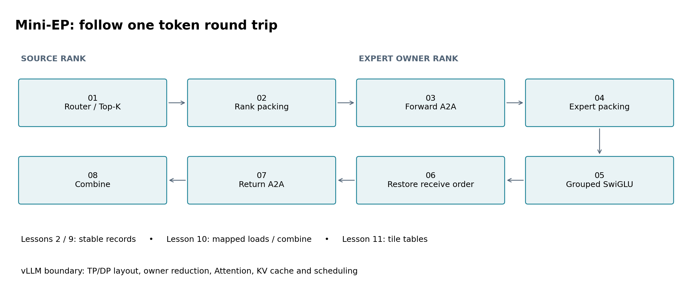
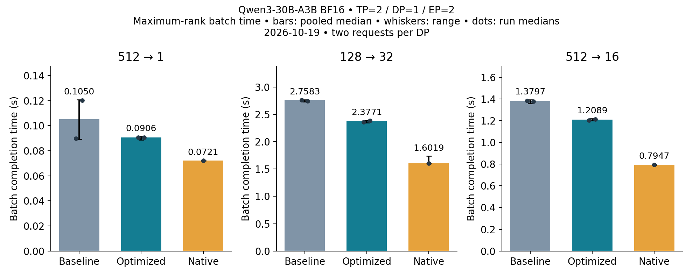
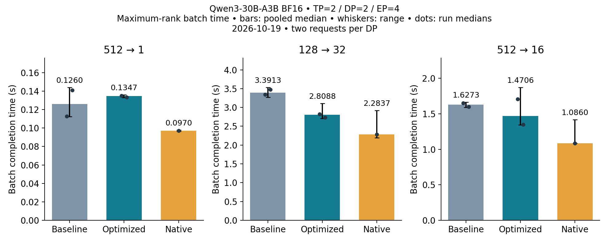
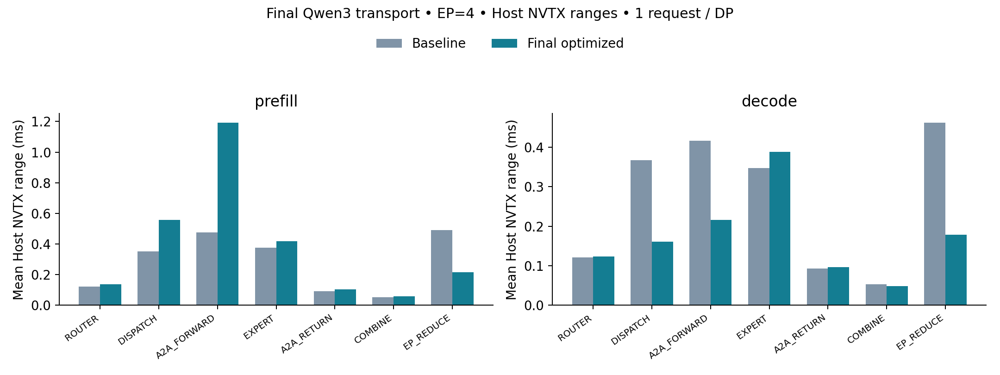

# Mini-EP

**从一个 Token 的跨卡往返，理解 MoE Expert Parallel。**

Mini-EP 是面向大模型推理教学的最小实验平台。你可以从可在 CPU 上运行的 PyTorch Reference 出发，在 1～4 张 NVIDIA GPU 上验证真实 NCCL All-to-All，再逐步阅读 Triton Dispatch、Combine、Grouped GEMM 和通信/计算编排。第十三课将同一条数据流接入 vLLM，并验证 Qwen3-30B-A3B 与 Qwen3.5-35B-A3B。

[课程首页](https://tvle9mq8jh.feishu.cn/wiki/QJp1wvBlgiiYV5kEOqFcpNtNnie) · [按课源码](code/README.md) · [Course13 使用说明](code/course13/README.md) · [性能与验收](code/course13/PERFORMANCE.md) · [知识衔接与补课清单](docs/Course13知识衔接与后续补充清单.md)



Router 选出 Top-K Expert；Dispatch 按目标 Rank 打包；NCCL 将 Token 送到完整 Expert 参数所在的 GPU。Expert 计算后先恢复按来源 Rank 排列的接收顺序，再返回源端；源端恢复 Token/slot 顺序、乘路由权重并合并。DP=2 的 owner 部分和再由框架按原生顺序归约。基础课程采用 Pure EP；第十三课的 Attention TP=2、DP=1/2、MoE EP=2/4 属于框架接入扩展。

## 你会得到什么

- **能追踪的数据流**：每次排列都有明确的索引方向，通信 splits、Expert offsets 和恢复关系可直接查看。
- **可独立对照的实现**：先验证 PyTorch Reference，再对比 Triton Kernel 与真实模型输出。
- **按课独立的源码**：每个 `code/courseN` 可整体复制运行，不跨课导入，不依赖根目录实现。
- **可复现的性能记录**：区分核心 EP、完整请求、CUDA Event 和 Nsight Timeline，保留配置与样本。

## 学习路线

| 阶段 | 课程 | 主要问题 | 运行条件 |
|---|---|---|---|
| 环境与 Reference | 0～2 | Token 怎样选 Expert、展开与恢复？ | 前两课 Reference 支持 CPU；环境检查需要相应设备 |
| GPU 与真实通信 | 3～6 | 谁向谁发送，变长 A2A 如何还原？ | 1～4 张 NVIDIA GPU、CUDA/NCCL |
| 扩展与测量 | 7～8 | 哪个 Rank 慢，时间花在哪里？ | 多 GPU；Profiler/Nsight 按课说明 |
| Kernel 与计算 | 9～11 | 如何减少搬运、融合 Combine、调度 Grouped GEMM？ | CUDA、Triton |
| 通信与计算编排 | 12 | 数据何时可读，缓冲何时可复用？ | Peer 访问等条件；TMA 路径要求计算能力≥9.0 |
| 真实模型接入 | 13 | 如何保持 Qwen/vLLM 数值语义并定位整模型瓶颈？ | 2/4 张 GPU、模型权重及固定软件环境 |

第十三课沿用第九课的 metadata/向量分工、第十课的恢复与加权、第十一课的 offsets/tile 表。第十二课已介绍固定容量和就绪信号；第十三课进一步讨论每步变化的路由、Host 同步和框架边界。详见 [课程衔接](code/course13/TEACHING.md)。

## 快速开始

先准备 Python 与本课需要的 PyTorch 环境，克隆仓库：

```bash
git clone https://gitee.com/hellofss/miniep1.git
cd miniep1/code/course1
python3 -m pip install -r requirements.txt
python3 test/demo.py --device cpu --top-k 2
python3 -m unittest discover -s checks -v
```

示例先展示单设备 MoE 数据流；测试用于确认值和布局。每课的前置条件、命令与依赖分别写在本课 README 和 requirements 中。

第十三课已验证环境为 H100 80GB、Python 3.12、PyTorch 2.13.0+cu130、Triton 3.7.1、vLLM 0.29.0、Transformers 5.16.1。模型为 Qwen3-30B-A3B BF16：48 层、H=2048、F=768、128 Experts、Top-8。在匹配环境中，从仓库根目录执行：

```bash
cd code/course13
python3 -m pip install --no-deps --no-build-isolation -e .
export MODEL_PATH=/path/to/Qwen3-30B-A3B
export CUDA_VISIBLE_DEVICES=0,1
python3 test/demo.py --model "$MODEL_PATH" --backend miniep --output results/demo
# 两卡真实 NCCL + 独立 Reference 对照
torchrun --standalone --nproc-per-node=2 checks/distributed.py --backend triton --fixed-pack-backend triton
```

模型权重需自行准备；GPU 可用显存需覆盖权重、工作区和 KV Cache。四卡入口、完整模型验收和服务 smoke test 见 [Course13 README](code/course13/README.md)。

## 性能与正确性

2026-10-19，H100 80GB，Qwen3-30B-A3B BF16，Attention TP=2、DP=1/2、MoE EP=2/4。每个 DP 同时排入两条请求，使用 eager、同步调度，关闭前缀缓存。以下是整批请求完成的最大 Rank 墙钟中位数，包含调度、Attention、MoE 和输出取回；排除模型加载及预热。

| 配置 | 每请求输入→输出 Token | 基线→优化快照 / s | 原生 vLLM / s | 快照/原生 |
|---|---|---:|---:|---:|
| 2 GPU / EP=2 | 512→1 | 0.10505 → 0.09064 | 0.07214 | 1.26× |
| 2 GPU / EP=2 | 128→32 | 2.75831 → 2.37710 | 1.60192 | 1.48× |
| 2 GPU / EP=2 | 512→16 | 1.37968 → 1.20891 | 0.79470 | 1.52× |
| 4 GPU / EP=4 | 512→1 | 0.12600 → 0.13468 | 0.09703 | 1.39× |
| 4 GPU / EP=4 | 128→32 | 3.39125 → 2.80883 | 2.28366 | 1.23× |
| 4 GPU / EP=4 | 512→16 | 1.62728 → 1.47064 | 1.08602 | 1.35× |

基线与当前实现各有正反两轮、合计 10 个样本；原生为 5 个样本，每轮完整预热 2 次。GPU 在运行前为空闲，宿主机仍有其他任务。图中柱为合并中位数、误差线为全部样本范围、圆点为每轮中位数。





双卡 decode / mixed 延迟较基线降低约 13.8% / 12.4%；四卡 decode 在主对照中降低约 17.2%。prefill 及四卡 mixed 有明显轮次漂移，不把其合并中位数的变化归因为稳定收益。第二轮 padding 融合另做四卡反向复测，decode / mixed 两轮均改善超过 3%；其中首轮测前有约 16.5～16.7 GiB/卡的常驻显存占用，不能外推为独占硬件收益，原始慢样本全部保留。Mini-EP 在这些场景仍慢于同配置原生 vLLM。

当前默认在小批 decode 使用固定容量 A2A、Triton 稳定前缀打包和 masked padding 读写，DP=2 复用框架的 Host 行数。两次 GEMM、BF16 舍入顺序、FP32 返回与原生 owner 归约保持一致。大输入仍走变长布局；未引入 GPU 通信/计算重叠。

| 验收 | 最终结果 |
|---|---|
| H100 单元测试 | 26/26；包含 NaN padding、非零 offsets 起点与单 Expert/Rank |
| 核心 NCCL | EP=1/2/4、Top-1/2/8、空输入与倾斜路由；另测 E=P |
| 双卡模型 | 128/128 序列一致；长 decode 40/40 序列一致 |
| 四卡模型 | 9 类场景、22/22 序列、314/314 Token 一致 |
| 逐层与 logits | 每 Rank 48 层，最大绝对误差均为 0 |

最终模型复验与 Timeline 在同一服务器 GPU 0–3 上重新执行，并重新生成原生基线；性能表保留原测量卡组的数据，不混合两组延迟。详细口径与全部尝试见 [性能报告](code/course13/PERFORMANCE.md)，精简数据见 [本轮数据](docs/benchmarks/course13-20261019.json)。



阶段图为最终基线/候选的 Host NVTX 范围均值，每 DP 一条请求，包含初始 prefill；不是 GPU 关键路径或 overlap 指标，不与上面的整批耗时相加。

## Qwen3.5 扩展与代码整理

Qwen3.5-35B-A3B 的 BF16 文本路径已验证，Attention TP=2、DP=1/2、MoE EP=2/4。主线仍是同一条 Token 往返；Shared Expert、Gated DeltaNet/Attention 与循环状态由 vLLM 提供，模型边界集中在 `integration`。

| 验证 | 结果 |
|---|---|
| 双卡主语料 / 长生成 | 128/128、8/8 条序列完全一致 |
| 四卡完整模型 | 9 类场景，22/22 条序列、314/314 Token 一致 |
| 逐层与 Logits | 每 Rank 40 层，最大绝对误差为 0 |
| 最终回归 | H100 28 项测试、EP=1/2/4 NCCL、两种模型逐层对照通过 |

代码整理按前课的 `pack_index`、`restore_index`、splits、offsets/tile 表解释布局。最终合并了外围日志的重复逻辑、收敛了初始化配置，并统一主流程的恢复索引局部名称。两次更激进的热路径精简未通过四卡 Prefill 性能门槛，均已回退；最终稳态推理字节码与完整验收基线一致，不宣称新的加速。原始样本和回退决策全部保留。

这里的 Qwen3.5 结果不能与上面的 Qwen3-30B-A3B 绝对延迟混算。详细范围、回退数据和复现步骤见 [Qwen3.5 验证报告](code/course13/QWEN35.md) 与 [完整数据](docs/benchmarks/course13-qwen35-20261020.json)。本轮交付源码见飞书 README 的最新附件；Git 远端尚未推送本轮修改。

## 如何验证和复现实验

从选定课程目录启动，先正确性、后性能。Course13 示例：

```bash
python3 -m unittest discover -s checks -v
# 四张 GPU，TP=2/DP=2 的布局与输出对照
MINIEP_FIXED_PACK=triton torchrun --standalone --nproc-per-node=4 checks/tp_dp.py
# 两张 GPU，核心 EP：不包括 Attention、KV Cache 或调度
torchrun --standalone --nproc-per-node=2 benchmarks/benchmark_ep.py \
  --tokens 128 --a2a-mode off --warmup 20 --repeats 50 \
  --output results/core.json
# 四张 GPU，显式启用候选；包含调度、Attention、MoE 与结果取回
MINIEP_FIXED_A2A=auto MINIEP_OWNER_SIZES=host MINIEP_FIXED_PACK=triton \
  torchrun --standalone --nproc-per-node=4 benchmarks/compare_vllm.py \
  --model "$MODEL_PATH" --backend miniep --dp-size 2 \
  --warmup 2 --repeats 5 --output results/model
```

核心 EP 报告最大 Rank 的 CUDA Event 时间；完整请求报告最大 Rank 的墙钟时间。模型加载与预热不进入 steady-state。各阶段最大值可能来自不同 Rank，不能相加当作端到端延迟。实验中的 `NCCL_NVLS_ENABLE=0` 是环境设置，库代码不修改 NCCL 配置。

## 仓库结构与贡献

```text
code/course0..13/   各课独立源码、示例、测试和基准
  mini_ep/         本课核心实现
  test/            启动入口
  checks/          正确性测试
  benchmarks/      性能实验（按课需要提供）
code/course13/
  reference/       独立 PyTorch Reference
  validation/      原生模型对比与验收报告
  TEACHING.md      前课概念到真实模型的阅读桥梁
docs/              课程正文、项目文档及可复现图表
tools/             仓库静态检查
```

提交问题时附上课程号、设备/软件版本、运行命令、shape/dtype、最小复现与 rank-aware 日志。贡献优化时保留独立 Reference，先补回归测试，再给同输入、同环境的 Benchmark；通信/计算重叠结论需要 Timeline。详细约定见 [AGENTS.md](AGENTS.md)。从仓库根目录执行 `python3 tools/check_course_layout.py --courses 13` 检查课程隔离与来源信息。

项目当前侧重可解释的 MoE 推理实验。服务引擎由 vLLM 提供；大规模训练、跨集群调度和自研 NCCL 不在基础实现范围。各课有独立环境要求，第十三课结果不代表所有 GPU、模型或生产服务负载。
