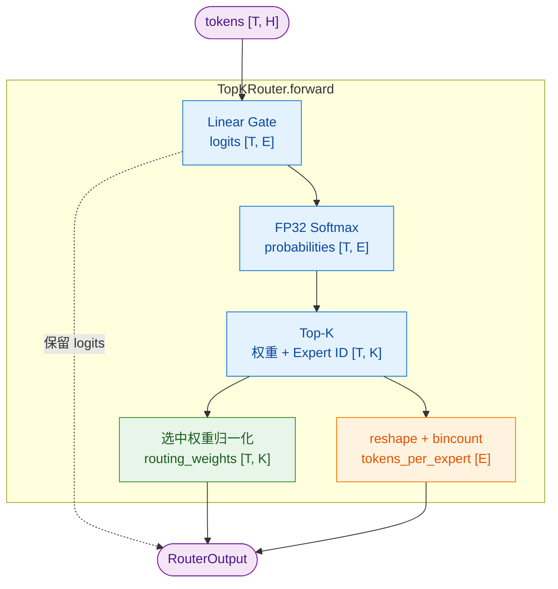
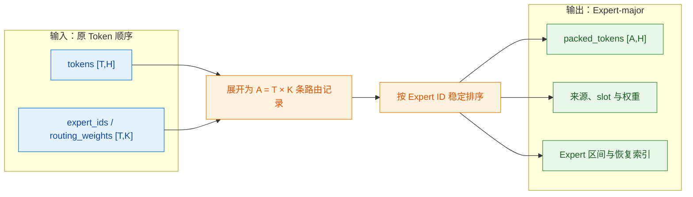
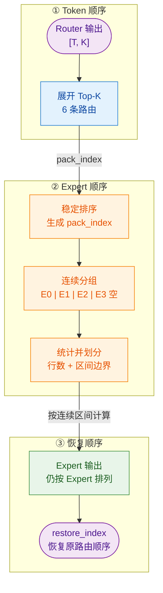
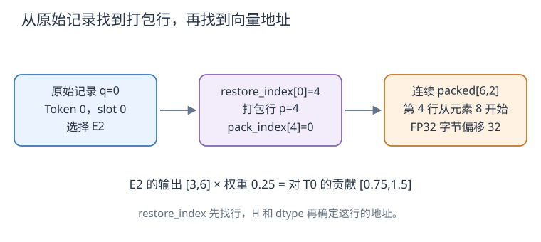
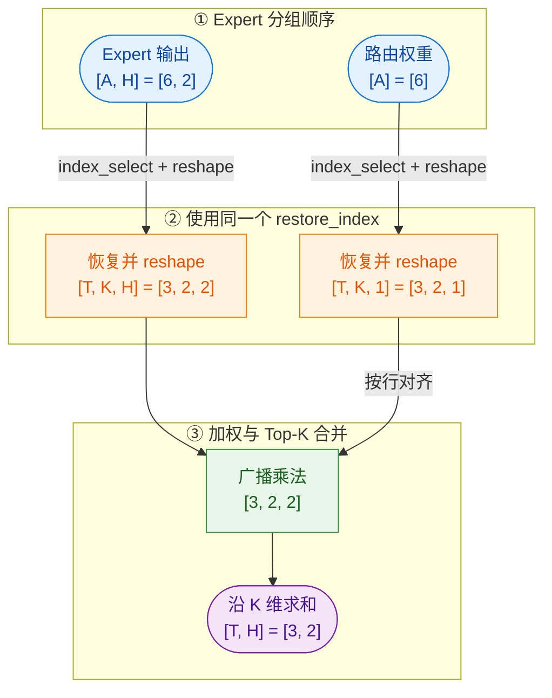

# 第 2 课：Router、Top-K 与 Token Dispatch

本课独立源码位于 `code/course2/`，示例在 `test/`，正确性测试在 `checks/`。下文命令均在本课目录中执行；将整个目录复制到其他位置后也使用同样的启动方式。

第一课为每个 Expert 分别收集一份输入张量。接下来要把这些分组装进一块连续缓冲区：先放 E0 的输入，再放 E1 的输入，依次排列，并记录每组从哪一行开始、到哪一行结束。矩阵乘可以按这些边界读取一个 Expert 的批次；跨设备通信也可以把相邻分组合成一个发送块。

Top-2 会把一个 Token 送入两个 Expert。每条分支由 Token 编号、slot、Expert ID 和路由权重共同描述，分别确定输入来源、分支位置、计算对象与返回后的贡献。打包时，输入向量和这些逐行信息使用同一个排列，位置同步变化，计算结果便与原来的分支一一对应。

沿用第一课的 `T0=[1,2]`、`T1=[3,4]`，再增加 `T2=[5,6]`，就能观察三个 Token 在不同 Expert 间的分组。固定 `T=3,H=2,E=4,K=2`，共有 `A=T×K=6` 条路由记录。路由只选中 E0、E1、E2，因此 E3 对应一个空区间。第五课将把这四个 Expert 分放到两个 Rank，继续追踪同样六条记录的通信往返。

## 2.1 Router 为每个 Token 生成 K 条分支

Router 保持第一课的定义：Gate 把 `[T,H]` 输入映射为 `[T,E]` logits，Softmax 沿 Expert 维产生概率，Top-K 选择 K 个 Expert，再对选中概率归一化。下面是 `TopKRouter.forward()` 的摘录，`self.gate`、`self.top_k` 与 `self.num_experts` 都来自模型配置。新增加的 `bincount()` 将选中的 Expert ID 转换为逐 Expert 的分支计数。

例如，某行概率为 `[0.50,0.30,0.15,0.05]`，Top-2 选中 E0、E1，权重重新归一化为 `[0.625,0.375]`。输出的同一个 `(token,slot)` 位置，Expert ID 和权重描述同一条分支。

**路由与计数 · code/course2/mini_ep/model/router.py**

```python
import torch
from mini_ep.model.router import RouterOutput

class TopKRouter(torch.nn.Module):
    def __init__(self, hidden_size, num_experts, top_k):
        super().__init__()
        if hidden_size <= 0 or num_experts <= 0 or not 1 <= top_k <= num_experts:
            raise ValueError("需要 hidden_size > 0、num_experts > 0 且 1 <= top_k <= num_experts")
        self.num_experts = num_experts
        self.top_k = top_k
        self.gate = torch.nn.Linear(hidden_size, num_experts, bias=False)

    def forward(self, tokens):
        logits = self.gate(tokens)
        # 用 FP32 计算路由概率；最后一维是 Expert 维。
        probabilities = torch.softmax(logits.float(), dim=-1)
        routing_weights, expert_ids = torch.topk(
            probabilities, k=self.top_k, dim=-1
        )
        # 在每个 Token 的 K 条分支间归一化。
        routing_weights = routing_weights / routing_weights.sum(dim=-1, keepdim=True)
        # 统计展开后的分支数，空 Expert 保留零计数。
        tokens_per_expert = torch.bincount(
            expert_ids.reshape(-1), minlength=self.num_experts
        )
        return RouterOutput(
            logits=logits, expert_ids=expert_ids,
            routing_weights=routing_weights, tokens_per_expert=tokens_per_expert,
        )
```



图 2-1：Router 从 logits 生成 Top-K 与计数。

Router 的输出仍按原 Token 排列。`expert_ids` 为同设备 int64 张量，`routing_weights` 为 FP32；`tokens_per_expert` 是同设备的 `[E]` int64 向量。`bincount()` 读取展平后的全部 ID，`minlength=E` 保留末尾未被选中的 Expert，因此零负载 Expert 也有对应的计数项。随后 Dispatch 根据这些 ID 收集输入向量。

### 2.1.1 从二维路由表到记录编号

二维表以 Token 为外层维度，以 slot 为内层维度。按行展平时，顺序是 `(T0,slot0)`、`(T0,slot1)`、`(T1,slot0)`，依此类推。第 a 条记录的来源满足：

**记录编号**

```text
token_id = a // K
slot_id  = a % K
```

因此可以用 `arange(T).repeat_interleave(K)` 生成 Token 索引，用 `arange(K).repeat(T)` 生成 slot。相同 Token 的 K 条记录读取同一行隐藏向量，但后续进入不同 Expert。

## 2.2 Dispatch 把记录排成连续区间

Dispatch 接收 `[T,H]` 浮点输入和两个 `[T,K]` 路由张量，三者位于同一设备；Expert ID 可为 int32 或 int64，范围是 `[0,E)`。Reference 支持非连续输入，收集以后得到连续的 `[A,H]` 缓冲区。它先按 Token、slot 展平路由表，再按 Expert ID 稳定排序，生成 `pack_index`；来源、slot 和权重使用同一排列，向量按排列后的 Token 行号读取。



图 2-2：展开路由记录，按 Expert 稳定打包。

排好以后，E0 的行在最前面，接着是 E1、E2，依此类推。这叫 Expert-major 布局，也就是先按 Expert 分组；稳定排序还会保留同一 Expert 内原有的 Token/slot 次序。下面的 `dispatch_reference()` 先用 `repeat_interleave(K)` 生成 Token 行号，用 `repeat(T)` 生成 slot，再按 Expert ID 排列它们。

**Expert 打包 · code/course2/mini_ep/distributed/dispatch.py**

```python
import torch
from mini_ep.distributed.dispatch import DispatchOutput

def dispatch_reference(tokens, expert_ids, routing_weights, num_experts):
    # 按 Token、slot 展平，定义原始记录顺序。
    flat_expert_ids = expert_ids.reshape(-1).to(torch.int64)
    flat_token_indices = torch.arange(
        tokens.shape[0], device=tokens.device, dtype=torch.int64
    ).repeat_interleave(expert_ids.shape[1])
    flat_route_slots = torch.arange(
        expert_ids.shape[1], device=tokens.device, dtype=torch.int64
    ).repeat(tokens.shape[0])
    flat_routing_weights = routing_weights.reshape(-1)

    # 稳定排序将同一 Expert 的记录放到相邻行。
    pack_index = torch.argsort(flat_expert_ids, stable=True)
    # 逆排列供返回后恢复原 Token/slot 顺序。
    restore_index = torch.argsort(pack_index)
    packed_token_indices = flat_token_indices.index_select(0, pack_index)
    # 按来源行号收集输入，形成连续打包缓冲区。
    packed_tokens = tokens.index_select(0, packed_token_indices).contiguous()
    packed_expert_ids = flat_expert_ids.index_select(0, pack_index)
    packed_route_slots = flat_route_slots.index_select(0, pack_index)
    packed_routing_weights = flat_routing_weights.index_select(0, pack_index)
    # 前缀和给出每个 Expert 在打包缓冲区中的区间。
    tokens_per_expert = torch.bincount(flat_expert_ids, minlength=num_experts)
    expert_offsets = torch.cat([
        tokens_per_expert.new_zeros(1), tokens_per_expert.cumsum(dim=0)
    ])
    return DispatchOutput(
        packed_tokens=packed_tokens, packed_expert_ids=packed_expert_ids,
        packed_token_indices=packed_token_indices,
        packed_route_slots=packed_route_slots,
        packed_routing_weights=packed_routing_weights,
        tokens_per_expert=tokens_per_expert, expert_offsets=expert_offsets,
        restore_index=restore_index, num_tokens=tokens.shape[0],
        top_k=expert_ids.shape[1],
    )
```

### 2.2.1 打包结果需要保存哪些信息

`packed_tokens` 中，同一个 Token 的 K 条分支各占一行；一次 `index_select()` 将原输入复制到这些打包位置。`restore_index = argsort(pack_index)` 建立反向查询：原记录对应现在的哪一行。`DispatchOutput` 把这个逆排列、逐行 metadata 和 Expert 区间一起返回。所有索引、计数、offset 均为同设备 int64 张量，打包输入保持原输入 dtype，打包权重保持传入权重 dtype。

| 字段 | Shape | 下游用途 |
|---|---|---|
| `packed_tokens` | `[A,H]` | 按 Expert 排列的连续输入 |
| `packed_expert_ids` | `[A]` | 每个打包行所属的 Expert |
| `packed_token_indices` | `[A]` | 每行来自原输入的哪一行 |
| `packed_route_slots` | `[A]` | 每行来自该 Token 的哪个 slot |
| `packed_routing_weights` | `[A]` | 与打包行逐行对应的合并权重 |
| `tokens_per_expert` | `[E]` | 每个 Expert 的记录数 |
| `expert_offsets` | `[E+1]` | 连续区间的起止位置 |
| `restore_index` | `[A]` | 从打包顺序恢复到 Token/slot 顺序 |

知道每个 Expert 有多少行，就能算出各组的边界：从 0 开始，依次累加计数，得到 `expert_offsets`。Ee 的输入是 `packed_tokens[offsets[e]:offsets[e+1]]`。空 Expert 的两个边界相等，切片为 `[0,H]`；最后一个边界等于全部记录数 `A`。

这里有两层“连续”。按 Expert 排序，让同一 Expert 的记录在逻辑行号上相邻；连续存储则描述这些行如何落在内存里。行主序 `[6,2]` 张量的 stride 为 `(2,1)`，从第 r 行到下一行跨两个元素，从第 c 列到下一列跨一个元素；元素 `(r,c)` 距张量起点 `2r+c` 个元素。Reference 按索引收集输入，并返回连续的 `packed_tokens`，后面的矩阵乘和通信都可以按行读取这块缓冲区。

## 2.3 六条记录怎样打包

下面的输入与路由把六条分支的身份和数值全部确定下来。每行输入包含两个元素，每个 Token 选择两个 Expert，因此打包缓冲区会包含六行、每行两个元素。

**输入与路由**

```python
import torch

def create_routing_example():
    tokens = torch.tensor([[1., 2.], [3., 4.], [5., 6.]])
    expert_ids = torch.tensor([[2, 0], [1, 2], [0, 1]])
    routing_weights = torch.tensor([[.25, .75], [.60, .40], [.20, .80]])
    return tokens, expert_ids, routing_weights
```

原始记录的 Expert ID 为 `[2,0,1,2,0,1]`。稳定排序返回 `pack_index=[1,4,2,5,0,3]`，即先读取原记录 1、4，再读取 2、5，最后读取 0、3。打包以后得到：

| 打包行 | 原记录号 | Token | slot | Expert | Weight |
|---|---|---|---|---|---|
| 0 | 1 | T0 | 1 | E0 | 0.75 |
| 1 | 4 | T2 | 0 | E0 | 0.20 |
| 2 | 2 | T1 | 0 | E1 | 0.60 |
| 3 | 5 | T2 | 1 | E1 | 0.80 |
| 4 | 0 | T0 | 0 | E2 | 0.25 |
| 5 | 3 | T1 | 1 | E2 | 0.40 |



图 2-3：六条记录的排列、区间与逆排列。

打包后的向量顺序为 `[T0,T2 | T1,T2 | T0,T1]`，两个分隔符划出 E0、E1、E2 三个非空区间，E3 位于末尾空区间。计数 `[2,2,2,0]` 的前缀和为 `[0,2,4,6,6]`。例如 E1 读取 `[2:4]`，E3 读取 `[6:6]`；两个切片都由同样的边界规则确定。

### 2.3.1 排列与逆排列各回答一个问题

`pack_index[p]` 回答“打包行 p 来自原记录的哪个位置”；`restore_index[a]` 回答“原记录 a 现在位于打包结果的哪里”。本例的逆排列是 `[4,0,2,5,1,3]`。

例如，原记录 0 是 T0 发往 E2 的分支，位于打包行 4；原记录 1 是 T0 发往 E0 的分支，位于打包行 0。恢复时先读取行 4、0，就把 T0 的两个分支重新排在一起。由此可以直接检查：`pack_index[restore_index[a]]=a`。

逆排列把 A 条记录放回 Token/slot 顺序。此时每条分支仍有一行独立输出：T0 的 K 行在一起，接着是 T1 的 K 行。将结果 reshape 为 `[T,K,H]` 后，再沿 K 维加权求和，才得到每个 Token 一行的 `[T,H]` 输出。

记录编号还可以继续推导到内存地址。对原记录 a=0，`restore_index[0]=4` 先找到打包行 4。连续 `[6,2]` 缓冲区中，每行含两个 FP32 元素，所以这一行从元素偏移 `4×2=8` 开始，距缓冲区起点 32 bytes。隐藏维列 h=0、1 分别读取元素 8、9。这里先由 metadata 找行，再由 H 和 dtype 找到行内元素。



图 2-4：逆排列、打包行号与连续地址的对应关系。

如果 E2 将输入乘 3，这一行输出为 `[3,6]`；乘原记录的权重 0.25 后，对 T0 的贡献是 `[0.75,1.5]`。T0 的另一个分支由 `restore_index[1]=0` 定位。两行各自带回正确权重，才可以合成一个 Token 的输出。

## 2.4 Combine：先恢复记录，再合并分支

Expert 输出与输入逐行对应，所以全部结果仍按 Expert-major 保存为 `[A,H]`。Combine 对结果和打包权重使用同一个 `restore_index`，把它们恢复到 Token-major、slot-minor。随后 reshape 为 `[T,K,H]` 和 `[T,K,1]`，相乘并沿 K 维求和。



图 2-5：恢复 Token/slot 布局，再加权归约。

下面摘录 `combine_reference()` 的核心计算。`packed_outputs` 是按 Dispatch 行序存放的 `[A,H]` Expert 结果，`dispatch` 是该次 Dispatch 返回的对象。对输出和权重使用相同逆排列以后，每个 Token 的 K 条记录相邻，再通过广播乘法与沿 K 求和形成输出：

**分支合并 · code/course2/mini_ep/distributed/dispatch.py**

```python
import torch

def combine_reference(packed_outputs, dispatch):
    # 输出与权重使用同一逆排列，保持逐行配对。
    restored_outputs = packed_outputs.index_select(0, dispatch.restore_index)
    restored_weights = dispatch.packed_routing_weights.index_select(
        0, dispatch.restore_index
    )
    outputs_by_token = restored_outputs.reshape(dispatch.num_tokens, dispatch.top_k, packed_outputs.shape[1])
    weights_by_token = restored_weights.to(packed_outputs.dtype).reshape(
        dispatch.num_tokens, dispatch.top_k, 1
    )
    # 沿 Top-K 维求和，每个 Token 恢复为一行。
    combined = (outputs_by_token * weights_by_token).sum(dim=1)
    return combined
```

`outputs_by_token[i,j,:]` 是第 i 个 Token 第 j 条分支的 Expert 输出，`weights_by_token[i,j,0]` 是它的权重。两者相乘后，`sum(dim=1)` 消去分支维，得到原序 `[T,H]`。显式写出 H 也使空输入可以还原为 `[0,H]`。结果 dtype 与 device 跟随 Expert 输出，输入可以带 stride，恢复操作按索引读取相应行。

### 2.4.1 Expert 计算怎样影响合并结果

先让所有 Expert 都原样输出输入。一个 Token 的 K 条分支就携带相同向量；由于 K 个权重之和为 1，合并结果就等于原始 `tokens`。接着让不同 Expert 输出不同的缩放值，就可以进一步检查分支是否交给了正确的 Expert、是否乘上了正确的权重。

让 Ee 执行 `(e+1)×x`，T0 经过 E2、E0，得到 `0.25×3T0+0.75×T0=1.5T0=[1.5,3]`；T1 得到 `0.60×2T1+0.40×3T1=[7.2,9.6]`；T2 得到 `0.20×T2+0.80×2T2=[9,10.8]`。不同 Expert 改变向量的缩放系数，使路由选择与权重都体现在结果中。下面的完整 CPU 例子从原表独立写出期望值，再通过打包与恢复得到它。

**Dispatch 示例**

```python
import torch
from mini_ep.distributed.dispatch import dispatch_reference, combine_reference

def main():
    tokens = torch.tensor([[1., 2.], [3., 4.], [5., 6.]])
    expert_ids = torch.tensor([[2, 0], [1, 2], [0, 1]])
    weights = torch.tensor([[.25, .75], [.60, .40], [.20, .80]])
    dispatch = dispatch_reference(tokens, expert_ids, weights, 4)
    scales = (dispatch.packed_expert_ids + 1).to(tokens.dtype)[:, None]
    packed_outputs = dispatch.packed_tokens * scales
    combined = combine_reference(packed_outputs, dispatch)
    expected = torch.tensor([[1.5, 3.], [7.2, 9.6], [9., 10.8]])
    torch.testing.assert_close(combined, expected)
    assert dispatch.expert_offsets.tolist() == [0, 2, 4, 6, 6]
    assert dispatch.packed_tokens.is_contiguous()
    assert combined.shape == tokens.shape
    assert combined.dtype == tokens.dtype
    assert combined.device == tokens.device
    print(combined)

if __name__ == "__main__":
    main()
```

代码根据打包行的 Expert ID 生成缩放系数，再按 `restore_index` 恢复结果。期望值则直接按原路由表手算，完全不使用恢复索引。两边相等，说明打包后的计算接回了正确的 Token 和权重。第五课会让这六条记录再经过一次跨 Rank 往返，并得到同样的输出。

## 2.5 从计数读取 Expert 负载

总记录数固定为 A，但它们在 Expert 之间的分配随输入变化。理想平均负载为 `A/E`；用最大计数除以平均计数，可以得到一个直观的倾斜程度：

**负载倾斜**

```text
imbalance_ratio = max(tokens_per_expert) / (A/E)
```

本例平均负载为 1.5，最大计数为 2，倾斜比为 `4/3`。这个比值在 A>0 时定义，描述路由在 Expert 维上的分布；全空输入的各项计数均为零。每个 Expert 的记录数决定其 GEMM 的 M 维；EP 中还要按 Expert 放置汇总 Rank 负载，例如当前 E0/E1 共四行，E2/E3 共两行。因此 Expert 倾斜和 Rank 倾斜需要分别从各自的计数解释。

Capacity factor 描述相对于平均负载的容量倍率，对应假设容量 `ceil(capacity_factor×A/E)`。示例保留全部路由记录，并打印这个容量与实际计数，呈现各 Expert 的输入规模。容量约束进一步涉及记录保留、丢弃或转移等策略；这些策略会改变哪些分支参与计算，以及最终输出怎样合并。

例如当前共有六条记录、四个 Expert，平均负载为 1.5。取 capacity factor=1.2，假设容量为 `ceil(1.2×1.5)=2` 行。E0、E1、E2 各有两行，E3 为零行，都落在这一容量内。

## 2.6 连续布局的 Reference 实现

Dispatch 与 Combine 的实现在 `mini_ep/distributed/dispatch.py`，入口是 `test/demo.py`。前者提供独立的 PyTorch Dispatch 与 Combine，后者把路由、逐行 metadata、offsets 和恢复误差打印出来。

进入 `code/course2` 后运行以下命令，需要一张可见 CUDA GPU：

**运行与测试**

```bash
cd code/course2
python3 test/demo.py \
  --device=cuda --dtype=float32 --num-tokens=32 \
  --hidden-size=8 --num-experts=4 --top-k=2
python3 -m unittest discover -s checks -p 'test_router_dispatch.py' -v
```

阅读示例输出时，可以将原路由表与打包表逐行对照：每条记录去了哪一行，`restore_index` 又从哪一行把它找回。总计数为 `T×K`，空 Expert 的相邻 offset 相等，而 `pack_index[restore_index[a]]=a` 表示记录 a 经过排列后可以回到原位。

打包以后，所有 Expert 的输入放在同一块缓冲区中，每个 Expert 占一个连续区间。第三课沿着这些区间讨论矩阵乘；第五课则把属于同一 Rank 的相邻区间合成发送块。计算和通信都从这里的打包结果开始，返回后仍用同一份逆排列找到原 Token。

继续阅读 [第 3 课：GPU、CUDA 执行模型与 GEMM 基准](https://tvle9mq8jh.feishu.cn/docx/J8uQdUhRqoEXPWxBc9ocXfiAn3c)。
