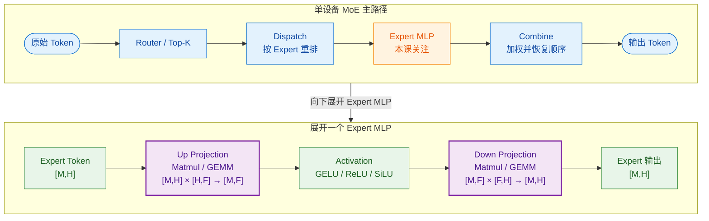
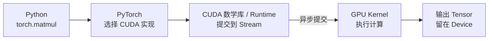
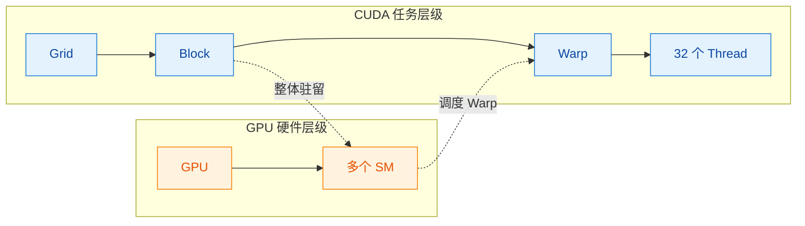
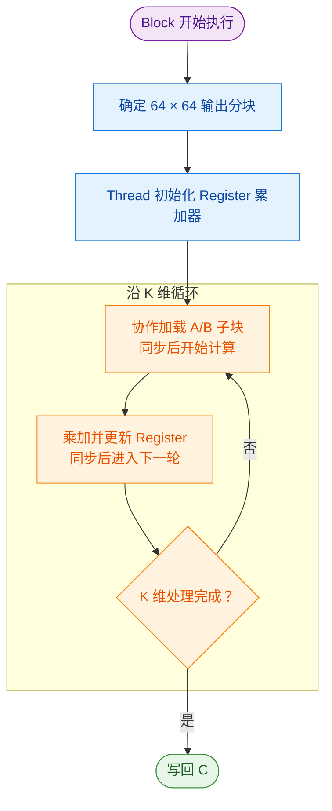
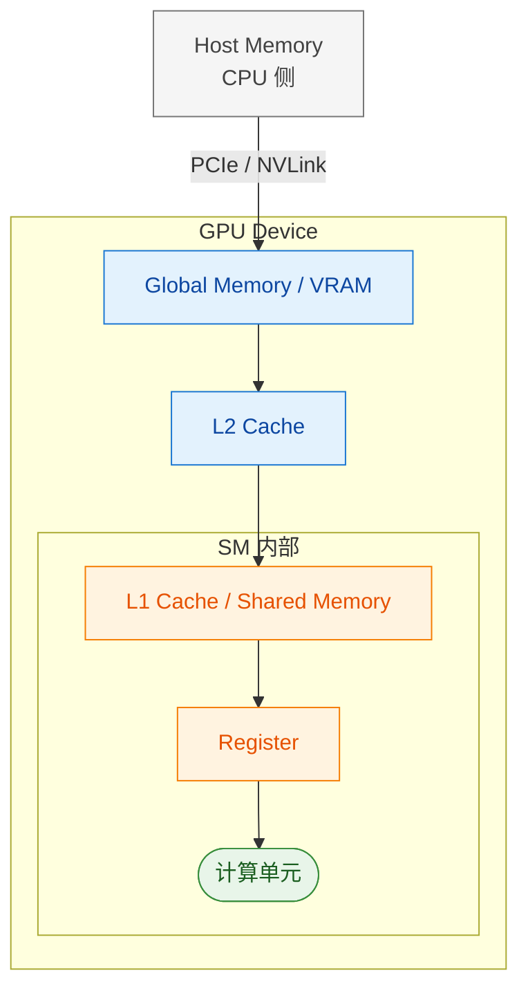
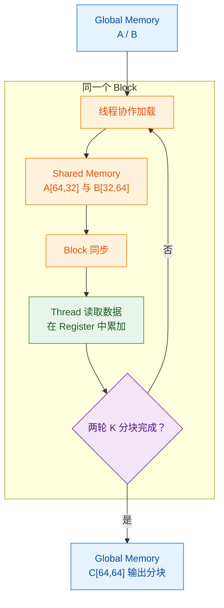
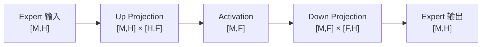
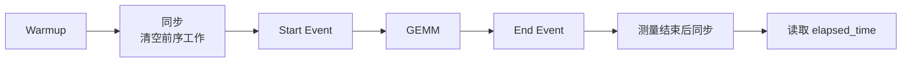
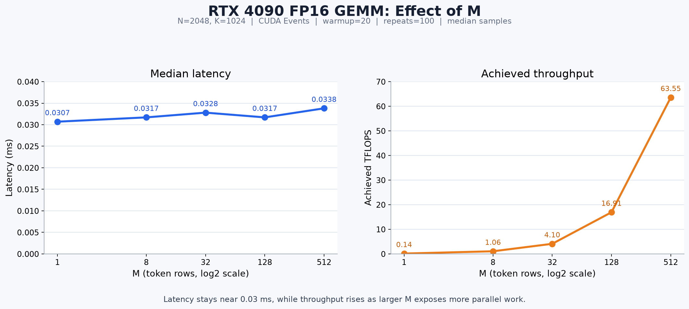

# 第 3 课：GPU、CUDA 执行模型与 GEMM 基准

本课独立源码位于 `code/course3/`，示例在 `test/`，正确性测试在 `checks/`。下文命令均在本课目录中执行；将整个目录复制到其他位置后也使用同样的启动方式。

第二课的六条记录被分成三个两行批次与一个空批次。非空 Expert 都要执行两次线性投影：例如 H=2、F=4 时，先做 `[2,2]×[2,4]`，再做 `[2,4]×[4,2]`。这些小矩阵揭示了一个系统问题：路由决定每个 Expert 的行数，GPU 数学库接收的正是这些不同形状的计算任务。

对于一个 Expert，设收到 M 行、每行 H 个元素，要将它们投影到 F 维，Up Projection 就是 `[M,H]×[H,F]→[M,F]`。M 增大时，算术工作量和输出行数一起增长，同一份权重也被更多输入行复用。线程划分与存储层次决定这些矩阵怎样在 GPU 上执行；将 H、F 扩展到更大的尺寸后，还可以用独立基准比较不同 M 的延迟。

从 PyTorch 的 `torch.matmul` 和 `nn.Linear` 出发，可以沿着计算量、线程分工、输入复用与设备计时，建立 Expert 行数与 GEMM 延迟之间的联系。

## 3.1 把 Expert MLP 写成矩阵乘

GEMM（General Matrix Multiplication，通用矩阵乘法）常写成 `C[M,N]=A[M,K]×B[K,N]`。M 是输入行数，N 是输出列数，K 是点积的累加维度。本课程的模型宽度继续记为 H、F；Up Projection 对应 `N=F,K=H`，Down Projection 对应 `N=H,K=F`。Router 的 Top-K 表示路由分支数，这里的 GEMM K 则只用于矩阵乘公式和 `--k` 参数。



图 3-1：Expert MLP 的两次投影。

一个 Expert MLP 包含两次主要矩阵乘：Up Projection 将 `[M,H]` 变成 `[M,F]`，Down Projection 将 `[M,F]` 变回 `[M,H]`。激活函数位于中间，逐元素改变数值。

| 投影 | GEMM 的 M | GEMM 的 N | GEMM 的 K |
|---|---|---|---|
| Up | 当前 Expert 收到的记录数 | F | H |
| Down | 当前 Expert 收到的记录数 | H | F |

M 可以直接从 `expert_offsets[e+1]-expert_offsets[e]` 取得。Top-2 会让同一个原始 Token 在两个 Expert 的批次中各占一行，因此这个 M 统计的是该 Expert 的路由记录数。

用后面的运行配置作一个具体算例：Up Projection 取 `M=1024,H=1024,F=2048`，即 GEMM 的 `N=2048,K=1024`。FP16 每个元素占 2 字节，输入、权重和输出分别占 2 MiB、4 MiB、4 MiB；乘加工作量为 `2×1024×2048×1024=4,294,967,296` FLOPs，约 4.295 GFLOPs。下面这些数量把形状与资源需求连接起来。

| 对象 | Shape | FP16 大小 |
|---|---|---|
| 输入 | `[1024,1024]` | 2 MiB |
| 保存的权重 | `[2048,1024]` | 4 MiB |
| 输出 | `[1024,2048]` | 4 MiB |

这次投影的输入、权重和输出合计占 10 MiB，其中同一份权重要被 1024 行输入反复使用。GEMM 会把矩阵切成小块，将当前需要的片段放入片上存储，让多个乘加操作复用它们。下面从线程的工作划分开始，看这种分块怎样执行。

### 3.1.1 Linear 的权重为什么要转置

`nn.Linear(K,N,bias=False)` 将权重保存为 `[N,K]`。输入 `[M,K]` 右乘其转置，得到 `[M,N]`。下面的摘录使用预先给定的正整数 M、N、K，以及设备 `device` 和浮点精度 `dtype`；例如 CPU 数值例子可以取 `M=2,N=4,K=2,device="cpu",dtype=torch.float32`。Matmul 与 Linear 接收相同输入，Linear 的权重从同一张量复制，因而表达相同的投影。

**Linear 与 Matmul**

```python
import torch

def compare_projections(M, N, K, device, dtype):
    tokens = torch.randn(M, K, device=device, dtype=dtype)
    weight = torch.randn(N, K, device=device, dtype=dtype)
    linear = torch.nn.Linear(K, N, bias=False, device=device, dtype=dtype)
    with torch.no_grad():
        # 两种投影使用相同权重，便于比较数值。
        linear.weight.copy_(weight)
    matmul_output = tokens @ weight.T
    linear_output = linear(tokens)
    torch.testing.assert_close(matmul_output, linear_output)
    return matmul_output, linear_output
```

输入与保存的权重都连续。输入 stride 为 `(K,1)`，权重 stride 为 `(K,1)`；`weight.T` 是 shape 为 `[K,N]`、stride 为 `(1,K)` 的视图，与原权重共享存储。转置视图改变寻址方式，GEMM 后端根据 shape、stride 和 dtype 选择实现。基准把输入构造、模块创建和权重复制放在计时前，正式样本测量投影调用。

用两行输入可以直接看出权重转置的含义。取 `X=[[1,2],[3,4]]`，保存权重 `W=[[1,0],[0,1],[1,1]]`。W 的三行分别提取输入的第一列、第二列与两列之和，因此 `X@W.T` 得到 `[[1,2,3],[3,4,7]]`，shape 从 `[2,2]` 变为 `[2,3]`。

![图 3-2：保存为 [out,in] 的权重如何生成三个输出特征。](assets/lesson_03_projection_numbers.svg)

图 3-2：保存为 [out,in] 的权重如何生成三个输出特征。

例如输出 `Y[0,2]` 沿归约维累加 `1×1+2×1=3`。第二行相同位置得到 `3×1+4×1=7`。每个输出元素使用 X 的一行和 W 的一行；后面的 Tile 划分正是让多个输出协作复用这些行中的片段。

## 3.2 一行 PyTorch 代码怎样到达 GPU

Host 指提交工作的 CPU 一侧，Device 指执行 CUDA 计算的 GPU 一侧。Host 执行 Python，准备张量与算子参数；Device 执行已经提交的 Kernel。CUDA Stream 是设备工作队列，同一流上的操作遵循提交次序。例如 Up Projection、GELU、Down Projection 依次提交到同一流，后续操作就能读取前一步生成的数据，同时 Host 继续组织后面的调用。



图 3-3：Host 提交算子，Device 执行 Kernel。

`torch.matmul` 进入 PyTorch 的算子分派后，根据 device、dtype、shape 和 layout 选择 CUDA 实现。CUDA 后端使用适合该形状的数学库路径，并把工作提交到 Stream，设备执行结束后将结果保存在 GPU 内存中。

这解释了为什么 Python 函数的返回时刻与结果完成时刻可以分开。后续 GPU 算子在相应的 Stream 依赖下消费结果；Host 要读取结果时，则要等待设备完成。计时也需要沿设备执行顺序确定起点和终点。

用一个假设时间线看这个差别：Host 在第 0～4 μs 提交调用，GPU 从第 4 μs 开始计算，20 μs 后完成。函数提交耗时是 4 μs，计算耗时是 20 μs，从发起到结果可用则是 24 μs。CUDA Event 放在设备流中的计算前后，记录的是设备执行到这两个标记的时刻；后面的 GEMM 基准据此测量投影耗时。这里的数字用于说明计时位置。

## 3.3 CUDA 怎样组织并行工作

Kernel 是在 GPU 上执行的函数。一次 Kernel Launch 创建一个 Grid，Grid 包含多个 Thread Block，每个 Block 再包含多个 Thread。线程依据自己的索引读取输入、计算部分结果并写回。

可以先用一维数组理解线程编号。假设 257 个元素，每个 Block 有 128 个线程，就需要三个 Block。线程的全局编号为 `block_id×128+thread_id`：前两个 Block 分别处理 0～127 和 128～255，第三个 Block 的第 0 个线程处理元素 256，其余线程通过 `idx<257` 的条件跳过计算。这样，Grid 给出整批工作，Block 划分任务，Thread 决定自己读取哪个元素。PyTorch 调用会由后端安排具体 Kernel 的启动配置。



图 3-4：Grid、Block、Warp 与 SM 的关系。

Grid、Block、Thread 描述程序的工作划分，SM（Streaming Multiprocessor）是调度和执行这些工作的硬件资源。一个 Block 在一个 SM 上执行，同一 SM 可以同时驻留多个 Block，具体数量受寄存器、共享内存等资源限制。

一个 Warp 包含 32 个线程，是 SM 调度和执行线程工作的基本单位。行主序 `[M,H]` 张量的同一行相邻列位于相邻地址；让线程读取相邻列，有助于把访问合并成内存事务。分支条件又决定哪些线程在某条指令上参与执行。后续 Dispatch 与 Combine Kernel 的设计会同时考虑记录索引、地址连续性和有效元素范围。

### 3.3.1 以输出 Tile 划分 GEMM

通用矩阵乘写为 `C[M,N]=A[M,K]×B[K,N]`。C 的每个元素都要沿 K 维累加。若每个线程各自从设备内存读取全部输入，会重复读取很多相同元素：同一行 A 被 N 个输出复用，同一列 B 被 M 个输出复用。

一种基础 GEMM 分块方案让一个 Block 负责 C 的 64×64 输出 Tile，Tile 指从大矩阵中截取的矩形子块。每轮沿 K 维读取 32 个元素，就需要 A 的 64×32 片段与 B 的 32×64 片段。Block 的线程协作加载这些片段，并在多轮 K 累加之间保留输出部分和。下面的流程图描述这种共享内存分块方案。



图 3-5：沿输出 Tile 和 K 维划分 GEMM。

在这个输出 Tile 内，一个 A 元素会参与 64 个输出列的计算，一个 B 元素会参与 64 个输出行的计算。线程把输入片段加载到共享内存后，可以多次读取它们完成乘加。数学库会根据矩阵形状、dtype 和设备选择具体分块，这里先用这组尺寸说明数据复用的过程。

## 3.4 让数据靠近执行单元

Tensor 通常保存在设备的全局内存中。访问路径还会经过缓存，而 Block 可以利用共享内存协作复用数据，线程则在寄存器中保留局部值和累加结果。这些存储的作用范围与容量不同，需要配合计算划分。



图 3-6：完整矩阵、输入片段与累加值所在的存储层次。

对 GEMM 来说，设备内存保存 A、B、C 的完整矩阵；共享内存适合保存当前 K 分块所需的输入；寄存器保存每个线程负责的输出累加值。将输入分块逐次送入计算，可以在有限的片上存储中完成大矩阵。

继续计算一个 64×64 输出 Tile 的局部数据。若输入片段使用 FP16，每次加载的 A Tile 为 64×32、B Tile 为 32×64，二者各占 4096 字节，合计 8 KiB。若输出用 FP32 累加，64×64 个累加值合计占 16 KiB，分散保存在负责这些输出的线程寄存器中。

更大的输出 Tile 能复用更多输入，也会占用更多共享内存和寄存器。一个 SM 的资源有限：单个 Block 占用越多，可同时驻留的 Block 就可能越少。Tile 大小同时影响输入复用和并行工作量，两者的取舍体现在给定矩阵形状的延迟中。

### 3.4.1 K 分块中的数据复用与同步

以 K=64、每次处理 32 个累加元素为例，共有两次 K 分块。先协作加载 A、B 的第一组片段，再等待参与读取的线程就绪，计算当前乘加；随后进入第二组片段，继续累加。完成后才把最终输出写回全局内存。



图 3-7：分两次读取 K Tile，并保留输出累加值。

一轮计算包含两个同步位置：输入片段全部写入共享内存后，计算线程开始读取；所有线程完成读取后，下一轮加载再覆盖这块空间。输出的部分和一直留在寄存器中，直到 K 维的所有分块处理完毕，再写回全局内存。图中展示的是基础分块方案，数学库还可以采用 Tensor Core 和其他实现方式。

## 3.5 GEMM 的形状与计算量

一次 GEMM 按 `2MNK` 计算 FLOPs。Up 和 Down 的 M 相同，输入、输出宽度互换；两个投影合计约为 `4MHF` FLOPs。多个 Expert 的 M 由 Router 分配，因而同一层会形成若干具有相同 H、F、不同 M 的矩阵乘。



图 3-8：Up 与 Down Projection 的输入输出形状。

第二课的 Expert 行数为 `[2,2,2,0]`，因此形成三个 M=2 的 MLP 与一个空输入。在更大的模型中，逐 Expert 循环也会提交一组 H、F 相同而 M 不同的投影。每次调用都有提交、调度与执行过程；拆分后的单个 GEMM 能提供多少并行工作，由该 Expert 的 M 决定。后续 Grouped GEMM 会集中组织这组任务，这里先建立单个形状的延迟基线。

### 3.5.1 用 FLOPs 和延迟推导吞吐

设一次 GEMM 的中位延迟为 L 毫秒，则工作负载吞吐为：

$$
\mathrm{Achieved\ TFLOPS} = \frac{2MNK}{L_{\mathrm{ms}}\times10^9}
$$

公式把毫秒换成秒，并将 FLOPs 换成 TFLOPs。固定 N、K 时，M 增加一倍，计算量也增加一倍，耗时则需要实际测量。如果耗时增长较少，算出的吞吐就会提高。延迟和吞吐从两个角度描述同一份工作：前者说明一次投影多久完成，后者说明这段时间内完成了多少计算。

## 3.6 把计时放在设备执行顺序上

Python 计时器记录函数调用的起止，CUDA Event 则把起止标记放入设备流。为了测量 GEMM，基准先准备相同输入和权重，比较数值结果，再运行 Warmup，完成首次使用时的初始化与算法准备。正式样本在当前 Stream 上依次记录 Start Event、投影调用、End Event，最后等待设备完成，读取两个事件之间的毫秒值。



图 3-9：Warmup 与 CUDA Event 定义测量区间。

`mini_ep/profiler/timer.py` 实现了这一过程。下面摘录中的 `operation` 是无参数的投影调用，`device` 为当前 CUDA 设备，`warmup` 与 `repeats` 为预热和采样次数。每次调用保存一对 Event，全部样本提交后统一同步，再读取耗时；操作与 Event 使用相同当前流。

**CUDA 计时 · code/course3/mini_ep/profiler/timer.py**

```python
import torch
from mini_ep.profiler.timer import LatencyStats

def measure_cuda_latency(operation, *, device, warmup=10, repeats=100):
    if warmup < 0 or repeats <= 0:
        raise ValueError("需要 warmup >= 0 且 repeats > 0")
    with torch.cuda.device(device), torch.inference_mode():
        for _ in range(warmup):
            operation()
        torch.cuda.synchronize(device)
        pairs = []
        for _ in range(repeats):
            started = torch.cuda.Event(enable_timing=True)
            ended = torch.cuda.Event(enable_timing=True)
            # 在当前 CUDA 流中记录起点。
            started.record()
            operation()
            # 在同一流中记录终点，夹住被测操作。
            ended.record()
            pairs.append((started, ended))
        torch.cuda.synchronize(device)
        samples_ms = [started.elapsed_time(ended) for started, ended in pairs]
    return LatencyStats(tuple(samples_ms))
```

统计结果包含 median、mean、min 和 max。中位数用于表示这一组样本的典型延迟，最小值和最大值帮助观察波动。比较实现时，输入、dtype、shape、设备和测量区间保持一致。

## 3.7 Expert 批次大小与 GEMM 延迟

`benchmarks/benchmark_gemm.py` 构造同一份输入与权重，测量 Matmul 和 Linear；`test/demo.py` 提供课程入口。以下命令在 `code/course3` 目录执行，需要一张可见 CUDA GPU：

**GEMM 基准**

```bash
cd code/course3
python3 test/demo.py \
  --device=cuda --operation=both --dtype=float16 \
  --m=1024 --n=2048 --k=1024 --warmup=20 --repeats=100
```

固定 N、K 和 dtype，取 `M=1、8、32、128、512、2048`，就得到具有相同权重形状、不同输入批次的矩阵乘。M 同时改变输出元素数量和权重被输入行复用的次数。基准记录每个形状的配置与延迟统计，再由 `2MNK` 计算吞吐，使路由决定的 Expert 行数与 GPU 的执行表现联系起来。



图 3-10：RTX 4090 上 M 维扫描的延迟与吞吐。

图 3-10 使用 RTX 4090、FP16、`N=2048,K=1024`，预热 20 次，CUDA Event 采样 100 次并取中位数。M 从 1 增到 512 时，延迟从 0.0307 ms 变为 0.0338 ms；按 `2MNK/L` 换算的吞吐从约 0.14 增到 63.55 TFLOPS。在这组配置下，计算量增加 512 倍，典型耗时增加约 10%。比较其他设备或矩阵形状时，可以沿用相同的计时方法取得对应数据。

曲线显示了这组形状的实测延迟。若要继续判断数据复用、输出 Tile 数量和提交开销各占多少，可以查看 Kernel 指标与 Timeline。Timeline 是按时间排列的执行轨迹，展示 CPU 提交、GPU Kernel 和通信各自何时开始、何时结束；它帮助把一次调用的总耗时接回具体阶段。图中的 Achieved TFLOPS 来自工作量除以耗时。配套测试使用各 dtype 的容差比较数值，并检查 shape、dtype 和 device：

**正确性测试**

```bash
python3 -m unittest discover -s checks -p 'test_gpu_execution.py' -v
```

第二课给出的记录数决定了 Expert 输入的 M，本课说明了这些矩阵怎样执行、怎样计时。把 Expert 放到多张 GPU 上后，还要先把输入送到它所在的设备。第四课从进程与集合通信讲起，第五课再把通信块接回路由记录。

有关线程层次与 Stream，可继续阅读 [CUDA Programming Guide](https://docs.nvidia.com/cuda/cuda-programming-guide/01-introduction/programming-model.html) 和 [CUDA 异步执行](https://docs.nvidia.com/cuda/cuda-programming-guide/02-basics/asynchronous-execution.html)。

继续阅读 [第 4 课：Distributed、NCCL 与 GPU 集合通信](https://tvle9mq8jh.feishu.cn/docx/VD4dd4QkColhL2xZMpscFpwanmg)。
