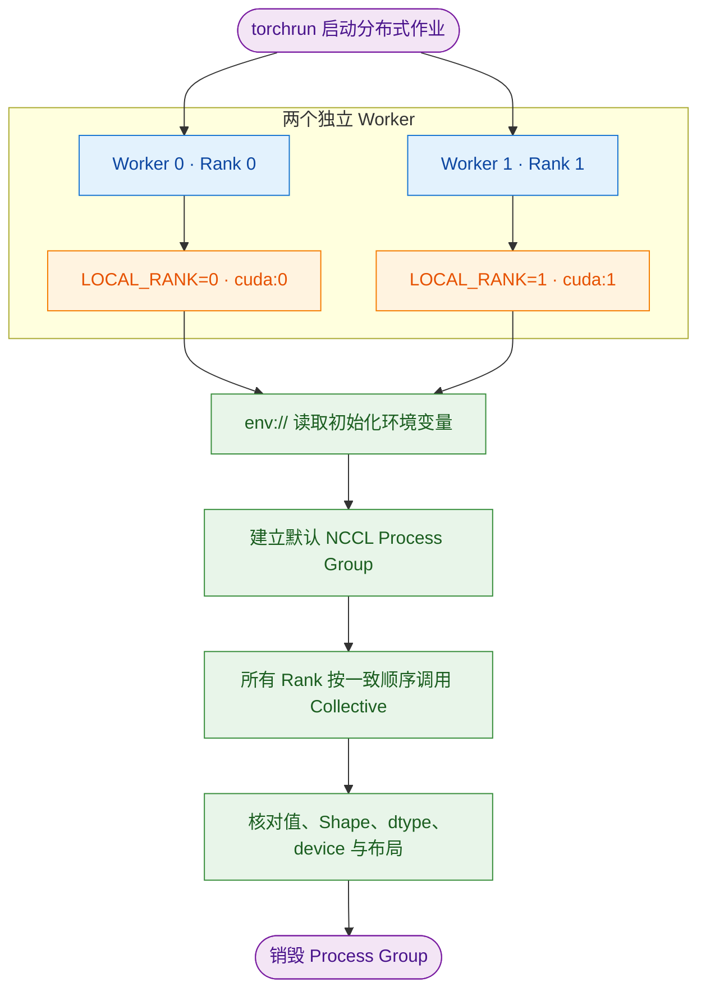
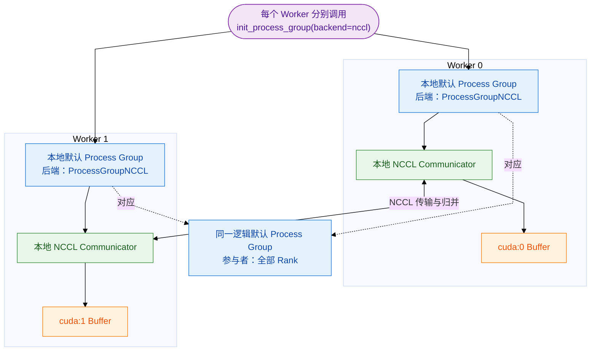
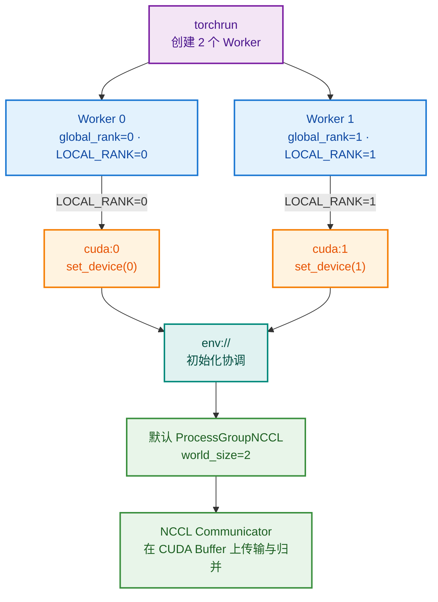
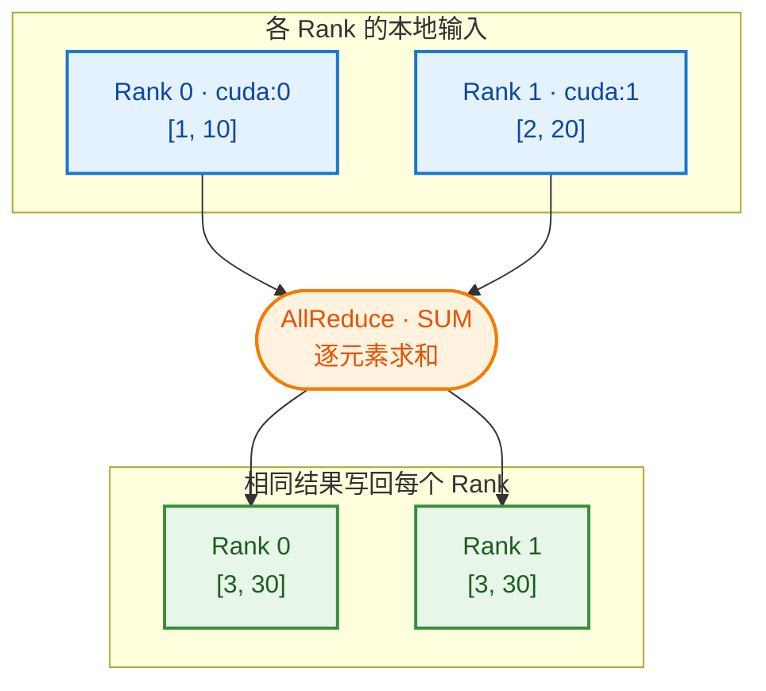
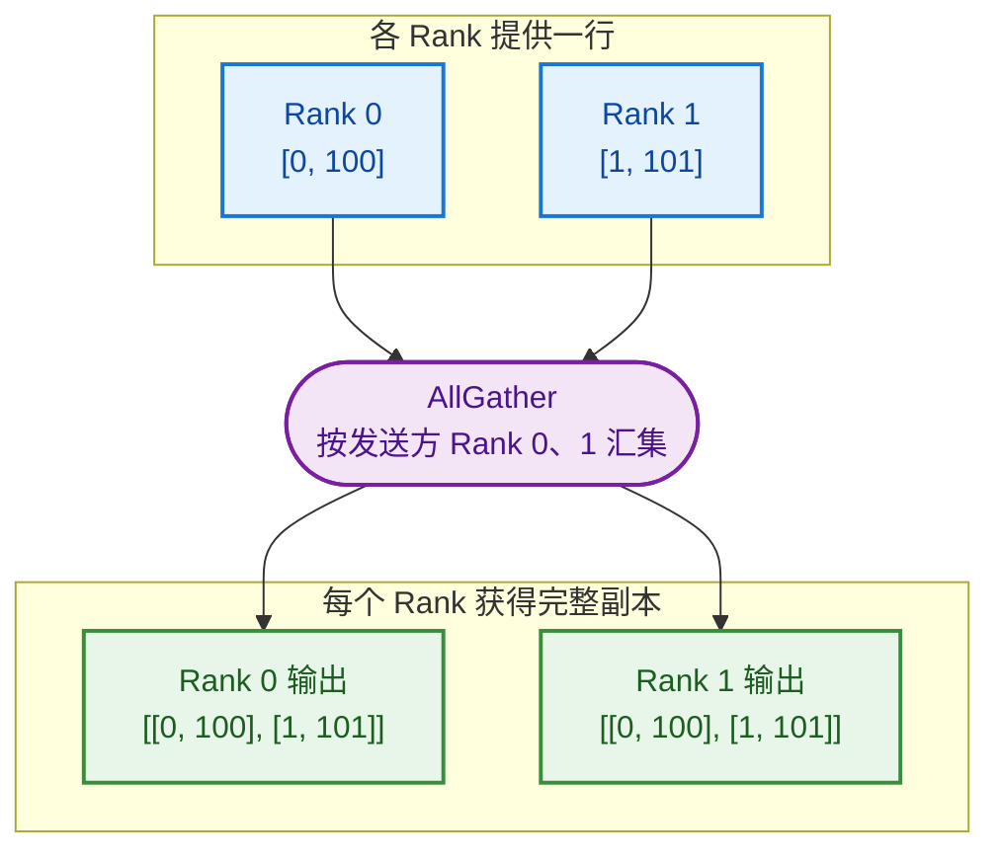
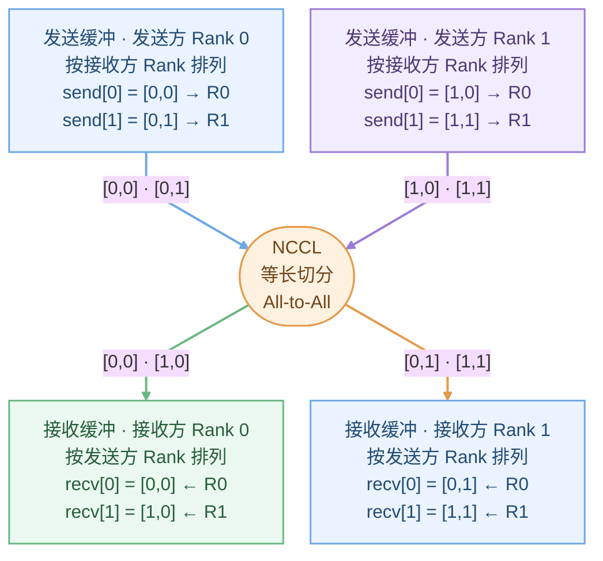
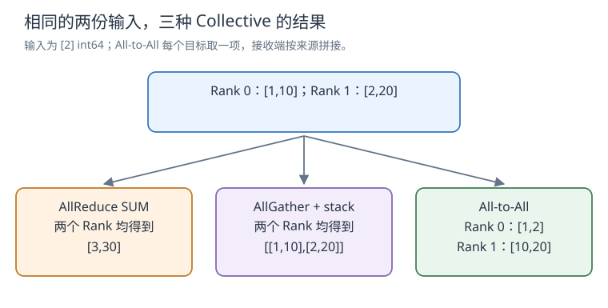
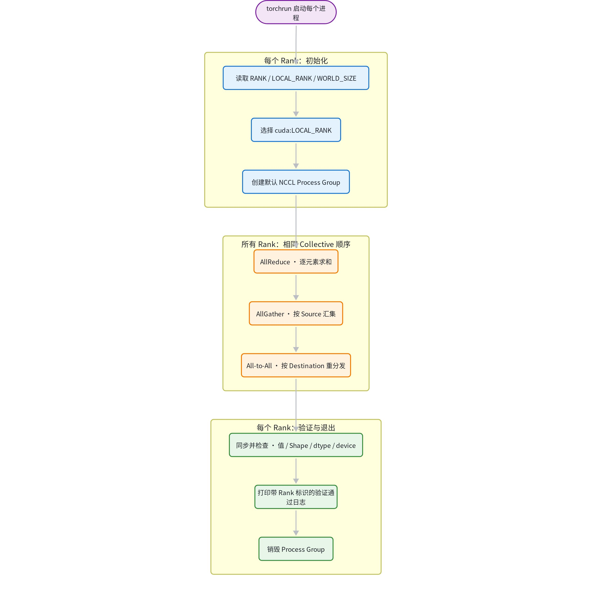
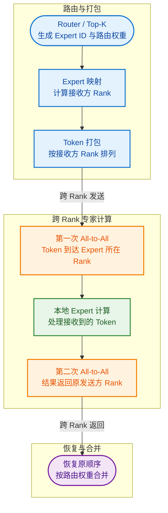

# 第 4 课：Distributed、NCCL 与 GPU 集合通信

本课独立源码位于 `code/course4/`，示例在 `test/`，正确性测试在 `checks/`。下文命令均在本课目录中执行；将整个目录复制到其他位置后也使用同样的启动方式。

把第五课将要使用的四个 Expert 分到两张 GPU：Rank 0 持有 E0/E1，Rank 1 持有 E2/E3。若 Rank 0 的 T0 选中 E2，它的输入就要交给 Rank 1。两个 Worker 是独立 Python 进程，各自管理模型对象与 CUDA 张量；集合通信将这些本地张量连接成跨进程数据流。

Collective（集合通信）是由一个进程组的所有成员共同完成的张量操作。理解 EP 的通信选择，可以先用小整数看清三个操作：AllReduce 合并同位置的值，AllGather 保留并收集各来源数据，All-to-All 让每个来源向每个目标发送指定块。两个 Worker 各绑定一张 GPU，使用小整数输入比较三种操作的输出内容与行序。

通信使用 PyTorch 的 `torch.distributed` 与 NCCL（NVIDIA Collective Communications Library，NVIDIA 集合通信库）。默认 Process Group 包含两个 Worker，CUDA 张量由 NCCL 后端传输。先建立参与者、设备和块顺序，第五课再让块长随路由变化，第六课接入真实 Expert 计算。

## 4.1 Worker、Rank 与设备绑定

`torchrun` 为分布式作业启动多个 Worker。单机双 GPU 作业启动两个 Python 进程，分别设置 `RANK` 与 `LOCAL_RANK`，并共享 `WORLD_SIZE`、`MASTER_ADDR` 和 `MASTER_PORT`。这些值确定每个进程是谁、作业内有多少成员，以及到哪里交换初始化信息；张量载荷随后通过 NCCL 的通信路径传输。



图 4-1：两个 Worker 从启动到通信组释放的路径。

进入 `code/course4` 后运行下面的命令，需要两张可见 CUDA GPU，PyTorch 环境支持 NCCL：

**启动进程**

```bash
cd code/course4
CUDA_VISIBLE_DEVICES=0,1 torchrun --standalone --nproc-per-node=2 \
  test/demo.py --expected-world-size=2
```

`--nproc-per-node=2` 表示本机两个 Worker，`--standalone` 为单机作业准备协调服务。两个 Worker 运行同一份脚本，再依据自己的 Rank 处理各自的数据。

每个 Worker 都有自己的 Python 变量和张量存储。脚本中的 `rank` 在进程 0 中取 0，在进程 1 中取 1；因此同一条构造表达式可以在两端生成不同输入。后面的 AllReduce 用这种方式分别准备 `[1,10]` 和 `[2,20]`，再通过通信得到相同的 `[3,30]`。`torchrun` 负责启动进程、提供身份，具体输入由各进程执行的代码准备。

### 4.1.1 进程身份与设备身份

Global Rank 表示进程在默认通信组中的编号；Local Rank 表示它在本机的编号，用来选择可见设备；World Size 表示默认组内的进程总数。多机时，同一 Local Rank 会在不同机器上重复，Global Rank 则区分整组参与者。

| Worker | Global Rank | Local Rank | World Size | 本课绑定的设备 |
|---|---|---|---|---|
| 0 | 0 | 0 | 2 | `cuda:0` |
| 1 | 1 | 1 | 2 | `cuda:1` |

CUDA 设备编号相对于 `CUDA_VISIBLE_DEVICES` 列表。例如列表为 `2,7` 时，进程内 `cuda:0` 指物理 GPU 2，`cuda:1` 指物理 GPU 7。`read_torchrun_environment()` 解析进程变量，`nccl_distributed()` 将 `LOCAL_RANK` 转换为对应 `torch.device` 并设置当前设备。每个 Worker 的输入、输出与通信缓冲区都创建在自己绑定的 CUDA 设备上。

## 4.2 Process Group 让参与者遵循同一通信语义

Process Group 指定一次 Collective 的参与进程及其组内编号。各 Worker 初始化自己的通信上下文后，通过同一个组交换张量。协调服务负责初始化时的信息交换，NCCL 后端负责后续 GPU 张量传输。一次 Collective 由该组的所有成员共同提交并完成。



图 4-2：各 Worker 持有本地通信上下文与缓冲区。

初始化先选设备，再建立 Process Group。下面摘录 `nccl_distributed()` 的核心调用：`device` 为 `torch.device("cuda", local_rank)`，`dist` 是 `torch.distributed`，`timedelta` 来自 `datetime`。这里使用支持 `device_id` 参数的 PyTorch；课程链接与接口说明以 PyTorch 2.11 为基准。

**初始化通信组 · code/course4/mini_ep/distributed/groups.py**

```python
import torch
import torch.distributed as dist
from datetime import timedelta

def initialize_nccl(device, timeout_seconds=120):
    torch.cuda.set_device(device)
    # 读取 torchrun 环境，建立默认 NCCL 进程组。
    dist.init_process_group(
        backend="nccl",
        init_method="env://",
        timeout=timedelta(seconds=timeout_seconds),
        device_id=device,
    )
```

`env://` 从环境变量读取进程编号和协调地址，`device_id` 指定当前进程使用的 CUDA 设备，超时参数设置初始化和通信的等待上限。建组后，各端按相同次序提交 Collective，调用参数描述彼此匹配的数据类型、形状和收发缓冲区，通信便按这些对应关系交换数据。

### 4.2.1 从 World Group 到 EP Group

默认组包含作业中的全部 Rank。后续更大的并行作业可以创建子组，让其中一部分进程协作完成 EP；此时还要区分 Global Rank 和 EP group 内的 Rank。以下 EP 示例将默认组用作 EP group，因此 EP rank 等于 Global Rank，EP size 等于 World Size。



图 4-3：进程编号、可见设备与默认通信组。

All-to-All 的第 d 个发送块发往当前 Process Group 的 Rank d。使用默认组时，这个编号就是 Global Rank；使用子组时，d 对应子组成员顺序中的第 d 个进程。Expert 放置和通信块都使用 EP rank 编号，发送方据此将 Token 交给拥有目标 Expert 的进程。

## 4.3 AllReduce：把同一位置的元素归约

AllReduce 先按照指定操作归约所有 Rank 的输入，再让每个参与者得到归约结果。我们使用 SUM：Rank 0 输入 `[1,10]`，Rank 1 输入 `[2,20]`，结果是 `[3,30]`，两个 Rank 都保存这两个元素。



图 4-4：逐元素求和的 AllReduce。

下面的 `rank` 是当前组内编号，`group` 为默认组或显式传入的 Process Group，`device` 为 Worker 绑定的 CUDA 设备。示例用 int64 张量精确表达整数求和，输入、输出均为 `[2]`。`all_reduce()` 原地更新本地缓冲区，两个 Rank 的结果都变成 `[3,30]`。

**AllReduce · test/demo.py**

```python
import torch
import torch.distributed as dist

def all_reduce_sum(rank, device, group=None):
    buffer = torch.tensor([rank + 1, 10 * (rank + 1)],
                          dtype=torch.int64, device=device)
    # 原地求和；组内每个 Rank 都得到归约结果。
    dist.all_reduce(buffer, op=dist.ReduceOp.SUM, group=group)
    return buffer
```

推广到 P 个 Rank，第一列的输入为 1 到 P，求和得到 `P(P+1)/2`，第二列为这个结果的十倍。所有 Rank 都得到相同结果，因此 AllReduce 适合计算全组共同需要的统计量。

## 4.4 AllGather：让每个 Rank 收齐所有输入

AllGather 保留各 Rank 的数据，并按来源 Rank 收集起来。本例中，Rank 0 提供 `[0,100]`，Rank 1 提供 `[1,101]`。两个 Rank 的接收列表都包含这两行，stack 后的形状是 `[2,2]`。



图 4-5：按来源收集的 AllGather。

下面仍使用当前 `rank`、`world_size`、`device` 和 `group`。本地输入为 `[2]` int64 张量，接收列表有 P 项，每项也为 `[2]` 且 dtype、device 相同。列表下标 s 对应来源 Rank s，`stack()` 再增加来源维，形成 `[P,2]` 张量：

**AllGather · test/demo.py**

```python
import torch
import torch.distributed as dist

def gather_rank_rows(rank, world_size, device, group=None):
    local_row = torch.tensor([rank, rank + 100], dtype=torch.int64, device=device)
    gathered_rows = [torch.empty_like(local_row) for _ in range(world_size)]
    # 列表下标对应来源 Rank。
    dist.all_gather(gathered_rows, local_row, group=group)
    gathered = torch.stack(gathered_rows)
    return gathered
```

AllReduce 把同位置的值合并为一个结果，AllGather 则保留各来源的值及其来源顺序。第六课中的接收布局依赖每个来源发往每个 Expert 的数量，因此需要保留一个来源维度，形成计数矩阵。选择 Collective 的依据正是下游需要保留哪些信息。

## 4.5 All-to-All：每个来源分别向每个目标发送

一个 Rank 将自己的发送缓冲区切成 P 块，第 d 块发给 Rank d。目标 Rank 再将收到的块按来源 Rank 拼接。源端的块号表达目标，目标端的块号表达来源。



图 4-6：All-to-All 按目标发送、按来源接收。

用 `[source_rank,destination_rank]` 标记每行，双 Rank 的发送与接收可以完整写出：

| Rank | 发送缓冲区 | 接收缓冲区 |
|---|---|---|
| 0 | `[[0,0],[0,1]]` | `[[0,0],[1,0]]` |
| 1 | `[[1,0],[1,1]]` | `[[0,1],[1,1]]` |

下面构造 `[P,2]` 连续 int64 缓冲区，每个目标分配一行。第 d 行是 `[rank,d]`，第一列记录来源，第二列记录去向。等长交换后，接收方 Rank d 的第 s 行变成 `[s,d]`，来源依次递增，目标始终为当前 Rank。`equal_split_all_to_all` 从 `mini_ep.distributed.all_to_all` 导入。

通信时，两端传入的是各自的本地缓冲区。在这张表里，Rank 0 将 `[0,1]` 发给 Rank 1；Rank 1 将它写入自己接收缓冲区的第 0 行。同时 Rank 1 将 `[1,0]` 发给 Rank 0，Rank 0 将它写入自己的第 1 行。来源编号决定接收位置，所以两个进程都能仅凭同一个分块规则解释输出。

**All-to-All · test/demo.py**

```python
import torch
import torch.distributed as dist
from mini_ep.distributed.all_to_all import equal_split_all_to_all

def exchange_rank_rows(rank, world_size, device, group=None):
    source = torch.full((world_size,), rank, dtype=torch.int64, device=device)
    destination = torch.arange(world_size, dtype=torch.int64, device=device)
    send_buffer = torch.stack((source, destination), dim=1)
    recv_buffer = equal_split_all_to_all(send_buffer, group=group)
    return recv_buffer
```

### 4.5.1 等长分块的张量布局

`equal_split_all_to_all()` 使用 `dist.all_to_all_single()`。输入为连续的 `[rows,...]` 张量，第 0 维表示行，后面的维度是每行载荷。rows 能被组大小整除，每个目标收到 `rows/P` 行；输出与输入保持相同 shape、dtype 和 device。

后续把每块改为不同的行数，仍然保留发送时按目标划分、接收时按来源拼接的规则，额外用 splits 描述区间边界。

把三种操作放在同一份输入上，输出的含义更容易比较。假设两个 Rank 都持有 `[2]` int64 张量，分别是 `[1,10]` 和 `[2,20]。AllReduce SUM 将相同位置相加；AllGather 保留两份输入，在每个 Rank 上堆叠为 `[2,2]`；等长 All-to-All 把本地第一项发给 Rank 0、第二项发给 Rank 1。



图 4-7：相同输入经过归约、收集与重分发后的结果。

于是 All-to-All 的 Rank 0 收到 `[1,2]`，Rank 1 收到 `[10,20]`。它把数据的目标列变成接收方的本地结果，块内数值保持原样。MoE 中每个目标块保存属于该 Rank 的 Expert 输入，因而可以沿这条“按目标发送、按来源接收”的规则继续构造通信。

## 4.6 Collective 的顺序也是数据流的一部分

两个 Rank 都按 AllReduce、AllGather、All-to-All 的顺序提交操作，组内的第一次、第二次和第三次调用分别配对。各 Worker 的提交时刻可以不同，较早提交的成员等待其他成员进入对应调用。这种按调用次序配对的方式，使各进程的本地代码共同组成一条通信序列。

示例使用 `async_op=False`，CUDA 结果的就绪遵循 PyTorch 的流依赖：同一当前流上的后续 GPU 操作按既定顺序消费通信输出。Host 打印、比较和报告前，示例在三次通信之后统一调用 `torch.cuda.synchronize(device)`，等待当前设备工作完成。CPU 同步点和组内通信序列分别管理结果读取与成员协作。

| 操作 | 本地输出 shape | 双 Rank 预期内容 |
|---|---|---|
| AllReduce SUM | `[2]` | `[3,30]` |
| AllGather + stack | `[2,2]` | `[[0,100],[1,101]]` |
| All-to-All | `[2,2]` | Rank d 得到 `[[0,d],[1,d]]` |

`run_collectives()` 根据上面的计算公式与排列规则构造预期值，逐值比较结果，再核对 shape、dtype、device 和连续性。用小整数表达输入，可以直接手算求和结果，并追踪每行数据的来源与去向。

### 4.6.1 让通信组跟随程序的生命周期

入口通过上下文管理器管理建组和释放。在上下文内创建通信张量、执行通信与检查，退出时销毁该上下文创建的组。这样，身份、设备和组一起保存在 `DistributedContext` 中，传给执行函数。



图 4-8：各 Rank 共同遵循的通信与检查顺序。

图中从初始化到销毁的顺序，对应每个 Worker 的通信生命周期。三次 Collective 在组内遵循同一个次序，Host 检查放在设备同步之后。

**通信入口 · test/demo.py**

```python
from mini_ep.distributed.groups import nccl_distributed

def main(run_collectives):
    with nccl_distributed(timeout_seconds=120) as context:
        results = run_collectives(context)
        print(f"rank={context.global_rank} device={context.device} PASS", flush=True)
    return results
```

这段代码使用三个模块：`groups.py` 读取进程环境、绑定设备并管理通信组；`test/demo.py` 在组内调用三种 Collective；`all_to_all.py` 封装按第 0 维分块的张量接口。可以沿入口代码逐个查看它们，确认当前 Rank、设备和缓冲区从哪里来。

## 4.7 通信阶段与可观察的进程状态

日志中的 Rank、Device 和阶段可以展示各进程当前执行到哪里。初始化阶段记录进程身份、设备与协调信息；Collective 阶段记录通信名称和缓冲区参数；结果阶段记录设备工作完成后的输出。将多个 Rank 的日志按阶段对照，就能看清同一次通信在各进程中的提交与完成过程。

需要细看通信阶段时，可在同一个启动命令上启用日志：

**日志与测试**

```bash
TORCH_DISTRIBUTED_DEBUG=DETAIL NCCL_DEBUG=INFO \
CUDA_VISIBLE_DEVICES=0,1 torchrun --standalone --nproc-per-node=2 \
  test/demo.py --expected-world-size=2 --timeout-seconds=120
python3 -m unittest discover -s checks -p 'test_distributed_nccl.py' -v
```

配套测试检查进程环境和张量接口，并在双 GPU 条件下运行 NCCL 通信。小整数输入用于核对求和结果与行序，shape、dtype、device 和连续性检查用于确认缓冲区满足后续 Token 传输的要求。

## 4.8 从数据交换走向 Expert Parallel

现在让发送行重新代表 Token。源 Rank 根据 Router 选择找到目标 Expert，再找到 Expert 所在的 Rank，按目标打包后发送。接收方调用本地 Expert，再按来源把结果送回。源端应用路由权重并合并分支。



图 4-9：Expert Parallel 的输入与结果往返。

Expert 的放置提前确定，Token 的去向每次前向都会变化。All-to-All 正好表达每个来源向多个目标分别发送的数据流。第五课将用变长 splits 表达这种变化，继续追踪同一批记录的往返过程。

有关通信接口与 CUDA Stream 语义，可查阅 [PyTorch Distributed](https://docs.pytorch.org/docs/2.11/distributed.html)。

继续阅读 [第 5 课：All-to-All 与 EP 通信](https://tvle9mq8jh.feishu.cn/docx/Wl15dw3sJovDErxqGTIcUlDvnHb)。
