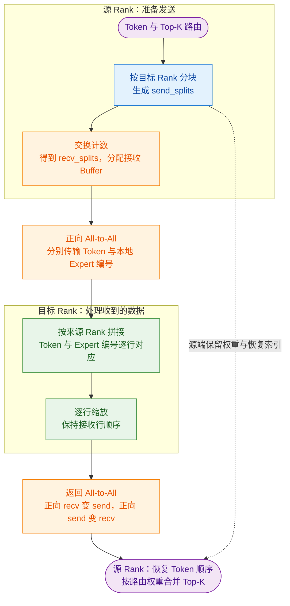
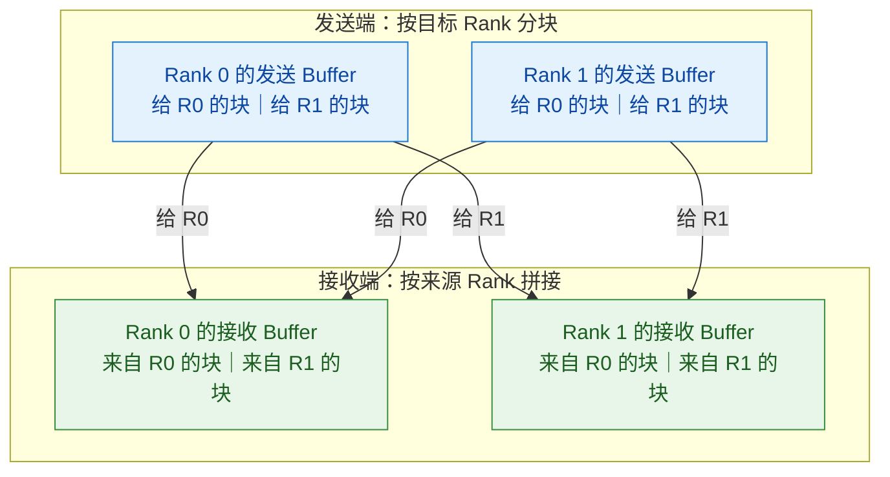
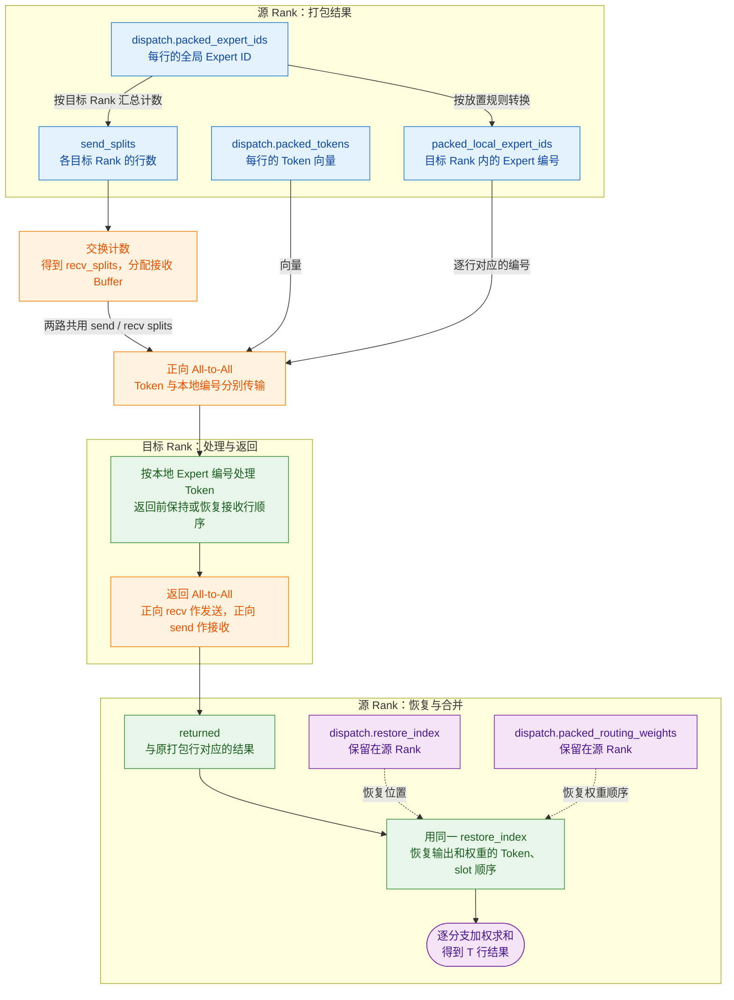
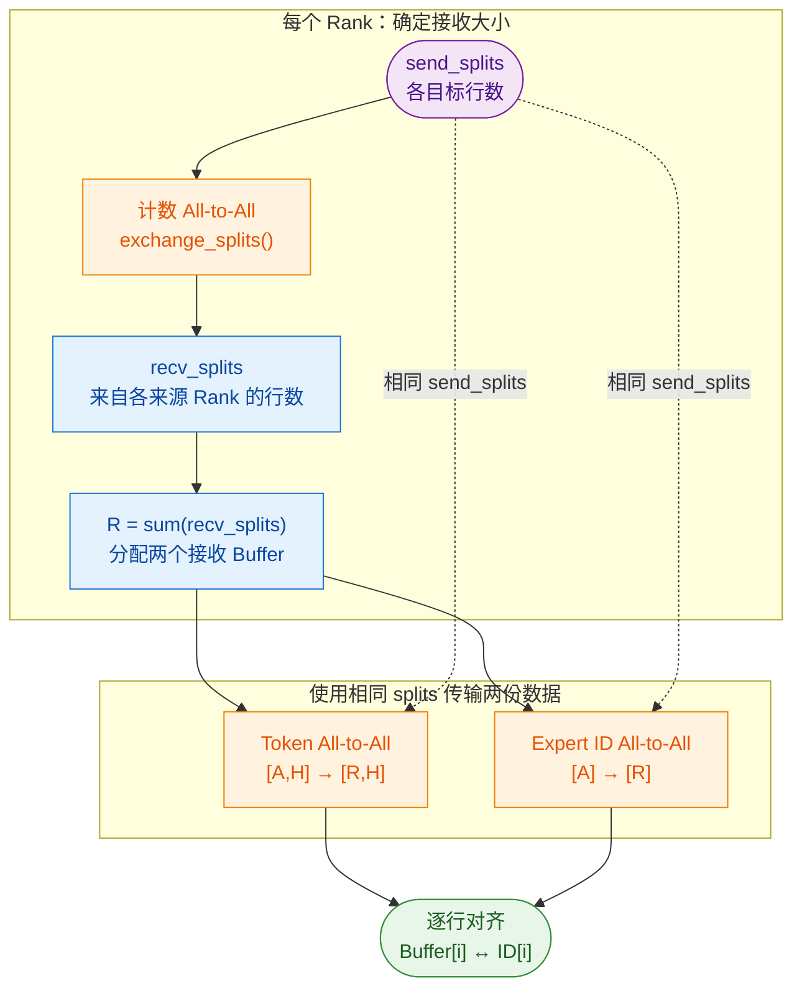
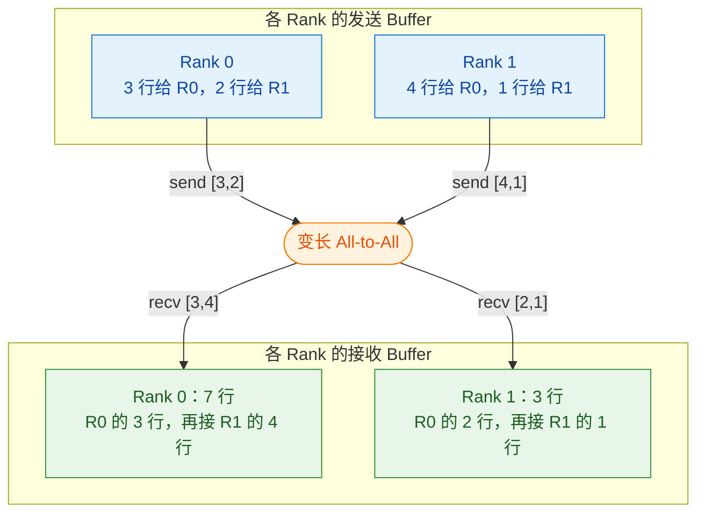
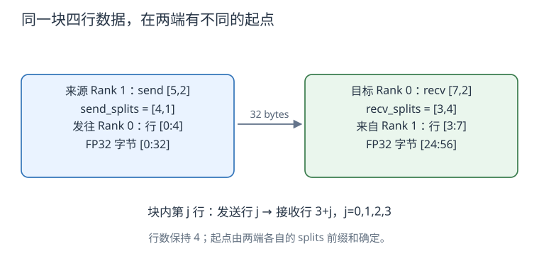
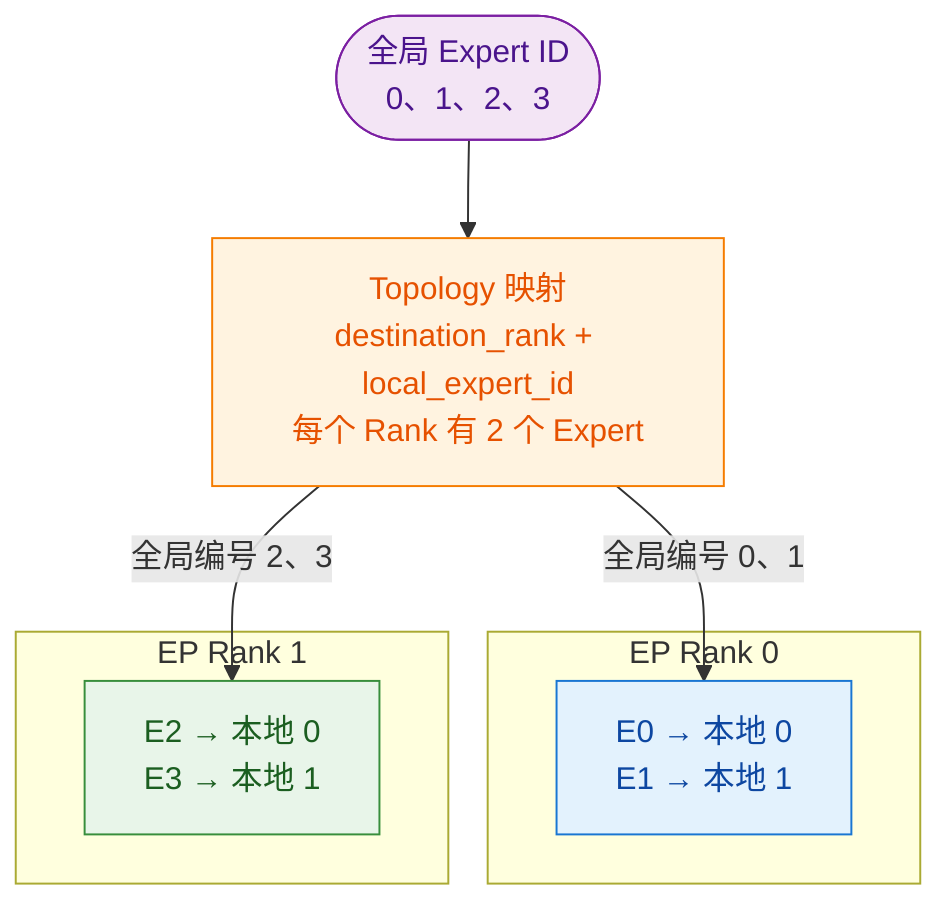
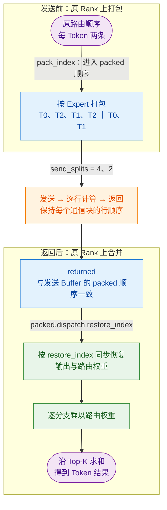
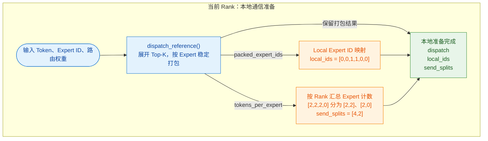
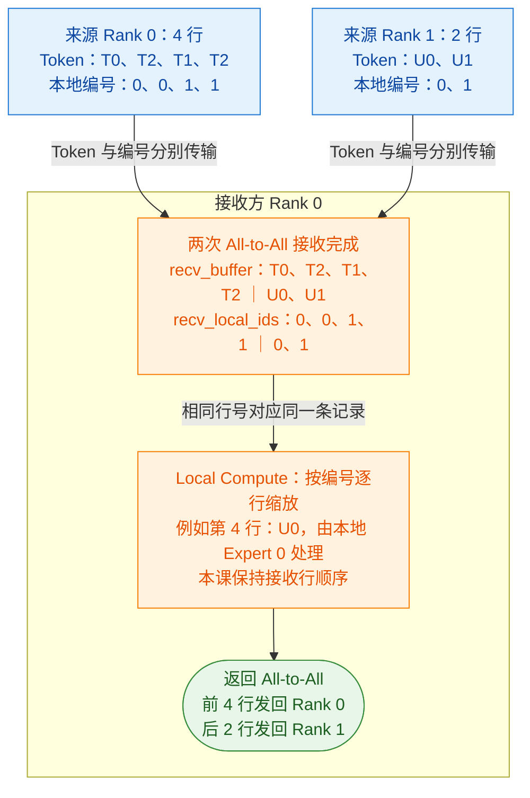

# 第 5 课：All-to-All 与 EP 通信

本课独立源码位于 `code/course5/`，示例在 `test/`，正确性测试在 `checks/`。下文命令均在本课目录中执行；将整个目录复制到其他位置后也使用同样的启动方式。

第四课向每个目标发送一行，块长事先固定。现在换成第二课的路由记录：同一个 Token 的两个 slot 可以去不同 Rank，也可以去同一 Rank 的不同 Expert。每个方向到底发多少行，要看当前的路由结果。All-to-All 因而需要一份 split 列表记录块长，仍按目标 Rank 发送、按来源 Rank 接收。

沿用第二课的六条记录，Rank 0 的 T0/T1/T2 共三行输入，Top-2 展开后有六行。E0/E1 放在 Rank 0，E2/E3 放在 Rank 1，于是四行留在 Rank 0，两行去 Rank 1。再让 Rank 1 提供 U0/U1 两行，向两个 Rank 各发送两条记录。每个来源能从自己的路由统计发送量；每个目标的接收量则由两个来源共同决定。

先让 Ee 输出 `(e+1)×x`。例如 E2 将输入乘以 3，E0 原样返回输入，这样很容易从结果看出一条分支交给了哪个 Expert。我们用这个简单计算贯穿计数交换、NCCL 传输和加权合并；第六课再换成真实 MLP，沿用相同的输入往返与恢复方式。

## 5.1 路由记录的跨 Rank 往返

Router 给出 Expert ID 和权重，Dispatch 展开 Top-K 并打包。发送方根据 Expert 所在的 Rank 切分输入，交换计数以后，分别发送 Token 向量和本地 Expert ID。接收方按 ID 计算，保持接收行序，再将结果发回来源。



图 5-1：Token、Expert 身份与返回结果的数据流。

最终输出要回到源 Rank，因此路由权重、Token/slot 索引和恢复排列都留在这里。目标 Rank 只需要收到输入向量，并知道每行交给哪个本地 Expert。计算后它将结果发回来源，源 Rank 再按保存的索引恢复顺序、应用权重，得到与原输入逐行对应的输出。

### 5.1.1 变长描述的是第 0 维

设 EP group 大小为 P，当前 Rank 有 N 个 Token，隐藏宽度为 H，每个 Token 选择 K 个 Expert，本地记录数为 `A=N×K`。发送缓冲区是 `[A,H]`，每行表示一条计算分支。接收缓冲区是 `[R,H]`，R 是所有来源发到当前 Rank 的记录数。本例 Rank 0 的 N=3、A=6，Rank 1 的 N=2、A=4；发送行数取决于本地输入，接收行数取决于全组路由。第六课继续用 N 表示本地 Token 数。

参与者使用相同 H 与浮点 dtype，各方向的第 0 维行数可以不同。`send_splits[d]` 表示发给组内目标 d 的行数，`recv_splits[s]` 表示从组内来源 s 接收的行数，列表均有 P 项。对来源 s、目标 d，一致性条件是来源的 `send_splits[d]` 等于目标的 `recv_splits[s]`。列表单位为行，实际元素数还要乘以每行载荷宽度。



图 5-2：发送块按目标排列，接收块按来源排列。

第 d 个发送块从 `sum(send_splits[:d])` 开始，长度为 `send_splits[d]`；第 s 个接收块从 `sum(recv_splits[:s])` 开始，长度为 `recv_splits[s]`。前缀和把组内 Rank 编号转化为缓冲区区间。split 为 0 时，该 Rank 对应空区间，后续块仍由同一套边界规则定位，因此非均匀路由和空来源可以共用这一表示。

## 5.2 一行数据携带哪些身份

Token 向量是计算输入，目标 Expert ID 决定计算函数，原 Token 编号与 slot 决定返回后的合并位置。这些身份的用途决定了信息的保存位置：计算输入与本地 Expert ID 发往目标，恢复索引与权重保存在来源。

均匀放置下，目标 Rank 可以从全局 Expert ID 推导。发送缓冲区的块位置已经表达目标 Rank，因此每行再传一个本地 Expert ID，就可以确定它在目标端交给哪一个 Expert。



图 5-3：源端保留恢复 metadata，目标端接收输入与身份。

源端保留该次 `DispatchOutput`，包括打包权重、Token/slot 与逆排列；这些信息供结果返回后合并。传输的向量为原 dtype，本地 Expert ID 为 int64，两者都在绑定的 CUDA 设备上，并使用相同 splits。输出的第 r 行向量与第 r 个 ID 因而仍描述同一条路由记录。

| 信息 | Shape | 保存位置与作用 |
|---|---|---|
| 打包 Token | `[A,H]` | 发到目标 Rank，供 Expert 计算 |
| 本地 Expert ID | `[A]`，int64 | 发到目标 Rank，选择本地 Expert |
| 全局 Expert ID | `[A]`，int64 | 源端保留，用于观察和校验 |
| 路由权重 | `[A]` | 源端保留，返回后加权 |
| `restore_index` | `[A]`，int64 | 源端保留，恢复 Token/slot 顺序 |
| send/recv splits | P 项整数列表 | 双方分别解释发送与接收区间 |

### 5.2.1 相同行数对应不同字节数

splits 的单位由第 0 维确定。Token 向量的一行包含 H 个浮点元素，行字节数为 `H×element_size`；本地 Expert ID 的一行只有一个 int64，行字节数为 8。

例如 H=128、FP16 时，一行 Token 向量占 256 字节，一行 ID 占 8 字节。两次通信使用相同的 splits，所以第 r 个 ID 始终对应第 r 行向量；但传输的总字节数分别为 `A×256` 和 `A×8`。

## 5.3 交换计数，把发送计划变成接收计划

当前 Rank 可以从 Router 结果统计自己的 send splits。每个来源发来的行数共同确定接收总行数 R 和各来源的区间。一个直接的方法是再做一次小规模 All-to-All：每个 Rank 向每个目标发送一个 int64 计数。



图 5-4：先交换行数，再准备接收缓冲区。

示例中的 `exchange_splits()` 将 P 项发送计数放入当前 CUDA 设备上的 int64 张量。调用第四课的 `equal_split_all_to_all()` 时，每个目标收到一个计数；返回第 s 项就是来源 s 发给当前 Rank 的行数。下面函数中的 `device` 与 `group` 沿用通信上下文，等长封装从 `mini_ep.distributed.all_to_all` 导入。

**计数交换 · test/demo.py**

```python
import torch
from mini_ep.distributed.all_to_all import equal_split_all_to_all

def exchange_splits(send_splits, device, group=None):
    counts = torch.tensor(send_splits, dtype=torch.int64, device=device)
    received_counts = equal_split_all_to_all(counts, group=group)
    return received_counts.cpu().tolist()
```

`.cpu().tolist()` 等待计数可供 Host 读取，再生成 `all_to_all_single()` 使用的 Python 整数列表。程序由接收行数分配缓冲区，随后依次进行 Token 交换、ID 交换与输出返回。四次 Collective 的顺序由所有 Rank 共同遵循；本地发送或接收为零时，split 列表包含零项，参与者仍提交相同序列。

### 5.3.1 发送矩阵的行与列

把全组发送量写成矩阵 S，`S[s,d]` 表示来源 s 发往目标 d 的行数。来源 s 的 send splits 是第 s 行，目标 d 的 recv splits 是第 d 列。先看下面这个独立例子：两个 Rank 各发送五行，却分别接收七行和三行。看清行与列的区别后，再回到六条 MoE 记录。

| 来源 | 发往 Rank 0 | 发往 Rank 1 | 发送总行数 |
|---|---|---|---|
| Rank 0 | 3 | 2 | 5 |
| Rank 1 | 4 | 1 | 5 |
| 接收总行数 | 7 | 3 | 10 |



图 5-5：发送五行的两个 Rank 分别接收七行与三行。

Rank 0 发送 `[3,2]`，接收 `[3,4]`，所以自己的发送缓冲区有 5 行，接收缓冲区有 7 行。Rank 1 发送 `[4,1]`，接收 `[2,1]`，接收缓冲区只有 3 行。全组发送总行数与接收总行数都为 10，各 Rank 的本地总量可以不同。

### 5.3.2 用行标记看清块的位置

用 `[source,destination,row_in_chunk]` 表示一行，发送和接收可完整展开为：

**通信布局**

```text
Rank 0 send: [0,0,0] [0,0,1] [0,0,2] | [0,1,0] [0,1,1]
Rank 1 send: [1,0,0] [1,0,1] [1,0,2] [1,0,3] | [1,1,0]
Rank 0 recv: [0,0,0] [0,0,1] [0,0,2] | [1,0,0] [1,0,1] [1,0,2] [1,0,3]
Rank 1 recv: [0,1,0] [0,1,1] | [1,1,0]
```

Rank 1 的发送切片 `[0:4]` 在 Rank 0 上写入接收切片 `[3:7]`。这个对应关系完全由源端的目标块和目标端的来源块确定。NCCL 按 splits 搬运载荷并保留各块内部行序，行内的来源、目标与块内编号则把这次搬运的结果直接呈现出来。

现在让每行携带 H=2 个 FP32 元素。一行占 8 bytes，Rank 1 发往 Rank 0 的四行占 32 bytes。它们在发送缓冲区从行 0 开始，在 Rank 0 的接收缓冲区则从行 3 开始：前面已经放了来源 Rank 0 的三行，共 24 bytes。



图 5-6：变长块的行边界如何转换成两端的字节区间。

因此本次传输读取发送字节区间 `[0,32)`，写入接收字节区间 `[24,56)`。块内第 j 行从发送行 j 移到接收行 3+j，j 依次为 0～3。splits 的单位是行；H 与 dtype 决定每行多少字节。改变 H 会改变载荷大小，两端的行区间和块内顺序继续由相同 splits 决定。

## 5.4 Expert 的位置怎样决定通信块

基础放置采用连续、均匀分配：E 个 Expert 分给 P 个 Rank，每个 Rank 持有 `L=E/P` 个连续编号的 Expert，配置满足 `E%P=0`。拓扑对象在构造时校验这个条件。

| 全局 Expert | 目标 Rank | 本地 Expert ID |
|---|---|---|
| E0 | 0 | 0 |
| E1 | 0 | 1 |
| E2 | 1 | 0 |
| E3 | 1 | 1 |



图 5-7：全局 Expert ID 映射到 Rank 与本地 ID。

按这张表，整数除法 `expert_id // L` 求出目标 Rank，取余 `expert_id % L` 求出本地 Expert ID。例如 E3 去 Rank 1，交给其本地 Expert 1。`ExpertParallelTopology` 集中提供这些映射并校验配置，Router、发送块和接收端分别使用全局 ID、EP rank 和本地 ID。

### 5.4.1 接回第二课的六条路由

继续使用第二课的固定例子：T0 选择 E2/E0，T1 选择 E1/E2，T2 选择 E0/E1。打包后全局 Expert ID 为 `[0,0,1,1,2,2]`，对应 Token 为 `[T0,T2,T1,T2,T0,T1]`。

前四行属于 Rank 0 的 E0/E1，后两行属于 Rank 1 的 E2。因此 Expert-major 已经同时满足 Rank 分块顺序，send splits 为 `[4,2]`。本地 Expert ID 为 `[0,0,1,1,0,0]`。



图 5-8：记录打包与返回后的逆排列。

图中 `pack_index` 将原路由排进 Expert 区间，`restore_index` 在返回后将每条记录找回原来的 Token/slot 位置。跨 Rank 往返期间，源端保留这两个布局之间的关系。

### 5.4.2 复用 Dispatch 和 Topology 生成计划

下面是发送计划的摘录，`tokens`、`expert_ids` 和 `routing_weights` 来自第二课的固定输入，`topology` 可用 `ExpertParallelTopology(num_experts=4, ep_size=2, ep_rank=0)` 建立。`dispatch_reference` 从 dispatch 模块导入，拓扑类从 topology 模块导入。按全局 Expert 排列后，连续的 E0/E1 区间合成 Rank 0 的块，E2/E3 合成 Rank 1 的块。

**发送计划 · test/demo.py**

```python
import torch
from mini_ep.distributed.dispatch import dispatch_reference

def build_send_plan(tokens, expert_ids, routing_weights, topology):
    dispatch = dispatch_reference(tokens, expert_ids, routing_weights, topology.num_experts)
    local_ids = topology.local_expert_id(dispatch.packed_expert_ids).contiguous()
    send_splits = dispatch.tokens_per_expert.reshape(
        topology.ep_size, topology.experts_per_rank
    ).sum(dim=1).cpu().tolist()
    return dispatch, local_ids, send_splits
```



图 5-9：从 Expert 计数汇总发送行数。

本例的 Expert 计数 `[2,2,2,0]` reshape 为 `[[2,2],[2,0]]`，按行求和得到 `[4,2]`。其中前四行交给本 Rank 的 E0/E1，后两行发给 Rank 1 的 E2。发送计划同时包含本地和远程分支，后续可以统一按目标 Rank 分块。

Expert-major 表示当前计算分组，Rank-packed 表示通信去向。连续均匀放置使两种排序在这里一致：相邻的本地 Expert 区间合并后就得到 Rank 块。第六课的 `pack_by_destination_rank()` 会显式保存这层排列与恢复关系，使通信布局与 Expert 布局各自具有清楚的接口。

## 5.5 正向通信：输入与身份一同到达

下面接续已准备好的 `dispatch`、`local_ids` 与 `send_splits`。所有输入均在当前 Rank 绑定的 CUDA 设备上；`variable_split_all_to_all` 从 all_to_all 模块导入。先交换计数，再按相同的边界分别传输 Token 向量和 int64 ID，两个 Collective 在全组按相同次序调用：

**正向通信 · test/demo.py**

```python
import torch
from mini_ep.distributed.all_to_all import equal_split_all_to_all, variable_split_all_to_all

def exchange_splits(send_splits, device, group=None):
    counts = torch.tensor(send_splits, dtype=torch.int64, device=device)
    received_counts = equal_split_all_to_all(counts, group=group)
    return received_counts.cpu().tolist()

def dispatch_to_experts(dispatch, local_ids, send_splits, device, group=None):
    # 先交换行数，再分配并传输向量与 ID。
    recv_splits = exchange_splits(send_splits, device, group)
    recv_tokens = variable_split_all_to_all(
        dispatch.packed_tokens, send_splits, recv_splits, group=group
    )
    recv_ids = variable_split_all_to_all(
        local_ids, send_splits, recv_splits, group=group
    )
    return recv_tokens, recv_ids, recv_splits
```

`variable_split_all_to_all()` 接收连续张量，校验发送 splits 之和等于输入行数，然后创建 `[sum(recv_splits),...]` 的输出。dtype、device 和每行载荷形状保留。它将 send splits 传给 `input_split_sizes`，recv splits 传给 `output_split_sizes`。

### 5.5.1 接收布局按来源划分

让 Rank 1 的两个 Token 记作 `U0=[11,12]`、`U1=[13,14]`，分别选择 E3/E0 与 E2/E1，权重均为 0.5。这与示例代码中 Rank 1 的输入构造一致。它向两个 Rank 各发两行，send splits 为 `[2,2]`。结合 Rank 0 的 `[4,2]`，得到：

| 接收方 | recv splits | Token 顺序 | 本地 ID |
|---|---|---|---|
| Rank 0 | `[4,2]` | `[T0,T2,T1,T2 ｜ U0,U1]` | `[0,0,1,1 ｜ 0,1]` |
| Rank 1 | `[2,2]` | `[T0,T1 ｜ U1,U0]` | `[0,0 ｜ 0,1]` |



图 5-10：来自两个来源的记录按行与本地 Expert ID 配对。

Rank 0 的本地 Expert 0 对应接收行 0、1、4，说明来自不同来源的同一 Expert 记录分散在不同块里。当前缩放函数按行执行即可；第六课将利用来源/Expert 计数构造索引，把这些行收集给真实的 MLP。

对于 Rank 1 的 U0，发往 E0 的分支先放在源端打包行 0，到 Rank 0 后落在接收行 4，交给本地 Expert 0；发往 E3 的分支放在源端打包行 3，到 Rank 1 后落在接收行 3，交给本地 Expert 1。两条分支的全局 Expert ID 分别为 0 和 3，本地 ID 分别为 0 和 1。目标 Rank 与本地 ID 共同定位全组中的 Expert。

## 5.6 返回通信：交换 splits 的角色

下面在接收端继续执行。`ep_rank` 是当前组内 Rank，均匀放置使全局 Expert ID 等于 `ep_rank×L+local_id`。缩放系数转为向量 dtype，并沿 H 广播。每行输入产生一行输出，输出保留接收行序，因此来源块直接成为返回时的目标块：

**返回与合并 · test/demo.py**

```python
import torch
from mini_ep.distributed.all_to_all import variable_split_all_to_all
from mini_ep.distributed.dispatch import combine_reference

def return_and_combine(recv_tokens, recv_ids, recv_splits, send_splits, ep_rank, topology, dispatch, group=None):
    # 目标 Rank 和本地 ID 一起确定全局 Expert。
    global_ids = recv_ids + ep_rank * topology.experts_per_rank
    computed = recv_tokens * (global_ids + 1).to(recv_tokens.dtype)[:, None]
    # 返回通信交换正向 send/recv splits 的角色。
    returned = variable_split_all_to_all(
        computed.contiguous(), recv_splits, send_splits, group=group
    )
    combined = combine_reference(returned, dispatch)
    return combined
```

正向接收 splits 变成返回发送 splits，正向发送 splits 变成返回接收 splits。返回结果与源端最初的打包输入逐行对应。随后逆排列恢复 Token/slot 顺序，源端应用一次路由权重，再沿 Top-K 求和。

### 5.6.1 用原路由表独立计算期望值

对每个原 Token i，直接遍历原表中的 K 个 slot，计算 `Σ_j w[i,j]×(expert_ids[i,j]+1)×tokens[i]`。这个参考只读取原始输入与路由，独立于打包索引和通信切片。

Rank 0 的三行输出仍为第二课的 `[1.5,3]`、`[7.2,9.6]`、`[9,10.8]`。Rank 1 的 U0 选择 E3/E0，得到 `0.5×4U0+0.5×U0=2.5U0=[27.5,30]`；U1 选择 E2/E1，也得到 `2.5U1=[32.5,35]`。先比较 `returned` 与原打包输入逐行缩放的结果，可以检查通信是否将每行送回原位；再比较 `combined` 与原路由公式，可以检查恢复顺序和加权求和。两端最终输出都按各自的原 Token 顺序排列。

本地 MLP 按 Expert 收集输入时，会进一步改变计算批次的行序。计算后把输出写回原接收行，就能重新形成按来源排列的缓冲区，原 `recv_splits` 因而直接成为返回时的发送边界。这个约定将 Expert 的局部分组封装在目标 Rank 内，源端仍使用原来的路由 metadata 恢复和合并。

## 5.7 All-to-All 的计时与通信成本

到这里已经建立了完整回环，可以独立测量其中一段向量搬运。`benchmarks/benchmark_all_to_all.py` 先交换计数、分配接收缓冲区并检查数值，再复用准备好的 send/recv 张量与 Python splits，计时一次正向 payload 交换。payload 指传输载荷；这一计时区间只包含 `dist.all_to_all_single()` 调用及相应设备工作。完整 MoE 的路由、打包、计数、Expert、返回和 Combine 各有自己的耗时。

每个 Rank 先 Warmup，再用 CUDA Event 取得逐次样本。各 Rank 的样本序列通过 MAX 归约，得到每次最慢 Rank 的时间；随后计算中位数、均值、最小值和最大值。统计范围是全组的单次载荷通信。

### 5.7.1 均匀与倾斜分配改变了什么

均匀分配把发送缓冲区的 A 行尽量平均分给 P 个目标，余数按 Rank 顺序补一行。倾斜分配把约 80% 的行发往 Rank 0，其余分给其他 Rank。双 Rank、每个来源 5 行时，两种发送矩阵分别为 `[[3,2],[3,2]]` 和 `[[4,1],[4,1]]`。

两个矩阵都发送 10 行，跨 Rank 的非对角块也都是 5 行，但目标端接收量从 `[6,4]` 变成了 `[8,2]`。远程总字节数相同，目标端的负载分布却发生了变化。发送矩阵保留每个方向的流量，既能显示 Rank 0 集中了更多输入，也能用于计算各 Rank 的 Expert 批次大小。

### 5.7.2 带宽的单位与统计口径

令每行字节数为 B、单个元素字节数为 b，跨 Rank 载荷计数为 `Σ_{s≠d} S[s,d]×B`。每个来源到目标的块只计一次，自发给自身的块保留在工作负载中，跨 Rank 字节数只统计非对角块。

$$
B_{\mathrm{remote}} = \sum_{s\ne d}S_{s,d}\,H\,b
$$

$$
\mathrm{BW}_{\mathrm{GB/s}} = \frac{B_{\mathrm{remote}}}{L_{\mathrm{ms}}\times10^6}
$$

GB/s 使用十进制单位，分子是全组非对角块的单向载荷字节数，分母是每次最慢 Rank 延迟样本的中位数。所得值描述该发送矩阵在此测量区间内的有效搬运速率。链路的峰值规格、协议流量和各方向拥塞还需要对应拓扑与计数解释；基准同时保留消息大小、发送矩阵、接收量与 dtype。

默认消息大小从 1 KiB 扫描到 100 MiB，表示每个 Rank 的发送缓冲区目标大小。实际行数为 `ceil(requested_bytes/B)`，实际发送字节取整到完整行。热点 Rank 的接收量由所有来源共同决定，因此另行记录 recv splits 和缓冲区大小。

## 5.8 变长通信的完整示例

进入 `code/course5` 后运行以下命令，需要两张可见 CUDA GPU、支持 NCCL 的 PyTorch。示例同时运行 Top-1、Top-2，输出 Rank 身份、发送/接收 splits 与接收本地 ID。

**通信示例**

```bash
cd code/course5
CUDA_VISIBLE_DEVICES=0,1 torchrun --standalone --nproc-per-node=2 \
  test/demo.py --expected-world-size=2 --dtype=float32
```

`--suite` 增加倾斜路由、空来源与全空输入。零行案例仍依次参与四次 Collective，用同一套规则检验空区间。精度通过 `--dtype` 选择：

**路由场景**

```bash
CUDA_VISIBLE_DEVICES=0,1 torchrun --standalone --nproc-per-node=2 \
  test/demo.py --expected-world-size=2 --suite --dtype=float16
```

也可以选择 bfloat16，或只启动一个 Worker 运行 EP=1。此时所有 Expert 都在本 Rank，send/recv splits 各只有一项；记录仍经过打包、返回和合并，最终得到与多 Rank 配置相同定义的 MoE 输出。

通信大小扫描由独立入口完成：

**通信基准**

```bash
CUDA_VISIBLE_DEVICES=0,1 torchrun --standalone --nproc-per-node=2 \
  benchmarks/benchmark_all_to_all.py --hidden-size=128 --dtype=float32 \
  --sizes-bytes 1024 1048576 104857600 --patterns uniform imbalanced \
  --warmup=10 --repeats=50
python3 -m unittest discover -s checks -p 'test_all_to_all_ep.py' -v
```

学习时可以分开使用这三个入口：配套测试检查分块、行数和远程字节计数；NCCL 示例检查输入往返后是否回到原行、加权结果是否正确；独立基准测量预先准备好的 payload 交换。它们分别对应通信布局、完整前向的数据搬运和这段搬运的成本。

第六课需要的接口已经齐全：发送侧从路由生成计划，接收侧先获得布局信息，两次 Token All-to-All 连接本地 Expert 计算与源端合并。接下来，我们将把逐行 Expert 身份整理为 MLP 的批次索引，并用单 GPU Reference 核对完整 MoE。

接口细节可查阅 [PyTorch 的 all_to_all_single](https://docs.pytorch.org/docs/2.11/distributed.html#torch.distributed.all_to_all_single)。

继续阅读 [第 6 课：实现 Mini-EP V1](https://tvle9mq8jh.feishu.cn/docx/Tiefd5MlyokSbfxubEOcyXRsnEf)。
