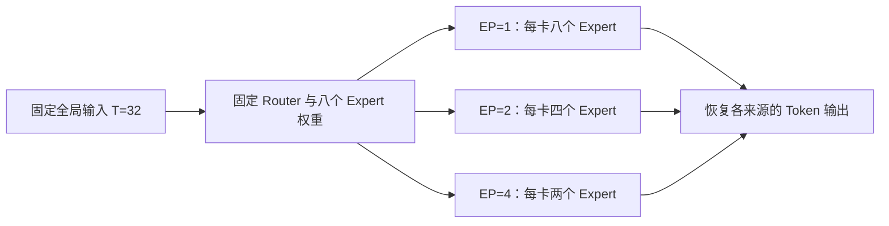
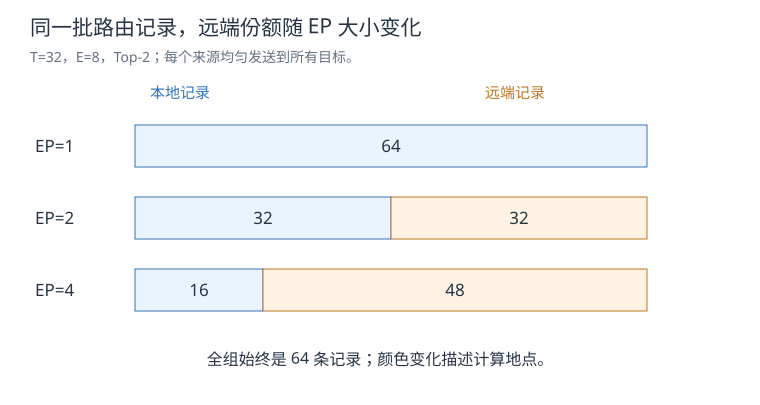
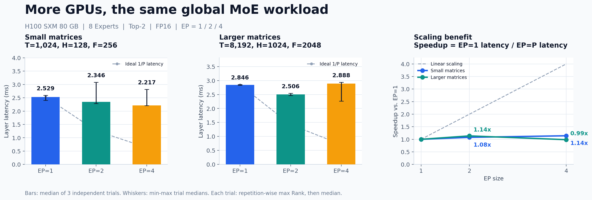
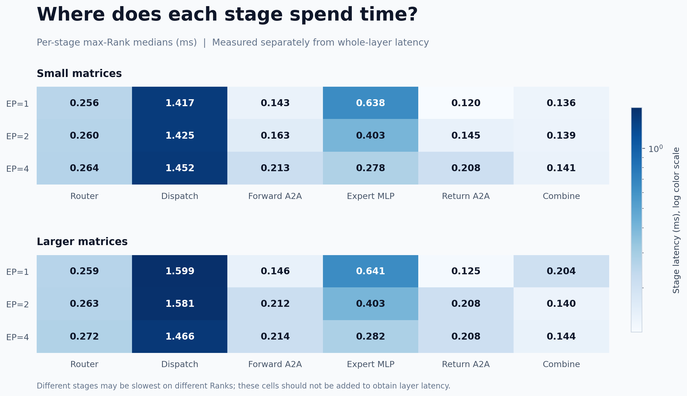
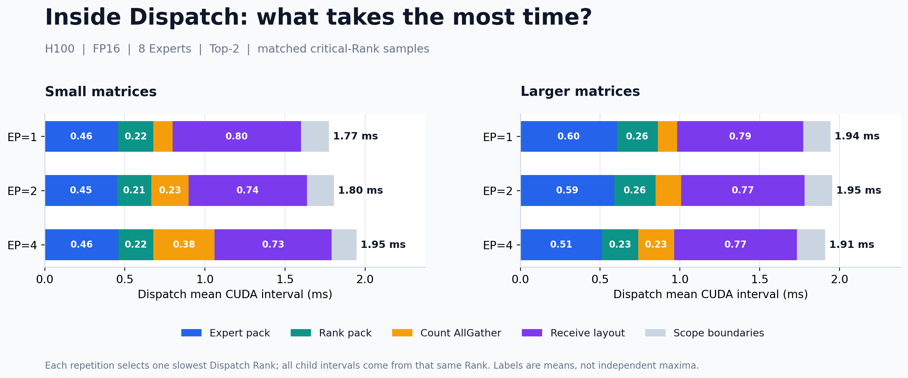
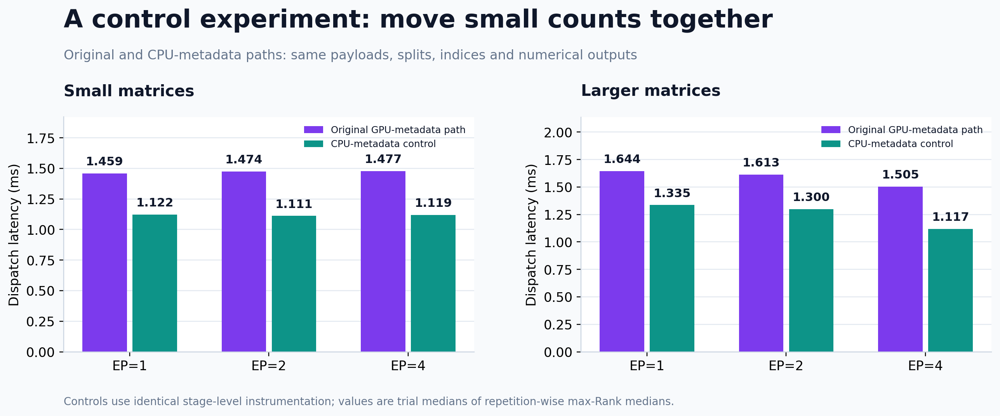

# 第 7 课：EP Scaling——把同一批 Token 分给更多 GPU

本课独立源码位于 `code/course7/`，示例在 `test/`，正确性测试在 `checks/`。下文命令均在本课目录中执行；将整个目录复制到其他位置后也使用同样的启动方式。

第六课把四个 Expert 放到两张 GPU 上，完成了 Token 的一次往返。接下来将 Expert 数扩展到八个，分别交给一张、两张和四张 GPU。模型还是同一个模型，输入还是同一批 Token，改变的是每张卡保存哪些 Expert、输入从哪个 Rank 出发，以及多少条记录需要跨卡。

先取 T=32、E=8、Top-2。全组共有 64 条 Token—Expert 记录。若路由均匀，每个 Expert 接收 8 行：EP=1 的一张卡处理全部 64 行，EP=2 每张卡处理 32 行，EP=4 每张卡处理 16 行。Expert 的单次矩阵乘法仍有 M=8；扩展 EP 减少的是每张卡负责的 Expert 数。与此同时，更多输入要访问远端 Expert，两次 All-to-All 的参与者也随之增加。

每张卡的计算量与 Token 的跨卡路径共同决定扩展后的耗时。比较 EP=1/2/4 时，统一输入、模型和计时口径，就能把延迟变化联系到具体的数据流；第八课再沿时间线分析负载与等待。

## 7.1 一份模型，三种放置

沿用第六课的符号：T 为全组原始 Token 数，H 为隐藏宽度，F 为 Expert 中间宽度，E 为全组 Expert 数，K 为每个 Token 选择的 Expert 数，P 为 EP group 的 Rank 数。当前示例等分输入，每个 Rank 持有 N=T/P 个 Token；路由展开后，本 Rank 发送 S=N×K 条记录。这里的 K 表示 Top-K，矩阵乘法的归约维则按具体投影写为 H 或 F。

| EP 大小 P | 每 Rank 原始 Token 数 N | 每 Rank 的 Expert | 均衡时每 Rank 接收记录数 | 每 Expert 的全组记录数 |
|---|---:|---|---:|---:|
| 1 | 32 | Rank 0：E0～E7 | 64 | 8 |
| 2 | 16 | Rank 0：E0～E3；Rank 1：E4～E7 | 32 | 8 |
| 4 | 8 | Rank r：E(2r)、E(2r+1) | 16 | 8 |

表中的接收行数是均衡路由下的数值。真实输入中，接收行数由所有来源的路由共同决定：Rank r 的 `recv_splits` 有 P 个元素，第 s 项表示来源 Rank s 发来的记录数。它们的和给出本 Rank 的 Expert 工作量。



图 7-1：固定全局输入时，Expert 在 EP=1/2/4 中的放置。

Router 在每个 Rank 上保存相同的 gate 权重，每个 Rank 只计算自己的输入行。Expert 权重按连续编号切片，`experts_per_rank=E/P`，`destination_rank=expert_id//experts_per_rank`。均匀放置采用 `E%P=0`，等分输入采用 `T%P=0`，各 Rank 因而分别持有 E/P 个 Expert 和 T/P 行输入。默认 Process Group 就是 EP group，单机 `global_rank=ep_rank`，`world_size=ep_size`，`local_rank` 用于选择进程可见的 CUDA 设备。

配套代码调用 `distribute_single_gpu_moe()` 从同一份 Reference 复制权重，再取 `global_tokens[r*N:(r+1)*N]`。本地输入为连续行主序 `[N,H]`，stride 为 `(H,1)`，dtype 为指定的 FP32、FP16 或 BF16，device 为当前 Rank 的 CUDA 设备。最终输出也是 `[N,H]`，按本地原始 Token 顺序排列；全组输出的归属始终跟随输入来源。

## 7.2 强扩展与弱扩展

比较扩展性需要先确定输入怎样变化。保持 T、E、H、F、K、权重和路由不变，增加 P，称为强扩展：观察完成同一批工作需要多久。令单卡和 P 卡的整层延迟分别为 L₁、Lₚ，加速比与并行效率为：

$$
S_P=L_1/L_P,\qquad \eta_P=S_P/P.
$$

如果单卡完成一批需要 4 ms，两卡需要 2.5 ms，则加速比为 1.6，并行效率为 0.8。这是理解计算方法的数值例子。吞吐使用原始 Token 数计数，同一批 Top-2 的 T=32 对应 32 个 Token 和 64 条 Expert 记录：

$$
\mathrm{tokens/s}=1000T/L_P\quad(L_P\text{ 的单位为 ms}).
$$

另一种比较保持每 Rank 输入 N 不变，让 T=N×P 随 GPU 数增长，称为弱扩展。此时均匀路由下，每个 Expert 的平均行数 TK/E 也随 P 增长。矩阵变大后，GEMM 的计算效率可能变化，所以要同时记录全局 T 和本地 N，分别解释每批延迟与全组吞吐。

配套工作负载把固定 seed、模型权重、全局输入和受控路由放在一起。`uniform` 让记录依次访问 Expert；第八课的 `hotspot` 将部分选择集中到 E0。在强扩展中，三个 EP 大小使用相同全局输入，因此全组 `tokens_per_expert` 相同。每卡原始输入数、Expert 所有权和发送矩阵随 P 变化。这样可以把扩展曲线与明确的数据流联系起来。

## 7.3 每卡计算量与跨卡载荷

Expert 由两次无偏置投影与 GELU 组成。对一个接收 Mₑ 行的 Expert，两次 GEMM 的乘加计算量约为 `4×Mₑ×H×F` FLOPs；GELU 的逐元素计算量单独计入。全组计算量为 `4×T×K×H×F`，强扩展时保持不变；均衡分给 P 张同型 GPU 后，每卡约为其 1/P。

这个估算还需要结合矩阵形状。前面的 T=32、K=2、E=8 给出每 Expert 八行，Up Projection 为 `[8,H] @ [H,F]`，Down Projection 为 `[8,F] @ [F,H]`。增加 EP 后，每卡调用的 Expert 更少，单个 Expert 的 M 仍为八。矩阵大小、权重访问和 Kernel 提交开销共同决定实际计算时间，第十一课将进一步处理这些小矩阵的调度。

通信载荷可以从发送矩阵直接核算。令 A[s,r] 为来源 s 发给目标 r 的记录数，一行向量占 H×b bytes，b 为每个元素的字节数。两次 All-to-All 都传输隐藏向量，跨 Rank 发送载荷合计为：

$$
V_{\rm remote}=2Hb\sum_{s\ne r}A[s,r].
$$

求和先统计输入发往远端 Expert 的记录，系数 2 再计入相同大小的返回结果。例如 A[0,1]=3 表示 Rank 0 送给 Rank 1 三行输入，计算后再收回三行输出，这一方向的往返载荷就是 6Hb。A 的对角元素属于本地 Expert；计数元数据单独统计。公式核算的是张量载荷，实际链路还承载协议与通信库内部流量。

若输入来源与 Expert 选择均匀且相互独立，远端比例约为 `1−1/P`。取 T=1024、K=2、H=128、FP32，每行 512 bytes，两次传输所有记录的载荷为 2 MiB。EP=2 的远端载荷约 1 MiB，EP=4 约 1.5 MiB。更具体的结果由 A 决定：同卡 Expert 的选择次数较多时，远端比例相应降低。

简单通信模型写作 `α+V/B_eff`：α 是启动和准备代价，B_eff 是当前路径上的有效带宽。小载荷更容易显现启动代价，大载荷对链路带宽更敏感。布局构造、计数交换和 Host 侧 splits 准备又发生在向量通信之前，它们一起决定第一批数据何时能够发出。

再用开头的 T=32、E=8、Top-2 追踪实际行数，并令 H=8、dtype=FP32。若每个来源都将记录均匀分给所有目标，EP=2 时全组有 32 条本地记录与 32 条远端记录；EP=4 时分别为 16 条与 48 条。两种配置中，每个 Expert 始终处理八行。



图 7-2：固定 64 条路由记录时，本地与远端记录的变化。

每行占 32 bytes，输入与结果各传一次，所以两卡的远端载荷为 `2×32×32=2048` bytes，四卡为 `2×48×32=3072` bytes。这组手算把计算分摊与跨卡比例联系起来：Expert 的 M 没有变，每张卡负责的 Expert 更少，而需要远端往返的记录更多。

## 7.4 最慢 Rank 的计时口径

一层 MoE 输出要等所选 Expert 的结果返回。某个 Rank 更早完成时，它的局部时间描述自己的进度；整组测量需要把参与者放到同一轮迭代中。配套基准先收集每个 Rank 的第 i 次 CUDA Event 时间，再对相同 i 取最大值，最后对这些最大值取中位数：

$$
L_P=\operatorname{median}_i\left(\max_r L_{r,i}\right).
$$

下面的函数接收本 Rank 的样本列表。浮点时间转换成当前 CUDA 设备上的 FP64 向量，组内逐元素 MAX 后再转到 CPU。样本位置 i 始终对应同一次前向，通信统计放在被测前向之外。

**最慢 Rank 样本 · code/course7/benchmarks/benchmark_ep.py**

```python
from __future__ import annotations
import torch
import torch.distributed as dist

def max_rank_samples(samples, device, group):
    """Reduce matching repetition slots after timing; no metric collective inside a sample."""
    tensor = torch.tensor(samples, device=device, dtype=torch.float64)
    dist.all_reduce(tensor, op=dist.ReduceOp.MAX, group=group)
    return tensor.cpu().tolist()
```

这种顺序保留了每轮出现的慢 Rank。假设两轮中 Rank 0 的时间为 `[4,1]` ms，Rank 1 为 `[1,4]` ms，两轮整组时间都是 4 ms。若先分别取平均，再比较两个 Rank，就会得到 2.5 ms，丢失逐轮等待关系。

CUDA Event 的结束位置决定哪些工作被计入延迟。NCCL 在内部通信流执行，配套同步 `all_to_all_single()` 封装建立当前流对通信工作的完成依赖，后续 Expert 能读取接收缓冲区。同一当前流上的结束 Event 因而排在整次同步前向的结果之后。输入已在 GPU 上，初始化、模型构造和 Reference 比较放在计时区间外。

**前向计时 · code/course7/benchmarks/benchmark_ep.py**

```python
from __future__ import annotations
import torch
import torch.distributed as dist
from benchmarks.benchmark_ep import max_rank_samples

def measure_forward(model, tokens, group, warmup, repeats):
    """Current-stream end-to-end CUDA samples; inputs already reside on device."""
    if warmup < 0 or repeats <= 0:
        raise ValueError(f"need warmup >= 0, repeats > 0; got {warmup}, {repeats}")
    for _ in range(warmup):
        model(tokens, group=group)
    torch.cuda.synchronize(tokens.device)
    dist.barrier(group=group)
    pairs = []
    for _ in range(repeats):
        started = torch.cuda.Event(enable_timing=True)
        ended = torch.cuda.Event(enable_timing=True)
        started.record()
        model(tokens, group=group)
        ended.record()
        pairs.append((started, ended))
    torch.cuda.synchronize(tokens.device)
    return max_rank_samples([a.elapsed_time(b) for a, b in pairs], tokens.device, group)
```

预热让后端完成首次初始化并进入重复执行；测量开始前排空已提交工作，并用组内 barrier 对齐这一测量边界。每轮前向内部保持原来的 collective 顺序，所有 Rank 完成样本后，再汇总时间向量。此处测量的是设备流上从前向开始到结果可用的间隔；Host 提交不及时造成的空档也会反映在该间隔里。

## 7.5 整层耗时与阶段分解

同步版本的执行依赖依次经过 `ROUTER → DISPATCH → A2A_FORWARD → EXPERT → A2A_RETURN → COMBINE`。阶段记录器在这些边界放置 CUDA Event，便于解释时间花在哪里；无阶段 Event 的原模型前向用于主要的端到端延迟。两组测量使用相同输入与权重。

DISPATCH 的口径包含 Top-K 展开、Expert 打包、Rank 打包、Expert 计数交换和接收布局构造。两次向量 A2A 分别计时，EXPERT 包括收集本地行、MLP 和结果回写，COMBINE 包括从 Rank 顺序恢复为 Expert 顺序与加权求和。`send_splits.tolist()` 和 `recv_splits.tolist()` 的 Host 准备位于向量通信之前，应结合 Timeline 检查其等待。

阶段统计保留每个 Rank 的时间，便于找到计算或通信较慢的位置。各阶段最大值可能来自不同进程：Rank 0 的 Expert 最慢时，Rank 1 可能在返回 A2A 中等待最久。两项相加会重复包含同一次负载差异带来的等待。因此，整层延迟使用完整前向样本，阶段耗时用来解释这段延迟的来源。

配套入口为 `test/demo.py`。在 `code/course7` 目录、可见 GPU 数不少于所选 EP 大小、CUDA/NCCL 就绪的条件下，以下命令保持全局 T=1024、H=128、F=256、E=8、Top-2 和 FP32。FP32 比较关闭 TF32，以保持同一数值基准。命令中的 `NCCL_NVLS_ENABLE=0` 使用常规 NCCL 通信路径；NVLS 是 NVLink SHARP 的可选集体通信加速机制。

**EP 扩展 · test/demo.py**

```bash
cd code/course7
for ep in 1 2 4; do
  NCCL_NVLS_ENABLE=0 torchrun --standalone --nproc-per-node="$ep" \
    test/demo.py --tokens 1024 --hidden-size 128 \
    --expert-hidden-size 256 --num-experts 8 --top-k 2 --dtype float32 \
    --warmup 5 --repeats 20 --output "results/ep${ep}.json"
done
```

输出记录每轮最慢 Rank 时间、中位数、原始 Token 吞吐、阶段时间、全组 Expert 计数、Rank 接收行数、通信载荷和软件环境。比较三份结果时，先用配置确认工作量一致，再将延迟变化连接到矩阵数量、远端载荷和阶段时间。下一课进一步展开后两项：负载如何集中到某个 Rank，以及 Timeline 怎样把通信等待、GPU 工作和 Host 空档连起来。

相关实现：[分布式前向](https://gitee.com/hellofss/miniep1/blob/master/code/course7/mini_ep/model/moe.py)、`mini_ep/profiler/stages.py`。背景阅读可参考 [AI Infra 的专家放置与负载分析](https://github.com/bojieli/ai-infra-book/blob/main/manuscripts/09-%E5%88%86%E5%B8%83%E5%BC%8F%E6%8E%A8%E7%90%86.md)。

配套源码、运行依赖与各课入口见[课程首页](https://tvle9mq8jh.feishu.cn/wiki/QJp1wvBlgiiYV5kEOqFcpNtNnie)的源码附件；标题中的路径对应解压后的仓库相对路径。

## 7.6 H100 实测：计算分摊了，整层能快多少？

固定八个 Expert、Top-2、FP16 与均匀路由，在四张通过 NVLink 连接的 H100 80GB GPU 上比较 EP=1/2/4。两组负载都保持全局输入、权重和路由不变，只改变输入分片与 Expert 放置。

### 7.6.1 两组固定负载

| 负载 | 全组 Token 数 T | 输入宽度 H | 中间宽度 F | 每 Expert 行数 M=TK/E |
| --- | --- | --- | --- | --- |
| 小矩阵 | 1024 | 128 | 256 | 256 |
| 较大矩阵 | 8192 | 1024 | 2048 | 2048 |

每个配置预热 50 次、测量 100 次，独立运行三轮。每轮先对相同重复位置取最慢 Rank，再求中位数；表中延迟为三轮中位数的中位数，图中误差线覆盖三轮的最小值与最大值。

```bash
cd code/course7
CUDA_VISIBLE_DEVICES=0,1,2,3 NCCL_NVLS_ENABLE=0 \
python3 benchmarks/run_scaling_experiment.py \
  --cases small large --ep-sizes 1 2 4 \
  --trials 3 --warmup 50 --repeats 100 \
  --output-dir results/scaling
```

脚本依次启动各组 `torchrun`，核对 Reference、全组路由指纹和各方向 splits，再保存逐 Rank 的耗时样本。只有两张 GPU 时，将 `--ep-sizes` 改为 `1 2`。

### 7.6.2 整层延迟与扩展收益



| 负载 | EP | 延迟 / ms | 吞吐 / Token·s⁻¹ | 加速比 | 并行效率 | 远端往返 / MiB |
| --- | --- | --- | --- | --- | --- | --- |
| 小矩阵 | 1 | 2.529 | 404,833 | 1.00× | 100.0% | 0 |
| 小矩阵 | 2 | 2.346 | 436,535 | 1.08× | 53.9% | 0.5 |
| 小矩阵 | 4 | 2.217 | 461,984 | 1.14× | 28.5% | 0.75 |
| 较大矩阵 | 1 | 2.846 | 2,878,118 | 1.00× | 100.0% | 0 |
| 较大矩阵 | 2 | 2.506 | 3,268,308 | 1.14× | 56.8% | 32 |
| 较大矩阵 | 4 | 2.888 | 2,836,235 | 0.99× | 24.6% | 48 |

小矩阵的整层延迟从单卡 2.529 ms 降到四卡 2.217 ms，加速约 1.14 倍；四张卡的并行效率约为 28.5%。增加 GPU 后，每卡处理量下降，但整层耗时并未缩短到单卡的四分之一。

较大矩阵在两卡时约为 2.506 ms，比单卡快 1.14 倍；四卡中位数为 2.888 ms，与单卡接近。四卡的三轮中位数分布在 2.266～2.936 ms，误差线与单卡重叠，这组数据没有显示稳定的四卡加速。

### 7.6.3 从阶段耗时解释结果



**Expert 计算确实被分摊。** 较大矩阵的 EXPERT 从单卡 0.641 ms 降到四卡 0.282 ms，减少约 56%。每个 Expert 的 M 仍为 2048，变化的是每卡负责的 Expert 数：八个、四个、两个。这个阶段同时包含输入收集、MLP 和结果写回。

**Dispatch 没有随卡数成比例缩短。** 小矩阵的 DISPATCH 约为 1.42～1.45 ms，较大矩阵约为 1.47～1.60 ms。展开、打包、计数 AllGather 和接收布局构造仍占据较长区间，因此减少 Expert 时间带来的收益只覆盖整层的一部分。后续可沿这一阶段继续拆解布局构造、Host 读取与计数通信。

**远端载荷与通信阶段一起增加。** 小矩阵四卡的输入 A2A 约为 0.213 ms，返回 A2A 约为 0.208 ms；单卡对应阶段也包含缓冲区处理和本地通信接口开销，不能直接当成零。较大矩阵的远端往返载荷从两卡 32 MiB 增到四卡 48 MiB，计算分摊与新增通信共同影响整层结果。

载荷按 `2×T×K×H×2×(1−1/P)` 计算：FP16 每元素两字节，输入和结果各传一次。较大矩阵的全组往返向量总量为 64 MiB，两卡的一半跨 Rank，四卡的四分之三跨 Rank。

阶段图展示各自的最慢 Rank，中位数也在各阶段独立计算，不能将六格相加作为整层延迟。整层加速比始终由图 7-3 的完整前向样本计算。

### 7.6.4 原始数据与图表复现

```bash
python3 -m pip install -r requirements-plot.txt
python3 benchmarks/plot_scaling_experiment.py \
  --input results/scaling/summary.json \
  --output-dir results/scaling/figures
```

课件使用的原始数据位于 `code/course7/results/h100_scaling_20261014/scaling/`：`summary.json` 汇总表格，`reports.json` 收集三轮报告，`raw/` 保存逐 Rank 原始样本、阶段样本、splits、环境和日志，`figures/` 保存 PNG 与 SVG。18 次配置运行均通过 Reference 检查。

### 7.6.4 拆开 DISPATCH：哪一步最耗时？

前面的 DISPATCH 约为 1.5 ms，其中既有输入打包，也有计数交换与接收布局构造。沿用两组 FP16 负载和 EP=1/2/4，将这段准备工作拆成四步：

| 子阶段 | 主要工作 |
| --- | --- |
| EXPERT_PACK | 展开 Top-K，按 Expert 排序，收集向量与路由 metadata |
| RANK_PACK | 按目标 Rank 打包，生成发送 splits 和恢复索引 |
| COUNT_ALLGATHER | 收集各来源的逐 Expert 计数 |
| RECEIVE_LAYOUT | 计算接收 splits、来源偏移和每个本地 Expert 的行索引 |

先在完整前向中加入子阶段计时，定位最大项；再沿用原 DISPATCH 边界，比较原始路径与元数据对照路径。细分计时增加了 Event 与 Host 提交，分解图中的绝对时间对应这条插桩路径。



| 负载 | EP | Expert 打包 / ms | Rank 打包 / ms | 计数 AllGather / ms | 接收布局 / ms | 布局占比 |
| --- | --- | --- | --- | --- | --- | --- |
| 小矩阵 | 1 | 0.458 | 0.221 | 0.119 | 0.802 | 45.2% |
| 小矩阵 | 2 | 0.453 | 0.213 | 0.233 | 0.738 | 40.9% |
| 小矩阵 | 4 | 0.460 | 0.218 | 0.383 | 0.731 | 37.5% |
| 较大矩阵 | 1 | 0.605 | 0.256 | 0.122 | 0.789 | 40.6% |
| 较大矩阵 | 2 | 0.588 | 0.259 | 0.160 | 0.774 | 39.6% |
| 较大矩阵 | 4 | 0.512 | 0.226 | 0.227 | 0.769 | 40.3% |

**接收布局构造是最大的单项，约占细分总时间的 38%～45%；Expert 打包次之。** 较大矩阵四卡时，布局构造约为 0.769 ms，Expert 打包约为 0.512 ms，计数 AllGather 约为 0.227 ms。

**为什么 GPU 增多后，布局构造仍然较慢？** `build_receive_layout()` 要逐一处理“来源 Rank × 本地 Expert”的区间，每个区间读取前缀行数、来源块起点和当前 Expert 行数。这三次 `.item()` 将 GPU 标量交给 Python 使用，并等待相应数据就绪。

| EP 大小 P | 本地 Expert 数 E/P | 每 Rank 推导区间数 | 循环中的 GPU 标量读取次数 |
| --- | --- | --- | --- |
| 1 | 8 | 1×8=8 | 8×3=24 |
| 2 | 4 | 2×4=8 | 8×3=24 |
| 4 | 2 | 4×2=8 | 8×3=24 |

本地 Expert 虽然减少，来源 Rank 却增多，循环次数始终为 `P×(E/P)=E=8`。Torch Profiler 在较大负载 EP=4、Rank 0 的采样中记录到每次前向 26 次 `aten::item` 调用，其中循环显式读取 24 个标量，其余来自校验等操作；计数 AllGather 区间内为零次。

**用对照实验检验这条开销。** 保留计数 AllGather，将小计数矩阵批量取回 CPU，沿用相同的布局推导，再把 splits 和行索引放回 GPU。Token 向量、Expert 计算和两次向量 A2A 保持相同，输出与布局 metadata 逐项对齐。



| 负载 | EP | 原始 DISPATCH / ms | CPU 元数据对照 / ms | 耗时减少 |
| --- | --- | --- | --- | --- |
| 小矩阵 | 1 | 1.459 | 1.122 | 23.1% |
| 小矩阵 | 2 | 1.474 | 1.111 | 24.7% |
| 小矩阵 | 4 | 1.477 | 1.119 | 24.2% |
| 较大矩阵 | 1 | 1.644 | 1.335 | 18.8% |
| 较大矩阵 | 2 | 1.613 | 1.300 | 19.4% |
| 较大矩阵 | 4 | 1.505 | 1.117 | 25.8% |

较大矩阵四卡的 DISPATCH 从 1.505 ms 降至 1.117 ms，减少约 25.8%；小矩阵四卡从 1.477 ms 降至 1.119 ms，减少约 24.2%。该对照同时减少了 GPU 计数的逐项取回，以及前缀求和、区间索引等小算子的 GPU 提交。

**这组结果将优化重点定位到接收布局构造，其次是 Expert 打包。** 布局构造处理的数据很小，耗时却受逐项标量读取和细碎算子提交影响。下一步可优先减少这些往返与提交，再优化打包中的排序和向量复制；表中的下降比例描述 DISPATCH 阶段，整层收益仍需通过完整前向测量。
