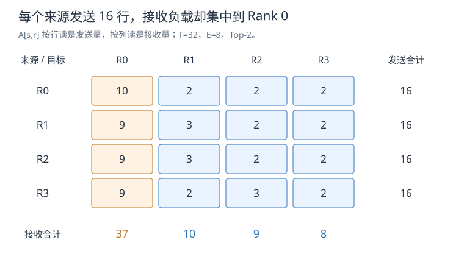
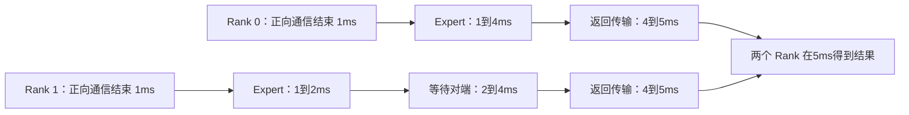

# 第 8 课：负载均衡与 Profiling——沿时间线寻找瓶颈

本课独立源码位于 `code/course8/`，示例在 `test/`，正确性测试在 `checks/`。下文命令均在本课目录中执行；将整个目录复制到其他位置后也使用同样的启动方式。

两张 GPU 都持有两个 Expert，输入也各有一半，计算时却可能一张卡很忙、另一张卡很早完成。原始 Token 的等分决定谁运行 Router，路由结果决定谁接收记录并运行 Expert。输入均分以后，还需要沿路由查看计算落到了哪里。

沿用第二课的三个 Token：路由为 `[[2,0],[1,2],[0,1]]`，Top-2 展开后六条记录，四个 Expert 的全组计数为 `[2,2,2,0]`。若 Rank 0 保存 E0、E1，Rank 1 保存 E2、E3，接收工作量就是 `[4,2]`。输入侧可以接近平分，计算侧却有两倍的行数差距。如果在这个例子中把 E1 与 E3 的放置交换，两个 Rank 都会接收三行；Expert 的选择次数保持原样，Rank 负载发生变化。这里用放置变化说明两种负载的关系，配套实现继续使用连续 Expert 编号的均匀放置。

第七课已经确定整层耗时的统计方法。接下来把 Expert 计数汇总为 Rank 负载，再连接到时间线上的计算与等待，就能解释哪些工作使结果晚到，并为后续的 Dispatch、Combine 和 GEMM 优化找到具体对象。

## 8.1 Expert 热度与 Rank 负载

Expert 的全组计数记为 cₑ。对均匀放置，Rank r 拥有连续的一组 Expert，接收行数是这些 cₑ 的和：

$$
R_r=\sum_{e\in\mathcal E_r}c_e,\qquad \sum_rR_r=TK.
$$

第六课的 `tokens_per_expert_all` 为 `[P,E]`、CUDA int64。第 s 行描述来源 Rank s 的 Expert 分配次数；沿来源维求和，得到全组 `[E]` 计数。接收行数 Rᵣ 与各来源 `recv_splits` 之和一致；Expert 集合按目标 Rank 分组，形成全组 `[P]` 工作量。

用最大值除以均值，可以量化分布偏离均衡的程度：

$$
I_E=\frac{\max_ec_e}{TK/E},\qquad
I_R=\frac{\max_rR_r}{TK/P}.
$$

对 `[2,2,2,0]`，Expert 均值为 1.5，I_E=4/3；Rank 计数 `[4,2]` 的均值为 3，I_R=4/3。交换 E1 与 E3 后，I_E 仍为 4/3，I_R 变为 1。同一个热点分布，经不同放置会产生不同的 Rank 负载。

下面的函数接收 `[E]` 或 `[P,E]` 的整数计数。统计在 CPU 上进行，方便报告；前向通信仍使用 GPU 上的 metadata。空工作量的比例定义为零，以便空输入场景保持明确的返回值。

**负载统计 · code/course8/mini_ep/utils/course_workload.py**

```python
from __future__ import annotations
import torch

def load_metrics(counts: torch.Tensor, ep_size: int) -> dict[str, object]:
    """CPU counts [E] or [P,E] -> global Expert and Rank row statistics."""
    if counts.ndim not in (1, 2) or counts.dtype not in (torch.int32, torch.int64):
        raise ValueError(
            f"need integer counts [E] or [P,E], got {counts.shape}/{counts.dtype}"
        )
    if ep_size <= 0 or counts.shape[-1] % ep_size:
        raise ValueError(f"E={counts.shape[-1]} must be divisible by P={ep_size}")
    global_counts = counts.sum(0) if counts.ndim == 2 else counts
    rank_counts = global_counts.reshape(ep_size, -1).sum(1)

    def ratio(v):
        mean = v.float().mean().item()
        return v.max().item() / mean if mean else 0.0

    return {
        "tokens_per_expert": global_counts.tolist(),
        "rows_per_rank": rank_counts.tolist(),
        "expert_imbalance": ratio(global_counts),
        "rank_imbalance": ratio(rank_counts),
    }
```

相同 H、F、dtype 的两投影 Expert，GEMM FLOPs 与记录数成正比。但行数和时间之间还经过矩阵形状、权重复用、后端选择与调度。三个八行 Expert 与一个二十四行 Expert 有相同的行数总和，Kernel 调用次数和 GEMM 形状不同；时间线将这些差异进一步分开。

## 8.2 均衡路由与热点路由

随机 gate 便于获得自然波动，受控 gate 则适合比较单个因素。配套代码用输入的前 E 个特征存放 Expert 得分，gate 的前 E 列设为单位矩阵。这样 `tokens[:, :E]` 就是 logits，每个 Token 选择哪些 Expert 可以直接从这些特征读出，其他输入特征仍由固定 seed 生成。

`uniform` 将记录依次分给 Expert。对 T=32、E=8、Top-2，Expert 计数为 `[8,8,8,8,8,8,8,8]`，EP=4 的 Rank 计数为 `[16,16,16,16]`。`hotspot` 在 Top-2 下让每个 Token 都选择 E0，另一条分支依次选择 E1～E7；计数为 `[32,5,5,5,5,4,4,4]`，Rank 计数为 `[37,10,9,8]`。同一个 Token 的两条分支选择不同 Expert，因此 E0 最多占全部 Top-2 记录的一半。

Top-1 的 `hotspot` 把 `floor(0.6T)` 个 Token 分给 E0，其余分给其他 Expert，用来研究更集中的工作量。每次比较保持模型参数和输入生成规则一致；改变路由时，比较对象是两种明确工作负载下的时间分解。

| 场景 | T、E、K | 全组 Expert 计数 | EP=4 的 Rank 行数 | I_R |
|---|---|---|---|---:|
| 均衡 | 32、8、2 | `[8,8,8,8,8,8,8,8]` | `[16,16,16,16]` | 1 |
| E0 热点 | 32、8、2 | `[32,5,5,5,5,4,4,4]` | `[37,10,9,8]` | 2.3125 |

热点同时改变接收、计算和返回的工作。Rank 0 要接收 37 行，执行相应 Expert，再把 37 行结果按来源块送回。原始输入仍等分为每 Rank 八行，发送方向和接收方向的压力因此不同。第七课的发送矩阵 A[s,r] 能显示这份差异：行和表示来源 s 的发送量，列和表示目标 r 的接收量。在此例中，各行和都是 16，列和则为 `[37,10,9,8]`。同一批 64 条记录，从发送侧和接收侧看具有不同分布。

这份发送矩阵可以从受控路由逐行算出。Rank 0 的八个 Token 都选择 E0，另一个分支中 E1 出现两次，E2～E7 各一次。因此它发往四个目标的行数是 `[10,2,2,2]`。其余来源沿同一循环继续选择，得到下图。



图 8-1：热点路由的发送矩阵同时呈现来源负载与目标负载。

每行合计都是 16，说明各来源的路由分支数相同。第 0 列合计 37，说明 E0/E1 所在的 Rank 0 接收最多；其余列合计为 10、9、8。Rank 0 的接收行数是平均 16 行的 2.3125 倍。这是后面读取 EXPERT 与 A2A_RETURN 时间线时应当对应的工作量。

## 8.3 负载差异与关键路径

设两张卡在 1 ms 时都完成正向 A2A。Rank 0 的 Expert 计算需要 3 ms，Rank 1 需要 1 ms。Rank 1 在 2 ms 发起返回 A2A，Rank 0 在 4 ms 才进入同一 collective；返回传输用时 1 ms，两个 Rank 都在 5 ms 获得结果。



图 8-2：两张卡的 Expert 负载差异如何形成返回等待。

在这个依赖例子里，Rank 1 的返回阶段跨度为 3 ms，其中 2 ms 来自更早进入 collective 后的等待，1 ms 来自数据传输。Rank 0 的 Expert 阶段更长，Rank 1 的 A2A 返回阶段更长，两项都指向同一条关键路径。关键路径是决定结果最早可用时刻的依赖链。

实际 Timeline 中，等待可能体现为 NCCL Kernel 持续运行、CUDA Stream 依赖或 Host 侧同步。A2A 范围覆盖通信调用及其等待。结合对端到达时刻、传输字节数和链路活动，可以进一步区分等待与实际传输所占的时间。

## 8.4 三种观察尺度

PyTorch Profiler 记录框架算子、Host 调用与 CUDA 活动，用来追踪一次 `index_select`、`argsort` 或 GEMM 对应的执行。NVTX 是代码放置的范围标记，让 Nsight Systems 时间线上出现业务名称。Nsight Systems 同时展示 Host 线程、CUDA API、GPU Stream、Kernel 与内存操作，适合把提交、等待和执行连成一条链。

| 观察对象 | 主要问题 | 本课对应信息 |
|---|---|---|
| 路由 metadata | 工作发给了谁 | Expert 计数、发送矩阵、Rank 接收行数 |
| PyTorch 算子事件 | 哪些调用生成了 GPU 工作 | 排序、索引、MLP、权重乘法与求和 |
| CUDA/NCCL Timeline | 工作何时提交、何时完成、谁在等待 | Kernel、Stream、Host 空档、通信对端到达 |

GPU 利用率的含义随指标而变化。监控工具的 GPU 活跃比例描述采样区间内是否有工作；SM 指标描述计算资源忙碌程度；GEMM 的 FLOPs/时间衡量矩阵计算吞吐。长时间运行的通信 Kernel 也会使设备保持活跃。将利用率与当前执行阶段对应起来，可以判断 Expert 计算是否获得了足够工作。

配套阶段记录器对同一段代码发出 `record_function` 与 NVTX 范围，并按需要记录 CUDA Event。所有事件使用当前 Rank 的设备和当前流；样本在测量边界同步后读取。

**阶段范围 · code/course8/mini_ep/profiler/stages.py**

```python
from __future__ import annotations
from collections.abc import Iterator
from contextlib import contextmanager
import torch
from mini_ep.profiler.nvtx import nvtx_range

class StageRecorder:
    def __init__(self, device: torch.device, timing: bool = False):
        self.device = torch.device(device)
        if timing and self.device.type != "cuda":
            raise ValueError("CUDA Event stage timing needs a CUDA device")
        self.timing = timing
        self.events: dict[str, list] = {}

    @contextmanager
    def stage(self, name: str) -> Iterator[None]:
        """Label host scope; CUDA events bracket dependent current-stream work."""
        pair = None
        if self.timing:
            with torch.cuda.device(self.device):
                pair = (
                    torch.cuda.Event(enable_timing=True),
                    torch.cuda.Event(enable_timing=True),
                )
                pair[0].record()
        with torch.profiler.record_function(name), nvtx_range(name):
            yield
        if pair is not None:
            with torch.cuda.device(self.device):
                pair[1].record()
            self.events.setdefault(name, []).append(pair)

    def samples_ms(self) -> dict[str, list[float]]:
        """Call after the measurement boundary has synchronized this device."""
        return {
            name: [a.elapsed_time(b) for a, b in pairs]
            for name, pairs in self.events.items()
        }
```

`record_function` 将业务名称放进 PyTorch 跟踪，NVTX 将同样的名称放进 Nsight 跟踪；两者标记的是 Host 代码范围。范围中的 CUDA API 进一步关联 GPU 工作。CUDA Event 提供当前流上的设备时间，两套信息连接起来，才能区分 Host 范围持续时间和 GPU 实际执行区间。[PyTorch Profiler](https://docs.pytorch.org/tutorials/recipes/recipes/profiler_recipe.html)介绍了算子范围与 Chrome Trace 的对应关系。

`run_ep_stages()` 沿用第六课的 Reference 前向和 collective 顺序：先 Router，再打包与计数交换，正向 A2A，本地 Expert，返回 A2A，最后恢复与 Combine。范围名称统一为 `ROUTER`、`DISPATCH`、`A2A_FORWARD`、`EXPERT`、`A2A_RETURN`、`COMBINE`。

## 8.5 从算子表读到 Timeline

先在算子表中寻找相对占比，再沿 Timeline 解释因果关系。若 DISPATCH 中排序和索引调用密集，且第一轮向量通信等待这些数据准备，优化对象就包括布局构造。若 EXPERT 中大量小 GEMM 之间有提交间隙，Grouped GEMM 可以改变工作组织。若 COMBINE 连续读写多份 `[N,K,H]` 中间结果，第十课的融合可以减少这些中转。

Timeline 还会显示 CPU 与 GPU 的衔接。GPU Tensor 的 `.tolist()` 要将 splits 转到 Host，调用可能等待前面的计数完成；后续 `all_to_all_single()` 又需要这些列表才能发起。此时，Host 准备和设备工作之间形成明确依赖。Dispatch 的调用耗时由 metadata 生成、排序、复制与相关准备工作共同组成，第九课据此比较 Reference 与 Triton 实现。

对阶段汇总，还要区分嵌套范围的 inclusive time 与 self time。inclusive time 包含子范围，self time 扣除子范围；把父子范围都累加，会重复计入同一段工作。跨 Rank 分析则保留每个 Rank 的时间线，并用 collective 次序和业务迭代对应事件。不同进程的 GPU 时钟用于计算各自间隔，因果关系通过通信和流依赖建立。

在两张可见 GPU 上，下面的命令保持第七课的测量条件，增加 `--scenario hotspot --profile torch`。采集发生在独立区间，每个 Rank 导出一份 JSON Trace；端到端数字仍来自采集之前的无 Profiler 前向。

**负载与算子跟踪 · test/demo.py**

```bash
cd code/course8
NCCL_NVLS_ENABLE=0 torchrun --standalone --nproc-per-node=2 \
  test/demo.py --tokens 1024 --num-experts 8 --top-k 2 \
  --hidden-size 128 --expert-hidden-size 256 --dtype float32 \
  --scenario hotspot --profile torch --trace-dir results/hotspot-traces \
  --warmup 5 --repeats 20 --output results/hotspot.json
```

`rank0.json` 与 `rank1.json` 可以在支持 Chrome Trace 的查看器中打开。两卡 `EXPERT` 范围连接到不同 Expert 计数，`A2A_RETURN` 范围连接到各自进入 collective 的时刻。对比 `uniform` 场景，可以追踪输入分布怎样改变整层关键路径。

Nsight Systems 使用同样的阶段名称，记录 CUDA、NVTX 与操作系统运行时活动。下面通过 `torchrun` 启动两个进程；关闭 CPU 采样和上下文切换采集，采集 CUDA 调用、Kernel 与阶段范围的时间线。

**系统时间线 · test/demo.py**

```bash
NCCL_NVLS_ENABLE=0 nsys profile --sample=none --cpuctxsw=none \
  --trace=cuda,nvtx,osrt --output=results/ep-hotspot \
  torchrun --standalone --nproc-per-node=2 test/demo.py \
  --tokens 1024 --num-experts 8 --top-k 2 --scenario hotspot \
  --hidden-size 128 --expert-hidden-size 256 --dtype float32 \
  --profile nvtx --warmup 5 --repeats 20 --output results/ep-hotspot.json
```

`.nsys-rep` 保存可在 Nsight Systems GUI 中阅读的时间线。采集后的整层时间、Kernel 持续时间、Host 提交空档和 NCCL 等待各有不同用途；选择优化对象时，将其与记录数、字节数和布局依赖一起解释。第九课从最靠近通信输入的阶段开始，先用 Reference 定义稳定的记录顺序，再将计数与向量打包写成 Triton Kernel。

延伸阅读：[PyTorch 与系统级 Profiling](https://tvle9mq8jh.feishu.cn/wiki/FVbkwEzi8iwBtLkF8SZcR3t4nkf)、[专家并行与负载](https://tvle9mq8jh.feishu.cn/wiki/G1eQwv1iSiP9pakc4zDcnayKnrd)。

配套源码、运行依赖与各课入口见[课程首页](https://tvle9mq8jh.feishu.cn/wiki/QJp1wvBlgiiYV5kEOqFcpNtNnie)的源码附件；标题中的路径对应解压后的仓库相对路径。
