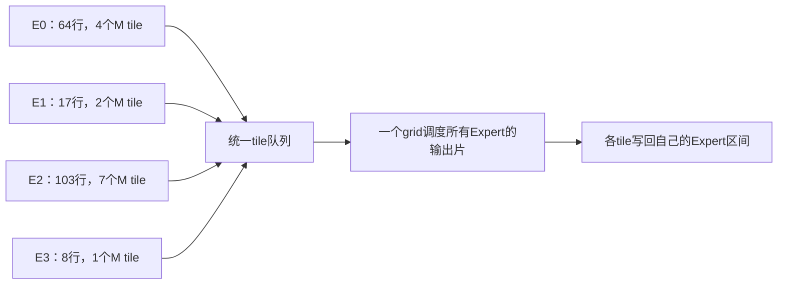
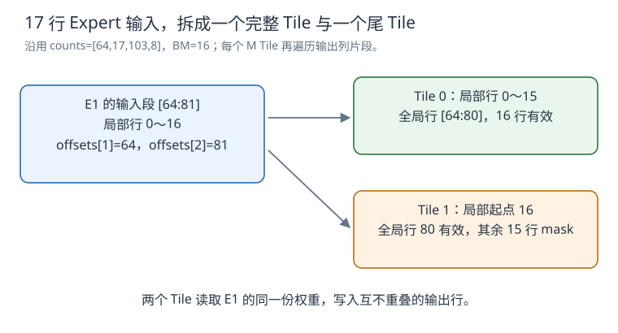
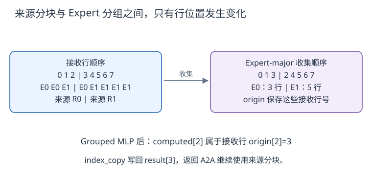

# 第 11 课：Grouped GEMM——把不同大小的 Expert 矩阵放进同一次调度

本课独立源码位于 `code/course11/`，示例在 `test/`，正确性测试在 `checks/`。下文命令均在本课目录中执行；将整个目录复制到其他位置后也使用同样的启动方式。

第六课的 Expert 阶段逐个取出本地行，运行 MLP，再写回接收位置。假设四个本地 Expert 分别收到 `[64,17,103,8]` 行，Up Projection 的输入形状就是 `[64,H]`、`[17,H]`、`[103,H]`、`[8,H]`，四份权重都具有 `[F,H]` 的形状。矩阵行数不同，投影结构相同。

逐 Expert 调用为每份矩阵单独进入 GEMM 后端。另一种组织方式先列出这些矩阵需要的输出 tiles，将它们交给同一个 GPU grid。GPU 可以在一次 launch 中调度属于不同 Expert 的 tile，各 tile 仍读取自己的输入段和权重。这就是 Grouped GEMM：一组独立矩阵乘法共用一次工作调度。

要把这些矩阵放进同一次调度，需要告诉每个程序实例：它负责哪个 Expert、从哪一行开始、读取哪份权重。下面先用 Expert Loop 定义计算结果，再用布局与 tile 表表达这份工作，最后接回完整 EP。

## 11.1 变长矩阵与权重布局

本 Rank 拥有 L=E/P 个 Expert。令 Mₑ 为本地 Expert e 的接收行数，R 为总接收记录数，则 `R=sum(Mₑ)`。计算输入先整理成 Expert-major `[R,H]`，第 e 个 Expert 的输入位于 `[offsets[e],offsets[e+1])`。offsets 为 `[L+1]` 的 CUDA int64，首项为零，末项为 R。

Up 权重堆叠为 `[L,F,H]`，Down 权重为 `[L,H,F]`。它们沿用 `nn.Linear` 的保存布局：一个 `[N,K_gemm]` 权重在逻辑乘法中使用转置。Up 计算 `[Mₑ,H] @ [H,F]`，Down 计算 `[Mₑ,F] @ [F,H]`。这里 K_gemm 表示本次 GEMM 的归约宽度，分别为 H 或 F；路由分支数仍记为 Top-K。

| 变量 | Shape | 连续布局与用途 |
|---|---|---|
| `packed_tokens` | `[R,H]` | Expert-major，stride `(H,1)` |
| `up_weights` | `[L,F,H]` | Expert、输出特征、输入特征，stride `(F×H,H,1)` |
| `up_outputs` | `[R,F]` | 保持 Expert 行顺序 |
| `down_weights` | `[L,H,F]` | Expert、输出特征、中间特征，stride `(H×F,F,1)` |
| `outputs` | `[R,H]` | 与 packed_tokens 的记录顺序相同 |

所有 Tensor 位于同一 device，输入和权重使用相同 FP32、FP16 或 BF16 dtype。累加器为 FP32，输出存回输入 dtype。Expert 采用无偏置 GELU MLP，Reference 与 Grouped 路径都采用相同激活。

独立 Reference 按 Host 侧整数计数切出连续输入段，对每个非空 Expert 调用 PyTorch matmul。零行 Expert 保留零长度段并跳过矩阵调用，后面的 Expert 起点仍由累积行数决定。

**Expert 投影 · code/course11/mini_ep/kernels/grouped_gemm/reference.py**

```python
from __future__ import annotations
import torch
from mini_ep.kernels.grouped_gemm.reference import GroupedGemmPlan, validate_grouped_inputs

def expert_loop(
    x: torch.Tensor, weights: torch.Tensor, plan: GroupedGemmPlan
) -> torch.Tensor:
    """Independent Reference: [S,K] @ per-Expert [N,K].T -> [S,N]."""
    validate_grouped_inputs(x, weights, plan)
    out = torch.empty((x.shape[0], weights.shape[1]), device=x.device, dtype=x.dtype)
    start = 0
    for e, m in enumerate(plan.counts):
        if m:
            out[start : start + m] = x[start : start + m] @ weights[e].T
        start += m
    return out
```

`weights[e].T` 是转置视图，矩阵后端读取对应 stride；输入行保持连续。函数将每个结果写回自己的段，因此输出仍为 Expert-major `[R,N]`，N 是当前投影的输出宽度。它独立使用 PyTorch 运算，作为后续 Kernel 的数值与布局依据。

## 11.2 Loop、Batched 与 Grouped GEMM

对 `[64,17,103,8]`，有效输入共 192 行。逐 Expert GEMM 的调用边界与四个 M 对应。若采用统一 M 的 Batched GEMM，可以把每份输入补到最大行数 103，形成 `[4,103,H]`；于是 412 行中有 220 行属于 padding。输出需要再按各 Expert 的真实 M 去掉补齐部分。

Grouped GEMM 接收不同 M 的矩阵，按每份输出的 tile 数建立调度。使用 BM=16，四个 Expert 在 M 维分别需要 `[4,2,7,1]` 个 tiles，共 14 个；224 个 tile 行槽位对应 192 个有效行。边界 mask 决定哪些行读写真实数据，tile 内计算组织仍受分块尺寸影响。

| 组织 | 行数表示 | 调度边界 | 本例中的行容量 |
|---|---|---|---:|
| Expert Loop | 每 Expert 一份真实 M | 分别调用 GEMM | 192 个有效行 |
| 等 M Batched GEMM | 四份补到最大 M | 统一 batch | 412 行 |
| 本课 Grouped GEMM | 真实 M 加输出 tile 表 | 一个 grid 覆盖全部 Expert | 224 个 tile 行槽位 |

这些容量描述计算组织。实际时间还经过 Tensor Core/SIMT 选择、权重读取、分块复用、尾块比例与 Kernel 提交，比较时保持输入、dtype、权重和计时区间一致。



图 11-1：不同 Expert 的输出 Tile 进入统一调度。

一次 launch 将各 Expert 的 tile 暴露给同一 GPU 调度器。较大的 Expert 贡献更多 tile，较小的 Expert 贡献较少 tile；设备按就绪工作分配资源。每个 tile 的权重和写入区间仍由所属 Expert 决定，矩阵间保持独立。

## 11.3 Tile 调度表

调度表显式记录每个 tile 所属的 Expert 与局部起始行。对每个 Expert e，沿 M 维生成 `0,16,32,...` 的 tile 起始行，保存到 `tile_rows`，同时在 `tile_experts` 保存 Expert 编号。这两个等长的 CUDA int64 向量共有 Q 项；offsets 保存 Expert 输入段边界。

例如 counts=`[2,0,1,3]`、BM=16，offsets=`[0,2,2,3,6]`，三个非空 Expert 各贡献一个 tile：`tile_experts=[0,2,3]`，`tile_rows=[0,0,0]`。Expert 1 的两个 offsets 相同，没有 tile。tile 1 指向 E2，它的全局输入行起点为 `offsets[2]+0=2`，有效末端为 offsets[3]=3。

`tile_rows` 保存相对于 Expert 段起点的行号。若某个 Expert 有 17 行，它贡献两个 tile，局部起点为 0 和 16。第二个 tile 的 16 个行槽位中只有第一行有效；Kernel 用这个 Expert 的末端 offset 屏蔽其余行。

回到开头的 `[64,17,103,8]`，E1 的全局输入段是 `[64:81]`。它的第一个 M Tile 从 `64+0` 开始，读取 `[64:80]`；第二个从 `64+16=80` 开始，只有行 80 落在 E1 的区间内。



图 11-2：局部 Tile 起点与 Expert 全局行边界。

归约时，第二个 Tile 的无效输入行由 mask 填零；写回时也只保存有效行。两个 Tile 都使用 E1 的权重，输出列片段再由 grid 的第二维选择。这样，变长行数由 offsets 与边界条件表达，矩阵乘主体继续使用固定 BM、BN、BK。

**调度数据 · code/course11/mini_ep/kernels/grouped_gemm/reference.py**

```python
from __future__ import annotations
from dataclasses import dataclass
import torch

@dataclass(frozen=True)
class GroupedGemmPlan:
    counts: tuple[int, ...]
    offsets: torch.Tensor
    tile_experts: torch.Tensor
    tile_rows: torch.Tensor
    block_m: int = 16
```

Host 侧 `counts` 保存各段的真实行数，Reference 用它进行 Python 切片；GPU offsets 和 tile 表供 Kernel 寻址。`block_m` 与 Kernel 的 M tile 大小一致。下面的构造函数创建这几组 metadata，输入为已知的非负整数行数与目标 device。

**Tile 计划 · code/course11/mini_ep/kernels/grouped_gemm/reference.py**

```python
from __future__ import annotations
from collections.abc import Sequence
import torch
from mini_ep.kernels.grouped_gemm.reference import GroupedGemmPlan

def create_grouped_plan(
    counts: Sequence[int], device, block_m: int = 16
) -> GroupedGemmPlan:
    """CPU counts [L] -> device int64 offsets [L+1] and tile maps [Q].

    Rows are contiguous Expert-major. Empty Experts generate no tiles. The
    plan is reusable while counts/order are fixed; construction is separate
    from GEMM execution. block_m is the kernel's output-row tile size.
    """
    if not counts or any(
        isinstance(c, bool) or not isinstance(c, int) or c < 0 for c in counts
    ):
        raise ValueError(
            f"counts must be a nonempty sequence of nonnegative integers, got {counts}"
        )
    if block_m != 16:
        raise ValueError(f"teaching kernel uses block_m=16, got {block_m}")
    offsets = [0]
    experts = []
    rows = []
    for e, m in enumerate(counts):
        offsets.append(offsets[-1] + m)
        for tile in range((m + block_m - 1) // block_m):
            experts.append(e)
            rows.append(tile * block_m)
    tensor = lambda a: torch.tensor(a, dtype=torch.int64, device=device)
    return GroupedGemmPlan(
        tuple(counts), tensor(offsets), tensor(experts), tensor(rows), block_m
    )
```

每个真实行属于唯一的 M tile；每个 M tile 又会在 grid 第二维遍历 N 维片段。因此输出中每个有效元素都有一个写入者，空 Expert 没有写入任务。路由计数变化后，重新构造计划；连续多次使用相同行分配时，可复用计划。

计划构造包括 Host 整数循环与 metadata 传输。微基准将其单独测量，GEMM 时间使用预先构造的同一份计划。完整接入 EP 的路径则包含当前批次的重排与计划准备，读性能结果时区分这两个边界。

## 11.4 分块寻址与归约

GEMM Kernel 的第一个 program 维度读取一个 M tile 的 Expert 编号和起始行；第二个维度选择输出特征片段。本实现固定 BM=16、BN=32、BK=32：每个程序计算最多 16×32 个输出元素，沿归约维每次读取 32 个元素。

对于 X 为 `[R,K_gemm]`、W 为 `[L,N,K_gemm]` 的连续布局，输入地址为 `row*K_gemm+k`，权重地址为 `expert*N*K_gemm+n*K_gemm+k`。从 W 读出的逻辑片段形状为 `[BK,BN]`，相当于读取保存矩阵的转置，实际权重保持原有 `[N,K_gemm]` 存储。

**分组矩阵乘 · code/course11/mini_ep/kernels/grouped_gemm/triton_impl.py**

```python
from __future__ import annotations
import triton
import triton.language as tl

@triton.jit
def grouped_gemm_kernel(
    X,
    W,
    Y,
    Offsets,
    TileExperts,
    TileRows,
    K: tl.constexpr,
    N: tl.constexpr,
    BM: tl.constexpr,
    BN: tl.constexpr,
    BK: tl.constexpr,
):
    tile = tl.program_id(0)
    expert = tl.load(TileExperts + tile)
    first = tl.load(Offsets + expert)
    end = tl.load(Offsets + expert + 1)
    rows = first + tl.load(TileRows + tile) + tl.arange(0, BM)
    cols = tl.program_id(1) * BN + tl.arange(0, BN)
    acc = tl.zeros((BM, BN), tl.float32)
    for block in range(tl.cdiv(K, BK)):
        ks = block * BK + tl.arange(0, BK)
        a = tl.load(
            X + rows[:, None] * K + ks[None, :],
            (rows[:, None] < end) & (ks[None, :] < K),
            other=0,
        )
        # W is [L,N,K]; this address expresses its logical transpose.
        b = tl.load(
            W + expert * N * K + cols[None, :] * K + ks[:, None],
            (cols[None, :] < N) & (ks[:, None] < K),
            other=0,
        )
        acc += tl.dot(a, b, input_precision="ieee")
    tl.store(
        Y + rows[:, None] * N + cols[None, :],
        acc,
        (rows[:, None] < end) & (cols[None, :] < N),
    )
```

`rows<end` 限制当前 Expert 的真实行区间；归约尾部的 `ks<K` 用零填充；输出列的 `cols<N` 屏蔽末个列 tile。输入片 a 为 `[BM,BK]`，权重片 b 为 `[BK,BN]`。程序逐块执行 `tl.dot(a,b)`，在 FP32 累加器里保存部分和，最后写入 `[R,N]`。行地址使用 Expert 的全局 offset，因此每份矩阵的结果落回原来的 Expert-major 段。

`input_precision="ieee"` 指定 FP32 输入的点积精度；基准同时关闭 PyTorch TF32，使 FP32 对照使用相同精度目标。FP16/BF16 输入采用对应低精度乘法与 FP32 累加。CUDA 后端选择的具体指令和资源占用可以通过生成代码与 Nsight Compute 查看。[Triton 的矩阵乘法教程](https://triton-lang.org/main/getting-started/tutorials/03-matrix-multiplication.html)说明了分块和 K 维累加的基本结构。

这种显式 tile 表让数据依赖容易验证。Triton 官方的 [Group GEMM 教程](https://triton-lang.org/main/getting-started/tutorials/08-grouped-gemm.html)还展示了设备侧跨问题遍历与固定数量 program 的调度形式。显式 tile 表将每个 program 与一个输出 tile 对应起来；设备侧遍历则让 program 连续领取多个任务。两种方式的调度成本与负载分配可以结合具体 shape 的 Profile 比较。

## 11.5 两次投影组成 Expert MLP

一轮 Up Projection 得到 `[R,F]`，GELU 逐元素处理这份 Tensor，Down Projection 把它变回 `[R,H]`。三个阶段保持同一个 Expert-major 行分配，因此可以共用 offsets 和 M tile 表；N、K_gemm 在第二次投影中交换为 H、F。

**分组 Expert MLP · code/course11/mini_ep/kernels/grouped_gemm/triton_impl.py**

```python
from __future__ import annotations
import torch
from mini_ep.kernels.grouped_gemm.reference import GroupedGemmPlan
from mini_ep.kernels.grouped_gemm.triton_impl import grouped_gemm

def grouped_expert_mlp(
    x: torch.Tensor,
    up_weights: torch.Tensor,
    down_weights: torch.Tensor,
    plan: GroupedGemmPlan,
) -> torch.Tensor:
    """Two grouped projections around the same GELU used by the Reference."""
    hidden = grouped_gemm(x, up_weights, plan)
    activated = torch.nn.functional.gelu(hidden)
    return grouped_gemm(activated.contiguous(), down_weights, plan)
```

每次分组投影都调用同一个 wrapper，wrapper 按当前输出宽度生成 N 维 grid。GELU 使用与 `expert_mlp_loop()` 相同的 PyTorch 运算，激活输入在 Up 输出 dtype 下保存。矩阵计算采用分组调度，激活函数及其舍入顺序与 Reference 一致。

逐 Expert MLP 的 Python 循环重复提交 Up、GELU、Down。Grouped 路径则先提交全组 Up，再一次处理全部激活，最后提交全组 Down。比较完整 MLP 时，除了 GEMM 调度，激活的工作组织也发生变化，所以基准同时提供 `--kind grouped` 的单投影结果与 `--kind mlp` 的整段结果。

两次 GEMM 的算术量约为 `4×R×H×F` FLOPs，单个投影为 `2×R×K_gemm×N`。将这个数量除以对应时间，可报告 GEMM FLOPs 口径的 TFLOPS；完整 MLP 时间还包含 GELU、调用和输出准备，字段名称应保留这一口径。

## 11.6 接收布局与计算布局

All-to-All 接收缓冲按来源 Rank 拼接，每个来源块内再按本地 Expert 排列。因此同一 Expert 的行可能分散在多个块中。第六课的 `layout.local_expert_index[e]` 已列出 Expert e 的全部接收行。

把这些索引按本地 Expert 顺序拼接成 `origin`，`recv_tokens.index_select(0,origin)` 就得到连续 Expert-major 输入。假设收到八行，E0 索引为 `[0,1,3]`，E1 为 `[2,4,5,6,7]`，拼接后的来源行号为 `[0,1,3,2,4,5,6,7]`，counts 为 `[3,5]`，offsets 为 `[0,3,8]`。


图 11-3：按 Expert 收集计算后，恢复来源 Rank 的接收顺序。

Grouped MLP 的输出保持这份 Expert-major 顺序，用 `result.index_copy_(0,origin,computed)` 写回原接收位置。返回 A2A 继续按照原来的来源块 splits 发送，来源 Rank 才能用自己的 Rank 逆排列与 restore_index 找到输出。这里新增的 origin 负责本地计算重排，与来源侧两个恢复索引分别对应不同布局。

这次重排可以按一条具体行来读：`origin=[0,1,3,2,4,5,6,7]` 中，第 2 项是 3。因此 `packed_tokens[2]` 来自接收行 3，Grouped MLP 的 `computed[2]` 也属于接收行 3。写回 `result[3]=computed[2]` 后，结果重新落入来源 Rank 1 的块内。



图 11-4：本地 Expert 分组计算前后的行排列。

其余行沿同一份 origin 回到各自位置。收集与写回两端共享索引，所以 Expert 计算可以使用连续批次，通信继续使用来源分块；每条记录的来源身份随这份索引保留。

**本地分组计算 · code/course11/mini_ep/kernels/grouped_gemm/triton_impl.py**

```python
from __future__ import annotations
import torch
from mini_ep.kernels.grouped_gemm.triton_impl import grouped_expert_mlp

def compute_grouped_local_experts(
    model, recv_tokens: torch.Tensor, layout
) -> torch.Tensor:
    """Pack source-major receive rows, execute grouped MLP, restore receive order.

    Layout indices cover recv_tokens [R,H] once. Up/down weights are stacked
    as [L,F,H]/[L,H,F]. This full teaching path includes packing, schedule and
    weight preparation; the microbenchmark times GEMM with a prepared plan.
    """
    from mini_ep.kernels.grouped_gemm.reference import (
        pack_local_experts,
        create_grouped_plan,
    )

    if any(
        expert.activation_name != "gelu" or expert.use_bias for expert in model.experts
    ):
        raise ValueError("grouped teaching path expects bias-free GELU Experts")
    packed, origin, counts = pack_local_experts(recv_tokens, layout.local_expert_index)
    plan = create_grouped_plan(counts, recv_tokens.device)
    up = torch.stack([expert.up_proj.weight for expert in model.experts]).contiguous()
    down = torch.stack(
        [expert.down_proj.weight for expert in model.experts]
    ).contiguous()
    computed = grouped_expert_mlp(packed, up, down, plan)
    result = torch.empty_like(recv_tokens)
    result.index_copy_(0, origin, computed)
    return result
```

`compute_grouped_local_experts()` 串联收集接收行、构造计划、堆叠本地权重、执行 MLP 和写回。权重读取自当前 Rank 的 Expert 模块，本地编号与其在 `model.experts` 中的位置一致。输入为 `[R,H]`，输出恢复为相同 shape、dtype、device 和接收行顺序。

固定推理权重可预先整理到 `[L,F,H]` 和 `[L,H,F]` 缓冲；动态 counts 则跟随每批路由生成。将这些准备工作分清楚，才有依据决定该缓存什么、在哪个阶段准备，以及哪部分耗时进入完整前向。

## 11.7 比较投影、MLP 与完整 EP

单卡微基准先用 Reference 的 Dispatch 生成变长 Expert 批次，保持 packed 输入、权重、dtype 和 counts 相同。Reference 与 Grouped 先完成数值对照，再触发首次编译、预热与 CUDA Event 测量；计划构造时间另列。微基准使用前面定义的固定 tile 配置；改变 H、F、counts 或 dtype 后，可以继续比较分块尺寸对吞吐和尾块开销的影响。

**Expert 计算基准 · test/demo.py**

```bash
cd code/course11
python3 test/demo.py --kind grouped --tokens 257 \
  --hidden-size 128 --num-experts 8 --top-k 2 --dtype float32 \
  --warmup 5 --repeats 20 --output results/lesson11-projection.json
python3 test/demo.py --kind mlp --tokens 257 \
  --hidden-size 128 --num-experts 8 --top-k 2 --dtype float32 \
  --warmup 5 --repeats 20 --output results/lesson11-mlp.json
```

报告将同口径的局部时间、Kernel 数、GEMM FLOPs、计划准备和 Expert 行数放在一起。多个小矩阵时可以观察提交与 tile 调度，大矩阵时可以进一步分析算术吞吐、访存和分块复用。边界测试还覆盖非整齐 H/F、单行 Expert、空 Expert、全部零行和三种 dtype。

分布式配套入口对照 PyTorch、仅 Triton Dispatch、仅融合 Combine、仅 Grouped Expert，以及三项组合。它在相同 gate 与 Expert 权重上执行真实 NCCL 通信，比较各 Rank 的本地输出和关键计数；支持 EP=1/2/4。下面选择两张 GPU：

**完整 EP 对照 · test/grouped_ep.py**

```bash
NCCL_NVLS_ENABLE=0 torchrun --standalone --nproc-per-node=2 \
  test/grouped_ep.py --output-dir results/ep-variants
```

这次前向保留原始通信组、Expert 所有权、collective 次序和输出归属。每个优化模块都能单独替换，也能组合使用；阶段统计和 Timeline 继续沿第八课的业务边界观察。至此，计数、打包、合并与 Expert 计算都有可独立对照的实现。第十二课转向这些阶段之间的交接：当前块运行 Expert 时，能否提前传输下一块，以及设备程序怎样用就绪信号推进通信和计算。

配套源码、运行依赖与各课入口见[课程首页](https://tvle9mq8jh.feishu.cn/wiki/QJp1wvBlgiiYV5kEOqFcpNtNnie)的源码附件；标题中的路径对应解压后的仓库相对路径。
