# 第 1 课：单 GPU MoE 与 Expert Parallel 基础

本课独立源码位于 `code/course1/`，示例在 `test/`，正确性测试在 `checks/`。下文命令均在本课目录中执行；将整个目录复制到其他位置后也使用同样的启动方式。

假设一批输入有两个 Token，它们进入前馈网络后，都要完成一次特征变换。普通 FFN（Feed-Forward Network，前馈网络）让两行输入使用同一组权重。MoE（Mixture of Experts，混合专家）则准备多组子网络，每组称为一个 Expert，由 Router（路由器）根据输入选择要调用的 Expert，并给出各分支的输出权重。

例如，一个 MoE 层保存 8 个 Expert，每个 Token 选择其中 2 个：模型拥有 8 份 Expert 参数，但处理一个 Token 只调用 2 个 Expert。

这里的 Token 指进入当前层的一行隐藏向量，也就是模型内部的一组浮点特征。Router 为它选出两个 Expert 后，同一行输入会分别送入这两个子网络。如果多个 Token 选中同一个 Expert，就把它们收集成一个批次，一起计算。

计算结束后，再找到每行结果属于哪个原 Token，将它的两条分支加权相加。后面的 Dispatch 和 Combine 分别完成这两件事。

在完整模型里，一批隐藏状态常写成 `[B,S,H]`：B 是序列条数，S 是每条序列的长度，H 是隐藏宽度。送入这里的 MoE 时，可以将前两维合成 `T=B×S`，得到 `[T,H]`。

例如两条序列、每条三个位置，按序列再按位置排列成六行；输出仍按这六行返回，便能恢复为 `[2,3,H]`。二维输入表中的每一行对应一个 Token，后续用 Token 行号追踪它的位置。

两个 Token、三个 Expert 的 Top-2 例子，可以逐项写出 Router → Dispatch → Expert → Combine 的数值关系。Top-2 表示每个 Token 选择两个 Expert；

后续课程将例子扩展到四个 Expert 和两个 Rank，Rank 是通信组内的进程编号。阅读需要了解 Python、二维张量索引和矩阵乘法。第一、二课的 PyTorch Reference（参考实现）可以在 CPU 上运行；

第三课的设备计时需要 CUDA GPU，第四至六课的双进程示例需要两张 GPU 与支持 NCCL 的 PyTorch。

## 1.1 从一个 FFN 到多个 Expert

Expert 是一个接收隐藏向量、输出同宽隐藏向量的子网络。Mini-EP 使用两层 MLP（Multi-Layer Perceptron，多层感知机）：Up Projection 将输入投影到更宽的特征空间，激活函数逐元素引入非线性，Down Projection 再投影回输入宽度。

设隐藏宽度为 H，中间宽度为 F，两份无 bias 的权重分别含 HF 个元素，因此一个 Expert 有 `2HF` 个参数。

如果模型有 E 个 Expert、每个 Token 选择 K 个，Expert 参数总量约为 `2EHF`；一次 Token 前向的两次矩阵乘合计约为 `4KHF` FLOPs。

这里按一次乘法和一次加法计 2 FLOPs，Router、激活函数和布局变换另外计入。E 决定权重容量，K 决定一个 Token 调用多少个 Expert。

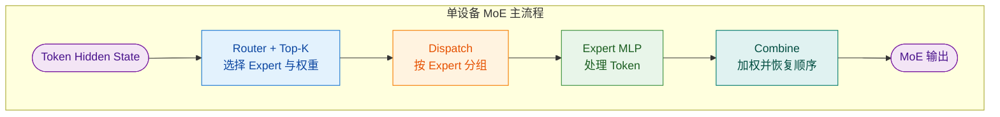

图 1-1：单设备 MoE 的计算路径。

两个 Token 都选择 E1 时，Dispatch 会把 T0、T1 放进 E1 的同一个输入批次。E1 用自己的权重一次处理这两行；Combine 再将第一行结果加回 T0，第二行结果加回 T1。Router 的选择由此落实为具体的输入收集、批量计算和输出回写。

### 1.1.1 模型参数与动态路由

Router 和 Expert 的权重是模型参数；路由表是由当前输入生成的临时数据。不同批次可能产生不同路由，但仍然调用同一组 Expert。这个区分也决定了后续 Expert Parallel 的分工：Expert 权重预先放在各个 Rank 上，Token 在每次前向时移动。

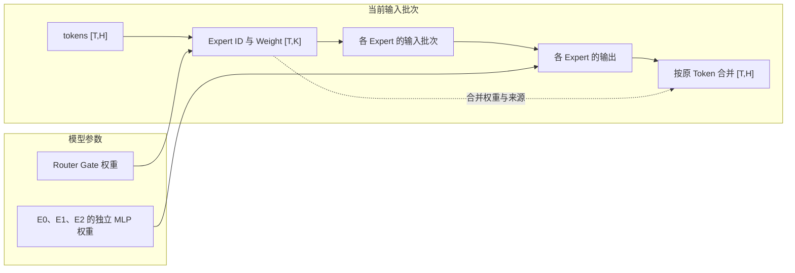

图 1-2：模型参数与当前批次路由的关系。

对应到源码，`router.py` 负责选择 Expert，`expert.py` 定义 Expert 内部的计算，`moe.py` 将它们接成完整前向。Router 和 Expert 的参数在推理调用之间保留；

每一批输入都会重新生成路由表。分布式实现也遵循这个安排：先把 Expert 权重放到各个 Rank，再根据当前路由发送 Token。

## 1.2 用路由记录描述分支

用 T 表示当前输入的 Token 行数，H 表示隐藏宽度，E 表示 Expert 数，K 表示每个 Token 选择的 Expert 数。输入 `tokens` 为 `[T,H]` 浮点张量；

Router 产生 `[T,E]` 的分数，再输出 `[T,K]` 的 `expert_ids` 与 `routing_weights`。第 i 行第 j 列的 ID 和权重共同定义第 i 个 Token 的第 j 条分支。

dtype 表示元素的数据类型：FP32 每个元素占 4 字节，FP16 和 BF16 各占 2 字节。Expert 权重与输入使用相同 dtype；Router 的概率与归一化权重使用 FP32。

device 表示张量所在的 CPU 或 CUDA 设备，输入、模型和路由 metadata 位于同一设备。metadata 是后续计算和恢复所需的元信息，包括分支编号、权重及计数。

其中 `(token_id, slot_id)` 确定一条路由记录，也称 assignment。slot 是某个 Token 的 Top-K 槽位，编号为 0 到 K−1。Top-2 时，一个 Token 产生两条记录；

整批输入共有 `A=T×K` 条记录。分组阶段按记录组织输入，合并阶段再将同一 Token 的 K 条记录还原成一行。

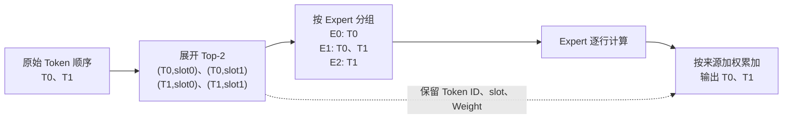

图 1-3：Token 顺序、路由记录与 Expert 分组之间的转换。

以 T0 的 slot 1 为例，它属于 T0 的最终输出，同时也是 E1 输入批次中的一行。前一个位置用来合并结果，后一个位置用来执行计算。Dispatch 用同一个排列移动输入向量、Token 编号、slot 和路由权重，计算结果由此始终对应自己的分支与回写位置。

| 张量 | Shape | 所表达的信息 |
| --- | --- | --- |
| `tokens` | `[T,H]` | 原始顺序的隐藏向量 |
| `logits` | `[T,E]` | 每个 Token 对全部 Expert 的分数 |
| `expert_ids` | `[T,K]` | 各 slot 选择的全局 Expert ID |
| `routing_weights` | `[T,K]` | 各 slot 的合并权重，逐 Token 求和为 1 |
| `tokens_per_expert` | `[E]` | 各 Expert 收到的路由记录数，合计为 A |

### 1.2.1 Router 怎样产生选择结果

Gate 是一个 `Linear(H,E,bias=False)`，每个输出分数由输入向量与对应 Expert 的 gate 权重做点积得到。logits 是尚未归一化的分数，Softmax 将一行 E 个分数转换成概率。

下面是 `TopKRouter.forward()` 的核心摘录，`self.gate` 和 `self.top_k` 来自 Router 实例；`torch` 指 PyTorch。Gate 按模型 dtype 执行，随后将 logits 转成 FP32 做 Softmax 与选中概率的归一化。

**Top-K 路由 · code/course1/mini_ep/model/router.py**

```python
import torch
from mini_ep.model.router import RouterOutput

class TopKRouter(torch.nn.Module):
    def __init__(self, hidden_size, num_experts, top_k):
        super().__init__()
        if hidden_size <= 0 or num_experts <= 0 or not 1 <= top_k <= num_experts:
            raise ValueError("需要 hidden_size > 0、num_experts > 0 且 1 <= top_k <= num_experts")
        self.num_experts = num_experts
        self.top_k = top_k
        self.gate = torch.nn.Linear(hidden_size, num_experts, bias=False)

    def forward(self, tokens):
        logits = self.gate(tokens)                       # [T,H] -> [T,E]
        # 用 FP32 计算路由概率；最后一维是 Expert 维。
        probabilities = torch.softmax(logits.float(), dim=-1)
        # 同时取出被选中的概率与 Expert 编号，二者共享 Token/slot 坐标。
        routing_weights, expert_ids = torch.topk(
            probabilities, k=self.top_k, dim=-1
        )
        # 在每个 Token 的 K 条分支间归一化。
        routing_weights = routing_weights / routing_weights.sum(
            dim=-1, keepdim=True
        )
        # 每条 Top-K 分支记为一次分配。
        tokens_per_expert = torch.bincount(
            expert_ids.reshape(-1), minlength=self.num_experts
        )
        return RouterOutput(
            logits=logits, expert_ids=expert_ids,
            routing_weights=routing_weights, tokens_per_expert=tokens_per_expert,
        )
```

**从隐藏向量生成 Expert 概率**

```python
# 线性层将每个 Token 的 H 维向量映射为 E 个 Expert 分数。
logits = self.gate(tokens)                       # [T,H] -> [T,E]
# 用 FP32 计算路由概率；最后一维是 Expert 维。
probabilities = torch.softmax(logits.float(), dim=-1)
```

gate 的权重为 [E,H]，输入 [T,H] 与其转置相乘，得到每个 Token 对 E 个 Expert 的得分 [T,E]。

float() 将归一化计算提升到 FP32，softmax 沿最后一维展开；行号仍表示原 Token，列号表示全局 Expert ID。

**选择分支，再确定分支权重**

```python
# 从每个 Token 的概率行中选择 K 个分支，并对选中权重归一化。
routing_weights, expert_ids = torch.topk(
    probabilities, k=self.top_k, dim=-1
)
# 在每个 Token 的 K 条分支间归一化。
routing_weights = routing_weights / routing_weights.sum(
    dim=-1, keepdim=True
)
```

topk 返回相同 shape 的两个 [T,K] 张量：浮点数是被选中的概率，int64 是对应列号。随后每行除以本行选中概率之和，保留 K 条分支的相对比例。

T0 的 0.56、0.24 变为 0.7、0.3；归一化只改变权重数值，Expert 和 slot 的配对保持不变。

**统计真正交给 Expert 的记录数**

```python
# 展开 Top-K 的 Expert ID；同一 Token 选择的不同分支分别计数。
tokens_per_expert = torch.bincount(
    expert_ids.reshape(-1), minlength=self.num_experts
)
```

展平 [T,K] 后，每个元素代表一条计算分支。bincount 按 Expert ID 统计出现次数，minlength=E 让未被选中的 Expert 也占一个零计数位置。

结果是同 device 的 [E] int64 张量，总和为 T×K，后面的分组与通信都由这些行数决定。

代码中的 `dim=-1` 始终指 Expert 或选中分支所在的最后一维。`torch.topk()` 同时返回概率与列号，列号就是 Expert ID；除以行和以后，选中的 K 个概率成为最终合并权重。

贯穿本课的输入为 `T0=[1,2]`、`T1=[3,4]`。假设 Softmax 概率分别是 `[0.56,0.24,0.20]` 和 `[0.20,0.32,0.48]`，Top-2 选出 E0/E1 和 E2/E1。每行选中概率之和为 0.8，得到：

**路由结果**

```text
T0: Expert [0,1]，Weight [0.7,0.3]
T1: Expert [2,1]，Weight [0.6,0.4]
```

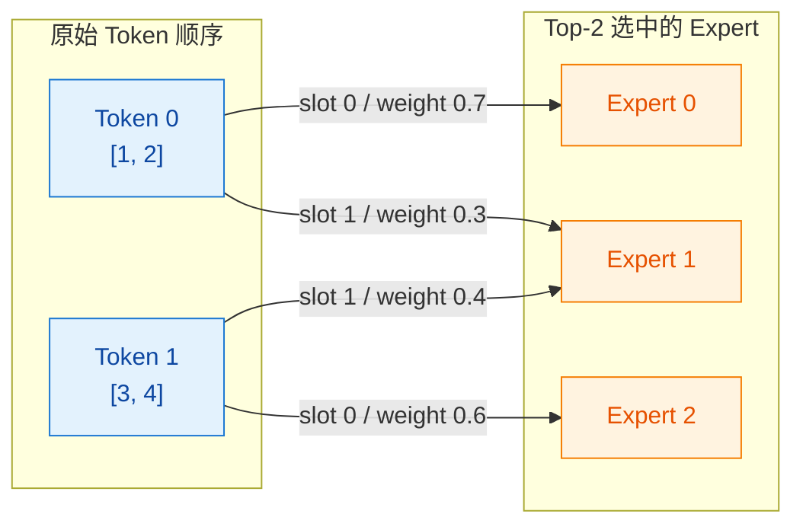

图 1-4：两个 Token 的四条 Top-2 路由。

图中有四条边，恰好对应四条路由记录。E1 同时收到 T0 和 T1；这两条记录的权重分别为 0.3、0.4，属于两个不同 Token 的输出。权重归一化发生在每个 Token 的 K 个分支之间。

选中概率再次归一化，是为了让参与计算的分支权重合计为 1。T0 选中的概率是 0.56 和 0.24，总和为 0.8；分别除以 0.8 后，得到 0.7 和 0.3，两者的相对比例仍为 7∶3。

若选择 Top-1，唯一分支的归一化权重就是 1。这也解释了为什么更改 K 会改变参与计算的 Expert 数，而每个 Token 的合并仍是这些分支的加权和。

## 1.3 Dispatch：把记录变成 Expert 的输入批次

E1 需要一起处理 T0 和 T1，E0 只处理 T0，E2 只处理 T1。`dispatch_tokens()` 按 Expert 逐个查找路由表，把命中的 Token 收集成一个张量。得到的三个局部输入分别是 `[T0]`、`[T0,T1]` 和 `[T1]`。

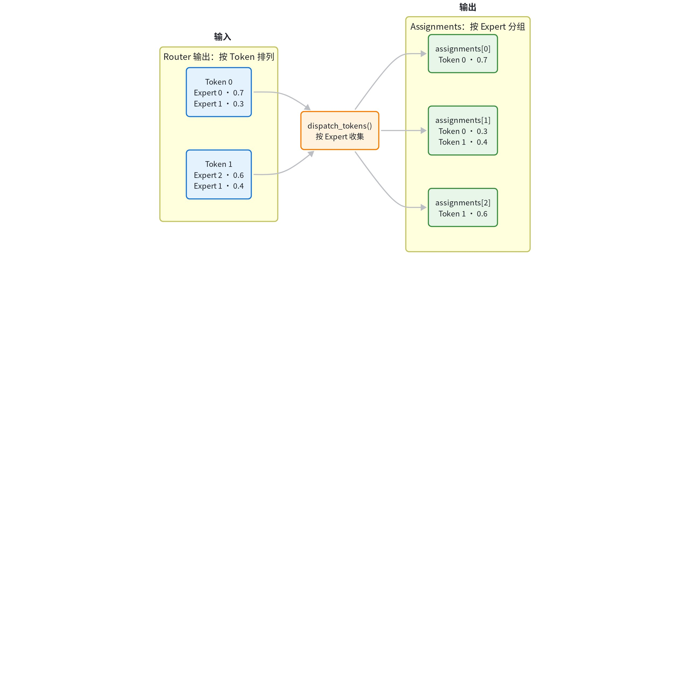

图 1-5：按 Expert 收集输入，并保存对应的权重。

收集的同时还要保存来源。一个分组对象包含 `tokens`、`token_indices`、`route_slots` 和 `routing_weights`，四者在同一行上描述同一条记录。

计算阶段读 `tokens`；合并阶段读原 Token 编号和路由权重。slot 让我们能回到二维路由表，核对 Expert ID 与权重是否来自同一位置。

### 1.3.1 两个坐标共同定位一条记录

对 E1 使用 `torch.where(expert_ids == 1)`，会返回两组坐标：Token 行号 `[0,1]` 和 slot 列号 `[1,1]`。前者指向输入矩阵中的 T0、T1；二者配对后，分别指向路由表的 `(0,1)`、`(1,1)`。

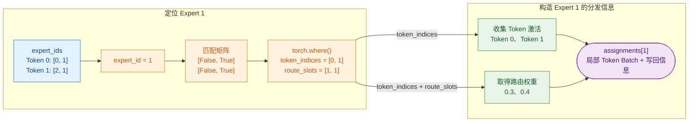

图 1-6：E1 在路由表中对应的 Token 与 slot。

下面继续处理一个 Expert，变量 `expert_id` 是其全局编号。`torch.where()` 的两个返回张量都是 int64 索引，分别标识 Token 行和 slot 列。收集输入使用 Token 行号，收集权重则同时使用行号与 slot，保证该输入分支与其权重配对：

**Expert 输入收集 · code/course1/mini_ep/model/moe.py**

```python
import torch

def collect_expert_inputs(tokens, expert_ids, routing_weights, expert_id):
    # 行号定位 Token，列号定位它的 Top-K slot。
    token_indices, route_slots = torch.where(expert_ids == expert_id)
    expert_tokens = tokens.index_select(0, token_indices)
    # 权重按 Token 与 slot 两个坐标读取。
    expert_weights = routing_weights[token_indices, route_slots]
    return expert_tokens, expert_weights, token_indices, route_slots
```

**用二维路由坐标收集 Expert 输入**

```python
# 用 Token 与 slot 两个坐标定位分支，再按 Token 编号收集输入行。
token_indices, route_slots = torch.where(expert_ids == expert_id)
expert_tokens = tokens.index_select(0, token_indices)
# 权重按 Token 与 slot 两个坐标读取。
expert_weights = routing_weights[token_indices, route_slots]
```

where 返回的两条 int64 向量分别是 Token 行号与 slot 列号，长度等于当前 Expert 的记录数 M。index_select 只按 Token 行收集 [M,H] 输入；

权重必须同时使用两个坐标读取，形成 [M]。返回这两组坐标后，Expert 只计算向量，Combine 仍能找到每行属于哪个原 Token。

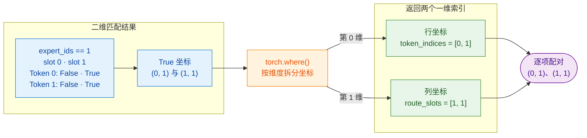

图 1-7：torch.where 返回的两组坐标。

E1 输入的第 0 行来自 T0 的 slot 1，权重为 0.3；第 1 行来自 T1 的 slot 1，权重为 0.4。交换这两行时，对应的 Token 编号、slot 和权重随同移动。每行计算结果便能乘上自己的权重，并回到自己的 Token。

### 1.3.2 分组对象怎样连接计算与合并

`dispatch_tokens()` 返回长度为 E 的分组列表，下标 e 对应 Ee。某个 Expert 没有被选中时，它的输入是 `[0,H]`，来源和权重也都是空张量。空批次延续了相同接口，后面的计算与合并沿用同一条链路。

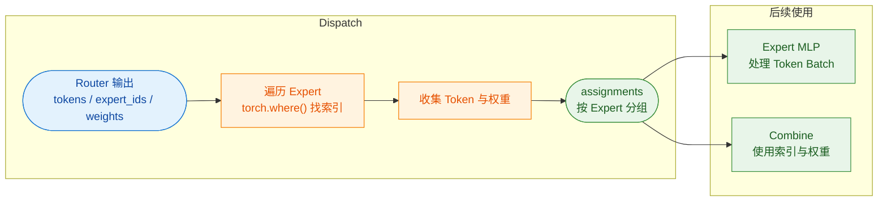

图 1-8：分组 metadata 连接输入收集、Expert 计算与输出回写。

Expert 只读取分组中的输入向量，保持行序并输出计算结果。Combine 再利用同一分组保存的 Token 编号和权重完成回写。因此，来源信息可以从 Dispatch 一直保留到 Combine，中间的 MLP 无需处理这些索引。

## 1.4 Expert：在局部批次上执行 MLP

模型用 `ModuleList` 保存 E 个独立的 `ExpertMLP`，每个实例拥有自己的权重。分组列表的第 e 项交给第 e 个 Expert，输出行数与该分组相同。例如 E1 接收 `[T0,T1]`，一次调用就处理两行输入；线性投影和逐元素激活保持它们的相对行序。

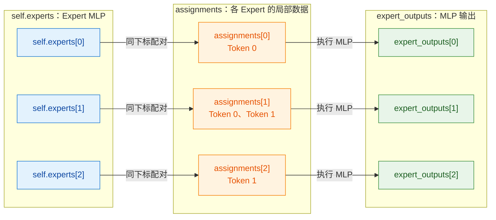

图 1-9：第 e 个 Expert 读取第 e 个分组。

设一个 Expert 收到 M 行输入。Up Projection 的权重在 PyTorch 中保存为 `[F,H]`，前向使用其转置，执行 `[M,H]×[H,F]→[M,F]`；

Down Projection 的权重保存为 `[H,F]`，执行 `[M,F]×[F,H]→[M,H]`。下面以 GELU 激活写出等价的最小 MLP。仓库类将两个投影命名为 `up_proj`、`down_proj`，并校验输入宽度；这里的 `up`、`down` 用来突出计算关系。

**Expert MLP · code/course1/mini_ep/model/expert.py**

```python
import torch

class ExpertMLP(torch.nn.Module):
    def __init__(self, hidden_size, expert_hidden_size):
        super().__init__()
        self.up = torch.nn.Linear(hidden_size, expert_hidden_size, bias=False)
        self.activation = torch.nn.GELU()
        self.down = torch.nn.Linear(expert_hidden_size, hidden_size, bias=False)

    def forward(self, tokens):
        # 两次投影保持行数：[M,H] → [M,F] → [M,H]。
        return self.down(self.activation(self.up(tokens)))
```

**两次投影之间保留行身份**

```python
# Up、激活、Down 依次处理同一批 Expert 输入行。
return self.down(self.activation(self.up(tokens)))
```

self.up 将 [M,H] 变为 [M,F]，GELU 对每个元素独立作用，self.down 再得到 [M,H]。三次操作都保持第 0 维的顺序，因此输出第 j 行始终对应输入第 j 行。

每个 Expert 使用独立的两份权重，同一条输入进入不同 Expert 会得到不同分支结果。

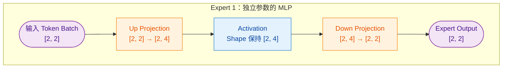

图 1-10：H=2、F=4 的两层 Expert MLP。

图中的 E1 使用 `H=2,F=4`：两行输入扩展为 `[2,4]`，经过逐元素激活，再投影回 `[2,2]`。这个 MLP 保持 Token 行数和行序，改变每行向量的数值。第三课会沿着这两次矩阵乘，讨论 GPU 的执行方式与计时。

## 1.5 Combine：让分支回到同一个 Token

每个 Expert 输出仍与自己的分组输入逐行对应。Combine 取出该行路由权重，乘上 Expert 输出，再累加到原 Token 的位置。对于输入 Ti，数学形式是：

$$
y_i = \sum_{j=0}^{K-1} w_{i,j}\,\operatorname{Expert}_{e_{i,j}}(x_i)
$$

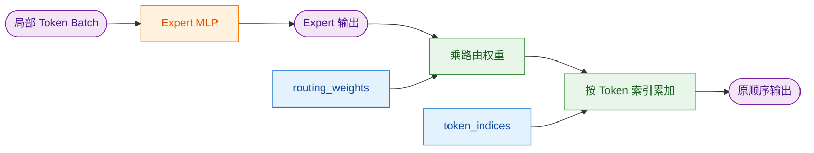

图 1-11：将 Expert 输出加权，累加到原 Token 行。

`index_add_()` 按索引把一行结果加到目标行。Top-2 下，同一个 Token 会在两个 Expert 分组中出现，因此两次写回相加得到完整输出。下面的 `assignments` 来自 Dispatch，`expert_outputs` 来自相同顺序的 Expert 调用。

`zeros_like(tokens)` 创建 `[T,H]` 的零输出，保留输入 dtype 与 device；乘法前将 FP32 路由权重转换为 Expert 输出 dtype，`unsqueeze(1)` 把权重从 `[M]` 变为 `[M,1]`，沿隐藏维度广播。

**加权合并 · code/course1/mini_ep/model/moe.py**

```python
import torch

def combine_expert_outputs(tokens, assignments, expert_outputs):
    output = torch.zeros_like(tokens)
    for assignment, expert_output in zip(assignments, expert_outputs, strict=True):
        # 将一行分支权重广播到 H 个输出元素。
        weighted_output = expert_output * assignment.routing_weights.to(
            expert_output.dtype
        ).unsqueeze(1)
        # 同一 Token 的多条分支累加到同一输出行。
        output.index_add_(0, assignment.token_indices, weighted_output)
    return output
```

**把每条分支权重广播到隐藏维**

```python
# 将每条分支的标量权重扩展到 H 个输出特征。
weighted_output = expert_output * assignment.routing_weights.to(
    expert_output.dtype
).unsqueeze(1)
```

一份 Expert 输出为 [M,H]，该分组的权重为 [M]。先将权重转换到输出 dtype，再增加长度为 1 的维度，形成 [M,1]；逐元素乘法沿 H 广播，每行的全部特征共用一份分支权重，结果仍为 [M,H]。

**在原 Token 行累加分支贡献**

```python
# 将属于同一原 Token 的多条加权分支累加到同一输出行。
output.index_add_(0, assignment.token_indices, weighted_output)
```

index_add_ 的 dim=0 表示沿行写回。若 token_indices=[0,1]，两行加权结果分别加到 output[0] 与 output[1]；

另一个 Expert 再命中 Token 0 时，其贡献继续加到同一行。output 从全零的 [T,H] 开始，循环结束后每行包含该 Token 的 K 条贡献。

### 1.5.1 加权合并的数值例子

为了单独看清合并，把各 Expert 的输出指定为下面的数值。E0 对 T0 输出 `[10,20]`，E1 对 T0 输出 `[100,200]`，对 T1 输出 `[30,40]`，E2 对 T1 输出 `[50,60]`。

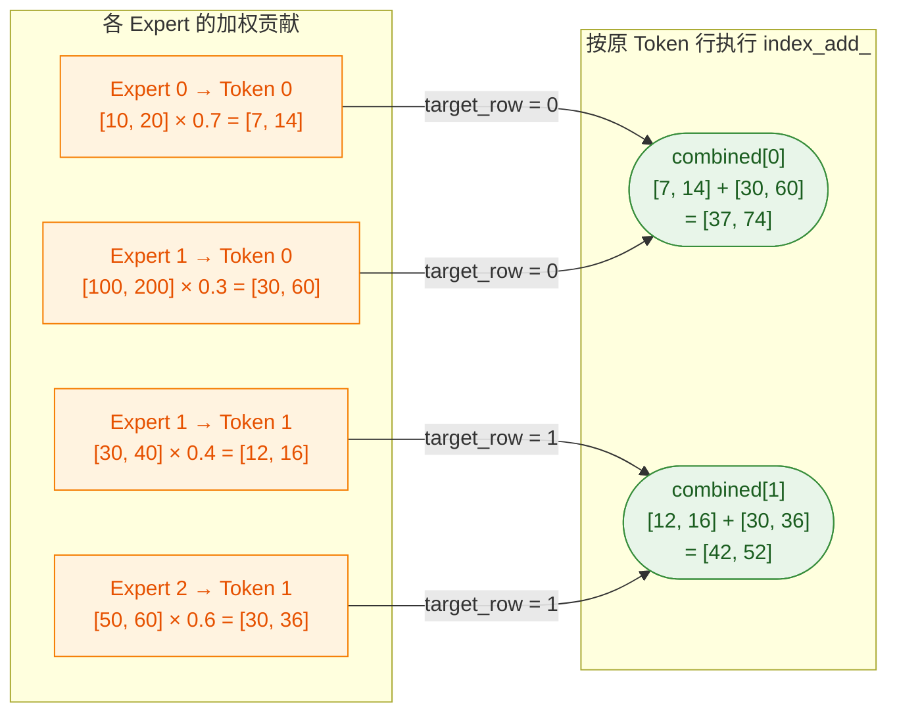

图 1-12：四条输出分支合并为两行结果。

于是 T0 得到 `0.7×[10,20]+0.3×[100,200]=[37,74]`，T1 得到 `0.4×[30,40]+0.6×[50,60]=[42,52]`。中间输出按 Expert 分组，最终两行按 T0、T1 的顺序排列。

单看 E1 的两行输出，可以把广播与回写分开理解。E1 的输出为 `[[100,200],[30,40]]`，对应权重为 `[0.3,0.4]`。权重 reshape 为 `[2,1]` 后，第一行的两个元素都乘 0.3，第二行都乘 0.4，得到 `[[30,60],[12,16]]`。

分组中的 `token_indices=[0,1]` 再把这两行分别加到 T0、T1；E0 和 E2 的贡献沿同样规则相加。

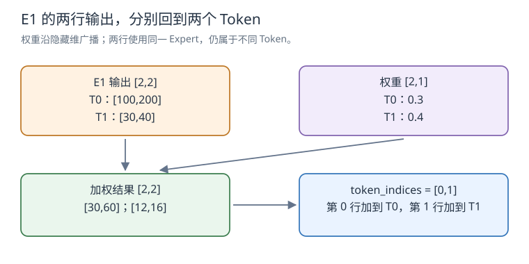

图 1-13：逐行权重沿 H 广播，随后按 Token 索引累加。

因此，权重广播只改变每行数值，Token 索引决定这行数值加到哪里。Expert 内的批次行号在此完成向原始 Token 行号的转换。

还可以让 Ee 简单地输出 `(e+1)×x`。沿用这张路由表，T0 得到 `(0.7×1+0.3×2)×T0=1.3T0`，T1 得到 `(0.4×2+0.6×3)×T1=2.6T1`。这个小例子把 Expert 编号和路由权重都留在结果里，后面可以用它检查打包、通信和恢复是否正确。

## 1.6 单设备 MoE 的完整前向

`SingleGPUMoE.forward()` 将上述模块接成一次前向。下面摘录的是方法内部的数据流，`self` 表示已创建的模型；`dispatch_tokens` 和 `combine_expert_outputs` 都在 `mini_ep/model/moe.py` 中。

中间列表以 Expert 编号为下标，最终 `hidden_states` 重新以原 Token 行号为下标。模型返回输出和路由 metadata，让数值结果与实际分支选择可以一起理解。

**MoE 前向 · code/course1/mini_ep/model/moe.py**

```python
import torch
from mini_ep.model.router import TopKRouter
from mini_ep.model.expert import ExpertMLP
from mini_ep.model.moe import MoEOutput, dispatch_tokens, combine_expert_outputs

class SingleGPUMoE(torch.nn.Module):
    def __init__(self, hidden_size: int, expert_hidden_size: int, num_experts: int, top_k: int, *, activation: str='gelu', bias: bool=False) -> None:
        super().__init__()
        self.hidden_size = hidden_size
        self.num_experts = num_experts
        self.router = TopKRouter(hidden_size, num_experts, top_k)
        self.experts = torch.nn.ModuleList([ExpertMLP(hidden_size, expert_hidden_size, activation=activation, bias=bias) for _ in range(num_experts)])

    def forward(self, tokens):
        # 原始 Token 顺序进入 Router；分组和恢复信息在本次前向内配对使用。
        routing = self.router(tokens)
        assignments = dispatch_tokens(
            tokens, routing.expert_ids, routing.routing_weights, self.num_experts
        )
        # 第 e 个 Expert 读取第 e 个 assignment，输出沿用该分组的行序。
        expert_outputs = [
            expert(assignment.tokens)
            for expert, assignment in zip(self.experts, assignments, strict=True)
        ]
        hidden_states = combine_expert_outputs(tokens, assignments, expert_outputs)
        return MoEOutput(
            hidden_states=hidden_states, router_logits=routing.logits,
            expert_ids=routing.expert_ids, routing_weights=routing.routing_weights,
            tokens_per_expert=routing.tokens_per_expert,
        )
```

**先生成路由，再保留分组的来源信息**

```python
# 路由确定 Expert 和权重，分组同时保存返回时所需的来源索引。
routing = self.router(tokens)
assignments = dispatch_tokens(
    tokens, routing.expert_ids, routing.routing_weights, self.num_experts
)
```

Router 只决定各 Token 选择哪些 Expert。dispatch_tokens 接收同一份输入、ID 与权重，按 Expert 编号建立 assignments；

第 e 项保存 E_e 的输入、原 Token 编号及权重。分组数量固定为 E，空 Expert 对应零行输入。

**逐 Expert 计算，再回到原 Token 顺序**

```python
# 各 Expert 处理各自输入；Combine 根据来源索引恢复 Token 顺序。
expert_outputs = [
    expert(assignment.tokens)
    for expert, assignment in zip(self.experts, assignments, strict=True)
]
hidden_states = combine_expert_outputs(tokens, assignments, expert_outputs)
```

ModuleList 与 assignments 按相同 Expert 编号排列，zip 将每份输入交给对应参数。列表中的输出仍按 Expert 分组；

combine_expert_outputs 使用分组保存的来源索引，生成原始 Token 顺序的 [T,H]。返回的路由 metadata 描述本次前向实际使用的分支。

下面的完整 CPU 示例把这条数据流放回真实模型：输入为两行 FP32 向量，三个 Expert 各有独立参数，每个 Token 选择两条分支。随机种子固定模型初始化；`torch.no_grad()` 表达推理前向。输出既保存原 Token 顺序的结果，也保留可以解释本次选择的路由 metadata。

**MoE 示例**

```python
import torch
from mini_ep.model.moe import SingleGPUMoE

def main():
    torch.manual_seed(0)
    model = SingleGPUMoE(2, 4, 3, 2).to(dtype=torch.float32)
    tokens = torch.tensor([[1., 2.], [3., 4.]])
    with torch.no_grad():
        result = model(tokens)
    assert result.hidden_states.shape == tokens.shape
    assert result.hidden_states.dtype == tokens.dtype
    assert result.hidden_states.device == tokens.device
    assert result.tokens_per_expert.sum().item() == 4
    torch.testing.assert_close(
        result.routing_weights.sum(dim=1), torch.ones(2)
    )
    print(result.expert_ids, result.hidden_states)

if __name__ == "__main__":
    main()
```

这里的 Router 使用随机初始化的 gate，分支选择由实际点积产生。前文的固定概率例子用于手算，两者遵循同一条加权公式。命令行入口可以配置更大的张量；下面的 CUDA 命令需要一张可见 GPU，测试入口同时保留 CPU 用例。

**运行与测试**

```bash
cd code/course1
python3 test/demo.py \
  --device=cuda --dtype=float32 --num-tokens=8 \
  --hidden-size=16 --expert-hidden-size=32 --num-experts=4 --top-k=2
python3 -m unittest discover -s checks -p 'test_single_gpu_moe.py' -v
```

Top-1 与 Top-2 对应不同的分支数量：前者每个 Token 产生一条记录，后者产生两条，因此所有 Expert 的记录数之和分别为 `T` 和 `2T`。归一化后的分支权重之和始终为 1，输出形状始终为 `[T,H]`。

示例通过 `--top-k` 选择这两种配置；`--device=cpu` 使用同一份 Reference 表达相同的数据关系。

Expert 数量 E 增大时，权重存储随 `2EHF` 增长；固定 Top-K 时，单个 Token 的 Expert 矩阵乘工作量仍由 `4KHF` 决定。Expert Parallel（专家并行，EP）把这些 Expert 权重分布到多张 GPU，Token 在计算前抵达所选 Expert 的设备，输出在计算后返回来源。

单设备实现中的分组与恢复关系因此成为跨设备通信的基础。下一课先建立连续打包布局，随后把布局边界转换成通信块边界。

继续阅读 [第 2 课：Router、Top-K 与 Token Dispatch](https://tvle9mq8jh.feishu.cn/docx/HiuwdyT5zopOEbxnCF4c4WPgnib)。

---

# 第 2 课：Router、Top-K 与 Token Dispatch

本课独立源码位于 `code/course2/`，示例在 `test/`，正确性测试在 `checks/`。下文命令均在本课目录中执行；将整个目录复制到其他位置后也使用同样的启动方式。

第一课为每个 Expert 分别收集一份输入张量。接下来要把这些分组装进一块连续缓冲区：先放 E0 的输入，再放 E1 的输入，依次排列，并记录每组从哪一行开始、到哪一行结束。矩阵乘可以按这些边界读取一个 Expert 的批次；跨设备通信也可以把相邻分组合成一个发送块。

Top-2 会把一个 Token 送入两个 Expert。每条分支由 Token 编号、slot、Expert ID 和路由权重共同描述，分别确定输入来源、分支位置、计算对象与返回后的贡献。打包时，输入向量和这些逐行信息使用同一个排列，位置同步变化，计算结果便与原来的分支一一对应。

沿用第一课的 `T0=[1,2]`、`T1=[3,4]`，再增加 `T2=[5,6]`，就能观察三个 Token 在不同 Expert 间的分组。固定 `T=3,H=2,E=4,K=2`，共有 `A=T×K=6` 条路由记录。

路由只选中 E0、E1、E2，因此 E3 对应一个空区间。第五课将把这四个 Expert 分放到两个 Rank，继续追踪同样六条记录的通信往返。

## 2.1 Router 为每个 Token 生成 K 条分支

Router 保持第一课的定义：Gate 把 `[T,H]` 输入映射为 `[T,E]` logits，Softmax 沿 Expert 维产生概率，Top-K 选择 K 个 Expert，再对选中概率归一化。

下面是 `TopKRouter.forward()` 的摘录，`self.gate`、`self.top_k` 与 `self.num_experts` 都来自模型配置。新增加的 `bincount()` 将选中的 Expert ID 转换为逐 Expert 的分支计数。

例如，某行概率为 `[0.50,0.30,0.15,0.05]`，Top-2 选中 E0、E1，权重重新归一化为 `[0.625,0.375]`。输出的同一个 `(token,slot)` 位置，Expert ID 和权重描述同一条分支。

**路由与计数 · code/course2/mini_ep/model/router.py**

```python
import torch
from mini_ep.model.router import RouterOutput

class TopKRouter(torch.nn.Module):
    def __init__(self, hidden_size, num_experts, top_k):
        super().__init__()
        if hidden_size <= 0 or num_experts <= 0 or not 1 <= top_k <= num_experts:
            raise ValueError("需要 hidden_size > 0、num_experts > 0 且 1 <= top_k <= num_experts")
        self.num_experts = num_experts
        self.top_k = top_k
        self.gate = torch.nn.Linear(hidden_size, num_experts, bias=False)

    def forward(self, tokens):
        logits = self.gate(tokens)
        # 用 FP32 计算路由概率；最后一维是 Expert 维。
        probabilities = torch.softmax(logits.float(), dim=-1)
        routing_weights, expert_ids = torch.topk(
            probabilities, k=self.top_k, dim=-1
        )
        # 在每个 Token 的 K 条分支间归一化。
        routing_weights = routing_weights / routing_weights.sum(dim=-1, keepdim=True)
        # 统计展开后的分支数，空 Expert 保留零计数。
        tokens_per_expert = torch.bincount(
            expert_ids.reshape(-1), minlength=self.num_experts
        )
        return RouterOutput(
            logits=logits, expert_ids=expert_ids,
            routing_weights=routing_weights, tokens_per_expert=tokens_per_expert,
        )
```

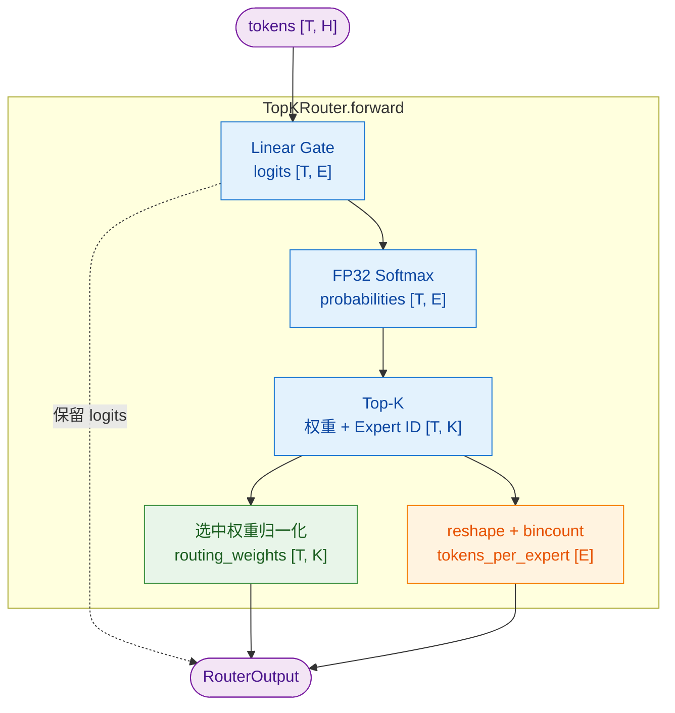

图 2-1：Router 从 logits 生成 Top-K 与计数。

Router 的输出仍按原 Token 排列。`expert_ids` 为同设备 int64 张量，`routing_weights` 为 FP32；`tokens_per_expert` 是同设备的 `[E]` int64 向量。

`bincount()` 读取展平后的全部 ID，`minlength=E` 保留末尾未被选中的 Expert，因此零负载 Expert 也有对应的计数项。随后 Dispatch 根据这些 ID 收集输入向量。

### 2.1.1 从二维路由表到记录编号

二维表以 Token 为外层维度，以 slot 为内层维度。按行展平时，顺序是 `(T0,slot0)`、`(T0,slot1)`、`(T1,slot0)`，依此类推。第 a 条记录的来源满足：

**记录编号**

```text
token_id = a // K
slot_id  = a % K
```

因此可以用 `arange(T).repeat_interleave(K)` 生成 Token 索引，用 `arange(K).repeat(T)` 生成 slot。相同 Token 的 K 条记录读取同一行隐藏向量，但后续进入不同 Expert。

## 2.2 Dispatch 把记录排成连续区间

Dispatch 接收 `[T,H]` 浮点输入和两个 `[T,K]` 路由张量，三者位于同一设备；Expert ID 可为 int32 或 int64，范围是 `[0,E)`。Reference 支持非连续输入，收集以后得到连续的 `[A,H]` 缓冲区。

它先按 Token、slot 展平路由表，再按 Expert ID 稳定排序，生成 `pack_index`；来源、slot 和权重使用同一排列，向量按排列后的 Token 行号读取。

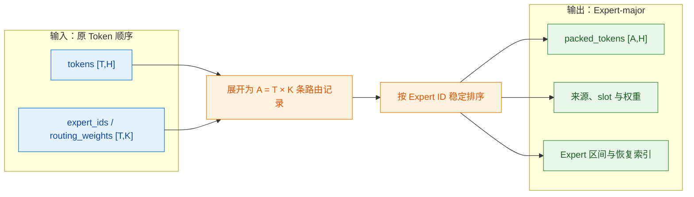

图 2-2：展开路由记录，按 Expert 稳定打包。

排好以后，E0 的行在最前面，接着是 E1、E2，依此类推。这叫 Expert-major 布局，也就是先按 Expert 分组；稳定排序还会保留同一 Expert 内原有的 Token/slot 次序。

下面的 `dispatch_reference()` 先用 `repeat_interleave(K)` 生成 Token 行号，用 `repeat(T)` 生成 slot，再按 Expert ID 排列它们。

**Expert 打包 · code/course2/mini_ep/distributed/dispatch.py**

```python
import torch
from mini_ep.distributed.dispatch import DispatchOutput

def dispatch_reference(tokens, expert_ids, routing_weights, num_experts):
    # 按 Token、slot 展平，定义原始记录顺序。
    flat_expert_ids = expert_ids.reshape(-1).to(torch.int64)
    flat_token_indices = torch.arange(
        tokens.shape[0], device=tokens.device, dtype=torch.int64
    ).repeat_interleave(expert_ids.shape[1])
    flat_route_slots = torch.arange(
        expert_ids.shape[1], device=tokens.device, dtype=torch.int64
    ).repeat(tokens.shape[0])
    flat_routing_weights = routing_weights.reshape(-1)

    # 稳定排序将同一 Expert 的记录放到相邻行。
    pack_index = torch.argsort(flat_expert_ids, stable=True)
    # 逆排列供返回后恢复原 Token/slot 顺序。
    restore_index = torch.argsort(pack_index)
    packed_token_indices = flat_token_indices.index_select(0, pack_index)
    # 按来源行号收集输入，形成连续打包缓冲区。
    packed_tokens = tokens.index_select(0, packed_token_indices).contiguous()
    packed_expert_ids = flat_expert_ids.index_select(0, pack_index)
    packed_route_slots = flat_route_slots.index_select(0, pack_index)
    packed_routing_weights = flat_routing_weights.index_select(0, pack_index)
    # 前缀和给出每个 Expert 在打包缓冲区中的区间。
    tokens_per_expert = torch.bincount(flat_expert_ids, minlength=num_experts)
    expert_offsets = torch.cat([
        tokens_per_expert.new_zeros(1), tokens_per_expert.cumsum(dim=0)
    ])
    return DispatchOutput(
        packed_tokens=packed_tokens, packed_expert_ids=packed_expert_ids,
        packed_token_indices=packed_token_indices,
        packed_route_slots=packed_route_slots,
        packed_routing_weights=packed_routing_weights,
        tokens_per_expert=tokens_per_expert, expert_offsets=expert_offsets,
        restore_index=restore_index, num_tokens=tokens.shape[0],
        top_k=expert_ids.shape[1],
    )
```

**展开的每条记录拥有三个坐标**

```python
# 把 [T,K] 路由按 Token、slot 顺序展开为 T×K 条记录。
flat_expert_ids = expert_ids.reshape(-1).to(torch.int64)
flat_token_indices = torch.arange(
    tokens.shape[0], device=tokens.device, dtype=torch.int64
).repeat_interleave(expert_ids.shape[1])
flat_route_slots = torch.arange(
    expert_ids.shape[1], device=tokens.device, dtype=torch.int64
).repeat(tokens.shape[0])
flat_routing_weights = routing_weights.reshape(-1)
```

对三个 Token 的 Top-2，Token 编号为 [0,0,1,1,2,2]，slot 为 [0,1,0,1,0,1]，Expert ID 为 [2,0,1,2,0,1]。

三条向量共同描述六条记录；reshape 权重时采用相同顺序。这里增加的是分支记录数，原始输入仍只有三行。

**一份排列同时移动向量和身份**

```python
# 稳定排序生成打包行到原记录的映射；所有逐行身份共用这份映射。
pack_index = torch.argsort(flat_expert_ids, stable=True)
# 逆排列供返回后恢复原 Token/slot 顺序。
restore_index = torch.argsort(pack_index)
packed_token_indices = flat_token_indices.index_select(0, pack_index)
# 按来源行号收集输入，形成连续打包缓冲区。
packed_tokens = tokens.index_select(0, packed_token_indices).contiguous()
packed_expert_ids = flat_expert_ids.index_select(0, pack_index)
packed_route_slots = flat_route_slots.index_select(0, pack_index)
packed_routing_weights = flat_routing_weights.index_select(0, pack_index)
```

pack_index=[1,4,2,5,0,3] 指定每个打包位置的原记录。先按它取得 Token 行号，再收集浮点向量，形成 [6,H]；

Expert ID、slot 与权重也按它重排。restore_index 是 pack_index 的逆排列，随后可以从原记录编号直接找到打包行。

**计数变成可切片的 Expert 区间**

```python
# 每个 Expert 的记录数做前缀和后，成为连续输入段的起止边界。
tokens_per_expert = torch.bincount(flat_expert_ids, minlength=num_experts)
expert_offsets = torch.cat([
    tokens_per_expert.new_zeros(1), tokens_per_expert.cumsum(dim=0)
])
```

计数 [2,2,2,0] 的累积和为 [2,4,6,6]，前导零构成 offsets=[0,2,4,6,6]。E1 的输入是 packed_tokens[2:4]，E3 对应 [6:6] 的空切片。末项为总记录数，完整区间恰好覆盖全部打包行。

### 2.2.1 打包结果需要保存哪些信息

`packed_tokens` 中，同一个 Token 的 K 条分支各占一行；一次 `index_select()` 将原输入复制到这些打包位置。`restore_index = argsort(pack_index)` 建立反向查询：原记录对应现在的哪一行。

`DispatchOutput` 把这个逆排列、逐行 metadata 和 Expert 区间一起返回。所有索引、计数、offset 均为同设备 int64 张量，打包输入保持原输入 dtype，打包权重保持传入权重 dtype。

| 字段 | Shape | 下游用途 |
| --- | --- | --- |
| `packed_tokens` | `[A,H]` | 按 Expert 排列的连续输入 |
| `packed_expert_ids` | `[A]` | 每个打包行所属的 Expert |
| `packed_token_indices` | `[A]` | 每行来自原输入的哪一行 |
| `packed_route_slots` | `[A]` | 每行来自该 Token 的哪个 slot |
| `packed_routing_weights` | `[A]` | 与打包行逐行对应的合并权重 |
| `tokens_per_expert` | `[E]` | 每个 Expert 的记录数 |
| `expert_offsets` | `[E+1]` | 连续区间的起止位置 |
| `restore_index` | `[A]` | 从打包顺序恢复到 Token/slot 顺序 |

知道每个 Expert 有多少行，就能算出各组的边界：从 0 开始，依次累加计数，得到 `expert_offsets`。Ee 的输入是 `packed_tokens[offsets[e]:offsets[e+1]]`。空 Expert 的两个边界相等，切片为 `[0,H]`；最后一个边界等于全部记录数 `A`。

这里有两层“连续”。按 Expert 排序，让同一 Expert 的记录在逻辑行号上相邻；连续存储则描述这些行如何落在内存里。行主序 `[6,2]` 张量的 stride 为 `(2,1)`，从第 r 行到下一行跨两个元素，从第 c 列到下一列跨一个元素；

元素 `(r,c)` 距张量起点 `2r+c` 个元素。Reference 按索引收集输入，并返回连续的 `packed_tokens`，后面的矩阵乘和通信都可以按行读取这块缓冲区。

## 2.3 六条记录怎样打包

下面的输入与路由把六条分支的身份和数值全部确定下来。每行输入包含两个元素，每个 Token 选择两个 Expert，因此打包缓冲区会包含六行、每行两个元素。

**输入与路由**

```python
import torch

def create_routing_example():
    tokens = torch.tensor([[1., 2.], [3., 4.], [5., 6.]])
    expert_ids = torch.tensor([[2, 0], [1, 2], [0, 1]])
    routing_weights = torch.tensor([[.25, .75], [.60, .40], [.20, .80]])
    return tokens, expert_ids, routing_weights
```

原始记录的 Expert ID 为 `[2,0,1,2,0,1]`。稳定排序返回 `pack_index=[1,4,2,5,0,3]`，即先读取原记录 1、4，再读取 2、5，最后读取 0、3。打包以后得到：

| 打包行 | 原记录号 | Token | slot | Expert | Weight |
| --- | --- | --- | --- | --- | --- |
| 0 | 1 | T0 | 1 | E0 | 0.75 |
| 1 | 4 | T2 | 0 | E0 | 0.20 |
| 2 | 2 | T1 | 0 | E1 | 0.60 |
| 3 | 5 | T2 | 1 | E1 | 0.80 |
| 4 | 0 | T0 | 0 | E2 | 0.25 |
| 5 | 3 | T1 | 1 | E2 | 0.40 |

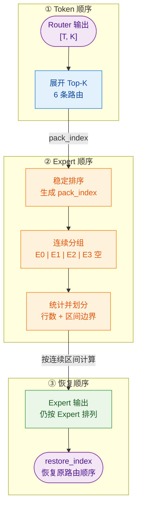

图 2-3：六条记录的排列、区间与逆排列。

打包后的向量顺序为 `[T0,T2 | T1,T2 | T0,T1]`，两个分隔符划出 E0、E1、E2 三个非空区间，E3 位于末尾空区间。计数 `[2,2,2,0]` 的前缀和为 `[0,2,4,6,6]`。例如 E1 读取 `[2:4]`，E3 读取 `[6:6]`；两个切片都由同样的边界规则确定。

### 2.3.1 排列与逆排列各回答一个问题

`pack_index[p]` 回答“打包行 p 来自原记录的哪个位置”；`restore_index[a]` 回答“原记录 a 现在位于打包结果的哪里”。本例的逆排列是 `[4,0,2,5,1,3]`。

例如，原记录 0 是 T0 发往 E2 的分支，位于打包行 4；原记录 1 是 T0 发往 E0 的分支，位于打包行 0。恢复时先读取行 4、0，就把 T0 的两个分支重新排在一起。由此可以直接检查：`pack_index[restore_index[a]]=a`。

逆排列把 A 条记录放回 Token/slot 顺序。此时每条分支仍有一行独立输出：T0 的 K 行在一起，接着是 T1 的 K 行。将结果 reshape 为 `[T,K,H]` 后，再沿 K 维加权求和，才得到每个 Token 一行的 `[T,H]` 输出。

记录编号还可以继续推导到内存地址。对原记录 a=0，`restore_index[0]=4` 先找到打包行 4。连续 `[6,2]` 缓冲区中，每行含两个 FP32 元素，所以这一行从元素偏移 `4×2=8` 开始，距缓冲区起点 32 bytes。

隐藏维列 h=0、1 分别读取元素 8、9。这里先由 metadata 找行，再由 H 和 dtype 找到行内元素。

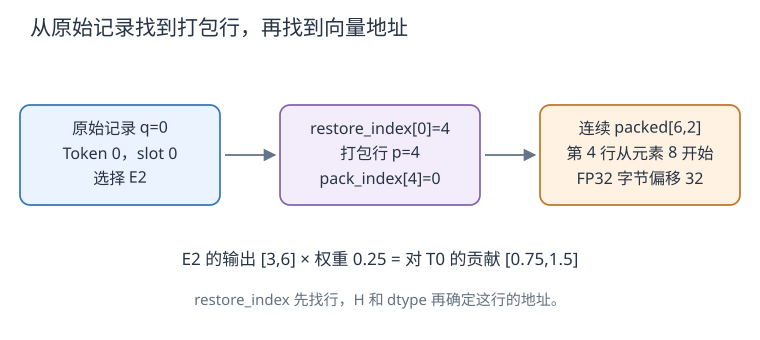

图 2-4：逆排列、打包行号与连续地址的对应关系。

如果 E2 将输入乘 3，这一行输出为 `[3,6]`；乘原记录的权重 0.25 后，对 T0 的贡献是 `[0.75,1.5]`。T0 的另一个分支由 `restore_index[1]=0` 定位。两行各自带回正确权重，才可以合成一个 Token 的输出。

## 2.4 Combine：先恢复记录，再合并分支

Expert 输出与输入逐行对应，所以全部结果仍按 Expert-major 保存为 `[A,H]`。Combine 对结果和打包权重使用同一个 `restore_index`，把它们恢复到 Token-major、slot-minor。随后 reshape 为 `[T,K,H]` 和 `[T,K,1]`，相乘并沿 K 维求和。

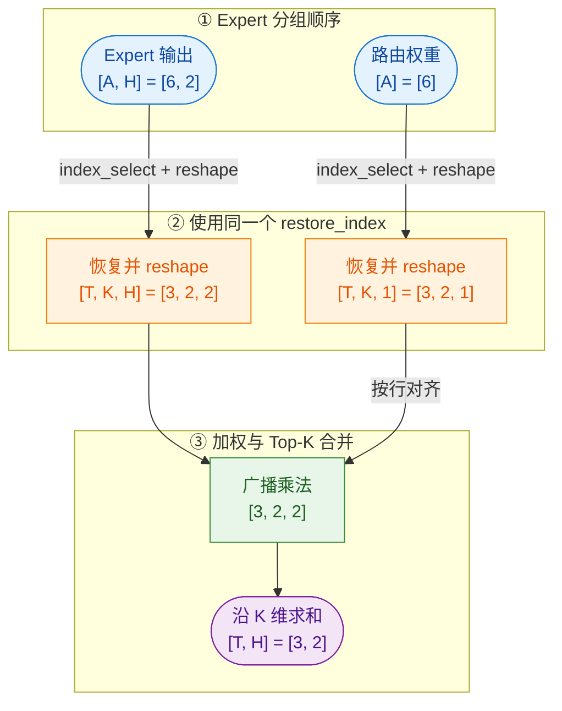

图 2-5：恢复 Token/slot 布局，再加权归约。

下面摘录 `combine_reference()` 的核心计算。`packed_outputs` 是按 Dispatch 行序存放的 `[A,H]` Expert 结果，`dispatch` 是该次 Dispatch 返回的对象。

对输出和权重使用相同逆排列以后，每个 Token 的 K 条记录相邻，再通过广播乘法与沿 K 求和形成输出：

**分支合并 · code/course2/mini_ep/distributed/dispatch.py**

```python
import torch

def combine_reference(packed_outputs, dispatch):
    # 输出与权重使用同一逆排列，保持逐行配对。
    restored_outputs = packed_outputs.index_select(0, dispatch.restore_index)
    restored_weights = dispatch.packed_routing_weights.index_select(
        0, dispatch.restore_index
    )
    outputs_by_token = restored_outputs.reshape(dispatch.num_tokens, dispatch.top_k, packed_outputs.shape[1])
    weights_by_token = restored_weights.to(packed_outputs.dtype).reshape(
        dispatch.num_tokens, dispatch.top_k, 1
    )
    # 沿 Top-K 维求和，每个 Token 恢复为一行。
    combined = (outputs_by_token * weights_by_token).sum(dim=1)
    return combined
```

**输出与权重一起恢复原记录顺序**

```python
# 用同一逆排列恢复分支输出和对应权重，保留二者的逐行配对。
restored_outputs = packed_outputs.index_select(0, dispatch.restore_index)
restored_weights = dispatch.packed_routing_weights.index_select(
    0, dispatch.restore_index
)
```

恢复时按原记录 q 遍历 restore_index，而读取的行号位于 Expert-major 缓冲。例如 q=0 读取行 4，q=1 读取行 0，正好是 T0 的两条分支。

packed 权重也读取行 4、0，保证每个分支结果乘上自己的权重。

**把记录维拆回 Token 与 slot**

```python
# 把记录维拆成 Token 与 K 个 slot，再沿 slot 合并。
outputs_by_token = restored_outputs.reshape(dispatch.num_tokens, dispatch.top_k, packed_outputs.shape[1])
weights_by_token = restored_weights.to(packed_outputs.dtype).reshape(
    dispatch.num_tokens, dispatch.top_k, 1
)
# 沿 Top-K 维求和，每个 Token 恢复为一行。
combined = (outputs_by_token * weights_by_token).sum(dim=1)
```

恢复后的六行按 [T0/slot0,T0/slot1,T1/slot0,…] 排列，因此可以 reshape 为 [3,2,H]。

权重转换为输出 dtype 并 reshape 为 [3,2,1]，沿 H 广播；sum(dim=1) 合并两个 slot，得到 [3,H]，行顺序与最初输入一致。

`outputs_by_token[i,j,:]` 是第 i 个 Token 第 j 条分支的 Expert 输出，`weights_by_token[i,j,0]` 是它的权重。

两者相乘后，`sum(dim=1)` 消去分支维，得到原序 `[T,H]`。显式写出 H 也使空输入可以还原为 `[0,H]`。结果 dtype 与 device 跟随 Expert 输出，输入可以带 stride，恢复操作按索引读取相应行。

### 2.4.1 Expert 计算怎样影响合并结果

先让所有 Expert 都原样输出输入。一个 Token 的 K 条分支就携带相同向量；由于 K 个权重之和为 1，合并结果就等于原始 `tokens`。接着让不同 Expert 输出不同的缩放值，就可以进一步检查分支是否交给了正确的 Expert、是否乘上了正确的权重。

完整例子将 Expert 定义为缩放函数 E_e(x)=(e+1)x。缩放系数直接暴露分支的 Expert 身份，原始路由公式又给出独立期望值。下面在同一份固定输入上完成打包、分支计算和合并，六条中间记录最终恢复为三行输出。

**Dispatch 示例**

```python
import torch
from mini_ep.distributed.dispatch import dispatch_reference, combine_reference

def main():
    tokens = torch.tensor([[1., 2.], [3., 4.], [5., 6.]])
    expert_ids = torch.tensor([[2, 0], [1, 2], [0, 1]])
    weights = torch.tensor([[.25, .75], [.60, .40], [.20, .80]])
    dispatch = dispatch_reference(tokens, expert_ids, weights, 4)
    scales = (dispatch.packed_expert_ids + 1).to(tokens.dtype)[:, None]
    packed_outputs = dispatch.packed_tokens * scales
    combined = combine_reference(packed_outputs, dispatch)
    expected = torch.tensor([[1.5, 3.], [7.2, 9.6], [9., 10.8]])
    torch.testing.assert_close(combined, expected)
    assert dispatch.expert_offsets.tolist() == [0, 2, 4, 6, 6]
    assert dispatch.packed_tokens.is_contiguous()
    assert combined.shape == tokens.shape
    assert combined.dtype == tokens.dtype
    assert combined.device == tokens.device
    print(combined)

if __name__ == "__main__":
    main()
```

代码根据打包行的 Expert ID 生成缩放系数，再按 `restore_index` 恢复结果。期望值则直接按原路由表手算，完全不使用恢复索引。两边相等，说明打包后的计算接回了正确的 Token 和权重。第五课会让这六条记录再经过一次跨 Rank 往返，并得到同样的输出。

## 2.5 从计数读取 Expert 负载

总记录数固定为 A，但它们在 Expert 之间的分配随输入变化。理想平均负载为 `A/E`；用最大计数除以平均计数，可以得到一个直观的倾斜程度：

**负载倾斜**

```text
imbalance_ratio = max(tokens_per_expert) / (A/E)
```

本例平均负载为 1.5，最大计数为 2，倾斜比为 `4/3`。这个比值在 A>0 时定义，描述路由在 Expert 维上的分布；全空输入的各项计数均为零。每个 Expert 的记录数决定其 GEMM 的 M 维；

EP 中还要按 Expert 放置汇总 Rank 负载，例如当前 E0/E1 共四行，E2/E3 共两行。因此 Expert 倾斜和 Rank 倾斜需要分别从各自的计数解释。

Capacity factor 描述相对于平均负载的容量倍率，对应假设容量 `ceil(capacity_factor×A/E)`。示例保留全部路由记录，并打印这个容量与实际计数，呈现各 Expert 的输入规模。容量约束进一步涉及记录保留、丢弃或转移等策略；这些策略会改变哪些分支参与计算，以及最终输出怎样合并。

例如当前共有六条记录、四个 Expert，平均负载为 1.5。取 capacity factor=1.2，假设容量为 `ceil(1.2×1.5)=2` 行。E0、E1、E2 各有两行，E3 为零行，都落在这一容量内。

## 2.6 连续布局的 Reference 实现

Dispatch 与 Combine 的实现在 `mini_ep/distributed/dispatch.py`，入口是 `test/demo.py`。

前者提供独立的 PyTorch Dispatch 与 Combine，后者把路由、逐行 metadata、offsets 和恢复误差打印出来。

进入 `code/course2` 后运行以下命令，需要一张可见 CUDA GPU：

**运行与测试**

```bash
cd code/course2
python3 test/demo.py \
  --device=cuda --dtype=float32 --num-tokens=32 \
  --hidden-size=8 --num-experts=4 --top-k=2
python3 -m unittest discover -s checks -p 'test_router_dispatch.py' -v
```

阅读示例输出时，可以将原路由表与打包表逐行对照：每条记录去了哪一行，`restore_index` 又从哪一行把它找回。总计数为 `T×K`，空 Expert 的相邻 offset 相等，而 `pack_index[restore_index[a]]=a` 表示记录 a 经过排列后可以回到原位。

打包以后，所有 Expert 的输入放在同一块缓冲区中，每个 Expert 占一个连续区间。第三课沿着这些区间讨论矩阵乘；第五课则把属于同一 Rank 的相邻区间合成发送块。计算和通信都从这里的打包结果开始，返回后仍用同一份逆排列找到原 Token。

继续阅读 [第 3 课：GPU、CUDA 执行模型与 GEMM 基准](https://tvle9mq8jh.feishu.cn/docx/J8uQdUhRqoEXPWxBc9ocXfiAn3c)。

---

# 第 3 课：GPU、CUDA 执行模型与 GEMM 基准

本课独立源码位于 `code/course3/`，示例在 `test/`，正确性测试在 `checks/`。下文命令均在本课目录中执行；将整个目录复制到其他位置后也使用同样的启动方式。

第二课的六条记录被分成三个两行批次与一个空批次。非空 Expert 都要执行两次线性投影：例如 H=2、F=4 时，先做 `[2,2]×[2,4]`，再做 `[2,4]×[4,2]`。这些小矩阵揭示了一个系统问题：路由决定每个 Expert 的行数，GPU 数学库接收的正是这些不同形状的计算任务。

对于一个 Expert，设收到 M 行、每行 H 个元素，要将它们投影到 F 维，Up Projection 就是 `[M,H]×[H,F]→[M,F]`。M 增大时，算术工作量和输出行数一起增长，同一份权重也被更多输入行复用。

线程划分与存储层次决定这些矩阵怎样在 GPU 上执行；将 H、F 扩展到更大的尺寸后，还可以用独立基准比较不同 M 的延迟。

从 PyTorch 的 `torch.matmul` 和 `nn.Linear` 出发，可以沿着计算量、线程分工、输入复用与设备计时，建立 Expert 行数与 GEMM 延迟之间的联系。

## 3.1 把 Expert MLP 写成矩阵乘

GEMM（General Matrix Multiplication，通用矩阵乘法）常写成 `C[M,N]=A[M,K]×B[K,N]`。M 是输入行数，N 是输出列数，K 是点积的累加维度。

本课程的模型宽度继续记为 H、F；Up Projection 对应 `N=F,K=H`，Down Projection 对应 `N=H,K=F`。Router 的 Top-K 表示路由分支数，这里的 GEMM K 则只用于矩阵乘公式和 `--k` 参数。

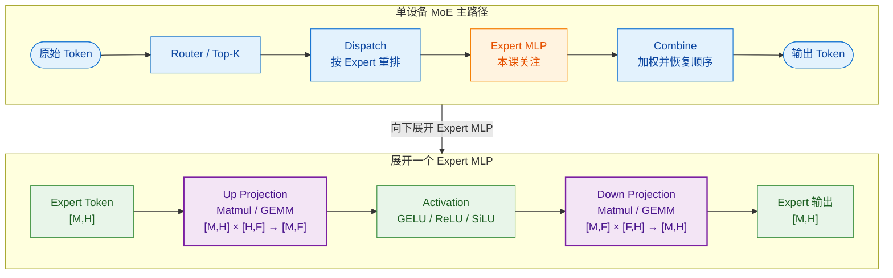

图 3-1：Expert MLP 的两次投影。

一个 Expert MLP 包含两次主要矩阵乘：Up Projection 将 `[M,H]` 变成 `[M,F]`，Down Projection 将 `[M,F]` 变回 `[M,H]`。激活函数位于中间，逐元素改变数值。

| 投影 | GEMM 的 M | GEMM 的 N | GEMM 的 K |
| --- | --- | --- | --- |
| Up | 当前 Expert 收到的记录数 | F | H |
| Down | 当前 Expert 收到的记录数 | H | F |

M 可以直接从 `expert_offsets[e+1]-expert_offsets[e]` 取得。Top-2 会让同一个原始 Token 在两个 Expert 的批次中各占一行，因此这个 M 统计的是该 Expert 的路由记录数。

用后面的运行配置作一个具体算例：Up Projection 取 `M=1024,H=1024,F=2048`，即 GEMM 的 `N=2048,K=1024`。FP16 每个元素占 2 字节，输入、权重和输出分别占 2 MiB、4 MiB、4 MiB；

乘加工作量为 `2×1024×2048×1024=4,294,967,296` FLOPs，约 4.295 GFLOPs。下面这些数量把形状与资源需求连接起来。

| 对象 | Shape | FP16 大小 |
| --- | --- | --- |
| 输入 | `[1024,1024]` | 2 MiB |
| 保存的权重 | `[2048,1024]` | 4 MiB |
| 输出 | `[1024,2048]` | 4 MiB |

这次投影的输入、权重和输出合计占 10 MiB，其中同一份权重要被 1024 行输入反复使用。GEMM 会把矩阵切成小块，将当前需要的片段放入片上存储，让多个乘加操作复用它们。下面从线程的工作划分开始，看这种分块怎样执行。

### 3.1.1 Linear 的权重为什么要转置

`nn.Linear(K,N,bias=False)` 将权重保存为 `[N,K]`。输入 `[M,K]` 右乘其转置，得到 `[M,N]`。下面的摘录使用预先给定的正整数 M、N、K，以及设备 `device` 和浮点精度 `dtype`；

例如 CPU 数值例子可以取 `M=2,N=4,K=2,device="cpu",dtype=torch.float32`。Matmul 与 Linear 接收相同输入，Linear 的权重从同一张量复制，因而表达相同的投影。

**Linear 与 Matmul**

```python
import torch

def compare_projections(M, N, K, device, dtype):
    tokens = torch.randn(M, K, device=device, dtype=dtype)
    weight = torch.randn(N, K, device=device, dtype=dtype)
    linear = torch.nn.Linear(K, N, bias=False, device=device, dtype=dtype)
    with torch.no_grad():
        # 两种投影使用相同权重，便于比较数值。
        linear.weight.copy_(weight)
    matmul_output = tokens @ weight.T
    linear_output = linear(tokens)
    torch.testing.assert_close(matmul_output, linear_output)
    return matmul_output, linear_output
```

**相同权重对应相同投影**

```python
# 使用相同权重计算投影，便于对齐矩阵乘与线性层的数值结果。
with torch.no_grad():
    # 两种投影使用相同权重，便于比较数值。
    linear.weight.copy_(weight)
matmul_output = tokens @ weight.T
linear_output = linear(tokens)
```

weight 保存为 [N,K]，weight.T 是 shape [K,N] 的转置视图。tokens @ weight.T 与无偏置 Linear 读取同一组参数，都产生 [M,N]。

copy_ 在 no_grad 范围中准备参数；矩阵后端根据实际 stride 解释转置视图。

输入与保存的权重都连续。输入 stride 为 `(K,1)`，权重 stride 为 `(K,1)`；`weight.T` 是 shape 为 `[K,N]`、stride 为 `(1,K)` 的视图，与原权重共享存储。

转置视图改变寻址方式，GEMM 后端根据 shape、stride 和 dtype 选择实现。基准把输入构造、模块创建和权重复制放在计时前，正式样本测量投影调用。

用两行输入可以直接看出权重转置的含义。取 `X=[[1,2],[3,4]]`，保存权重 `W=[[1,0],[0,1],[1,1]]`。W 的三行分别提取输入的第一列、第二列与两列之和，因此 `X@W.T` 得到 `[[1,2,3],[3,4,7]]`，shape 从 `[2,2]` 变为 `[2,3]`。

![图 3-2：保存为 [out,in] 的权重如何生成三个输出特征。](assets/lesson_03_projection_numbers.svg)

图 3-2：保存为 [out,in] 的权重如何生成三个输出特征。

例如输出 `Y[0,2]` 沿归约维累加 `1×1+2×1=3`。第二行相同位置得到 `3×1+4×1=7`。每个输出元素使用 X 的一行和 W 的一行；后面的 Tile 划分正是让多个输出协作复用这些行中的片段。

## 3.2 一行 PyTorch 代码怎样到达 GPU

Host 指提交工作的 CPU 一侧，Device 指执行 CUDA 计算的 GPU 一侧。Host 执行 Python，准备张量与算子参数；Device 执行已经提交的 Kernel。

CUDA Stream 是设备工作队列，同一流上的操作遵循提交次序。例如 Up Projection、GELU、Down Projection 依次提交到同一流，后续操作就能读取前一步生成的数据，同时 Host 继续组织后面的调用。

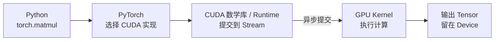

图 3-3：Host 提交算子，Device 执行 Kernel。

`torch.matmul` 进入 PyTorch 的算子分派后，根据 device、dtype、shape 和 layout 选择 CUDA 实现。CUDA 后端使用适合该形状的数学库路径，并把工作提交到 Stream，设备执行结束后将结果保存在 GPU 内存中。

这解释了为什么 Python 函数的返回时刻与结果完成时刻可以分开。后续 GPU 算子在相应的 Stream 依赖下消费结果；Host 要读取结果时，则要等待设备完成。计时也需要沿设备执行顺序确定起点和终点。

用一个假设时间线看这个差别：Host 在第 0～4 μs 提交调用，GPU 从第 4 μs 开始计算，20 μs 后完成。函数提交耗时是 4 μs，计算耗时是 20 μs，从发起到结果可用则是 24 μs。

CUDA Event 放在设备流中的计算前后，记录的是设备执行到这两个标记的时刻；后面的 GEMM 基准据此测量投影耗时。这里的数字用于说明计时位置。

## 3.3 CUDA 怎样组织并行工作

Kernel 是在 GPU 上执行的函数。一次 Kernel Launch 创建一个 Grid，Grid 包含多个 Thread Block，每个 Block 再包含多个 Thread。线程依据自己的索引读取输入、计算部分结果并写回。

可以先用一维数组理解线程编号。假设 257 个元素，每个 Block 有 128 个线程，就需要三个 Block。线程的全局编号为 `block_id×128+thread_id`：前两个 Block 分别处理 0～127 和 128～255，第三个 Block 的第 0 个线程处理元素 256，其余线程通过 `idx<257` 的条件跳过计算。

这样，Grid 给出整批工作，Block 划分任务，Thread 决定自己读取哪个元素。PyTorch 调用会由后端安排具体 Kernel 的启动配置。

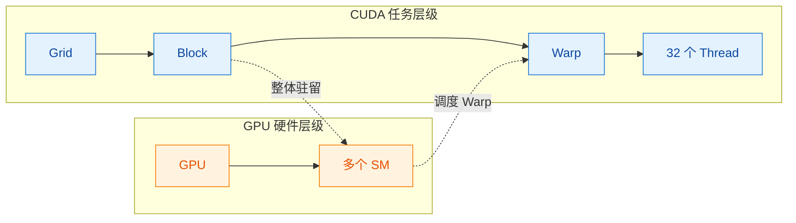

图 3-4：Grid、Block、Warp 与 SM 的关系。

Grid、Block、Thread 描述程序的工作划分，SM（Streaming Multiprocessor）是调度和执行这些工作的硬件资源。一个 Block 在一个 SM 上执行，同一 SM 可以同时驻留多个 Block，具体数量受寄存器、共享内存等资源限制。

一个 Warp 包含 32 个线程，是 SM 调度和执行线程工作的基本单位。行主序 `[M,H]` 张量的同一行相邻列位于相邻地址；让线程读取相邻列，有助于把访问合并成内存事务。

分支条件又决定哪些线程在某条指令上参与执行。后续 Dispatch 与 Combine Kernel 的设计会同时考虑记录索引、地址连续性和有效元素范围。

### 3.3.1 以输出 Tile 划分 GEMM

通用矩阵乘写为 `C[M,N]=A[M,K]×B[K,N]`。C 的每个元素都要沿 K 维累加。若每个线程各自从设备内存读取全部输入，会重复读取很多相同元素：同一行 A 被 N 个输出复用，同一列 B 被 M 个输出复用。

一种基础 GEMM 分块方案让一个 Block 负责 C 的 64×64 输出 Tile，Tile 指从大矩阵中截取的矩形子块。每轮沿 K 维读取 32 个元素，就需要 A 的 64×32 片段与 B 的 32×64 片段。

Block 的线程协作加载这些片段，并在多轮 K 累加之间保留输出部分和。下面的流程图描述这种共享内存分块方案。

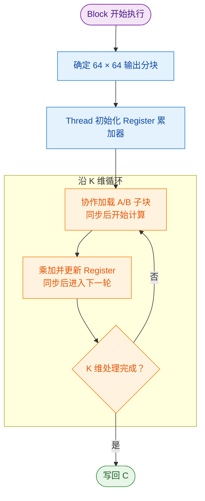

图 3-5：沿输出 Tile 和 K 维划分 GEMM。

在这个输出 Tile 内，一个 A 元素会参与 64 个输出列的计算，一个 B 元素会参与 64 个输出行的计算。线程把输入片段加载到共享内存后，可以多次读取它们完成乘加。数学库会根据矩阵形状、dtype 和设备选择具体分块，这里先用这组尺寸说明数据复用的过程。

## 3.4 让数据靠近执行单元

Tensor 通常保存在设备的全局内存中。访问路径还会经过缓存，而 Block 可以利用共享内存协作复用数据，线程则在寄存器中保留局部值和累加结果。这些存储的作用范围与容量不同，需要配合计算划分。

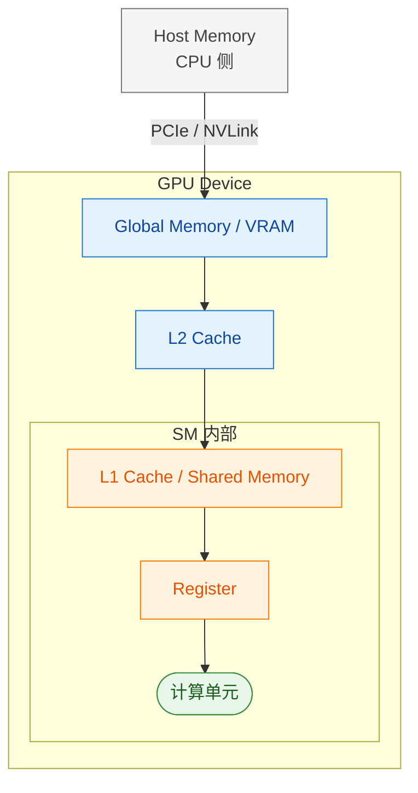

图 3-6：完整矩阵、输入片段与累加值所在的存储层次。

对 GEMM 来说，设备内存保存 A、B、C 的完整矩阵；共享内存适合保存当前 K 分块所需的输入；寄存器保存每个线程负责的输出累加值。将输入分块逐次送入计算，可以在有限的片上存储中完成大矩阵。

继续计算一个 64×64 输出 Tile 的局部数据。若输入片段使用 FP16，每次加载的 A Tile 为 64×32、B Tile 为 32×64，二者各占 4096 字节，合计 8 KiB。若输出用 FP32 累加，64×64 个累加值合计占 16 KiB，分散保存在负责这些输出的线程寄存器中。

更大的输出 Tile 能复用更多输入，也会占用更多共享内存和寄存器。一个 SM 的资源有限：单个 Block 占用越多，可同时驻留的 Block 就可能越少。Tile 大小同时影响输入复用和并行工作量，两者的取舍体现在给定矩阵形状的延迟中。

### 3.4.1 K 分块中的数据复用与同步

以 K=64、每次处理 32 个累加元素为例，共有两次 K 分块。先协作加载 A、B 的第一组片段，再等待参与读取的线程就绪，计算当前乘加；随后进入第二组片段，继续累加。完成后才把最终输出写回全局内存。

```mermaid
flowchart TD
    IN["Global Memory
A / B"]

    subgraph BLOCK["同一个 Block"]
        LOAD["线程协作加载"] --> SHARED["Shared Memory
A[64,32] 与 B[32,64]"]
        SHARED --> SYNC["Block 同步"]
        SYNC --> ACC["Thread 读取数据
在 Register 中累加"]
        ACC --> CHECK{"两轮 K 分块完成？"}
        CHECK -- "否" --> LOAD
    end

    IN --> LOAD
    CHECK -- "是" --> OUT["Global Memory
C[64,64] 输出分块"]

    classDef global fill:#e3f2fd,stroke:#1976d2,color:#0d47a1;
    classDef shared fill:#fff3e0,stroke:#f57c00,color:#e65100;
    classDef compute fill:#e8f5e9,stroke:#388e3c,color:#1b5e20;
    classDef decision fill:#f3e5f5,stroke:#7b1fa2,color:#4a148c;

    class IN,OUT global;
    class LOAD,SHARED,SYNC shared;
    class ACC compute;
    class CHECK decision;
```

图 3-7：分两次读取 K Tile，并保留输出累加值。

一轮计算包含两个同步位置：输入片段全部写入共享内存后，计算线程开始读取；所有线程完成读取后，下一轮加载再覆盖这块空间。输出的部分和一直留在寄存器中，直到 K 维的所有分块处理完毕，再写回全局内存。图中展示的是基础分块方案，数学库还可以采用 Tensor Core 和其他实现方式。

## 3.5 GEMM 的形状与计算量

一次 GEMM 按 `2MNK` 计算 FLOPs。Up 和 Down 的 M 相同，输入、输出宽度互换；两个投影合计约为 `4MHF` FLOPs。多个 Expert 的 M 由 Router 分配，因而同一层会形成若干具有相同 H、F、不同 M 的矩阵乘。

```mermaid
flowchart LR
    A["Expert 输入
[M,H]"] --> B["Up Projection
[M,H] × [H,F]"]
    B --> C["Activation
[M,F]"]
    C --> D["Down Projection
[M,F] × [F,H]"]
    D --> E["Expert 输出
[M,H]"]
```

图 3-8：Up 与 Down Projection 的输入输出形状。

第二课的 Expert 行数为 `[2,2,2,0]`，因此形成三个 M=2 的 MLP 与一个空输入。在更大的模型中，逐 Expert 循环也会提交一组 H、F 相同而 M 不同的投影。

每次调用都有提交、调度与执行过程；拆分后的单个 GEMM 能提供多少并行工作，由该 Expert 的 M 决定。后续 Grouped GEMM 会集中组织这组任务，这里先建立单个形状的延迟基线。

### 3.5.1 用 FLOPs 和延迟推导吞吐

设一次 GEMM 的中位延迟为 L 毫秒，则工作负载吞吐为：

$$
\mathrm{Achieved\ TFLOPS} = \frac{2MNK}{L_{\mathrm{ms}}\times10^9}
$$

公式把毫秒换成秒，并将 FLOPs 换成 TFLOPs。固定 N、K 时，M 增加一倍，计算量也增加一倍，耗时则需要实际测量。如果耗时增长较少，算出的吞吐就会提高。延迟和吞吐从两个角度描述同一份工作：前者说明一次投影多久完成，后者说明这段时间内完成了多少计算。

## 3.6 把计时放在设备执行顺序上

Python 计时器记录函数调用的起止，CUDA Event 则把起止标记放入设备流。为了测量 GEMM，基准先准备相同输入和权重，比较数值结果，再运行 Warmup，完成首次使用时的初始化与算法准备。

正式样本在当前 Stream 上依次记录 Start Event、投影调用、End Event，最后等待设备完成，读取两个事件之间的毫秒值。

```mermaid
flowchart LR
    A["Warmup"] --> B["同步
清空前序工作"]
    B --> C["Start Event"]
    C --> D["GEMM"]
    D --> E["End Event"]
    E --> F["测量结束后同步"]
    F --> G["读取 elapsed_time"]
```

图 3-9：Warmup 与 CUDA Event 定义测量区间。

`mini_ep/profiler/timer.py` 实现了这一过程。下面摘录中的 `operation` 是无参数的投影调用，`device` 为当前 CUDA 设备，`warmup` 与 `repeats` 为预热和采样次数。每次调用保存一对 Event，全部样本提交后统一同步，再读取耗时；操作与 Event 使用相同当前流。

**CUDA 计时 · code/course3/mini_ep/profiler/timer.py**

```python
import torch
from mini_ep.profiler.timer import LatencyStats

def measure_cuda_latency(operation, *, device, warmup=10, repeats=100):
    if warmup < 0 or repeats <= 0:
        raise ValueError("需要 warmup >= 0 且 repeats > 0")
    with torch.cuda.device(device), torch.inference_mode():
        # 预热与正式采样使用同一操作，预热完成后统一同步。
        for _ in range(warmup):
            operation()
        torch.cuda.synchronize(device)
        pairs = []
        for _ in range(repeats):
            started = torch.cuda.Event(enable_timing=True)
            ended = torch.cuda.Event(enable_timing=True)
            # 在当前 CUDA 流中记录起点。
            started.record()
            operation()
            # 在同一流中记录终点，夹住被测操作。
            ended.record()
            pairs.append((started, ended))
        torch.cuda.synchronize(device)
        # 全部 GPU 样本完成后再由 Host 读取毫秒数。
        samples_ms = [started.elapsed_time(ended) for started, ended in pairs]
    return LatencyStats(tuple(samples_ms))
```

**将首次准备工作放在采样边界之前**

```python
# 先提交预热工作，再等待完成，使采样区间从已准备的状态开始。
for _ in range(warmup):
    operation()
torch.cuda.synchronize(device)
pairs = []
```

warmup 提交与被测调用相同的操作，让后端完成初始化。随后 synchronize 排空预热工作，再建立采样列表；从此开始的时间只覆盖重复操作所在的流区间。

device 上下文指定设备，inference_mode 关闭此基准所不需要的自动求导记录。

**一对 Event 包围一次设备流工作**

```python
# 在同一 CUDA 流中记录起止 Event，将设备工作夹在两者之间。
started.record()
operation()
# 在同一流中记录终点，夹住被测操作。
ended.record()
pairs.append((started, ended))
```

started 和 ended 都记录在当前流。operation 在两者之间提交工作，该流到达终点时，属于此依赖链的操作已经完成。这里只保存 Event 对，避免每轮为了读取时间再次同步。

**在完成边界之后读取时间样本**

```python
# 终点完成以后，按每对 Event 读取该轮设备耗时。
samples_ms = [started.elapsed_time(ended) for started, ended in pairs]
```

前面的 synchronize 确保全部终点 Event 可读取。elapsed_time 返回每对 Event 的毫秒间隔，LatencyStats 保留原始样本并计算统计量。

若被测操作把工作交给其他流，操作自身需要将结果完成依赖接回当前流，才能由这个终点覆盖。

统计结果包含 median、mean、min 和 max：中位数描述典型延迟，最小值与最大值描述波动。比较实现时，输入、dtype、shape、设备和测量区间保持一致。起点与终点夹住当前流上一次操作的依赖链，样本在所有终点完成后统一读取。

第三课使用同流矩阵乘，因此该区间覆盖投影结果的生成；第七课沿用这个方式测量完整同步 EP 前向，第十二课再明确跨流与远端写入如何接入完成依赖。

## 3.7 Expert 批次大小与 GEMM 延迟

`benchmarks/benchmark_gemm.py` 构造同一份输入与权重，测量 Matmul 和 Linear；`test/demo.py` 提供课程入口。以下命令在 `code/course3` 目录执行，需要一张可见 CUDA GPU：

**GEMM 基准**

```bash
cd code/course3
python3 test/demo.py \
  --device=cuda --operation=both --dtype=float16 \
  --m=1024 --n=2048 --k=1024 --warmup=20 --repeats=100
```

固定 N、K 和 dtype，取 `M=1、8、32、128、512、2048`，就得到具有相同权重形状、不同输入批次的矩阵乘。M 同时改变输出元素数量和权重被输入行复用的次数。基准记录每个形状的配置与延迟统计，再由 `2MNK` 计算吞吐，使路由决定的 Expert 行数与 GPU 的执行表现联系起来。

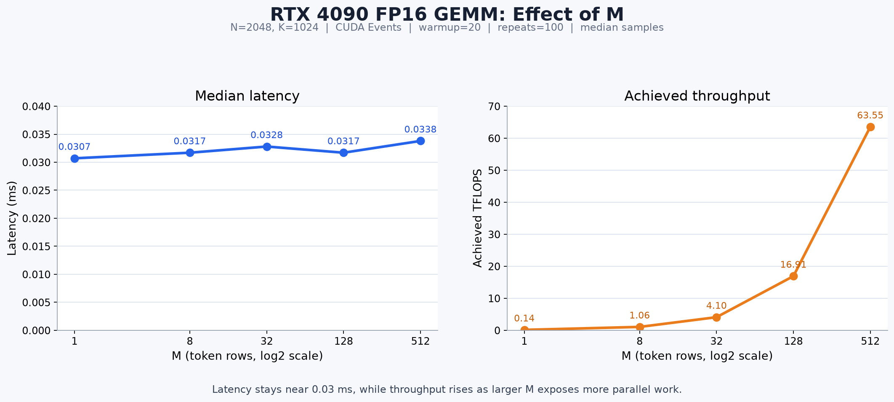

图 3-10：RTX 4090 上 M 维扫描的延迟与吞吐。

图 3-10 使用 RTX 4090、FP16、`N=2048,K=1024`，预热 20 次，CUDA Event 采样 100 次并取中位数。M 从 1 增到 512 时，延迟从 0.0307 ms 变为 0.0338 ms；

按 `2MNK/L` 换算的吞吐从约 0.14 增到 63.55 TFLOPS。在这组配置下，计算量增加 512 倍，典型耗时增加约 10%。比较其他设备或矩阵形状时，可以沿用相同的计时方法取得对应数据。

曲线显示了这组形状的实测延迟。若要继续判断数据复用、输出 Tile 数量和提交开销各占多少，可以查看 Kernel 指标与 Timeline。Timeline 是按时间排列的执行轨迹，展示 CPU 提交、GPU Kernel 和通信各自何时开始、何时结束；

它帮助把一次调用的总耗时接回具体阶段。图中的 Achieved TFLOPS 来自工作量除以耗时。配套测试使用各 dtype 的容差比较数值，并检查 shape、dtype 和 device：

**正确性测试**

```bash
python3 -m unittest discover -s checks -p 'test_gpu_execution.py' -v
```

第二课给出的记录数决定了 Expert 输入的 M，本课说明了这些矩阵怎样执行、怎样计时。把 Expert 放到多张 GPU 上后，还要先把输入送到它所在的设备。第四课从进程与集合通信讲起，第五课再把通信块接回路由记录。

有关线程层次与 Stream，可继续阅读 [CUDA Programming Guide](https://docs.nvidia.com/cuda/cuda-programming-guide/01-introduction/programming-model.html) 和 [CUDA 异步执行](https://docs.nvidia.com/cuda/cuda-programming-guide/02-basics/asynchronous-execution.html)。

继续阅读 [第 4 课：Distributed、NCCL 与 GPU 集合通信](https://tvle9mq8jh.feishu.cn/docx/VD4dd4QkColhL2xZMpscFpwanmg)。

---

# 第 4 课：Distributed、NCCL 与 GPU 集合通信

本课独立源码位于 `code/course4/`，示例在 `test/`，正确性测试在 `checks/`。下文命令均在本课目录中执行；将整个目录复制到其他位置后也使用同样的启动方式。

把第五课将要使用的四个 Expert 分到两张 GPU：Rank 0 持有 E0/E1，Rank 1 持有 E2/E3。若 Rank 0 的 T0 选中 E2，它的输入就要交给 Rank 1。两个 Worker 是独立 Python 进程，各自管理模型对象与 CUDA 张量；集合通信将这些本地张量连接成跨进程数据流。

Collective（集合通信）是由一个进程组的所有成员共同完成的张量操作。理解 EP 的通信选择，可以先用小整数看清三个操作：AllReduce 合并同位置的值，AllGather 保留并收集各来源数据，All-to-All 让每个来源向每个目标发送指定块。

两个 Worker 各绑定一张 GPU，使用小整数输入比较三种操作的输出内容与行序。

通信使用 PyTorch 的 `torch.distributed` 与 NCCL（NVIDIA Collective Communications Library，NVIDIA 集合通信库）。

默认 Process Group 包含两个 Worker，CUDA 张量由 NCCL 后端传输。先建立参与者、设备和块顺序，第五课再让块长随路由变化，第六课接入真实 Expert 计算。

## 4.1 Worker、Rank 与设备绑定

`torchrun` 为分布式作业启动多个 Worker。单机双 GPU 作业启动两个 Python 进程，分别设置 `RANK` 与 `LOCAL_RANK`，并共享 `WORLD_SIZE`、`MASTER_ADDR` 和 `MASTER_PORT`。

这些值确定每个进程是谁、作业内有多少成员，以及到哪里交换初始化信息；张量载荷随后通过 NCCL 的通信路径传输。

```mermaid
flowchart TD
    A(["torchrun 启动分布式作业"])

    subgraph W["两个独立 Worker"]
        direction LR
        P0["Worker 0 · Rank 0"] --> D0["LOCAL_RANK=0 · cuda:0"]
        P1["Worker 1 · Rank 1"] --> D1["LOCAL_RANK=1 · cuda:1"]
    end

    E["env:// 读取初始化环境变量"]
    G["建立默认 NCCL Process Group"]
    C["所有 Rank 按一致顺序调用 Collective"]
    V["核对值、Shape、dtype、device 与布局"]
    X(["销毁 Process Group"])

    A --> P0
    A --> P1
    D0 --> E
    D1 --> E
    E --> G --> C --> V --> X

    classDef launch fill:#f3e5f5,stroke:#7b1fa2,color:#4a148c;
    classDef process fill:#e3f2fd,stroke:#1976d2,color:#0d47a1;
    classDef device fill:#fff3e0,stroke:#f57c00,color:#e65100;
    classDef comm fill:#e8f5e9,stroke:#388e3c,color:#1b5e20;
    class A,X launch;
    class P0,P1 process;
    class D0,D1 device;
    class E,G,C,V comm;
```

图 4-1：两个 Worker 从启动到通信组释放的路径。

进入 `code/course4` 后运行下面的命令，需要两张可见 CUDA GPU，PyTorch 环境支持 NCCL：

**启动进程**

```bash
cd code/course4
CUDA_VISIBLE_DEVICES=0,1 torchrun --standalone --nproc-per-node=2 \
  test/demo.py --expected-world-size=2
```

`--nproc-per-node=2` 表示本机两个 Worker，`--standalone` 为单机作业准备协调服务。两个 Worker 运行同一份脚本，再依据自己的 Rank 处理各自的数据。

每个 Worker 都有自己的 Python 变量和张量存储。脚本中的 `rank` 在进程 0 中取 0，在进程 1 中取 1；因此同一条构造表达式可以在两端生成不同输入。

后面的 AllReduce 用这种方式分别准备 `[1,10]` 和 `[2,20]`，再通过通信得到相同的 `[3,30]`。`torchrun` 负责启动进程、提供身份，具体输入由各进程执行的代码准备。

### 4.1.1 进程身份与设备身份

Global Rank 表示进程在默认通信组中的编号；Local Rank 表示它在本机的编号，用来选择可见设备；World Size 表示默认组内的进程总数。多机时，同一 Local Rank 会在不同机器上重复，Global Rank 则区分整组参与者。

| Worker | Global Rank | Local Rank | World Size | 本课绑定的设备 |
| --- | --- | --- | --- | --- |
| 0 | 0 | 0 | 2 | `cuda:0` |
| 1 | 1 | 1 | 2 | `cuda:1` |

CUDA 设备编号相对于 `CUDA_VISIBLE_DEVICES` 列表。例如列表为 `2,7` 时，进程内 `cuda:0` 指物理 GPU 2，`cuda:1` 指物理 GPU 7。

`read_torchrun_environment()` 解析进程变量，`nccl_distributed()` 将 `LOCAL_RANK` 转换为对应 `torch.device` 并设置当前设备。

每个 Worker 的输入、输出与通信缓冲区都创建在自己绑定的 CUDA 设备上。

## 4.2 Process Group 让参与者遵循同一通信语义

Process Group 指定一次 Collective 的参与进程及其组内编号。各 Worker 初始化自己的通信上下文后，通过同一个组交换张量。协调服务负责初始化时的信息交换，NCCL 后端负责后续 GPU 张量传输。一次 Collective 由该组的所有成员共同提交并完成。

```mermaid
%%{init: {"theme":"base","flowchart":{"curve":"linear","nodeSpacing":24,"rankSpacing":38}}}%%
flowchart TB
    I(["每个 Worker 分别调用
init_process_group(backend=nccl)"])

    subgraph W0["Worker 0"]
        direction TB
        P0["本地默认 Process Group
后端：ProcessGroupNCCL"]
        C0["本地 NCCL Communicator"]
        B0["cuda:0 Buffer"]
        P0 --> C0 --> B0
    end

    subgraph W1["Worker 1"]
        direction TB
        P1["本地默认 Process Group
后端：ProcessGroupNCCL"]
        C1["本地 NCCL Communicator"]
        B1["cuda:1 Buffer"]
        P1 --> C1 --> B1
    end

    G["同一逻辑默认 Process Group
参与者：全部 Rank"]

    I --> P0
    I --> P1
    P0 -.->|对应| G
    P1 -.->|对应| G
    C0 <-->|NCCL 传输与归并| C1

    classDef init fill:#F3E5F5,stroke:#7B1FA2,color:#4A148C;
    classDef pg fill:#E3F2FD,stroke:#1976D2,color:#0D47A1;
    classDef comm fill:#E8F5E9,stroke:#388E3C,color:#1B5E20;
    classDef buffer fill:#FFF3E0,stroke:#F57C00,color:#E65100;
    class I init;
    class P0,P1,G pg;
    class C0,C1 comm;
    class B0,B1 buffer;
```

图 4-2：各 Worker 持有本地通信上下文与缓冲区。

初始化先选设备，再建立 Process Group。下面摘录 `nccl_distributed()` 的核心调用：`device` 为 `torch.device("cuda", local_rank)`，`dist` 是 `torch.distributed`，`timedelta` 来自 `datetime`。

这里使用支持 `device_id` 参数的 PyTorch；课程链接与接口说明以 PyTorch 2.11 为基准。

**初始化通信组 · code/course4/mini_ep/distributed/groups.py**

```python
import torch
import torch.distributed as dist
from datetime import timedelta

def initialize_nccl(device, timeout_seconds=120):
    torch.cuda.set_device(device)
    # 读取 torchrun 环境，建立默认 NCCL 进程组。
    dist.init_process_group(
        backend="nccl",
        init_method="env://",
        timeout=timedelta(seconds=timeout_seconds),
        device_id=device,
    )
```

**绑定设备，再建立通信参与者**

```python
# 先绑定当前进程使用的 CUDA 设备，再初始化 NCCL 进程组。
torch.cuda.set_device(device)
# 读取 torchrun 环境，建立默认 NCCL 进程组。
dist.init_process_group(
    backend="nccl",
    init_method="env://",
    timeout=timedelta(seconds=timeout_seconds),
    device_id=device,
)
```

set_device 设置当前进程后续 CUDA 分配与操作使用的设备。env:// 从 torchrun 提供的环境读取 Rank、world size 与 rendezvous 地址；

backend="nccl" 创建 GPU collective 使用的默认进程组。device_id 是当前进程绑定的 torch.device，各进程使用相同的组配置进入初始化。

`env://` 从环境变量读取进程编号和协调地址，`device_id` 指定当前进程使用的 CUDA 设备，超时参数设置初始化和通信的等待上限。建组后，各端按相同次序提交 Collective，调用参数描述彼此匹配的数据类型、形状和收发缓冲区，通信便按这些对应关系交换数据。

### 4.2.1 从 World Group 到 EP Group

默认组包含作业中的全部 Rank。后续更大的并行作业可以创建子组，让其中一部分进程协作完成 EP；此时还要区分 Global Rank 和 EP group 内的 Rank。以下 EP 示例将默认组用作 EP group，因此 EP rank 等于 Global Rank，EP size 等于 World Size。

```mermaid
flowchart TB
    L["torchrun<br/>创建 2 个 Worker"]

    R0["Worker 0<br/>global_rank=0 · LOCAL_RANK=0"]
    R1["Worker 1<br/>global_rank=1 · LOCAL_RANK=1"]
    D0["cuda:0<br/>set_device(0)"]
    D1["cuda:1<br/>set_device(1)"]

    E["env://<br/>初始化协调"]
    G["默认 ProcessGroupNCCL<br/>world_size=2"]
    N["NCCL Communicator<br/>在 CUDA Buffer 上传输与归并"]

    L --> R0 -->|"LOCAL_RANK=0"| D0
    L --> R1 -->|"LOCAL_RANK=1"| D1
    D0 --> E
    D1 --> E
    E --> G --> N

    classDef launch fill:#F3E5F5,stroke:#7B1FA2,color:#4A148C,stroke-width:2px;
    classDef worker fill:#E3F2FD,stroke:#1976D2,color:#0D47A1,stroke-width:2px;
    classDef device fill:#FFF3E0,stroke:#F57C00,color:#E65100,stroke-width:2px;
    classDef init fill:#E0F2F1,stroke:#00897B,color:#004D40,stroke-width:2px;
    classDef comm fill:#E8F5E9,stroke:#388E3C,color:#1B5E20,stroke-width:2px;
    class L launch;
    class R0,R1 worker;
    class D0,D1 device;
    class E init;
    class G,N comm;
```

图 4-3：进程编号、可见设备与默认通信组。

All-to-All 的第 d 个发送块发往当前 Process Group 的 Rank d。使用默认组时，这个编号就是 Global Rank；使用子组时，d 对应子组成员顺序中的第 d 个进程。Expert 放置和通信块都使用 EP rank 编号，发送方据此将 Token 交给拥有目标 Expert 的进程。

## 4.3 AllReduce：把同一位置的元素归约

AllReduce 先按照指定操作归约所有 Rank 的输入，再让每个参与者得到归约结果。我们使用 SUM：Rank 0 输入 `[1,10]`，Rank 1 输入 `[2,20]`，结果是 `[3,30]`，两个 Rank 都保存这两个元素。

```mermaid
flowchart TB
    subgraph INPUT["各 Rank 的本地输入"]
        direction LR
        R0["Rank 0 · cuda:0
[1, 10]"]
        R1["Rank 1 · cuda:1
[2, 20]"]
    end

    SUM(["AllReduce · SUM
逐元素求和"])

    subgraph OUTPUT["相同结果写回每个 Rank"]
        direction LR
        O0["Rank 0
[3, 30]"]
        O1["Rank 1
[3, 30]"]
    end

    R0 --> SUM
    R1 --> SUM
    SUM --> O0
    SUM --> O1

    classDef input fill:#E3F2FD,stroke:#1976D2,color:#0D47A1,stroke-width:2px;
    classDef op fill:#FFF3E0,stroke:#F57C00,color:#E65100,stroke-width:2px;
    classDef output fill:#E8F5E9,stroke:#388E3C,color:#1B5E20,stroke-width:2px;
    class R0,R1 input;
    class SUM op;
    class O0,O1 output;
```

图 4-4：逐元素求和的 AllReduce。

下面的 `rank` 是当前组内编号，`group` 为默认组或显式传入的 Process Group，`device` 为 Worker 绑定的 CUDA 设备。示例用 int64 张量精确表达整数求和，输入、输出均为 `[2]`。`all_reduce()` 原地更新本地缓冲区，两个 Rank 的结果都变成 `[3,30]`。

**AllReduce · test/demo.py**

```python
import torch
import torch.distributed as dist

def all_reduce_sum(rank, device, group=None):
    buffer = torch.tensor([rank + 1, 10 * (rank + 1)],
                          dtype=torch.int64, device=device)
    # 原地求和；组内每个 Rank 都得到归约结果。
    dist.all_reduce(buffer, op=dist.ReduceOp.SUM, group=group)
    return buffer
```

**同一位置的元素在组内求和**

```python
# 所有 Rank 在同一张量位置上贡献数值，归约结果写回各自缓冲区。
buffer = torch.tensor([rank + 1, 10 * (rank + 1)],
                      dtype=torch.int64, device=device)
# 原地求和；组内每个 Rank 都得到归约结果。
dist.all_reduce(buffer, op=dist.ReduceOp.SUM, group=group)
```

Rank 0 创建 [1,10]，Rank 1 创建 [2,20]。all_reduce 原地更新各自的两个 int64 元素，每个参与者最终都得到 [3,30]。归约配对依据张量位置，进程组决定谁参与本次相加。

推广到 P 个 Rank，第一列的输入为 1 到 P，求和得到 `P(P+1)/2`，第二列为这个结果的十倍。所有 Rank 都得到相同结果，因此 AllReduce 适合计算全组共同需要的统计量。

## 4.4 AllGather：让每个 Rank 收齐所有输入

AllGather 保留各 Rank 的数据，并按来源 Rank 收集起来。本例中，Rank 0 提供 `[0,100]`，Rank 1 提供 `[1,101]`。两个 Rank 的接收列表都包含这两行，stack 后的形状是 `[2,2]`。

```mermaid
flowchart TB
    subgraph INPUT["各 Rank 提供一行"]
        direction LR
        R0["Rank 0
[0, 100]"]
        R1["Rank 1
[1, 101]"]
    end

    GATHER(["AllGather
按发送方 Rank 0、1 汇集"])

    subgraph OUTPUT["每个 Rank 获得完整副本"]
        direction LR
        O0["Rank 0 输出
[[0, 100], [1, 101]]"]
        O1["Rank 1 输出
[[0, 100], [1, 101]]"]
    end

    R0 --> GATHER
    R1 --> GATHER
    GATHER --> O0
    GATHER --> O1

    classDef input fill:#E3F2FD,stroke:#1976D2,color:#0D47A1,stroke-width:2px;
    classDef op fill:#F3E5F5,stroke:#7B1FA2,color:#4A148C,stroke-width:2px;
    classDef output fill:#E8F5E9,stroke:#388E3C,color:#1B5E20,stroke-width:2px;
    class R0,R1 input;
    class GATHER op;
    class O0,O1 output;
```

图 4-5：按来源收集的 AllGather。

下面仍使用当前 `rank`、`world_size`、`device` 和 `group`。本地输入为 `[2]` int64 张量，接收列表有 P 项，每项也为 `[2]` 且 dtype、device 相同。列表下标 s 对应来源 Rank s，`stack()` 再增加来源维，形成 `[P,2]` 张量：

**AllGather · test/demo.py**

```python
import torch
import torch.distributed as dist

def gather_rank_rows(rank, world_size, device, group=None):
    local_row = torch.tensor([rank, rank + 100], dtype=torch.int64, device=device)
    gathered_rows = [torch.empty_like(local_row) for _ in range(world_size)]
    # 列表下标对应来源 Rank。
    dist.all_gather(gathered_rows, local_row, group=group)
    gathered = torch.stack(gathered_rows)
    return gathered
```

**按来源 Rank 保存完整输入**

```python
# 为每个来源准备一份接收张量，按组内 Rank 顺序保存结果。
gathered_rows = [torch.empty_like(local_row) for _ in range(world_size)]
# 列表下标对应来源 Rank。
dist.all_gather(gathered_rows, local_row, group=group)
gathered = torch.stack(gathered_rows)
```

每个列表元素与 local_row 同 shape、dtype、device。AllGather 将来源 s 的两个元素写入列表下标 s，stack 再得到 [P,2]。

两卡结果为 [[0,100],[1,101]]；新增加的第 0 维记录数据来自哪个 Rank。

AllReduce 把同位置的值合并为一个结果，AllGather 则保留各来源的值及其来源顺序。第六课中的接收布局依赖每个来源发往每个 Expert 的数量，因此需要保留一个来源维度，形成计数矩阵。选择 Collective 的依据正是下游需要保留哪些信息。

## 4.5 All-to-All：每个来源分别向每个目标发送

一个 Rank 将自己的发送缓冲区切成 P 块，第 d 块发给 Rank d。目标 Rank 再将收到的块按来源 Rank 拼接。源端的块号表达目标，目标端的块号表达来源。

```mermaid
%%{init: {"theme":"base","flowchart":{"curve":"linear","nodeSpacing":24,"rankSpacing":42}}}%%
flowchart TB
    S0["发送缓冲 · 发送方 Rank 0<br/>按接收方 Rank 排列<br/>send[0] = [0,0] → R0<br/>send[1] = [0,1] → R1"]
    S1["发送缓冲 · 发送方 Rank 1<br/>按接收方 Rank 排列<br/>send[0] = [1,0] → R0<br/>send[1] = [1,1] → R1"]

    A2A(["NCCL<br/>等长切分<br/>All-to-All"])

    D0["接收缓冲 · 接收方 Rank 0<br/>按发送方 Rank 排列<br/>recv[0] = [0,0] ← R0<br/>recv[1] = [1,0] ← R1"]
    D1["接收缓冲 · 接收方 Rank 1<br/>按发送方 Rank 排列<br/>recv[0] = [0,1] ← R0<br/>recv[1] = [1,1] ← R1"]

    S0 -->|"[0,0] · [0,1]"| A2A
    S1 -->|"[1,0] · [1,1]"| A2A
    A2A -->|"[0,0] · [1,0]"| D0
    A2A -->|"[0,1] · [1,1]"| D1

    classDef blue fill:#EAF3FF,stroke:#6EA8E5,color:#234B75,stroke-width:1.5px;
    classDef purple fill:#F2ECFF,stroke:#9A7BD8,color:#4D3974,stroke-width:1.5px;
    classDef orange fill:#FFF1DF,stroke:#E59B4D,color:#70451D,stroke-width:1.5px;
    classDef green fill:#EAF8EF,stroke:#69B883,color:#285E3B,stroke-width:1.5px;
    class S0 blue;
    class S1 purple;
    class A2A orange;
    class D0 green;
    class D1 blue;
    linkStyle 0 stroke:#6EA8E5,stroke-width:2px;
    linkStyle 1 stroke:#9A7BD8,stroke-width:2px;
    linkStyle 2 stroke:#69B883,stroke-width:2px;
    linkStyle 3 stroke:#E59B4D,stroke-width:2px;
```

图 4-6：All-to-All 按目标发送、按来源接收。

用 `[source_rank,destination_rank]` 标记每行，双 Rank 的发送与接收可以完整写出：

| Rank | 发送缓冲区 | 接收缓冲区 |
| --- | --- | --- |
| 0 | `[[0,0],[0,1]]` | `[[0,0],[1,0]]` |
| 1 | `[[1,0],[1,1]]` | `[[0,1],[1,1]]` |

下面构造 `[P,2]` 连续 int64 缓冲区，每个目标分配一行。第 d 行是 `[rank,d]`，第一列记录来源，第二列记录去向。等长交换后，接收方 Rank d 的第 s 行变成 `[s,d]`，来源依次递增，目标始终为当前 Rank。

`equal_split_all_to_all` 从 `mini_ep.distributed.all_to_all` 导入。

通信时，两端传入的是各自的本地缓冲区。在这张表里，Rank 0 将 `[0,1]` 发给 Rank 1；Rank 1 将它写入自己接收缓冲区的第 0 行。同时 Rank 1 将 `[1,0]` 发给 Rank 0，Rank 0 将它写入自己的第 1 行。来源编号决定接收位置，所以两个进程都能仅凭同一个分块规则解释输出。

**All-to-All · test/demo.py**

```python
import torch
import torch.distributed as dist
from mini_ep.distributed.all_to_all import equal_split_all_to_all

def exchange_rank_rows(rank, world_size, device, group=None):
    source = torch.full((world_size,), rank, dtype=torch.int64, device=device)
    destination = torch.arange(world_size, dtype=torch.int64, device=device)
    # 第 d 行是一条发给目标 Rank d 的记录，行内保存来源和目标标签。
    send_buffer = torch.stack((source, destination), dim=1)
    recv_buffer = equal_split_all_to_all(send_buffer, group=group)
    return recv_buffer
```

**发送行号选择目标，接收行号指向来源**

```python
# 发送缓冲区按目标 Rank 切分，接收缓冲区按来源 Rank 拼接。
source = torch.full((world_size,), rank, dtype=torch.int64, device=device)
destination = torch.arange(world_size, dtype=torch.int64, device=device)
# 第 d 行是一条发给目标 Rank d 的记录，行内保存来源和目标标签。
send_buffer = torch.stack((source, destination), dim=1)
recv_buffer = equal_split_all_to_all(send_buffer, group=group)
```

source 在每行写下当前 Rank，destination 则为 0…P−1。发送缓冲 [P,2] 的第 d 行因而标记为 [当前来源,d]，等分 A2A 把它送给目标 d。

在 Rank d 的接收结果中，第 s 行是 [s,d]，这就展示了目标分块到来源分块的变化。

### 4.5.1 等长分块的张量布局

`equal_split_all_to_all()` 使用 `dist.all_to_all_single()`。输入为连续的 `[rows,...]` 张量，第 0 维表示行，后面的维度是每行载荷。rows 能被组大小整除，每个目标收到 `rows/P` 行；输出与输入保持相同 shape、dtype 和 device。

后续把每块改为不同的行数，仍然保留发送时按目标划分、接收时按来源拼接的规则，额外用 splits 描述区间边界。

两张卡都发送 [2,2] 张量，也都接收 [2,2] 张量。shape 保持相同，行的归属已经改变：发送行按目标排列，接收行按来源排列。第五课将每个方向的一行扩展成由路由决定的变长块，继续使用这套来源与目标约定。

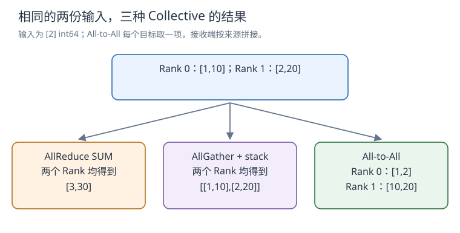

图 4-7：相同输入经过归约、收集与重分发后的结果。

于是 All-to-All 的 Rank 0 收到 `[1,2]`，Rank 1 收到 `[10,20]`。它把数据的目标列变成接收方的本地结果，块内数值保持原样。MoE 中每个目标块保存属于该 Rank 的 Expert 输入，因而可以沿这条“按目标发送、按来源接收”的规则继续构造通信。

## 4.6 Collective 的顺序也是数据流的一部分

两个 Rank 都按 AllReduce、AllGather、All-to-All 的顺序提交操作，组内的第一次、第二次和第三次调用分别配对。各 Worker 的提交时刻可以不同，较早提交的成员等待其他成员进入对应调用。这种按调用次序配对的方式，使各进程的本地代码共同组成一条通信序列。

示例使用 `async_op=False`，CUDA 结果的就绪遵循 PyTorch 的流依赖：同一当前流上的后续 GPU 操作按既定顺序消费通信输出。Host 打印、比较和报告前，示例在三次通信之后统一调用 `torch.cuda.synchronize(device)`，等待当前设备工作完成。

CPU 同步点和组内通信序列分别管理结果读取与成员协作。

| 操作 | 本地输出 shape | 双 Rank 预期内容 |
| --- | --- | --- |
| AllReduce SUM | `[2]` | `[3,30]` |
| AllGather + stack | `[2,2]` | `[[0,100],[1,101]]` |
| All-to-All | `[2,2]` | Rank d 得到 `[[0,d],[1,d]]` |

`run_collectives()` 根据上面的计算公式与排列规则构造预期值，逐值比较结果，再核对 shape、dtype、device 和连续性。用小整数表达输入，可以直接手算求和结果，并追踪每行数据的来源与去向。

### 4.6.1 让通信组跟随程序的生命周期

入口通过上下文管理器管理建组和释放。在上下文内创建通信张量、执行通信与检查，退出时销毁该上下文创建的组。这样，身份、设备和组一起保存在 `DistributedContext` 中，传给执行函数。

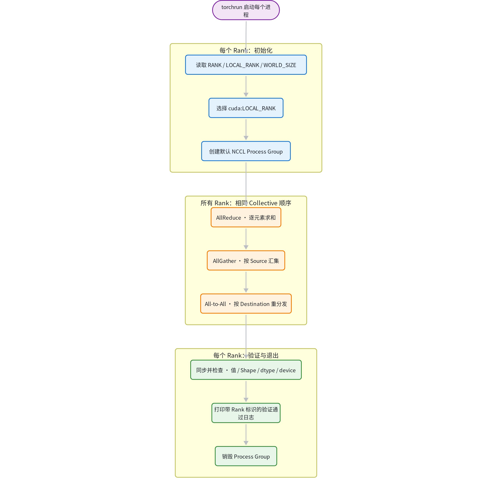

图 4-8：各 Rank 共同遵循的通信与检查顺序。

图中从初始化到销毁的顺序，对应每个 Worker 的通信生命周期。三次 Collective 在组内遵循同一个次序，Host 检查放在设备同步之后。

**通信入口 · test/demo.py**

```python
from mini_ep.distributed.groups import nccl_distributed

def main(run_collectives):
    with nccl_distributed(timeout_seconds=120) as context:
        results = run_collectives(context)
        print(f"rank={context.global_rank} device={context.device} PASS", flush=True)
    return results
```

这段代码使用三个模块：`groups.py` 读取进程环境、绑定设备并管理通信组；`test/demo.py` 在组内调用三种 Collective；`all_to_all.py` 封装按第 0 维分块的张量接口。可以沿入口代码逐个查看它们，确认当前 Rank、设备和缓冲区从哪里来。

## 4.7 通信阶段与可观察的进程状态

日志中的 Rank、Device 和阶段可以展示各进程当前执行到哪里。初始化阶段记录进程身份、设备与协调信息；Collective 阶段记录通信名称和缓冲区参数；结果阶段记录设备工作完成后的输出。将多个 Rank 的日志按阶段对照，就能看清同一次通信在各进程中的提交与完成过程。

需要细看通信阶段时，可在同一个启动命令上启用日志：

**日志与测试**

```bash
TORCH_DISTRIBUTED_DEBUG=DETAIL NCCL_DEBUG=INFO \
CUDA_VISIBLE_DEVICES=0,1 torchrun --standalone --nproc-per-node=2 \
  test/demo.py --expected-world-size=2 --timeout-seconds=120
python3 -m unittest discover -s checks -p 'test_distributed_nccl.py' -v
```

配套测试检查进程环境和张量接口，并在双 GPU 条件下运行 NCCL 通信。小整数输入用于核对求和结果与行序，shape、dtype、device 和连续性检查用于确认缓冲区满足后续 Token 传输的要求。

## 4.8 从数据交换走向 Expert Parallel

现在让发送行重新代表 Token。源 Rank 根据 Router 选择找到目标 Expert，再找到 Expert 所在的 Rank，按目标打包后发送。接收方调用本地 Expert，再按来源把结果送回。源端应用路由权重并合并分支。

```mermaid
flowchart TD
    subgraph ROUTE["路由与打包"]
        direction TB
        A(["Router / Top-K
生成 Expert ID 与路由权重"])
        B["Expert 映射
计算接收方 Rank"]
        C["Token 打包
按接收方 Rank 排列"]
        A --> B --> C
    end

    subgraph COMPUTE["跨 Rank 专家计算"]
        direction TB
        D["第一次 All-to-All
Token 到达 Expert 所在 Rank"]
        E["本地 Expert 计算
处理接收到的 Token"]
        F["第二次 All-to-All
结果返回原发送方 Rank"]
        D --> E --> F
    end

    subgraph RESTORE["恢复与合并"]
        direction TB
        G(["恢复原顺序
按路由权重合并"])
    end

    C -->|跨 Rank 发送| D
    F -->|跨 Rank 返回| G

    classDef route fill:#E3F2FD,stroke:#1976D2,color:#0D47A1,stroke-width:2px;
    classDef comm fill:#FFF3E0,stroke:#F57C00,color:#E65100,stroke-width:2px;
    classDef compute fill:#E8F5E9,stroke:#388E3C,color:#1B5E20,stroke-width:2px;
    classDef result fill:#F3E5F5,stroke:#7B1FA2,color:#4A148C,stroke-width:2px;
    class A,B,C route;
    class D,F comm;
    class E compute;
    class G result;
```

图 4-9：Expert Parallel 的输入与结果往返。

Expert 的放置提前确定，Token 的去向每次前向都会变化。All-to-All 正好表达每个来源向多个目标分别发送的数据流。第五课将用变长 splits 表达这种变化，继续追踪同一批记录的往返过程。

有关通信接口与 CUDA Stream 语义，可查阅 [PyTorch Distributed](https://docs.pytorch.org/docs/2.11/distributed.html)。

继续阅读 [第 5 课：All-to-All 与 EP 通信](https://tvle9mq8jh.feishu.cn/docx/Wl15dw3sJovDErxqGTIcUlDvnHb)。

---

# 第 5 课：All-to-All 与 EP 通信

本课独立源码位于 `code/course5/`，示例在 `test/`，正确性测试在 `checks/`。下文命令均在本课目录中执行；将整个目录复制到其他位置后也使用同样的启动方式。

第四课向每个目标发送一行，块长事先固定。现在换成第二课的路由记录：同一个 Token 的两个 slot 可以去不同 Rank，也可以去同一 Rank 的不同 Expert。

每个方向到底发多少行，要看当前的路由结果。All-to-All 因而需要一份 split 列表记录块长，仍按目标 Rank 发送、按来源 Rank 接收。

沿用第二课的六条记录，Rank 0 的 T0/T1/T2 共三行输入，Top-2 展开后有六行。E0/E1 放在 Rank 0，E2/E3 放在 Rank 1，于是四行留在 Rank 0，两行去 Rank 1。

再让 Rank 1 提供 U0/U1 两行，向两个 Rank 各发送两条记录。每个来源能从自己的路由统计发送量；每个目标的接收量则由两个来源共同决定。

先让 Ee 输出 `(e+1)×x`。例如 E2 将输入乘以 3，E0 原样返回输入，这样很容易从结果看出一条分支交给了哪个 Expert。我们用这个简单计算贯穿计数交换、NCCL 传输和加权合并；第六课再换成真实 MLP，沿用相同的输入往返与恢复方式。

## 5.1 路由记录的跨 Rank 往返

Router 给出 Expert ID 和权重，Dispatch 展开 Top-K 并打包。发送方根据 Expert 所在的 Rank 切分输入，交换计数以后，分别发送 Token 向量和本地 Expert ID。接收方按 ID 计算，保持接收行序，再将结果发回来源。

```mermaid
flowchart TD
    subgraph S["源 Rank：准备发送"]
        A(["Token 与 Top-K 路由"])
        B["按目标 Rank 分块
生成 send_splits"]
        C["交换计数
得到 recv_splits，分配接收 Buffer"]
        A --> B --> C
    end
    D["正向 All-to-All
分别传输 Token 与本地 Expert 编号"]
    subgraph R["目标 Rank：处理收到的数据"]
        E["按来源 Rank 拼接
Token 与 Expert 编号逐行对应"]
        F["逐行缩放
保持接收行顺序"]
        E --> F
    end
    G["返回 All-to-All
正向 recv 变 send，正向 send 变 recv"]
    H(["源 Rank：恢复 Token 顺序
按路由权重合并 Top-K"])
    C --> D --> E
    F --> G --> H
    B -.->|"源端保留权重与恢复索引"| H
    classDef blue fill:#e3f2fd,stroke:#1976d2,color:#0d47a1;
    classDef orange fill:#fff3e0,stroke:#f57c00,color:#e65100;
    classDef green fill:#e8f5e9,stroke:#388e3c,color:#1b5e20;
    classDef purple fill:#f3e5f5,stroke:#7b1fa2,color:#4a148c;
    class B blue;
    class C,D,G orange;
    class E,F green;
    class A,H purple;
```

图 5-1：Token、Expert 身份与返回结果的数据流。

最终输出要回到源 Rank，因此路由权重、Token/slot 索引和恢复排列都留在这里。目标 Rank 只需要收到输入向量，并知道每行交给哪个本地 Expert。计算后它将结果发回来源，源 Rank 再按保存的索引恢复顺序、应用权重，得到与原输入逐行对应的输出。

### 5.1.1 变长描述的是第 0 维

设 EP group 大小为 P，当前 Rank 有 N 个 Token，隐藏宽度为 H，每个 Token 选择 K 个 Expert，本地记录数为 `A=N×K`。发送缓冲区是 `[A,H]`，每行表示一条计算分支。

接收缓冲区是 `[R,H]`，R 是所有来源发到当前 Rank 的记录数。本例 Rank 0 的 N=3、A=6，Rank 1 的 N=2、A=4；发送行数取决于本地输入，接收行数取决于全组路由。第六课继续用 N 表示本地 Token 数。

参与者使用相同 H 与浮点 dtype，各方向的第 0 维行数可以不同。`send_splits[d]` 表示发给组内目标 d 的行数，`recv_splits[s]` 表示从组内来源 s 接收的行数，列表均有 P 项。

对来源 s、目标 d，一致性条件是来源的 `send_splits[d]` 等于目标的 `recv_splits[s]`。列表单位为行，实际元素数还要乘以每行载荷宽度。

```mermaid
flowchart TD
    subgraph SEND["发送端：按目标 Rank 分块"]
        S0["Rank 0 的发送 Buffer
给 R0 的块｜给 R1 的块"]
        S1["Rank 1 的发送 Buffer
给 R0 的块｜给 R1 的块"]
    end
    subgraph RECV["接收端：按来源 Rank 拼接"]
        R0["Rank 0 的接收 Buffer
来自 R0 的块｜来自 R1 的块"]
        R1["Rank 1 的接收 Buffer
来自 R0 的块｜来自 R1 的块"]
    end
    S0 -->|"给 R0"| R0
    S0 -->|"给 R1"| R1
    S1 -->|"给 R0"| R0
    S1 -->|"给 R1"| R1
    classDef blue fill:#e3f2fd,stroke:#1976d2,color:#0d47a1;
    classDef green fill:#e8f5e9,stroke:#388e3c,color:#1b5e20;
    class S0,S1 blue;
    class R0,R1 green;
```

图 5-2：发送块按目标排列，接收块按来源排列。

第 d 个发送块从 `sum(send_splits[:d])` 开始，长度为 `send_splits[d]`；第 s 个接收块从 `sum(recv_splits[:s])` 开始，长度为 `recv_splits[s]`。

前缀和把组内 Rank 编号转化为缓冲区区间。split 为 0 时，该 Rank 对应空区间，后续块仍由同一套边界规则定位，因此非均匀路由和空来源可以共用这一表示。

## 5.2 一行数据携带哪些身份

Token 向量是计算输入，目标 Expert ID 决定计算函数，原 Token 编号与 slot 决定返回后的合并位置。这些身份的用途决定了信息的保存位置：计算输入与本地 Expert ID 发往目标，恢复索引与权重保存在来源。

均匀放置下，目标 Rank 可以从全局 Expert ID 推导。发送缓冲区的块位置已经表达目标 Rank，因此每行再传一个本地 Expert ID，就可以确定它在目标端交给哪一个 Expert。

```mermaid
flowchart TD
    subgraph S["源 Rank：打包结果"]
        E["dispatch.packed_expert_ids
每行的全局 Expert ID"]
        L["packed_local_expert_ids
目标 Rank 内的 Expert 编号"]
        T["dispatch.packed_tokens
每行的 Token 向量"]
        P["send_splits
各目标 Rank 的行数"]
        E -->|"按放置规则转换"| L
        E -->|"按目标 Rank 汇总计数"| P
    end
    C["交换计数
得到 recv_splits，分配接收 Buffer"]
    A["正向 All-to-All
Token 与本地编号分别传输"]
    subgraph D["目标 Rank：处理与返回"]
        X["按本地 Expert 编号处理 Token
返回前保持或恢复接收行顺序"]
        B["返回 All-to-All
正向 recv 作发送，正向 send 作接收"]
        X --> B
    end
    subgraph R["源 Rank：恢复与合并"]
        O["returned
与原打包行对应的结果"]
        I["dispatch.restore_index
保留在源 Rank"]
        W["dispatch.packed_routing_weights
保留在源 Rank"]
        U["用同一 restore_index
恢复输出和权重的 Token、slot 顺序"]
        Y(["逐分支加权求和
得到 T 行结果"])
        O --> U
        I -.->|"恢复位置"| U
        W -.->|"恢复权重顺序"| U
        U --> Y
    end
    P --> C
    C -->|"两路共用 send / recv splits"| A
    T -->|"向量"| A
    L -->|"逐行对应的编号"| A
    A --> X
    B --> O
    classDef blue fill:#e3f2fd,stroke:#1976d2,color:#0d47a1;
    classDef orange fill:#fff3e0,stroke:#f57c00,color:#e65100;
    classDef green fill:#e8f5e9,stroke:#388e3c,color:#1b5e20;
    classDef purple fill:#f3e5f5,stroke:#7b1fa2,color:#4a148c;
    class E,L,T,P blue;
    class C,A,B orange;
    class X,O,U green;
    class I,W,Y purple;
```

图 5-3：源端保留恢复 metadata，目标端接收输入与身份。

源端保留该次 `DispatchOutput`，包括打包权重、Token/slot 与逆排列；这些信息供结果返回后合并。传输的向量为原 dtype，本地 Expert ID 为 int64，两者都在绑定的 CUDA 设备上，并使用相同 splits。输出的第 r 行向量与第 r 个 ID 因而仍描述同一条路由记录。

| 信息 | Shape | 保存位置与作用 |
| --- | --- | --- |
| 打包 Token | `[A,H]` | 发到目标 Rank，供 Expert 计算 |
| 本地 Expert ID | `[A]`，int64 | 发到目标 Rank，选择本地 Expert |
| 全局 Expert ID | `[A]`，int64 | 源端保留，用于观察和校验 |
| 路由权重 | `[A]` | 源端保留，返回后加权 |
| `restore_index` | `[A]`，int64 | 源端保留，恢复 Token/slot 顺序 |
| send/recv splits | P 项整数列表 | 双方分别解释发送与接收区间 |

### 5.2.1 相同行数对应不同字节数

splits 的单位由第 0 维确定。Token 向量的一行包含 H 个浮点元素，行字节数为 `H×element_size`；本地 Expert ID 的一行只有一个 int64，行字节数为 8。

例如 H=128、FP16 时，一行 Token 向量占 256 字节，一行 ID 占 8 字节。两次通信使用相同的 splits，所以第 r 个 ID 始终对应第 r 行向量；但传输的总字节数分别为 `A×256` 和 `A×8`。

## 5.3 交换计数，把发送计划变成接收计划

当前 Rank 可以从 Router 结果统计自己的 send splits。每个来源发来的行数共同确定接收总行数 R 和各来源的区间。一个直接的方法是再做一次小规模 All-to-All：每个 Rank 向每个目标发送一个 int64 计数。

```mermaid
flowchart TD
    subgraph PREP["每个 Rank：确定接收大小"]
        A(["send_splits
各目标行数"])
        B["计数 All-to-All
exchange_splits()"]
        C["recv_splits
来自各来源 Rank 的行数"]
        D["R = sum(recv_splits)
分配两个接收 Buffer"]
        A --> B --> C --> D
    end

    subgraph DATA["使用相同 splits 传输两份数据"]
        E["Token All-to-All
[A,H] → [R,H]"]
        F["Expert ID All-to-All
[A] → [R]"]
    end

    G(["逐行对齐
Buffer[i] ↔ ID[i]"])

    D --> E
    D --> F
    A -.->|"相同 send_splits"| E
    A -.->|"相同 send_splits"| F
    E --> G
    F --> G

    classDef blue fill:#e3f2fd,stroke:#1976d2,color:#0d47a1;
    classDef orange fill:#fff3e0,stroke:#f57c00,color:#e65100;
    classDef green fill:#e8f5e9,stroke:#388e3c,color:#1b5e20;
    classDef purple fill:#f3e5f5,stroke:#7b1fa2,color:#4a148c;
    class A purple;
    class B,E,F orange;
    class C,D blue;
    class G green;
```

图 5-4：先交换行数，再准备接收缓冲区。

示例中的 `exchange_splits()` 将 P 项发送计数放入当前 CUDA 设备上的 int64 张量。调用第四课的 `equal_split_all_to_all()` 时，每个目标收到一个计数；

返回第 s 项就是来源 s 发给当前 Rank 的行数。下面函数中的 `device` 与 `group` 沿用通信上下文，等长封装从 `mini_ep.distributed.all_to_all` 导入。

**计数交换 · test/demo.py**

```python
import torch
from mini_ep.distributed.all_to_all import equal_split_all_to_all

def exchange_splits(send_splits, device, group=None):
    # 计数本身也使用 CUDA Tensor，通过同一 NCCL 进程组交换。
    counts = torch.tensor(send_splits, dtype=torch.int64, device=device)
    received_counts = equal_split_all_to_all(counts, group=group)
    return received_counts.cpu().tolist()
```

**用小规模通信转置发送计划**

```python
# 每个目标只接收一个计数，交换后得到各来源将发送的行数。
counts = torch.tensor(send_splits, dtype=torch.int64, device=device)
received_counts = equal_split_all_to_all(counts, group=group)
return received_counts.cpu().tolist()
```

当前 Rank 的 counts[d] 是发往 d 的行数；等长 A2A 为每个目标送一个 int64。返回的 received_counts[s] 是来源 s 将发给本 Rank 的行数。

这里的通信每块包含一个计数，计数的值再决定下一轮向量通信每块包含多少行。cpu().tolist() 将这些值交给 Host 侧 split 接口。

`.cpu().tolist()` 等待计数可供 Host 读取，再生成 `all_to_all_single()` 使用的 Python 整数列表。程序由接收行数分配缓冲区，随后依次进行 Token 交换、ID 交换与输出返回。

四次 Collective 的顺序由所有 Rank 共同遵循；本地发送或接收为零时，split 列表包含零项，参与者仍提交相同序列。

### 5.3.1 发送矩阵的行与列

把全组发送量写成矩阵 S，`S[s,d]` 表示来源 s 发往目标 d 的行数。来源 s 的 send splits 是第 s 行，目标 d 的 recv splits 是第 d 列。先看下面这个独立例子：两个 Rank 各发送五行，却分别接收七行和三行。看清行与列的区别后，再回到六条 MoE 记录。

| 来源 | 发往 Rank 0 | 发往 Rank 1 | 发送总行数 |
| --- | --- | --- | --- |
| Rank 0 | 3 | 2 | 5 |
| Rank 1 | 4 | 1 | 5 |
| 接收总行数 | 7 | 3 | 10 |

```mermaid
flowchart TD
    subgraph SEND["各 Rank 的发送 Buffer"]
        S0["Rank 0
3 行给 R0，2 行给 R1"]
        S1["Rank 1
4 行给 R0，1 行给 R1"]
    end
    A(["变长 All-to-All"])
    subgraph RECV["各 Rank 的接收 Buffer"]
        R0["Rank 0：7 行
R0 的 3 行，再接 R1 的 4 行"]
        R1["Rank 1：3 行
R0 的 2 行，再接 R1 的 1 行"]
    end
    S0 -->|"send [3,2]"| A
    S1 -->|"send [4,1]"| A
    A -->|"recv [3,4]"| R0
    A -->|"recv [2,1]"| R1
    classDef blue fill:#e3f2fd,stroke:#1976d2,color:#0d47a1;
    classDef orange fill:#fff3e0,stroke:#f57c00,color:#e65100;
    classDef green fill:#e8f5e9,stroke:#388e3c,color:#1b5e20;
    class S0,S1 blue;
    class A orange;
    class R0,R1 green;
```

图 5-5：发送五行的两个 Rank 分别接收七行与三行。

Rank 0 发送 `[3,2]`，接收 `[3,4]`，所以自己的发送缓冲区有 5 行，接收缓冲区有 7 行。Rank 1 发送 `[4,1]`，接收 `[2,1]`，接收缓冲区只有 3 行。全组发送总行数与接收总行数都为 10，各 Rank 的本地总量可以不同。

### 5.3.2 用行标记看清块的位置

用 `[source,destination,row_in_chunk]` 表示一行，发送和接收可完整展开为：

**通信布局**

```text
Rank 0 send: [0,0,0] [0,0,1] [0,0,2] | [0,1,0] [0,1,1]
Rank 1 send: [1,0,0] [1,0,1] [1,0,2] [1,0,3] | [1,1,0]
Rank 0 recv: [0,0,0] [0,0,1] [0,0,2] | [1,0,0] [1,0,1] [1,0,2] [1,0,3]
Rank 1 recv: [0,1,0] [0,1,1] | [1,1,0]
```

Rank 1 的发送切片 `[0:4]` 在 Rank 0 上写入接收切片 `[3:7]`。这个对应关系完全由源端的目标块和目标端的来源块确定。NCCL 按 splits 搬运载荷并保留各块内部行序，行内的来源、目标与块内编号则把这次搬运的结果直接呈现出来。

现在让每行携带 H=2 个 FP32 元素。一行占 8 bytes，Rank 1 发往 Rank 0 的四行占 32 bytes。它们在发送缓冲区从行 0 开始，在 Rank 0 的接收缓冲区则从行 3 开始：前面已经放了来源 Rank 0 的三行，共 24 bytes。

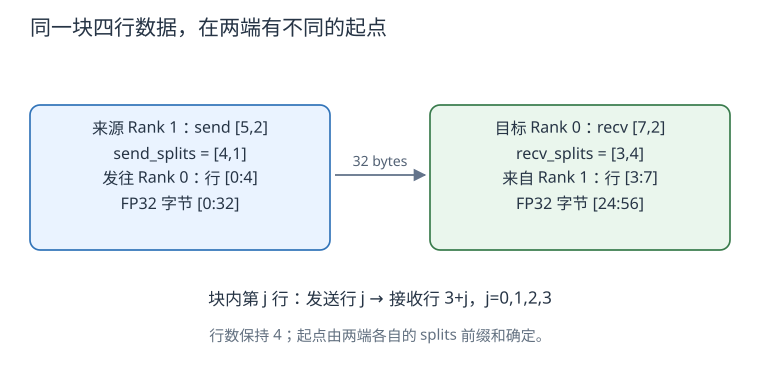

图 5-6：变长块的行边界如何转换成两端的字节区间。

因此本次传输读取发送字节区间 `[0,32)`，写入接收字节区间 `[24,56)`。块内第 j 行从发送行 j 移到接收行 3+j，j 依次为 0～3。splits 的单位是行；H 与 dtype 决定每行多少字节。改变 H 会改变载荷大小，两端的行区间和块内顺序继续由相同 splits 决定。

## 5.4 Expert 的位置怎样决定通信块

基础放置采用连续、均匀分配：E 个 Expert 分给 P 个 Rank，每个 Rank 持有 `L=E/P` 个连续编号的 Expert，配置满足 `E%P=0`。拓扑对象在构造时校验这个条件。

| 全局 Expert | 目标 Rank | 本地 Expert ID |
| --- | --- | --- |
| E0 | 0 | 0 |
| E1 | 0 | 1 |
| E2 | 1 | 0 |
| E3 | 1 | 1 |

```mermaid
flowchart TD
    ID(["全局 Expert ID
0、1、2、3"])
    MAP["Topology 映射<br/>destination_rank + local_expert_id
每个 Rank 有 2 个 Expert"]
    ID --> MAP
    subgraph R0["EP Rank 0"]
        A["E0 → 本地 0
E1 → 本地 1"]
    end
    subgraph R1["EP Rank 1"]
        B["E2 → 本地 0
E3 → 本地 1"]
    end
    MAP -->|"全局编号 0、1"| A
    MAP -->|"全局编号 2、3"| B

classDef blue fill:#e3f2fd,stroke:#1976d2,color:#0d47a1;
classDef green fill:#e8f5e9,stroke:#388e3c,color:#1b5e20;
classDef orange fill:#fff3e0,stroke:#f57c00,color:#e65100;
classDef purple fill:#f3e5f5,stroke:#7b1fa2,color:#4a148c;
class ID purple;
class MAP orange;
class A blue;
class B green;
```

图 5-7：全局 Expert ID 映射到 Rank 与本地 ID。

按这张表，整数除法 `expert_id // L` 求出目标 Rank，取余 `expert_id % L` 求出本地 Expert ID。例如 E3 去 Rank 1，交给其本地 Expert 1。

`ExpertParallelTopology` 集中提供这些映射并校验配置，Router、发送块和接收端分别使用全局 ID、EP rank 和本地 ID。

### 5.4.1 接回第二课的六条路由

继续使用第二课的固定例子：T0 选择 E2/E0，T1 选择 E1/E2，T2 选择 E0/E1。打包后全局 Expert ID 为 `[0,0,1,1,2,2]`，对应 Token 为 `[T0,T2,T1,T2,T0,T1]`。

前四行属于 Rank 0 的 E0/E1，后两行属于 Rank 1 的 E2。因此 Expert-major 已经同时满足 Rank 分块顺序，send splits 为 `[4,2]`。本地 Expert ID 为 `[0,0,1,1,0,0]`。

```mermaid
flowchart TD
    subgraph PRE["发送前：原 Rank 上打包"]
        A(["原路由顺序
每 Token 两条"])
        B["按 Expert 打包
T0、T2、T1、T2 ｜ T0、T1"]
        A -->|"pack_index：进入 packed 顺序"| B
    end
    C["发送 → 逐行计算 → 返回
保持每个通信块的行顺序"]
    subgraph POST["返回后：原 Rank 上合并"]
        D["returned
与发送 Buffer 的 packed 顺序一致"]
        G["按 restore_index 同步恢复
输出与路由权重"]
        F["逐分支乘以路由权重"]
        H(["沿 Top-K 求和
得到 Token 结果"])
        D -->|"packed.dispatch.restore_index"| G
        G --> F
        F --> H
    end
    B -->|"send_splits = 4、2"| C
    C --> D

classDef blue fill:#e3f2fd,stroke:#1976d2,color:#0d47a1;
classDef green fill:#e8f5e9,stroke:#388e3c,color:#1b5e20;
classDef orange fill:#fff3e0,stroke:#f57c00,color:#e65100;
classDef purple fill:#f3e5f5,stroke:#7b1fa2,color:#4a148c;
class A,H purple;
class B,D blue;
class C orange;
class F,G green;
```

图 5-8：记录打包与返回后的逆排列。

图中 `pack_index` 将原路由排进 Expert 区间，`restore_index` 在返回后将每条记录找回原来的 Token/slot 位置。跨 Rank 往返期间，源端保留这两个布局之间的关系。

### 5.4.2 复用 Dispatch 和 Topology 生成计划

下面是发送计划的摘录，`tokens`、`expert_ids` 和 `routing_weights` 来自第二课的固定输入，`topology` 可用 `ExpertParallelTopology(num_experts=4, ep_size=2, ep_rank=0)` 建立。

`dispatch_reference` 从 dispatch 模块导入，拓扑类从 topology 模块导入。按全局 Expert 排列后，连续的 E0/E1 区间合成 Rank 0 的块，E2/E3 合成 Rank 1 的块。

**发送计划 · test/demo.py**

```python
import torch
from mini_ep.distributed.dispatch import dispatch_reference

def build_send_plan(tokens, expert_ids, routing_weights, topology):
    dispatch = dispatch_reference(tokens, expert_ids, routing_weights, topology.num_experts)
    local_ids = topology.local_expert_id(dispatch.packed_expert_ids).contiguous()
    send_splits = dispatch.tokens_per_expert.reshape(
        topology.ep_size, topology.experts_per_rank
    ).sum(dim=1).cpu().tolist()
    return dispatch, local_ids, send_splits
```

**按 Expert 放置汇总各目标的行数**

```python
# 将全局 Expert ID 映射到本地 ID，并按 Expert 放置汇总目标块长。
local_ids = topology.local_expert_id(dispatch.packed_expert_ids).contiguous()
send_splits = dispatch.tokens_per_expert.reshape(
    topology.ep_size, topology.experts_per_rank
).sum(dim=1).cpu().tolist()
```

连续均匀放置下，[E] 计数 reshape 为 [P,L]，一行列出目标 Rank 的 L 个 Expert；按 dim=1 求和得到 [P] 发送行数。

本例 [[2,2],[2,0]] 变为 [4,2]。local_ids 与已打包向量逐行对应，通过全局 ID 取余得到目标端的 Expert 下标。

```mermaid
flowchart TD
    subgraph PREP["当前 Rank：本地通信准备"]
        A(["输入 Token、Expert ID、路由权重"])
        B["dispatch_reference()
展开 Top-K，按 Expert 稳定打包"]
        C["Local Expert ID 映射
local_ids = [0,0,1,1,0,0]"]
        D["按 Rank 汇总 Expert 计数
[2,2,2,0] 分为 [2,2]、[2,0]
send_splits = [4,2]"]
        E["本地准备完成
dispatch
local_ids
send_splits"]
        A --> B
        B -->|"packed_expert_ids"| C
        B -->|"tokens_per_expert"| D
        B -->|"保留打包结果"| E
        C --> E
        D --> E
    end
    classDef blue fill:#e3f2fd,stroke:#1976d2,color:#0d47a1;
    classDef orange fill:#fff3e0,stroke:#f57c00,color:#e65100;
    classDef green fill:#e8f5e9,stroke:#388e3c,color:#1b5e20;
    class A,B blue;
    class C,D orange;
    class E green;
```

图 5-9：从 Expert 计数汇总发送行数。

本例的 Expert 计数 `[2,2,2,0]` reshape 为 `[[2,2],[2,0]]`，按行求和得到 `[4,2]`。其中前四行交给本 Rank 的 E0/E1，后两行发给 Rank 1 的 E2。发送计划同时包含本地和远程分支，后续可以统一按目标 Rank 分块。

Expert-major 表示当前计算分组，Rank-packed 表示通信去向。连续均匀放置使两种排序在这里一致：相邻的本地 Expert 区间合并后就得到 Rank 块。第六课的 `pack_by_destination_rank()` 会显式保存这层排列与恢复关系，使通信布局与 Expert 布局各自具有清楚的接口。

## 5.5 正向通信：输入与身份一同到达

下面接续已准备好的 `dispatch`、`local_ids` 与 `send_splits`。所有输入均在当前 Rank 绑定的 CUDA 设备上；`variable_split_all_to_all` 从 all_to_all 模块导入。

先交换计数，再按相同的边界分别传输 Token 向量和 int64 ID，两个 Collective 在全组按相同次序调用：

**正向通信 · test/demo.py**

```python
import torch
from mini_ep.distributed.all_to_all import equal_split_all_to_all, variable_split_all_to_all

def exchange_splits(send_splits, device, group=None):
    counts = torch.tensor(send_splits, dtype=torch.int64, device=device)
    received_counts = equal_split_all_to_all(counts, group=group)
    return received_counts.cpu().tolist()

def dispatch_to_experts(dispatch, local_ids, send_splits, device, group=None):
    # 先交换行数，再分配并传输向量与 ID。
    recv_splits = exchange_splits(send_splits, device, group)
    recv_tokens = variable_split_all_to_all(
        dispatch.packed_tokens, send_splits, recv_splits, group=group
    )
    recv_ids = variable_split_all_to_all(
        local_ids, send_splits, recv_splits, group=group
    )
    return recv_tokens, recv_ids, recv_splits
```

**先知道接收区间，再传浮点输入**

```python
# 先交换每个来源的行数，再按这些边界接收 [R,H] 浮点向量。
recv_splits = exchange_splits(send_splits, device, group)
recv_tokens = variable_split_all_to_all(
    dispatch.packed_tokens, send_splits, recv_splits, group=group
)
```

exchange_splits 生成接收计划，向量通信据此分配 [R,H]。发送端使用自己的目标块长，接收端使用所有来源给出的块长；来源 s 发给目标 d 的行数必须在两端相等。

**相同 splits 让向量与 Expert 身份配对**

```python
# Expert ID 与 Token 向量使用相同 splits，接收后逐行对应。
recv_ids = variable_split_all_to_all(
    local_ids, send_splits, recv_splits, group=group
)
```

ID 是 [A] int64，向量是 [A,H] 浮点，两次传输共用第 0 维的 splits。每个来源块内都保持原行序，因此 recv_ids[j] 指向 recv_tokens[j] 应调用的本地 Expert。

所有 Rank 依次进入向量、ID 两次 collective。

`variable_split_all_to_all()` 接收连续张量，校验发送 splits 之和等于输入行数，然后创建 `[sum(recv_splits),...]` 的输出。

dtype、device 和每行载荷形状保留。它将 send splits 传给 `input_split_sizes`，recv splits 传给 `output_split_sizes`。

### 5.5.1 接收布局按来源划分

让 Rank 1 的两个 Token 记作 `U0=[11,12]`、`U1=[13,14]`，分别选择 E3/E0 与 E2/E1，权重均为 0.5。这与示例代码中 Rank 1 的输入构造一致。它向两个 Rank 各发两行，send splits 为 `[2,2]`。结合 Rank 0 的 `[4,2]`，得到：

| 接收方 | recv splits | Token 顺序 | 本地 ID |
| --- | --- | --- | --- |
| Rank 0 | `[4,2]` | `[T0,T2,T1,T2 ｜ U0,U1]` | `[0,0,1,1 ｜ 0,1]` |
| Rank 1 | `[2,2]` | `[T0,T1 ｜ U1,U0]` | `[0,0 ｜ 0,1]` |

```mermaid
flowchart TD
    S0["来源 Rank 0：4 行
Token：T0、T2、T1、T2
本地编号：0、0、1、1"]
    S1["来源 Rank 1：2 行
Token：U0、U1
本地编号：0、1"]
    subgraph R0["接收方 Rank 0"]
        R["两次 All-to-All 接收完成
recv_buffer：T0、T2、T1、T2 ｜ U0、U1
recv_local_ids：0、0、1、1 ｜ 0、1"]
        C["Local Compute：按编号逐行缩放
例如第 4 行：U0，由本地 Expert 0 处理
本课保持接收行顺序"]
        B(["返回 All-to-All
前 4 行发回 Rank 0
后 2 行发回 Rank 1"])
        R -->|"相同行号对应同一条记录"| C
        C --> B
    end
    S0 -->|"Token 与编号分别传输"| R
    S1 -->|"Token 与编号分别传输"| R
    classDef blue fill:#e3f2fd,stroke:#1976d2,color:#0d47a1;
    classDef orange fill:#fff3e0,stroke:#f57c00,color:#e65100;
    classDef green fill:#e8f5e9,stroke:#388e3c,color:#1b5e20;
    class S0,S1 blue;
    class R,C orange;
    class B green;
```

图 5-10：来自两个来源的记录按行与本地 Expert ID 配对。

Rank 0 的本地 Expert 0 对应接收行 0、1、4，说明来自不同来源的同一 Expert 记录分散在不同块里。当前缩放函数按行执行即可；第六课将利用来源/Expert 计数构造索引，把这些行收集给真实的 MLP。

对于 Rank 1 的 U0，发往 E0 的分支先放在源端打包行 0，到 Rank 0 后落在接收行 4，交给本地 Expert 0；发往 E3 的分支放在源端打包行 3，到 Rank 1 后落在接收行 3，交给本地 Expert 1。

两条分支的全局 Expert ID 分别为 0 和 3，本地 ID 分别为 0 和 1。目标 Rank 与本地 ID 共同定位全组中的 Expert。

## 5.6 返回通信：交换 splits 的角色

下面在接收端继续执行。`ep_rank` 是当前组内 Rank，均匀放置使全局 Expert ID 等于 `ep_rank×L+local_id`。缩放系数转为向量 dtype，并沿 H 广播。每行输入产生一行输出，输出保留接收行序，因此来源块直接成为返回时的目标块：

**返回与合并 · test/demo.py**

```python
import torch
from mini_ep.distributed.all_to_all import variable_split_all_to_all
from mini_ep.distributed.dispatch import combine_reference

def return_and_combine(recv_tokens, recv_ids, recv_splits, send_splits, ep_rank, topology, dispatch, group=None):
    # 目标 Rank 和本地 ID 一起确定全局 Expert。
    global_ids = recv_ids + ep_rank * topology.experts_per_rank
    computed = recv_tokens * (global_ids + 1).to(recv_tokens.dtype)[:, None]
    # 返回通信交换正向 send/recv splits 的角色。
    returned = variable_split_all_to_all(
        computed.contiguous(), recv_splits, send_splits, group=group
    )
    combined = combine_reference(returned, dispatch)
    return combined
```

**在接收行上应用可手算的 Expert**

```python
# 从 EP rank 与本地 ID 恢复全局 Expert，再沿 H 广播缩放系数。
global_ids = recv_ids + ep_rank * topology.experts_per_rank
computed = recv_tokens * (global_ids + 1).to(recv_tokens.dtype)[:, None]
```

本地 Expert 编号加 ep_rank×L 得到全局编号。系数 e+1 转成向量 dtype，并通过 [:,None] 沿 H 广播。每行输入产生同位置的一行结果；计算阶段保留按来源 Rank 拼接的布局。

**按原来源送回，再使用源端的权重**

```python
# 返回通信互换正向 send/recv splits，源端再恢复并加权。
returned = variable_split_all_to_all(
    computed.contiguous(), recv_splits, send_splits, group=group
)
combined = combine_reference(returned, dispatch)
```

返回发送块直接采用正向接收块，split 的角色随之交换。收回的 returned 重现源端原先的发送行序；本例连续放置使它也是 Expert-major，因此可直接传入 combine_reference。

源端保存的 dispatch 决定各分支的权重和最终 Token 位置。

正向接收 splits 变成返回发送 splits，正向发送 splits 变成返回接收 splits。返回结果与源端最初的打包输入逐行对应。随后逆排列恢复 Token/slot 顺序，源端应用一次路由权重，再沿 Top-K 求和。

### 5.6.1 用原路由表独立计算期望值

对每个原 Token i，直接遍历原表中的 K 个 slot，计算 `Σ_j w[i,j]×(expert_ids[i,j]+1)×tokens[i]`。这个参考只读取原始输入与路由，独立于打包索引和通信切片。

Rank 0 的三行输出仍为第二课的 `[1.5,3]`、`[7.2,9.6]`、`[9,10.8]`。Rank 1 的 U0 选择 E3/E0，得到 `0.5×4U0+0.5×U0=2.5U0=[27.5,30]`；

U1 选择 E2/E1，也得到 `2.5U1=[32.5,35]`。先比较 `returned` 与原打包输入逐行缩放的结果，可以检查通信是否将每行送回原位；再比较 `combined` 与原路由公式，可以检查恢复顺序和加权求和。两端最终输出都按各自的原 Token 顺序排列。

本地 MLP 按 Expert 收集输入时，会进一步改变计算批次的行序。计算后把输出写回原接收行，就能重新形成按来源排列的缓冲区，原 `recv_splits` 因而直接成为返回时的发送边界。这个约定将 Expert 的局部分组封装在目标 Rank 内，源端仍使用原来的路由 metadata 恢复和合并。

## 5.7 All-to-All 的计时与通信成本

到这里已经建立了完整回环，可以独立测量其中一段向量搬运。`benchmarks/benchmark_all_to_all.py` 先交换计数、分配接收缓冲区并检查数值，再复用准备好的 send/recv 张量与 Python splits，计时一次正向 payload 交换。

payload 指传输载荷；这一计时区间只包含 `dist.all_to_all_single()` 调用及相应设备工作。完整 MoE 的路由、打包、计数、Expert、返回和 Combine 各有自己的耗时。

每个 Rank 先 Warmup，再用 CUDA Event 取得逐次样本。各 Rank 的样本序列通过 MAX 归约，得到每次最慢 Rank 的时间；随后计算中位数、均值、最小值和最大值。统计范围是全组的单次载荷通信。

### 5.7.1 均匀与倾斜分配改变了什么

均匀分配把发送缓冲区的 A 行尽量平均分给 P 个目标，余数按 Rank 顺序补一行。倾斜分配把约 80% 的行发往 Rank 0，其余分给其他 Rank。双 Rank、每个来源 5 行时，两种发送矩阵分别为 `[[3,2],[3,2]]` 和 `[[4,1],[4,1]]`。

两个矩阵都发送 10 行，跨 Rank 的非对角块也都是 5 行，但目标端接收量从 `[6,4]` 变成了 `[8,2]`。远程总字节数相同，目标端的负载分布却发生了变化。发送矩阵保留每个方向的流量，既能显示 Rank 0 集中了更多输入，也能用于计算各 Rank 的 Expert 批次大小。

### 5.7.2 带宽的单位与统计口径

令每行字节数为 B、单个元素字节数为 b，跨 Rank 载荷计数为 `Σ_{s≠d} S[s,d]×B`。每个来源到目标的块只计一次，自发给自身的块保留在工作负载中，跨 Rank 字节数只统计非对角块。

$$
B_{\mathrm{remote}} = \sum_{s\ne d}S_{s,d}\,H\,b
$$

$$
\mathrm{BW}_{\mathrm{GB/s}} = \frac{B_{\mathrm{remote}}}{L_{\mathrm{ms}}\times10^6}
$$

GB/s 使用十进制单位，分子是全组非对角块的单向载荷字节数，分母是每次最慢 Rank 延迟样本的中位数。所得值描述该发送矩阵在此测量区间内的有效搬运速率。链路的峰值规格、协议流量和各方向拥塞还需要对应拓扑与计数解释；基准同时保留消息大小、发送矩阵、接收量与 dtype。

默认消息大小从 1 KiB 扫描到 100 MiB，表示每个 Rank 的发送缓冲区目标大小。实际行数为 `ceil(requested_bytes/B)`，实际发送字节取整到完整行。热点 Rank 的接收量由所有来源共同决定，因此另行记录 recv splits 和缓冲区大小。

## 5.8 变长通信的完整示例

进入 `code/course5` 后运行以下命令，需要两张可见 CUDA GPU、支持 NCCL 的 PyTorch。示例同时运行 Top-1、Top-2，输出 Rank 身份、发送/接收 splits 与接收本地 ID。

**通信示例**

```bash
cd code/course5
CUDA_VISIBLE_DEVICES=0,1 torchrun --standalone --nproc-per-node=2 \
  test/demo.py --expected-world-size=2 --dtype=float32
```

`--suite` 增加倾斜路由、空来源与全空输入。零行案例仍依次参与四次 Collective，用同一套规则检验空区间。精度通过 `--dtype` 选择：

**路由场景**

```bash
CUDA_VISIBLE_DEVICES=0,1 torchrun --standalone --nproc-per-node=2 \
  test/demo.py --expected-world-size=2 --suite --dtype=float16
```

也可以选择 bfloat16，或只启动一个 Worker 运行 EP=1。此时所有 Expert 都在本 Rank，send/recv splits 各只有一项；记录仍经过打包、返回和合并，最终得到与多 Rank 配置相同定义的 MoE 输出。

通信大小扫描由独立入口完成：

**通信基准**

```bash
CUDA_VISIBLE_DEVICES=0,1 torchrun --standalone --nproc-per-node=2 \
  benchmarks/benchmark_all_to_all.py --hidden-size=128 --dtype=float32 \
  --sizes-bytes 1024 1048576 104857600 --patterns uniform imbalanced \
  --warmup=10 --repeats=50
python3 -m unittest discover -s checks -p 'test_all_to_all_ep.py' -v
```

学习时可以分开使用这三个入口：配套测试检查分块、行数和远程字节计数；NCCL 示例检查输入往返后是否回到原行、加权结果是否正确；独立基准测量预先准备好的 payload 交换。它们分别对应通信布局、完整前向的数据搬运和这段搬运的成本。

第六课需要的接口已经齐全：发送侧从路由生成计划，接收侧先获得布局信息，两次 Token All-to-All 连接本地 Expert 计算与源端合并。接下来，我们将把逐行 Expert 身份整理为 MLP 的批次索引，并用单 GPU Reference 核对完整 MoE。

接口细节可查阅 [PyTorch 的 all_to_all_single](https://docs.pytorch.org/docs/2.11/distributed.html#torch.distributed.all_to_all_single)。

继续阅读 [第 6 课：实现 Mini-EP V1](https://tvle9mq8jh.feishu.cn/docx/Tiefd5MlyokSbfxubEOcyXRsnEf)。

---

# 第 6 课：实现 Mini-EP V1

本课独立源码位于 `code/course6/`，示例在 `test/`，正确性测试在 `checks/`。下文命令均在本课目录中执行；将整个目录复制到其他位置后也使用同样的启动方式。

单 GPU 上的 MoE 有一条容易看清的数据流：Router 为每个 Token 选择 Expert，Dispatch 把属于同一个 Expert 的输入放在一起，Expert 计算，最后把结果按路由权重加起来。

把 Expert 分到两张 GPU 上以后，这条数据流多了一段路程。一个 Token 可能留在本地，也可能要去另一张卡；Top-2 还会让同一个 Token 同时交给两个 Expert。

计算结束后，这些结果要重新汇合，才能成为原来那个 Token 的输出。

先看一个具体的 Token。T0 在 Rank 0 上，Router 为它选出 E3 和 E2，两个 Expert 都在 Rank 1。Rank 0 要发送两行相同的输入向量；Rank 1 分别调用 E3 和 E2，再把两行输出送回 Rank 0。最终得到：

**加权输出**

```text
y(T0) = 0.6476 × E3(T0) + 0.3524 × E2(T0)
```

向量在两张卡之间往返，路由权重和原始 Token 编号始终保存在 Rank 0。接下来要弄清的是：接收方怎样区分这两行，计算后的两行怎样找到各自的位置，以及多个 Token 一起发送时，怎样一次完成这件事。

第五课的缩放回环已经让第二课六条记录跨 Rank 往返，得到同样的加权输出。接入 MLP 后，每个 Expert 要一次处理自己的批次；接收缓冲区却按来源 Rank 拼接，同一 Expert 的记录可能分散在多个来源块中。

Mini-EP V1 的关键就是从计数重建这些行索引，收集给本地 Expert，计算后写回原接收位置，再将结果返回来源。

## 6.1 Expert 留在原处，Token 去找它

这里的 Rank 是通信组内的进程编号。每个进程绑定一张 GPU，保存自己的输入和 Expert 权重。默认进程组用作 EP group，因此 `ep_size = world_size`，`ep_rank = global_rank`。

单机两进程时，`LOCAL_RANK` 分别为 0、1，用来选择进程可见的 `cuda:0`、`cuda:1`；可见设备编号由启动环境决定。

先沿用第五课的布局关系：Rank 0 的 E0 接收行 `[0,1,4]`，E1 接收行 `[2,3,5]`。把逐行缩放替换为 MLP，只需分别收集这两组行，完成计算后写回各自位置，返回边界仍是 `[4,2]`。

下面扩大到八个 Token 和 H=64、F=128，以展示完整模型前向。全组 Token 数记为 T，EP group 的 Rank 数记为 P，本 Rank 输入行数记为 N，示例等分后满足 `N=T/P`。

表中的 T0～T7 是全组输入的标签，代码中的 Token 索引则相对于各 Rank 的本地输入。例如 Rank 1 的 `[4,64]` 输入按行存放 T4、T5、T6、T7，本地索引依次为 0、1、2、3。

它保存的 `packed_token_indices=0` 指向 T4，返回合并也写入本地输出第 0 行。这里用 T 表示全组 Token 数，N 表示本 Rank 的原始输入行数；

接收到多少条 Expert 记录，要等路由计数确定。

| 对象 | 配置 | 放在哪里 |
| --- | --- | --- |
| 输入 | T=8，H=64 | Rank 0 保存 T0～T3；Rank 1 保存 T4～T7 |
| Router | 4 个 Expert，Top-2 | 两个 Rank 各保存同一份 gate 权重 |
| Expert MLP | H=64，F=128 | Rank 0 保存 E0、E1；Rank 1 保存 E2、E3 |
| 输出 | 每个 Rank 得到 `[4,64]` | 回到各自输入的原始 Token 顺序 |

连续均匀放置的配置满足 `num_experts > 0`、`ep_size > 0` 与 `num_experts % ep_size == 0`。四个 Expert 分给两个 Rank，每个 Rank 持有两个；在此前提下，Expert ID 可直接转换为目标 Rank 和本地编号：

**Expert 映射 · code/course6/mini_ep/distributed/topology.py**

```python
class ExpertParallelTopology:
    def __init__(self, num_experts, ep_size, ep_rank):
        if num_experts <= 0 or ep_size <= 0 or num_experts % ep_size != 0:
            raise ValueError("Expert 数与 EP 大小需要为正，且 Expert 数能被 EP 大小整除")
        if not 0 <= ep_rank < ep_size:
            raise ValueError(f"ep_rank={ep_rank} 应位于 [0, {ep_size})")
        self.num_experts = num_experts
        self.ep_size = ep_size
        self.ep_rank = ep_rank

    @property
    def experts_per_rank(self):
        return self.num_experts // self.ep_size

    def destination_rank(self, expert_id):
        # 连续的 L 个全局 Expert 共享同一个目标 Rank。
        return expert_id // self.experts_per_rank

    def local_expert_id(self, expert_id):
        # 在该 Rank 的 L 个 Expert 中定位本地编号。
        return expert_id % self.experts_per_rank
```

**商确定设备，余数确定设备内参数**

```python
# 均匀放置下，用整除定位目标 Rank，用余数定位设备内 Expert。
def destination_rank(self, expert_id):
    # 连续的 L 个全局 Expert 共享同一个目标 Rank。
    return expert_id // self.experts_per_rank

def local_expert_id(self, expert_id):
    # 在该 Rank 的 L 个 Expert 中定位本地编号。
    return expert_id % self.experts_per_rank
```

四个 Expert 分给两个 Rank 时 L=2。对 E3，商 1 指定 Rank 1，余数 1 指定这个 Rank 的第二个 Expert。

构造函数先保证 E、P 为正且 E 能被 P 整除，映射才覆盖连续、等长的 Expert 区间。

例如，E3 的目标 Rank 是 `3 // 2 = 1`，在 Rank 1 的本地编号是 `3 % 2 = 1`。这些映射由 `ExpertParallelTopology` 提供，构造时会检查 Expert 数能否被 EP size 整除。

Router 选出全局 Expert ID 后，发送方用映射找到目标 Rank，接收方用本地 ID 找到自己的 Expert 模块。

模型准备阶段，各 Rank 在 CPU 上用相同随机种子创建 `SingleGPUMoE`，再调用 `distribute_single_gpu_moe()`。每个进程复制同一份 Router，只保留本 Rank 的 Expert，并把模型迁移到绑定的 CUDA 设备和所选 dtype。

路由使用相同 gate，分支使用相同 Expert 参数，因此分布式输出可以与完整单设备模型按同一条数学定义比较。

### 6.1.1 模块职责与前向数据流

从源码阅读时，可以先看 `test/demo.py` 如何准备输入、建立通信组和比较结果，再进入 `ExpertParallelMoE.forward()` 跟踪一次前向。下面列出它调用的主要模块，以及每个模块需要关注的数据：

| 文件 | 阅读时关注什么 |
| --- | --- |
| `mini_ep/model/router.py` | Expert ID、Top-K 权重和每个 Expert 的命中计数 |
| `mini_ep/distributed/topology.py` | Expert 放置、发送量和接收行索引 |
| `mini_ep/distributed/dispatch.py` | 两次打包排列，以及返回后的 Combine |
| `mini_ep/distributed/all_to_all.py` | 计数交换和变长 All-to-All 的缓冲区契约 |
| `mini_ep/model/moe.py` | 把这些部件接成完整前向 |

图中可以沿两条顺序读代码：准备模型时切分 Expert 权重；执行前向时生成路由，将 Token 按 Expert 和目标 Rank 打包，发送到相应设备计算，再返回并合并。下面各节会按前向的顺序展开这些函数，逐次说明缓冲区中的行怎样变化。

```mermaid
flowchart TB
    EX["test/demo.py"] --> NC["nccl_distributed()
建立默认 NCCL Process Group"]
    EX --> DS["distribute_single_gpu_moe()
从同一份单 GPU Reference 切分 Expert 权重"]
    EX --> FW["ExpertParallelMoE.forward()"]
    FW --> RT["TopKRouter.forward()"]
    FW --> DP["dispatch_reference() + pack_by_destination_rank()"]
    FW --> AG["all_gather_expert_counts() + build_receive_layout()"]
    FW --> A1["variable_split_all_to_all() #1"]
    FW --> ML["ExpertMLP.forward()（逐本地 Expert）"]
    FW --> A2["variable_split_all_to_all() #2"]
    FW --> CB["combine_reference()"]
    FW --> RS["ExpertParallelForwardResult"]
    RS --> EX
    classDef entry fill:#f3e5f5,stroke:#7b1fa2,color:#4a148c;
    classDef setup fill:#e3f2fd,stroke:#1976d2,color:#0d47a1;
    classDef step fill:#fff3e0,stroke:#f57c00,color:#e65100;
    classDef output fill:#e8f5e9,stroke:#388e3c,color:#1b5e20;
    class EX entry;
    class NC,DS setup;
    class FW,RT,DP,AG,A1,ML,A2,CB step;
    class RS output;
```

图 6-1：前向入口与各模块的调用关系。

图中的 `distribute_single_gpu_moe()` 负责切分权重；`forward()` 负责搬运当前批次的 Token。权重在模型准备阶段确定，Token 的去向则由每次前向的 Router 结果决定。

## 6.2 从路由决定到通信计划

每个 Rank 从自己的 `[N,H]` 输入生成路由与发送块。接收方需要两层信息：从各来源收到多少行，以及每个来源块里各本地 Expert 占多少行。V1 将来源的逐 Expert 计数收集成矩阵，用它同时分配缓冲区和生成 Expert 行索引。一次前向由这些依赖连接：

**前向流程**

```text
本地 Router → Expert 顺序打包 → 目标 Rank 打包
→ 计数 AllGather → 接收布局
→ 正向 All-to-All → 本地 Expert 计算
→ 返回 All-to-All → 恢复排列与加权求和
```

代码用 NVTX 为各阶段添加可显示在性能分析工具中的名称：`ROUTER`、`DISPATCH`、`A2A_FORWARD`、`EXPERT`、`A2A_RETURN` 和 `COMBINE`。

在 Nsight Systems 的 Timeline 中，这些标记帮助定位哪段代码正在路由、通信或计算。`DISPATCH` 包含发送侧打包、计数 AllGather 和接收布局推导；

Token 向量随后由 `A2A_FORWARD` 搬运。读时间线时，可以先沿这些阶段找到对应函数，再查看其中的 Kernel 与通信活动。

```mermaid
flowchart TB
    subgraph LOCAL["为 Token 重分发准备布局"]
        R["ROUTER
本地 Token 的 gate + Top-K
expert_ids / routing_weights"]
        D["DISPATCH
Top-K 展开 + Expert 顺序打包"]
        P["Rank Packing
稳定排序到 Rank-packed 顺序
得到 send_splits"]
        C["计数 AllGather（跨 Rank 通信）
all_gather_expert_counts"]
        L["接收布局
每个本地 Expert 的行索引"]
        R --> D --> P --> C --> L
    end
    L --> F["A2A_FORWARD
variable_split_all_to_all
All-to-All #1"]
    F --> E["EXPERT
本地 Expert MLP
结果写回原位"]
    E --> B["A2A_RETURN
All-to-All #2
send / recv splits 互换"]
    B --> U["Unpermute + COMBINE
row_origin_index 回到 Expert 顺序
routing weight 加权 + Top-K 求和"]
    U --> OUT["本 Rank 的 MoE 输出
原始 Token 顺序"]
    classDef blue fill:#e3f2fd,stroke:#1976d2,color:#0d47a1;
    classDef orange fill:#fff3e0,stroke:#f57c00,color:#e65100;
    classDef green fill:#e8f5e9,stroke:#388e3c,color:#1b5e20;
    classDef purple fill:#f3e5f5,stroke:#7b1fa2,color:#4a148c;
    class R,D,P,C,L blue;
    class F,E,B orange;
    class U purple;
    class OUT green;
```

图 6-2：布局准备、计数交换与两次 Token All-to-All。

### 6.2.1 Router 给出的是计算分支

每个 Rank 用相同的 gate 权重给自己的 Token 打分。输入是 `[num_local_tokens,H]`；`expert_ids` 和 `routing_weights` 的形状都是 `[num_local_tokens,K]`。

Expert ID 用整数表示，路由权重在 FP32 中归一化，同一个 Token 的 K 个权重之和为 1。Expert 计算可以使用 FP32、FP16 或 BF16。

下面用一份具体路由表展开八个 Token 的分支。表内权重以四位小数表示，供追踪记录与加权关系使用；代码保留 Router 实际生成的完整精度权重。每个来源的四行输入展开为八条记录，Expert 编号确定计算地点，slot 与权重确定返回后的贡献。

| Token | 所在 Rank | slot 0：Expert / 权重 | slot 1：Expert / 权重 |
| --- | --- | --- | --- |
| T0 | 0 | E3 / 0.6476 | E2 / 0.3524 |
| T1 | 0 | E2 / 0.5070 | E0 / 0.4930 |
| T2 | 0 | E2 / 0.7374 | E1 / 0.2626 |
| T3 | 0 | E0 / 0.5267 | E3 / 0.4733 |
| T4 | 1 | E3 / 0.6381 | E1 / 0.3619 |
| T5 | 1 | E1 / 0.5749 | E3 / 0.4251 |
| T6 | 1 | E2 / 0.5524 | E1 / 0.4476 |
| T7 | 1 | E0 / 0.5911 | E1 / 0.4089 |

T1 的两个分支分别去 Rank 1 和 Rank 0；T0 的两个分支都去 Rank 1。每个分支对应一次 Expert 调用，称为一条 assignment，中文可以理解为一条路由记录。

Top-2 下，四个本地 Token 产生八条记录。即使两条记录发往同一张卡，它们也对应不同的 Expert，发送缓冲区分别保存一行输入。

按表统计，Rank 0 的 `tokens_per_expert` 为 `[2,1,3,2]`，Rank 1 为 `[1,4,1,2]`，两个向量各计八条记录。它们表示当前来源选择了各 Expert 多少次。

将各来源计数相加得到 `[3,5,4,4]`，才是全组各 Expert 实际处理的批次行数；把本地来源计数和全组计算负载分开，后续接收布局就有了明确含义。

## 6.3 Expert 布局与通信布局

### 6.3.1 Expert-major：按计算对象排列

Router 的结果按 Token 排列，Expert 希望得到自己的输入批次。`dispatch_reference()` 先按 Token、再按 slot 展平路由，然后根据全局 Expert ID 稳定排序。Rank 0 的规范展平顺序和打包顺序分别是：

**记录顺序**

```text
规范顺序：
(T0,E3), (T0,E2), (T1,E2), (T1,E0),
(T2,E2), (T2,E1), (T3,E0), (T3,E3)

Expert 顺序：
(T1,E0), (T3,E0) | (T2,E1) |
(T0,E2), (T1,E2), (T2,E2) | (T0,E3), (T3,E3)
```

这里的稳定排序保证同一个 Expert 内部仍按原来的 Token/slot 次序排列。排序对象是路由记录，读取输入时则使用这些记录的 Token 索引。同一个 Token 因而可以被读取两次，成为发送缓冲区中的两行。

**Expert 打包 · code/course6/mini_ep/distributed/dispatch.py**

```python
import torch

def pack_expert_rows(tokens, expert_ids):
    # 按 Token、slot 展平，定义原始记录顺序。
    flat_expert_ids = expert_ids.reshape(-1).to(torch.int64)
    flat_token_indices = torch.arange(
        tokens.shape[0], device=tokens.device, dtype=torch.int64
    ).repeat_interleave(expert_ids.shape[1])

    # 稳定排序将同一 Expert 的记录放到相邻行。
    pack_index = torch.argsort(flat_expert_ids, stable=True)
    # 逆排列供返回后恢复原 Token/slot 顺序。
    restore_index = torch.argsort(pack_index)
    packed_token_indices = flat_token_indices.index_select(0, pack_index)
    # 按来源行号收集输入，形成连续打包缓冲区。
    packed_tokens = tokens.index_select(0, packed_token_indices).contiguous()
    return packed_tokens, pack_index, restore_index
```

**从规范记录编号走到连续 Expert 输入**

```python
# 按 Expert 稳定排序记录，并用原记录编号收集对应 Token 行。
pack_index = torch.argsort(flat_expert_ids, stable=True)
# 逆排列供返回后恢复原 Token/slot 顺序。
restore_index = torch.argsort(pack_index)
packed_token_indices = flat_token_indices.index_select(0, pack_index)
# 按来源行号收集输入，形成连续打包缓冲区。
packed_tokens = tokens.index_select(0, packed_token_indices).contiguous()
```

先稳定排序 Expert ID，再按这份排列读取 Token 行号。Rank 0 的来源行号变为 [1,3,2,0,1,2,0,3]，形成八行连续输入；

restore_index=[6,3,4,0,5,2,1,7] 保存原始八条记录各自的新位置。后面的通信可以移动向量，源端保留这个对应关系。

`packed_tokens` 是 `[num_local_tokens*K,H]` 的连续张量，dtype 和 device 与输入相同。索引采用 `int64`，与输入在同一设备上；Token、slot、Expert ID 和权重都按同一个 `pack_index` 重排。排列后的 Rank 0 数据如下：

| 打包行 | 原 Token | slot | Expert | 权重 | 目标 Rank |
| --- | --- | --- | --- | --- | --- |
| 0 | T1 | 1 | E0 | 0.4930 | 0 |
| 1 | T3 | 0 | E0 | 0.5267 | 0 |
| 2 | T2 | 1 | E1 | 0.2626 | 0 |
| 3 | T0 | 1 | E2 | 0.3524 | 1 |
| 4 | T1 | 0 | E2 | 0.5070 | 1 |
| 5 | T2 | 0 | E2 | 0.7374 | 1 |
| 6 | T0 | 0 | E3 | 0.6476 | 1 |
| 7 | T3 | 1 | E3 | 0.4733 | 1 |

`packed_token_indices` 与 `restore_index` 分别连接输入行和路由记录。前者为 `[1,3,2,0,1,2,0,3]`，说明每个打包行从哪个原 Token 读取向量；

后者为 `[6,3,4,0,5,2,1,7]`，说明每条原始 Token/slot 记录位于哪个打包行。一个索引用于构造 Expert 输入，另一个用于恢复 Expert 输出，二者共同保存分支的来源关系。

Expert 的区间由带前导零的前缀和给出：`expert_offsets = [0,2,3,6,8]`。E2 的输入占 `[3,6)`，共有三行。索引、计数和偏移描述的是同一份布局，可以相互核对。

### 6.3.2 Rank-packed：按通信目标排列

`all_to_all_single()` 读取一个连续缓冲区，按 dim 0 把它切成若干块：第 0 块发给 Rank 0，第 1 块发给 Rank 1。因此，还要把行按目标 Rank 排列，并记录每块的行数。

**Rank 打包 · code/course6/mini_ep/distributed/dispatch.py**

```python
import torch

def build_rank_plan(dispatch, topology):
    destination_rank = topology.destination_rank(dispatch.packed_expert_ids)
    # 按目标 Rank 排列，记录各行原来的 Expert 位置。
    row_origin_index = torch.argsort(destination_rank, stable=True).contiguous()
    send_splits = torch.zeros(
        topology.ep_size, dtype=torch.int64, device=destination_rank.device
    )
    # 累加每个目标 Rank 的发送行数。
    send_splits.scatter_add_(
        0, destination_rank, torch.ones_like(destination_rank, dtype=torch.int64)
    )
    return row_origin_index, send_splits
```

**通信排列保存 Expert 行的来处**

```python
# 按目标 Rank 重排 Expert 行，同时保留回到 Expert 顺序的映射。
destination_rank = topology.destination_rank(dispatch.packed_expert_ids)
# 按目标 Rank 排列，记录各行原来的 Expert 位置。
row_origin_index = torch.argsort(destination_rank, stable=True).contiguous()
```

目标 Rank 向量与 Expert-major 行逐一对应。对目标稳定排序，row_origin_index[k] 就是第 k 个通信行应读取的 Expert 行；

返回后使用同一个数作为散射目标。连续放置下它是恒等排列，接口仍明确保存这层布局关系。

**按目标编号累加发送块长**

```python
# 每条路由记录向其目标 Rank 的行数计数贡献 1。
send_splits.scatter_add_(
    0, destination_rank, torch.ones_like(destination_rank, dtype=torch.int64)
)
```

scatter_add_ 将每条记录贡献的整数 1 加到 destination_rank 指定的位置。长度为 P 的 int64 输出给出各目标行数，总和为 N×K。

它回答发多少行，row_origin_index 回答这些行按什么顺序排列。

`row_origin_index[k]` 表示 Rank-packed 第 k 行来自 Expert 顺序的哪一行。打包函数用它重排输入和对应 metadata。`send_splits[d]` 是本 Rank 发给目标 d 的行数，长度为 `ep_size`。

在当前放置方式下，E0、E1 都去 Rank 0，E2、E3 都去 Rank 1。全局 Expert ID 升序也就意味着目标 Rank 升序，所以第二次排序得到恒等排列。

Rank 0 的前 3 行发给 Rank 0，后 5 行发给 Rank 1：`send_splits=[3,5]`，`send_offsets=[0,3,8]`。Rank 1 同样得到 `[5,3]`。

本例的第二次排序保持原行序。`pack_by_destination_rank()` 给出发送缓冲区和 `send_splits`：第 d 块交给 Rank d，块内保持 Expert 顺序。改变 Expert 放置时，可以在这一步调整目标排列，并在返回后恢复到原 Expert 顺序。

## 6.4 从全局计数重建接收布局

### 6.4.1 用一份计数矩阵确定接收量

Rank 0 已经知道自己要发送 `[3,5]` 行，却还不知道 Rank 1 会发来多少。接收缓冲区要在传输之前分配，因此先交换计数。`all_gather_expert_counts()` 把各 Rank 的 `[num_experts]` 整数向量收集为 `[ep_size,num_experts]`：

**Expert 计数**

```text
C = [[2,1,3,2],     # 来源 Rank 0，按 E0～E3 排列
     [1,4,1,2]]     # 来源 Rank 1
```

在 NCCL 路径上，这份 `int64` 计数张量也放在各进程绑定的 CUDA 设备上。四个 `int64` 是 32 bytes，每个 Rank 收集得到的完整矩阵占 64 bytes。交换的是计数；64 维 Token 向量由下一步的 All-to-All 传送。

把每一行中属于同一个目标 Rank 的 Expert 计数相加，就得到发送矩阵 S。行代表来源，列代表目标：

| 来源 / 目标 | Rank 0：E0、E1 | Rank 1：E2、E3 |
| --- | --- | --- |
| Rank 0 | 2+1=3 | 3+2=5 |
| Rank 1 | 1+4=5 | 1+2=3 |

发送方读取自己的行，接收方读取自己的列。对于任意来源 s 和目标 d：

**发送与接收计数**

```text
S[s,d] = Rank s 的 send_splits[d]
       = Rank d 的 recv_splits[s]
```

因此，Rank 0 从 Rank 0 收到 3 行、从 Rank 1 收到 5 行；Rank 1 从 Rank 0 收到 5 行、从 Rank 1 收到 3 行。本例的 S 恰好对称，发送和接收向量数值相同。

换成倾斜 Top-1 路由，S 可以是 `[[3,1],[3,1]]`：两边都发送 `[3,1]`，Rank 0 接收 `[3,3]`，Rank 1 接收 `[1,1]`。按行、按列的两种读法在这个例子里就区分开了。

第五课通过单独一次 All-to-All 发送逐行本地 Expert ID。V1 改用计数矩阵 C 和发送块内的 Expert 顺序确定归属。例如 Rank 0 从来源 0 收到的计数为 `[2,1]`，前三行的本地 ID 就是 `[0,0,1]`；

从来源 1 收到 `[1,4]`，接下来的五行就是 `[0,1,1,1,1]`。接收方知道块长和块内排列，便能直接重建各 Expert 的行索引。

因此，第五课的调用序列是计数 All-to-All、Token All-to-All、ID All-to-All、输出 All-to-All；V1 的序列是计数 AllGather、Token All-to-All、输出 All-to-All。

AllGather 收集 `[P,E]` 的整数计数，Token 向量仍通过两次 All-to-All 往返。S 用于描述 Rank 之间的总行数，C 进一步给出这些行分别属于哪个 Expert。

### 6.4.2 All-to-All 的输出按来源排列

发送侧按目标 Rank 分块，接收侧按来源 Rank 拼接。Rank 0 的接收缓冲区先放来源 Rank 0 的三行，再放来源 Rank 1 的五行；每个来源块内部，延续发送端的 Expert 顺序。

Rank 0 拥有 E0、E1，从 C 中取这两列：

**接收布局**

```text
per_source_local_expert_counts = [[2,1],
                                 [1,4]]
recv_splits  = [3,5]
recv_offsets = [0,3,8]

接收行：
0,1     → 来源 R0，E0
2       → 来源 R0，E1
3       → 来源 R1，E0
4,5,6,7 → 来源 R1，E1
```

按来源切片时，接收缓冲区包含两个连续块。按 Expert 收集时，E0 取行 `[0,1,3]`，E1 取行 `[2,4,5,6,7]`。同一个 Expert 的输入分散在两个来源块里，使用这组行索引便能把它们收集成一个计算批次。下面从各块的计数推导这些索引。

Rank 1 取 E2、E3 两列，得到 `[[3,2],[1,2]]`。它的接收偏移是 `[0,5,8]`，E2 的索引是 `[0,1,2,5]`，E3 是 `[3,4,6,7]`。两个 Expert 分别处理四行。

### 6.4.3 从块长推导行索引

来源 s 的块从 `recv_offsets[s]` 开始。本地 Expert e 在这个块之前有多少行，等于同一来源下编号小于 e 的 Expert 计数之和。因此：

**Expert 区间**

```text
start(s,e) = recv_offsets[s] + sum(local_counts[s,:e])
count(s,e) = local_counts[s,e]
```

对固定 Expert e，依次拼接各来源的 `[start,start+count)`，便得到它的全部输入行索引。下面给出独立的 PyTorch 推导函数：`local_counts` 为非负 int64 矩阵，shape 是 `[P,L]`，P 是来源数，L 是本地 Expert 数；

其两维均为正。CPU 与 CUDA 使用相同布局，返回的 splits、offsets 和索引均在输入设备上。例子中的 E0 索引 `[0,1,3]` 直接来自两个来源块的边界。

**行索引推导**

```python
import torch

def derive_local_rows(local_counts):
    recv_splits = local_counts.sum(dim=1)
    # 前导零与前缀和共同给出各来源块的边界。
    recv_offsets = torch.cat([
        recv_splits.new_zeros(1), recv_splits.cumsum(dim=0)
    ])
    rows_by_expert = []
    for e in range(local_counts.shape[1]):
        blocks = []
        for s in range(local_counts.shape[0]):
            start = int(recv_offsets[s].item())
            # 跳过该来源块内编号更小的本地 Expert。
            start += int(local_counts[s, :e].sum().item())
            count = int(local_counts[s, e].item())
            blocks.append(torch.arange(
                start, start + count,
                dtype=torch.int64, device=local_counts.device
            ))
        rows_by_expert.append(torch.cat(blocks))
    return recv_splits, recv_offsets, rows_by_expert

counts = torch.tensor([[2, 1], [1, 4]], dtype=torch.int64)
splits, offsets, rows = derive_local_rows(counts)
assert splits.tolist() == [3, 5]
assert offsets.tolist() == [0, 3, 8]
assert [r.tolist() for r in rows] == [[0, 1, 3], [2, 4, 5, 6, 7]]
assert sorted(torch.cat(rows).tolist()) == list(range(8))
```

**来源行数先确定通信块边界**

```python
# 按来源汇总计数，前缀和给出各来源在接收区中的边界。
recv_splits = local_counts.sum(dim=1)
# 前导零与前缀和共同给出各来源块的边界。
recv_offsets = torch.cat([
    recv_splits.new_zeros(1), recv_splits.cumsum(dim=0)
])
```

local_counts 的每行属于一个来源，沿本地 Expert 维求和得到 recv_splits=[3,5]。前导零加累积和得到 [0,3,8]，来源 0 占 [0,3)，来源 1 占 [3,8)。这些边界是后续 Expert 局部偏移的基准。

**在来源块内部寻找当前 Expert 的区间**

```python
# 在某个来源块内，用前序 Expert 的计数定位当前 Expert 的输入段。
start = int(recv_offsets[s].item())
# 跳过该来源块内编号更小的本地 Expert。
start += int(local_counts[s, :e].sum().item())
count = int(local_counts[s, e].item())
blocks.append(torch.arange(
    start, start + count,
    dtype=torch.int64, device=local_counts.device
))
```

对于来源 s，先跳过整个接收缓冲中更早来源的行，再跳过该来源块里编号更小的本地 Expert。E0 从来源 0 取 [0,2)，从来源 1 取 [3,4)，合成 [0,1,3]。

arange 在 local_counts.device 上生成 int64 行索引，供 GPU index_select 直接读取。

偏移中的第一个零对应来源 Rank 0 的起点。普通累积和 `[3,8]` 描述的是块尾；带前导零的 `[0,3,8]` 才能同时描述块头和块尾。读写每个来源块时，使用 `[recv_offsets[s],recv_offsets[s+1])`。

E0 和 E1 的索引互不重叠，合起来正好是接收行 0 到 7。代码最后的断言检查每一行是否恰好出现一次。这也保证了后面的 `empty_like()` 输出缓冲区会被 Expert 循环全部写满，再交给返回通信读取。

在倾斜 Top-1 的例子中，Rank 1 的本地计数是 `[[0,1],[0,1]]`。E2 的索引为空，E3 的索引为 `[0,1]`。空索引产生 `[0,H]` 输入，MLP 和写回操作自然沿用同一套张量接口。

## 6.5 第一次 All-to-All：输入到达 Expert

此时发送和接收的计划都已确定，可以分配接收缓冲区并发起通信。`variable_split_all_to_all()` 的核心调用是：

**Token 交换 · code/course6/mini_ep/distributed/all_to_all.py**

```python
import torch
import torch.distributed as dist

def variable_split_all_to_all(send_buffer, send_rows, recv_rows, group=None):
    # 接收行数来自各来源的贡献，载荷宽度、dtype 和 device 沿用输入。
    recv_tokens = torch.empty(
        (sum(recv_rows), *send_buffer.shape[1:]),
        dtype=send_buffer.dtype, device=send_buffer.device,
    )
    # 两组 splits 都以第 0 维的行数为单位。
    dist.all_to_all_single(
        recv_tokens, send_buffer,
        output_split_sizes=recv_rows,
        input_split_sizes=send_rows,
        group=group, async_op=False,
    )
    return recv_tokens
```

**用接收行数创建同宽同类型缓冲区**

```python
# 接收行数来自计数交换，行宽、dtype 和 device 沿用发送输入。
recv_tokens = torch.empty(
    (sum(recv_rows), *send_buffer.shape[1:]),
    dtype=send_buffer.dtype, device=send_buffer.device,
)
```

输出第 0 维为 sum(recv_rows)，其余维度原样继承 send_buffer。输入 [8,64] FP32 可能得到 [6,64] 或 [10,64]，具体行数由全组路由决定；

一行的 64 个元素保持共同载荷形状与 dtype。

**输入块长与输出块长分别解释两端布局**

```python
# 输入 splits 描述目标块，输出 splits 描述来源块；单位均为行。
dist.all_to_all_single(
    recv_tokens, send_buffer,
    output_split_sizes=recv_rows,
    input_split_sizes=send_rows,
    group=group, async_op=False,
)
```

input_split_sizes 按目标 Rank 划分发送缓冲，output_split_sizes 按来源 Rank 划分接收缓冲。

所有参与者调用相同 collective，并为每个方向给出相等行数。同步封装接回当前 CUDA 流的完成依赖，后续同流 Expert 操作消费接收数据。

`send_buffer` 是连续的 `[发送行数,H]` 张量；`send_rows` 和 `recv_rows` 是 Host 侧的整数列表，长度均为 EP size，单位为 dim 0 的行数。

发送列表之和等于发送缓冲区行数，接收列表之和决定输出行数。相同行宽和 dtype 让一行在两端表示同样数量的元素。例如 H=64、FP32 时，一行是 64 个元素、256 bytes。

通信后，来源 Rank 0 的行在前，来源 Rank 1 的行在后，每个来源块内部保持发送时的顺序。即使输入和接收张量恰好都是 `[8,64]`，其中的行也已经发生了交换：要用 `recv_splits` 找到来源块，再用该来源的 Expert 计数找出块内各 Expert 的行。

```mermaid
flowchart LR
    subgraph R0["Rank 0（Expert 0, 1）"]
        A0["发送缓冲区 8 行
行 0-2 → Rank 0
行 3-7 → Rank 1"]
    end
    subgraph R1["Rank 1（Expert 2, 3）"]
        A1["发送缓冲区 8 行
行 0-4 → Rank 0
行 5-7 → Rank 1"]
    end
    A0 -->|3 行| B0["Rank 0 接收缓冲区 8 行
行 0-2：来自 Rank 0
行 3-7：来自 Rank 1"]
    A1 -->|5 行| B0
    A0 -->|5 行| B1["Rank 1 接收缓冲区 8 行
行 0-4：来自 Rank 0
行 5-7：来自 Rank 1"]
    A1 -->|3 行| B1
    classDef blue fill:#e3f2fd,stroke:#1976d2,color:#0d47a1;
    classDef green fill:#e8f5e9,stroke:#388e3c,color:#1b5e20;
    class A0,A1 blue;
    class B0,B1 green;
```

图 6-3：正向按目标发送，返回时按来源送回。

### 6.5.1 把 Expert 的结果写回它收到的位置

Rank 0 的 E0 用 `[0,1,3]` 收集三行输入，E1 用 `[2,4,5,6,7]` 收集五行。这分别形成 `[3,64]` 与 `[5,64]` 的连续批次，各自执行 Up Projection、GELU、Down Projection，返回同宽结果。

下面是 `ExpertParallelMoE.forward()` 的摘录，`layout` 来自计数推导，`self.experts` 按本地 Expert 编号保存模块。

**Expert 计算 · code/course6/mini_ep/model/moe.py**

```python
import torch

def compute_local_experts(experts, recv_tokens, layout):
    expert_output = torch.empty_like(recv_tokens)
    for local_expert_id, rows in enumerate(layout.local_expert_index):
        # 来源块里分散的同一 Expert 记录，在这里收集为连续计算批次。
        local_tokens = recv_tokens.index_select(0, rows)
        local_outputs = experts[local_expert_id](local_tokens)
        # 将结果写回原接收位置，保留来源分块顺序。
        expert_output.index_copy_(0, rows, local_outputs)
    return expert_output
```

**收集计算批次后写回原接收行**

```python
# 收集同一 Expert 的分散行计算，再把结果写回原接收行。
local_tokens = recv_tokens.index_select(0, rows)
local_outputs = experts[local_expert_id](local_tokens)
# 将结果写回原接收位置，保留来源分块顺序。
expert_output.index_copy_(0, rows, local_outputs)
```

rows=[0,1,3] 时，index_select 形成 [3,H] 的连续 E0 输入。MLP 的输出第 j 行对应 rows[j]，index_copy_ 按同一索引将其写回 0、1、3。

各 Expert 的 rows 不重叠且覆盖全部接收行，empty_like 分配的输出在返回通信前被全部填满。

`index_select()` 为每个 Expert 组成一个连续计算批次，`index_copy_()` 再把结果放回接收缓冲区对应的位置。E0 的三行输出仍在 0、1、3，E1 的五行输出仍在 2、4、5、6、7。输出由此保持“来源 Rank 分块、块内 Expert 顺序”的布局。

这个写回位置决定了返回通信可以怎样做。如果把所有 E0 的结果排在前面，再接所有 E1 的结果，就会形成新的 Expert 顺序，需要再恢复一次来源分块。原位写回把来源布局一直保留到下一次 All-to-All。

在 Rank 1 上，E3 收集接收行 `[3,4,6,7]`，形成自己的四行 MLP 输入。MLP 输出的第 0 行写回接收缓冲区第 3 行，第 1 行写回第 4 行，依此类推。Expert 批次中的行号和通信缓冲区中的行号由这组索引连接；返回通信读取的是写回后的来源分块。

## 6.6 第二次 All-to-All：结果回到原 Token

### 6.6.1 为什么交换两组 splits 就能返回

第一次通信结束后，每个来源块的身份已经确定。把来源 s 的块发还给 Rank s，返回通信的发送行数就是第一次的接收行数。原发送方期待收回自己发出的全部分支，所以返回通信的接收行数就是第一次的发送行数：

**输出返回 · code/course6/mini_ep/model/moe.py**

```python
from mini_ep.distributed.all_to_all import variable_split_all_to_all

def return_expert_outputs(expert_output, recv_rows, send_rows, group=None):
    # 返回通信交换正向 send/recv splits 的角色。
    returned = variable_split_all_to_all(
        expert_output,
        recv_rows,       # 返回时发给各原始来源
        send_rows,       # 从各 Expert 所在 Rank 收回结果
        group=group,
    )
    return returned
```

**返回块复用原来的来源区间**

```python
# 把正向来源块作为返回目标块，保持块内行序。
returned = variable_split_all_to_all(
    expert_output,
    recv_rows,       # 返回时发给各原始来源
    send_rows,       # 从各 Expert 所在 Rank 收回结果
    group=group,
)
```

接收端将来源 s 的结果块发回 Rank s，所以正向 recv_rows 变为返回 input splits。源端从各 Expert 所在 Rank 收回自己当初发送的行数，所以正向 send_rows 变为返回 output splits。

块内顺序由 Expert 原位写回保持，returned[k] 对应最初发送行 k 的结果。

用发送矩阵看，返回矩阵是 S 的转置。Rank 0 原先发给 Rank 1 的五行，作为一个来源块保存在 Rank 1；Rank 1 处理后把这五行按块内原序送回。Rank 0 的返回缓冲区按 Expert 所在 Rank 拼接，重新得到当初发送时的 Rank-packed 次序。

**返回顺序**

```text
returned[k] = 本 Rank 当初发送的第 k 行经过目标 Expert 后的结果
```

这条位置关系依靠三个设计共同保持：发送块内有确定顺序，Expert 输出写回原位，每条输入分支返回一条输出。源 Rank 保存的 Token 索引、slot、权重和排列因此能够直接配对返回结果。

目标 Rank 利用计数和块内顺序找到各 Expert 的输入，计算后写回原接收行。它无需携带原 Token 编号、slot 或路由权重，这些信息一直保存在源 Rank。结果按原块送回后，源 Rank 就能用自己的索引将每行输出接回对应权重。

### 6.6.2 先恢复 Expert 顺序，再恢复 Token/slot 顺序

`returned` 处于 Rank-packed 顺序，`combine_reference()` 接收的则是 Dispatch 定义的 Expert 顺序。`row_origin_index` 描述两者之间的对应关系，作为散射目标使用：

**Expert 顺序恢复 · code/course6/mini_ep/model/moe.py**

```python
import torch
from mini_ep.distributed.dispatch import combine_reference

def restore_and_combine(returned, rank_pack, dispatch):
    expert_major_outputs = torch.empty_like(returned)
    # 散射回 Expert 顺序，再交给 Combine。
    expert_major_outputs.index_copy_(
        0, rank_pack.row_origin_index, returned,
    )
    hidden_states = combine_reference(expert_major_outputs, dispatch)
    return hidden_states
```

**散射方向由原打包行的来处决定**

```python
# 按通信排列保存的来源行散射，恢复 Expert-major 输出。
expert_major_outputs.index_copy_(
    0, rank_pack.row_origin_index, returned,
)
```

通信行 k 的来处是 row_origin_index[k]，因此恢复赋值为 expert_major_outputs[row_origin_index[k]]=returned[k]。

这一步连接 Rank-packed 与 Expert-major；下一次 restore_index 的读取再连接 Expert-major 与原始 Token/slot。

逐行写出来，就是 `expert_major_outputs[row_origin_index[k]] = returned[k]`。当前采用连续均匀放置，两种行序恰好相同，因此 `row_origin_index` 是恒等排列。这一步仍会分配缓冲区并写回，但第 k 行继续放在第 k 行。

下面继续使用该次 `dispatch` 和恢复后的 `[N×K,H]` Expert 输出。`restore_index` 将输出与权重同步读取到 Token-major、slot-minor 顺序，即 Token 行为外层、slot 为内层；再显式按 H 还原三维张量，沿 K 求和：

**分支合并 · code/course6/mini_ep/distributed/dispatch.py**

```python
import torch

def combine_reference(expert_major_outputs, dispatch):
    # 逆排列把每个 Token 的 K 条输出放回一起。
    token_major_outputs = expert_major_outputs.index_select(
        0, dispatch.restore_index
    ).reshape(dispatch.num_tokens, dispatch.top_k, expert_major_outputs.shape[1])
    # 权重按相同排列恢复，随后沿 H 维广播。
    token_major_weights = dispatch.packed_routing_weights.index_select(
        0, dispatch.restore_index
    ).reshape(dispatch.num_tokens, dispatch.top_k, 1)
    hidden_states = (
        token_major_outputs
        * token_major_weights.to(dtype=token_major_outputs.dtype)
    ).sum(dim=1)
    return hidden_states
```

**按原 Token 和 slot 读取分支结果**

```python
# 逆排列将 Expert 输出恢复为原 Token、slot 的记录顺序。
token_major_outputs = expert_major_outputs.index_select(
    0, dispatch.restore_index
).reshape(dispatch.num_tokens, dispatch.top_k, expert_major_outputs.shape[1])
```

restore_index 以原记录 q 为下标，值为 Expert-major 行号。读取后 reshape 为 [N,K,H]，把同一个 Token 的 K 行放在一起。

显式使用输出宽度 H，空输入 N=0 时也能确定三维 shape。

**权重转换、广播与 Top-K reduction**

```python
# 将权重广播到 H 维，逐分支相乘，再沿 Top-K 维求和。
hidden_states = (
    token_major_outputs
    * token_major_weights.to(dtype=token_major_outputs.dtype)
).sum(dim=1)
```

token_major_weights 已按相同索引恢复为 [N,K,1]。转换到分支输出 dtype 后相乘，沿 dim=1 合并 K 条分支，得到 [N,H]。

每个权重只应用一次，输出行对应当前来源 Rank 的原始输入。

输出先恢复为 `[N,K,H]`，一个 Token 的 K 个分支重新相邻；权重恢复为 `[N,K,1]`，沿 H 广播后，`sum(dim=1)` 得到 `[N,H]`。显式宽度 H 让 N=0 时也能确定输出 shape。

FP32 路由权重在相乘前转换为 Expert 输出 dtype，结果保留其 dtype 与 device，与仓库 `combine_reference()` 的语义一致。

Rank 0 的 T1 在规范展平顺序中占位置 2、3。`restore_index[2]=4`，`restore_index[3]=0`，因此读出的两行分别是 E2(T1) 和 E0(T1)，权重分别是 0.5070、0.4930。T0 则读取 Expert 顺序中的行 6、3，完成开头给出的 E3/E2 加权和。

两层排列的关系可以直接用数据赋值区分：

| metadata | 记录的对应关系 | 恢复方式 |
| --- | --- | --- |
| `row_origin_index[k]` | Rank-packed 行 k 来自哪一条 Expert 顺序的行 | 将返回行 k 散射到这个位置 |
| `restore_index[q]` | Token/slot 规范位置 q 位于哪一条 Expert 顺序的行 | 按这个索引读取，再 reshape 为 `[N,K,H]` |

以 T0 的 E3 分支为例，它是原路由表的 slot 0，排在源端 Expert 缓冲区的第 6 行。发往 Rank 1 的块从源端第 3 行开始，因此这条分支位于块内第 3 行，到达 Rank 1 后也在来源 0 块的第 3 行。

E3 算完后写回该位置，返回通信再将它放回源端第 6 行。`restore_index[0]=6` 将它读到 T0 的 slot 0，乘以权重 0.6476，再与 slot 1 的结果相加。

反过来跟踪来自 Rank 1 的 T7，可以看清来源块偏移的作用。T7 是该 Rank 的本地第 3 个 Token，slot 0 选择 E0，因此原记录编号为 `q=3×2=6`。它也是该来源唯一发往 E0 的记录，稳定打包后位于第 0 行。

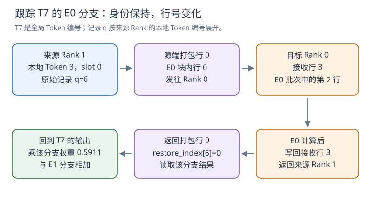

图 6-4：T7 的一条分支在源端、接收端和 Expert 批次中的位置。

Rank 0 先接收自己的三行，再接收 Rank 1 的五行，所以这条记录到达接收行 3。E0 收集接收行 `[0,1,3]` 时，它位于本地 Expert 批次的第 2 行。

MLP 输出沿该索引写回行 3，返回通信再把它放回 Rank 1 的打包行 0。`restore_index[6]=0` 最终将这条分支交回 T7，与 E1 分支一起加权；图中的权重沿用路由表的四位小数表示。

## 6.7 完整前向的编排与数据依赖

下面汇合各阶段的核心调用，是 `ExpertParallelMoE.forward()` 内部摘录。`self` 是已分片模型，输入 `tokens` 为本 Rank 的 `[N,H]` 浮点张量，Router、Expert 与输入处于同一设备和计算 dtype；

`group` 为默认 EP Process Group。布局函数来自 dispatch、topology 模块，计数与向量交换来自 all_to_all 模块。

**EP 前向 · code/course6/mini_ep/model/moe.py**

```python
import torch
from mini_ep.model.router import TopKRouter
from mini_ep.model.expert import ExpertMLP
from mini_ep.model.moe import ExpertParallelForwardResult
from mini_ep.distributed.topology import ExpertParallelTopology, build_receive_layout
from mini_ep.distributed.dispatch import dispatch_reference, pack_by_destination_rank, combine_reference
from mini_ep.distributed.all_to_all import all_gather_expert_counts, variable_split_all_to_all

class ExpertParallelMoE(torch.nn.Module):
    def __init__(self, hidden_size: int, expert_hidden_size: int, num_experts: int, top_k: int, *, ep_size: int, ep_rank: int, activation: str='gelu', bias: bool=False) -> None:
        super().__init__()
        self.hidden_size = hidden_size
        self.expert_hidden_size = expert_hidden_size
        self.num_experts = num_experts
        self.top_k = top_k
        self.topology = ExpertParallelTopology(num_experts=num_experts, ep_size=ep_size, ep_rank=ep_rank)
        self.router = TopKRouter(hidden_size, num_experts, top_k)
        self.experts = torch.nn.ModuleList([ExpertMLP(hidden_size, expert_hidden_size, activation=activation, bias=bias) for _ in range(self.topology.num_local_experts)])

    def forward(self, tokens, *, group=None):
        routing = self.router(tokens)
        dispatch = dispatch_reference(
            tokens, routing.expert_ids, routing.routing_weights, self.num_experts
        )
        rank_pack = pack_by_destination_rank(dispatch, self.topology)
        # 收集整数计数，重建本 Rank 将收到哪些来源的 Expert 记录。
        counts = all_gather_expert_counts(routing.tokens_per_expert, group=group)
        layout = build_receive_layout(
            self.topology, counts,
            local_tokens_per_expert=routing.tokens_per_expert,
        )
        send_rows = rank_pack.send_splits.tolist()
        recv_rows = layout.recv_splits.tolist()

        # 第一次向量 A2A：由目标分块变为来源分块。
        recv_tokens = variable_split_all_to_all(
            rank_pack.packed_tokens, send_rows, recv_rows, group=group
        )
        expert_output = torch.empty_like(recv_tokens)
        for e, rows in enumerate(layout.local_expert_index):
            # 将结果写回原接收位置，保留来源分块顺序。
            expert_output.index_copy_(
                0, rows, self.experts[e](recv_tokens.index_select(0, rows))
            )
        # 返回通信交换正向 send/recv splits 的角色。
        returned = variable_split_all_to_all(
            expert_output, recv_rows, send_rows, group=group
        )
        expert_major_outputs = torch.empty_like(returned)
        # 散射回 Expert 顺序，再交给 Combine。
        expert_major_outputs.index_copy_(0, rank_pack.row_origin_index, returned)
        # 源端恢复 Token/slot 并应用路由权重，完成一次前向。
        hidden_states = combine_reference(expert_major_outputs, dispatch)
        return ExpertParallelForwardResult(
            hidden_states=hidden_states, router_logits=routing.logits,
            expert_ids=routing.expert_ids, routing_weights=routing.routing_weights,
            tokens_per_expert=routing.tokens_per_expert,
            tokens_per_expert_all=counts,
            send_splits=rank_pack.send_splits, recv_splits=layout.recv_splits,
            local_expert_rows=torch.tensor(
                [rows.numel() for rows in layout.local_expert_index],
                dtype=torch.int64, device=tokens.device,
            ),
        )
```

**路由与计数共同确定此次通信布局**

```python
# 路由与计数先确定布局，随后通信按该布局传输浮点输入。
routing = self.router(tokens)
dispatch = dispatch_reference(
    tokens, routing.expert_ids, routing.routing_weights, self.num_experts
)
rank_pack = pack_by_destination_rank(dispatch, self.topology)
# 收集整数计数，重建本 Rank 将收到哪些来源的 Expert 记录。
counts = all_gather_expert_counts(routing.tokens_per_expert, group=group)
layout = build_receive_layout(
    self.topology, counts,
    local_tokens_per_expert=routing.tokens_per_expert,
)
send_rows = rank_pack.send_splits.tolist()
recv_rows = layout.recv_splits.tolist()
```

本地 Router 决定本来源的记录，Dispatch 与 Rank 打包决定发送行序。计数 AllGather 得到 [P,E]，build_receive_layout 从当前 Rank 拥有的 Expert 列推导 recv_splits 与 local_expert_index。

两个 .tolist() 在向量传输之前准备 Host split 列表。

**完整往返保留每条记录的位置关系**

```python
# 正向发送、Expert 计算与返回共用接收行身份，源端完成恢复。
recv_tokens = variable_split_all_to_all(
    rank_pack.packed_tokens, send_rows, recv_rows, group=group
)
expert_output = torch.empty_like(recv_tokens)
for e, rows in enumerate(layout.local_expert_index):
    # 将结果写回原接收位置，保留来源分块顺序。
    expert_output.index_copy_(
        0, rows, self.experts[e](recv_tokens.index_select(0, rows))
    )
# 返回通信交换正向 send/recv splits 的角色。
returned = variable_split_all_to_all(
    expert_output, recv_rows, send_rows, group=group
)
expert_major_outputs = torch.empty_like(returned)
# 散射回 Expert 顺序，再交给 Combine。
expert_major_outputs.index_copy_(0, rank_pack.row_origin_index, returned)
```

第一轮 A2A 将输入送往参数所在地。Expert 循环在接收位置写回，第二轮按来源返回；row_origin_index 再恢复源端的 Expert 顺序。

每一步只改变其负责的布局，最后 Combine 使用最初保留的 dispatch 将分支汇回 [N,H]。

每个 Rank 都按计数 AllGather、正向 All-to-All、返回 All-to-All 的顺序进入 collective。一个 Rank 的发送块中有零行时，相应 split 是零，整个调用顺序保持一致。接收方的 `local_expert_index` 则决定自己实际处理多少行。

### 6.7.1 缓冲区的顺序也是使用顺序

`rank_pack.packed_tokens` 由发送侧打包产生，供第一次 All-to-All 读取；`recv_tokens` 由第一次通信产生，供 Expert 读取；

`expert_output` 由 Expert 写入，供第二次通信读取；`returned` 由第二次通信产生，供恢复排列读取。V1 为这些对象分别分配张量，同一次前向中的依赖按代码顺序连接。

`async_op=False` 配合 PyTorch 的当前流依赖，使后续同流 GPU 操作按顺序消费通信结果；Host 读取张量时等待相应设备数据就绪。课程入口用 `torch.no_grad()` 执行推理前向，Expert 输出通过预分配缓冲区传给下一次 Collective。

这里还有几处 GPU 到 Host 的读取。`send_splits` 和 `recv_splits` 起初是 GPU 整数张量，`.tolist()` 将数值交给 Python，供 `all_to_all_single()` 使用；

接收布局中的 `.item()` 也为 Python 循环读取设备值。这些操作需要等相关数据就绪。逐项推导布局将计数与行索引的关系显式写出，GPU 到 Host 的读取也随之进入布局准备的耗时。

### 6.7.2 从行数估算搬运量

八个 Token 做 Top-2，总共产生 16 条输入分支。H=64、FP32 时，每条分支占 `64×4=256 bytes`，全部输入分支合计 4096 bytes；输出仍是 64 维，返回阶段承载相同规模的向量。

在发送矩阵 `[[3,5],[5,3]]` 中，跨 Rank 的分支有 `5+5=10` 条，另六条分配给所在 Rank 的 Expert。因此，两次 All-to-All 的跨 GPU 向量载荷合计为：

**通信载荷**

```text
10 × 64 × 4 × 2 = 5120 bytes
```

这个数字按每条跨 GPU 消息计一次，包含输入和输出两个方向。计数交换、通信协议与本地重排分别消耗自己的资源。把它们区分开，能够看出模型参数怎样改变工作量：K 增加会增加分支，H 增加会增加每行字节数，Expert 放置和路由分布则决定其中多少行跨 Rank。

## 6.8 分布式前向与单设备 Reference

### 6.8.1 相同参数、相同路由与输出对齐

准备两张可用 GPU，以及支持 CUDA/NCCL 的 PyTorch。从项目根目录执行下面的命令；`CUDA_VISIBLE_DEVICES` 列出的两张卡，在进程中分别表现为 `cuda:0` 和 `cuda:1`。示例固定模型与输入的随机种子，建立两个进程，并将默认进程组用作 EP group。

**双 GPU 示例**

```bash
cd code/course6
CUDA_VISIBLE_DEVICES=0,1 torchrun \
  --standalone --nproc-per-node=2 \
  test/demo.py \
  --expected-world-size=2 --timeout-seconds=120 \
  --tokens=8 --hidden-size=64 --expert-hidden-size=128 \
  --num-experts=4 --top-k=2 --scenario=random --seed=0
```

`--tokens` 表示全组 Token 总数，示例把输入等分给各 Rank。`--hidden-size` 和 `--expert-hidden-size` 分别控制 H、F；`--num-experts` 和 `--top-k` 控制 Expert 数和分支数。

`--expected-world-size` 检查进程数，`--timeout-seconds` 为 collective 设置等待上限。示例的等分输入便于最后用等长 AllGather 拼接输出，EP 通信本身的 split 则由实际路由动态计算。

模型返回的 `ExpertParallelForwardResult` 同时包含 `[N,H]` 输出、`[N,K]` 路由表、`[E]` 本来源计数、`[P,E]` 全来源计数，以及 `[P]` 的 send/recv splits；

计数与 split 张量均为 int64、保存在本地设备。`local_expert_rows` 进一步列出每个本地 Expert 的实际批次行数。它们分别回答“本地输入去了哪里”和“本地参数处理了哪些来源的输入”。

数值比较分为两步。各 Rank 将 `[N,H]` 的最终输出收集成完整批次，Rank 0 用同一份权重对完整输入运行 `SingleGPUMoE`。前者经历两次 All-to-All；

后者在一张 GPU 上持有全部 Expert，按 Token 索引加权累加。两者采用相同的 Router、Expert 数学和权重，布局与汇合实现各自独立，能够从最终输出检验这条分布式数据流。

这次输出 AllGather 发生在 EP 前向完成之后，供示例将各 Rank 的 `[N,H]` 输出拼成 `[T,H]` 并比较 Reference。前向内部的计数 AllGather 则发生在输入传输之前，用于计划接收布局。两次调用收集的对象与用途不同：一次是整数计数，一次是已经合并好的最终输出。

各 dtype 的比较容差如下。`torch.testing.assert_close()` 同时检查张量的形状、dtype、device 和数值，数值条件按参考元素应用 `atol + rtol×abs(expected)`。

例如 FP32 下，参考值为 10 时，允许的绝对差为 `1e-5+1e-4×10=0.00101`；参考值为 0 时，允许差为 `1e-5`。rtol 使较大数值按比例比较，atol 为接近零的元素提供绝对尺度。矩阵乘与分支求和会产生浮点舍入，不同批次组织方式也可能改变求和顺序，因此各计算 dtype 使用表中的比较容差。

| 计算 dtype | rtol | atol |
| --- | --- | --- |
| FP32 | 1e-4 | 1e-5 |
| FP16 | 1e-2 | 2e-3 |
| BF16 | 2e-2 | 8e-3 |

### 6.8.2 路由分布、空区间与 EP=1

对称的发送矩阵容易手算，非对称矩阵更容易看清方向。把启动命令中的场景改为 `--scenario=skewed --top-k=1 --dtype=float16`，继续使用两个进程。

该场景将四个 gate 行分别乘以 `8.0、4.0、0.05、0.05`，形成更集中的路由。比较输出时，可以关注三件事：同一 Rank 的发送与接收行数怎样改变，哪个 Expert 收到零行，以及返回后每个 Rank 是否仍得到自己原来的 Token 数。

Top-K、Token 数与 dtype 分别改变分支数量、输入规模和元素表示。示例将这些配置与 Expert 计数、发送矩阵及输出误差一同呈现，使不同前向都可以按同一组关系解释。空 Expert 对应空计算区间，空来源对应零行通信块，所有参与者仍遵循相同的 Collective 次序。

EP=1 将所有 Expert 放在同一进程，路径中的计数和通信接口仍保留。在单张可用 GPU 上可以运行：

**单 GPU 示例**

```bash
CUDA_VISIBLE_DEVICES=0 torchrun \
  --standalone --nproc-per-node=1 \
  test/demo.py \
  --expected-world-size=1 --timeout-seconds=120 \
  --tokens=8 --num-experts=4 --top-k=2 --seed=0
```

此时 `send_splits` 和 `recv_splits` 都是 `[16]`：八个 Token 做 Top-2，共有十六条记录，全部交给本 Rank。各 Expert 处理的行数加起来也是 16，返回后每两条分支合成一个 Token，输出仍为八行。

### 6.8.3 布局不变量与正确性检查

前向的各阶段通过几组数量关系连接：本 Rank 的 Expert 计数之和为 `N×K`，发送 splits 之和等于打包行数，各来源的 Expert 行索引共同覆盖接收缓冲区，发送矩阵的第 r 列给出 Rank r 的接收向量。

两次排列保存每条记录的位置关系，返回以后由逆排列重新配对原 Token/slot。这些不变量把完整输出拆解为可独立验证的布局与数值关系。

`checks/test_mini_ep_v1.py` 分层验证这些关系：CPU 用例覆盖映射、计数、打包、接收分区和纯张量往返；CUDA/NCCL 集成用例通过 `torchrun` 执行 EP=1、EP=2，并比较随机 Top-2 FP32、倾斜 Top-1 FP16、倾斜 Top-2 BF16 及不同 Token 数和隐藏宽度。以下入口运行本课测试；前置课程的测试保存在对应课程的 `checks/` 中：

**正确性测试**

```bash
python3 -m unittest checks.test_mini_ep_v1 -v
```

CPU 上可以先完成布局推导和对应单元测试；CUDA/NCCL 集成用例按可用设备条件执行。数值、shape、dtype、device 和 metadata 的检查分别对应计算结果、张量表示与布局关系。

最终输出的正确性同时包括数值和逐行对应关系。对 T0 的 E3 分支，需要确认返回结果来自 E3，并乘上该 slot 的权重。检查时沿数据流核对通信块长、Expert 行索引、返回行序与恢复排列，再用独立 Reference 比较最终输出。

## 6.9 数据流的扩展方向

倾斜 Top-1 的发送矩阵 `[[3,1],[3,1]]` 使 Rank 0 接收六行、Rank 1 接收两行；在这个路由中，Rank 1 的 E2 为空，E3 处理两行。

进一步把空输入写入发送矩阵 S，空来源对应全零行，没有输入抵达的目标对应全零列。缓冲区大小来自行和与列和，零 split 形成空区间，Expert 索引和返回通信继承这些边界，因此空 Expert、空来源和全空批次都沿用同一套布局语义。

再考虑另一种放置：Rank 0 持有 E0/E3，Rank 1 持有 E1/E2。拓扑需要显式映射表，发送量按映射聚合；按目标 Rank 稳定排序后，块内仍可保留全局 Expert 顺序。

接收方按有序的本地 Expert 列表选取 C 的对应列，重新推导块长与行索引，返回端使用相应 `row_origin_index` 恢复 Expert 顺序。沿用前面的行数与排列推导，可以得到这份映射对应的完整收发关系。

还可以给每个 Expert 增加容量上限。若保持每条分支的返回槽位，未计算的分支可以用约定值填回；若只返回保留下来的分支，就需要建立新的返回行数和来源位置映射。先决定输出如何定义，再推导相应的 metadata 和 Combine，这样容量策略就能接在已经理解的数据流上。

现在，T0 的两个分支已经从 Rank 0 到达 Rank 1 的 E3、E2，计算后返回，并形成开头的加权输出。其他 Token 也按相同规则完成前向。后续可以先扩展 EP 规模，再分阶段测量耗时，针对 Dispatch、Combine 和 Expert 计算学习 Kernel、Grouped GEMM 以及通信与计算重叠。

优化时继续用这条数据流和单 GPU Reference 检查结果。

## 6.10 延伸阅读

- [第 1 课：单 GPU MoE 与 Expert Parallel 基础](https://tvle9mq8jh.feishu.cn/docx/MjUZdaohOowHXxxZhqvcUYyxn2g)
- [第 2 课：Router、Top-K 与 Token Dispatch](https://tvle9mq8jh.feishu.cn/docx/HiuwdyT5zopOEbxnCF4c4WPgnib)
- [第 3 课：GPU、CUDA 执行模型与 GEMM 基准](https://tvle9mq8jh.feishu.cn/docx/J8uQdUhRqoEXPWxBc9ocXfiAn3c)
- [第 4 课：Distributed、NCCL 与 GPU 集合通信](https://tvle9mq8jh.feishu.cn/docx/VD4dd4QkColhL2xZMpscFpwanmg)
- [第 5 课：All-to-All 与 EP 通信](https://tvle9mq8jh.feishu.cn/docx/Wl15dw3sJovDErxqGTIcUlDvnHb)
- [PyTorch：all_to_all_single 与 CUDA collective 语义](https://docs.pytorch.org/docs/2.11/distributed.html)
- [PyTorch：assert_close 的比较条件](https://docs.pytorch.org/docs/2.11/testing.html#torch.testing.assert_close)
- [《深入理解 AI Infra》：算子与运行时](https://github.com/bojieli/ai-infra-book/blob/main/manuscripts/05-算子与运行时.md)
- [《深入理解 AI Infra》：分布式推理](https://github.com/bojieli/ai-infra-book/blob/main/manuscripts/09-分布式推理.md)

---

# 第 7 课：EP Scaling——把同一批 Token 分给更多 GPU

本课独立源码位于 `code/course7/`，示例在 `test/`，正确性测试在 `checks/`。下文命令均在本课目录中执行；将整个目录复制到其他位置后也使用同样的启动方式。

第六课把四个 Expert 放到两张 GPU 上，完成了 Token 的一次往返。接下来将 Expert 数扩展到八个，分别交给一张、两张和四张 GPU。模型还是同一个模型，输入还是同一批 Token，改变的是每张卡保存哪些 Expert、输入从哪个 Rank 出发，以及多少条记录需要跨卡。

先取 T=32、E=8、Top-2。全组共有 64 条 Token—Expert 记录。若路由均匀，每个 Expert 接收 8 行：EP=1 的一张卡处理全部 64 行，EP=2 每张卡处理 32 行，EP=4 每张卡处理 16 行。

Expert 的单次矩阵乘法仍有 M=8；扩展 EP 减少的是每张卡负责的 Expert 数。与此同时，更多输入要访问远端 Expert，两次 All-to-All 的参与者也随之增加。

每张卡的计算量与 Token 的跨卡路径共同决定扩展后的耗时。比较 EP=1/2/4 时，统一输入、模型和计时口径，就能把延迟变化联系到具体的数据流；第八课再沿时间线分析负载与等待。

## 7.1 一份模型，三种放置

沿用第六课的符号：T 为全组原始 Token 数，H 为隐藏宽度，F 为 Expert 中间宽度，E 为全组 Expert 数，K 为每个 Token 选择的 Expert 数，P 为 EP group 的 Rank 数。

当前示例等分输入，每个 Rank 持有 N=T/P 个 Token；路由展开后，本 Rank 发送 S=N×K 条记录。这里的 K 表示 Top-K，矩阵乘法的归约维则按具体投影写为 H 或 F。

| EP 大小 P | 每 Rank 原始 Token 数 N | 每 Rank 的 Expert | 均衡时每 Rank 接收记录数 | 每 Expert 的全组记录数 |
| --- | --- | --- | --- | --- |
| 1 | 32 | Rank 0：E0～E7 | 64 | 8 |
| 2 | 16 | Rank 0：E0～E3；Rank 1：E4～E7 | 32 | 8 |
| 4 | 8 | Rank r：E(2r)、E(2r+1) | 16 | 8 |

表中的接收行数是均衡路由下的数值。真实输入中，接收行数由所有来源的路由共同决定：Rank r 的 `recv_splits` 有 P 个元素，第 s 项表示来源 Rank s 发来的记录数。它们的和给出本 Rank 的 Expert 工作量。

```mermaid
flowchart LR
    X[固定全局输入 T=32] --> R[固定 Router 与八个 Expert 权重]
    R --> P1[EP=1：每卡八个 Expert]
    R --> P2[EP=2：每卡四个 Expert]
    R --> P4[EP=4：每卡两个 Expert]
    P1 --> Y[恢复各来源的 Token 输出]
    P2 --> Y
    P4 --> Y
```

图 7-1：固定全局输入时，Expert 在 EP=1/2/4 中的放置。

Router 在每个 Rank 上保存相同的 gate 权重，每个 Rank 只计算自己的输入行。Expert 权重按连续编号切片，`experts_per_rank=E/P`，`destination_rank=expert_id//experts_per_rank`。

均匀放置采用 `E%P=0`，等分输入采用 `T%P=0`，各 Rank 因而分别持有 E/P 个 Expert 和 T/P 行输入。默认 Process Group 就是 EP group，单机 `global_rank=ep_rank`，`world_size=ep_size`，`local_rank` 用于选择进程可见的 CUDA 设备。

配套代码调用 `distribute_single_gpu_moe()` 从同一份 Reference 复制权重，再取 `global_tokens[r*N:(r+1)*N]`。

本地输入为连续行主序 `[N,H]`，stride 为 `(H,1)`，dtype 为指定的 FP32、FP16 或 BF16，device 为当前 Rank 的 CUDA 设备。

最终输出也是 `[N,H]`，按本地原始 Token 顺序排列；全组输出的归属始终跟随输入来源。

## 7.2 强扩展与弱扩展

比较扩展性需要先确定输入怎样变化。保持 T、E、H、F、K、权重和路由不变，增加 P，称为强扩展：观察完成同一批工作需要多久。令单卡和 P 卡的整层延迟分别为 L₁、Lₚ，加速比与并行效率为：

$$
S_P=L_1/L_P,\qquad \eta_P=S_P/P.
$$

如果单卡完成一批需要 4 ms，两卡需要 2.5 ms，则加速比为 1.6，并行效率为 0.8。这是理解计算方法的数值例子。吞吐使用原始 Token 数计数，同一批 Top-2 的 T=32 对应 32 个 Token 和 64 条 Expert 记录：

$$
\mathrm{tokens/s}=1000T/L_P\quad(L_P\text{ 的单位为 ms}).
$$

另一种比较保持每 Rank 输入 N 不变，让 T=N×P 随 GPU 数增长，称为弱扩展。此时均匀路由下，每个 Expert 的平均行数 TK/E 也随 P 增长。矩阵变大后，GEMM 的计算效率可能变化，所以要同时记录全局 T 和本地 N，分别解释每批延迟与全组吞吐。

配套工作负载把固定 seed、模型权重、全局输入和受控路由放在一起。`uniform` 让记录依次访问 Expert；第八课的 `hotspot` 将部分选择集中到 E0。在强扩展中，三个 EP 大小使用相同全局输入，因此全组 `tokens_per_expert` 相同。

每卡原始输入数、Expert 所有权和发送矩阵随 P 变化。这样可以把扩展曲线与明确的数据流联系起来。

## 7.3 每卡计算量与跨卡载荷

Expert 由两次无偏置投影与 GELU 组成。对一个接收 Mₑ 行的 Expert，两次 GEMM 的乘加计算量约为 `4×Mₑ×H×F` FLOPs；GELU 的逐元素计算量单独计入。全组计算量为 `4×T×K×H×F`，强扩展时保持不变；均衡分给 P 张同型 GPU 后，每卡约为其 1/P。

这个估算还需要结合矩阵形状。前面的 T=32、K=2、E=8 给出每 Expert 八行，Up Projection 为 `[8,H] @ [H,F]`，Down Projection 为 `[8,F] @ [F,H]`。

增加 EP 后，每卡调用的 Expert 更少，单个 Expert 的 M 仍为八。矩阵大小、权重访问和 Kernel 提交开销共同决定实际计算时间，第十一课将进一步处理这些小矩阵的调度。

通信载荷可以从发送矩阵直接核算。令 A[s,r] 为来源 s 发给目标 r 的记录数，一行向量占 H×b bytes，b 为每个元素的字节数。两次 All-to-All 都传输隐藏向量，跨 Rank 发送载荷合计为：

$$
V_{\rm remote}=2Hb\sum_{s\ne r}A[s,r].
$$

求和先统计输入发往远端 Expert 的记录，系数 2 再计入相同大小的返回结果。例如 A[0,1]=3 表示 Rank 0 送给 Rank 1 三行输入，计算后再收回三行输出，这一方向的往返载荷就是 6Hb。

A 的对角元素属于本地 Expert；计数元数据单独统计。公式核算的是张量载荷，实际链路还承载协议与通信库内部流量。

若输入来源与 Expert 选择均匀且相互独立，远端比例约为 `1−1/P`。取 T=1024、K=2、H=128、FP32，每行 512 bytes，两次传输所有记录的载荷为 2 MiB。

EP=2 的远端载荷约 1 MiB，EP=4 约 1.5 MiB。更具体的结果由 A 决定：同卡 Expert 的选择次数较多时，远端比例相应降低。

简单通信模型写作 `α+V/B_eff`：α 是启动和准备代价，B_eff 是当前路径上的有效带宽。小载荷更容易显现启动代价，大载荷对链路带宽更敏感。布局构造、计数交换和 Host 侧 splits 准备又发生在向量通信之前，它们一起决定第一批数据何时能够发出。

再用开头的 T=32、E=8、Top-2 追踪实际行数，并令 H=8、dtype=FP32。若每个来源都将记录均匀分给所有目标，EP=2 时全组有 32 条本地记录与 32 条远端记录；EP=4 时分别为 16 条与 48 条。两种配置中，每个 Expert 始终处理八行。

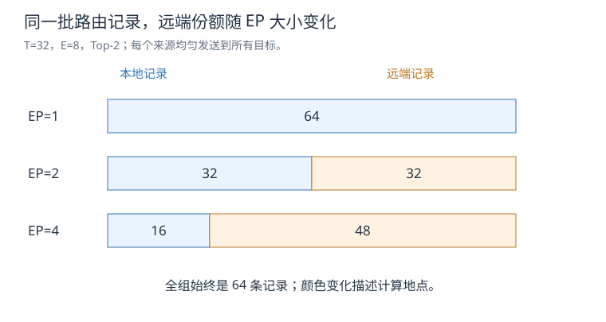

图 7-2：固定 64 条路由记录时，本地与远端记录的变化。

每行占 32 bytes，输入与结果各传一次，所以两卡的远端载荷为 `2×32×32=2048` bytes，四卡为 `2×48×32=3072` bytes。这组手算把计算分摊与跨卡比例联系起来：Expert 的 M 没有变，每张卡负责的 Expert 更少，而需要远端往返的记录更多。

## 7.4 最慢 Rank 的计时口径

一层 MoE 输出要等所选 Expert 的结果返回。某个 Rank 更早完成时，它的局部时间描述自己的进度；整组测量需要把参与者放到同一轮迭代中。配套基准先收集每个 Rank 的第 i 次 CUDA Event 时间，再对相同 i 取最大值，最后对这些最大值取中位数：

$$
L_P=\operatorname{median}_i\left(\max_r L_{r,i}\right).
$$

下面的函数接收本 Rank 的样本列表。浮点时间转换成当前 CUDA 设备上的 FP64 向量，组内逐元素 MAX 后再转到 CPU。样本位置 i 始终对应同一次前向，通信统计放在被测前向之外。

**最慢 Rank 样本 · code/course7/benchmarks/benchmark_ep.py**

```python
from __future__ import annotations
import torch
import torch.distributed as dist

def max_rank_samples(samples, device, group):
    """Reduce matching repetition slots after timing; no metric collective inside a sample."""
    # 时间向量下标 i 表示同一轮迭代，组内按该下标取最大值。
    tensor = torch.tensor(samples, device=device, dtype=torch.float64)
    dist.all_reduce(tensor, op=dist.ReduceOp.MAX, group=group)
    return tensor.cpu().tolist()
```

**逐轮取最慢参与者，再计算整体统计量**

```python
# 对齐各 Rank 的第 i 轮样本，逐轮取 MAX 后再计算分布统计量。
tensor = torch.tensor(samples, device=device, dtype=torch.float64)
dist.all_reduce(tensor, op=dist.ReduceOp.MAX, group=group)
return tensor.cpu().tolist()
```

每个 Rank 的 samples[i] 对应同一次重复。FP64 时间向量在 CUDA 上做逐元素 MAX，使所有参与者获得每轮最慢 Rank 时间；

转回 Host 后才计算中位数。此统计 collective 位于采样之后，独立于前向的通信序列。

这种顺序保留了每轮出现的慢 Rank。假设两轮中 Rank 0 的时间为 `[4,1]` ms，Rank 1 为 `[1,4]` ms，两轮整组时间都是 4 ms。若先分别取平均，再比较两个 Rank，就会得到 2.5 ms，丢失逐轮等待关系。

CUDA Event 的结束位置决定哪些工作被计入延迟。NCCL 在内部通信流执行，配套同步 `all_to_all_single()` 封装建立当前流对通信工作的完成依赖，后续 Expert 能读取接收缓冲区。

同一当前流上的结束 Event 因而排在整次同步前向的结果之后。输入已在 GPU 上，初始化、模型构造和 Reference 比较放在计时区间外。

**前向计时 · code/course7/benchmarks/benchmark_ep.py**

```python
from __future__ import annotations
import torch
import torch.distributed as dist
from benchmarks.benchmark_ep import max_rank_samples

def measure_forward(model, tokens, group, warmup, repeats):
    """Current-stream end-to-end CUDA samples; inputs already reside on device."""
    if warmup < 0 or repeats <= 0:
        raise ValueError(f"need warmup >= 0, repeats > 0; got {warmup}, {repeats}")
    for _ in range(warmup):
        model(tokens, group=group)
    # 预热完成后，在测量边界排空设备工作。
    torch.cuda.synchronize(tokens.device)
    dist.barrier(group=group)
    pairs = []
    for _ in range(repeats):
        started = torch.cuda.Event(enable_timing=True)
        ended = torch.cuda.Event(enable_timing=True)
        # 当前流上的一对 Event 覆盖本轮完整前向。
        started.record()
        model(tokens, group=group)
        ended.record()
        pairs.append((started, ended))
    torch.cuda.synchronize(tokens.device)
    return max_rank_samples([a.elapsed_time(b) for a, b in pairs], tokens.device, group)
```

**对齐整组的测量起点**

```python
# 预热完成后对齐参与者，再进入重复测量区间。
for _ in range(warmup):
    model(tokens, group=group)
# 预热完成后，在测量边界排空设备工作。
torch.cuda.synchronize(tokens.device)
dist.barrier(group=group)
```

各 Rank 先预热相同次数，再排空本设备工作，并在测量边界进入 barrier。随后所有参与者按相同重复次序调用模型。边界同步发生在样本外，模型内部继续保持既有 collective 顺序。

**每轮保存当前流上的端到端区间**

```python
# 同流起止 Event 包住本轮完整前向，记录当前 Rank 的设备时间。
started.record()
model(tokens, group=group)
ended.record()
pairs.append((started, ended))
```

一对 Event 包围完整 model 前向，包括布局准备形成的设备等待、两次通信、本地计算与合并。前向的同步 NCCL 封装将通信依赖接回当前流，因此结束 Event 排在最终结果可用之后。

**先收集各轮时间，再汇总跨 Rank 延迟**

```python
# 先读取各轮 Event 延迟，再按相同轮次汇总最慢 Rank。
return max_rank_samples([a.elapsed_time(b) for a, b in pairs], tokens.device, group)
```

此前的 synchronize 让所有终点可读取。列表保留每轮的顺序，max_rank_samples 再将不同 Rank 的同轮样本对应起来。最终用这些最大值求中位数，衡量整组完成同一批工作的时间。

预热让后端完成首次初始化并进入重复执行；测量开始前排空已提交工作，并用组内 barrier 对齐这一测量边界。每轮前向内部保持原来的 collective 顺序，所有 Rank 完成样本后，再汇总时间向量。此处测量的是设备流上从前向开始到结果可用的间隔；Host 提交不及时造成的空档也会反映在该间隔里。

## 7.5 整层耗时与阶段分解

同步版本的执行依赖依次经过 `ROUTER → DISPATCH → A2A_FORWARD → EXPERT → A2A_RETURN → COMBINE`。阶段记录器在这些边界放置 CUDA Event，便于解释时间花在哪里；无阶段 Event 的原模型前向用于主要的端到端延迟。两组测量使用相同输入与权重。

DISPATCH 的口径包含 Top-K 展开、Expert 打包、Rank 打包、Expert 计数交换和接收布局构造。两次向量 A2A 分别计时，EXPERT 包括收集本地行、MLP 和结果回写，COMBINE 包括从 Rank 顺序恢复为 Expert 顺序与加权求和。

`send_splits.tolist()` 和 `recv_splits.tolist()` 的 Host 准备位于向量通信之前，应结合 Timeline 检查其等待。

阶段统计保留每个 Rank 的时间，便于找到计算或通信较慢的位置。各阶段最大值可能来自不同进程：Rank 0 的 Expert 最慢时，Rank 1 可能在返回 A2A 中等待最久。两项相加会重复包含同一次负载差异带来的等待。因此，整层延迟使用完整前向样本，阶段耗时用来解释这段延迟的来源。

配套入口为 `test/demo.py`。在 `code/course7` 目录、可见 GPU 数不少于所选 EP 大小、CUDA/NCCL 就绪的条件下，以下命令保持全局 T=1024、H=128、F=256、E=8、Top-2 和 FP32。

FP32 比较关闭 TF32，以保持同一数值基准。命令中的 `NCCL_NVLS_ENABLE=0` 使用常规 NCCL 通信路径；NVLS 是 NVLink SHARP 的可选集体通信加速机制。

**EP 扩展 · test/demo.py**

```bash
cd code/course7
for ep in 1 2 4; do
  NCCL_NVLS_ENABLE=0 torchrun --standalone --nproc-per-node="$ep" \
    test/demo.py --tokens 1024 --hidden-size 128 \
    --expert-hidden-size 256 --num-experts 8 --top-k 2 --dtype float32 \
    --warmup 5 --repeats 20 --output "results/ep${ep}.json"
done
```

报告中的逐轮最慢 Rank 时间与中位数描述整层完成速度，Expert 计数、接收行数与通信载荷描述工作分配，阶段时间连接两者。强扩展中固定全组记录数，增加 P 会减少每卡持有的 Expert 数，同时改变远端比例；

实际延迟由这些因素和具体矩阵形状共同决定。下一课沿时间线追踪一份热点路由，解释较早完成计算的 Rank 为什么仍要等待返回。

相关实现：[分布式前向](https://gitee.com/hellofss/miniep1/blob/master/code/course7/mini_ep/model/moe.py)、`mini_ep/profiler/stages.py`。背景阅读可参考 [AI Infra 的专家放置与负载分析](https://github.com/bojieli/ai-infra-book/blob/main/manuscripts/09-分布式推理.md)。

配套源码、运行依赖与各课入口见[课程首页](https://tvle9mq8jh.feishu.cn/wiki/QJp1wvBlgiiYV5kEOqFcpNtNnie)的源码附件；标题中的路径对应解压后的仓库相对路径。

---

# 第 8 课：负载均衡与 Profiling——沿时间线寻找瓶颈

本课独立源码位于 `code/course8/`，示例在 `test/`，正确性测试在 `checks/`。下文命令均在本课目录中执行；将整个目录复制到其他位置后也使用同样的启动方式。

两张 GPU 都持有两个 Expert，输入也各有一半，计算时却可能一张卡很忙、另一张卡很早完成。原始 Token 的等分决定谁运行 Router，路由结果决定谁接收记录并运行 Expert。输入均分以后，还需要沿路由查看计算落到了哪里。

沿用第二课的三个 Token：路由为 `[[2,0],[1,2],[0,1]]`，Top-2 展开后六条记录，四个 Expert 的全组计数为 `[2,2,2,0]`。若 Rank 0 保存 E0、E1，Rank 1 保存 E2、E3，接收工作量就是 `[4,2]`。

输入侧可以接近平分，计算侧却有两倍的行数差距。如果在这个例子中把 E1 与 E3 的放置交换，两个 Rank 都会接收三行；Expert 的选择次数保持原样，Rank 负载发生变化。

这里用放置变化说明两种负载的关系，配套实现继续使用连续 Expert 编号的均匀放置。

第七课已经确定整层耗时的统计方法。接下来把 Expert 计数汇总为 Rank 负载，再连接到时间线上的计算与等待，就能解释哪些工作使结果晚到，并为后续的 Dispatch、Combine 和 GEMM 优化找到具体对象。

## 8.1 Expert 热度与 Rank 负载

Expert 的全组计数记为 cₑ。对均匀放置，Rank r 拥有连续的一组 Expert，接收行数是这些 cₑ 的和：

$$
R_r=\sum_{e\in\mathcal E_r}c_e,\qquad \sum_rR_r=TK.
$$

第六课的 `tokens_per_expert_all` 为 `[P,E]`、CUDA int64。第 s 行描述来源 Rank s 的 Expert 分配次数；沿来源维求和，得到全组 `[E]` 计数。接收行数 Rᵣ 与各来源 `recv_splits` 之和一致；Expert 集合按目标 Rank 分组，形成全组 `[P]` 工作量。

用最大值除以均值，可以量化分布偏离均衡的程度：

$$
I_E=\frac{\max_ec_e}{TK/E},\qquad I_R=\frac{\max_rR_r}{TK/P}.
$$

对 `[2,2,2,0]`，Expert 均值为 1.5，I_E=4/3；Rank 计数 `[4,2]` 的均值为 3，I_R=4/3。交换 E1 与 E3 后，I_E 仍为 4/3，I_R 变为 1。同一个热点分布，经不同放置会产生不同的 Rank 负载。

下面的函数接收 `[E]` 或 `[P,E]` 的整数计数。统计在 CPU 上进行，方便报告；前向通信仍使用 GPU 上的 metadata。空工作量的比例定义为零，以便空输入场景保持明确的返回值。

**负载统计 · code/course8/mini_ep/utils/course_workload.py**

```python
from __future__ import annotations
import torch

def load_metrics(counts: torch.Tensor, ep_size: int) -> dict[str, object]:
    """CPU counts [E] or [P,E] -> global Expert and Rank row statistics."""
    if counts.ndim not in (1, 2) or counts.dtype not in (torch.int32, torch.int64):
        raise ValueError(
            f"need integer counts [E] or [P,E], got {counts.shape}/{counts.dtype}"
        )
    if ep_size <= 0 or counts.shape[-1] % ep_size:
        raise ValueError(f"E={counts.shape[-1]} must be divisible by P={ep_size}")
    # 先合并所有来源对 Expert 的贡献，再按 Expert 所有权汇总 Rank 行数。
    global_counts = counts.sum(0) if counts.ndim == 2 else counts
    rank_counts = global_counts.reshape(ep_size, -1).sum(1)

    def ratio(v):
        mean = v.float().mean().item()
        return v.max().item() / mean if mean else 0.0

    return {
        "tokens_per_expert": global_counts.tolist(),
        "rows_per_rank": rank_counts.tolist(),
        "expert_imbalance": ratio(global_counts),
        "rank_imbalance": ratio(rank_counts),
    }
```

**从来源计数汇总到参数所在地的工作量**

```python
# 沿来源维求和，得到全组发往各 Expert 的记录数。
global_counts = counts.sum(0) if counts.ndim == 2 else counts
rank_counts = global_counts.reshape(ep_size, -1).sum(1)
```

输入为 [P,E] 时，先沿来源维求和，得到各 Expert 全组接收行数 [E]；输入为 [E] 时已经是该口径。连续均匀放置使相邻 L=E/P 个计数属于同一 Rank，reshape 后沿 Expert 维相加，得到 [P] Rank 行数。

**用最大负载与平均负载建立比例**

```python
# 用最大 Expert 负载除以平均负载，量化路由的不均匀程度。
mean = v.float().mean().item()
return v.max().item() / mean if mean else 0.0
```

同一种计数先求平均，再将最大值除以它。Expert 计数 [2,2,2,0] 与 Rank 计数 [4,2] 在本例中都给出 4/3；两者统计的对象不同。mean=0 表示全部计数为零，此函数按约定返回 0。

相同 H、F、dtype 的两投影 Expert，GEMM FLOPs 与记录数成正比。但行数和时间之间还经过矩阵形状、权重复用、后端选择与调度。三个八行 Expert 与一个二十四行 Expert 有相同的行数总和，Kernel 调用次数和 GEMM 形状不同；时间线将这些差异进一步分开。

## 8.2 均衡路由与热点路由

随机 gate 便于获得自然波动，受控 gate 则适合比较单个因素。配套代码用输入的前 E 个特征存放 Expert 得分，gate 的前 E 列设为单位矩阵。这样 `tokens[:, :E]` 就是 logits，每个 Token 选择哪些 Expert 可以直接从这些特征读出，其他输入特征仍由固定 seed 生成。

`uniform` 将记录依次分给 Expert。对 T=32、E=8、Top-2，Expert 计数为 `[8,8,8,8,8,8,8,8]`，EP=4 的 Rank 计数为 `[16,16,16,16]`。

`hotspot` 在 Top-2 下让每个 Token 都选择 E0，另一条分支依次选择 E1～E7；计数为 `[32,5,5,5,5,4,4,4]`，Rank 计数为 `[37,10,9,8]`。

同一个 Token 的两条分支选择不同 Expert，因此 E0 最多占全部 Top-2 记录的一半。

Top-1 的 `hotspot` 把 `floor(0.6T)` 个 Token 分给 E0，其余分给其他 Expert，用来研究更集中的工作量。每次比较保持模型参数和输入生成规则一致；改变路由时，比较对象是两种明确工作负载下的时间分解。

| 场景 | T、E、K | 全组 Expert 计数 | EP=4 的 Rank 行数 | I_R |
| --- | --- | --- | --- | --- |
| 均衡 | 32、8、2 | `[8,8,8,8,8,8,8,8]` | `[16,16,16,16]` | 1 |
| E0 热点 | 32、8、2 | `[32,5,5,5,5,4,4,4]` | `[37,10,9,8]` | 2.3125 |

热点同时改变接收、计算和返回的工作。Rank 0 要接收 37 行，执行相应 Expert，再把 37 行结果按来源块送回。原始输入仍等分为每 Rank 八行，发送方向和接收方向的压力因此不同。

第七课的发送矩阵 A[s,r] 能显示这份差异：行和表示来源 s 的发送量，列和表示目标 r 的接收量。在此例中，各行和都是 16，列和则为 `[37,10,9,8]`。同一批 64 条记录，从发送侧和接收侧看具有不同分布。

这份发送矩阵可以从受控路由逐行算出。Rank 0 的八个 Token 都选择 E0，另一个分支中 E1 出现两次，E2～E7 各一次。因此它发往四个目标的行数是 `[10,2,2,2]`。其余来源沿同一循环继续选择，得到下图。

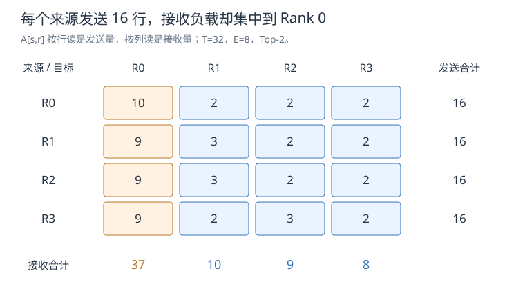

图 8-1：热点路由的发送矩阵同时呈现来源负载与目标负载。

每行合计都是 16，说明各来源的路由分支数相同。第 0 列合计 37，说明 E0/E1 所在的 Rank 0 接收最多；其余列合计为 10、9、8。Rank 0 的接收行数是平均 16 行的 2.3125 倍。这是后面读取 EXPERT 与 A2A_RETURN 时间线时应当对应的工作量。

## 8.3 负载差异与关键路径

设两张卡在 1 ms 时都完成正向 A2A。Rank 0 的 Expert 计算需要 3 ms，Rank 1 需要 1 ms。Rank 1 在 2 ms 发起返回 A2A，Rank 0 在 4 ms 才进入同一 collective；返回传输用时 1 ms，两个 Rank 都在 5 ms 获得结果。

```mermaid
flowchart LR
    A0[Rank 0：正向通信结束 1ms] --> C0[Expert：1到4ms]
    C0 --> R0[返回传输：4到5ms]
    A1[Rank 1：正向通信结束 1ms] --> C1[Expert：1到2ms]
    C1 --> W1[等待对端：2到4ms]
    W1 --> R1[返回传输：4到5ms]
    R0 --> Y[两个 Rank 在5ms得到结果]
    R1 --> Y
```

图 8-2：两张卡的 Expert 负载差异如何形成返回等待。

在这个依赖例子里，Rank 1 的返回阶段跨度为 3 ms，其中 2 ms 来自更早进入 collective 后的等待，1 ms 来自数据传输。Rank 0 的 Expert 阶段更长，Rank 1 的 A2A 返回阶段更长，两项都指向同一条关键路径。关键路径是决定结果最早可用时刻的依赖链。

实际 Timeline 中，等待可能体现为 NCCL Kernel 持续运行、CUDA Stream 依赖或 Host 侧同步。A2A 范围覆盖通信调用及其等待。结合对端到达时刻、传输字节数和链路活动，可以进一步区分等待与实际传输所占的时间。

## 8.4 三种观察尺度

PyTorch Profiler 记录框架算子、Host 调用与 CUDA 活动，用来追踪一次 `index_select`、`argsort` 或 GEMM 对应的执行。NVTX 是代码放置的范围标记，让 Nsight Systems 时间线上出现业务名称。

Nsight Systems 同时展示 Host 线程、CUDA API、GPU Stream、Kernel 与内存操作，适合把提交、等待和执行连成一条链。

| 观察对象 | 主要问题 | 本课对应信息 |
| --- | --- | --- |
| 路由 metadata | 工作发给了谁 | Expert 计数、发送矩阵、Rank 接收行数 |
| PyTorch 算子事件 | 哪些调用生成了 GPU 工作 | 排序、索引、MLP、权重乘法与求和 |
| CUDA/NCCL Timeline | 工作何时提交、何时完成、谁在等待 | Kernel、Stream、Host 空档、通信对端到达 |

GPU 利用率的含义随指标而变化。监控工具的 GPU 活跃比例描述采样区间内是否有工作；SM 指标描述计算资源忙碌程度；GEMM 的 FLOPs/时间衡量矩阵计算吞吐。长时间运行的通信 Kernel 也会使设备保持活跃。将利用率与当前执行阶段对应起来，可以判断 Expert 计算是否获得了足够工作。

配套阶段记录器对同一段代码发出 `record_function` 与 NVTX 范围，并按需要记录 CUDA Event。所有事件使用当前 Rank 的设备和当前流；样本在测量边界同步后读取。

**阶段范围 · code/course8/mini_ep/profiler/stages.py**

```python
from __future__ import annotations
from collections.abc import Iterator
from contextlib import contextmanager
import torch
from mini_ep.profiler.nvtx import nvtx_range

class StageRecorder:
    def __init__(self, device: torch.device, timing: bool = False):
        self.device = torch.device(device)
        if timing and self.device.type != "cuda":
            raise ValueError("CUDA Event stage timing needs a CUDA device")
        self.timing = timing
        self.events: dict[str, list] = {}

    @contextmanager
    def stage(self, name: str) -> Iterator[None]:
        """Label host scope; CUDA events bracket dependent current-stream work."""
        pair = None
        if self.timing:
            with torch.cuda.device(self.device):
                pair = (
                    torch.cuda.Event(enable_timing=True),
                    torch.cuda.Event(enable_timing=True),
                )
                # 起点 Event 先进入当前流，随后阶段主体提交其依赖工作。
                pair[0].record()
        with torch.profiler.record_function(name), nvtx_range(name):
            yield
        if pair is not None:
            with torch.cuda.device(self.device):
                # 终点 Event 连接当前流上的阶段结果。
                pair[1].record()
            self.events.setdefault(name, []).append(pair)

    def samples_ms(self) -> dict[str, list[float]]:
        """Call after the measurement boundary has synchronized this device."""
        return {
            name: [a.elapsed_time(b) for a, b in pairs]
            for name, pairs in self.events.items()
        }
```

**同一个业务阶段进入两套跟踪视图**

```python
# 用同一阶段名称标记 PyTorch Profiler 与 NVTX 范围。
with torch.profiler.record_function(name), nvtx_range(name):
    yield
```

contextmanager 在 yield 处执行调用者的阶段代码。record_function 给 PyTorch Profiler 添加 Host 范围，nvtx_range 给 Nsight 添加同名范围；

两者让 ROUTER、EXPERT 等业务名称与范围内提交的 CUDA 操作关联。

**设备终点按流依赖排在阶段工作之后**

```python
# 在阶段工作之后记录终点 Event，以流内顺序建立计时边界。
if pair is not None:
    with torch.cuda.device(self.device):
        # 终点 Event 连接当前流上的阶段结果。
        pair[1].record()
    self.events.setdefault(name, []).append(pair)
```

阶段主体退出后，在同一设备的当前流记录终点 Event，再按名称保存 Event 对。Host 范围描述提交过程，Event 对描述设备流上的间隔。

samples_ms 在测量边界已经同步后读取这些时间，保留同名阶段的多轮样本。

`record_function` 将业务名称放进 PyTorch 跟踪，NVTX 将同样的名称放进 Nsight 跟踪；两者标记的是 Host 代码范围。范围中的 CUDA API 进一步关联 GPU 工作。

CUDA Event 提供当前流上的设备时间，两套信息连接起来，才能区分 Host 范围持续时间和 GPU 实际执行区间。[PyTorch Profiler](https://docs.pytorch.org/tutorials/recipes/recipes/profiler_recipe.html)介绍了算子范围与 Chrome Trace 的对应关系。

`run_ep_stages()` 沿用第六课的 Reference 前向和 collective 顺序：先 Router，再打包与计数交换，正向 A2A，本地 Expert，返回 A2A，最后恢复与 Combine。

范围名称统一为 `ROUTER`、`DISPATCH`、`A2A_FORWARD`、`EXPERT`、`A2A_RETURN`、`COMBINE`。

## 8.5 从算子表读到 Timeline

先在算子表中寻找相对占比，再沿 Timeline 解释因果关系。若 DISPATCH 中排序和索引调用密集，且第一轮向量通信等待这些数据准备，优化对象就包括布局构造。若 EXPERT 中大量小 GEMM 之间有提交间隙，Grouped GEMM 可以改变工作组织。

若 COMBINE 连续读写多份 `[N,K,H]` 中间结果，第十课的融合可以减少这些中转。

Timeline 还会显示 CPU 与 GPU 的衔接。GPU Tensor 的 `.tolist()` 要将 splits 转到 Host，调用可能等待前面的计数完成；后续 `all_to_all_single()` 又需要这些列表才能发起。

此时，Host 准备和设备工作之间形成明确依赖。Dispatch 的调用耗时由 metadata 生成、排序、复制与相关准备工作共同组成，第九课据此比较 Reference 与 Triton 实现。

对阶段汇总，还要区分嵌套范围的 inclusive time 与 self time。inclusive time 包含子范围，self time 扣除子范围；把父子范围都累加，会重复计入同一段工作。

跨 Rank 分析则保留每个 Rank 的时间线，并用 collective 次序和业务迭代对应事件。不同进程的 GPU 时钟用于计算各自间隔，因果关系通过通信和流依赖建立。

在两张可见 GPU 上，下面的命令保持第七课的测量条件，增加 `--scenario hotspot --profile torch`。采集发生在独立区间，每个 Rank 导出一份 JSON Trace；端到端数字仍来自采集之前的无 Profiler 前向。

**负载与算子跟踪 · test/demo.py**

```bash
cd code/course8
NCCL_NVLS_ENABLE=0 torchrun --standalone --nproc-per-node=2 \
  test/demo.py --tokens 1024 --num-experts 8 --top-k 2 \
  --hidden-size 128 --expert-hidden-size 256 --dtype float32 \
  --scenario hotspot --profile torch --trace-dir results/hotspot-traces \
  --warmup 5 --repeats 20 --output results/hotspot.json
```

`rank0.json` 与 `rank1.json` 可以在支持 Chrome Trace 的查看器中打开。两卡 `EXPERT` 范围连接到不同 Expert 计数，`A2A_RETURN` 范围连接到各自进入 collective 的时刻。对比 `uniform` 场景，可以追踪输入分布怎样改变整层关键路径。

Nsight Systems 使用同样的阶段名称，记录 CUDA、NVTX 与操作系统运行时活动。下面通过 `torchrun` 启动两个进程；关闭 CPU 采样和上下文切换采集，采集 CUDA 调用、Kernel 与阶段范围的时间线。

**系统时间线 · test/demo.py**

```bash
NCCL_NVLS_ENABLE=0 nsys profile --sample=none --cpuctxsw=none \
  --trace=cuda,nvtx,osrt --output=results/ep-hotspot \
  torchrun --standalone --nproc-per-node=2 test/demo.py \
  --tokens 1024 --num-experts 8 --top-k 2 --scenario hotspot \
  --hidden-size 128 --expert-hidden-size 256 --dtype float32 \
  --profile nvtx --warmup 5 --repeats 20 --output results/ep-hotspot.json
```

`.nsys-rep` 将提交、流依赖与 GPU 执行保存在同一时间线视图中。把 EXPERT 对应到接收行数，把 A2A_RETURN 对应到对端进入时刻，再查看布局准备与 Kernel 之间的 Host 空档，就能为一个具体优化选择数据流依据。

第九课从通信前的稳定打包开始，把整数计数、记录定位和隐藏向量搬运分别写成可对照的实现。

延伸阅读：[PyTorch 与系统级 Profiling](https://tvle9mq8jh.feishu.cn/wiki/FVbkwEzi8iwBtLkF8SZcR3t4nkf)、[专家并行与负载](https://tvle9mq8jh.feishu.cn/wiki/G1eQwv1iSiP9pakc4zDcnayKnrd)。

配套源码、运行依赖与各课入口见[课程首页](https://tvle9mq8jh.feishu.cn/wiki/QJp1wvBlgiiYV5kEOqFcpNtNnie)的源码附件；标题中的路径对应解压后的仓库相对路径。

---

# 第 9 课：Triton Dispatch——从记录编号到连续向量

本课独立源码位于 `code/course9/`，示例在 `test/`，正确性测试在 `checks/`。下文命令均在本课目录中执行；将整个目录复制到其他位置后也使用同样的启动方式。

第二课将三个 Token 的六条路由记录按 Expert 排列，第六课再把这些连续记录交给 All-to-All。现在把打包过程拆开：先计算每个 Expert 有多少行，再给每条记录确定唯一的输出行号，最后搬运隐藏向量。记录编号与向量分开处理，便于看清哪些工作在处理整数 metadata，哪些工作在移动大量浮点数据。

仍取 `tokens=[[1,2],[3,4],[5,6]]`、Top-2 路由 `[[2,0],[1,2],[0,1]]`，四个 Expert 中 E3 为空。原始记录 r0～r5 的 Expert ID 为 `[2,0,1,2,0,1]`。

稳定打包后，记录顺序为 `[r1,r4,r2,r5,r0,r3]`，对应输入行 `[T0,T2,T1,T2,T0,T1]`。Triton 实现沿用这份排列与 metadata，依次完成计数、定位与向量收集。

Triton 是编写 GPU Kernel 的语言与编译器。Host 侧 Python 准备 Tensor 和 launch grid，设备侧程序处理一块逻辑数据；多个 program 实例共同覆盖输入。

一个 program 的逻辑向量、CUDA 线程组织和寄存器布局由编译器联系起来，读代码时先关注索引、数据依赖和地址计算。

## 9.1 输入布局与恢复索引

本 Rank 输入为 `[N,H]`，路由为 `[N,K]`，展开记录数 S=N×K。第七课的全局 T 在本 Rank 变成 N；单卡示例满足 N=T；进入 EP 时，本函数仍只处理当前 Rank 的 N 行输入。

每条原始记录 q 的来源 Token 为 `q//K`，slot 为 `q%K`。它们是这条记录从打包到返回一直携带的逻辑身份。

`dispatch_reference()` 使用稳定排序：Expert ID 较小的组在前，同组记录保持原始 Token/slot 顺序。`dispatch_triton()` 返回相同的 `DispatchOutput`，因此第六课的 Rank 打包、计数交换、两次 A2A 和 Combine 接口可以继续使用。

| 字段 | Shape 与 dtype | 含义和顺序 |
| --- | --- | --- |
| `tokens` | `[N,H]`，FP32/FP16/BF16 | 当前 Rank 的原始 Token 顺序 |
| `expert_ids` | `[N,K]`，int32/int64 | 每个 Token 的全局 Expert ID |
| `routing_weights` | `[N,K]`，浮点 | 与 Token/slot 一一配对的权重 |
| `packed_tokens` | `[S,H]`，与输入同 dtype | 稳定 Expert 顺序，连续行主序 |
| `tokens_per_expert` | `[E]`，int64 | 本 Rank 的记录计数 |
| `expert_offsets` | `[E+1]`，int64 | 各 Expert 段的边界，末项为 S |
| `restore_index` | `[S]`，int64 | 原始记录 q 在打包缓冲区中的行号 |
| `packed_expert_ids` | `[S]`，int64 | 打包行的全局 Expert ID |
| `packed_token_indices` / `packed_route_slots` | `[S]`，int64 | 打包行对应的原始 Token 编号与 Top-K slot |
| `packed_routing_weights` | `[S]`，与输入权重同 dtype | 与 packed_tokens 逐行配对的分支权重 |

这些 Tensor 全部位于输入的 CUDA device。公开 wrapper 校验 shape、dtype、Expert ID 范围和共同 device，并将非连续输入变为连续 Tensor；

相关复制属于公开调用的耗时。GPU Kernel 内部使用连续 stride：`tokens` 为 `(H,1)`，一维 metadata 为 `(1,)`。空输入返回 `[0,H]` 缓冲和零计数，空 Expert 的相邻 offsets 相等。

对六条记录，计数为 `[2,2,2,0]`，offsets 为 `[0,2,4,6,6]`。临时 `pack_index[p]` 表示打包行 p 来自原始记录几，值为 `[1,4,2,5,0,3]`；

`restore_index[q]` 表示原始记录 q 被放到哪一行，值为 `[4,0,2,5,1,3]`。两者满足 `pack_index[restore_index[q]]=q`。

```mermaid
flowchart LR
    I[原记录 q：0 1 2 3 4 5] --> S[按 Expert 稳定分组]
    S --> P[打包行 p 的来源：1 4 2 5 0 3]
    P --> X[packed_tokens：T0 T2 T1 T2 T0 T1]
    S --> R[原记录的去向：4 0 2 5 1 3]
    R --> C[返回后由 restore_index 合并]
```

图 9-1：稳定打包排列与恢复索引的两个方向。

## 9.2 直方图与分组前缀

Histogram（直方图）在这里统计每个 Expert ID 出现多少次。将 S 条记录分成 Q 个逻辑块，每块 B 条，得到 `partial_counts[Q,E]`。第 b 行表示块 b 对各 Expert 的贡献；沿块维求和得到全局计数 cₑ。

先把 B 取为 2 便于手算。六条记录分为 `[2,0]`、`[1,2]`、`[0,1]`，各块计数如下：

| 块 b | Expert IDs | E0 | E1 | E2 | E3 |
| --- | --- | --- | --- | --- | --- |
| 0 | `[2,0]` | 1 | 0 | 1 | 0 |
| 1 | `[1,2]` | 0 | 1 | 1 | 0 |
| 2 | `[0,1]` | 1 | 1 | 0 | 0 |
| 合计 | 六条记录 | 2 | 2 | 2 | 0 |

运行实现使用 B=128。`tl.program_id(0)` 选择逻辑块，`tl.arange(0,B)` 生成块内位置。`tl.load` 的 mask 屏蔽末块越过 S 的位置。填充 ID 设为 histogram bin 范围之外的值，使这些位置不计入任何 Expert。

`@triton.jit` 将函数标记为设备程序，第一次按某组配置 launch 时编译。`tl.constexpr` 参数由 Host 给出，编译器据此确定逻辑向量大小与固定循环。

Host 使用 `histogram_kernel[(Q,)](...)` 发起 Q 个 program，Q 为 `ceil(S/B)`；括号中的 grid 决定程序实例数，B 决定每个实例处理的逻辑记录数。

**块内计数 · code/course9/mini_ep/kernels/histogram_triton.py**

```python
from __future__ import annotations
import triton
import triton.language as tl

@triton.jit
def histogram_kernel(
    Ids,
    Partial,
    S: tl.constexpr,
    E: tl.constexpr,
    EPAD: tl.constexpr,
    BLOCK: tl.constexpr,
):
    # 第 b 个 program 负责原始记录区间 [b×BLOCK,(b+1)×BLOCK)。
    block = tl.program_id(0)
    records = block * BLOCK + tl.arange(0, BLOCK)
    ids = tl.load(Ids + records, records < S, other=EPAD).to(tl.int32)
    # 尾块填充 ID 位于直方图 bin 范围之外。
    # Padding IDs lie outside the histogram's bin range.
    counts = tl.histogram(ids, EPAD)
    experts = tl.arange(0, EPAD)
    # 每个 program 只写自己在 partial_counts[Q,E] 中的一行。
    tl.store(Partial + block * E + experts, counts, experts < E)
```

**一个 program 读取一块原始记录**

```python
# 每个 program 负责一块原始记录，尾部越界位置填入无效 ID。
block = tl.program_id(0)
records = block * BLOCK + tl.arange(0, BLOCK)
ids = tl.load(Ids + records, records < S, other=EPAD).to(tl.int32)
```

block 选择第 b 块，records=b×BLOCK+[0,…,BLOCK−1] 生成原记录编号。records<S 的位置读取真实 ID，末块无效位置填 EPAD。

EPAD 位于 histogram 的有效 bin 编号 0…EPAD−1 之外，尾部填充值不贡献任何 Expert 计数。

**将块内直方图写入二维计数表**

```python
# 先统计本块 ID 的直方图，再只写真实 Expert 对应的列。
counts = tl.histogram(ids, EPAD)
experts = tl.arange(0, EPAD)
# 每个 program 只写自己在 partial_counts[Q,E] 中的一行。
tl.store(Partial + block * E + experts, counts, experts < E)
```

tl.histogram 产生 EPAD 个 bin，experts<E 的 mask 只写真实 Expert 列。Partial+block×E+experts 对应 partial_counts[b,e]，输入 S=6、BLOCK=2 时三行分别描述 [2,0]、[1,2]、[0,1]。跨块求和与前缀由后续 wrapper 完成。

`EPAD` 是不小于 E 的二次幂，用于给 `tl.histogram` 提供固定 bin 数。内部 Expert ID 使用 int32，公开接口接收 int32/int64 路由 Tensor。

计数写入 int64 的 `partial_counts`，保留与 Reference 相同的 metadata dtype。`tl.histogram` 的 bin 语义见 [Triton API](https://triton-lang.org/main/python-api/generated/triton.language.histogram.html)。

计数确定每个 Expert 的总区间，前缀和确定各块在这个区间内的子区间。定义：

$$
O_e=\sum_{j<e}c_j,\qquad P_{b,e}=\sum_{a<b}\mathrm{partial\_counts}[a,e].
$$

若记录 q 位于块 b、选择 Expert e，块内在 q 之前出现的同 Expert 记录数为 l(q)，其唯一输出位置为：

$$
p(q)=O_e+P_{b,e}+l(q).
$$

三项分别对应“Expert 从哪里开始”“前面的块占了多少行”“本块里前面的同类记录占了多少行”。原始记录 r3 选择 E2，O₂=4，前面的块对 E2 贡献一行，本块内它前面没有 E2，因此 p(r3)=4+1+0=5。r4 选择 E0，前两块共贡献一行 E0，所以 p(r4)=0+1+0=1。

计数之后，Host wrapper 用 PyTorch CUDA 运算沿块维求和得到 `[E]` 计数，再构造 `[E+1]` 的 Expert offsets 和 `[Q,E]` 的块前缀 P。

这里的运算仍在 GPU 上执行。随后 Triton 读取两组起点，为每条记录写出唯一位置。计数、前缀与定位各自有明确输入输出，可以分别对齐 Reference。

把六条记录全部代入位置公式，可以看到三个偏移怎样共同保持稳定顺序。仍用便于手算的 B=2，三块分别是 `[2,0]`、`[1,2]`、`[0,1]`。

| 原记录 q | Expert e | 块 b | Expert 起点 Oₑ | 之前块贡献 Pᵦ,ₑ | 本块前序同类 l(q) | 输出行 p(q) |
| --- | --- | --- | --- | --- | --- | --- |
| 0 | 2 | 0 | 4 | 0 | 0 | 4 |
| 1 | 0 | 0 | 0 | 0 | 0 | 0 |
| 2 | 1 | 1 | 2 | 0 | 0 | 2 |
| 3 | 2 | 1 | 4 | 1 | 0 | 5 |
| 4 | 0 | 2 | 0 | 1 | 0 | 1 |
| 5 | 1 | 2 | 2 | 1 | 0 | 3 |

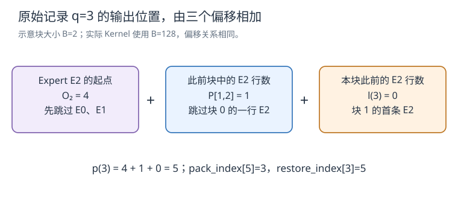

图 9-2：Expert 起点、块前缀与块内编号共同确定输出行。

按 q 读取最后一列，得到 `restore_index=[4,0,2,5,1,3]`；按输出行从小到大读取原记录，得到 `pack_index=[1,4,2,5,0,3]`。这份表同时解释了正向收集和反向恢复为何使用不同索引。

## 9.3 稳定的组内行号

对某个 Expert e，块内的匹配向量为 `(ids==e)`。将其转成 0/1，再做包含当前位置的前缀和，匹配位置的结果减一就得到 l(q)。例如本块 IDs 为 `[0,2,0,1]`，E0 的匹配向量是 `[1,0,1,0]`，前缀和为 `[1,1,2,2]`；两条 E0 记录的块内编号分别为 0、1。

**稳定行号 · code/course9/mini_ep/kernels/histogram_triton.py**

```python
from __future__ import annotations
import triton
import triton.language as tl

@triton.jit
def stable_positions_kernel(
    Ids,
    Prefix,
    Offsets,
    Pack,
    Restore,
    S: tl.constexpr,
    E: tl.constexpr,
    BLOCK: tl.constexpr,
):
    # 当前 program 负责一段连续原始记录，逻辑向量长度为 BLOCK。
    block = tl.program_id(0)
    records = block * BLOCK + tl.arange(0, BLOCK)
    # records<S 屏蔽尾块越界位置；-1 不会匹配合法 Expert。
    ids = tl.load(Ids + records, records < S, other=-1)
    # 按 Expert 分别计算块内稳定行号；相同输入得到与 Reference 一致的排列。
    for expert in tl.static_range(E):
        # 仅选中当前 Expert 的有效原始记录。
        selected = (records < S) & (ids == expert)
        # 块内前缀和减 1，得到选中记录从 0 开始的稳定编号。
        within = tl.cumsum(selected.to(tl.int32)) - 1
        # Expert 全局起点加之前块的贡献，得到本块所属子区间起点。
        start = tl.load(Offsets + expert) + tl.load(Prefix + block * E + expert)
        packed_row = start + within
        # 同时写出 p→q 和 q→p 两个方向，保留分支身份。
        # Pack[p]=q，用于从原记录收集输入。
        tl.store(Pack + packed_row, records, selected)
        # Restore[q]=p，用于在返回后读取对应分支。
        tl.store(Restore + records, packed_row, selected)
```

**按逻辑块读取原始记录**

```python
# 每个 program 读取连续 BLOCK 条原记录；records 的 shape 为 [BLOCK]。
block = tl.program_id(0)
records = block * BLOCK + tl.arange(0, BLOCK)
# 尾块越过 S 的位置不读显存，以无效 Expert ID -1 填充。
ids = tl.load(Ids + records, records < S, other=-1)
```

block 决定本 program 处理哪个原始记录区间。records 是长度为 BLOCK 的逻辑向量，保存原始记录编号 q；Ids 是 CUDA 上连续的一维 Expert ID 数组，包含 S=N×K 个元素。这里按原始 Token、slot 顺序读取记录。

沿用六条记录、BLOCK=2 的手算例子：block=2 得到 records=[4,5]，读取 ids=[0,1]。实际实现使用 BLOCK=128；若末块只有部分记录有效，records<S 只允许有效位置读取，其他位置得到 -1，后续不会匹配任何合法 Expert。

**筛出当前 Expert 并计算块内稳定编号**

```python
# 外层 tl.static_range(E) 每次处理一个 Expert，selected 的 shape 为 [BLOCK]。
selected = (records < S) & (ids == expert)
# 包含当前位置的前缀和减 1，得到选中记录从 0 开始的组内编号。
within = tl.cumsum(selected.to(tl.int32)) - 1
```

完整 Kernel 在 for expert in tl.static_range(E) 中执行这段逻辑。selected 同时检查记录有效性和 Expert 归属。

将布尔向量转为 int32 后，tl.cumsum 沿记录顺序累计当前 Expert 的出现次数；减一后，每条选中记录得到本块内的稳定编号。

仍看 block=2 的 ids=[0,1]：处理 E0 时，selected=[True,False]，前缀和为 [1,1]，within=[0,0]。只有第一个位置的编号用于后续写入。一个块里若有多条相同 Expert 记录，扫描会按原记录先后给出 0、1、2 等编号。

**把块内编号平移到 Expert 的全局区间**

```python
# Offsets[e] 是该 Expert 在打包缓冲区中的起点。
# Prefix 按 [逻辑块, Expert] 行主序存储，记录更早块对该 Expert 的贡献。
start = tl.load(Offsets + expert) + tl.load(Prefix + block * E + expert)
# 块起点加块内编号，得到每条选中记录的最终打包行 p。
packed_row = start + within
```

Offsets 是 [E+1] 的 int64 CUDA 数组，Prefix 是 [Q,E] 的连续 int64 CUDA 数组，Q=ceil(S/BLOCK)。

Prefix+block×E+expert 定位 Prefix[block,expert]；这一项统计更早逻辑块中属于当前 Expert 的记录数。它与 Expert 起点相加，得到当前块在该 Expert 分组中占用的子区间起点。

六条记录的 E0 起点为 Offsets[0]=0；block=2 之前已有一条 E0 记录，所以 Prefix[2,0]=1。当前块的 E0 记录 q=4 拥有 within=0，最终得到 packed_row=0+1+0=1。

这个地址由记录顺序与计数决定，各 program 的实际执行先后不改变它。

**分别写出正向排列与恢复索引**

```python
# Pack[p]=q：打包行 p 应从原记录 q 收集输入。
tl.store(Pack + packed_row, records, selected)
# Restore[q]=p：原记录 q 的结果可从打包行 p 取回。
tl.store(Restore + records, packed_row, selected)
```

Pack 与 Restore 都是 shape 为 [S] 的连续 int64 CUDA 数组。第一行以 packed_row 为地址偏移、以 records 为值，保存“打包行来自哪条原记录”；

第二行交换地址和值的角色，保存“原记录去了哪一行”。两次写入共用 selected，只有属于当前 Expert 的有效记录更新数组。

对 q=4、p=1，代码写出 Pack[1]=4 和 Restore[4]=1。后续 Dispatch 读取 Pack[p]，再用 q//K 找到原 Token 并搬运整行隐藏向量；Combine 读取 Restore[q]，从返回结果中取回对应分支。

块内扫描给出互异编号，Prefix 为不同块划分互不重叠的子区间，Offsets 又把不同 Expert 放到互不重叠的组中。因此每条记录具有唯一写入位置，并满足 Pack[Restore[q]]=q。

这种实现对 E 个 Expert 分别执行块内扫描，定位部分的逻辑工作量为 O(S×E)，临时块计数空间为 O(Q×E)。E=4/8 时，可以逐个 Expert 跟踪稳定位置的形成过程。随着 E 增长，扫描次数和临时空间随之增加；扫描、排序与其他分组方案的取舍取决于这些成本及 metadata 的实际耗时。

稳定排列还让正确性比较更直接：输入相同，`packed_expert_ids`、Token 编号、slot、权重、offsets 和逆排列都逐元素对应 Reference。执行线程的先后不影响这些身份关系。

## 9.4 连续向量打包

metadata 确定后，浮点向量的搬运只需要读取 `pack_index[p]`。原始 Token 行号为 `pack_index[p]//K`。同一个 Token 在 Top-2 中会产生两份向量，分别放到两个 Expert 的段内；它们对应不同记录，后续使用不同权重。

下面的 Kernel 采用二维 grid。第一个维度选择打包行，第二个维度选择这一行的 H 维片段，每个片段最多处理 128 个连续元素。

**向量打包 · code/course9/mini_ep/kernels/dispatch_triton.py**

```python
from __future__ import annotations
import triton
import triton.language as tl

@triton.jit
def dispatch_kernel(
    X,
    Pack,
    Y,
    S: tl.constexpr,
    H: tl.constexpr,
    TOP_K: tl.constexpr,
    BLOCK_H: tl.constexpr,
):
    # 二维网格分别选择打包行和该行的隐藏维片段。
    row = tl.program_id(0)
    cols = tl.program_id(1) * BLOCK_H + tl.arange(0, BLOCK_H)
    record = tl.load(Pack + row)
    token = record // TOP_K
    # H 维连续；来源行号从原始 Token 顺序中收集输入。
    # H is contiguous; the row index gathers from original Token order.
    values = tl.load(X + token * H + cols, cols < H, other=0)
    # 以连续打包行布局写出，尾列由同一 mask 屏蔽。
    tl.store(Y + row * H + cols, values, cols < H)
```

**从输出行追溯原 Token**

```python
# 从打包行读取原记录编号，再用整除 Top-K 找到输入 Token。
row = tl.program_id(0)
cols = tl.program_id(1) * BLOCK_H + tl.arange(0, BLOCK_H)
record = tl.load(Pack + row)
token = record // TOP_K
```

grid 第一维选择打包行 p，第二维选择隐藏维的连续列片。Pack[p] 是原记录 q，整数除以 TOP_K 得到原 Token 行 t；

slot 影响所选 Expert 和权重，同一 Token 的输入向量由 t 决定。

**一块连续隐藏向量的收集与写出**

```python
# 沿 H 维收集连续特征，mask 屏蔽最后一个列块的越界位置。
values = tl.load(X + token * H + cols, cols < H, other=0)
# 以连续打包行布局写出，尾列由同一 mask 屏蔽。
tl.store(Y + row * H + cols, values, cols < H)
```

X+t×H+cols 读取原输入行的列片，Y+p×H+cols 写到打包行的同一列片。两端 H 维均连续；cols<H 同时保护输入和输出尾部。

例如 H=130、BLOCK_H=128，第二个列 program 只搬运列 128、129。数值与 dtype 沿用输入，变化的是行的位置与分支副本数量。

本课基准取 N=257、Top-2、H=128，得到 S=514 条记录。BLOCK_H=128 时，向量打包网格为 (514,1)，每个 program 复制一条完整隐藏向量。

若 H 增为 130，网格变为 (514,2)，每行的第二个 program 只复制两个有效元素。记录定位与列片覆盖相互独立，改变 H 会改变向量搬运量，Pack 的长度继续由 N×K 决定。

完整 `dispatch_triton()` 先校验输入，再调用 `stable_dispatch_metadata()` 与向量 Kernel，最后按同一 Pack 收集 packed Expert ID、Token 编号、slot 和路由权重，组装 `DispatchOutput`。

其中 Token 与 slot 的原始序列分别由 `repeat_interleave(K)` 和 `repeat(N)` 生成。packed 权重与 packed 向量从此保持逐行配对，直到第十课的 Combine。

这一次向量搬运的逻辑读写约为 `2×S×H×b` bytes：每条记录读取一行输入、写出一行输出。Top-K 的重复输入在缓存中可能复用，实际 HBM 流量由访问和缓存行为决定；按逻辑字节数除以时间得到的是有效搬运率，适合在相同口径下比较实现。

## 9.5 分布式接入与计时

进入分布式前向时，Dispatch 处理本 Rank 的 `[N,H]` 输入，生成 `[N×K,H]` Expert 顺序缓冲。连续均匀放置让相邻 Expert 属于相邻目标 Rank，后续 `pack_by_destination_rank()` 构造发送缓冲与 splits。

接收方仍按第六课的全组计数重建来源块中的本地 Expert 行索引。

`run_ep_stages()` 提供 `dispatch_impl` 参数，默认使用 PyTorch Reference，传入 `dispatch_triton` 后只改变这一阶段的实现。

所有 Rank 使用同一配置，按相同顺序进入计数交换、正向 A2A 和返回 A2A。来源 Rank 保留自身的 restore metadata；向量完成往返后，Combine 继续恢复原 Token 顺序。

配套正确性用例比较 packed 数值、shape、dtype、device、连续性以及全部 metadata，并覆盖 Top-1/Top-2、空 Token、空 Expert、倾斜选择、int32/int64 ID 和非整齐 H。

索引逆关系还可以用 `pack_index[restore_index]==arange(S)` 独立检查。数值向量只做复制，因此 Dispatch 对照采用精确比较。

单卡入口使用 CUDA 与 Triton，进入 `code/course9` 后运行；可以通过可见设备设置选择具体 GPU。示例的 T=257、H=128、E=8、K=2 同时包含尾块和不同 Expert 行数。

**Dispatch 基准 · test/demo.py**

```bash
cd code/course9
python3 test/demo.py --tokens 257 --hidden-size 128 \
  --num-experts 8 --top-k 2 --dtype float32 --warmup 5 --repeats 20 \
  --output results/lesson09-dispatch.json
```

此基准的对象是 dispatch_triton() 的完整公开调用：输入检查、必要的连续化、metadata 构造、浮点向量搬运与结果组装均属于该接口。准备阶段完成 Reference 对照和首次 JIT，采样阶段使用预热后的相同输入；

Profiler 在独立区间统计 Kernel 数。直方图、扫描与向量搬运分别承担不同成本，比较整段延迟时需要同时保留它们的活动与 E、S、H 配置。

Triton 的 program 划分、边界 mask 和连续地址计算可以参考 [向量加法教程](https://triton-lang.org/main/getting-started/tutorials/01-vector-add.html)。本课已经给每条返回记录确定位置，第十课将沿 `restore_index` 直接读取 Expert 输出，在一个程序中完成路由权重与 Top-K 合并。

配套源码、运行依赖与各课入口见[课程首页](https://tvle9mq8jh.feishu.cn/wiki/QJp1wvBlgiiYV5kEOqFcpNtNnie)的源码附件；标题中的路径对应解压后的仓库相对路径。

---

# 第 10 课：Triton Combine——让一条输出在程序内完成

本课独立源码位于 `code/course10/`，示例在 `test/`，正确性测试在 `checks/`。下文命令均在本课目录中执行；将整个目录复制到其他位置后也使用同样的启动方式。

第九课为六条 Expert 记录建立了稳定排列。返回通信结束后，来源 Rank 又拿到六条 Expert 输出；三个原始 Token 各需要合并两条分支。Reference 先恢复记录顺序，再乘权重，最后沿 Top-K 维求和。每一步都容易读懂，也会产生供下一步读取的中间张量。

对一个具体元素，计算只需要两份 Expert 输出和两份权重。若 Token 0 的某列 Expert 输出为 2 和 4，路由权重为 0.25 和 0.75，这一列的最终值就是 3.5。

当前列的结果与其他 Token、其他列相互独立。找到这些依赖后，就可以让一个 Triton program 直接沿逆排列取数，在局部完成加权与求和，再写出最终输出。

沿 Reference 的数据流，将恢复、加权与求和放进同一个程序，可以省去中间张量的写回与重读；不同 dtype 下的舍入顺序也随之进入融合实现。分布式部分沿用第六课的两次 A2A，改变发生在返回结果到达来源 Rank 之后。

## 10.1 两级恢复索引

第二次 All-to-All 返回的 `[S,H]` Tensor，行顺序与第一次发送的 Rank-packed 顺序相同。`rank_pack.row_origin_index[p]` 指出返回行 p 在此前 Expert-major 缓冲中的位置。

第六课用 `index_copy_` 将这些行散射回 Expert 顺序，得到 `expert_major_outputs`。

`dispatch.restore_index[q]` 再指出原始 Token/slot 记录 q 在 Expert-major 缓冲中的位置。因此恢复原记录时读取 `expert_major_outputs[restore_index[q]]`，随后把记录维 reshape 为 `[N,K,H]`。

两种索引连接的是不同排列：来源 Rank 的通信打包与 Expert 分组，以及 Expert 分组与原始 Token/slot。

`combine_triton()` 与 `combine_reference()` 接收相同布局的输入：已经恢复为 Expert-major 的输出 Tensor。Rank 顺序恢复继续位于它之前。

连续均匀放置下，两种打包顺序经常一致；显式保留 `row_origin_index`，让通信布局与 Combine 布局的职责保持清楚。

```mermaid
flowchart LR
    R[返回结果：Rank-packed] --> U[row_origin_index：恢复 Expert 顺序]
    U --> E[expert_major_outputs：S乘H]
    E --> P[restore_index：定位原 Token 的 K 条分支]
    P --> W[程序内乘权重并累加]
    W --> O[最终输出：N乘H]
```

图 10-1：从返回通信顺序逐级恢复到原始 Token 输出。

两级恢复索引还可以组合为一次寻址。令 pᵣ(pₑ) 为 Expert 行 pₑ 在返回 Rank-packed 缓冲中的位置，则读取地址由 `pᵣ(restore_index[q])` 给出；

相应权重仍与 Expert 行配对。下面的 `combine_triton()` 直接读取 Expert-major 输出，复用第九课的 restore_index，在程序内生成最终 Token 输出。

## 10.2 分支定位与加权

仍使用第二课的权重与 Expert ID。每个 Expert 将输入乘以 `expert_id+1`，六行 Expert-major 输出与权重为：

| Expert 行 p | 原始记录 q | 分支身份 | Expert 输出 | 权重 |
| --- | --- | --- | --- | --- |
| 0 | 1 | T0、slot 1、E0 | `[1,2]` | 0.75 |
| 1 | 4 | T2、slot 0、E0 | `[5,6]` | 0.20 |
| 2 | 2 | T1、slot 0、E1 | `[6,8]` | 0.60 |
| 3 | 5 | T2、slot 1、E1 | `[10,12]` | 0.80 |
| 4 | 0 | T0、slot 0、E2 | `[3,6]` | 0.25 |
| 5 | 3 | T1、slot 1、E2 | `[9,12]` | 0.40 |

T0 的两条原始记录为 q=0、1。`restore_index=[4,0,2,5,1,3]` 让它读取 Expert 行 4、0，得到 `0.25×[3,6]+0.75×[1,2]=[1.5,3]`。T1 读取行 2、5，得到 `[7.2,9.6]`；T2 读取行 1、3，得到 `[9,10.8]`。

令 Y 为 Expert-major 输出，w 为与 Y 同行的 packed 权重，R 为 restore_index，则每个元素满足：

$$
O[t,h]=\sum_{k=0}^{K-1}w[R[tK+k]]Y[R[tK+k],h].
$$

这个公式同时给出索引与融合范围：对固定 t、h，只需要循环读取 K 条分支。同一个程序对一段连续 h 执行这件事，便可以复用每条分支的行号和权重，并把最后一维的读写组织成连续访问。

## 10.3 中间张量与逻辑访存

Reference 先做 `index_select`，得到恢复为原记录顺序的输出 `[N×K,H]`。reshape 为 `[N,K,H]` 是连续 Tensor 上的视图变换。权重沿同一个 restore_index 读取，再转为 Expert 输出 dtype 并广播到最后一维。乘法产生 `[N,K,H]`，求和得到 `[N,H]`。

这些操作分别承担明确作用：索引修复位置，dtype 转换确定乘法精度，广播让同一分支的 H 个元素使用相同权重，Top-K reduction 将一个 Token 的 K 行变成一行。理解融合时，要沿这个顺序检查每份数据的去向。

忽略小规模 metadata 和缓存复用，设一行有 H 个元素，每元素 b bytes。单独的恢复读写约为 `2×N×K×H×b`；乘法读恢复后的输出、写加权结果，约为相同字节数；求和读 `N×K×H`、写 `N×H`。合计的逻辑读写为：

$$
V_{\rm ref}\approx(5K+1)NHb.
$$

融合直接读取 K 份 Expert 输出，再写一份最终输出，逻辑读写为：

$$
V_{\rm fused}\approx(K+1)NHb.
$$

Top-2 的系数分别为 11 和 3。若 N=3、H=2、FP32，以上向量部分分别为 264 bytes 和 72 bytes；减少的 192 bytes 来自两份中间张量各自的一次写回与重读。这个算例计算数据路径，实际 Kernel 时间还取决于 launch、缓存、寻址和设备带宽。

融合后，恢复输出与加权结果保存在程序处理的局部片段中，用完即可释放；显存中只需保留 Expert 输出和最终 `[N,H]` 结果。前面的字节数衡量数据经过的读写路径，临时 Tensor 容量则衡量某一时刻需要保存多少数据。

对本例的 N=3、K=2、H=2，恢复结果和加权结果各含 12 个 FP32 元素，各占 48 bytes。下图把两份中间 Tensor 的去向画出来。融合路径在程序内完成取数与加权，最终写出六个元素的 `[3,2]` 输出。

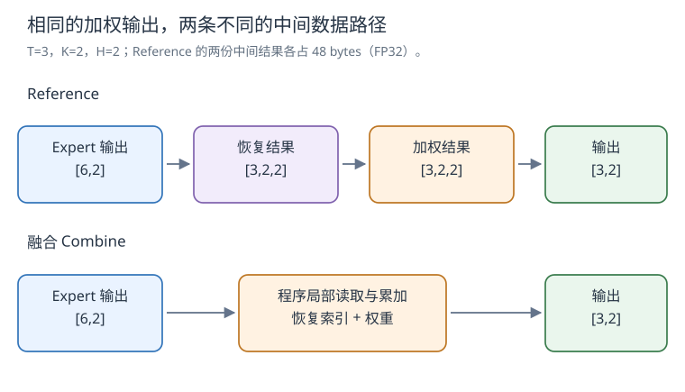

图 10-2：Reference 中间张量与融合程序局部累加的对照。

以处理 T0 的 program 为例，slot 0 读取行 4 的 `[3,6]` 与权重 0.25，局部累加器变为 `[0.75,1.5]`；slot 1 再读取行 0 的 `[1,2]` 与权重 0.75，累加器变为 `[1.5,3]`。

两列完成后只写出这一行。它与前面的加权公式计算相同结果，同时省去完整恢复 Tensor 与加权 Tensor 的显存中转。

## 10.4 融合 Kernel 与舍入语义

输入 Y 为连续 `[N×K,H]`、CUDA FP32/FP16/BF16，restore 为连续 `[N×K]`、CUDA int64，权重为与 Y 同行的连续浮点 Tensor。

三者位于同一 device。输出为连续 `[N,H]`，dtype 和 device 与 Y 相同。公开 wrapper 会对非连续输入建立连续副本，并支持 N=0；Kernel 支持 Top-1 和 Top-2。

二维 grid 的第一个维度选择 Token，第二个维度选择 H 维片段。每个程序用 `tl.static_range(TOP_K)` 展开固定分支数，读取 row、weight 与向量，累加到一段 FP32 局部向量，最后只写出一次结果。

**融合合并 · code/course10/mini_ep/kernels/combine_triton.py**

```python
from __future__ import annotations
import triton
import triton.language as tl

@triton.jit
def combine_kernel(
    Y,
    Restore,
    Weights,
    Out,
    H: tl.constexpr,
    TOP_K: tl.constexpr,
    BLOCK_H: tl.constexpr,
):
    # 每个 program 负责一个 Token 的一段输出列。
    token = tl.program_id(0)
    cols = tl.program_id(1) * BLOCK_H + tl.arange(0, BLOCK_H)
    acc = tl.zeros((BLOCK_H,), tl.float32)
    for slot in tl.static_range(TOP_K):
        # 原记录编号 q 通过 Restore 找到 Expert-major 行 p。
        packed_row = tl.load(Restore + token * TOP_K + slot)
        value = tl.load(Y + packed_row * H + cols, cols < H, other=0)
        weight = tl.load(Weights + packed_row).to(value.dtype)
        # 每个乘积先舍入到 Expert 输出 dtype，再提升为 FP32 累加。
        # Round each product to Expert-output dtype, like the Reference.
        product = (value.to(tl.float32) * weight.to(tl.float32)).to(value.dtype)
        acc = acc + product.to(tl.float32)
    # 只保存最终加权和；输出指针的 dtype 决定最终存储精度。
    tl.store(Out + token * H + cols, acc, cols < H)
```

**每个 program 持有一段最终输出**

```python
# 每个 program 负责一个原 Token 的连续特征片段，并创建 FP32 累加器。
token = tl.program_id(0)
cols = tl.program_id(1) * BLOCK_H + tl.arange(0, BLOCK_H)
acc = tl.zeros((BLOCK_H,), tl.float32)
```

第一维选择原 Token，第二维选择 H 的列片。acc 为长度 BLOCK_H 的 FP32 局部累加器，初值全零；此时尚未分配 [N,K,H] 的恢复结果或加权中间张量。

**逆排列同时定位分支结果与分支权重**

```python
# 用原 Token、slot 查询打包行，再在同一行读取输出与权重。
packed_row = tl.load(Restore + token * TOP_K + slot)
value = tl.load(Y + packed_row * H + cols, cols < H, other=0)
weight = tl.load(Weights + packed_row).to(value.dtype)
```

token×TOP_K+slot 是原始记录 q，Restore[q] 给出 Expert-major 行 p。Y+p×H+cols 读取该分支向量，Weights+p 读取与该行配对的标量权重。

一次权重加载广播到这个 program 处理的全部列。

**将低精度乘积的舍入保留在融合路径中**

```python
# 乘积先舍入到输入 dtype，再转回 FP32 累加，保留 Reference 精度边界。
product = (value.to(tl.float32) * weight.to(tl.float32)).to(value.dtype)
acc = acc + product.to(tl.float32)
```

weight 先转成 value.dtype，乘法以 FP32 计算后显式转回 value.dtype，复现 Reference 中低精度乘法张量的保存边界；

再提升为 FP32 加到 acc。Top-1/Top-2 的固定循环处理完所有分支后，acc 包含当前 Token 这些列的完整加权和。

**直接写回原始 Token 行**

```python
# 把累加结果写到原始 Token 行，只保留有效隐藏维坐标。
tl.store(Out + token * H + cols, acc, cols < H)
```

Out+token×H+cols 就是最终 [N,H] 布局的地址。mask 仅保留 cols<H，写入时按 Out 的元素类型转换；

输出 dtype 与 Expert 输出相同。每个 Token/列片只由一个 program 写入，最终一次 store 代替恢复、加权与求和之间的显存中转。

将地址式代入第二课的六行输出：T0 的 slot 0 由 Restore[0]=4 定位，slot 1 由 Restore[1]=0 定位。H=2 时，两次向量加载分别从 Y 的元素偏移 8 和 0 开始，读取 [3,6]、[1,2]；

标量权重分别来自 Weights[4]=0.25、Weights[0]=0.75。累加器最终为 [1.5,3]，写入 Out 的前两个元素。权重的下标随打包行变化，输出地址随原 Token 变化。

程序中还显式保留乘法舍入。Reference 先把权重转成 Y 的 dtype，乘法结果也以该 dtype 保存，随后求和。FP16/BF16 中，一个乘积落地到低精度 Tensor 时会舍入。

融合实现将权重转成 `value.dtype`，以 FP32 做乘法，再把乘积转回 `value.dtype`，然后提升为 FP32 累加，最终存回输出 dtype。wrapper 使用 `enable_fp_fusion=False`，让所写的运算边界保持可见。

两条分支可能在求和时相互抵消，因此各乘积先舍入还是先相加，会影响最终值。上述转换顺序保留了 Reference 的低精度乘积，再以 FP32 累加；最终按输出 dtype 保存。正确性对照使用各 dtype 的容差，同时检查值、shape、dtype 和 device。

## 10.5 局部计时与整层收益

Combine 的计时输入已经包含 Expert-major 输出、restore_index 和 packed 权重。Reference 与 Triton 使用同一份 Tensor，计时只覆盖公开 Combine 调用。

连续输入时，融合路径的非空计算由一次 CUDA Kernel launch 完成；必要的连续化属于完整调用，输入布局应在配置中写清楚。

基准在首次 JIT 与预热之后重复采样同一份 Expert 输出、逆排列和权重。CUDA Event 覆盖公开调用的当前流区间，独立 Profiler 统计 Kernel 数。前面的逻辑字节公式解释减少了哪些中间读写；具体延迟与有效读写率由样本给出，实际 HBM 流量可以结合设备计数器解释。

**Combine 基准 · test/demo.py**

```bash
cd code/course10
python3 test/demo.py --tokens 257 --hidden-size 128 \
  --num-experts 8 --top-k 2 --dtype float32 --warmup 5 --repeats 20 \
  --output results/lesson10-combine.json
```

配套测试覆盖原始记录与 Expert 行的排列关系、Top-1/Top-2、尾列、空 Token、非连续输入和三种 dtype。进入分布式前向时，通过 `run_ep_stages(..., combine_impl=combine_triton)` 替换最后一段 Combine；第一次计数交换与两次向量 A2A 保持相同次序。

优化价值还要连接整层占比。若 Combine 占原始整层延迟的 f，局部调用获得 s 倍加速，其他阶段保持相同，则整层加速模型为：

$$
S_{\rm layer}=\frac{1}{(1-f)+f/s}.
$$

取 f=0.1、s=2，整层时间系数为 0.95，加速约 1.053 倍。这一数值推导说明如何把局部变化放回第八课的时间分解。下一课继续处理另一类工作组织：多个 Expert 的 GEMM 有共同的 H、F，却有不同的行数，如何把它们的 tiles 放进同一次调度。

融合的数据路径与舍入边界，可结合 [AI Infra 的算子融合章节](https://github.com/bojieli/ai-infra-book/blob/main/manuscripts/05-算子与运行时.md) 阅读。

配套源码、运行依赖与各课入口见[课程首页](https://tvle9mq8jh.feishu.cn/wiki/QJp1wvBlgiiYV5kEOqFcpNtNnie)的源码附件；标题中的路径对应解压后的仓库相对路径。

---

# 第 11 课：Grouped GEMM——把不同大小的 Expert 矩阵放进同一次调度

本课独立源码位于 `code/course11/`，示例在 `test/`，正确性测试在 `checks/`。下文命令均在本课目录中执行；将整个目录复制到其他位置后也使用同样的启动方式。

第六课的 Expert 阶段逐个取出本地行，运行 MLP，再写回接收位置。假设四个本地 Expert 分别收到 `[64,17,103,8]` 行，Up Projection 的输入形状就是 `[64,H]`、`[17,H]`、`[103,H]`、`[8,H]`，四份权重都具有 `[F,H]` 的形状。矩阵行数不同，投影结构相同。

逐 Expert 调用为每份矩阵单独进入 GEMM 后端。另一种组织方式先列出这些矩阵需要的输出 tiles，将它们交给同一个 GPU grid。GPU 可以在一次 launch 中调度属于不同 Expert 的 tile，各 tile 仍读取自己的输入段和权重。

这就是 Grouped GEMM：一组独立矩阵乘法共用一次工作调度。

要把这些矩阵放进同一次调度，需要告诉每个程序实例：它负责哪个 Expert、从哪一行开始、读取哪份权重。下面先用 Expert Loop 定义计算结果，再用布局与 tile 表表达这份工作，最后接回完整 EP。

## 11.1 变长矩阵与权重布局

本 Rank 拥有 L=E/P 个 Expert。令 Mₑ 为本地 Expert e 的接收行数，R 为总接收记录数，则 `R=sum(Mₑ)`。计算输入先整理成 Expert-major `[R,H]`，第 e 个 Expert 的输入位于 `[offsets[e],offsets[e+1])`。

offsets 为 `[L+1]` 的 CUDA int64，首项为零，末项为 R。

Up 权重堆叠为 `[L,F,H]`，Down 权重为 `[L,H,F]`。它们沿用 `nn.Linear` 的保存布局：一个 `[N,K_gemm]` 权重在逻辑乘法中使用转置。Up 计算 `[Mₑ,H] @ [H,F]`，Down 计算 `[Mₑ,F] @ [F,H]`。

这里 K_gemm 表示本次 GEMM 的归约宽度，分别为 H 或 F；路由分支数仍记为 Top-K。

| 变量 | Shape | 连续布局与用途 |
| --- | --- | --- |
| `packed_tokens` | `[R,H]` | Expert-major，stride `(H,1)` |
| `up_weights` | `[L,F,H]` | Expert、输出特征、输入特征，stride `(F×H,H,1)` |
| `up_outputs` | `[R,F]` | 保持 Expert 行顺序 |
| `down_weights` | `[L,H,F]` | Expert、输出特征、中间特征，stride `(H×F,F,1)` |
| `outputs` | `[R,H]` | 与 packed_tokens 的记录顺序相同 |

所有 Tensor 位于同一 device，输入和权重使用相同 FP32、FP16 或 BF16 dtype。累加器为 FP32，输出存回输入 dtype。Expert 采用无偏置 GELU MLP，Reference 与 Grouped 路径都采用相同激活。

独立 Reference 按 Host 侧整数计数切出连续输入段，对每个非空 Expert 调用 PyTorch matmul。零行 Expert 保留零长度段并跳过矩阵调用，后面的 Expert 起点仍由累积行数决定。

**Expert 投影 · code/course11/mini_ep/kernels/grouped_gemm/reference.py**

```python
from __future__ import annotations
import torch
from mini_ep.kernels.grouped_gemm.reference import GroupedGemmPlan, validate_grouped_inputs

def expert_loop(
    x: torch.Tensor, weights: torch.Tensor, plan: GroupedGemmPlan
) -> torch.Tensor:
    """Independent Reference: [S,K] @ per-Expert [N,K].T -> [S,N]."""
    validate_grouped_inputs(x, weights, plan)
    out = torch.empty((x.shape[0], weights.shape[1]), device=x.device, dtype=x.dtype)
    start = 0
    # 每个 Expert 的真实 M 决定切片长度，权重使用该 Expert 自己的参数。
    for e, m in enumerate(plan.counts):
        if m:
            out[start : start + m] = x[start : start + m] @ weights[e].T
        start += m
    return out
```

**用真实行数切出独立矩阵**

```python
# 根据每个 Expert 的实际行数，切出其独立矩阵乘输入。
for e, m in enumerate(plan.counts):
    if m:
        out[start : start + m] = x[start : start + m] @ weights[e].T
    start += m
```

start 是当前 Expert 在连续输入中的起点。非空 Expert 使用 x[start:start+m] 与 weights[e].T 相乘，输出直接写回相同行段；

随后 start 增加真实 m。空 Expert 的 m=0，起点保持不变，输出仍以 Expert-major 排列。

`weights[e].T` 是转置视图，矩阵后端读取对应 stride；输入行保持连续。函数将每个结果写回自己的段，因此输出仍为 Expert-major `[R,N]`，N 是当前投影的输出宽度。它独立使用 PyTorch 运算，作为后续 Kernel 的数值与布局依据。

## 11.2 Loop、Batched 与 Grouped GEMM

对 `[64,17,103,8]`，有效输入共 192 行。逐 Expert GEMM 的调用边界与四个 M 对应。若采用统一 M 的 Batched GEMM，可以把每份输入补到最大行数 103，形成 `[4,103,H]`；

于是 412 行中有 220 行属于 padding。输出需要再按各 Expert 的真实 M 去掉补齐部分。

Grouped GEMM 接收不同 M 的矩阵，按每份输出的 tile 数建立调度。使用 BM=16，四个 Expert 在 M 维分别需要 `[4,2,7,1]` 个 tiles，共 14 个；

224 个 tile 行槽位对应 192 个有效行。边界 mask 决定哪些行读写真实数据，tile 内计算组织仍受分块尺寸影响。

| 组织 | 行数表示 | 调度边界 | 本例中的行容量 |
| --- | --- | --- | --- |
| Expert Loop | 每 Expert 一份真实 M | 分别调用 GEMM | 192 个有效行 |
| 等 M Batched GEMM | 四份补到最大 M | 统一 batch | 412 行 |
| 本课 Grouped GEMM | 真实 M 加输出 tile 表 | 一个 grid 覆盖全部 Expert | 224 个 tile 行槽位 |

这些容量描述计算组织。实际时间还经过 Tensor Core/SIMT 选择、权重读取、分块复用、尾块比例与 Kernel 提交，比较时保持输入、dtype、权重和计时区间一致。

```mermaid
flowchart LR
    E0[E0：64行，4个M tile] --> Q[统一tile队列]
    E1[E1：17行，2个M tile] --> Q
    E2[E2：103行，7个M tile] --> Q
    E3[E3：8行，1个M tile] --> Q
    Q --> G[一个grid调度所有Expert的输出片]
    G --> O[各tile写回自己的Expert区间]
```

图 11-1：不同 Expert 的输出 Tile 进入统一调度。

一次 launch 将各 Expert 的 tile 暴露给同一 GPU 调度器。较大的 Expert 贡献更多 tile，较小的 Expert 贡献较少 tile；设备按就绪工作分配资源。每个 tile 的权重和写入区间仍由所属 Expert 决定，矩阵间保持独立。

## 11.3 Tile 调度表

调度表显式记录每个 tile 所属的 Expert 与局部起始行。对每个 Expert e，沿 M 维生成 `0,16,32,...` 的 tile 起始行，保存到 `tile_rows`，同时在 `tile_experts` 保存 Expert 编号。

这两个等长的 CUDA int64 向量共有 Q 项；offsets 保存 Expert 输入段边界。

例如 counts=`[2,0,1,3]`、BM=16，offsets=`[0,2,2,3,6]`，三个非空 Expert 各贡献一个 tile：`tile_experts=[0,2,3]`，`tile_rows=[0,0,0]`。

Expert 1 的两个 offsets 相同，没有 tile。tile 1 指向 E2，它的全局输入行起点为 `offsets[2]+0=2`，有效末端为 offsets[3]=3。

`tile_rows` 保存相对于 Expert 段起点的行号。若某个 Expert 有 17 行，它贡献两个 tile，局部起点为 0 和 16。第二个 tile 的 16 个行槽位中只有第一行有效；Kernel 用这个 Expert 的末端 offset 屏蔽其余行。

回到开头的 `[64,17,103,8]`，E1 的全局输入段是 `[64:81]`。它的第一个 M Tile 从 `64+0` 开始，读取 `[64:80]`；第二个从 `64+16=80` 开始，只有行 80 落在 E1 的区间内。

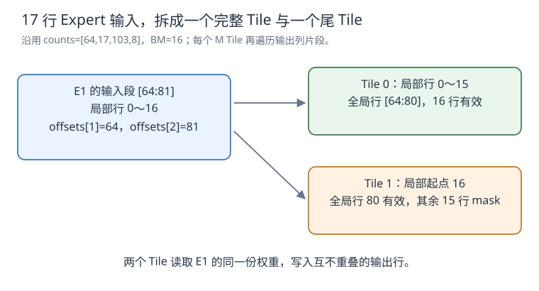

图 11-2：局部 Tile 起点与 Expert 全局行边界。

归约时，第二个 Tile 的无效输入行由 mask 填零；写回时也只保存有效行。两个 Tile 都使用 E1 的权重，输出列片段再由 grid 的第二维选择。这样，变长行数由 offsets 与边界条件表达，矩阵乘主体继续使用固定 BM、BN、BK。

**调度数据 · code/course11/mini_ep/kernels/grouped_gemm/reference.py**

```python
from __future__ import annotations
from dataclasses import dataclass
import torch

@dataclass(frozen=True)
class GroupedGemmPlan:
    # Host 保存真实行数，设备侧张量保存边界与 tile 映射。
    counts: tuple[int, ...]
    offsets: torch.Tensor
    tile_experts: torch.Tensor
    tile_rows: torch.Tensor
    block_m: int = 16
```

**一份计划分别服务 Host 与 GPU**

```python
# Host tuple 用于构建计划，GPU Tensor 供 Kernel 按 Expert 查询。
counts: tuple[int, ...]
offsets: torch.Tensor
tile_experts: torch.Tensor
tile_rows: torch.Tensor
block_m: int = 16
```

counts 是 Host 整数元组，Reference 用它确定 Python 切片。offsets 是 [L+1] device int64，tile_experts 与 tile_rows 是等长的 [Q] device int64；

它们让 GPU program 查到 Expert、全局段起点与段内 tile 行号。block_m=16 将构造计划的分块约定与 Kernel 的 BM 连接起来。

Host 侧 `counts` 保存各段的真实行数，Reference 用它进行 Python 切片；GPU offsets 和 tile 表供 Kernel 寻址。`block_m` 与 Kernel 的 M tile 大小一致。下面的构造函数创建这几组 metadata，输入为已知的非负整数行数与目标 device。

**Tile 计划 · code/course11/mini_ep/kernels/grouped_gemm/reference.py**

```python
from __future__ import annotations
from collections.abc import Sequence
import torch
from mini_ep.kernels.grouped_gemm.reference import GroupedGemmPlan

def create_grouped_plan(
    counts: Sequence[int], device, block_m: int = 16
) -> GroupedGemmPlan:
    """CPU counts [L] -> device int64 offsets [L+1] and tile maps [Q].

    Rows are contiguous Expert-major. Empty Experts generate no tiles. The
    plan is reusable while counts/order are fixed; construction is separate
    from GEMM execution. block_m is the kernel's output-row tile size.
    """
    if not counts or any(
        isinstance(c, bool) or not isinstance(c, int) or c < 0 for c in counts
    ):
        raise ValueError(
            f"counts must be a nonempty sequence of nonnegative integers, got {counts}"
        )
    if block_m != 16:
        raise ValueError(f"teaching kernel uses block_m=16, got {block_m}")
    # 真实行边界与 tile 任务表分别构造，padding 行不进入 offsets。
    offsets = [0]
    experts = []
    rows = []
    for e, m in enumerate(counts):
        offsets.append(offsets[-1] + m)
        for tile in range((m + block_m - 1) // block_m):
            experts.append(e)
            rows.append(tile * block_m)
    # 设备侧寻址使用 int64，Host 计数保留为不可变元组。
    tensor = lambda a: torch.tensor(a, dtype=torch.int64, device=device)
    return GroupedGemmPlan(
        tuple(counts), tensor(offsets), tensor(experts), tensor(rows), block_m
    )
```

**每个非空 Expert 贡献若干 M tile**

```python
# 非空 Expert 按 BM 行划分计算块，空 Expert 不生成 tile。
for e, m in enumerate(counts):
    offsets.append(offsets[-1] + m)
    for tile in range((m + block_m - 1) // block_m):
        experts.append(e)
        rows.append(tile * block_m)
```

offsets 累加真实行数，tile 数则为 ceil(m/block_m)。E1 有 17 行时，向 experts 添加两个 1，向 rows 添加 0 与 16。

前者确定使用哪份权重，后者确定从该 Expert 段内哪一行开始；m=0 时 range(0) 自动产生零个任务。

**把调度映射放到计算所在的 device**

```python
# 将调度表放到输入所在 device，以 int64 保存 Expert 和 tile 坐标。
tensor = lambda a: torch.tensor(a, dtype=torch.int64, device=device)
return GroupedGemmPlan(
    tuple(counts), tensor(offsets), tensor(experts), tensor(rows), block_m
)
```

offsets、Expert 编号与局部行号都转换为同一 device 的 int64 Tensor。counts 保留为 Host tuple，供 Reference 和计划说明使用；

GPU grid 的第一维长度来自 tile_experts 的元素数。当前计划可在行数、顺序与 BM 相同的重复计算中复用。

每个真实行属于唯一的 M tile；每个 M tile 又会在 grid 第二维遍历 N 维片段。因此输出中每个有效元素都有一个写入者，空 Expert 没有写入任务。路由计数变化后，重新构造计划；连续多次使用相同行分配时，可复用计划。

计划构造包括 Host 整数循环与 metadata 传输。微基准将其单独测量，GEMM 时间使用预先构造的同一份计划。完整接入 EP 的路径则包含当前批次的重排与计划准备，读性能结果时区分这两个边界。

## 11.4 分块寻址与归约

GEMM Kernel 的第一个 program 维度读取一个 M tile 的 Expert 编号和起始行；第二个维度选择输出特征片段。本实现固定 BM=16、BN=32、BK=32：每个程序计算最多 16×32 个输出元素，沿归约维每次读取 32 个元素。

对于 X 为 `[R,K_gemm]`、W 为 `[L,N,K_gemm]` 的连续布局，输入地址为 `row*K_gemm+k`，权重地址为 `expert*N*K_gemm+n*K_gemm+k`。从 W 读出的逻辑片段形状为 `[BK,BN]`，相当于读取保存矩阵的转置，实际权重保持原有 `[N,K_gemm]` 存储。

**分组矩阵乘 · code/course11/mini_ep/kernels/grouped_gemm/triton_impl.py**

```python
from __future__ import annotations
import triton
import triton.language as tl

@triton.jit
def grouped_gemm_kernel(
    X,
    W,
    Y,
    Offsets,
    TileExperts,
    TileRows,
    K: tl.constexpr,
    N: tl.constexpr,
    BM: tl.constexpr,
    BN: tl.constexpr,
    BK: tl.constexpr,
):
    # 第一维查询 M tile 的 Expert 与局部行起点，第二维覆盖输出列。
    tile = tl.program_id(0)
    expert = tl.load(TileExperts + tile)
    first = tl.load(Offsets + expert)
    end = tl.load(Offsets + expert + 1)
    rows = first + tl.load(TileRows + tile) + tl.arange(0, BM)
    cols = tl.program_id(1) * BN + tl.arange(0, BN)
    acc = tl.zeros((BM, BN), tl.float32)
    for block in range(tl.cdiv(K, BK)):
        ks = block * BK + tl.arange(0, BK)
        # 输入片 a 为 [BM,BK]，尾行和归约尾列填零。
        a = tl.load(
            X + rows[:, None] * K + ks[None, :],
            (rows[:, None] < end) & (ks[None, :] < K),
            other=0,
        )
        # W 保存为 [L,N,K]；地址广播表达其逻辑转置 [BK,BN]。
        # W is [L,N,K]; this address expresses its logical transpose.
        b = tl.load(
            W + expert * N * K + cols[None, :] * K + ks[:, None],
            (cols[None, :] < N) & (ks[:, None] < K),
            other=0,
        )
        acc += tl.dot(a, b, input_precision="ieee")
    # 输出恢复到 Expert-major [R,N]，只写当前 Expert 的有效行列。
    tl.store(
        Y + rows[:, None] * N + cols[None, :],
        acc,
        (rows[:, None] < end) & (cols[None, :] < N),
    )
```

**从 tile 表定位 Expert 的输出子矩阵**

```python
# 从 tile 调度表找到 Expert 和行块，再生成输出矩阵坐标。
tile = tl.program_id(0)
expert = tl.load(TileExperts + tile)
first = tl.load(Offsets + expert)
end = tl.load(Offsets + expert + 1)
rows = first + tl.load(TileRows + tile) + tl.arange(0, BM)
cols = tl.program_id(1) * BN + tl.arange(0, BN)
acc = tl.zeros((BM, BN), tl.float32)
```

tile 读取 tile_experts 和 tile_rows，first/end 给出 Expert 的全局行段。rows=first+局部起点+[0,…,BM−1]，cols 由 grid 第二维选择；

输出 tile 为 [BM,BN]。E1 段 [64,81) 的第二块从行 80 开始，rows<end 只允许第一行有效。

**加载输入矩阵的一个归约片段**

```python
# 按 [BM,BK] 的输入布局加载当前归约片段，越界元素补零。
a = tl.load(
    X + rows[:, None] * K + ks[None, :],
    (rows[:, None] < end) & (ks[None, :] < K),
    other=0,
)
```

rows[:,None] 与 ks[None,:] 广播成 [BM,BK] 地址矩阵。连续 X 的行 stride 为 K，列 stride 为 1。

当前 Expert 尾行与归约尾列共同参与 mask，无效位置补零，点积结果由有效输入决定。

**按权重转置的逻辑布局积累部分和**

```python
# 按转置后的逻辑布局加载权重，与输入片段点积并累加。
b = tl.load(
    W + expert * N * K + cols[None, :] * K + ks[:, None],
    (cols[None, :] < N) & (ks[:, None] < K),
    other=0,
)
acc += tl.dot(a, b, input_precision="ieee")
```

W 以 [L,N,K] 保存，expert×N×K 定位权重起点，cols×K 定位输出特征行，ks 定位输入特征。地址广播为 [BK,BN]，与 [BM,BK] 的 a 相乘。

每个归约块贡献 [BM,BN] 部分和，累加到 FP32 acc，直到完整 K 被覆盖。

**将有效 tile 写回连续 Expert 输出**

```python
# 将 FP32 部分和转换为输出 dtype，仅写有效 Expert 行和输出列。
tl.store(
    Y + rows[:, None] * N + cols[None, :],
    acc,
    (rows[:, None] < end) & (cols[None, :] < N),
)
```

Y+rows[:,None]×N+cols[None,:] 为 [R,N] 行主序输出的元素地址。mask 要求行位于当前 Expert 段内且列小于 N，既保护末行块也保护末列块。

acc 保存 FP32 累加值，store 按 Y 的 dtype 转换；每个有效元素由唯一的 M/N tile 写入。

把地址计算代入 E1 的第二个 M tile：Expert 段为 [64,81)，rows 从 80 开始，只有行 80 有效。取 K_gemm=64、BK=32，需要两轮归约；

第一轮读取特征 0～31，第二轮读取 32～63。每轮 a 中其余 15 行填零，b 的权重仍来自 E1；最终仅将这一条有效行写到 Y[80] 的对应列片。变长 M 的边界因此局限在加载与写回的 mask 中。

`input_precision="ieee"` 指定 FP32 输入的点积精度；基准同时关闭 PyTorch TF32，使 FP32 对照使用相同精度目标。FP16/BF16 输入采用对应低精度乘法与 FP32 累加。

CUDA 后端选择的具体指令和资源占用可以通过生成代码与 Nsight Compute 查看。[Triton 的矩阵乘法教程](https://triton-lang.org/main/getting-started/tutorials/03-matrix-multiplication.html)说明了分块和 K 维累加的基本结构。

这种显式 tile 表让数据依赖容易验证。Triton 官方的 [Group GEMM 教程](https://triton-lang.org/main/getting-started/tutorials/08-grouped-gemm.html)还展示了设备侧跨问题遍历与固定数量 program 的调度形式。显式 tile 表将每个 program 与一个输出 tile 对应起来；

设备侧遍历则让 program 连续领取多个任务。两种方式的调度成本与负载分配可以结合具体 shape 的 Profile 比较。

## 11.5 两次投影组成 Expert MLP

一轮 Up Projection 得到 `[R,F]`，GELU 逐元素处理这份 Tensor，Down Projection 把它变回 `[R,H]`。三个阶段保持同一个 Expert-major 行分配，因此可以共用 offsets 和 M tile 表；N、K_gemm 在第二次投影中交换为 H、F。

**分组 Expert MLP · code/course11/mini_ep/kernels/grouped_gemm/triton_impl.py**

```python
from __future__ import annotations
import torch
from mini_ep.kernels.grouped_gemm.reference import GroupedGemmPlan
from mini_ep.kernels.grouped_gemm.triton_impl import grouped_gemm

def grouped_expert_mlp(
    x: torch.Tensor,
    up_weights: torch.Tensor,
    down_weights: torch.Tensor,
    plan: GroupedGemmPlan,
) -> torch.Tensor:
    """Two grouped projections around the same GELU used by the Reference."""
    # Up 使用 [L,F,H] 权重，输出仍按 Expert-major 排列。
    hidden = grouped_gemm(x, up_weights, plan)
    activated = torch.nn.functional.gelu(hidden)
    # Down 使用 [L,H,F] 权重，恢复隐藏宽度 H。
    return grouped_gemm(activated.contiguous(), down_weights, plan)
```

**两次投影共享 Expert 行分配**

```python
# Up 和 Down 共用 Expert 行分组，激活保持这些行的顺序。
hidden = grouped_gemm(x, up_weights, plan)
activated = torch.nn.functional.gelu(hidden)
# Down 使用 [L,H,F] 权重，恢复隐藏宽度 H。
return grouped_gemm(activated.contiguous(), down_weights, plan)
```

Up 将 [R,H] 变为 [R,F]，GELU 保持每行位置，再由 Down 得到 [R,H]。两次 grouped_gemm 使用同一份 M tile 表，变化的是输出宽度 N 和归约宽度 K_gemm。

激活在 Up 输出 dtype 下保存，随后作为 Down 的连续输入。

每次分组投影都调用同一个 wrapper，wrapper 按当前输出宽度生成 N 维 grid。GELU 使用与 `expert_mlp_loop()` 相同的 PyTorch 运算，激活输入在 Up 输出 dtype 下保存。矩阵计算采用分组调度，激活函数及其舍入顺序与 Reference 一致。

逐 Expert MLP 的 Python 循环重复提交 Up、GELU、Down。Grouped 路径则先提交全组 Up，再一次处理全部激活，最后提交全组 Down。比较完整 MLP 时，除了 GEMM 调度，激活的工作组织也发生变化，所以基准同时提供 `--kind grouped` 的单投影结果与 `--kind mlp` 的整段结果。

两次 GEMM 的算术量约为 `4×R×H×F` FLOPs，单个投影为 `2×R×K_gemm×N`。将这个数量除以对应时间，可报告 GEMM FLOPs 口径的 TFLOPS；完整 MLP 时间还包含 GELU、调用和输出准备，字段名称应保留这一口径。

## 11.6 接收布局与计算布局

All-to-All 接收缓冲按来源 Rank 拼接，每个来源块内再按本地 Expert 排列。因此同一 Expert 的行可能分散在多个块中。第六课的 `layout.local_expert_index[e]` 已列出 Expert e 的全部接收行。

把这些索引按本地 Expert 顺序拼接成 `origin`，`recv_tokens.index_select(0,origin)` 就得到连续 Expert-major 输入。

假设收到八行，E0 索引为 `[0,1,3]`，E1 为 `[2,4,5,6,7]`，拼接后的来源行号为 `[0,1,3,2,4,5,6,7]`，counts 为 `[3,5]`，offsets 为 `[0,3,8]`。

```mermaid
flowchart LR
    R[接收：按来源Rank分块] --> I[拼接各本地Expert的行索引origin]
    I --> P[收集为连续Expert批次]
    P --> G[Grouped Up → GELU → Grouped Down]
    G --> U[index_copy按origin写回接收顺序]
    U --> A[原有recv_splits发起返回A2A]
```

图 11-3：按 Expert 收集计算后，恢复来源 Rank 的接收顺序。

Grouped MLP 的输出保持这份 Expert-major 顺序，用 `result.index_copy_(0,origin,computed)` 写回原接收位置。返回 A2A 继续按照原来的来源块 splits 发送，来源 Rank 才能用自己的 Rank 逆排列与 restore_index 找到输出。

这里新增的 origin 负责本地计算重排，与来源侧两个恢复索引分别对应不同布局。

这次重排可以按一条具体行来读：`origin=[0,1,3,2,4,5,6,7]` 中，第 2 项是 3。因此 `packed_tokens[2]` 来自接收行 3，Grouped MLP 的 `computed[2]` 也属于接收行 3。

写回 `result[3]=computed[2]` 后，结果重新落入来源 Rank 1 的块内。

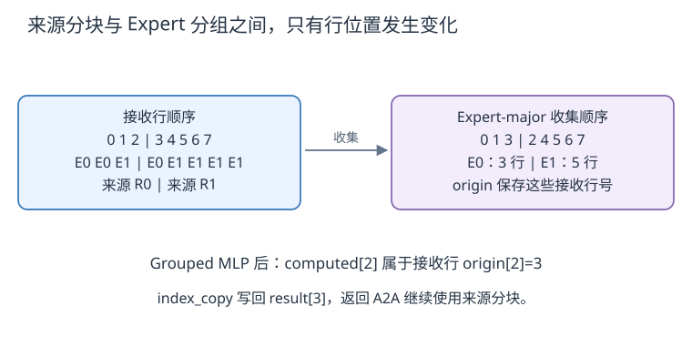

图 11-4：本地 Expert 分组计算前后的行排列。

其余行沿同一份 origin 回到各自位置。收集与写回两端共享索引，所以 Expert 计算可以使用连续批次，通信继续使用来源分块；每条记录的来源身份随这份索引保留。

**本地分组计算 · code/course11/mini_ep/kernels/grouped_gemm/triton_impl.py**

```python
from __future__ import annotations
import torch
from mini_ep.kernels.grouped_gemm.triton_impl import grouped_expert_mlp

def compute_grouped_local_experts(
    model, recv_tokens: torch.Tensor, layout
) -> torch.Tensor:
    """Pack source-major receive rows, execute grouped MLP, restore receive order.

    Layout indices cover recv_tokens [R,H] once. Up/down weights are stacked
    as [L,F,H]/[L,H,F]. This full teaching path includes packing, schedule and
    weight preparation; the microbenchmark times GEMM with a prepared plan.
    """
    from mini_ep.kernels.grouped_gemm.reference import (
        pack_local_experts,
        create_grouped_plan,
    )

    if any(
        expert.activation_name != "gelu" or expert.use_bias for expert in model.experts
    ):
        raise ValueError("grouped teaching path expects bias-free GELU Experts")
    # 将来源分块布局收集为 Expert-major，同时保留原接收行号。
    packed, origin, counts = pack_local_experts(recv_tokens, layout.local_expert_index)
    plan = create_grouped_plan(counts, recv_tokens.device)
    # 按本地 Expert 编号堆叠权重，固定推理参数可在准备阶段缓存。
    up = torch.stack([expert.up_proj.weight for expert in model.experts]).contiguous()
    down = torch.stack(
        [expert.down_proj.weight for expert in model.experts]
    ).contiguous()
    computed = grouped_expert_mlp(packed, up, down, plan)
    result = torch.empty_like(recv_tokens)
    # 结果回到原接收行，恢复返回 A2A 所需的来源块。
    result.index_copy_(0, origin, computed)
    return result
```

**为分散的接收行建立连续计算布局**

```python
# 把分散接收行收集为连续 Expert 批次，并保存每行原接收位置。
packed, origin, counts = pack_local_experts(recv_tokens, layout.local_expert_index)
plan = create_grouped_plan(counts, recv_tokens.device)
```

pack_local_experts 按本地 Expert 顺序拼接 layout 的行索引，再收集 recv_tokens。packed 是 Expert-major [R,H]，origin[j] 表示 packed 第 j 行来自原接收行几；

counts 决定每个 Expert 的真实 M，再用于构造 GPU tile 计划。

**将独立模块参数整理为分组权重**

```python
# 将独立 Expert 模块的两组权重堆叠成分组 GEMM 使用的连续张量。
up = torch.stack([expert.up_proj.weight for expert in model.experts]).contiguous()
down = torch.stack(
    [expert.down_proj.weight for expert in model.experts]
).contiguous()
computed = grouped_expert_mlp(packed, up, down, plan)
```

各 Expert 的 up_proj.weight 与 down_proj.weight 按本地编号堆叠，分别形成连续 [L,F,H] 与 [L,H,F]。

Grouped MLP 在同一 Expert 行段上使用这两份参数，computed 保持 packed 的行序。该教学调用包含参数堆叠与计划构造，完整 EP 比较按这个边界计时。

**恢复接收布局以后再返回来源**

```python
# 先散射回原接收位置，再按来源块执行返回通信。
result = torch.empty_like(recv_tokens)
# 结果回到原接收行，恢复返回 A2A 所需的来源块。
result.index_copy_(0, origin, computed)
```

origin 在收集时表示读取的接收行，写回时表示结果的目标行。因此 result[origin[j]]=computed[j]。

例如 origin[2]=3，第三条分组结果写回接收行 3；来源块重新连续，返回 A2A 继续使用原 recv_splits。

`compute_grouped_local_experts()` 串联收集接收行、构造计划、堆叠本地权重、执行 MLP 和写回。权重读取自当前 Rank 的 Expert 模块，本地编号与其在 `model.experts` 中的位置一致。

输入为 `[R,H]`，输出恢复为相同 shape、dtype、device 和接收行顺序。

固定推理权重可预先整理到 `[L,F,H]` 和 `[L,H,F]` 缓冲；动态 counts 则跟随每批路由生成。将这些准备工作分清楚，才有依据决定该缓存什么、在哪个阶段准备，以及哪部分耗时进入完整前向。

## 11.7 比较投影、MLP 与完整 EP

单卡微基准先用 Reference 的 Dispatch 生成变长 Expert 批次，保持 packed 输入、权重、dtype 和 counts 相同。Reference 与 Grouped 先完成数值对照，再触发首次编译、预热与 CUDA Event 测量；

计划构造时间另列。微基准使用前面定义的固定 tile 配置；改变 H、F、counts 或 dtype 后，可以继续比较分块尺寸对吞吐和尾块开销的影响。

**Expert 计算基准 · test/demo.py**

```bash
cd code/course11
python3 test/demo.py --kind grouped --tokens 257 \
  --hidden-size 128 --num-experts 8 --top-k 2 --dtype float32 \
  --warmup 5 --repeats 20 --output results/lesson11-projection.json
python3 test/demo.py --kind mlp --tokens 257 \
  --hidden-size 128 --num-experts 8 --top-k 2 --dtype float32 \
  --warmup 5 --repeats 20 --output results/lesson11-mlp.json
```

报告将同口径的局部时间、Kernel 数、GEMM FLOPs、计划准备和 Expert 行数放在一起。多个小矩阵时可以观察提交与 tile 调度，大矩阵时可以进一步分析算术吞吐、访存和分块复用。边界测试还覆盖非整齐 H/F、单行 Expert、空 Expert、全部零行和三种 dtype。

分布式配套入口对照 PyTorch、仅 Triton Dispatch、仅融合 Combine、仅 Grouped Expert，以及三项组合。它在相同 gate 与 Expert 权重上执行真实 NCCL 通信，比较各 Rank 的本地输出和关键计数；支持 EP=1/2/4。下面选择两张 GPU：

**完整 EP 对照 · test/grouped_ep.py**

```bash
NCCL_NVLS_ENABLE=0 torchrun --standalone --nproc-per-node=2 \
  test/grouped_ep.py --output-dir results/ep-variants
```

完整前向保留同一组参数所有权、collective 次序和输出归属。Dispatch、Combine 与 Grouped Expert 可以分别替换，也可以组合，Reference 持续提供逐阶段与最终输出的数学依据。

到这里，单阶段内部的数据组织已清楚：第十二课转向阶段之间的交接，以显式 Peer 写入、就绪计数和轮次信号连接输入搬运、分组投影、结果回传与合并。

配套源码、运行依赖与各课入口见[课程首页](https://tvle9mq8jh.feishu.cn/wiki/QJp1wvBlgiiYV5kEOqFcpNtNnie)的源码附件；标题中的路径对应解压后的仓库相对路径。

---

# 第 12 课：Triton 分离执行——从 Token 通信到 Expert 计算

本课独立源码位于 `code/course12/`，示例在 `test/`，正确性测试在 `checks/`。下文命令均在本课目录中执行；将整个目录复制到其他位置后也使用同样的启动方式。

两张 GPU 各自持有一半 Expert。Rank 0 上的 Token A 选择 Expert 0 和 Expert 2：第一条分支留在本地，第二条分支送到 Rank 1。

两边算完后，Rank 1 把结果送回 Rank 0，再按 0.25 和 0.75 的权重合并。即使每个 Expert 都只是两次矩阵乘，这次前向仍要解决三个问题：怎样追踪 A 的两条分支，怎样确认远端写入已经可读，以及怎样在下一轮安全地复用同一块显存。

本课围绕这个例子，实现一条 **Triton 分离执行**路径：输入发送、Expert 计算、结果回传和加权合并由独立的 GPU 内核（Kernel）承担，同一 Rank 按 CUDA 流的顺序提交它们。

通信通过单机 GPU 之间的对等显存访问（Peer Memory）完成；跨 GPU 的数据交接由设备侧信号连接。数学结果、Token 身份和 Expert 归属沿用 Pure Expert Parallel（纯专家并行，EP）的定义。

前十一课已经建立稳定 Dispatch、两次 All-to-All、恢复与 Combine，以及变长 Expert 的分组计算。本课继续沿这条数据流，先用小规模 PyTorch Reference 定义输出与精度，再把通信缓冲区换成可由对端 GPU 写入的映射显存，逐一建立数据地址、就绪时刻和复用边界。

基础 NCCL 前向位于 [model/moe.py](https://gitee.com/hellofss/miniep1/blob/master/code/course12/mini_ep/model/moe.py)；本课路径位于 [kernels/comm_compute/triton_peer.py](https://gitee.com/hellofss/miniep1/blob/master/code/course12/mini_ep/kernels/comm_compute/triton_peer.py)，入口为 `TritonPeerSeparated`。

## 12.1 从两条路由分支到完整输出

沿用前面的 Top-K 路由定义，`expert_ids[t,j]` 是 Token t 的第 j 条分支选择的全局 Expert ID，`weights[t,j]` 是合并权重。

每个 Token 产生 K 条记录；一条记录贯穿输入打包、目标 Expert 计算和返回合并。下面先让所有参数留在同一个设备，明确这份记录最终应贡献什么数值。

把 Token 看成 H 维特征向量，N 个 Token 排成 `x[N,H]`。每个 Expert 是一个无偏置的两层多层感知机（MLP）：先用 Up 投影把 H 维映射到 F 维，再做 GELU 激活，最后用 Down 投影回到 H 维。对分配给 Expert e 的 `n_e` 行输入，有：

$$
Z_e=\operatorname{GELU}(X_eW_{\mathrm{up},e}^{T}),\qquad Y_e=Z_eW_{\mathrm{down},e}^{T}.
$$

$X_e$、$Z_e$、$Y_e$ 的形状依次为 `[n_e,H]`、`[n_e,F]`、`[n_e,H]`；两组权重分别为 `[F,H]` 和 `[H,F]`。这里 GELU 采用 $\operatorname{GELU}(z)=\frac12z(1+\operatorname{erf}(z/\sqrt2))$。

原始 Token t 的输出由它的 K 条分支加权得到：

$$
y_t=\sum_{j=0}^{K-1}w_{t,j}Y_{e_{t,j}}(x_t).
$$

### 12.1.1 用 Reference 固定计算语义

先把全部 Expert 权重放在一个设备上。下面的完整示例沿 Expert 遍历路由，收集输入、计算 MLP，再把结果累加到原始 Token 位置。`expert_ids` 使用 int64，数据和路由权重使用 FP32，所有张量在 CPU 上，数据按行连续存储；

把输入与权重迁移到同一个 CUDA device 后，索引关系保持一致。

**PyTorch Reference · 全部 Expert 位于同一设备**

```python
import torch
import torch.nn.functional as functional

# 四个 Token、四个 Expert；这个 FP32 示例可直接在 CPU 上运行。
torch.manual_seed(12)
n, h, f, e = 4, 8, 16, 4
x = torch.randn(n, h)
expert_ids = torch.tensor([[0, 2], [3, 0], [2, 1], [1, 3]])
weights = torch.tensor([[0.25, 0.75]]).expand(n, 2).contiguous()
up = torch.randn(e, f, h) / h**0.5
down = torch.randn(e, h, f) / f**0.5
output = torch.zeros(n, h, dtype=torch.float32)

# 按 Expert 找到分支并收集输入。
for expert in range(e):
    token, slot = torch.where(expert_ids == expert)
    selected = x.index_select(0, token)       # [n_e,H]
    # 在收集后的行上计算两层 MLP。
    projected = selected @ up[expert].T      # [n_e,F]
    activation = functional.gelu(projected, approximate="none")
    branch_output = activation @ down[expert].T  # [n_e,H]
    # 把分支加权后累加回 Token。
    weighted = branch_output.float() * weights[token, slot, None]
    output.index_add_(0, token, weighted)     # 同一 Token 的分支累加

assert output.shape == (n, h)
assert output.dtype == torch.float32
assert output.device == x.device
```

**按 Expert 找到分支并收集输入**

```python
# 找出当前 Expert 的全部 Token、slot 坐标，并收集对应输入行。
for expert in range(e):
    token, slot = torch.where(expert_ids == expert)
    selected = x.index_select(0, token)       # [n_e,H]
```

torch.where 返回 token 与 slot 两组 int64 索引，它们共同标识原始 [N,K] 路由中的位置。index_select 沿 x 的第 0 维取行，得到 [n_e,H]；

Top-2 中同一个 Token 可以被两个 Expert 分别收集。没有分支的 Expert 得到 [0,H]，其余代码沿用相同形状规则。

**在收集后的行上计算两层 MLP**

```python
# Up、精确 GELU 和 Down 保持同一批分支行的顺序。
projected = selected @ up[expert].T      # [n_e,F]
activation = functional.gelu(projected, approximate="none")
branch_output = activation @ down[expert].T  # [n_e,H]
```

selected @ up[expert].T 将 [n_e,H] 乘 [H,F]，得到 [n_e,F]。GELU 逐元素作用在该矩阵上；

再乘 [F,H] 的 Down 权重，恢复为 [n_e,H]。三步都保留第 0 维的行顺序，所以第 r 行输出仍属于 token[r] 指定的原始 Token。

**把分支加权后累加回 Token**

```python
# 每条分支乘以自己的路由权重，再累加回原 Token 行。
weighted = branch_output.float() * weights[token, slot, None]
output.index_add_(0, token, weighted)     # 同一 Token 的分支累加
```

weights[token,slot,None] 从 [N,K] 中取每条分支的权重，并添加长度为 1 的列维，形成 [n_e,1]，与 [n_e,H] 广播相乘。

index_add_ 沿 output 的行维累加：多个 Expert 指向同一 Token 时，各条分支进入同一行。output 的形状保持 [N,H]，这一步同时完成顺序恢复和 Top-K reduction。

这份 Reference 将分支输出转为 FP32，再乘 FP32 路由权重并累加到 FP32 output。第十课的 combine_triton() 复现低精度乘积和低精度输出；

本课的 Peer Combine 则保留 FP32 加权结果。两条优化路径各自对照相同 dtype 边界的 Reference，完整结果都按原始 Token 行排列。

FP32 Reference 用来检查数学与索引。后续 FP16 路径还有明确的舍入位置：Up 矩阵乘输出为 FP16，GELU 后的激活为 FP16，Down 输出为 FP16，最后转 FP32 加权求和。

做精度对齐时，Reference 也采用这些 dtype 边界；Triton 的矩阵乘在内核中使用 FP32 累加。

### 12.1.2 计算怎样分到两张 GPU

设两张 GPU 对应 Rank 0、1，分别持有 Expert 0、1 和 Expert 2、3。A 的 Expert 0 分支在 Rank 0 计算，Expert 2 分支在 Rank 1 计算，两个结果最后回到 Rank 0。

输入分发（Dispatch）负责把每条分支交给对应 Expert，结果合并（Combine）负责恢复 Token 顺序并加权求和。

CUDA 流（CUDA Stream）是一串按提交顺序执行的 GPU 工作。本课路径通常提交七个 Kernel：开始信号、输入发送、Up 与 GELU、Down、结果回传、完成信号和 Combine。图中实线表示同一 Rank 的流内顺序，虚线表示来自其他 Rank 的依赖。

```mermaid
flowchart LR
    S[开始信号] --> I[输入发送]
    I --> U[Up 投影与 GELU]
    U --> D[Down 投影]
    D --> R[结果回传]
    R --> F[完成信号]
    F --> C[加权合并]
    T[远端输入就绪] -.-> U
    V[远端结果完成] -.-> C
```

图 12-1：同一 Stream 上的七个执行阶段，虚线表示跨 Rank 的数据依赖。

通信与矩阵乘各自拥有独立的 Kernel 边界。Up 投影与逐元素 GELU 放在同一个 Kernel 内，直接消费矩阵乘结果；Combine 把索引恢复、权重乘法和 Top-K 求和放在一起。这样，阶段间通过完整张量交接，阶段内仍可以复用已经读入或算出的局部数据。

NCCL 基础实现用两次 All-to-All 完成同样的往返：第一次把分支送到 Expert 所在 Rank，第二次把输出送回源 Rank。本课的 Peer 路径由源 GPU 内核直接写目标 GPU 的映射缓冲区，准备阶段仍使用 NCCL 交换计数。后文依次说明这条路径中数据的地址与可读时刻。

## 12.2 Token 的身份与排列

### 12.2.1 从路由分支到 Expert 顺序

设每个 Rank 有四个 Token，采用 Top-2 路由。用大写字母表示 Rank 0 的 Token，小写字母表示 Rank 1 的 Token：

| 源 Rank | Token | 选择的 Expert | 分支顺序 |
| --- | --- | --- | --- |
| 0 | A、B、C、D | A→0、2；B→3、0；C→2、1；D→1、3 | 每个 Token 的 slot 0 在前，slot 1 在后 |
| 1 | a、b、c、d | a→2、0；b→1、3；c→0、2；d→3、1 | 与 Rank 0 使用相同规则 |

路由张量 `expert_ids[N,K]` 按 Token、槽位顺序展平，第 `t*K+j` 项标识 Token t 的第 j 条分支。Rank 0 的展平 ID 为 `[0,2,3,0,2,1,1,3]`，稳定排序得到分支编号 `[0,3,5,6,1,4,2,7]`。

分支编号除以 K 可找回输入 Token；按此读取 x 后，四个 Expert 依次得到 `[A,B]`、`[C,D]`、`[A,C]`、`[B,D]`。

源 Rank 为每个 Expert 预留 $C=NK$ 行，以容纳倾斜路由。这个例子中 C=8，`packed` 的形状为 `[4,8,H]`，每段前两行有效。展平前两维后，Expert e 内第 r 行的行号是 `e*C+r`。恢复索引 `restore[t,j]` 保存每条原始分支的这个行号：

$$
\mathrm{restore}=\begin{bmatrix}0&16\\24&1\\17&8\\9&25\end{bmatrix}.
$$

下面把上述排序和行号写成可运行的 PyTorch 代码，接续 12.1 节的示例。`packed` 的有效行复制输入，`restore` 记录反向寻址；padding 行保留分配空间，后续只访问计数标明的有效行。

**Expert 分段与 restore · 接续 PyTorch Reference**

```python
# 接续前面的 Reference，建立源 Rank 的固定容量布局。
k = expert_ids.shape[1]
capacity = n * k
# 给展开后的分支排序。
ids = expert_ids.flatten()
order = torch.argsort(ids, stable=True)
counts = torch.bincount(ids, minlength=e)
packed = torch.empty(e, capacity, h, dtype=x.dtype, device=x.device)
restore = torch.empty_like(ids)
position = 0
# 把数据地址和恢复地址一起建立。
for expert, count in enumerate(counts.tolist()):
    selected = order[position:position + count]
    packed[expert, :count] = x[selected // k]
    restore[selected] = expert * capacity + torch.arange(count, device=x.device)
    position += count
# 用恢复索引检验 Top-K 展开。
restore = restore.reshape(n, k)
assert restore.tolist() == [[0, 16], [24, 1], [17, 8], [9, 25]]
restored_input = packed.reshape(e * capacity, h)[restore]
torch.testing.assert_close(restored_input, x[:, None, :].expand(n, k, h))
```

**给展开后的分支排序**

```python
# 将 [N,K] 分支展开后稳定排序，获得 Expert 分组的来源记录。
ids = expert_ids.flatten()
order = torch.argsort(ids, stable=True)
counts = torch.bincount(ids, minlength=e)
```

flatten 得到长度 N*K 的 Expert ID 向量。稳定排序 order 保存的是原始分支编号，排序后相同 Expert 的分支连续排列，同 Expert 内保留原始先后顺序。

counts[e] 给出源 Rank 发给 Expert e 的有效行数，总和为 N*K。

**把数据地址和恢复地址一起建立**

```python
# 逐 Expert 建立数据所在位置与返回位置的对应关系。
for expert, count in enumerate(counts.tolist()):
    selected = order[position:position + count]
    packed[expert, :count] = x[selected // k]
    restore[selected] = expert * capacity + torch.arange(count, device=x.device)
    position += count
```

position 指向排序结果中当前 Expert 段的起点，selected 是该段的原始分支编号。selected//k 把分支编号映射回 Token 编号，因此 packed[expert,:count] 写入正确的输入行。

restore[selected] 在原始分支位置记录 expert*capacity+段内行号：数据按 Expert 写入，恢复地址按原始分支保存。

**用恢复索引检验 Top-K 展开**

```python
# 将逆排列还原为 [N,K]，逐 Token 检查各 slot 的记录身份。
restore = restore.reshape(n, k)
assert restore.tolist() == [[0, 16], [24, 1], [17, 8], [9, 25]]
restored_input = packed.reshape(e * capacity, h)[restore]
torch.testing.assert_close(restored_input, x[:, None, :].expand(n, k, h))
```

reshape 把一维 restore 变回 [N,K]。packed 展平前两维后，使用 restore 高级索引，结果为 [N,K,H]。

它应等于 x 的每行沿 Top-K 维复制 K 次；assert_close 检查的是具体输入值，同时验证了每个恢复地址确实指向对应 Token 的分支。

restore 在源端以原始分支编号为下标保存。目标端计算期间，源端无需修改它；结果回传只需将每条分支写入最初约定的 returned 行。最后再按 restore 读取，便把计算结果接到原路由表上。这里的身份映射与第二课相同，地址增加了每个 Expert 固定容量段的起点。

A 的两个分支位于第 0 行和第 16 行。计算完成后，结果会回到源 GPU 的这两个位置，Combine 按相同索引取回它们。

```mermaid
flowchart LR
    A[Rank 0 的 Token A] --> E0[Rank 0：Expert 0]
    A --> E2[Rank 1：Expert 2]
    E0 --> R0[Rank 0 returned 第 0 行]
    E2 --> R16[Rank 0 returned 第 16 行]
    R0 --> W[按 0.25 和 0.75 加权]
    R16 --> W
    W --> O[Rank 0 输出 Token A]
```

图 12-2：Token A 的两条分支在不同 GPU 上计算，结果回到源 Rank 后合并。

### 12.2.2 从源 Rank 顺序到本地 Expert 行

令 EP 大小为 P，总 Expert 数为 E。均匀放置要求 $E\bmod P=0$，每个 Rank 持有 $Q=E/P$ 个 Expert。全局 Expert e 的目标 Rank 为 `e//Q`，本地编号为 `e%Q`；

Rank r 持有编号 `[r*Q,(r+1)*Q)` 的 Expert。本实现把 WORLD 用作 EP 进程组，global rank 与 EP rank 相同，world size 与 EP size 都是 P；

local rank 表示本机进程编号，用于绑定 CUDA device。单机运行时一个进程对应一张 GPU。

用 $a_{s,e}$ 表示源 Rank s 发给 Expert e 的分支行数。目标端为每个本地 Expert 按源 Rank 拼接，因此源 s 的这一段从 $d_{s,e}=\sum_{u<s}a_{u,e}$ 行开始，Expert 总行数是 $n_e=\sum_sa_{s,e}$。

这个前缀和既确定远端写入地址，也让不同源的写入范围互不重叠。

目标 Rank 为每个本地 Expert 分配连续行，依次放入来自 Rank 0、1、…、$P-1$ 的 Token。小例子中的 Rank 1、本地 Expert 0 就是全局 Expert 2，它收到的顺序为 `[A,C,a,c]`。

这四行的 `sources` 是 `[0,0,1,1]`，`offsets` 是 `[16,17,16,17]`。回传时，前两行写入 Rank 0 的 `returned`，后两行写入 Rank 1 的 `returned`；相同 offset 属于不同 GPU 的缓冲区。

```mermaid
flowchart LR
    R0[Rank 0：Expert 2 段 A C] --> L[Rank 1：本地 Expert 0 输入 A C a c]
    R1[Rank 1：Expert 2 段 a c] --> L
    L --> G[Expert 2 的两次矩阵乘]
    G --> B0[Rank 0 returned：行 16 17]
    G --> B1[Rank 1 returned：行 16 17]
```

图 12-3：本地 Expert 输入按源 Rank 拼接；sources 与 offsets 保存回程地址。

### 12.2.3 前向过程中使用的张量

接收容量 M 取所有 Expert 的最大有效行数，至少为 1，再向上取整到 BM 的倍数：$M=B_M\left\lceil\max(1,\max_e n_e)/B_M\right\rceil$。

BM 是一个输入行块的高度，下一节会用它划分就绪信号。`rows[q]` 保存本地 Expert q 的有效行数；M 是分配容量。下表的数据张量与内部 metadata 均在当前 Rank 绑定的 CUDA device 上，采用连续布局，最后一维连续。

| 张量 | Shape 与 dtype | 含义与顺序 |
| --- | --- | --- |
| `x` | `[N,H]`，FP16 | 原始 Token 顺序 |
| `expert_ids` / `weights` | `[N,K]`，int64 / FP32 | 每个 Token 的 Expert ID 与对应路由权重 |
| `up` / `down` | `[Q,F,H]` / `[Q,H,F]`，FP16 | 当前 Rank 持有的本地 Expert 权重 |
| `packed` / `returned` | `[E,C,H]`，FP16 | 源 Rank 的 Expert 分段输入与分支结果，均支持 Peer 访问 |
| `local_inputs` | `[Q,M,H]`，FP16 | 目标 Rank 上的本地 Expert 顺序，每个 Expert 内按源 Rank 拼接 |
| `activation` | `[Q,M,F]`，FP16 | Up 投影和 GELU 的输出 |
| `local_outputs` | `[Q,M,H]`，FP16 | Down 投影输出，随后回传到源 Rank |
| `rows` | `[Q]`，int32 | 本地 Expert 的有效行数，决定读写 mask |
| `sources` / `offsets` | `[Q,M]`，int32 | 每行结果的源 EP rank，以及源 `returned` 展平后的行号 |
| `restore` | `[N,K]`，int64 | 原始分支到 `returned` 行号的映射 |
| `output` | `[N,H]`，FP32 | 按原始 Token 顺序排列的加权结果 |

输入排列发生两次变化：准备阶段从 Token/slot 顺序变为源 Rank 的 Expert 分段顺序；发送阶段把各源的 Expert 段拼到目标 Rank 的本地 Expert 行中。

结果回传利用 `sources`、`offsets` 恢复源端的分支位置，最后由 `restore` 恢复原始 Token 顺序。GEMM 自身只沿行计算，保留输入行与输出行的一一对应关系。

### 12.2.4 准备阶段怎样获得全局行数

对象构造先对本地展平 Expert ID 做 `bincount`，得到 CUDA int64 `counts[E]`。每个目标 Rank 对应连续的 Q 个计数，因此一次等长 `all_to_all_single(received, counts)` 就能交换计数；

发送缓冲区每个目标块含 Q 个 int64 元素。接收结果重排为 `[P,Q]`，第 s 行是源 Rank s 发给本 Rank 各 Expert 的行数。沿源维求和得到 `rows`，再对最大值做 `all_reduce(MAX)`，统一 M。

随后 `all_gather` 收集各源的计数向量，得到 `[P,E]`，沿源维计算前缀和。这里通信的内容是分支计数，Token 数据仍由 Peer 写入传送。缓冲区通过 `torch.distributed._symmetric_memory.empty` 分配，再对 WORLD 做 `rendezvous` 建立各进程可用的 Peer 映射。

准备中的 collective 和映射操作由全部 Rank 按相同顺序参与，对象构造结束后才进入重复前向。

固定容量使地址在多轮调用中保持稳定，也带来显存成本。FP16 的 `packed` 与 `returned` 每 Rank 合计占 $4ECH$ 字节，另外还需要本地输入、激活和输出。只有计数以内的有效行参与搬运与计算。路由变化会改变这些计数、前缀和与恢复索引，因此需要重新准备对象。

## 12.3 输入发送与 Tile 就绪

### 12.3.1 把远端写入拆成互不重叠的片段

直接写 Peer Memory，需要知道一段 Token 从哪里读、发给谁、写到哪里。`segments` 是形状为 `[L,4]` 的 CUDA int32 张量，每行包含 `expert`、`src`、`count`、`dst`：全局 Expert ID、源 Expert 段内起始行、有效行数，以及目标本地 Expert 内的起始行。这三个行相关字段都以 Token 行为单位。

一次输入矩阵乘读取 BM 行，这块输入称为一个行 Tile。准备阶段在目标 Tile 边界处切分每个源段，使一个片段只写一个目标 Tile。若 BM=128，某 Tile 的前 70 行来自 Rank 0、后 58 行来自 Rank 1，就产生两个片段。

每个片段再沿 Hidden 维切成 `COPY_N` 列的块，一个 Triton program 搬运一个列块。program 是网格中的一个执行实例，对应协作处理一块数据的线程块。

发送需要两张 CUDA uint64 `[P]` 指针表：`local_ptrs` 指向各 Rank 的 `local_inputs`，`ready_ptrs` 指向各 Rank 的就绪计数器。

指针值来自对称内存映射句柄，是当前进程可访问的地址；各进程的虚拟地址可以不同。下面的 Kernel 从源 `packed[E,C,H]` 读取 FP16，写到目标 `local_inputs[Q,M,H]`，然后发布这一列块的完成状态。

**输入发送 · code/course12/mini_ep/kernels/comm_compute/triton_peer.py**

```python
@triton.jit
def peer_input_push_kernel(
    Input,
    LocalPtrs,
    ReadyPtrs,
    Segments,
    H: tl.constexpr,
    M: tl.constexpr,
    Q: tl.constexpr,
    C: tl.constexpr,
    BM: tl.constexpr,
    COPY_N: tl.constexpr,
    SIGNAL: tl.constexpr,
):
    # 一个片段只覆盖一个目标行 Tile，沿 H 维分块发送。
    # 从一个 program 编号找到片段和列块。
    nt: tl.constexpr = tl.cdiv(H, COPY_N)
    task = tl.program_id(0)
    seg = task // nt
    expert = tl.load(Segments + seg * 4)
    src = tl.load(Segments + seg * 4 + 1)
    count = tl.load(Segments + seg * 4 + 2)
    dst = tl.load(Segments + seg * 4 + 3)
    # 生成 Tile 坐标并定位目标 GPU。
    rows = tl.arange(0, BM)
    cols = task % nt * COPY_N + tl.arange(0, COPY_N)
    peer = expert // Q
    remote = tl.multiple_of(tl.load(LocalPtrs + peer), 16).to(tl.pointer_type(tl.float16))
    # 按二维地址搬运一块数据。
    v = tl.load(
        Input + (expert * C + src + rows[:, None]) * H + cols[None, :],
        (rows[:, None] < count) & (cols[None, :] < H),
        0,
    )
    tl.store(
        remote + ((expert % Q) * M + dst + rows[:, None]) * H + cols[None, :],
        v,
        (rows[:, None] < count) & (cols[None, :] < H),
    )
    # 数据写入完成后，向目标 GPU 发布本列块的就绪状态。
    # 发布目标输入 Tile 的完成计数。
    if SIGNAL:
        tl.debug_barrier()
        ready = tl.load(ReadyPtrs + peer).to(tl.pointer_type(tl.int32))
        tl.atomic_add(
            ready + (expert % Q) * tl.cdiv(M, BM) + dst // BM, 1, sem="release", scope="sys"
        )
```

**从一个 program 编号找到片段和列块**

```python
# 把一维 program 编号拆成通信片段编号和隐藏维列块编号。
nt: tl.constexpr = tl.cdiv(H, COPY_N)
task = tl.program_id(0)
seg = task // nt
expert = tl.load(Segments + seg * 4)
src = tl.load(Segments + seg * 4 + 1)
count = tl.load(Segments + seg * 4 + 2)
dst = tl.load(Segments + seg * 4 + 3)
```

nt=ceil(H/COPY_N) 是每个源片段的列块数。task//nt 选择 segments 的一行，读取全局 Expert、源段起点 src、有效行数 count 和目标段起点 dst；

task%nt 则选择这个片段的第几个列块。一个片段由 nt 个 program 协作搬完，每个 program 写入互不重叠的列。

**生成 Tile 坐标并定位目标 GPU**

```python
# 生成行列坐标，并从指针表选择目标 GPU 的输入缓冲区。
rows = tl.arange(0, BM)
cols = task % nt * COPY_N + tl.arange(0, COPY_N)
peer = expert // Q
remote = tl.multiple_of(tl.load(LocalPtrs + peer), 16).to(tl.pointer_type(tl.float16))
```

rows 是长度 BM 的片段内行坐标，cols 是长度 COPY_N 的全局 Hidden 列坐标。expert//Q 决定目标 Rank，LocalPtrs[peer] 提供该进程可用的远端映射地址；

转换为 FP16 指针后，后续指针加法的单位是一个 FP16 元素。multiple_of 向编译器声明地址对齐信息，地址来自已建立的映射。

**按二维地址搬运一块数据**

```python
# 按源、目标二维地址搬运数据，行列 mask 只保留有效元素。
v = tl.load(
    Input + (expert * C + src + rows[:, None]) * H + cols[None, :],
    (rows[:, None] < count) & (cols[None, :] < H),
    0,
)
tl.store(
    remote + ((expert % Q) * M + dst + rows[:, None]) * H + cols[None, :],
    v,
    (rows[:, None] < count) & (cols[None, :] < H),
)
```

rows[:,None] 与 cols[None,:] 广播出 [BM,COPY_N] 地址网格。源地址先选择 Expert 段 expert*C，再加 src 和片段内行号；

目标地址先选择本地 Expert expert%Q，再加 dst 和行号。相同的 mask 只读写 count 行、H 列以内的位置，tl.load 的第三个参数 0 让无效位置得到零，tl.store 的 mask 则跳过对应写入。

**发布目标输入 Tile 的完成计数**

```python
# 完成本块输入写入后，向目标行块的就绪计数器发布贡献。
if SIGNAL:
    tl.debug_barrier()
    ready = tl.load(ReadyPtrs + peer).to(tl.pointer_type(tl.int32))
    tl.atomic_add(
        ready + (expert % Q) * tl.cdiv(M, BM) + dst // BM, 1, sem="release", scope="sys"
    )
```

该片段属于目标行 Tile dst//BM，计数器下标由本地 Expert 和这个行 Tile 共同确定。线程块内写入汇合后，对远端计数器执行 system scope 的 release 加一；

一次增加表示一个列块搬运完成。目标 Up program 等到本轮所有片段的列块都发布，才读取这块输入。

片段沿目标输入 Tile 边界切开，因此同一个 program 的所有有效行都发布到同一个就绪计数器。每个片段只覆盖一个来源对某个 Expert 的贡献，源内起点 src 与目标内起点 dst 可以不同。`H`idden 维的多个列 program 共同补齐这个片段，列块的发布次数再参与目标 Tile 的总阈值。

例如小例子里 Rank 0 的 Expert 2 段可以表示为 `(2,0,2,0)`，Rank 1 的对应段为 `(2,0,2,2)`。前者从源第 16 行读取，后者也从各自源缓冲区的第 16 行读取；

两者写入 Rank 1 本地 Expert 0 的第 0、2 行，拼成 `[A,C,a,c]`。这些公式中的偏移以 FP16 元素为单位，换算字节地址时每个元素占 2 字节。

写入数据与发布计数构成一次生产者交接。`tl.debug_barrier()` 先让当前线程块中参与写入的线程汇合；随后 `release` 原子操作在 system scope（`sys`）发布完成。

消费端用同一 system scope 的 `acquire` 等待计数，从而建立跨 GPU 的写入与读取顺序。这个协议要求 Peer 映射支持跨 GPU 原子访问。

### 12.3.2 从完成计数到可读输入

`tile_ready` 是展平存储的 int32 计数器，逻辑形状为 `[Q,ceil(M/BM)]`。`expected` 具有相同逻辑形状和 dtype，记录每轮填充该 Tile 所需的列块发布次数。一个 Tile 每与一个源段相交，就增加 `ceil(H/COPY_N)` 次；因此阈值同时覆盖源段数和 Hidden 维列块数。

以 `H=4096`、`COPY_N=256` 为例，一段输入需要 16 个列块。整个 Tile 来自一个源片段时，`expected=16`；70 行与 58 行分属两个源片段时，两个片段各有 16 个列块，`expected=32`。计数达到目标值，说明该 Tile 的所有有效行、所有列都已经写入。

```mermaid
sequenceDiagram
    participant S0 as 源 Rank 0
    participant S1 as 源 Rank 1
    participant T as 目标输入 Tile
    participant U as 目标 Up Kernel
    S0->>T: 写入前 70 行的 16 个列块
    S0->>T: 每个列块 release 计数加一
    S1->>T: 写入后 58 行的 16 个列块
    S1->>T: 每个列块 release 计数加一
    U->>T: acquire 等待计数达到 epoch × 32
    T-->>U: 完整输入可读
    U->>U: 执行本 Tile 的矩阵乘
```

图 12-4：两个源片段共同填满一个输入 Tile，完成计数连接发送与矩阵乘。

计数器在多次前向之间累加，用递增的 `epoch` 区分轮次。若每轮需要 32 次发布，第 1 轮等待 32，第 2 轮等待 64。固定路由使每轮片段与阈值保持一致；开始信号又约束各 Rank 的轮次进度，缓冲区的完整生命周期将在 12.6 节说明。

本 Rank 的输入发送结束后，流才执行本 Rank 的 Up Kernel。此时其他 Rank 可能还在发送，每个 Up program 便等待自己负责的输入 Tile。

流内顺序连接本 Rank 的阶段，Tile 计数连接跨 Rank 的生产者与消费者。同一 GPU 的输入发送与 Up 按顺序执行；不同 GPU 可以处于不同阶段。

## 12.4 本地 Expert 的分组矩阵乘

### 12.4.1 三维网格对应三个计算坐标

第十一课用 tile_experts、tile_rows 显式列出变长矩阵的工作。本课为每个本地 Expert 分配相同容量 M，以三维网格直接表达 Expert、行块和列块：`program_id(0)` 选择本地 Expert，`program_id(1)` 选择行 Tile，`program_id(2)` 选择列 Tile。

有效行数仍由 rows 提供，每个 program 维护 `[BM,BN]` FP32 累加器，沿输入特征维以 BK 为步长完成点积。

先沿用四 Token 的例子：Rank 1 的 Expert 2 输入为 `[A,C,a,c]`，Up 后仍是这四行，只把每行宽度从 H 改成 F，Down 后恢复为 H。扩大到四张 GPU、16 个 Expert、每 Rank 1024 个 Token、Top-2 严格均匀路由时，每个 Expert 得到 `4*1024*2/16=512` 行。

此时 Q=4、M=512，取 H=4096、F=14336，Up 矩阵乘为 `[512,4096] @ [4096,14336]`，Down 为 `[512,14336] @ [14336,4096]`。

取 BM=128、BN=256、BK=64，Up 网格为 `[4,4,56]`，Down 网格为 `[4,4,16]`。Up 每个 program 沿输入维执行 64 次分块累加，Down 执行 224 次。

Expert 的行数通过 `rows` 单独提供：空 Expert 的 program 跳过计算，尾部不足 BM 行时只写有效行。网格中的 program 可以分批调度，每个 program 只等待自己的输入 Tile。

### 12.4.2 Tensor Descriptor 与精度边界

实现使用 Hopper 的 TMA（Tensor Memory Accelerator，张量内存搬运单元）加载矩阵 Tile。`TensorDescriptor` 描述张量的基地址、形状、步长和块大小，让 Triton 按二维 Tile 读取数据。

输入描述符把 `[Q,M,H]` 看作 `[Q*M,H]`，权重描述符把 `[Q,F,H]` 看作 `[Q*F,H]`，再根据 Expert 编号加上相应的行偏移。

Up 的输入块形状为 `[BM,BK]`，权重块形状为 `[BN,BK]`，转置权重块后完成 `[BM,BK] @ [BK,BN]`。Down 对 `activation` 与 `down` 使用相同的地址组织。

`fence.proxy.async.global` 连接普通全局内存写入与 TMA 的异步读取路径，位于输入就绪之后、描述符加载之前。

描述符看到的是容量矩阵，因此读取尾部 Tile 时可能覆盖有效行以外的 padding。每个输出行只依赖对应输入行，写回 mask 只保留 `row<count` 的行；沿输入维跨过 H 或 F 的边界由描述符加载处理。Kernel 参数中的 `X`、`W` 保留接口中的张量语义，实际读取地址由 `ADesc`、`BDesc` 提供。

**分组投影 · code/course12/mini_ep/kernels/comm_compute/triton_peer.py**

```python
@triton.jit
def grouped_projection_kernel(
    X,
    W,
    Y,
    Rows,
    Ready,
    Expected,
    ADesc,
    BDesc,
    epoch,
    IN: tl.constexpr,
    OUT: tl.constexpr,
    M: tl.constexpr,
    BM: tl.constexpr,
    BN: tl.constexpr,
    BK: tl.constexpr,
    GELU: tl.constexpr,
    WAIT: tl.constexpr,
):
    """Independent local-memory grouped GEMM with the same precision boundaries."""
    # 网格三维分别选择 Expert、输出行 Tile、输出列 Tile。
    # 把网格坐标变成输出矩阵坐标。
    expert = tl.program_id(0)
    row = tl.program_id(1) * BM + tl.arange(0, BM)
    col = tl.program_id(2) * BN + tl.arange(0, BN)
    count = tl.load(Rows + expert)
    # 等待当前行块的输入完整到达。
    if tl.program_id(1) * BM < count:
        # Up 等远端输入；Down 的输入由前一个 Kernel 生产。
        if WAIT:
            tile = expert * tl.cdiv(M, BM) + tl.program_id(1)
            expected = tl.load(Expected + tile)
            _wait(Ready + tile, epoch * expected, True)
        # 连接普通显存写入与 TMA 读取。
        tl.inline_asm_elementwise(
            "fence.proxy.async.global; mov.u32 $0, 0;",
            "=r",
            [],
            dtype=tl.int32,
            is_pure=False,
            pack=1,
        )
        # 沿输入特征维积累一个输出 Tile。
        acc = tl.zeros((BM, BN), tl.float32)
        for step in range(tl.cdiv(IN, BK)):
            ks = step * BK + tl.arange(0, BK)
            a = ADesc.load([expert * M + tl.program_id(1) * BM, step * BK])
            b = BDesc.load([expert * OUT + tl.program_id(2) * BN, step * BK]).T
            acc = tl.dot(a, b, acc)
        # 把已完成的列块拆成两半。
        if GELU:
            left, right = tl.split(tl.reshape(acc, (BM, 2, BN // 2)).permute(0, 2, 1))
            half_col = tl.program_id(2) * BN + tl.arange(0, BN // 2)
            # 先保留舍入位置，再激活并写前半列。
            v = left.to(tl.float16).to(tl.float32)
            value = (0.5 * v * (1.0 + libdevice.erf(v * 0.7071067811865475))).to(tl.float16)
            tl.store(
                Y + (expert * M + row[:, None]) * OUT + half_col[None, :],
                value,
                (row[:, None] < count) & (half_col[None, :] < OUT),
            )
            # 把后半列放回相邻输出位置。
            v = right.to(tl.float16).to(tl.float32)
            value = (0.5 * v * (1.0 + libdevice.erf(v * 0.7071067811865475))).to(tl.float16)
            tl.store(
                Y + (expert * M + row[:, None]) * OUT + half_col[None, :] + BN // 2,
                value,
                (row[:, None] < count) & (half_col[None, :] + BN // 2 < OUT),
            )
        else:
            # Down 怎样把累加结果写回 Y。
            tl.store(
                Y + (expert * M + row[:, None]) * OUT + col[None, :],
                acc.to(tl.float16),
                (row[:, None] < count) & (col[None, :] < OUT),
            )
```

**把网格坐标变成输出矩阵坐标**

```python
# 三维 grid 依次选择 Expert、输出行块和输出列块。
expert = tl.program_id(0)
row = tl.program_id(1) * BM + tl.arange(0, BM)
col = tl.program_id(2) * BN + tl.arange(0, BN)
count = tl.load(Rows + expert)
```

三个 program_id 分别选择 Expert、行块和列块。row 为长度 BM 的行向量，col 为长度 BN 的列向量；两者决定此 program 负责的 [BM,BN] 输出区域。

count 从 Rows 读出该 Expert 的有效行数；只有行块起点小于 count 才进入计算，因此空 Expert 和容量范围中完全无效的行块会被跳过。

**等待当前行块的输入完整到达**

```python
# 有效行块先等待本轮计数阈值，Up 的输入到齐后才开始读取。
if tl.program_id(1) * BM < count:
    # Up 等远端输入；Down 的输入由前一个 Kernel 生产。
    if WAIT:
        tile = expert * tl.cdiv(M, BM) + tl.program_id(1)
        expected = tl.load(Expected + tile)
        _wait(Ready + tile, epoch * expected, True)
```

tile=expert*ceil(M/BM)+program_id(1) 将“Expert、行块”变成计数器下标。Expected[tile] 是这一行块每轮的发布次数，epoch*expected 是当前轮的累计阈值。

同一行块的所有输出列块共用输入，所以它们等待同一个计数器。Up 设置 WAIT=True；Down 的输入来自同流前一个 Up Kernel，设置 WAIT=False。

**连接普通显存写入与 TMA 读取**

```python
# 在就绪等待后建立普通全局访问与 TMA 异步访问之间的代理顺序。
tl.inline_asm_elementwise(
    "fence.proxy.async.global; mov.u32 $0, 0;",
    "=r",
    [],
    dtype=tl.int32,
    is_pure=False,
    pack=1,
)
```

远端输入由普通全局存储写入，描述符加载使用 TMA 的异步访问路径。fence.proxy.async.global 为这两种内存访问路径建立所需的代理顺序，放在输入就绪等待之后、描述符读取之前。

后面的 mov.u32 给这段内联汇编提供一个 int32 返回值；is_pure=False 表示该汇编具有内存顺序副作用。Tile 信号和这条 fence 分别处理跨 GPU 的发布依赖与访问代理的衔接。

**沿输入特征维积累一个输出 Tile**

```python
# 沿 IN 维按 BK 分块加载输入和权重，并用 FP32 累积点积。
acc = tl.zeros((BM, BN), tl.float32)
for step in range(tl.cdiv(IN, BK)):
    ks = step * BK + tl.arange(0, BK)
    a = ADesc.load([expert * M + tl.program_id(1) * BM, step * BK])
    b = BDesc.load([expert * OUT + tl.program_id(2) * BN, step * BK]).T
    acc = tl.dot(a, b, acc)
```

acc 是 [BM,BN] 的 FP32 部分和。每次 step 处理 BK 个输入特征：ADesc 读取 [BM,BK]，BDesc 读取 [BN,BK] 后转置为 [BK,BN]，tl.dot 完成这两个块的矩阵乘并累加到 acc。

描述符把 Expert 维与行维展平，所以输入起始行是 expert*M+行块起点，权重起始行是 expert*OUT+列块起点。

IN 决定循环次数；全部 step 完成后，每个输出值才得到完整点积。ks 在当前实现中生成分块特征坐标，实际加载直接使用 step*BK 的描述符偏移。

**把已完成的列块拆成两半**

```python
# 将列块拆为前后两半；拆分只改变临时组织，写回列位置保持相邻。
if GELU:
    left, right = tl.split(tl.reshape(acc, (BM, 2, BN // 2)).permute(0, 2, 1))
    half_col = tl.program_id(2) * BN + tl.arange(0, BN // 2)
```

Up 的 acc 先从 [BM,BN] reshape 为 [BM,2,BN/2]，再 permute 成 [BM,BN/2,2]，split 沿最后一个二元素维拆出 left 和 right。

left 对应列块的前半列，right 对应后半列；两者都是 [BM,BN/2]。half_col 给出前半列的全局列号，后半列在此基础上加 BN/2。

拆分改变临时张量的组织，最终写回仍是连续的 OUT 列。

**先保留舍入位置，再激活并写前半列**

```python
# 先保留 Up 输出的 FP16 舍入，再计算 GELU 并写出前半列。
v = left.to(tl.float16).to(tl.float32)
value = (0.5 * v * (1.0 + libdevice.erf(v * 0.7071067811865475))).to(tl.float16)
tl.store(
    Y + (expert * M + row[:, None]) * OUT + half_col[None, :],
    value,
    (row[:, None] < count) & (half_col[None, :] < OUT),
)
```

left 先转 FP16，再转回 FP32，明确保留 Up 矩阵乘输出的 FP16 舍入。随后按精确 GELU 的 erf 公式计算，结果再存为 FP16。

Y 的地址由 expert*M、row 与 half_col 组成，mask 只保留有效 Token 行和有效输出列。每个 program 写出自己负责的前半列，与其他 program 的输出区域互不重叠。

**把后半列放回相邻输出位置**

```python
# 后半列使用相同舍入与 GELU，存储列坐标额外增加 BN/2。
v = right.to(tl.float16).to(tl.float32)
value = (0.5 * v * (1.0 + libdevice.erf(v * 0.7071067811865475))).to(tl.float16)
tl.store(
    Y + (expert * M + row[:, None]) * OUT + half_col[None, :] + BN // 2,
    value,
    (row[:, None] < count) & (half_col[None, :] + BN // 2 < OUT),
)
```

right 使用同样的 FP16 舍入与 GELU 计算，写回列号增加 BN/2。对 BN=256 的列块，前一次存储负责 0～127 列，这次负责 128～255 列；

其他列块加上各自列起点。两次写入共同产生同一个 [BM,BN] 激活 Tile，后续 Down 按普通连续布局读取。

**Down 怎样把累加结果写回 Y**

```python
# 按 [Expert,M,OUT] 行主序计算地址，将 FP32 累加结果转为 FP16 写回。
tl.store(
    # [BM,1] 行坐标与 [1,BN] 列坐标广播为 [BM,BN] 元素地址。
    Y + (expert * M + row[:, None]) * OUT + col[None, :],
    # FP32 累加值按输出缓冲区的 FP16 dtype 舍入。
    acc.to(tl.float16),
    # 容量 M 中未使用的行与超过 OUT 的列不写入。
    (row[:, None] < count) & (col[None, :] < OUT),
)
```

这是 GELU=False 分支的输出。Y 的逻辑形状为 [Q,M,OUT]：expert*M+row 先选该 Expert 的行，乘 OUT 移到这一行的起始元素，再加 col 得到列地址。

row[:,None] 与 col[None,:] 广播出 [BM,BN] 地址矩阵，acc.to(tl.float16) 把 FP32 累加结果转换为 FP16。

mask 同时检查 row<count 和 col<OUT，只写有效行列。以 expert=1、M=512、OUT=4096、row=128、col=256 为例，写入元素编号为 (512+128)*4096+256=2621696；

它对应 Y[1,128,256]。这一步不改变 Token 行顺序，写出的 local_outputs 接下来交给结果回传。

`IN`、`OUT` 分别代表当前投影的输入维与输出维：Up 取 `H,F`，Down 取 `F,H`。Up 设置 `WAIT=True`，在读输入前等待 Tile；Down 设置 `WAIT=False`，它的完整输入由前一个 Up Kernel 的完成来保证。两个投影都以 FP32 累加，再在存储时转换为 FP16。

Up 在激活前先把 FP32 累加值转成 FP16，再转回 FP32 计算 GELU，最后写出 FP16。这个舍入点对应 Reference 中 FP16 矩阵乘的输出；

Down 同样把 FP32 累加值存为 FP16。代码把列块拆成左右两半分别计算 GELU，两半写入相邻列，输出布局保持连续。数值格式与舍入位置在算子融合后仍保持一致。

`compute()` 接收已经准备好的工作区，通过两个网格依次提交 Up、Down。第一组描述符对应输入与 Up 权重，第二组对应激活与 Down 权重。下面展示类中的方法摘录，完整定义和导入见本课源码。

`activation[Q,M,F]` 是两个 Kernel 间的完整中间张量，`local_outputs[Q,M,H]` 是回传 Kernel 的输入。

**Expert 计算 · code/course12/mini_ep/kernels/comm_compute/triton_peer.py**

```python
class TritonPeerSeparated(TritonPeerMLP):
    def compute(self, wait: bool = False) -> torch.Tensor:
        """Two local TMA GEMMs; wait=True acquires the distributed input tiles."""
        # Up 的启动参数怎样对应张量布局。
        grouped_projection_kernel[
            (self.q, triton.cdiv(self.m, self.bm), triton.cdiv(self.f, self.bn))
        ](
            self.local_inputs,
            self.up,
            self.activation,
            self.rows,
            self.tile_ready,
            self.expected,
            *self.descriptors[:2],
            self.epoch,
            self.h,
            self.f,
            self.m,
            self.bm,
            self.bn,
            self.bk,
            True,
            wait,
            num_warps=self.warps,
            num_stages=self.stages,
        )
        # Down 复用行布局并恢复 Hidden 宽度。
        grouped_projection_kernel[
            (self.q, triton.cdiv(self.m, self.bm), triton.cdiv(self.h, self.bn))
        ](
            self.activation,
            self.down,
            self.local_outputs,
            self.rows,
            self.tile_ready,
            self.expected,
            *self.descriptors[2:],
            self.epoch,
            self.f,
            self.h,
            self.m,
            self.bm,
            self.bn,
            self.bk,
            False,
            False,
            num_warps=self.warps,
            num_stages=self.stages,
        )
        return self.local_outputs
```

**Up 的启动参数怎样对应张量布局**

```python
# Up 使用 H→F 的描述符和网格，并按 wait 参数等待输入 Tile。
grouped_projection_kernel[
    (self.q, triton.cdiv(self.m, self.bm), triton.cdiv(self.f, self.bn))
](
    self.local_inputs,
    self.up,
    self.activation,
    self.rows,
    self.tile_ready,
    self.expected,
    *self.descriptors[:2],
    self.epoch,
    self.h,
    self.f,
    self.m,
    self.bm,
    self.bn,
    self.bk,
    True,
    wait,
    num_warps=self.warps,
    num_stages=self.stages,
)
```

第一组三维网格分别覆盖 Q 个本地 Expert、ceil(M/BM) 个行块和 ceil(F/BN) 个输出列块。local_inputs、up、activation 分别承担输入、权重和输出，descriptors[:2] 提供两份读取描述符；

IN=H、OUT=F。末尾 True 和 wait 分别开启 GELU、控制输入等待，完整 run() 传入 wait=True。

**Down 复用行布局并恢复 Hidden 宽度**

```python
# Down 使用 F→H 的网格，沿用 Expert 行布局并读取前一个 Kernel 的激活。
grouped_projection_kernel[
    (self.q, triton.cdiv(self.m, self.bm), triton.cdiv(self.h, self.bn))
](
    self.activation,
    self.down,
    self.local_outputs,
    self.rows,
    self.tile_ready,
    self.expected,
    *self.descriptors[2:],
    self.epoch,
    self.f,
    self.h,
    self.m,
    self.bm,
    self.bn,
    self.bk,
    False,
    False,
    num_warps=self.warps,
    num_stages=self.stages,
)
```

第二组网格的列块数换成 ceil(H/BN)，输入换成 activation，权重换成 down，输出换成 local_outputs；

IN=F、OUT=H。两个 False 分别关闭 GELU 和设备侧输入等待。Up 与 Down 提交到同一 CUDA 流，Down 开始时完整 activation 已经生成。

方法返回 local_outputs 的张量句柄，后续 push() 在同一流中读取它。

输入、激活和输出的前两维始终表示“本地 Expert、该 Expert 的接收行”。GEMM 改变每行的特征宽度，保留行身份；`sources` 与 `offsets` 因而可以跨过两次投影，直接用于结果回传。

## 12.5 结果回传与加权合并

### 12.5.1 按来源把每行送回

Down 完成后，`local_outputs[Q,M,H]` 仍按本地 Expert 和源 Rank 拼接的行顺序排列。回传 Kernel 遍历它的有效元素，根据 `sources[q,r]` 找源 GPU，再根据 `offsets[q,r]` 找源 `returned` 的行。

每条分支具有唯一回程位置，因此普通写入即可放回分支结果；Top-K 求和留给源端 Combine。

**结果回传 · code/course12/mini_ep/kernels/comm_compute/triton_peer.py**

```python
@triton.jit
def peer_copy_kernel(
    PeerPtrs,
    Local,
    Sources,
    Offsets,
    Rows,
    H: tl.constexpr,
    M: tl.constexpr,
    Q: tl.constexpr,
    PUSH: tl.constexpr,
    BLOCK: tl.constexpr,
):
    # 把连续元素编号还原成本地 Expert 和行列。
    idx = tl.program_id(0) * BLOCK + tl.arange(0, BLOCK)
    row, col = idx // H, idx % H
    expert = row // M
    count = tl.load(Rows + expert, expert < Q, 0)
    mask = (expert < Q) & (row % M < count)
    # metadata 同时确定结果所属 GPU 和源端分支位置。
    # 根据每行 metadata 找回源地址。
    source = tl.load(Sources + row, mask, 0)
    offset = tl.load(Offsets + row, mask, 0)
    peer = tl.multiple_of(tl.load(PeerPtrs + source), 16).to(tl.pointer_type(tl.float16))
    # 把有效结果元素写回源 GPU。
    if PUSH:
        v = tl.load(Local + idx, mask, 0)
        tl.store(peer + offset * H + col, v, mask)
    else:
        v = tl.load(peer + offset * H + col, mask, 0, cache_modifier=".cg")
        tl.store(Local + idx, v, mask)
```

**把连续元素编号还原成本地 Expert 和行列**

```python
# 将连续元素编号分解为本地 Expert、Expert 内行号和隐藏维列号。
idx = tl.program_id(0) * BLOCK + tl.arange(0, BLOCK)
row, col = idx // H, idx % H
expert = row // M
count = tl.load(Rows + expert, expert < Q, 0)
mask = (expert < Q) & (row % M < count)
```

每个 program 遍历 BLOCK 个连续元素。idx//H 得到展平行号，idx%H 得到列号，再用 row//M 找本地 Expert。

Rows 给出有效行数，mask 检查 Expert 未超出 Q 且 Expert 内行号小于 count。容量中的 padding 行及最后一个 program 的越界元素都被 mask 排除。

**根据每行 metadata 找回源地址**

```python
# 从行 metadata 读取源 Rank 与源端记录位置，确定结果回传地址。
source = tl.load(Sources + row, mask, 0)
offset = tl.load(Offsets + row, mask, 0)
peer = tl.multiple_of(tl.load(PeerPtrs + source), 16).to(tl.pointer_type(tl.float16))
```

Sources 与 Offsets 的逻辑形状都是 [Q,M]，用展平 row 索引得到源 Rank 和源 returned 的展平行号。

PeerPtrs[source] 指向该源 Rank 的映射缓冲区；offset 的单位是 Token 行，乘 H 后才成为元素偏移。

同一行的全部 Hidden 列共享这两个 metadata。

**把有效结果元素写回源 GPU**

```python
# 只将有效结果元素写到该分支所属源 GPU 的返回缓冲区。
if PUSH:
    v = tl.load(Local + idx, mask, 0)
    tl.store(peer + offset * H + col, v, mask)
else:
    v = tl.load(peer + offset * H + col, mask, 0, cache_modifier=".cg")
    tl.store(Local + idx, v, mask)
```

PUSH=True 从本地 Local 读取 FP16 结果，写到 peer+offset*H+col，保留源端预先建立的分支位置。

PUSH=False 反向读取 Peer 数据并放到 Local，供独立搬运诊断使用。两个方向都使用同一 mask。回传本身没有加权或求和，每条分支先独立保存，随后完成信号通知 Combine 可以读取。

在完整前向中，`push()` 以 `PUSH=True` 调用上述 Kernel：`PeerPtrs` 指向各源 Rank 的 `returned`，`Local` 指向本地 Down 输出。

`idx` 是元素编号，除以 H 得到展平行号，再除以 M 得到本地 Expert；`offset*H+col` 把源行号还原为元素地址。BLOCK=8192 表示每个 program 处理的元素数。

`PUSH=False` 用于从固定的源输入读取数据的独立诊断。

`rows` 生成有效行 mask，保留容量中的 padding 行不会被回传。回到小例子，Rank 1 上 Expert 2 的输出依次对应 `[A,C,a,c]`：前两行写 Rank 0 的第 16、17 行，后两行写 Rank 1 的第 16、17 行。

### 12.5.2 在源 Rank 恢复 Token 输出

源 Rank 读结果之前，要等所有参与 Rank 完成回传。每个 Rank 在回传 Kernel 结束后发布本轮完成信号；Combine 对这些信号执行 acquire 等待，再读取 `returned[E,C,H]`。

下面的 Kernel 用 int64 `restore[N,K]` 恢复分支，用 FP32 `weights[N,K]` 加权，写出 FP32 `output[N,H]`。

**加权合并 · code/course12/mini_ep/kernels/comm_compute/triton_peer.py**

```python
@triton.jit
def peer_combine_kernel(
    Returned,
    Restore,
    Weights,
    Output,
    OwnFlags,
    epoch,
    N: tl.constexpr,
    H: tl.constexpr,
    K: tl.constexpr,
    P: tl.constexpr,
    BLOCK: tl.constexpr,
):
    # 所有 Rank 都完成回传后，源端才能读取分支结果。
    # 先等所有 Expert 所在 Rank 完成回传。
    for peer in range(P):
        _wait(OwnFlags + P + peer, epoch, True)
    # 每个 program 负责原始输出的一段元素。
    idx = tl.program_id(0) * BLOCK + tl.arange(0, BLOCK)
    token, col = idx // H, idx % H
    value = tl.full((BLOCK,), 0, tl.float32)
    # 用 restore 逐条取回并加权。
    for slot in range(K):
        row = tl.load(Restore + token * K + slot, token < N, 0)
        w = tl.load(Weights + token * K + slot, token < N, 0)
        v = tl.load(Returned + row * H + col, token < N, 0, cache_modifier=".cg").to(tl.float32)
        value += v * w
    # 把 Top-K 和写入原始 Token 顺序。
    tl.store(Output + idx, value, idx < N * H)
```

**先等所有 Expert 所在 Rank 完成回传**

```python
# 合并前逐 Peer 等待当前轮回传完成，使全部分支结果可读。
for peer in range(P):
    _wait(OwnFlags + P + peer, epoch, True)
```

OwnFlags 前 P 项属于开始轮次，后 P 项属于回传完成轮次，所以此处访问 P+peer。每个 Combine program 在读取 returned 之前，都 acquire 等待全部 Rank 的完成轮次至少为 epoch。各个来源的写回因而先于当前轮的结果读取。

**每个 program 负责原始输出的一段元素**

```python
# 每个 program 负责输出 [N,H] 中一段连续元素。
idx = tl.program_id(0) * BLOCK + tl.arange(0, BLOCK)
token, col = idx // H, idx % H
value = tl.full((BLOCK,), 0, tl.float32)
```

idx 覆盖原始 output[N,H] 的连续元素，token=idx//H、col=idx%H。value 是 BLOCK 个 FP32 零值，每个位置独立累加自己的 Top-K 分支。

因此不同 program 写入的输出范围互不重叠，Combine 在此处无需跨 program 归约。

**用 restore 逐条取回并加权**

```python
# 逐 slot 用 restore 找到返回分支，并以对应权重累加。
for slot in range(K):
    row = tl.load(Restore + token * K + slot, token < N, 0)
    w = tl.load(Weights + token * K + slot, token < N, 0)
    v = tl.load(Returned + row * H + col, token < N, 0, cache_modifier=".cg").to(tl.float32)
    value += v * w
```

第 slot 次循环先从 Restore[token,slot] 取得 returned 的行号，再从 Weights 取同一分支的 FP32 权重。

Returned[row,col] 是 FP16 Expert 输出，转 FP32 后与权重相乘，累加到 value。token<N 的 mask 保护最后一个 program 的无效 Token；

cache_modifier=".cg" 指定通过全局缓存层级读取结果。

**把 Top-K 和写入原始 Token 顺序**

```python
# 将 Top-K 累加结果写回原 Token 顺序，屏蔽末块越界元素。
tl.store(Output + idx, value, idx < N * H)
```

Output+idx 已经是原始 [N,H] 布局中的地址，value 保存该元素的 K 条分支加权和。idx<N*H 保护最后一个 program 的尾部。

Output 是 FP32 张量，最终输出保持 FP32；源端按 Expert 分段保存的结果在这里恢复为按 Token 排列。

`idx//H` 找到原始 Token，`idx%H` 找到 Hidden 列。循环中的 `slot` 遍历 Top-K 分支，`restore[token,slot]` 决定从 `returned` 的哪一行读取；读取 FP16 分支结果后转换为 FP32，再乘路由权重。

回到 Token A，`restore[0]=[0,16]`。若两条分支结果的前两维是 `[2,4]` 与 `[6,8]`，权重为 0.25、0.75，输出就是 `[5,7]`。源 GPU 内部按 Expert 保存的行，在这一刻重新变成原始 Token 顺序。Top-1 使用同一循环，只遍历一个槽位。

## 12.6 信号与缓冲区复用

### 12.6.1 一轮开始与一轮结束

Tile 计数保证输入可读，开始和完成信号则管理整轮前向。每个 Rank 的 `flags` 为 int32 `[2*P]`：前 `P` 项记录各 Rank 的开始轮次，后 `P` 项记录各 Rank 的结果回传完成轮次。槽位由发布者的 Rank 决定，数值是递增的 `epoch`。

为什么下一轮也需要信号？设 Rank 1 已完成自己的 Combine，而 Rank 0 仍在读取上一轮的 `returned`。Rank 1 若立即写回新一轮结果，就会覆盖 Rank 0 尚未读完的数据。

开始信号安排在上一轮 Combine 和本轮输入准备之后；每个 Rank 先发布自己已进入本轮，再等待全部 Rank 的开始轮次。所有源端读完旧结果后，新一轮才进入发送和计算。

**轮次信号 · code/course12/mini_ep/kernels/comm_compute/triton_peer.py**

```python
@triton.jit
def peer_signal_kernel(FlagPtrs, epoch, P: tl.constexpr, RANK: tl.constexpr, START: tl.constexpr):
    # 向每个 Rank 发布自己的轮次。
    for peer in range(P):
        ptr = tl.load(FlagPtrs + peer).to(tl.pointer_type(tl.int32))
        slot = RANK if START else P + RANK
        tl.atomic_xchg(ptr + slot, epoch, sem="release", scope="sys")
    # 开始阶段汇合所有 Rank 的进度。
    if START:
        own = tl.load(FlagPtrs + RANK).to(tl.pointer_type(tl.int32))
        for peer in range(P):
            _wait(own + peer, epoch, True)
```

**向每个 Rank 发布自己的轮次**

```python
# 向每个 Peer 的信号区发布当前 Rank 已到达的轮次。
for peer in range(P):
    ptr = tl.load(FlagPtrs + peer).to(tl.pointer_type(tl.int32))
    slot = RANK if START else P + RANK
    tl.atomic_xchg(ptr + slot, epoch, sem="release", scope="sys")
```

FlagPtrs[peer] 定位目标 Rank 的 flags。发布者始终写自己的槽位：START=True 写 RANK，START=False 写 P+RANK。

atomic_xchg 直接写入当前 epoch，并使用 system scope release 发布本 Rank 先前的数据访问。

每个 Rank 的 flags 最终都包含所有发布者的轮次。

**开始阶段汇合所有 Rank 的进度**

```python
# 开始阶段等待所有 Peer 到达本轮，随后才能复用共享工作区。
if START:
    own = tl.load(FlagPtrs + RANK).to(tl.pointer_type(tl.int32))
    for peer in range(P):
        _wait(own + peer, epoch, True)
```

own 取得本 Rank 的 flags，逐个等待前 P 个开始槽位达到 epoch。只有全部 Rank 都越过上一轮 Combine 并进入本轮，当前 Rank 才继续发送输入。

完成信号阶段只发布后半槽位，实际等待发生在随后的 Combine Kernel。

`START=True` 时使用前半段槽位，发布之后等待本 Rank 上每个来源的开始信号。`START=False` 时使用后半段槽位；它位于结果回传 Kernel 之后，所以发布完成轮次时，本 Rank 的回传写入已完成。Combine 等待这些后半段槽位，随后读取远端写回的分支结果。

等待由 `_wait()` 实现。它通过加零的原子操作读取计数，使用 acquire 语义，并循环到计数达到目标值。system scope 使输入就绪、开始和完成信号的同步关系覆盖 Peer GPU。`nanosleep` 在轮询间插入短暂停顿，program 保持驻留，等待对应生产者继续推进。

**等待信号 · code/course12/mini_ep/kernels/comm_compute/triton_peer.py**

```python
@triton.jit
def _wait(Ptr, epoch, SYSTEM: tl.constexpr):
    # 编译时确定原子作用域；跨 GPU 的 Peer 信号使用 system scope。
    # 轮询如何建立读取依赖。
    scope: tl.constexpr = "sys" if SYSTEM else "gpu"
    while tl.atomic_add(Ptr, 0, sem="acquire", scope=scope) < epoch:
        tl.inline_asm_elementwise(
            "nanosleep.u32 128; mov.u32 $0, 0;",
            "=r",
            [],
            dtype=tl.int32,
            is_pure=False,
            pack=1,
        )
```

**轮询如何建立读取依赖**

```python
# 按 SYSTEM 选择原子作用域，并轮询信号直到依赖满足。
scope: tl.constexpr = "sys" if SYSTEM else "gpu"
while tl.atomic_add(Ptr, 0, sem="acquire", scope=scope) < epoch:
    tl.inline_asm_elementwise(
        "nanosleep.u32 128; mov.u32 $0, 0;",
        "=r",
        [],
        dtype=tl.int32,
        is_pure=False,
        pack=1,
    )
```

SYSTEM 在编译期决定原子作用域。atomic_add(Ptr,0) 读取当前计数并保持数值不变，acquire 语义与生产者的 release 配对；

计数不足就插入 nanosleep 后再次读取。达到阈值时循环结束，调用者继续消费数据。等待期间 program 保持驻留，只有对应生产者完成发布后才能前进。

```mermaid
flowchart TB
    A[上一轮 Combine 读完 returned] --> B[各 Rank 发布本轮开始信号]
    B --> C[等待全部开始信号后发送输入]
    C --> D[Up 与 Down 计算]
    D --> E[回传结果后发布完成信号]
    E --> F[等待全部完成信号后 Combine]
    F --> G[同一 Stream 进入下一轮]
    G -.-> B
```

图 12-5：开始信号保护跨轮次复用，完成信号保护源端结果读取。

同一轮中，`packed` 的生产者是准备或 `update_input()`，消费者是输入发送；`local_inputs` 由各源写入、由 Up 读取；`activation` 与 `local_outputs` 依次交给 Down 和回传；

`returned` 最后交给 Combine。流内顺序保护本地中间张量，开始信号保护跨轮次覆盖，完成信号保护结果读取。对象持有映射句柄和工作区，直至这些 GPU 工作结束。

每次 `run()` 返回同一个输出缓冲区。保留多轮结果时，在调用流中先 `clone()`，再提交下一轮；复制也进入相同流的顺序。固定路由下可用 `update_input(x)` 替换输入数值，排列和 metadata 沿用准备结果。

多轮调用使用同一条流；跨流消费输出时，记录完成事件并让消费流等待，同时将消费结束依赖接回缓冲区复用之前。结束调用后，等待该流完成，再释放对象和销毁进程组。

## 12.7 从准备对象到可消费的输出

`TritonPeerSeparated` 继承基类的准备逻辑，建立路由 metadata、Peer 映射和 Tensor Descriptor，并分配本地输出工作区。它自己的 `run()` 把本课各阶段连接起来。下面是该方法的完整摘录；`compute(wait=True)` 内部启动 Up 和 Down 两个 Kernel。

**分离前向 · code/course12/mini_ep/kernels/comm_compute/triton_peer.py**

```python
class TritonPeerSeparated(TritonPeerMLP):
    def run(self) -> torch.Tensor:
        # 为新一轮分配计数阈值。
        self.epoch += 1
        if self.epoch * max(self.grid, self.max_expected) >= 2**31:
            raise RuntimeError("epoch counter exhausted; recreate the prepared pipeline")
        # 按依赖顺序提交发送、计算和回传。
        peer_signal_kernel[(1,)](self.ptrs[2], self.epoch, self.p, self.rank, True, num_warps=4)
        # 以下调用均进入当前 Stream，Up 额外等待远端输入就绪。
        self.send_input()
        self.compute(wait=True)
        self.push()
        peer_signal_kernel[(1,)](self.ptrs[2], self.epoch, self.p, self.rank, False, num_warps=4)
        # 提交合并并返回可继续排队的输出句柄。
        peer_combine_kernel[(triton.cdiv(self.n * self.h, 1024),)](
            self.returned,
            self.restore,
            self.weights,
            self.output,
            self.flags,
            self.epoch,
            self.n,
            self.h,
            self.k,
            self.p,
            1024,
        )
        return self.output
```

**为新一轮分配计数阈值**

```python
# 推进轮次后，当前轮使用新的累计就绪阈值。
self.epoch += 1
if self.epoch * max(self.grid, self.max_expected) >= 2**31:
    raise RuntimeError("epoch counter exhausted; recreate the prepared pipeline")
```

每次调用先增加 epoch。tile_ready 每轮增加 expected，因此 epoch*max_expected 必须落在 int32 范围内；

此处复用准备对象中的统一上界检查，同时纳入 grid。接近边界时抛出错误，调用者在已有工作结束后重新准备对象，计数器从零开始。

**按依赖顺序提交发送、计算和回传**

```python
# 按同一 CUDA 流的依赖顺序提交输入发送、Up、Down 与结果回传。
peer_signal_kernel[(1,)](self.ptrs[2], self.epoch, self.p, self.rank, True, num_warps=4)
# 以下调用均进入当前 Stream，Up 额外等待远端输入就绪。
self.send_input()
self.compute(wait=True)
self.push()
peer_signal_kernel[(1,)](self.ptrs[2], self.epoch, self.p, self.rank, False, num_warps=4)
```

第一个信号 Kernel 以 START=True 汇合本轮开始进度。send_input() 写入远端输入并发布 Tile 计数；

compute(wait=True) 依次启动 Up 和 Down；push() 写回结果；第二个信号 Kernel 以 START=False 发布回传完成。

它们全部进入当前 CUDA 流，局部的先后关系由流保证，跨 GPU 的依赖由信号等待保证。

**提交合并并返回可继续排队的输出句柄**

```python
# 提交读取返回结果的 Combine，返回可供后续设备工作继续使用的 Tensor。
peer_combine_kernel[(triton.cdiv(self.n * self.h, 1024),)](
    self.returned,
    self.restore,
    self.weights,
    self.output,
    self.flags,
    self.epoch,
    self.n,
    self.h,
    self.k,
    self.p,
    1024,
)
return self.output
```

网格大小 ceil(N*H/1024) 覆盖全部输出元素。returned、restore 和 weights 提供分支结果及恢复信息，flags 和 epoch 决定等待哪轮回传，output 是预分配的 FP32 目标。

返回 self.output 后，同流消费者排在 Combine 后执行；保留多轮输出时，在下一次 run() 前把这块输出复制出来。

`run()` 在调用时的当前 CUDA 流中提交上述工作。Python 返回时，GPU 工作已经入队，同流后续算子在 Combine 后读取输出。CPU 要读取结果时等待流或对应事件；

另一条 CUDA 流要读取时等待生产流记录的完成事件。通常每轮有七次 Kernel 启动；若某 Rank 没有任何待发送片段，`send_input()` 跳过输入发送 Kernel，其余阶段仍按协议参与。

`epoch` 的上界检查保护 int32 计数。Tile 计数每轮累加 `expected` 次，所以它与轮次相乘也需要落在 int32 范围内。到达实现检查的计数上界后，重新准备对象即可重新建立计数与缓冲区生命周期。

构造和重复执行具有不同成本。构造需要排序、打包、统计、计数交换、容量统一和 Peer 映射，包含主机读取 metadata 及初始化同步。重复前向复用固定路由与工作区，从已打包输入开始，完成发送、计算、回传和合并；

更新输入另由 `update_input()` 完成。部署或测量时分别计量这两部分，便能区分冷启动、输入更新和稳定执行的开销。

本实现用于单机、一进程一 GPU 的推理，WORLD 使用 NCCL，各 Rank 的 N、H、F、Q、K 和 Tile 配置一致，并按相同顺序构造对象、调用前向。GPU 拓扑需要 Peer 访问和跨 GPU 原子操作，TMA 路径要求计算能力至少为 9.0。

输入与两组权重为同设备连续 FP16，Expert ID 为同设备 int64，路由权重为同设备连续 FP32；支持 Top-1、Top-2，H 与 F 是 8 的倍数。

PyTorch 需提供 `torch.distributed._symmetric_memory`，Triton 需提供 `triton.tools.tensor_descriptor.TensorDescriptor`；这些接口与所用软件版本配套。

本课各 Triton 代码块是源码函数或类方法摘录；完整运行还需源码中的导入、描述符构造、工作区与进程组初始化。`BM=128`、`BN=256`、`BK=64`、`COPY_N=256`、8 warps、3 stages 是下节测量采用的配置。

Reference 先固定值和索引，分离执行再把这些关系落到显存地址与 GPU 信号上，两条路径可以对照检查。

## 12.8 从矩阵形状理解测量结果

把完整路径与同步 NCCL 路径比较，需要固定 Token、路由、Expert 权重和精度边界。下表使用 NVIDIA H100 80GB HBM3，每 Rank 1024 个 Token，H=4096、F=14336、Top-2、FP16，权重为 0.5、0.5，路由严格均匀。

测量环境为 PyTorch `2.12.0a0+0291f960b6.nv26.04.48445190`、CUDA 13.2、Triton 3.6.0。同步路径采用两次 variable-split NCCL All-to-All 和本地 Expert 计算，分离路径采用 Peer 搬运、TMA Grouped GEMM 和本课 Combine。

计时从已打包输入开始，到原始 Token 顺序的 FP32 加权输出结束，包含两次数据搬运、Expert 计算和 Combine；Router、输入打包、计数交换、映射准备和首次编译单独位于准备区间。

每条路径预热 10 次，按正序和逆序各采样 30 次。CUDA Event 记录各 Rank 延迟，每次取最大 Rank 值，再对 60 个值取中位数：$T=\operatorname{median}_i\left(\max_r T_{r,i}\right)$。

延迟降幅为 $1-T_{\mathrm{separated}}/T_{\mathrm{NCCL}}$，详细配置与样本见[独立验证说明](https://tvle9mq8jh.feishu.cn/wiki/W4AUwwP0DirmJkkl9iiclk0Fn9b)。

| EP / Expert 数 | 同步 NCCL（ms） | Triton 分离（ms） | 延迟降低 |
| --- | --- | --- | --- |
| 2 / 8 | 1.0508 | 0.8900 | 15.3% |
| 4 / 8 | 1.0528 | 0.9244 | 12.2% |
| 4 / 16 | 1.1652 | 0.9659 | 17.1% |
| 4 / 32 | 1.3086 | 1.1283 | 13.8% |

四组配置中，完整分离路径的中位延迟低 12.2%～17.1%。这个比较包含通信实现、GEMM Kernel、工作区管理与 Combine 的组合变化。若要测量某一模块的贡献，可以固定其余模块，单独替换 Peer 搬运或 Expert 计算，再采用同一区间计时。

固定 EP=4，每 Rank 的分支数都是 2048，全局为 8192。Expert 数从 8 增至 32 时，每 Expert 的行数从 1024 减至 256，本地 Expert 数从 2 增至 8。

按两层 MLP 的乘加计数，全局计算量约为 $4PNKHF$，保持不变；但单次矩阵乘的行数、Tile 数和权重复用方式随 Expert 数改变。表中的分离延迟从 0.9244 ms 增至 1.1283 ms，说明配置分析还需要关注每个 Expert 的矩阵形状。

通信量也可以从分支计算。忽略 metadata，每条远端分支往返各搬运 H 个 FP16 元素，因此每个源 Rank 的跨 GPU 载荷为 $B_{\mathrm{peer}}=2R_{\mathrm{remote}}H\times2\ \mathrm{bytes}$。

在 EP=4、E=16 的均匀例子里，2048 条分支中 1536 条去远端，往返载荷为 24 MiB。这个数统计每个源 Rank 的发送输入与返回输出，不含本地 Expert 分支及信号开销。

执行并发需要结合 Timeline 阅读：本 GPU 的输入发送结束后才开始 Up，Up 可以与其他 GPU 尚未结束的发送同时存在；Down 等完整 Up Kernel，回传等完整 Down Kernel。

Nsight Systems 可用 `TRITON_SEPARATED_PROFILE` 范围定位这些 Kernel，再观察各 GPU 的输入发送、Up、Down、回传与 Combine 的先后关系。

讨论通信隐藏程度时，需要在同一测量区间记录 total latency、exposed communication time 和 overlap ratio。上表给出了这四组配置的完整路径延迟。

沿着 A 的两条分支回看，`restore` 保存源端分支身份，`sources/offsets` 保存回程地址，Tile 计数交接远端输入，轮次信号管理结果读取与缓冲区复用。后续引入多流、分块流水或通信计算融合时，这些地址与依赖关系仍是基础：调整的是阶段的执行时机和交接粒度，输出继续遵循同一份 Reference。


---

# 第 13 课：Mini-EP 接入 vLLM，运行真实 Qwen MoE

这一课把前面可观察的 EP 数据流放入真实推理引擎。模型采用 Qwen3-30B-A3B，支持双卡 TP=2/DP=1/EP=2，以及四卡 TP=2/DP=2/EP=4。四卡时每个 Rank 持有 32 个 Experts。vLLM 负责 Attention、KV Cache 与请求调度；Mini-EP 明确实现 Token 分发、NCCL 通信、SwiGLU 和返回合并。

## 从教学 MLP 到 SwiGLU

Qwen Expert 有 gate、up、down 三个投影，计算为 `down(silu(gate(x))*up(x))`。它不同于前面默认的两层 GELU MLP。接入时必须正确解释合并的 gate/up 权重布局和 BF16 舍入位置，而不是只对齐矩阵维度。

## 和前面课程串联

第 2 课的 Top-K 展开和逆排列，在本课仍由 `dispatch_reference` 与 `combine_reference` 负责；第 5、6 课的 variable-split NCCL All-to-All 形成往返路径；第 11 课的 Tile GEMM 思路用于两个投影。这里用一个固定 Tile 的 GEMM Kernel 和一个 SwiGLU Kernel 补齐 Qwen Expert，并沿第 10 课思路融合逆排列、加权和 Top-K Combine，保留可单独比较的 PyTorch Reference。第 12 课的异步或融合通信不是本课接入的前置依赖。

需要特别观察 BF16：vLLM 先把 SiLU 结果舍入 BF16，再乘 up；Expert 分支加权后按 owner Rank 求部分和，再归约。Combine 还需要显式保持 slot 顺序：并行 sum 的重新分组可能将 FP32 和推向 BF16 舍入中点的另一侧。数学公式相同也可能因为这些中间舍入点不同而产生数值差异。

## TP 与 EP 的交界

本课采用 Attention TP=2，MoE EP=2 或 EP=4。Attention 后两个 Rank 都有完整 Token 行；若每个 Rank 都把这些行当成自己的源 Token，会重复发出所有路由分支。本课先给 Token 分配唯一的源 Rank，再按 Expert 所属 Rank 发出 A2A。结果回到源 Rank并合并后，最后恢复 Attention 下一层所需的复制布局。

单 Token Decode 是重要边界：源 Token 只能属于一个 Rank，另一个 Rank 仍可能持有所选 Expert，因此不能因为源 Token 数为零就跳过通信或计算。

四卡时，vLLM 已在 Qwen MoE 入口按 TP rank 切分 Token；适配层接收这份局部输入，避免再次切分。两个 DP 副本处理不同请求，源 Token 数可以不同；空闲 DP 也要参与 collective，计算来自另一个 DP 的 Expert Token。详细 Rank/Expert 映射见本课 README。

四卡 BF16 归约使用原生 NCCL 的求和顺序。Mini-EP 在完成两次 A2A 后保留各 owner 部分和，适配层将它们整理成原生归约布局后执行 reduce-scatter。这个清晰但额外传输部分和的实现优先保证精度，没有作性能优化承诺。

核心 `mini_ep` 只保留推理与 NVTX；独立 PyTorch 实现在 `reference/`，逐层比较和 logits 验证在 `validation/`，正确性测试在 `checks/`。生产插件不导入这些外围目录。

## 三种精度问题分开验证

1. 相同层输入和路由：比较原生 EP 与 Mini-EP，判断布局和 Expert 计算是否正确。
2. 相同生成前缀：比较完整词表 logits，检查跨层数值累积。
3. 独立贪心生成：报告 Token 序列是否一致。一处近似并列的 logits 可能改变后续前缀，后续输出不能再视为同输入数值比较。

Teacher forcing 只控制采样结果，误差指标始终来自强制之前的原始 logits。逐层 compare 返回原生输出，以免第一层误差传播后混淆后续层的测试。

## 一个真实的 Combine 舍入边界

在长 Prefill 中，第 41 层曾出现一个不同的输出元素。逐段重放发现，两个 GEMM、SiLU 和每条加权分支都一致；差异来自最后的 K 维求和。八个分支中有一个约 `9.255e-9` 的小值，其余分支的和靠近 BF16 中点。改变 FP32 加法分组后，这个元素分别舍入为 `-0.1884765625` 和 `-0.189453125`。

因此 Reference 按 slot 0 到 K−1 显式累加，Triton Combine 也保留相同顺序，并在每个 Expert owner 的部分和处舍入。这对应 `checks/test_reference.py` 中的最小回归用例：输入、输出的存储精度和累加顺序都是框架接入接口的一部分。先逐层定位，再检查同前缀 logits，可以避免用调大容差掩盖此类差异。

## 实验

完整安装、双卡/四卡命令、接口布局、验收门槛和服务示例见 [course13 README](../../code/course13/README.md)。先运行 CPU Reference 和 NCCL 正确性，再加载真实模型，最后测量性能。

完成后应能解释：每个 Token 的唯一源 Rank、两次 A2A 的 splits、每个 Expert 的参数所有者、路由权重施加时机，以及为什么 TP 输出收集不等于用 AllGather 模拟 Expert Parallel。
