# 第 1 课：单 GPU MoE 与 Expert Parallel 基础

本课独立源码位于 `code/course1/`，示例在 `test/`，正确性测试在 `checks/`。下文命令均在本课目录中执行；将整个目录复制到其他位置后也使用同样的启动方式。

假设一批输入有两个 Token，它们进入前馈网络后，都要完成一次特征变换。普通 FFN（Feed-Forward Network，前馈网络）让两行输入使用同一组权重。MoE（Mixture of Experts，混合专家）则准备多组子网络，每组称为一个 Expert，由 Router（路由器）根据输入选择要调用的 Expert，并给出各分支的输出权重。

例如，一个 MoE 层保存 8 个 Expert，每个 Token 选择其中 2 个：模型拥有 8 份 Expert 参数，但处理一个 Token 只调用 2 个 Expert。

这里的 Token 指进入当前层的一行隐藏向量，也就是模型内部的一组浮点特征。Router 为它选出两个 Expert 后，同一行输入会分别送入这两个子网络。如果多个 Token 选中同一个 Expert，就把它们收集成一个批次，一起计算。

计算结束后，再找到每行结果属于哪个原 Token，将它的两条分支加权相加。后面的 Dispatch 和 Combine 分别完成这两件事。

在完整模型里，一批隐藏状态常写成 `[B,S,H]`：B 是序列条数，S 是每条序列的长度，H 是隐藏宽度。送入这里的 MoE 时，可以将前两维合成 `T=B×S`，得到 `[T,H]`。

例如两条序列、每条三个位置，按序列再按位置排列成六行；输出仍按这六行返回，便能恢复为 `[2,3,H]`。二维输入表中的每一行对应一个 Token，后续用 Token 行号追踪它的位置。

两个 Token、三个 Expert 的 Top-2 例子，可以逐项写出 Router → Dispatch → Expert → Combine 的数值关系。Top-2 表示每个 Token 选择两个 Expert；

后续课程将例子扩展到四个 Expert 和两个 Rank，Rank 是通信组内的进程编号。阅读需要了解 Python、二维张量索引和矩阵乘法。第一、二课的 PyTorch Reference（参考实现）可以在 CPU 上运行；

第三课的设备计时需要 CUDA GPU，第四至六课的双进程示例需要两张 GPU 与支持 NCCL 的 PyTorch。

## 1.1 从一个 FFN 到多个 Expert

Expert 是一个接收隐藏向量、输出同宽隐藏向量的子网络。Mini-EP 使用两层 MLP（Multi-Layer Perceptron，多层感知机）：Up Projection 将输入投影到更宽的特征空间，激活函数逐元素引入非线性，Down Projection 再投影回输入宽度。

设隐藏宽度为 H，中间宽度为 F，两份无 bias 的权重分别含 HF 个元素，因此一个 Expert 有 `2HF` 个参数。

如果模型有 E 个 Expert、每个 Token 选择 K 个，Expert 参数总量约为 `2EHF`；一次 Token 前向的两次矩阵乘合计约为 `4KHF` FLOPs。

这里按一次乘法和一次加法计 2 FLOPs，Router、激活函数和布局变换另外计入。E 决定权重容量，K 决定一个 Token 调用多少个 Expert。


图 1-1：单设备 MoE 的计算路径。

两个 Token 都选择 E1 时，Dispatch 会把 T0、T1 放进 E1 的同一个输入批次。E1 用自己的权重一次处理这两行；Combine 再将第一行结果加回 T0，第二行结果加回 T1。Router 的选择由此落实为具体的输入收集、批量计算和输出回写。

### 1.1.1 模型参数与动态路由

Router 和 Expert 的权重是模型参数；路由表是由当前输入生成的临时数据。不同批次可能产生不同路由，但仍然调用同一组 Expert。这个区分也决定了后续 Expert Parallel 的分工：Expert 权重预先放在各个 Rank 上，Token 在每次前向时移动。

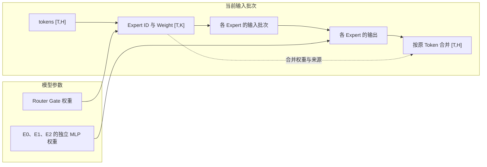

图 1-2：模型参数与当前批次路由的关系。

对应到源码，`router.py` 负责选择 Expert，`expert.py` 定义 Expert 内部的计算，`moe.py` 将它们接成完整前向。Router 和 Expert 的参数在推理调用之间保留；

每一批输入都会重新生成路由表。分布式实现也遵循这个安排：先把 Expert 权重放到各个 Rank，再根据当前路由发送 Token。

## 1.2 用路由记录描述分支

用 T 表示当前输入的 Token 行数，H 表示隐藏宽度，E 表示 Expert 数，K 表示每个 Token 选择的 Expert 数。输入 `tokens` 为 `[T,H]` 浮点张量；

Router 产生 `[T,E]` 的分数，再输出 `[T,K]` 的 `expert_ids` 与 `routing_weights`。第 i 行第 j 列的 ID 和权重共同定义第 i 个 Token 的第 j 条分支。

dtype 表示元素的数据类型：FP32 每个元素占 4 字节，FP16 和 BF16 各占 2 字节。Expert 权重与输入使用相同 dtype；Router 的概率与归一化权重使用 FP32。

device 表示张量所在的 CPU 或 CUDA 设备，输入、模型和路由 metadata 位于同一设备。metadata 是后续计算和恢复所需的元信息，包括分支编号、权重及计数。

其中 `(token_id, slot_id)` 确定一条路由记录，也称 assignment。slot 是某个 Token 的 Top-K 槽位，编号为 0 到 K−1。Top-2 时，一个 Token 产生两条记录；

整批输入共有 `A=T×K` 条记录。分组阶段按记录组织输入，合并阶段再将同一 Token 的 K 条记录还原成一行。

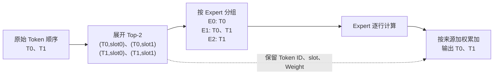

图 1-3：Token 顺序、路由记录与 Expert 分组之间的转换。

以 T0 的 slot 1 为例，它属于 T0 的最终输出，同时也是 E1 输入批次中的一行。前一个位置用来合并结果，后一个位置用来执行计算。Dispatch 用同一个排列移动输入向量、Token 编号、slot 和路由权重，计算结果由此始终对应自己的分支与回写位置。

| 张量 | Shape | 所表达的信息 |
| --- | --- | --- |
| `tokens` | `[T,H]` | 原始顺序的隐藏向量 |
| `logits` | `[T,E]` | 每个 Token 对全部 Expert 的分数 |
| `expert_ids` | `[T,K]` | 各 slot 选择的全局 Expert ID |
| `routing_weights` | `[T,K]` | 各 slot 的合并权重，逐 Token 求和为 1 |
| `tokens_per_expert` | `[E]` | 各 Expert 收到的路由记录数，合计为 A |

### 1.2.1 Router 怎样产生选择结果

Gate 是一个 `Linear(H,E,bias=False)`，每个输出分数由输入向量与对应 Expert 的 gate 权重做点积得到。logits 是尚未归一化的分数，Softmax 将一行 E 个分数转换成概率。

下面是 `TopKRouter.forward()` 的核心摘录，`self.gate` 和 `self.top_k` 来自 Router 实例；`torch` 指 PyTorch。Gate 按模型 dtype 执行，随后将 logits 转成 FP32 做 Softmax 与选中概率的归一化。

**Top-K 路由 · code/course1/mini_ep/model/router.py**

```python
import torch
from mini_ep.model.router import RouterOutput

class TopKRouter(torch.nn.Module):
    def __init__(self, hidden_size, num_experts, top_k):
        super().__init__()
        if hidden_size <= 0 or num_experts <= 0 or not 1 <= top_k <= num_experts:
            raise ValueError("需要 hidden_size > 0、num_experts > 0 且 1 <= top_k <= num_experts")
        self.num_experts = num_experts
        self.top_k = top_k
        self.gate = torch.nn.Linear(hidden_size, num_experts, bias=False)

    def forward(self, tokens):
        logits = self.gate(tokens)                       # [T,H] -> [T,E]
        # 用 FP32 计算路由概率；最后一维是 Expert 维。
        probabilities = torch.softmax(logits.float(), dim=-1)
        # 同时取出被选中的概率与 Expert 编号，二者共享 Token/slot 坐标。
        routing_weights, expert_ids = torch.topk(
            probabilities, k=self.top_k, dim=-1
        )
        # 在每个 Token 的 K 条分支间归一化。
        routing_weights = routing_weights / routing_weights.sum(
            dim=-1, keepdim=True
        )
        # 每条 Top-K 分支记为一次分配。
        tokens_per_expert = torch.bincount(
            expert_ids.reshape(-1), minlength=self.num_experts
        )
        return RouterOutput(
            logits=logits, expert_ids=expert_ids,
            routing_weights=routing_weights, tokens_per_expert=tokens_per_expert,
        )
```

**从隐藏向量生成 Expert 概率**

```python
# 线性层将每个 Token 的 H 维向量映射为 E 个 Expert 分数。
logits = self.gate(tokens)                       # [T,H] -> [T,E]
# 用 FP32 计算路由概率；最后一维是 Expert 维。
probabilities = torch.softmax(logits.float(), dim=-1)
```

gate 的权重为 [E,H]，输入 [T,H] 与其转置相乘，得到每个 Token 对 E 个 Expert 的得分 [T,E]。

float() 将归一化计算提升到 FP32，softmax 沿最后一维展开；行号仍表示原 Token，列号表示全局 Expert ID。

**选择分支，再确定分支权重**

```python
# 从每个 Token 的概率行中选择 K 个分支，并对选中权重归一化。
routing_weights, expert_ids = torch.topk(
    probabilities, k=self.top_k, dim=-1
)
# 在每个 Token 的 K 条分支间归一化。
routing_weights = routing_weights / routing_weights.sum(
    dim=-1, keepdim=True
)
```

topk 返回相同 shape 的两个 [T,K] 张量：浮点数是被选中的概率，int64 是对应列号。随后每行除以本行选中概率之和，保留 K 条分支的相对比例。

T0 的 0.56、0.24 变为 0.7、0.3；归一化只改变权重数值，Expert 和 slot 的配对保持不变。

**统计真正交给 Expert 的记录数**

```python
# 展开 Top-K 的 Expert ID；同一 Token 选择的不同分支分别计数。
tokens_per_expert = torch.bincount(
    expert_ids.reshape(-1), minlength=self.num_experts
)
```

展平 [T,K] 后，每个元素代表一条计算分支。bincount 按 Expert ID 统计出现次数，minlength=E 让未被选中的 Expert 也占一个零计数位置。

结果是同 device 的 [E] int64 张量，总和为 T×K，后面的分组与通信都由这些行数决定。

代码中的 `dim=-1` 始终指 Expert 或选中分支所在的最后一维。`torch.topk()` 同时返回概率与列号，列号就是 Expert ID；除以行和以后，选中的 K 个概率成为最终合并权重。

贯穿本课的输入为 `T0=[1,2]`、`T1=[3,4]`。假设 Softmax 概率分别是 `[0.56,0.24,0.20]` 和 `[0.20,0.32,0.48]`，Top-2 选出 E0/E1 和 E2/E1。每行选中概率之和为 0.8，得到：

**路由结果**

```text
T0: Expert [0,1]，Weight [0.7,0.3]
T1: Expert [2,1]，Weight [0.6,0.4]
```

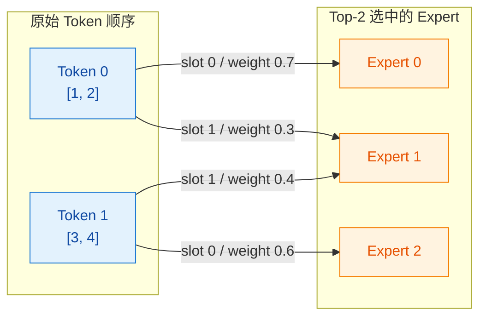

图 1-4：两个 Token 的四条 Top-2 路由。

图中有四条边，恰好对应四条路由记录。E1 同时收到 T0 和 T1；这两条记录的权重分别为 0.3、0.4，属于两个不同 Token 的输出。权重归一化发生在每个 Token 的 K 个分支之间。

选中概率再次归一化，是为了让参与计算的分支权重合计为 1。T0 选中的概率是 0.56 和 0.24，总和为 0.8；分别除以 0.8 后，得到 0.7 和 0.3，两者的相对比例仍为 7∶3。

若选择 Top-1，唯一分支的归一化权重就是 1。这也解释了为什么更改 K 会改变参与计算的 Expert 数，而每个 Token 的合并仍是这些分支的加权和。

## 1.3 Dispatch：把记录变成 Expert 的输入批次

E1 需要一起处理 T0 和 T1，E0 只处理 T0，E2 只处理 T1。`dispatch_tokens()` 按 Expert 逐个查找路由表，把命中的 Token 收集成一个张量。得到的三个局部输入分别是 `[T0]`、`[T0,T1]` 和 `[T1]`。

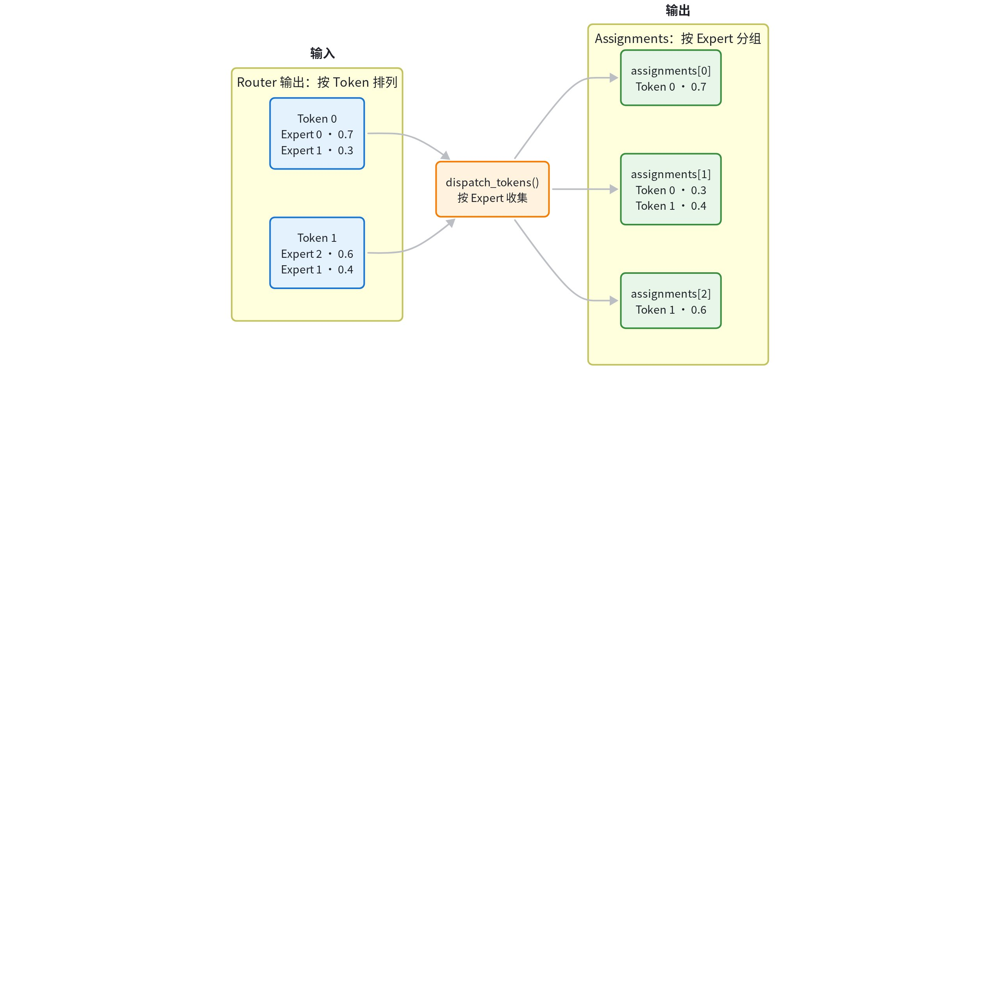

图 1-5：按 Expert 收集输入，并保存对应的权重。

收集的同时还要保存来源。一个分组对象包含 `tokens`、`token_indices`、`route_slots` 和 `routing_weights`，四者在同一行上描述同一条记录。

计算阶段读 `tokens`；合并阶段读原 Token 编号和路由权重。slot 让我们能回到二维路由表，核对 Expert ID 与权重是否来自同一位置。

### 1.3.1 两个坐标共同定位一条记录

对 E1 使用 `torch.where(expert_ids == 1)`，会返回两组坐标：Token 行号 `[0,1]` 和 slot 列号 `[1,1]`。前者指向输入矩阵中的 T0、T1；二者配对后，分别指向路由表的 `(0,1)`、`(1,1)`。

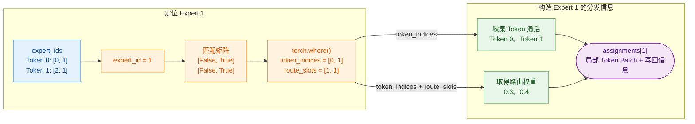

图 1-6：E1 在路由表中对应的 Token 与 slot。

下面继续处理一个 Expert，变量 `expert_id` 是其全局编号。`torch.where()` 的两个返回张量都是 int64 索引，分别标识 Token 行和 slot 列。收集输入使用 Token 行号，收集权重则同时使用行号与 slot，保证该输入分支与其权重配对：

**Expert 输入收集 · code/course1/mini_ep/model/moe.py**

```python
import torch

def collect_expert_inputs(tokens, expert_ids, routing_weights, expert_id):
    # 行号定位 Token，列号定位它的 Top-K slot。
    token_indices, route_slots = torch.where(expert_ids == expert_id)
    expert_tokens = tokens.index_select(0, token_indices)
    # 权重按 Token 与 slot 两个坐标读取。
    expert_weights = routing_weights[token_indices, route_slots]
    return expert_tokens, expert_weights, token_indices, route_slots
```

**用二维路由坐标收集 Expert 输入**

```python
# 用 Token 与 slot 两个坐标定位分支，再按 Token 编号收集输入行。
token_indices, route_slots = torch.where(expert_ids == expert_id)
expert_tokens = tokens.index_select(0, token_indices)
# 权重按 Token 与 slot 两个坐标读取。
expert_weights = routing_weights[token_indices, route_slots]
```

where 返回的两条 int64 向量分别是 Token 行号与 slot 列号，长度等于当前 Expert 的记录数 M。index_select 只按 Token 行收集 [M,H] 输入；

权重必须同时使用两个坐标读取，形成 [M]。返回这两组坐标后，Expert 只计算向量，Combine 仍能找到每行属于哪个原 Token。

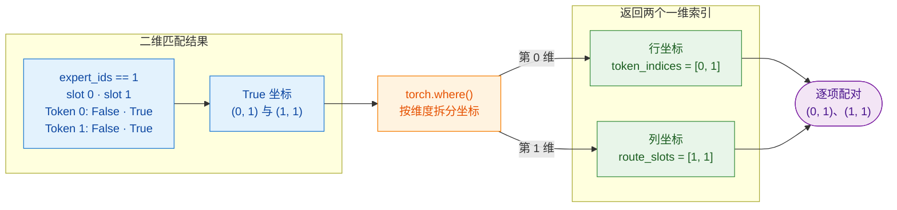

图 1-7：torch.where 返回的两组坐标。

E1 输入的第 0 行来自 T0 的 slot 1，权重为 0.3；第 1 行来自 T1 的 slot 1，权重为 0.4。交换这两行时，对应的 Token 编号、slot 和权重随同移动。每行计算结果便能乘上自己的权重，并回到自己的 Token。

### 1.3.2 分组对象怎样连接计算与合并

`dispatch_tokens()` 返回长度为 E 的分组列表，下标 e 对应 Ee。某个 Expert 没有被选中时，它的输入是 `[0,H]`，来源和权重也都是空张量。空批次延续了相同接口，后面的计算与合并沿用同一条链路。

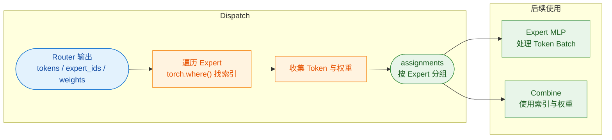

图 1-8：分组 metadata 连接输入收集、Expert 计算与输出回写。

Expert 只读取分组中的输入向量，保持行序并输出计算结果。Combine 再利用同一分组保存的 Token 编号和权重完成回写。因此，来源信息可以从 Dispatch 一直保留到 Combine，中间的 MLP 无需处理这些索引。

## 1.4 Expert：在局部批次上执行 MLP

模型用 `ModuleList` 保存 E 个独立的 `ExpertMLP`，每个实例拥有自己的权重。分组列表的第 e 项交给第 e 个 Expert，输出行数与该分组相同。例如 E1 接收 `[T0,T1]`，一次调用就处理两行输入；线性投影和逐元素激活保持它们的相对行序。

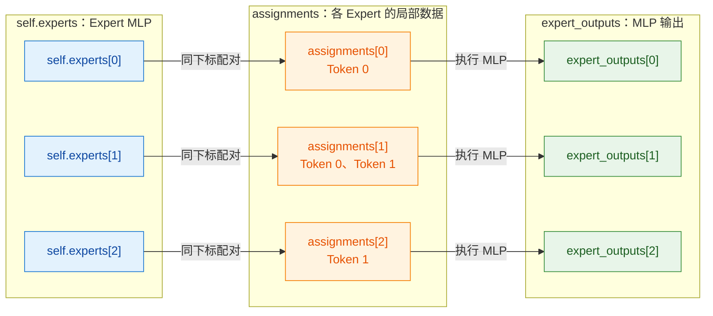

图 1-9：第 e 个 Expert 读取第 e 个分组。

设一个 Expert 收到 M 行输入。Up Projection 的权重在 PyTorch 中保存为 `[F,H]`，前向使用其转置，执行 `[M,H]×[H,F]→[M,F]`；

Down Projection 的权重保存为 `[H,F]`，执行 `[M,F]×[F,H]→[M,H]`。下面以 GELU 激活写出等价的最小 MLP。仓库类将两个投影命名为 `up_proj`、`down_proj`，并校验输入宽度；这里的 `up`、`down` 用来突出计算关系。

**Expert MLP · code/course1/mini_ep/model/expert.py**

```python
import torch

class ExpertMLP(torch.nn.Module):
    def __init__(self, hidden_size, expert_hidden_size):
        super().__init__()
        self.up = torch.nn.Linear(hidden_size, expert_hidden_size, bias=False)
        self.activation = torch.nn.GELU()
        self.down = torch.nn.Linear(expert_hidden_size, hidden_size, bias=False)

    def forward(self, tokens):
        # 两次投影保持行数：[M,H] → [M,F] → [M,H]。
        return self.down(self.activation(self.up(tokens)))
```

**两次投影之间保留行身份**

```python
# Up、激活、Down 依次处理同一批 Expert 输入行。
return self.down(self.activation(self.up(tokens)))
```

self.up 将 [M,H] 变为 [M,F]，GELU 对每个元素独立作用，self.down 再得到 [M,H]。三次操作都保持第 0 维的顺序，因此输出第 j 行始终对应输入第 j 行。

每个 Expert 使用独立的两份权重，同一条输入进入不同 Expert 会得到不同分支结果。

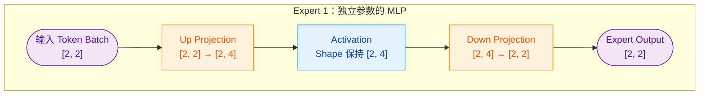

图 1-10：H=2、F=4 的两层 Expert MLP。

图中的 E1 使用 `H=2,F=4`：两行输入扩展为 `[2,4]`，经过逐元素激活，再投影回 `[2,2]`。这个 MLP 保持 Token 行数和行序，改变每行向量的数值。第三课会沿着这两次矩阵乘，讨论 GPU 的执行方式与计时。

## 1.5 Combine：让分支回到同一个 Token

每个 Expert 输出仍与自己的分组输入逐行对应。Combine 取出该行路由权重，乘上 Expert 输出，再累加到原 Token 的位置。对于输入 Ti，数学形式是：

$$
y_i = \sum_{j=0}^{K-1} w_{i,j}\,\operatorname{Expert}_{e_{i,j}}(x_i)
$$

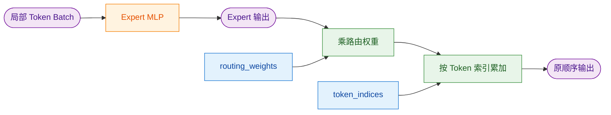

图 1-11：将 Expert 输出加权，累加到原 Token 行。

`index_add_()` 按索引把一行结果加到目标行。Top-2 下，同一个 Token 会在两个 Expert 分组中出现，因此两次写回相加得到完整输出。下面的 `assignments` 来自 Dispatch，`expert_outputs` 来自相同顺序的 Expert 调用。

`zeros_like(tokens)` 创建 `[T,H]` 的零输出，保留输入 dtype 与 device；乘法前将 FP32 路由权重转换为 Expert 输出 dtype，`unsqueeze(1)` 把权重从 `[M]` 变为 `[M,1]`，沿隐藏维度广播。

**加权合并 · code/course1/mini_ep/model/moe.py**

```python
import torch

def combine_expert_outputs(tokens, assignments, expert_outputs):
    output = torch.zeros_like(tokens)
    for assignment, expert_output in zip(assignments, expert_outputs, strict=True):
        # 将一行分支权重广播到 H 个输出元素。
        weighted_output = expert_output * assignment.routing_weights.to(
            expert_output.dtype
        ).unsqueeze(1)
        # 同一 Token 的多条分支累加到同一输出行。
        output.index_add_(0, assignment.token_indices, weighted_output)
    return output
```

**把每条分支权重广播到隐藏维**

```python
# 将每条分支的标量权重扩展到 H 个输出特征。
weighted_output = expert_output * assignment.routing_weights.to(
    expert_output.dtype
).unsqueeze(1)
```

一份 Expert 输出为 [M,H]，该分组的权重为 [M]。先将权重转换到输出 dtype，再增加长度为 1 的维度，形成 [M,1]；逐元素乘法沿 H 广播，每行的全部特征共用一份分支权重，结果仍为 [M,H]。

**在原 Token 行累加分支贡献**

```python
# 将属于同一原 Token 的多条加权分支累加到同一输出行。
output.index_add_(0, assignment.token_indices, weighted_output)
```

index_add_ 的 dim=0 表示沿行写回。若 token_indices=[0,1]，两行加权结果分别加到 output[0] 与 output[1]；

另一个 Expert 再命中 Token 0 时，其贡献继续加到同一行。output 从全零的 [T,H] 开始，循环结束后每行包含该 Token 的 K 条贡献。

### 1.5.1 加权合并的数值例子

为了单独看清合并，把各 Expert 的输出指定为下面的数值。E0 对 T0 输出 `[10,20]`，E1 对 T0 输出 `[100,200]`，对 T1 输出 `[30,40]`，E2 对 T1 输出 `[50,60]`。

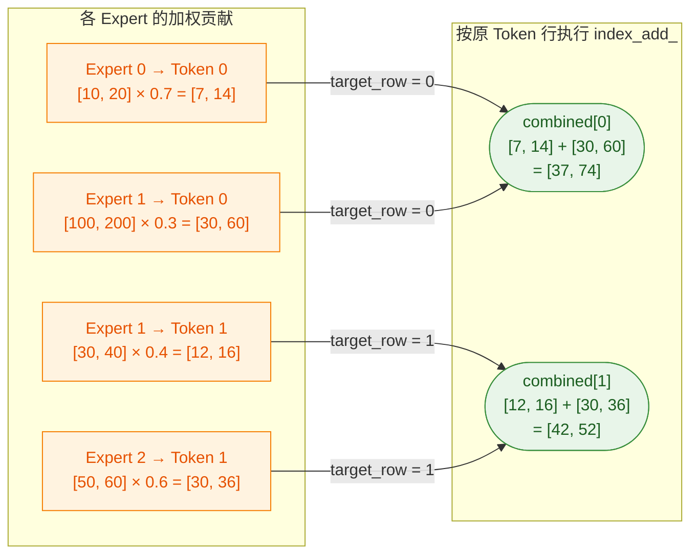

图 1-12：四条输出分支合并为两行结果。

于是 T0 得到 `0.7×[10,20]+0.3×[100,200]=[37,74]`，T1 得到 `0.4×[30,40]+0.6×[50,60]=[42,52]`。中间输出按 Expert 分组，最终两行按 T0、T1 的顺序排列。

单看 E1 的两行输出，可以把广播与回写分开理解。E1 的输出为 `[[100,200],[30,40]]`，对应权重为 `[0.3,0.4]`。权重 reshape 为 `[2,1]` 后，第一行的两个元素都乘 0.3，第二行都乘 0.4，得到 `[[30,60],[12,16]]`。

分组中的 `token_indices=[0,1]` 再把这两行分别加到 T0、T1；E0 和 E2 的贡献沿同样规则相加。

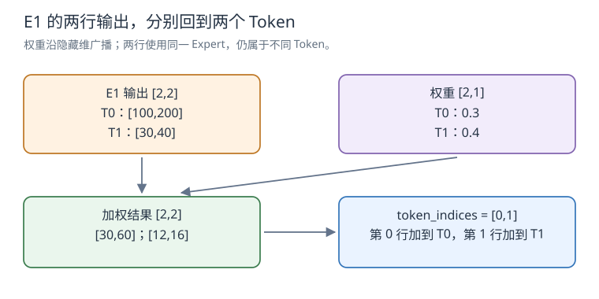

图 1-13：逐行权重沿 H 广播，随后按 Token 索引累加。

因此，权重广播只改变每行数值，Token 索引决定这行数值加到哪里。Expert 内的批次行号在此完成向原始 Token 行号的转换。

还可以让 Ee 简单地输出 `(e+1)×x`。沿用这张路由表，T0 得到 `(0.7×1+0.3×2)×T0=1.3T0`，T1 得到 `(0.4×2+0.6×3)×T1=2.6T1`。这个小例子把 Expert 编号和路由权重都留在结果里，后面可以用它检查打包、通信和恢复是否正确。

## 1.6 单设备 MoE 的完整前向

`SingleGPUMoE.forward()` 将上述模块接成一次前向。下面摘录的是方法内部的数据流，`self` 表示已创建的模型；`dispatch_tokens` 和 `combine_expert_outputs` 都在 `mini_ep/model/moe.py` 中。

中间列表以 Expert 编号为下标，最终 `hidden_states` 重新以原 Token 行号为下标。模型返回输出和路由 metadata，让数值结果与实际分支选择可以一起理解。

**MoE 前向 · code/course1/mini_ep/model/moe.py**

```python
import torch
from mini_ep.model.router import TopKRouter
from mini_ep.model.expert import ExpertMLP
from mini_ep.model.moe import MoEOutput, dispatch_tokens, combine_expert_outputs

class SingleGPUMoE(torch.nn.Module):
    def __init__(self, hidden_size: int, expert_hidden_size: int, num_experts: int, top_k: int, *, activation: str='gelu', bias: bool=False) -> None:
        super().__init__()
        self.hidden_size = hidden_size
        self.num_experts = num_experts
        self.router = TopKRouter(hidden_size, num_experts, top_k)
        self.experts = torch.nn.ModuleList([ExpertMLP(hidden_size, expert_hidden_size, activation=activation, bias=bias) for _ in range(num_experts)])

    def forward(self, tokens):
        # 原始 Token 顺序进入 Router；分组和恢复信息在本次前向内配对使用。
        routing = self.router(tokens)
        assignments = dispatch_tokens(
            tokens, routing.expert_ids, routing.routing_weights, self.num_experts
        )
        # 第 e 个 Expert 读取第 e 个 assignment，输出沿用该分组的行序。
        expert_outputs = [
            expert(assignment.tokens)
            for expert, assignment in zip(self.experts, assignments, strict=True)
        ]
        hidden_states = combine_expert_outputs(tokens, assignments, expert_outputs)
        return MoEOutput(
            hidden_states=hidden_states, router_logits=routing.logits,
            expert_ids=routing.expert_ids, routing_weights=routing.routing_weights,
            tokens_per_expert=routing.tokens_per_expert,
        )
```

**先生成路由，再保留分组的来源信息**

```python
# 路由确定 Expert 和权重，分组同时保存返回时所需的来源索引。
routing = self.router(tokens)
assignments = dispatch_tokens(
    tokens, routing.expert_ids, routing.routing_weights, self.num_experts
)
```

Router 只决定各 Token 选择哪些 Expert。dispatch_tokens 接收同一份输入、ID 与权重，按 Expert 编号建立 assignments；

第 e 项保存 E_e 的输入、原 Token 编号及权重。分组数量固定为 E，空 Expert 对应零行输入。

**逐 Expert 计算，再回到原 Token 顺序**

```python
# 各 Expert 处理各自输入；Combine 根据来源索引恢复 Token 顺序。
expert_outputs = [
    expert(assignment.tokens)
    for expert, assignment in zip(self.experts, assignments, strict=True)
]
hidden_states = combine_expert_outputs(tokens, assignments, expert_outputs)
```

ModuleList 与 assignments 按相同 Expert 编号排列，zip 将每份输入交给对应参数。列表中的输出仍按 Expert 分组；

combine_expert_outputs 使用分组保存的来源索引，生成原始 Token 顺序的 [T,H]。返回的路由 metadata 描述本次前向实际使用的分支。

下面的完整 CPU 示例把这条数据流放回真实模型：输入为两行 FP32 向量，三个 Expert 各有独立参数，每个 Token 选择两条分支。随机种子固定模型初始化；`torch.no_grad()` 表达推理前向。输出既保存原 Token 顺序的结果，也保留可以解释本次选择的路由 metadata。

**MoE 示例**

```python
import torch
from mini_ep.model.moe import SingleGPUMoE

def main():
    torch.manual_seed(0)
    model = SingleGPUMoE(2, 4, 3, 2).to(dtype=torch.float32)
    tokens = torch.tensor([[1., 2.], [3., 4.]])
    with torch.no_grad():
        result = model(tokens)
    assert result.hidden_states.shape == tokens.shape
    assert result.hidden_states.dtype == tokens.dtype
    assert result.hidden_states.device == tokens.device
    assert result.tokens_per_expert.sum().item() == 4
    torch.testing.assert_close(
        result.routing_weights.sum(dim=1), torch.ones(2)
    )
    print(result.expert_ids, result.hidden_states)

if __name__ == "__main__":
    main()
```

这里的 Router 使用随机初始化的 gate，分支选择由实际点积产生。前文的固定概率例子用于手算，两者遵循同一条加权公式。命令行入口可以配置更大的张量；下面的 CUDA 命令需要一张可见 GPU，测试入口同时保留 CPU 用例。

**运行与测试**

```bash
cd code/course1
python3 test/demo.py \
  --device=cuda --dtype=float32 --num-tokens=8 \
  --hidden-size=16 --expert-hidden-size=32 --num-experts=4 --top-k=2
python3 -m unittest discover -s checks -p 'test_single_gpu_moe.py' -v
```

Top-1 与 Top-2 对应不同的分支数量：前者每个 Token 产生一条记录，后者产生两条，因此所有 Expert 的记录数之和分别为 `T` 和 `2T`。归一化后的分支权重之和始终为 1，输出形状始终为 `[T,H]`。

示例通过 `--top-k` 选择这两种配置；`--device=cpu` 使用同一份 Reference 表达相同的数据关系。

Expert 数量 E 增大时，权重存储随 `2EHF` 增长；固定 Top-K 时，单个 Token 的 Expert 矩阵乘工作量仍由 `4KHF` 决定。Expert Parallel（专家并行，EP）把这些 Expert 权重分布到多张 GPU，Token 在计算前抵达所选 Expert 的设备，输出在计算后返回来源。

单设备实现中的分组与恢复关系因此成为跨设备通信的基础。下一课先建立连续打包布局，随后把布局边界转换成通信块边界。

继续阅读 [第 2 课：Router、Top-K 与 Token Dispatch](https://tvle9mq8jh.feishu.cn/docx/HiuwdyT5zopOEbxnCF4c4WPgnib)。

[课程首页](课程首页.md) · [下一课](第02课.md)
