# 第 3 课：GPU、CUDA 执行模型与 GEMM 基准

第二课把六条分支记录打包成 `[2,2,2,0]` 四个 Expert 批次。每个非空批次接下来都要经过 Expert MLP：先扩展特征，经过激活函数，再投影回原来的隐藏宽度。分支的行顺序在这段计算中保持不变。

本课沿着这段计算展开：矩阵乘怎样交给 GPU，线程怎样分工，输入怎样被重复使用，以及一次投影的耗时怎样测量。最后固定权重形状，只改变 Expert 收到的行数，观察 GEMM 延迟与吞吐的关系。

数值例子使用小矩阵；CUDA 执行与设备计时需要一张 NVIDIA GPU。本课源码位于 `code/course3/`，示例在 `test/`，正确性测试在 `checks/`。

## 3.1 把 Expert MLP 写成矩阵乘

GEMM（通用矩阵乘法）将一批输入行投影到新的特征空间，常写为 `C[M,N] = A[M,K] × B[K,N]`：M 是行数，N 是输出特征数，K 是每个点积累加的长度。

沿用前两课的模型符号：H 是输入隐藏宽度，F 是 Expert 中间宽度。Up Projection（上投影）对应 `N=F、K=H`；Down Projection（下投影）对应 `N=H、K=F`。本课矩阵乘公式中的 K 表示累加维度，路由 Top-K 中的 K 表示每个 Token 选择的 Expert 数，两者分别用于各自的上下文。

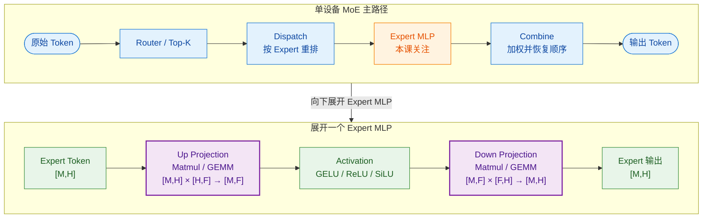

图 3-1：Expert MLP 的两次投影。

一个 Expert MLP 的形状变化为 `[M,H] → [M,F] → [M,H]`。两次投影之间的激活函数逐元素改变数值，保持 `[M,F]` 的形状；两次投影都保留 M 行，输出第 i 行仍对应输入第 i 条分支。

| 投影 | GEMM 的 M | GEMM 的 N | GEMM 的 K |
| --- | --- | --- | --- |
| Up | 当前 Expert 收到的记录数 | F | H |
| Down | 当前 Expert 收到的记录数 | H | F |

当前 Expert 的行数为 `M = expert_offsets[e+1] - expert_offsets[e]`。第二课的边界是 `[0,2,4,6,6]`，所以 E0、E1、E2 各有两行，E3 为零行。Top-2 的两条分支分别进入各自的 Expert 批次，这里的 M 统计该 Expert 收到的分支数。

将矩阵放大到后面的基准配置：`M=1024、H=1024、F=2048`。上投影的输入为 `[1024,1024]`，保存的权重为 `[2048,1024]`，输出为 `[1024,2048]`。FP16 每个元素占 2 字节，对应大小如下。

按一次乘法与一次加法计为 2 FLOPs，这次投影的计算量为 `2×1024×2048×1024 = 4,294,967,296 FLOPs`，约 4.295 GFLOPs。

| 对象 | Shape | FP16 大小 |
| --- | --- | --- |
| 输入 | `[1024,1024]` | 2 MiB |
| 保存的权重 | `[2048,1024]` | 4 MiB |
| 输出 | `[1024,2048]` | 4 MiB |

三块张量合计占 10 MiB，这是张量的存储大小。计算时，同一份权重参与 1024 行输入的投影；GPU 可以把当前需要的输入片段放在片上存储中复用。后文的 Tile 分块就是围绕这种复用安排工作。

### 3.1.1 Linear 的权重为什么要转置

`nn.Linear(K,N,bias=False)` 表示将 K 个输入特征投影成 N 个输出特征。它把权重保存为 `[N,K]`，每一行对应一个输出特征；输入 `[M,K]` 与权重的转置 `[K,N]` 相乘，得到 `[M,N]`。

下面的完整示例为 Matmul 与 Linear 准备同一份输入和权重。M、N、K 为正整数，输入与权重使用相同的浮点 dtype、位于同一设备；随机输入在调用前可用 `torch.manual_seed(31)` 固定种子。

**完整示例 · Linear 与 Matmul**

```python
import torch

def compare_projections(M, N, K, device, dtype):
    tokens = torch.randn(M, K, device=device, dtype=dtype)
    weight = torch.randn(N, K, device=device, dtype=dtype)
    linear = torch.nn.Linear(K, N, bias=False, device=device, dtype=dtype)
    with torch.no_grad():
        # 两种投影使用相同权重，便于比较数值。
        linear.weight.copy_(weight)
    matmul_output = tokens @ weight.T
    linear_output = linear(tokens)
    torch.testing.assert_close(matmul_output, linear_output)
    return matmul_output, linear_output
```

函数返回两份 `[M,N]` 输出，并用 `assert_close` 比较数值。拆开看，关键是参数对齐与投影计算。

**让两种调用使用同一组参数**

**逻辑片段 · 对齐权重**

```python
# 将已有权重复制到 Linear，保持两种调用的参数一致。
with torch.no_grad():
    linear.weight.copy_(weight)
```

`linear.weight` 是 Linear 持有的参数，`weight` 是本例生成的权重。`copy_` 将数值写入前者；`no_grad()` 让这次参数准备不参与自动求导。复制完成后，两种投影使用相同的矩阵。

**用转置后的权重生成输出特征**

**逻辑片段 · 计算投影**

```python
# [M,K] @ [K,N] 得到 [M,N]。
matmul_output = tokens @ weight.T
linear_output = linear(tokens)
```

- `tokens`：M 行输入，每行有 K 个特征。
- `weight`：N 行权重，每行描述一个输出特征怎样组合 K 个输入特征。
- `matmul_output` 与 `linear_output`：相同投影的两份结果，均为 `[M,N]`。

输入与保存的权重为连续张量，stride 均为 `(K,1)`。`weight.T` 与原权重共享存储，shape 变为 `[K,N]`，stride 变为 `(1,K)`；矩阵后端据此读取转置后的逻辑元素。

先用两行输入手算这次投影：`X=[[1,2],[3,4]]`，保存权重 `W=[[1,0],[0,1],[1,1]]`。这组小矩阵独立用于说明投影：W 的三行分别提取第一项、第二项与两项之和。

**数值例子 · 两个输入特征变为三个输出特征**

```python
# 每行权重生成一个输出特征。
X = [[1, 2], [3, 4]]
W = [[1, 0], [0, 1], [1, 1]]
# X @ W.T 的结果：[[1, 2, 3], [3, 4, 7]]
```

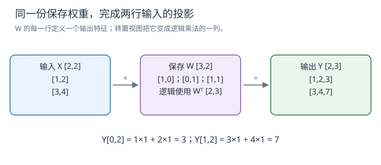

图 3-2：保存为 [out,in] 的权重如何生成三个输出特征。

例如 `Y[0,2] = 1×1 + 2×1 = 3`，使用 X 的第 0 行与 W 的第 2 行；`Y[1,2] = 3×1 + 4×1 = 7`。每个输出都沿输入特征维累加，因此输出行数保持 2，特征数从 2 变为 3。

## 3.2 一行 PyTorch 代码怎样到达 GPU

Host 是运行 Python、提交工作的 CPU 一侧，Device 是执行 CUDA 计算的 GPU 一侧。调用 `torch.matmul` 时，PyTorch 根据张量的形状、精度与布局选择后端实现，并将计算提交给 GPU。

CUDA Stream（流）可以理解为设备工作队列。同一流中的 Up Projection、激活函数、Down Projection 按提交顺序执行，后一步读取前一步的结果；CPU 可以在 GPU 执行期间继续提交后续工作。

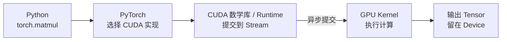

图 3-3：Host 提交算子，Device 执行 Kernel。

CUDA 调用通常在 GPU 完成前返回。返回的张量对象已经建立，数值由随后执行的 Kernel 写入；同一流中的下一次计算会在它之后执行，CPU 读取数值则需要等待计算完成。

因此，计时需要明确测量位置。用一条假设时间线说明：CPU 在 0～4 μs 提交调用，GPU 在 4～24 μs 执行计算。CPU 的提交区间为 4 μs，GPU 的执行区间为 20 μs，从发起到结果可用为 24 μs。

CUDA Event（事件）将时间标记放进流中，在 GPU 执行到标记时记录时间。本课基准用前后两枚 Event 测量一次投影所在的设备流区间。

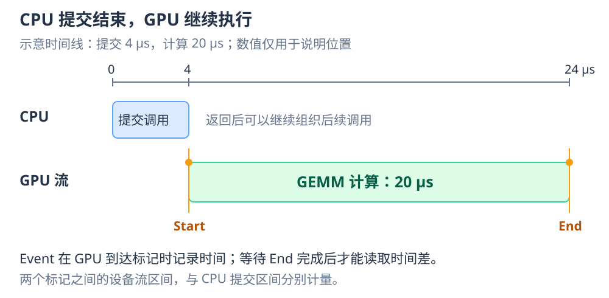

CPU 提交与 GPU 执行：Event 在设备流中记录时间，两个标记夹住投影执行区间。示意数字用于区分计时位置。

## 3.3 CUDA 怎样组织并行工作

Kernel 是在 GPU 上执行的函数。一次启动创建一个 Grid（网格），Grid 包含多个 Block（线程块），每个 Block 包含多个 Thread（线程）。这些编号帮助线程定位自己负责的数据。

例如要处理 257 个元素，每个 Block 使用 128 个线程，需要 `ceil(257/128)=3` 个 Block。线程的全局编号为 `idx = block_id×128 + thread_id`。

| Block 编号 | 产生的 idx | 有效工作 |
| --- | --- | --- |
| 0 | 0～127 | 处理前 128 个元素 |
| 1 | 128～255 | 处理接下来的 128 个元素 |
| 2 | 256～383 | 仅 idx=256 有效，其余满足 idx≥257 |

线程在访问数据前判断 `idx<257`，最后一个 Block 中超出范围的线程跳过访问。这个边界判断会在后续 Dispatch 与 Combine Kernel 中以 mask 的形式出现；本课使用的 PyTorch 算子由后端安排线程编号与边界处理。

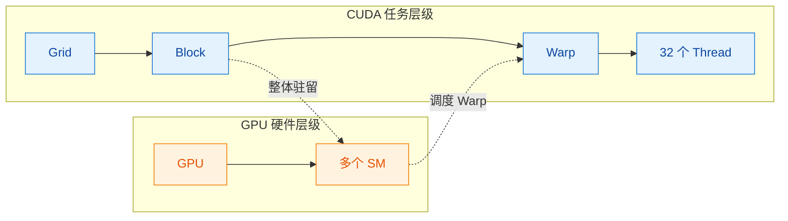

图 3-4：Grid、Block、Warp 与 SM 的关系。

SM（流式多处理器）是 GPU 调度与执行线程工作的硬件单元。一个 Block 在一个 SM 上执行，同一 SM 可以驻留多个 Block，数量取决于它们使用的寄存器、共享内存等资源。

Block 内的线程按 32 个一组组织成 Warp（线程束），末组可以不足 32 个有效线程。SM 以 Warp 为基本单位调度指令。程序中的 Grid、Block、Thread 划分工作，硬件上的 SM 负责执行这些工作。

对行主序张量 `[M,H]`，同一行的相邻特征位于相邻地址。让相邻线程读取相邻位置，有利于合并内存访问；访问超出有效行列的元素时，则通过边界条件屏蔽。

### 3.3.1 以输出 Tile 划分 GEMM

矩阵乘的每个输出元素都要沿 K 维累加。同一行 A 会用于多个输出列，同一列 B 会用于多个输出行。为了共享这些重复使用的输入，可以把输出矩阵划成 Tile（矩形子块）。

以一个 Block 负责 `64×64` 输出 Tile、每轮处理 32 个 K 元素为例：这一轮只需加载 `A[64,32]` 与 `B[32,64]` 两块输入，就能更新 4096 个输出的部分和。

若 K=64，就分两轮处理 `0:32` 与 `32:64`，将两轮贡献累加到同一输出 Tile。下面展示基础共享内存分块的执行流程；具体数学库会选择适合矩阵形状与硬件的分块。

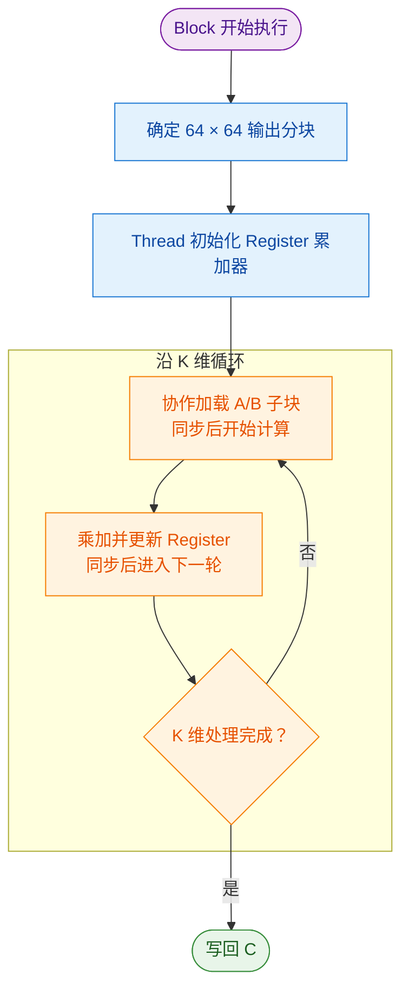

图 3-5：沿输出 Tile 和 K 维划分 GEMM。

在一个输出 Tile 内，A 的每个元素参与 64 个输出列的计算，B 的每个元素参与 64 个输出行的计算。协作加载到共享内存后，同一片段可以被计算线程多次读取，输出部分和则在 K 维循环中持续累加。

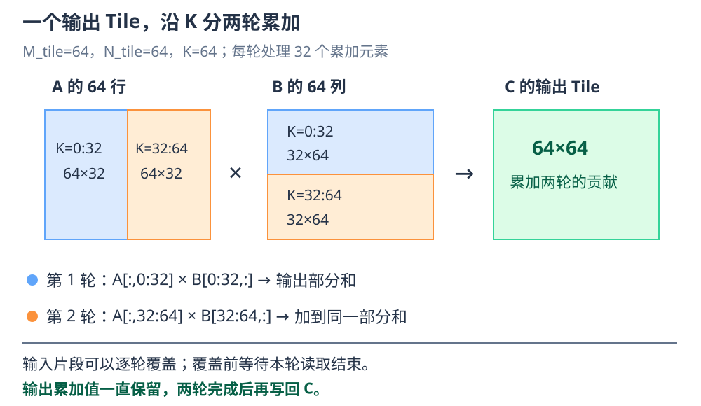

输出 Tile 的两轮累加：沿 K 维分别读取两组输入片段，输出部分和持续保留，全部完成后再写回。

## 3.4 让数据靠近执行单元

数据存放的位置与它的用途相配合：全局内存保存完整矩阵，缓存帮助复用访问，Block 用共享内存保存协作读取的片段，线程用寄存器保存局部值与累加结果。图中将这些作用按存储层次组织。

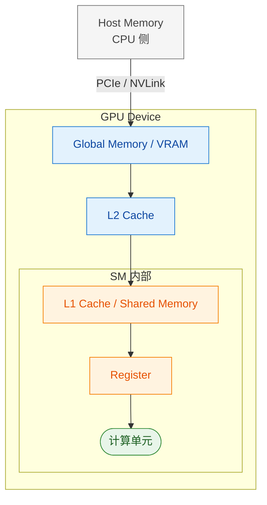

图 3-6：完整矩阵、输入片段与累加值所在的存储层次。

在这里的基础 GEMM 分块方案中，A、B、C 的完整矩阵位于全局内存，当前 K 分块的 A/B 片段放进共享内存，输出部分和保存在计算线程的寄存器中。缓存由硬件管理，共享内存的加载、复用与覆盖由程序安排。

| 一个 Block 当前使用的数据 | 形状与精度 | 数据大小 |
| --- | --- | --- |
| A 输入片段 | 64×32，FP16 | 4 KiB |
| B 输入片段 | 32×64，FP16 | 4 KiB |
| 输出累加值 | 64×64，FP32 | 合计 16 KiB，分布在线程寄存器中 |

输入片段合计 8 KiB；累加值的数据量为 16 KiB，实际寄存器用量还包含索引与临时变量。更大的 Tile 可以增加输入复用，也会消耗更多片上资源，影响一个 SM 可同时驻留的 Block 数。这个取舍需要结合具体形状测量。

### 3.4.1 K 分块中的数据复用与同步

K=64、每轮处理 32 个元素时，第一轮读取 `A[:,0:32]` 与 `B[0:32,:]`，第二轮读取 `A[:,32:64]` 与 `B[32:64,:]`。两轮更新同一份输出累加值，全部完成后才写回 C。

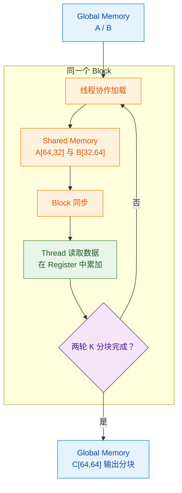

图 3-7：分两次读取 K Tile，并保留输出累加值。

共享内存复用需要两个同步点：所有输入片段写入后，计算线程才开始读取；所有线程完成本轮读取后，下一轮才覆盖这块空间。输出的部分和持续保存在寄存器中，直到 K 维处理完毕。

**数据生命周期 · 共享片段与输出累加值**

```text
第 1 轮：加载 A/B 的 K=0:32 片段 → 同步 → 更新累加值 → 同步
第 2 轮：加载 A/B 的 K=32:64 片段 → 同步 → 更新累加值
最后：将累加值写回输出 Tile
```

这两个同步点分别保证“输入已经准备好”和“旧输入可以被覆盖”。这里描述基础共享内存方案；Tensor Core 等实现可以采用不同的指令与数据搬运方式。

## 3.5 GEMM 的形状与计算量

FLOPs 表示浮点运算次数。一次 `[M,K]×[K,N]` 矩阵乘包含 MN 个输出，每个输出执行 K 次乘加，约为 `2MNK` FLOPs。Expert 的 Up 与 Down 各约为 `2MHF`，两次投影合计约 `4MHF`，这里单独统计矩阵乘。

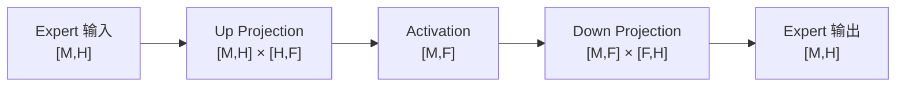

图 3-8：Up 与 Down Projection 的输入输出形状。

第二课的行数 `[2,2,2,0]` 对应三个 M=2 的 Expert 与一个空批次；空 Expert 没有分支需要计算。固定 H、F 时，各个非空 Expert 的主要差别就是 M。

每次 GEMM 调用都经历提交、调度与执行。M 改变计算量、输出 Tile 数量和权重的复用机会，因此后文固定 N、K 扫描 M，先建立单个投影的延迟基线，后续再比较逐 Expert 循环与 Grouped GEMM。

### 3.5.1 用 FLOPs 和延迟推导吞吐

设一次 GEMM 的中位延迟为 L 毫秒，则工作负载吞吐为：

$\mathrm{Achieved\ TFLOPS} = \frac{2MNK}{L_{\mathrm{ms}}\times10^9}$

L 使用毫秒：先乘 `10⁻³` 换成秒，再除以 `10¹²` 换成 TFLOPs/s，便得到分母 `L×10⁹`。

例如 `M=512、N=2048、K=1024` 时，计算量约 2.147 GFLOPs；若中位延迟约 0.0338 ms，按显示的舍入值计算，吞吐约为 63.54 TFLOPS。延迟说明这次投影花多久，吞吐说明这段时间完成多少计算。

## 3.6 把计时放在设备执行顺序上

CUDA Event 把起止标记放进设备流：GPU 执行到 Start 时记录起点，完成投影后执行到 End 时记录终点，二者之差就是采样区间。CPU 可以先提交多组标记与投影，最后统一等待完成，再读取时间。

正式采样前先做 Warmup（预热），让后端准备相同操作所需的状态。输入生成、Linear 创建与权重复制放在计时前，正式区间覆盖已经准备好参数的投影调用。

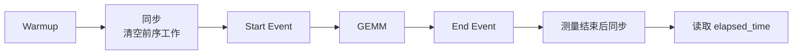

图 3-9：Warmup 与 CUDA Event 定义测量区间。

`mini_ep/profiler/timer.py` 的 `measure_latency()` 同时支持 CPU 与 CUDA。下面保留 CUDA 分支的教学摘录：`operation` 是无参数调用，例如 `lambda: torch.matmul(tokens, weight.T)`，输入与权重已准备在指定 CUDA 设备上，操作提交到当前流。

**完整摘录 · CUDA Event 计时**

```python
import torch
from mini_ep.profiler.timer import LatencyStats

def measure_cuda_latency(operation, *, device, warmup=10, repeats=100):
    if warmup < 0 or repeats <= 0:
        raise ValueError("需要 warmup >= 0 且 repeats > 0")
    with torch.cuda.device(device), torch.inference_mode():
        # 预热与正式采样使用同一操作，预热完成后统一同步。
        for _ in range(warmup):
            operation()
        torch.cuda.synchronize(device)
        pairs = []
        for _ in range(repeats):
            started = torch.cuda.Event(enable_timing=True)
            ended = torch.cuda.Event(enable_timing=True)
            # 在同一流中用起止事件夹住一次投影。
            started.record()
            operation()
            ended.record()
            pairs.append((started, ended))
        torch.cuda.synchronize(device)
        # 全部 GPU 样本完成后再由 Host 读取毫秒数。
        samples_ms = [started.elapsed_time(ended) for started, ended in pairs]
    return LatencyStats(tuple(samples_ms))
```

函数返回 `LatencyStats`，这是保存毫秒样本和统计结果的数据类。下面分三段看预热、采样和读取各自负责什么。

**预热完成后再开始采样**

**逻辑片段 · 预热与采样边界**

```python
# 预热工作完成后，正式样本从已准备好的状态开始。
for _ in range(warmup):
    operation()
torch.cuda.synchronize(device)
pairs = []
```

`warmup` 是预热次数，循环调用的仍是同一个 `operation`。`synchronize(device)` 等待此前提交到该设备的工作完成；随后建立 `pairs`，用于保存正式样本的 Event 对。`inference_mode()` 关闭本基准无需记录的自动求导。

**用一对 Event 夹住一次投影**

**逻辑片段 · 起点、投影与终点**

```python
# 记录 GPU 到达起点与终点的时刻。
started.record()
operation()
ended.record()
pairs.append((started, ended))
```

- `started` 与 `ended`：两枚启用计时的 CUDA Event，按顺序记录在当前流中。
- `operation()`：提交一次投影；同一流到达 ended 时，排在前面的投影已完成。
- `pairs`：保存各轮 Event 对，供采样结束后统一读取。

例如 `repeats=3`，流中的顺序为 `Start₀ → GEMM₀ → End₀ → Start₁ → GEMM₁ → End₁ → Start₂ → GEMM₂ → End₂`。每一对只包围该轮调用，循环内部无需等待 GPU。

**全部样本完成后读取毫秒值**

**逻辑片段 · 读取耗时与汇总**

```python
# 等所有样本完成，再读取每一对事件的时间差。
torch.cuda.synchronize(device)
samples_ms = [started.elapsed_time(ended) for started, ended in pairs]
return LatencyStats(tuple(samples_ms))
```

`elapsed_time()` 返回一对 Event 间的毫秒数，`samples_ms` 因而包含 repeats 个样本。假设样本为 `[0.03,0.05,0.04]` ms，中位数与均值均为 0.04 ms，最小值为 0.03 ms，最大值为 0.05 ms。

| 统计字段 | 含义 |
| --- | --- |
| median_ms | 中位延迟，描述典型样本 |
| mean_ms | 平均延迟 |
| min_ms / max_ms | 最小 / 最大延迟，展示波动范围 |
| samples_ms / repeats | 原始毫秒样本 / 样本数 |

本课操作在同一流执行，Event 区间覆盖投影产生结果的过程，包括该流区间内的等待；CPU 提交节奏也可能造成流中空隙。比较 Matmul 与 Linear 时，输入、权重、dtype、shape、设备和测量区间保持一致。

跨流操作需要把其他流的完成依赖接回记录 End 的流，才能覆盖完整工作。本课先使用同流 GEMM，后续课程再展开多流与通信依赖。

## 3.7 Expert 批次大小与 GEMM 延迟

本课的 `benchmarks/benchmark_gemm.py` 为 Matmul 与 Linear 准备同一份输入和权重，`test/demo.py` 是启动入口。以下命令从仓库根目录进入本课，需要一张可见 CUDA GPU、Python 3.10+ 与匹配驱动的 CUDA 版 PyTorch。

**单 GPU · GEMM 基准**

```bash
cd code/course3
python3 test/demo.py \
  --device=cuda --operation=both --dtype=float16 \
  --m=1024 --n=2048 --k=1024 --warmup=20 --repeats=100
```

| 参数 | 本次配置的含义 |
| --- | --- |
| --m=1024 | 1024 行输入，对应 Expert 批次大小 |
| --n=2048 | 2048 个输出特征 |
| --k=1024 | 每行 1024 个输入特征，即点积长度 |
| --operation=both | 分别测量 Matmul 与无偏置 Linear |
| --warmup=20 / --repeats=100 | 预热 20 次，正式采样 100 次 |

默认随机种子为 31，也可用 `--seed` 显式指定。输出记录矩阵形状、dtype、设备名称、PyTorch/CUDA 版本、FP32 矩阵乘精度设置，以及延迟统计与 Achieved TFLOPS。

固定 `N=2048、K=1024` 和 FP16，只把 M 改为 `1、8、32、128、512、2048`，便得到同一权重形状下的批次大小扫描。M 同时改变计算量、输出规模和输入行对权重的复用，下面的已有曲线展示这组配置的测量结果。

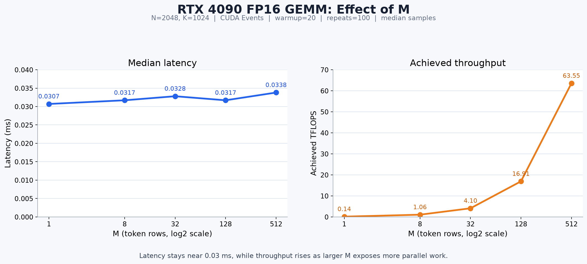

图 3-10：RTX 4090 上 M 维扫描的延迟与吞吐。

图 3-10 使用 RTX 4090、FP16、`N=2048、K=1024`，预热 20 次，用 CUDA Event 采样 100 次并取中位数。M 从 1 增至 512 时，延迟从约 0.0307 ms 变为 0.0338 ms，吞吐从约 0.14 增至 63.55 TFLOPS。显示的延迟经过舍入，吞吐使用对应测量值计算。

在这组配置下，计算量增加 512 倍，典型延迟增加约 10%。这给出了单个投影的实测基线；要继续区分提交开销、输入复用与 Tile 并行度的贡献，可以结合 Kernel 指标和 Timeline（按时间排列的执行轨迹）查看各阶段。

基准使用 `2MNK` 除以中位耗时计算 Achieved TFLOPS。运行 `--operation=both` 时，还会在测量后比较两份输出：FP32 使用 `rtol=atol=1e-5`，FP16 使用 `1e-3`，BF16 使用 `1e-2`。

**本课示例与正确性测试**

下面命令在 `code/course3/` 中执行。CPU 示例用于学习投影数值与接口；CUDA Event 与 GPU 性能测量使用前面的单 GPU 命令。

**CPU 示例与正确性测试**

```bash
# CPU 数值示例：两行输入，每行两个特征，投影到三个特征。
python3 test/demo.py --device=cpu --dtype=float32 \
  --operation=both --m=2 --n=3 --k=2 --warmup=2 --repeats=3

# 发现并运行本课 checks/ 下的正确性测试。
python3 -m unittest discover -s checks -p 'test_gpu_execution.py' -v
```

测试检查投影数值、输出 shape/dtype/device、参数与布局校验、随机输入复现、计时调用次数与统计字段。CUDA 计时测试需要一张 GPU，另有设备选择测试需要两张 GPU；缺少对应设备时测试会跳过。

第二课的分支数决定 Expert 输入的 M，本课将 M 接到矩阵乘、GPU 分工与计时。Expert 分布到多张 GPU 后，还要先把分支送到目标设备：第四课介绍进程与集合通信，第五课再把通信接回路由记录。

有关线程层次与 Stream，可继续阅读 [CUDA Programming Guide](https://docs.nvidia.com/cuda/cuda-programming-guide/01-introduction/programming-model.html) 和 [CUDA 异步执行](https://docs.nvidia.com/cuda/cuda-programming-guide/02-basics/asynchronous-execution.html)；投影与事件接口见 [PyTorch Linear](https://docs.pytorch.org/docs/stable/generated/torch.nn.Linear.html) 和 [CUDA Event](https://docs.pytorch.org/docs/stable/generated/torch.cuda.Event.html)。

继续阅读 [第 4 课：Distributed、NCCL 与 GPU 集合通信](https://tvle9mq8jh.feishu.cn/docx/VD4dd4QkColhL2xZMpscFpwanmg)。

[上一课](第02课.md) · [课程首页](课程首页.md) · [下一课](第04课.md)
