# 第 4 课：Distributed、NCCL 与 GPU 集合通信

前三课已经建立单设备上的路由、打包与 Expert 计算。现在把四个 Expert 分到两张 GPU：Rank 0 持有 E0/E1，Rank 1 持有 E2/E3。若 Rank 0 上的 T0 选中 E2，它的分支输入就要送到 Rank 1，计算结果随后再返回。

本课先用两个独立 Python 进程、两张 GPU 和小整数张量，讲清跨进程数据怎样交换：AllReduce 对同一位置求和，AllGather 收集各来源，All-to-All 按目标重分发。三种操作都属于 Collective（集合通信），由同一进程组的所有成员共同调用。

实现使用 `torch.distributed` 与 NCCL（NVIDIA 集合通信库）。本课只建立固定大小的通信语义，第五课引入路由决定的变长块，第六课接入真实 Expert 计算。独立源码位于 `code/course4/`，入口在 `test/`，测试在 `checks/`。

## 4.1 Worker、Rank 与设备绑定

`torchrun` 为作业启动多个 Worker（工作进程）。本课的两个 Worker 执行同一份脚本，各自持有 Python 变量与 CUDA 张量，再通过通信交换数值。

启动器为每个进程提供 `RANK`、`LOCAL_RANK`、`WORLD_SIZE`，以及初始化用的 `MASTER_ADDR`、`MASTER_PORT`。前一组确定进程身份与设备选择，后一组用于交换建组信息。

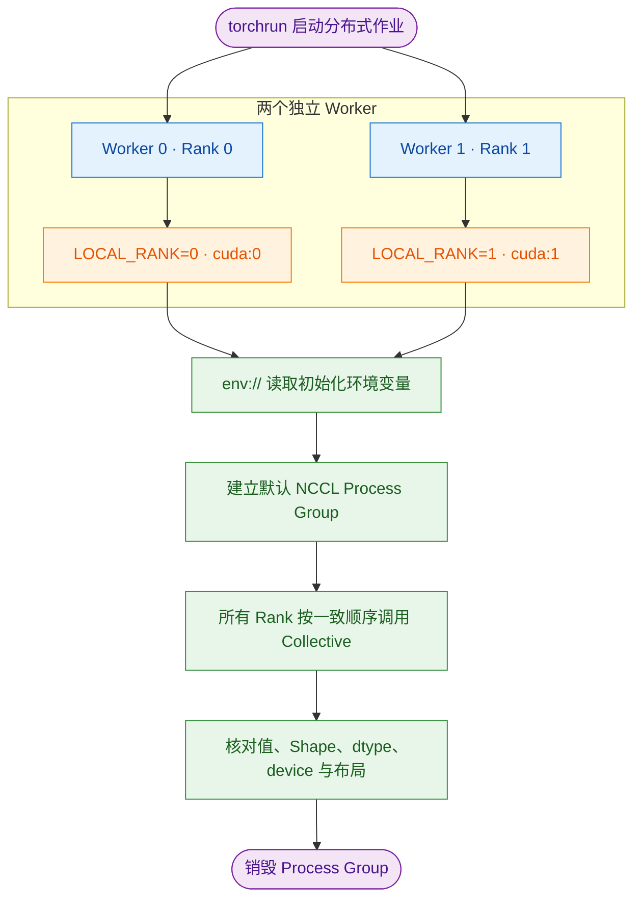

图 4-1：两个 Worker 从启动到通信组释放的路径。

下面从仓库根目录进入本课，再启动两个 Worker。条件为 Python 3.10+、支持 CUDA/NCCL 的 PyTorch，以及两张可见 NVIDIA GPU。

**双 GPU · 启动本课示例**

```bash
cd code/course4
torchrun --standalone --nproc-per-node=2 \
  test/demo.py --expected-world-size=2
```

`--standalone` 为单机作业准备初始化协调服务，`--nproc-per-node=2` 启动两个本地进程；`--expected-world-size=2` 让示例检查实际参与人数。

同一条 `rank+1` 表达式，在 Rank 0 中得到 1，在 Rank 1 中得到 2。后面的 AllReduce 就用这个差别生成 `[1,10]` 与 `[2,20]`：输入由各进程本地代码准备，通信再把它们连接起来。

### 4.1.1 进程身份与设备身份

Global Rank 是进程在整个作业默认组中的编号，Local Rank 是本机进程编号，本课用它选择可见 GPU；World Size 是默认组的参与进程总数。单机两卡时编号如下，多机作业的 Local Rank 则会在不同机器上重复。

| Worker | Global Rank | Local Rank | World Size | 本课绑定的设备 |
| --- | --- | --- | --- | --- |
| 0 | 0 | 0 | 2 | `cuda:0` |
| 1 | 1 | 1 | 2 | `cuda:1` |

CUDA 编号相对于可见设备列表。例如 `CUDA_VISIBLE_DEVICES=2,7` 时，进程内的 `cuda:0` 对应所选的 GPU 2，`cuda:1` 对应 GPU 7。

`read_torchrun_environment()` 解析并校验进程编号；`nccl_distributed()` 绑定 GPU，建立通信组，并将这些信息保存到上下文中。本课每个 Worker 的通信张量都位于它绑定的 GPU。

## 4.2 Process Group 让参与者遵循同一通信语义

这三个名称对应不同层次：**ProcessGroup 定义谁一起通信，ProcessGroupNCCL 用 NCCL 实现通信，NCCL Communicator 保存实际通信所需的成员与连接信息。**

| 名称 | 含义 | 本课中的例子 |
| --- | --- | --- |
| **ProcessGroup（进程组）** | PyTorch 的通信抽象，定义参与进程及组内 Rank，提供 AllReduce、AllGather 等接口。 | Rank 0 与 Rank 1 组成一个组。 |
| **ProcessGroupNCCL** | ProcessGroup 的 NCCL 后端实现，负责把 PyTorch 集合通信调用交给 NCCL，并管理 CUDA 流等执行依赖。 | 两个进程通过 NCCL 交换 GPU 张量。 |
| **NCCL Communicator（通信器）** | NCCL 底层的通信上下文，保存成员数、当前成员编号、设备与通信连接等信息。 | 两张 GPU 各持有本地通信器，彼此配合完成交换。 |

例如，在已准备好进程环境与 CUDA 缓冲区的 Worker 中：

```python
dist.init_process_group(backend="nccl")
dist.all_reduce(buffer)
```

第一行建立默认进程组，并选择 `ProcessGroupNCCL` 后端。第二行的调用关系可以理解为：

```text
PyTorch 的 all_reduce(buffer)
            ↓
ProcessGroupNCCL 处理调用
            ↓
通过 NCCL Communicator 执行 GPU 通信
```

**每个 Worker 都持有自己的本地对象**：Rank 0 的对象处理自己 GPU 上的缓冲区，Rank 1 的对象处理它的缓冲区；这些本地对象协作完成同一个逻辑进程组的通信。

初始化协调服务帮助成员找到彼此，NCCL 后端随后交换 GPU 张量。下图将进程组、NCCL 通信器与各 Worker 的本地缓冲区放在一起展示。

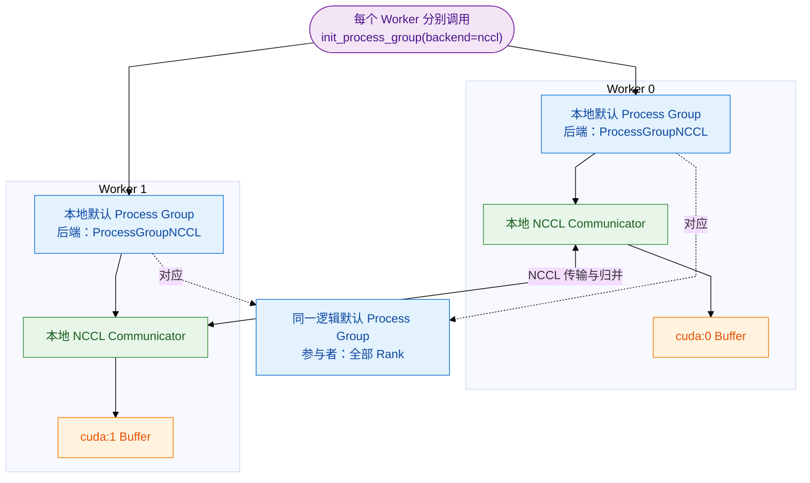

图 4-2：各 Worker 持有本地通信上下文与缓冲区。

建组顺序是先绑定设备，再初始化默认进程组。下面保留 `groups.py` 的核心调用，省略仓库中的环境与参数校验；`device` 为带编号的 CUDA 设备，例如 Rank 1 使用 `torch.device("cuda",1)`。接口说明以 PyTorch 2.11 为基准，环境需支持 `device_id` 参数。

**完整摘录 · 初始化 NCCL 通信组**

```python
import torch
import torch.distributed as dist
from datetime import timedelta

def initialize_nccl(device, timeout_seconds=120):
    torch.cuda.set_device(device)
    # 读取 torchrun 环境，建立默认 NCCL 进程组。
    dist.init_process_group(
        backend="nccl",
        init_method="env://",
        timeout=timedelta(seconds=timeout_seconds),
        device_id=device,
    )
```

**绑定当前进程的 GPU**

**逻辑片段 · 绑定设备**

```python
# 让当前 Worker 的默认 CUDA 操作使用自己的 GPU。
torch.cuda.set_device(device)
```

本课按 `LOCAL_RANK` 选择设备：Worker 0 绑定 cuda:0，Worker 1 绑定 cuda:1。显式传入其他设备的张量构造仍会使用指定设备；通信输入与输出都按本课绑定规则创建。

**通过环境信息建立默认组**

**逻辑片段 · 建立通信参与者**

```python
# 所有 Worker 使用一致的后端和初始化方式建组。
dist.init_process_group(
    backend="nccl",
    init_method="env://",
    timeout=timedelta(seconds=timeout_seconds),
    device_id=device,
)
```

- `backend="nccl"`：使用 NCCL 后端处理本课的 GPU 张量通信。
- `init_method="env://"`：读取 torchrun 提供的进程编号、参与人数与协调地址。
- `device_id`：当前 Worker 绑定的 CUDA 设备。
- `timeout`：以秒配置的初始化与通信等待上限，示例默认 120 秒。

建组完成后，各成员使用同一组配置，以一致顺序调用通信。每次调用的数据类型、形状和收发大小也要相互匹配，后文的小例子将这些对应关系逐项展开。

### 4.2.1 从 World Group 到 EP Group

默认组包含作业的全部 Rank，后续也可以为一部分进程建立 EP Group。Global Rank 标识全作业进程，EP Rank 标识它在 Expert Parallel 组内的位置；EP Size 是该组成员数。

本课与基础 EP 示例使用默认组，因此 `EP Rank = Global Rank`，`EP Size = World Size = 2`。示例里的 rank、world_size 均指这组成员的编号与人数。

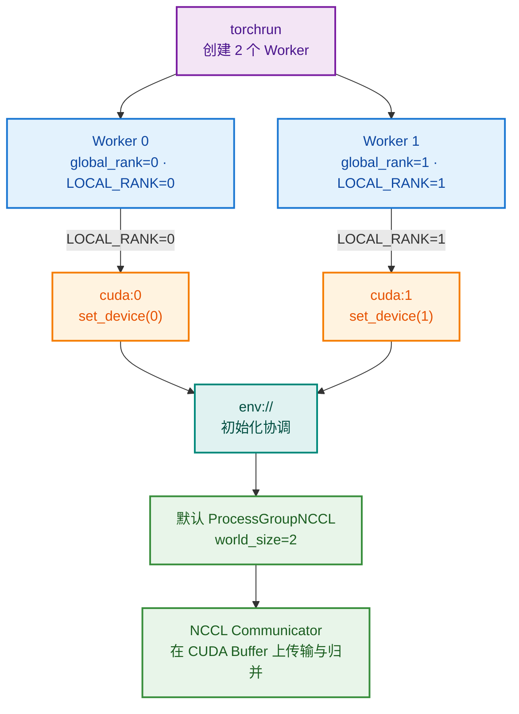

图 4-3：进程编号、可见设备与默认通信组。

All-to-All 的第 d 个发送块发往当前进程组的 Rank d。使用默认组时 d 就是 Global Rank；使用子组时则按子组成员顺序解释。Expert 放置与通信块使用相同的 EP Rank 编号，输入才能被送到目标 Expert 所在的进程。

## 4.3 AllReduce：把同一位置的元素归约

AllReduce 对各 Rank 张量的同一位置执行归约，并把结果写回每个参与者。本例选择 SUM：`[1,10] + [2,20] = [3,30]`，两个 Rank 都得到这份结果，输出仍有两个元素。

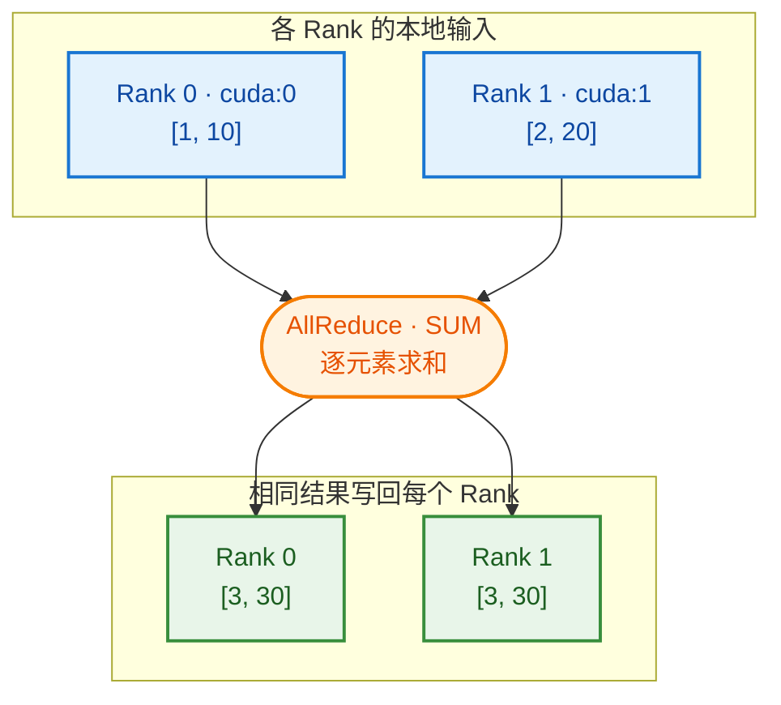

图 4-4：逐元素求和的 AllReduce。

下面的函数在两个 Worker 上分别调用，输入为本地 CUDA 上的 `[2]` int64 张量。整数值方便精确手算；`group=None` 使用默认进程组。

**完整摘录 · AllReduce 求和**

```python
import torch
import torch.distributed as dist

def all_reduce_sum(rank, device, group=None):
    buffer = torch.tensor([rank + 1, 10 * (rank + 1)],
                          dtype=torch.int64, device=device)
    # 原地求和；组内每个 Rank 都得到归约结果。
    dist.all_reduce(buffer, op=dist.ReduceOp.SUM, group=group)
    return buffer
```

**本地输入怎样由 Rank 决定**

**逻辑片段 · 构造本地贡献**

```python
# rank=0 得到 [1,10]，rank=1 得到 [2,20]。
buffer = torch.tensor([rank + 1, 10 * (rank + 1)],
                      dtype=torch.int64, device=device)
```

`buffer` 是当前进程持有的两个数。位置 0 保存 `rank+1`，位置 1 保存其十倍；通信按位置配对，所以第一项与第一项相加，第二项与第二项相加。

**将求和结果写回本地缓冲区**

**逻辑片段 · 原地归约**

```python
# 原地更新 buffer，组内每个 Rank 都获得相同结果。
dist.all_reduce(buffer, op=dist.ReduceOp.SUM, group=group)
```

调用后的 `buffer` 内容变为 `[3,30]`，shape 与 dtype 保持不变，张量仍在各自的 GPU。`all_reduce()` 更新传入张量，函数最后返回的就是这个缓冲区。

推广到 P 个 Rank，第一项为 `1+…+P = P(P+1)/2`，第二项为它的十倍。AllReduce 适合生成所有成员都需要的全组统计量。

## 4.4 AllGather：让每个 Rank 收齐所有输入

AllGather 保留每个来源的数据，让每个 Rank 收齐整组输入。本例 Rank 0 提供 `[0,100]`，Rank 1 提供 `[1,101]`；接收列表按来源 Rank 排列，随后 stack 成 `[[0,100],[1,101]]`。

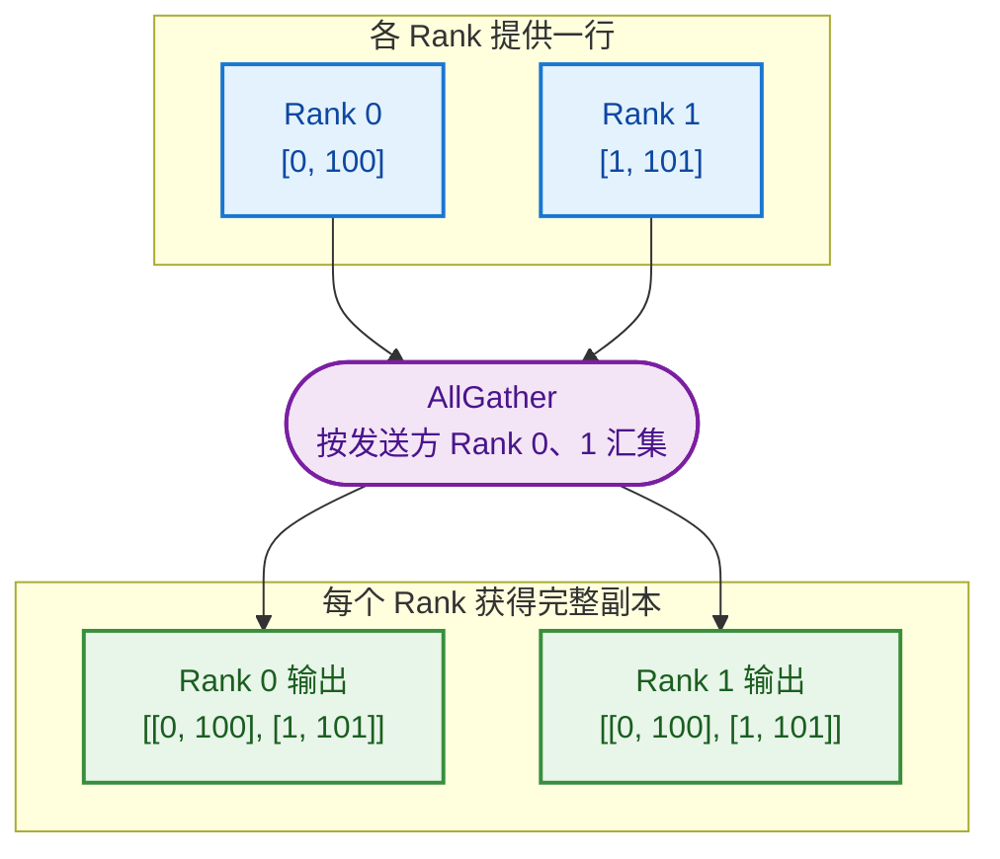

图 4-5：按来源收集的 AllGather。

本地输入 `local_row` 为 `[2]` int64 CUDA 张量。每个 Worker 为 P 个来源各准备一份同 shape、dtype、device 的接收张量，再执行收集。

**完整摘录 · AllGather 收集来源**

```python
import torch
import torch.distributed as dist

def gather_rank_rows(rank, world_size, device, group=None):
    local_row = torch.tensor([rank, rank + 100], dtype=torch.int64, device=device)
    gathered_rows = [torch.empty_like(local_row) for _ in range(world_size)]
    # 列表下标对应来源 Rank。
    dist.all_gather(gathered_rows, local_row, group=group)
    gathered = torch.stack(gathered_rows)
    return gathered
```

**准备并填充接收列表**

**逻辑片段 · 按来源接收**

```python
# 列表第 s 项用于接收来源 Rank s 的完整输入。
gathered_rows = [torch.empty_like(local_row) for _ in range(world_size)]
dist.all_gather(gathered_rows, local_row, group=group)
```

`local_row` 是当前 Rank 提供的两个数；`gathered_rows` 是长度为 P 的列表。`empty_like` 只分配接收空间，数值由通信填入。两卡时，第 0 项为 `[0,100]`，第 1 项为 `[1,101]`，各 Rank 获得相同列表。

**增加一维来表示来源**

**逻辑片段 · 来源维与 stack**

```python
# 将 P 个 [2] 张量叠成 [P,2]，第 0 维是来源 Rank。
gathered = torch.stack(gathered_rows)
```

双 Rank 的输出 shape 为 `[2,2]`，`gathered[s,:]` 保存来源 s 的数据。stack 保留每个输入的两个元素，并在外层增加来源维。

AllReduce 将同位置的贡献合为一个值；AllGather 保留每个来源的完整数值。后续 EP 会用 AllGather 收集小规模计数 metadata，以确定各来源发来的行数；Token 向量则用 All-to-All 按目标发送。

## 4.5 All-to-All：每个来源分别向每个目标发送

All-to-All 将一个 Rank 的发送缓冲区按目标分块，第 d 块发给 Rank d；接收方再按来源 Rank 拼接收到的块。发送块号回答“发给谁”，接收块号回答“来自谁”。本节先让每个目标恰好收到一行。

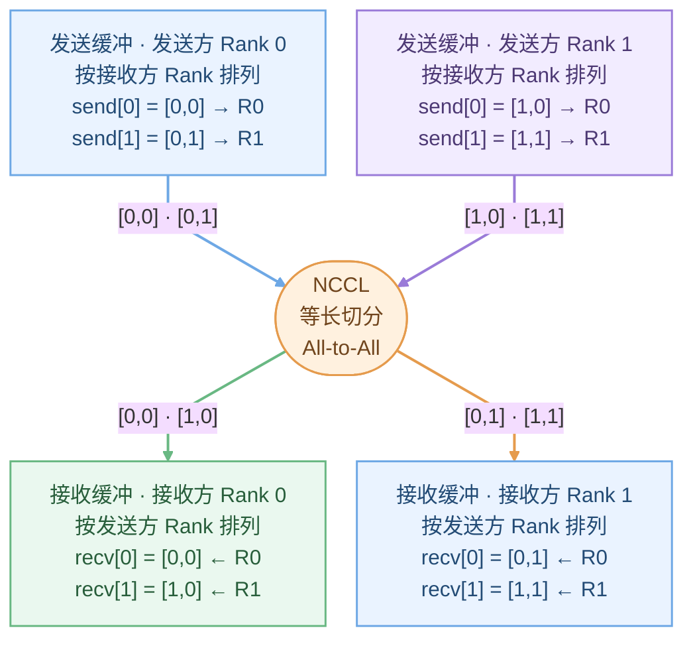

图 4-6：All-to-All 按目标发送、按来源接收。

用 `[source_rank,destination_rank]` 标记每行，双 Rank 的发送与接收可以完整写出：

| Rank | 发送缓冲区 | 接收缓冲区 |
| --- | --- | --- |
| 0 | `[[0,0],[0,1]]` | `[[0,0],[1,0]]` |
| 1 | `[[1,0],[1,1]]` | `[[0,1],[1,1]]` |

用 `[source_rank,destination_rank]` 给每行附上来源与目标标签，构造连续 `[P,2]` int64 缓冲区。每个 Worker 的第 d 行为 `[rank,d]`；标签用于看清行的去向，All-to-All 根据分块位置发送数据。

**完整摘录 · 构造并交换目标行**

```python
import torch
import torch.distributed as dist
from mini_ep.distributed.all_to_all import equal_split_all_to_all

def exchange_rank_rows(rank, world_size, device, group=None):
    source = torch.full((world_size,), rank, dtype=torch.int64, device=device)
    destination = torch.arange(world_size, dtype=torch.int64, device=device)
    # 第 d 行是一条发给目标 Rank d 的记录，行内保存来源和目标标签。
    send_buffer = torch.stack((source, destination), dim=1)
    recv_buffer = equal_split_all_to_all(send_buffer, group=group)
    return recv_buffer
```

**先构造两列，再组成发送行**

**逻辑片段 · 构造目标分块**

```python
# 两列分别记录来源与目标。
source = torch.full((world_size,), rank, dtype=torch.int64, device=device)
destination = torch.arange(world_size, dtype=torch.int64, device=device)
send_buffer = torch.stack((source, destination), dim=1)
```

- `source`：长度为 P，每项都是当前 Rank。
- `destination`：目标编号 `[0,…,P−1]`。
- `send_buffer`：将两列逐项配对后的 `[P,2]` 张量，第 d 行发往目标 d。

例如 Rank 0：`source=[0,0]`，`destination=[0,1]`，`stack(...,dim=1)` 将同一位置的两个数组成一行，得到 `[[0,0],[0,1]]`。Rank 1 对应 `[[1,0],[1,1]]`。

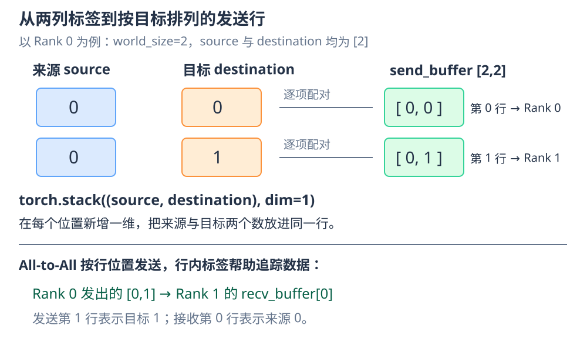

按列构造、按行发送：stack(dim=1) 将来源与目标逐项配对，第 d 行随后发往目标 Rank d。

**交换后按来源解释接收行**

**逻辑片段 · 目标顺序变为来源顺序**

```python
# 输入按目标分块；输出按来源分块。
recv_buffer = equal_split_all_to_all(send_buffer, group=group)
```

`equal_split_all_to_all` 从本课 `mini_ep.distributed.all_to_all` 导入，返回新分配的接收缓冲区。Rank 0 从来源 0 收到 `[0,0]`，从来源 1 收到 `[1,0]`；Rank 1 收到 `[0,1]` 与 `[1,1]`。

每个 Rank 也保留发给自己的块，因此输出同时包含本地与远端来源。发送与接收张量的 shape 都是 `[2,2]`，行的组织规则从目标顺序变为来源顺序，行内的两个标签保持原值。

### 4.5.1 等长分块的张量布局

`equal_split_all_to_all()` 将通信封装为一次 `dist.all_to_all_single()` 调用。输入为连续 `[rows,…]` 张量，第 0 维为行，剩余维度为每行载荷；rows 可被组大小 P 整除。

所有 Rank 使用匹配的等长配置：每个发送方将 rows 行分成 P 块，每块 `rows/P` 行。下面摘录交换核心，仓库实现还检查进程组状态、连续性和可整除条件。

**逻辑片段 · 等长 All-to-All 接口**

```python
# 预先按目标打包；每个目标获得相同的行数。
recv_buffer = torch.empty_like(send_buffer)
dist.all_to_all_single(
    recv_buffer,
    send_buffer,
    group=group,
    async_op=False,
)
```

`recv_buffer` 与输入具有相同 shape、dtype、device，按来源 Rank 保存各块，块内次序保持不变。通信前已经确定目标分块；接口按第 0 维划分这些块。

本例每个目标块为一行、两个 int64 元素，即 16 字节。本地发送与接收张量各有 4 个元素、32 字节，其中各有一个发给自己的块与一个远端块。更大的 `[rows,H]` 输入也按行分块，每行携带 H 个特征。

下面的对照图改用同一组输入 `[1,10]`、`[2,20]` 比较三种操作，便于看清“求和、收齐、重分发”的区别；All-to-All 在这里将每个标量作为一个等长块。

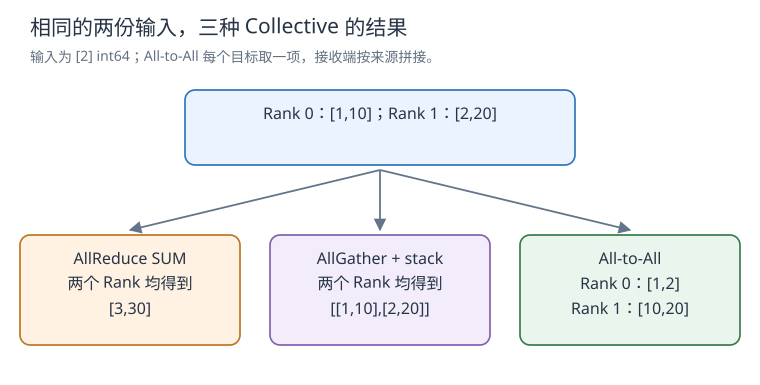

图 4-7：相同输入经过归约、收集与重分发后的结果。

在图 4-7 的共同输入下，AllReduce 使两端得到 `[3,30]`，AllGather 使两端收齐 `[[1,10],[2,20]]`；All-to-All 则让 Rank 0 收到 `[1,2]`，Rank 1 收到 `[10,20]`。不同操作保留的数据与来源关系不同，EP 使用按目标交换来组织 Expert 输入。

## 4.6 Collective 的顺序也是数据流的一部分

每个进程独立执行代码，通信将这些本地调用连接起来。本课所有 Rank 都按 `AllReduce → AllGather → All-to-All` 的顺序进入同一个组的操作，并使用匹配的参数。调用顺序给出了对应关系，实际提交时刻可以不同。

本课使用默认的同步接口形式 `async_op=False`，调用返回时已建立当前 CUDA 流消费通信结果所需的依赖。同一当前流上的后续 GPU 运算按该依赖读取输出；CPU 打印结果前，示例在三次通信之后统一等待设备完成。

**逻辑片段 · Host 读取前的完成边界**

```python
# 三次通信完成提交后，等待设备结果就绪再向 CPU 报告。
torch.cuda.synchronize(device)
```

这里的设备同步服务于结果检查与报告；组内一致的 Collective 顺序服务于成员间的数据交换。本课据此检查数值与布局，性能测量会在后续课程另行定义区间。

| 操作 | 本地输出 shape | 双 Rank 预期内容 |
| --- | --- | --- |
| AllReduce SUM | `[2]` | `[3,30]` |
| AllGather + stack | `[2,2]` | `[[0,100],[1,101]]` |
| All-to-All | `[2,2]` | Rank d 得到 `[[0,d],[1,d]]` |

`run_collectives()` 用求和公式与来源顺序构造预期值，再检查结果数值、shape、dtype、device 和连续性。各 Rank 的日志分别带上自己的编号，读者可以将上表与两个进程的输出逐项对照。

### 4.6.1 让通信组跟随程序的生命周期

入口使用 `nccl_distributed()` 上下文管理器：进入 with 时建组，with 内执行通信与检查，退出时释放它创建的组。`DistributedContext` 将进程身份、设备与通信组装在一起，传给执行函数。

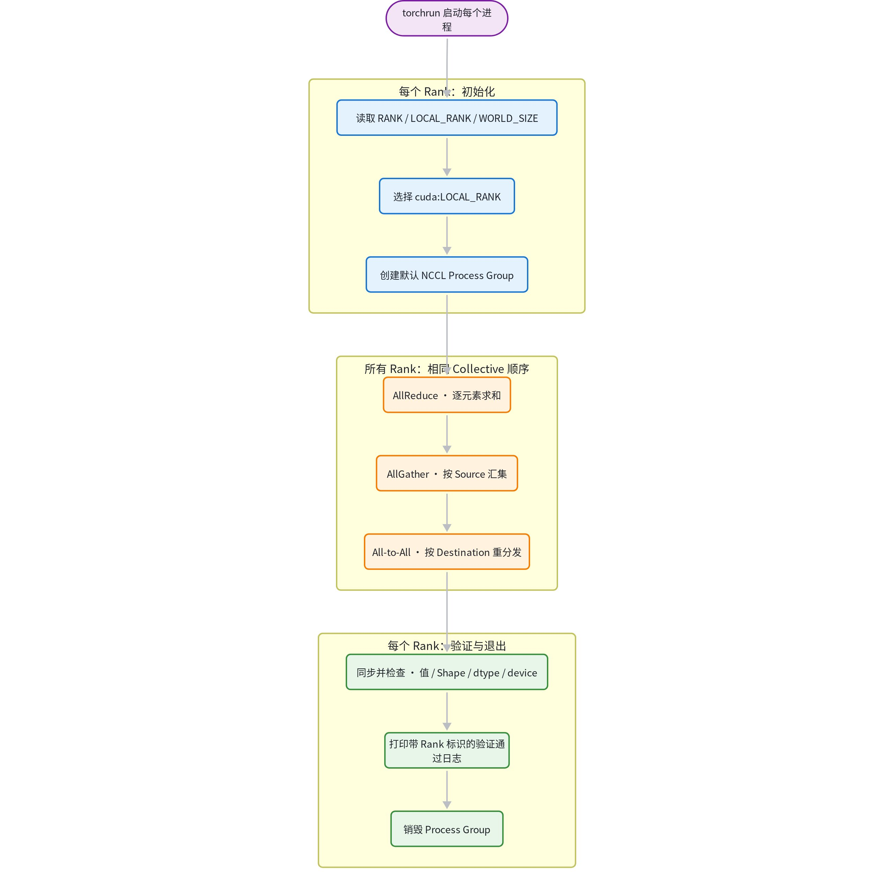

图 4-8：各 Rank 共同遵循的通信与检查顺序。

下面保留入口的核心结构。`run_collectives` 执行三次通信，并在报告前同步、检查结果；本课脚本的 main 还包含启动参数解析与参与人数校验。

**完整摘录 · 通信上下文与入口**

```python
from mini_ep.distributed.groups import nccl_distributed

def main(run_collectives):
    with nccl_distributed(timeout_seconds=120) as context:
        results = run_collectives(context)
        print(f"rank={context.global_rank} device={context.device} PASS", flush=True)
    return results
```

- `context.global_rank / local_rank / world_size`：当前进程的全局编号、本机编号与参与人数。
- `context.device`：该 Worker 绑定的 CUDA 设备。
- `context.group`：三次 Collective 使用的默认进程组。
- `results`：`CollectiveResults` 数据类，保存 AllReduce、AllGather 输出和 All-to-All 收发缓冲区。

上下文退出时通过 `finally` 释放本次创建的进程组，正常返回与异常路径都遵循该释放逻辑。源码职责也与这条路径对应：`mini_ep/distributed/groups.py` 管理身份与组，`test/demo.py` 执行并检查三种通信，`all_to_all.py` 封装分块接口。

## 4.7 通信阶段与可观察的进程状态

观察分布式程序时，可以先按 Rank 对照日志：哪个进程完成初始化，谁进入了哪次 Collective，最后输出什么。本课报告包含 Global Rank、Local Rank、World Size、设备与三种操作的结果。

需要更细的初始化与通信信息时，开启 PyTorch/NCCL 调试日志。下面命令都在 `code/course4/` 中执行；通信示例仍需两张 GPU。

**调试日志与正确性测试**

```bash
# 双 GPU：显示初始化与通信调试信息。
TORCH_DISTRIBUTED_DEBUG=DETAIL NCCL_DEBUG=INFO \
  torchrun --standalone --nproc-per-node=2 \
  test/demo.py --expected-world-size=2 --timeout-seconds=120

# 在本课 checks/ 中发现并运行测试。
python3 -m unittest discover -s checks -p 'test_distributed_nccl.py' -v
```

环境解析与接口校验测试可在 CPU 上运行；mock 测试检查调用参数与缓冲区属性，真实 NCCL 数据交换由双 GPU 集成测试覆盖。后者启动两个进程，检查两份 PASS 日志及实际数值，通信超时为 60 秒，子进程等待上限为 90 秒。

没有两张可见 CUDA GPU 或 NCCL 支持时，双 GPU 测试会跳过。通信失败时，按 Rank 保留报错与调试输出，先对照设备绑定、调用顺序和形状参数，定位到具体阶段。

## 4.8 从数据交换走向 Expert Parallel

将 All-to-All 的行从整数标签换成 Token 特征，就接回了前面的路由数据流：源 Rank 根据目标 Expert 找到目标 Rank，按目标打包输入；接收方运行本地 Expert，再把结果按来源送回，源端恢复顺序并应用路由权重。

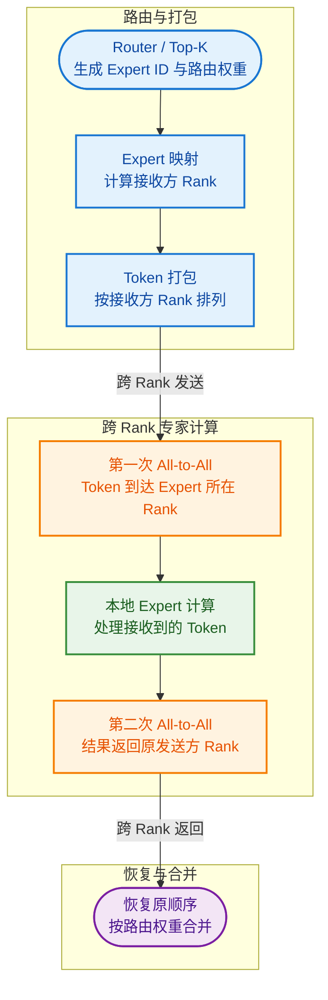

图 4-9：Expert Parallel 的输入与结果往返。

均匀放置四个 Expert 到两个 Rank 时，每 Rank 持有两个 Expert：E0/E1 属于 Rank 0，E2/E3 属于 Rank 1。若 Rank 0 的 T0 路由到 E2，该分支走 `Rank 0 → Rank 1 的 E2 → Rank 0`，回来后再与 T0 的其他分支加权合并。

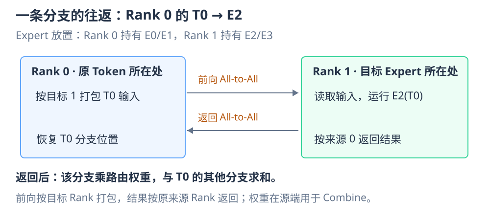

T0→E2 分支往返：输入送到 Expert 所在 Rank，计算结果返回原来源，再参与源端的加权合并。

Expert 放置事先确定，路由决定每次前向发往各 Rank 的行数。第五课为每个目标块补充变长 splits，继续沿“按目标发送、按来源接收”的规则追踪输入与结果往返。

通信接口与 CUDA 流语义见 [PyTorch Distributed](https://docs.pytorch.org/docs/2.11/distributed.html)，启动与环境变量见 [torchrun](https://docs.pytorch.org/docs/2.11/elastic/run.html)。

继续阅读 [第 5 课：All-to-All 与 EP 通信](https://tvle9mq8jh.feishu.cn/docx/Wl15dw3sJovDErxqGTIcUlDvnHb)。

[上一课](第03课.md) · [课程首页](课程首页.md) · [下一课](第05课.md)
