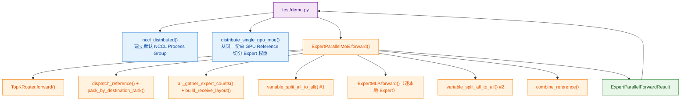
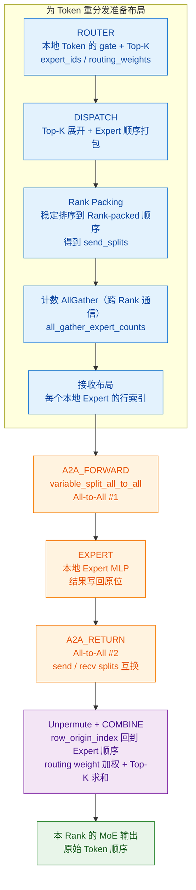
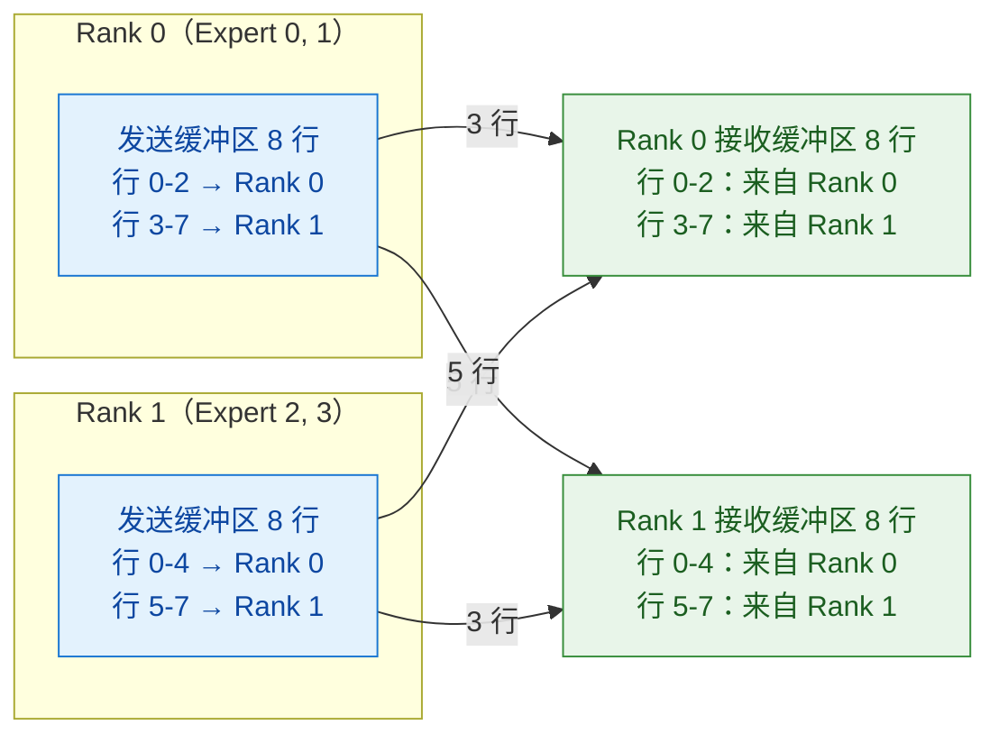
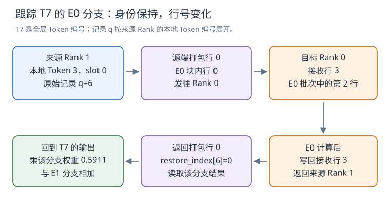

# 第 6 课：实现 Mini-EP V1

本课独立源码位于 `code/course6/`，示例在 `test/`，正确性测试在 `checks/`。下文命令均在本课目录中执行；将整个目录复制到其他位置后也使用同样的启动方式。

单 GPU 上的 MoE 有一条容易看清的数据流：Router 为每个 Token 选择 Expert，Dispatch 把属于同一个 Expert 的输入放在一起，Expert 计算，最后把结果按路由权重加起来。

把 Expert 分到两张 GPU 上以后，这条数据流多了一段路程。一个 Token 可能留在本地，也可能要去另一张卡；Top-2 还会让同一个 Token 同时交给两个 Expert。

计算结束后，这些结果要重新汇合，才能成为原来那个 Token 的输出。

先看一个具体的 Token。T0 在 Rank 0 上，Router 为它选出 E3 和 E2，两个 Expert 都在 Rank 1。Rank 0 要发送两行相同的输入向量；Rank 1 分别调用 E3 和 E2，再把两行输出送回 Rank 0。最终得到：

**加权输出**

```text
y(T0) = 0.6476 × E3(T0) + 0.3524 × E2(T0)
```

向量在两张卡之间往返，路由权重和原始 Token 编号始终保存在 Rank 0。接下来要弄清的是：接收方怎样区分这两行，计算后的两行怎样找到各自的位置，以及多个 Token 一起发送时，怎样一次完成这件事。

第五课的缩放回环已经让第二课六条记录跨 Rank 往返，得到同样的加权输出。接入 MLP 后，每个 Expert 要一次处理自己的批次；接收缓冲区却按来源 Rank 拼接，同一 Expert 的记录可能分散在多个来源块中。

Mini-EP V1 的关键就是从计数重建这些行索引，收集给本地 Expert，计算后写回原接收位置，再将结果返回来源。

## 6.1 Expert 留在原处，Token 去找它

这里的 Rank 是通信组内的进程编号。每个进程绑定一张 GPU，保存自己的输入和 Expert 权重。默认进程组用作 EP group，因此 `ep_size = world_size`，`ep_rank = global_rank`。

单机两进程时，`LOCAL_RANK` 分别为 0、1，用来选择进程可见的 `cuda:0`、`cuda:1`；可见设备编号由启动环境决定。

先沿用第五课的布局关系：Rank 0 的 E0 接收行 `[0,1,4]`，E1 接收行 `[2,3,5]`。把逐行缩放替换为 MLP，只需分别收集这两组行，完成计算后写回各自位置，返回边界仍是 `[4,2]`。

下面扩大到八个 Token 和 H=64、F=128，以展示完整模型前向。全组 Token 数记为 T，EP group 的 Rank 数记为 P，本 Rank 输入行数记为 N，示例等分后满足 `N=T/P`。

表中的 T0～T7 是全组输入的标签，代码中的 Token 索引则相对于各 Rank 的本地输入。例如 Rank 1 的 `[4,64]` 输入按行存放 T4、T5、T6、T7，本地索引依次为 0、1、2、3。

它保存的 `packed_token_indices=0` 指向 T4，返回合并也写入本地输出第 0 行。这里用 T 表示全组 Token 数，N 表示本 Rank 的原始输入行数；

接收到多少条 Expert 记录，要等路由计数确定。

| 对象 | 配置 | 放在哪里 |
| --- | --- | --- |
| 输入 | T=8，H=64 | Rank 0 保存 T0～T3；Rank 1 保存 T4～T7 |
| Router | 4 个 Expert，Top-2 | 两个 Rank 各保存同一份 gate 权重 |
| Expert MLP | H=64，F=128 | Rank 0 保存 E0、E1；Rank 1 保存 E2、E3 |
| 输出 | 每个 Rank 得到 `[4,64]` | 回到各自输入的原始 Token 顺序 |

连续均匀放置的配置满足 `num_experts > 0`、`ep_size > 0` 与 `num_experts % ep_size == 0`。四个 Expert 分给两个 Rank，每个 Rank 持有两个；在此前提下，Expert ID 可直接转换为目标 Rank 和本地编号：

**Expert 映射 · code/course6/mini_ep/distributed/topology.py**

```python
class ExpertParallelTopology:
    def __init__(self, num_experts, ep_size, ep_rank):
        if num_experts <= 0 or ep_size <= 0 or num_experts % ep_size != 0:
            raise ValueError("Expert 数与 EP 大小需要为正，且 Expert 数能被 EP 大小整除")
        if not 0 <= ep_rank < ep_size:
            raise ValueError(f"ep_rank={ep_rank} 应位于 [0, {ep_size})")
        self.num_experts = num_experts
        self.ep_size = ep_size
        self.ep_rank = ep_rank

    @property
    def experts_per_rank(self):
        return self.num_experts // self.ep_size

    def destination_rank(self, expert_id):
        # 连续的 L 个全局 Expert 共享同一个目标 Rank。
        return expert_id // self.experts_per_rank

    def local_expert_id(self, expert_id):
        # 在该 Rank 的 L 个 Expert 中定位本地编号。
        return expert_id % self.experts_per_rank
```

**商确定设备，余数确定设备内参数**

```python
# 均匀放置下，用整除定位目标 Rank，用余数定位设备内 Expert。
def destination_rank(self, expert_id):
    # 连续的 L 个全局 Expert 共享同一个目标 Rank。
    return expert_id // self.experts_per_rank

def local_expert_id(self, expert_id):
    # 在该 Rank 的 L 个 Expert 中定位本地编号。
    return expert_id % self.experts_per_rank
```

四个 Expert 分给两个 Rank 时 L=2。对 E3，商 1 指定 Rank 1，余数 1 指定这个 Rank 的第二个 Expert。

构造函数先保证 E、P 为正且 E 能被 P 整除，映射才覆盖连续、等长的 Expert 区间。

例如，E3 的目标 Rank 是 `3 // 2 = 1`，在 Rank 1 的本地编号是 `3 % 2 = 1`。这些映射由 `ExpertParallelTopology` 提供，构造时会检查 Expert 数能否被 EP size 整除。

Router 选出全局 Expert ID 后，发送方用映射找到目标 Rank，接收方用本地 ID 找到自己的 Expert 模块。

模型准备阶段，各 Rank 在 CPU 上用相同随机种子创建 `SingleGPUMoE`，再调用 `distribute_single_gpu_moe()`。每个进程复制同一份 Router，只保留本 Rank 的 Expert，并把模型迁移到绑定的 CUDA 设备和所选 dtype。

路由使用相同 gate，分支使用相同 Expert 参数，因此分布式输出可以与完整单设备模型按同一条数学定义比较。

### 6.1.1 模块职责与前向数据流

从源码阅读时，可以先看 `test/demo.py` 如何准备输入、建立通信组和比较结果，再进入 `ExpertParallelMoE.forward()` 跟踪一次前向。下面列出它调用的主要模块，以及每个模块需要关注的数据：

| 文件 | 阅读时关注什么 |
| --- | --- |
| `mini_ep/model/router.py` | Expert ID、Top-K 权重和每个 Expert 的命中计数 |
| `mini_ep/distributed/topology.py` | Expert 放置、发送量和接收行索引 |
| `mini_ep/distributed/dispatch.py` | 两次打包排列，以及返回后的 Combine |
| `mini_ep/distributed/all_to_all.py` | 计数交换和变长 All-to-All 的缓冲区契约 |
| `mini_ep/model/moe.py` | 把这些部件接成完整前向 |

图中可以沿两条顺序读代码：准备模型时切分 Expert 权重；执行前向时生成路由，将 Token 按 Expert 和目标 Rank 打包，发送到相应设备计算，再返回并合并。下面各节会按前向的顺序展开这些函数，逐次说明缓冲区中的行怎样变化。



图 6-1：前向入口与各模块的调用关系。

图中的 `distribute_single_gpu_moe()` 负责切分权重；`forward()` 负责搬运当前批次的 Token。权重在模型准备阶段确定，Token 的去向则由每次前向的 Router 结果决定。

## 6.2 从路由决定到通信计划

每个 Rank 从自己的 `[N,H]` 输入生成路由与发送块。接收方需要两层信息：从各来源收到多少行，以及每个来源块里各本地 Expert 占多少行。V1 将来源的逐 Expert 计数收集成矩阵，用它同时分配缓冲区和生成 Expert 行索引。一次前向由这些依赖连接：

**前向流程**

```text
本地 Router → Expert 顺序打包 → 目标 Rank 打包
→ 计数 AllGather → 接收布局
→ 正向 All-to-All → 本地 Expert 计算
→ 返回 All-to-All → 恢复排列与加权求和
```

代码用 NVTX 为各阶段添加可显示在性能分析工具中的名称：`ROUTER`、`DISPATCH`、`A2A_FORWARD`、`EXPERT`、`A2A_RETURN` 和 `COMBINE`。

在 Nsight Systems 的 Timeline 中，这些标记帮助定位哪段代码正在路由、通信或计算。`DISPATCH` 包含发送侧打包、计数 AllGather 和接收布局推导；

Token 向量随后由 `A2A_FORWARD` 搬运。读时间线时，可以先沿这些阶段找到对应函数，再查看其中的 Kernel 与通信活动。



图 6-2：布局准备、计数交换与两次 Token All-to-All。

### 6.2.1 Router 给出的是计算分支

每个 Rank 用相同的 gate 权重给自己的 Token 打分。输入是 `[num_local_tokens,H]`；`expert_ids` 和 `routing_weights` 的形状都是 `[num_local_tokens,K]`。

Expert ID 用整数表示，路由权重在 FP32 中归一化，同一个 Token 的 K 个权重之和为 1。Expert 计算可以使用 FP32、FP16 或 BF16。

下面用一份具体路由表展开八个 Token 的分支。表内权重以四位小数表示，供追踪记录与加权关系使用；代码保留 Router 实际生成的完整精度权重。每个来源的四行输入展开为八条记录，Expert 编号确定计算地点，slot 与权重确定返回后的贡献。

| Token | 所在 Rank | slot 0：Expert / 权重 | slot 1：Expert / 权重 |
| --- | --- | --- | --- |
| T0 | 0 | E3 / 0.6476 | E2 / 0.3524 |
| T1 | 0 | E2 / 0.5070 | E0 / 0.4930 |
| T2 | 0 | E2 / 0.7374 | E1 / 0.2626 |
| T3 | 0 | E0 / 0.5267 | E3 / 0.4733 |
| T4 | 1 | E3 / 0.6381 | E1 / 0.3619 |
| T5 | 1 | E1 / 0.5749 | E3 / 0.4251 |
| T6 | 1 | E2 / 0.5524 | E1 / 0.4476 |
| T7 | 1 | E0 / 0.5911 | E1 / 0.4089 |

T1 的两个分支分别去 Rank 1 和 Rank 0；T0 的两个分支都去 Rank 1。每个分支对应一次 Expert 调用，称为一条 assignment，中文可以理解为一条路由记录。

Top-2 下，四个本地 Token 产生八条记录。即使两条记录发往同一张卡，它们也对应不同的 Expert，发送缓冲区分别保存一行输入。

按表统计，Rank 0 的 `tokens_per_expert` 为 `[2,1,3,2]`，Rank 1 为 `[1,4,1,2]`，两个向量各计八条记录。它们表示当前来源选择了各 Expert 多少次。

将各来源计数相加得到 `[3,5,4,4]`，才是全组各 Expert 实际处理的批次行数；把本地来源计数和全组计算负载分开，后续接收布局就有了明确含义。

## 6.3 Expert 布局与通信布局

### 6.3.1 Expert-major：按计算对象排列

Router 的结果按 Token 排列，Expert 希望得到自己的输入批次。`dispatch_reference()` 先按 Token、再按 slot 展平路由，然后根据全局 Expert ID 稳定排序。Rank 0 的规范展平顺序和打包顺序分别是：

**记录顺序**

```text
规范顺序：
(T0,E3), (T0,E2), (T1,E2), (T1,E0),
(T2,E2), (T2,E1), (T3,E0), (T3,E3)

Expert 顺序：
(T1,E0), (T3,E0) | (T2,E1) |
(T0,E2), (T1,E2), (T2,E2) | (T0,E3), (T3,E3)
```

这里的稳定排序保证同一个 Expert 内部仍按原来的 Token/slot 次序排列。排序对象是路由记录，读取输入时则使用这些记录的 Token 索引。同一个 Token 因而可以被读取两次，成为发送缓冲区中的两行。

**Expert 打包 · code/course6/mini_ep/distributed/dispatch.py**

```python
import torch

def pack_expert_rows(tokens, expert_ids):
    # 按 Token、slot 展平，定义原始记录顺序。
    flat_expert_ids = expert_ids.reshape(-1).to(torch.int64)
    flat_token_indices = torch.arange(
        tokens.shape[0], device=tokens.device, dtype=torch.int64
    ).repeat_interleave(expert_ids.shape[1])

    # 稳定排序将同一 Expert 的记录放到相邻行。
    pack_index = torch.argsort(flat_expert_ids, stable=True)
    # 逆排列供返回后恢复原 Token/slot 顺序。
    restore_index = torch.argsort(pack_index)
    packed_token_indices = flat_token_indices.index_select(0, pack_index)
    # 按来源行号收集输入，形成连续打包缓冲区。
    packed_tokens = tokens.index_select(0, packed_token_indices).contiguous()
    return packed_tokens, pack_index, restore_index
```

**从规范记录编号走到连续 Expert 输入**

```python
# 按 Expert 稳定排序记录，并用原记录编号收集对应 Token 行。
pack_index = torch.argsort(flat_expert_ids, stable=True)
# 逆排列供返回后恢复原 Token/slot 顺序。
restore_index = torch.argsort(pack_index)
packed_token_indices = flat_token_indices.index_select(0, pack_index)
# 按来源行号收集输入，形成连续打包缓冲区。
packed_tokens = tokens.index_select(0, packed_token_indices).contiguous()
```

先稳定排序 Expert ID，再按这份排列读取 Token 行号。Rank 0 的来源行号变为 [1,3,2,0,1,2,0,3]，形成八行连续输入；

restore_index=[6,3,4,0,5,2,1,7] 保存原始八条记录各自的新位置。后面的通信可以移动向量，源端保留这个对应关系。

`packed_tokens` 是 `[num_local_tokens*K,H]` 的连续张量，dtype 和 device 与输入相同。索引采用 `int64`，与输入在同一设备上；Token、slot、Expert ID 和权重都按同一个 `pack_index` 重排。排列后的 Rank 0 数据如下：

| 打包行 | 原 Token | slot | Expert | 权重 | 目标 Rank |
| --- | --- | --- | --- | --- | --- |
| 0 | T1 | 1 | E0 | 0.4930 | 0 |
| 1 | T3 | 0 | E0 | 0.5267 | 0 |
| 2 | T2 | 1 | E1 | 0.2626 | 0 |
| 3 | T0 | 1 | E2 | 0.3524 | 1 |
| 4 | T1 | 0 | E2 | 0.5070 | 1 |
| 5 | T2 | 0 | E2 | 0.7374 | 1 |
| 6 | T0 | 0 | E3 | 0.6476 | 1 |
| 7 | T3 | 1 | E3 | 0.4733 | 1 |

`packed_token_indices` 与 `restore_index` 分别连接输入行和路由记录。前者为 `[1,3,2,0,1,2,0,3]`，说明每个打包行从哪个原 Token 读取向量；

后者为 `[6,3,4,0,5,2,1,7]`，说明每条原始 Token/slot 记录位于哪个打包行。一个索引用于构造 Expert 输入，另一个用于恢复 Expert 输出，二者共同保存分支的来源关系。

Expert 的区间由带前导零的前缀和给出：`expert_offsets = [0,2,3,6,8]`。E2 的输入占 `[3,6)`，共有三行。索引、计数和偏移描述的是同一份布局，可以相互核对。

### 6.3.2 Rank-packed：按通信目标排列

`all_to_all_single()` 读取一个连续缓冲区，按 dim 0 把它切成若干块：第 0 块发给 Rank 0，第 1 块发给 Rank 1。因此，还要把行按目标 Rank 排列，并记录每块的行数。

**Rank 打包 · code/course6/mini_ep/distributed/dispatch.py**

```python
import torch

def build_rank_plan(dispatch, topology):
    destination_rank = topology.destination_rank(dispatch.packed_expert_ids)
    # 按目标 Rank 排列，记录各行原来的 Expert 位置。
    row_origin_index = torch.argsort(destination_rank, stable=True).contiguous()
    send_splits = torch.zeros(
        topology.ep_size, dtype=torch.int64, device=destination_rank.device
    )
    # 累加每个目标 Rank 的发送行数。
    send_splits.scatter_add_(
        0, destination_rank, torch.ones_like(destination_rank, dtype=torch.int64)
    )
    return row_origin_index, send_splits
```

**通信排列保存 Expert 行的来处**

```python
# 按目标 Rank 重排 Expert 行，同时保留回到 Expert 顺序的映射。
destination_rank = topology.destination_rank(dispatch.packed_expert_ids)
# 按目标 Rank 排列，记录各行原来的 Expert 位置。
row_origin_index = torch.argsort(destination_rank, stable=True).contiguous()
```

目标 Rank 向量与 Expert-major 行逐一对应。对目标稳定排序，row_origin_index[k] 就是第 k 个通信行应读取的 Expert 行；

返回后使用同一个数作为散射目标。连续放置下它是恒等排列，接口仍明确保存这层布局关系。

**按目标编号累加发送块长**

```python
# 每条路由记录向其目标 Rank 的行数计数贡献 1。
send_splits.scatter_add_(
    0, destination_rank, torch.ones_like(destination_rank, dtype=torch.int64)
)
```

scatter_add_ 将每条记录贡献的整数 1 加到 destination_rank 指定的位置。长度为 P 的 int64 输出给出各目标行数，总和为 N×K。

它回答发多少行，row_origin_index 回答这些行按什么顺序排列。

`row_origin_index[k]` 表示 Rank-packed 第 k 行来自 Expert 顺序的哪一行。打包函数用它重排输入和对应 metadata。`send_splits[d]` 是本 Rank 发给目标 d 的行数，长度为 `ep_size`。

在当前放置方式下，E0、E1 都去 Rank 0，E2、E3 都去 Rank 1。全局 Expert ID 升序也就意味着目标 Rank 升序，所以第二次排序得到恒等排列。

Rank 0 的前 3 行发给 Rank 0，后 5 行发给 Rank 1：`send_splits=[3,5]`，`send_offsets=[0,3,8]`。Rank 1 同样得到 `[5,3]`。

本例的第二次排序保持原行序。`pack_by_destination_rank()` 给出发送缓冲区和 `send_splits`：第 d 块交给 Rank d，块内保持 Expert 顺序。改变 Expert 放置时，可以在这一步调整目标排列，并在返回后恢复到原 Expert 顺序。

## 6.4 从全局计数重建接收布局

### 6.4.1 用一份计数矩阵确定接收量

Rank 0 已经知道自己要发送 `[3,5]` 行，却还不知道 Rank 1 会发来多少。接收缓冲区要在传输之前分配，因此先交换计数。`all_gather_expert_counts()` 把各 Rank 的 `[num_experts]` 整数向量收集为 `[ep_size,num_experts]`：

**Expert 计数**

```text
C = [[2,1,3,2],     # 来源 Rank 0，按 E0～E3 排列
     [1,4,1,2]]     # 来源 Rank 1
```

在 NCCL 路径上，这份 `int64` 计数张量也放在各进程绑定的 CUDA 设备上。四个 `int64` 是 32 bytes，每个 Rank 收集得到的完整矩阵占 64 bytes。交换的是计数；64 维 Token 向量由下一步的 All-to-All 传送。

把每一行中属于同一个目标 Rank 的 Expert 计数相加，就得到发送矩阵 S。行代表来源，列代表目标：

| 来源 / 目标 | Rank 0：E0、E1 | Rank 1：E2、E3 |
| --- | --- | --- |
| Rank 0 | 2+1=3 | 3+2=5 |
| Rank 1 | 1+4=5 | 1+2=3 |

发送方读取自己的行，接收方读取自己的列。对于任意来源 s 和目标 d：

**发送与接收计数**

```text
S[s,d] = Rank s 的 send_splits[d]
       = Rank d 的 recv_splits[s]
```

因此，Rank 0 从 Rank 0 收到 3 行、从 Rank 1 收到 5 行；Rank 1 从 Rank 0 收到 5 行、从 Rank 1 收到 3 行。本例的 S 恰好对称，发送和接收向量数值相同。

换成倾斜 Top-1 路由，S 可以是 `[[3,1],[3,1]]`：两边都发送 `[3,1]`，Rank 0 接收 `[3,3]`，Rank 1 接收 `[1,1]`。按行、按列的两种读法在这个例子里就区分开了。

第五课通过单独一次 All-to-All 发送逐行本地 Expert ID。V1 改用计数矩阵 C 和发送块内的 Expert 顺序确定归属。例如 Rank 0 从来源 0 收到的计数为 `[2,1]`，前三行的本地 ID 就是 `[0,0,1]`；

从来源 1 收到 `[1,4]`，接下来的五行就是 `[0,1,1,1,1]`。接收方知道块长和块内排列，便能直接重建各 Expert 的行索引。

因此，第五课的调用序列是计数 All-to-All、Token All-to-All、ID All-to-All、输出 All-to-All；V1 的序列是计数 AllGather、Token All-to-All、输出 All-to-All。

AllGather 收集 `[P,E]` 的整数计数，Token 向量仍通过两次 All-to-All 往返。S 用于描述 Rank 之间的总行数，C 进一步给出这些行分别属于哪个 Expert。

### 6.4.2 All-to-All 的输出按来源排列

发送侧按目标 Rank 分块，接收侧按来源 Rank 拼接。Rank 0 的接收缓冲区先放来源 Rank 0 的三行，再放来源 Rank 1 的五行；每个来源块内部，延续发送端的 Expert 顺序。

Rank 0 拥有 E0、E1，从 C 中取这两列：

**接收布局**

```text
per_source_local_expert_counts = [[2,1],
                                 [1,4]]
recv_splits  = [3,5]
recv_offsets = [0,3,8]

接收行：
0,1     → 来源 R0，E0
2       → 来源 R0，E1
3       → 来源 R1，E0
4,5,6,7 → 来源 R1，E1
```

按来源切片时，接收缓冲区包含两个连续块。按 Expert 收集时，E0 取行 `[0,1,3]`，E1 取行 `[2,4,5,6,7]`。同一个 Expert 的输入分散在两个来源块里，使用这组行索引便能把它们收集成一个计算批次。下面从各块的计数推导这些索引。

Rank 1 取 E2、E3 两列，得到 `[[3,2],[1,2]]`。它的接收偏移是 `[0,5,8]`，E2 的索引是 `[0,1,2,5]`，E3 是 `[3,4,6,7]`。两个 Expert 分别处理四行。

### 6.4.3 从块长推导行索引

来源 s 的块从 `recv_offsets[s]` 开始。本地 Expert e 在这个块之前有多少行，等于同一来源下编号小于 e 的 Expert 计数之和。因此：

**Expert 区间**

```text
start(s,e) = recv_offsets[s] + sum(local_counts[s,:e])
count(s,e) = local_counts[s,e]
```

对固定 Expert e，依次拼接各来源的 `[start,start+count)`，便得到它的全部输入行索引。下面给出独立的 PyTorch 推导函数：`local_counts` 为非负 int64 矩阵，shape 是 `[P,L]`，P 是来源数，L 是本地 Expert 数；

其两维均为正。CPU 与 CUDA 使用相同布局，返回的 splits、offsets 和索引均在输入设备上。例子中的 E0 索引 `[0,1,3]` 直接来自两个来源块的边界。

**行索引推导**

```python
import torch

def derive_local_rows(local_counts):
    recv_splits = local_counts.sum(dim=1)
    # 前导零与前缀和共同给出各来源块的边界。
    recv_offsets = torch.cat([
        recv_splits.new_zeros(1), recv_splits.cumsum(dim=0)
    ])
    rows_by_expert = []
    for e in range(local_counts.shape[1]):
        blocks = []
        for s in range(local_counts.shape[0]):
            start = int(recv_offsets[s].item())
            # 跳过该来源块内编号更小的本地 Expert。
            start += int(local_counts[s, :e].sum().item())
            count = int(local_counts[s, e].item())
            blocks.append(torch.arange(
                start, start + count,
                dtype=torch.int64, device=local_counts.device
            ))
        rows_by_expert.append(torch.cat(blocks))
    return recv_splits, recv_offsets, rows_by_expert

counts = torch.tensor([[2, 1], [1, 4]], dtype=torch.int64)
splits, offsets, rows = derive_local_rows(counts)
assert splits.tolist() == [3, 5]
assert offsets.tolist() == [0, 3, 8]
assert [r.tolist() for r in rows] == [[0, 1, 3], [2, 4, 5, 6, 7]]
assert sorted(torch.cat(rows).tolist()) == list(range(8))
```

**来源行数先确定通信块边界**

```python
# 按来源汇总计数，前缀和给出各来源在接收区中的边界。
recv_splits = local_counts.sum(dim=1)
# 前导零与前缀和共同给出各来源块的边界。
recv_offsets = torch.cat([
    recv_splits.new_zeros(1), recv_splits.cumsum(dim=0)
])
```

local_counts 的每行属于一个来源，沿本地 Expert 维求和得到 recv_splits=[3,5]。前导零加累积和得到 [0,3,8]，来源 0 占 [0,3)，来源 1 占 [3,8)。这些边界是后续 Expert 局部偏移的基准。

**在来源块内部寻找当前 Expert 的区间**

```python
# 在某个来源块内，用前序 Expert 的计数定位当前 Expert 的输入段。
start = int(recv_offsets[s].item())
# 跳过该来源块内编号更小的本地 Expert。
start += int(local_counts[s, :e].sum().item())
count = int(local_counts[s, e].item())
blocks.append(torch.arange(
    start, start + count,
    dtype=torch.int64, device=local_counts.device
))
```

对于来源 s，先跳过整个接收缓冲中更早来源的行，再跳过该来源块里编号更小的本地 Expert。E0 从来源 0 取 [0,2)，从来源 1 取 [3,4)，合成 [0,1,3]。

arange 在 local_counts.device 上生成 int64 行索引，供 GPU index_select 直接读取。

偏移中的第一个零对应来源 Rank 0 的起点。普通累积和 `[3,8]` 描述的是块尾；带前导零的 `[0,3,8]` 才能同时描述块头和块尾。读写每个来源块时，使用 `[recv_offsets[s],recv_offsets[s+1])`。

E0 和 E1 的索引互不重叠，合起来正好是接收行 0 到 7。代码最后的断言检查每一行是否恰好出现一次。这也保证了后面的 `empty_like()` 输出缓冲区会被 Expert 循环全部写满，再交给返回通信读取。

在倾斜 Top-1 的例子中，Rank 1 的本地计数是 `[[0,1],[0,1]]`。E2 的索引为空，E3 的索引为 `[0,1]`。空索引产生 `[0,H]` 输入，MLP 和写回操作自然沿用同一套张量接口。

## 6.5 第一次 All-to-All：输入到达 Expert

此时发送和接收的计划都已确定，可以分配接收缓冲区并发起通信。`variable_split_all_to_all()` 的核心调用是：

**Token 交换 · code/course6/mini_ep/distributed/all_to_all.py**

```python
import torch
import torch.distributed as dist

def variable_split_all_to_all(send_buffer, send_rows, recv_rows, group=None):
    # 接收行数来自各来源的贡献，载荷宽度、dtype 和 device 沿用输入。
    recv_tokens = torch.empty(
        (sum(recv_rows), *send_buffer.shape[1:]),
        dtype=send_buffer.dtype, device=send_buffer.device,
    )
    # 两组 splits 都以第 0 维的行数为单位。
    dist.all_to_all_single(
        recv_tokens, send_buffer,
        output_split_sizes=recv_rows,
        input_split_sizes=send_rows,
        group=group, async_op=False,
    )
    return recv_tokens
```

**用接收行数创建同宽同类型缓冲区**

```python
# 接收行数来自计数交换，行宽、dtype 和 device 沿用发送输入。
recv_tokens = torch.empty(
    (sum(recv_rows), *send_buffer.shape[1:]),
    dtype=send_buffer.dtype, device=send_buffer.device,
)
```

输出第 0 维为 sum(recv_rows)，其余维度原样继承 send_buffer。输入 [8,64] FP32 可能得到 [6,64] 或 [10,64]，具体行数由全组路由决定；

一行的 64 个元素保持共同载荷形状与 dtype。

**输入块长与输出块长分别解释两端布局**

```python
# 输入 splits 描述目标块，输出 splits 描述来源块；单位均为行。
dist.all_to_all_single(
    recv_tokens, send_buffer,
    output_split_sizes=recv_rows,
    input_split_sizes=send_rows,
    group=group, async_op=False,
)
```

input_split_sizes 按目标 Rank 划分发送缓冲，output_split_sizes 按来源 Rank 划分接收缓冲。

所有参与者调用相同 collective，并为每个方向给出相等行数。同步封装接回当前 CUDA 流的完成依赖，后续同流 Expert 操作消费接收数据。

`send_buffer` 是连续的 `[发送行数,H]` 张量；`send_rows` 和 `recv_rows` 是 Host 侧的整数列表，长度均为 EP size，单位为 dim 0 的行数。

发送列表之和等于发送缓冲区行数，接收列表之和决定输出行数。相同行宽和 dtype 让一行在两端表示同样数量的元素。例如 H=64、FP32 时，一行是 64 个元素、256 bytes。

通信后，来源 Rank 0 的行在前，来源 Rank 1 的行在后，每个来源块内部保持发送时的顺序。即使输入和接收张量恰好都是 `[8,64]`，其中的行也已经发生了交换：要用 `recv_splits` 找到来源块，再用该来源的 Expert 计数找出块内各 Expert 的行。



图 6-3：正向按目标发送，返回时按来源送回。

### 6.5.1 把 Expert 的结果写回它收到的位置

Rank 0 的 E0 用 `[0,1,3]` 收集三行输入，E1 用 `[2,4,5,6,7]` 收集五行。这分别形成 `[3,64]` 与 `[5,64]` 的连续批次，各自执行 Up Projection、GELU、Down Projection，返回同宽结果。

下面是 `ExpertParallelMoE.forward()` 的摘录，`layout` 来自计数推导，`self.experts` 按本地 Expert 编号保存模块。

**Expert 计算 · code/course6/mini_ep/model/moe.py**

```python
import torch

def compute_local_experts(experts, recv_tokens, layout):
    expert_output = torch.empty_like(recv_tokens)
    for local_expert_id, rows in enumerate(layout.local_expert_index):
        # 来源块里分散的同一 Expert 记录，在这里收集为连续计算批次。
        local_tokens = recv_tokens.index_select(0, rows)
        local_outputs = experts[local_expert_id](local_tokens)
        # 将结果写回原接收位置，保留来源分块顺序。
        expert_output.index_copy_(0, rows, local_outputs)
    return expert_output
```

**收集计算批次后写回原接收行**

```python
# 收集同一 Expert 的分散行计算，再把结果写回原接收行。
local_tokens = recv_tokens.index_select(0, rows)
local_outputs = experts[local_expert_id](local_tokens)
# 将结果写回原接收位置，保留来源分块顺序。
expert_output.index_copy_(0, rows, local_outputs)
```

rows=[0,1,3] 时，index_select 形成 [3,H] 的连续 E0 输入。MLP 的输出第 j 行对应 rows[j]，index_copy_ 按同一索引将其写回 0、1、3。

各 Expert 的 rows 不重叠且覆盖全部接收行，empty_like 分配的输出在返回通信前被全部填满。

`index_select()` 为每个 Expert 组成一个连续计算批次，`index_copy_()` 再把结果放回接收缓冲区对应的位置。E0 的三行输出仍在 0、1、3，E1 的五行输出仍在 2、4、5、6、7。输出由此保持“来源 Rank 分块、块内 Expert 顺序”的布局。

这个写回位置决定了返回通信可以怎样做。如果把所有 E0 的结果排在前面，再接所有 E1 的结果，就会形成新的 Expert 顺序，需要再恢复一次来源分块。原位写回把来源布局一直保留到下一次 All-to-All。

在 Rank 1 上，E3 收集接收行 `[3,4,6,7]`，形成自己的四行 MLP 输入。MLP 输出的第 0 行写回接收缓冲区第 3 行，第 1 行写回第 4 行，依此类推。Expert 批次中的行号和通信缓冲区中的行号由这组索引连接；返回通信读取的是写回后的来源分块。

## 6.6 第二次 All-to-All：结果回到原 Token

### 6.6.1 为什么交换两组 splits 就能返回

第一次通信结束后，每个来源块的身份已经确定。把来源 s 的块发还给 Rank s，返回通信的发送行数就是第一次的接收行数。原发送方期待收回自己发出的全部分支，所以返回通信的接收行数就是第一次的发送行数：

**输出返回 · code/course6/mini_ep/model/moe.py**

```python
from mini_ep.distributed.all_to_all import variable_split_all_to_all

def return_expert_outputs(expert_output, recv_rows, send_rows, group=None):
    # 返回通信交换正向 send/recv splits 的角色。
    returned = variable_split_all_to_all(
        expert_output,
        recv_rows,       # 返回时发给各原始来源
        send_rows,       # 从各 Expert 所在 Rank 收回结果
        group=group,
    )
    return returned
```

**返回块复用原来的来源区间**

```python
# 把正向来源块作为返回目标块，保持块内行序。
returned = variable_split_all_to_all(
    expert_output,
    recv_rows,       # 返回时发给各原始来源
    send_rows,       # 从各 Expert 所在 Rank 收回结果
    group=group,
)
```

接收端将来源 s 的结果块发回 Rank s，所以正向 recv_rows 变为返回 input splits。源端从各 Expert 所在 Rank 收回自己当初发送的行数，所以正向 send_rows 变为返回 output splits。

块内顺序由 Expert 原位写回保持，returned[k] 对应最初发送行 k 的结果。

用发送矩阵看，返回矩阵是 S 的转置。Rank 0 原先发给 Rank 1 的五行，作为一个来源块保存在 Rank 1；Rank 1 处理后把这五行按块内原序送回。Rank 0 的返回缓冲区按 Expert 所在 Rank 拼接，重新得到当初发送时的 Rank-packed 次序。

**返回顺序**

```text
returned[k] = 本 Rank 当初发送的第 k 行经过目标 Expert 后的结果
```

这条位置关系依靠三个设计共同保持：发送块内有确定顺序，Expert 输出写回原位，每条输入分支返回一条输出。源 Rank 保存的 Token 索引、slot、权重和排列因此能够直接配对返回结果。

目标 Rank 利用计数和块内顺序找到各 Expert 的输入，计算后写回原接收行。它无需携带原 Token 编号、slot 或路由权重，这些信息一直保存在源 Rank。结果按原块送回后，源 Rank 就能用自己的索引将每行输出接回对应权重。

### 6.6.2 先恢复 Expert 顺序，再恢复 Token/slot 顺序

`returned` 处于 Rank-packed 顺序，`combine_reference()` 接收的则是 Dispatch 定义的 Expert 顺序。`row_origin_index` 描述两者之间的对应关系，作为散射目标使用：

**Expert 顺序恢复 · code/course6/mini_ep/model/moe.py**

```python
import torch
from mini_ep.distributed.dispatch import combine_reference

def restore_and_combine(returned, rank_pack, dispatch):
    expert_major_outputs = torch.empty_like(returned)
    # 散射回 Expert 顺序，再交给 Combine。
    expert_major_outputs.index_copy_(
        0, rank_pack.row_origin_index, returned,
    )
    hidden_states = combine_reference(expert_major_outputs, dispatch)
    return hidden_states
```

**散射方向由原打包行的来处决定**

```python
# 按通信排列保存的来源行散射，恢复 Expert-major 输出。
expert_major_outputs.index_copy_(
    0, rank_pack.row_origin_index, returned,
)
```

通信行 k 的来处是 row_origin_index[k]，因此恢复赋值为 expert_major_outputs[row_origin_index[k]]=returned[k]。

这一步连接 Rank-packed 与 Expert-major；下一次 restore_index 的读取再连接 Expert-major 与原始 Token/slot。

逐行写出来，就是 `expert_major_outputs[row_origin_index[k]] = returned[k]`。当前采用连续均匀放置，两种行序恰好相同，因此 `row_origin_index` 是恒等排列。这一步仍会分配缓冲区并写回，但第 k 行继续放在第 k 行。

下面继续使用该次 `dispatch` 和恢复后的 `[N×K,H]` Expert 输出。`restore_index` 将输出与权重同步读取到 Token-major、slot-minor 顺序，即 Token 行为外层、slot 为内层；再显式按 H 还原三维张量，沿 K 求和：

**分支合并 · code/course6/mini_ep/distributed/dispatch.py**

```python
import torch

def combine_reference(expert_major_outputs, dispatch):
    # 逆排列把每个 Token 的 K 条输出放回一起。
    token_major_outputs = expert_major_outputs.index_select(
        0, dispatch.restore_index
    ).reshape(dispatch.num_tokens, dispatch.top_k, expert_major_outputs.shape[1])
    # 权重按相同排列恢复，随后沿 H 维广播。
    token_major_weights = dispatch.packed_routing_weights.index_select(
        0, dispatch.restore_index
    ).reshape(dispatch.num_tokens, dispatch.top_k, 1)
    hidden_states = (
        token_major_outputs
        * token_major_weights.to(dtype=token_major_outputs.dtype)
    ).sum(dim=1)
    return hidden_states
```

**按原 Token 和 slot 读取分支结果**

```python
# 逆排列将 Expert 输出恢复为原 Token、slot 的记录顺序。
token_major_outputs = expert_major_outputs.index_select(
    0, dispatch.restore_index
).reshape(dispatch.num_tokens, dispatch.top_k, expert_major_outputs.shape[1])
```

restore_index 以原记录 q 为下标，值为 Expert-major 行号。读取后 reshape 为 [N,K,H]，把同一个 Token 的 K 行放在一起。

显式使用输出宽度 H，空输入 N=0 时也能确定三维 shape。

**权重转换、广播与 Top-K reduction**

```python
# 将权重广播到 H 维，逐分支相乘，再沿 Top-K 维求和。
hidden_states = (
    token_major_outputs
    * token_major_weights.to(dtype=token_major_outputs.dtype)
).sum(dim=1)
```

token_major_weights 已按相同索引恢复为 [N,K,1]。转换到分支输出 dtype 后相乘，沿 dim=1 合并 K 条分支，得到 [N,H]。

每个权重只应用一次，输出行对应当前来源 Rank 的原始输入。

输出先恢复为 `[N,K,H]`，一个 Token 的 K 个分支重新相邻；权重恢复为 `[N,K,1]`，沿 H 广播后，`sum(dim=1)` 得到 `[N,H]`。显式宽度 H 让 N=0 时也能确定输出 shape。

FP32 路由权重在相乘前转换为 Expert 输出 dtype，结果保留其 dtype 与 device，与仓库 `combine_reference()` 的语义一致。

Rank 0 的 T1 在规范展平顺序中占位置 2、3。`restore_index[2]=4`，`restore_index[3]=0`，因此读出的两行分别是 E2(T1) 和 E0(T1)，权重分别是 0.5070、0.4930。T0 则读取 Expert 顺序中的行 6、3，完成开头给出的 E3/E2 加权和。

两层排列的关系可以直接用数据赋值区分：

| metadata | 记录的对应关系 | 恢复方式 |
| --- | --- | --- |
| `row_origin_index[k]` | Rank-packed 行 k 来自哪一条 Expert 顺序的行 | 将返回行 k 散射到这个位置 |
| `restore_index[q]` | Token/slot 规范位置 q 位于哪一条 Expert 顺序的行 | 按这个索引读取，再 reshape 为 `[N,K,H]` |

以 T0 的 E3 分支为例，它是原路由表的 slot 0，排在源端 Expert 缓冲区的第 6 行。发往 Rank 1 的块从源端第 3 行开始，因此这条分支位于块内第 3 行，到达 Rank 1 后也在来源 0 块的第 3 行。

E3 算完后写回该位置，返回通信再将它放回源端第 6 行。`restore_index[0]=6` 将它读到 T0 的 slot 0，乘以权重 0.6476，再与 slot 1 的结果相加。

反过来跟踪来自 Rank 1 的 T7，可以看清来源块偏移的作用。T7 是该 Rank 的本地第 3 个 Token，slot 0 选择 E0，因此原记录编号为 `q=3×2=6`。它也是该来源唯一发往 E0 的记录，稳定打包后位于第 0 行。



图 6-4：T7 的一条分支在源端、接收端和 Expert 批次中的位置。

Rank 0 先接收自己的三行，再接收 Rank 1 的五行，所以这条记录到达接收行 3。E0 收集接收行 `[0,1,3]` 时，它位于本地 Expert 批次的第 2 行。

MLP 输出沿该索引写回行 3，返回通信再把它放回 Rank 1 的打包行 0。`restore_index[6]=0` 最终将这条分支交回 T7，与 E1 分支一起加权；图中的权重沿用路由表的四位小数表示。

## 6.7 完整前向的编排与数据依赖

下面汇合各阶段的核心调用，是 `ExpertParallelMoE.forward()` 内部摘录。`self` 是已分片模型，输入 `tokens` 为本 Rank 的 `[N,H]` 浮点张量，Router、Expert 与输入处于同一设备和计算 dtype；

`group` 为默认 EP Process Group。布局函数来自 dispatch、topology 模块，计数与向量交换来自 all_to_all 模块。

**EP 前向 · code/course6/mini_ep/model/moe.py**

```python
import torch
from mini_ep.model.router import TopKRouter
from mini_ep.model.expert import ExpertMLP
from mini_ep.model.moe import ExpertParallelForwardResult
from mini_ep.distributed.topology import ExpertParallelTopology, build_receive_layout
from mini_ep.distributed.dispatch import dispatch_reference, pack_by_destination_rank, combine_reference
from mini_ep.distributed.all_to_all import all_gather_expert_counts, variable_split_all_to_all

class ExpertParallelMoE(torch.nn.Module):
    def __init__(self, hidden_size: int, expert_hidden_size: int, num_experts: int, top_k: int, *, ep_size: int, ep_rank: int, activation: str='gelu', bias: bool=False) -> None:
        super().__init__()
        self.hidden_size = hidden_size
        self.expert_hidden_size = expert_hidden_size
        self.num_experts = num_experts
        self.top_k = top_k
        self.topology = ExpertParallelTopology(num_experts=num_experts, ep_size=ep_size, ep_rank=ep_rank)
        self.router = TopKRouter(hidden_size, num_experts, top_k)
        self.experts = torch.nn.ModuleList([ExpertMLP(hidden_size, expert_hidden_size, activation=activation, bias=bias) for _ in range(self.topology.num_local_experts)])

    def forward(self, tokens, *, group=None):
        routing = self.router(tokens)
        dispatch = dispatch_reference(
            tokens, routing.expert_ids, routing.routing_weights, self.num_experts
        )
        rank_pack = pack_by_destination_rank(dispatch, self.topology)
        # 收集整数计数，重建本 Rank 将收到哪些来源的 Expert 记录。
        counts = all_gather_expert_counts(routing.tokens_per_expert, group=group)
        layout = build_receive_layout(
            self.topology, counts,
            local_tokens_per_expert=routing.tokens_per_expert,
        )
        send_rows = rank_pack.send_splits.tolist()
        recv_rows = layout.recv_splits.tolist()

        # 第一次向量 A2A：由目标分块变为来源分块。
        recv_tokens = variable_split_all_to_all(
            rank_pack.packed_tokens, send_rows, recv_rows, group=group
        )
        expert_output = torch.empty_like(recv_tokens)
        for e, rows in enumerate(layout.local_expert_index):
            # 将结果写回原接收位置，保留来源分块顺序。
            expert_output.index_copy_(
                0, rows, self.experts[e](recv_tokens.index_select(0, rows))
            )
        # 返回通信交换正向 send/recv splits 的角色。
        returned = variable_split_all_to_all(
            expert_output, recv_rows, send_rows, group=group
        )
        expert_major_outputs = torch.empty_like(returned)
        # 散射回 Expert 顺序，再交给 Combine。
        expert_major_outputs.index_copy_(0, rank_pack.row_origin_index, returned)
        # 源端恢复 Token/slot 并应用路由权重，完成一次前向。
        hidden_states = combine_reference(expert_major_outputs, dispatch)
        return ExpertParallelForwardResult(
            hidden_states=hidden_states, router_logits=routing.logits,
            expert_ids=routing.expert_ids, routing_weights=routing.routing_weights,
            tokens_per_expert=routing.tokens_per_expert,
            tokens_per_expert_all=counts,
            send_splits=rank_pack.send_splits, recv_splits=layout.recv_splits,
            local_expert_rows=torch.tensor(
                [rows.numel() for rows in layout.local_expert_index],
                dtype=torch.int64, device=tokens.device,
            ),
        )
```

**路由与计数共同确定此次通信布局**

```python
# 路由与计数先确定布局，随后通信按该布局传输浮点输入。
routing = self.router(tokens)
dispatch = dispatch_reference(
    tokens, routing.expert_ids, routing.routing_weights, self.num_experts
)
rank_pack = pack_by_destination_rank(dispatch, self.topology)
# 收集整数计数，重建本 Rank 将收到哪些来源的 Expert 记录。
counts = all_gather_expert_counts(routing.tokens_per_expert, group=group)
layout = build_receive_layout(
    self.topology, counts,
    local_tokens_per_expert=routing.tokens_per_expert,
)
send_rows = rank_pack.send_splits.tolist()
recv_rows = layout.recv_splits.tolist()
```

本地 Router 决定本来源的记录，Dispatch 与 Rank 打包决定发送行序。计数 AllGather 得到 [P,E]，build_receive_layout 从当前 Rank 拥有的 Expert 列推导 recv_splits 与 local_expert_index。

两个 .tolist() 在向量传输之前准备 Host split 列表。

**完整往返保留每条记录的位置关系**

```python
# 正向发送、Expert 计算与返回共用接收行身份，源端完成恢复。
recv_tokens = variable_split_all_to_all(
    rank_pack.packed_tokens, send_rows, recv_rows, group=group
)
expert_output = torch.empty_like(recv_tokens)
for e, rows in enumerate(layout.local_expert_index):
    # 将结果写回原接收位置，保留来源分块顺序。
    expert_output.index_copy_(
        0, rows, self.experts[e](recv_tokens.index_select(0, rows))
    )
# 返回通信交换正向 send/recv splits 的角色。
returned = variable_split_all_to_all(
    expert_output, recv_rows, send_rows, group=group
)
expert_major_outputs = torch.empty_like(returned)
# 散射回 Expert 顺序，再交给 Combine。
expert_major_outputs.index_copy_(0, rank_pack.row_origin_index, returned)
```

第一轮 A2A 将输入送往参数所在地。Expert 循环在接收位置写回，第二轮按来源返回；row_origin_index 再恢复源端的 Expert 顺序。

每一步只改变其负责的布局，最后 Combine 使用最初保留的 dispatch 将分支汇回 [N,H]。

每个 Rank 都按计数 AllGather、正向 All-to-All、返回 All-to-All 的顺序进入 collective。一个 Rank 的发送块中有零行时，相应 split 是零，整个调用顺序保持一致。接收方的 `local_expert_index` 则决定自己实际处理多少行。

### 6.7.1 缓冲区的顺序也是使用顺序

`rank_pack.packed_tokens` 由发送侧打包产生，供第一次 All-to-All 读取；`recv_tokens` 由第一次通信产生，供 Expert 读取；

`expert_output` 由 Expert 写入，供第二次通信读取；`returned` 由第二次通信产生，供恢复排列读取。V1 为这些对象分别分配张量，同一次前向中的依赖按代码顺序连接。

`async_op=False` 配合 PyTorch 的当前流依赖，使后续同流 GPU 操作按顺序消费通信结果；Host 读取张量时等待相应设备数据就绪。课程入口用 `torch.no_grad()` 执行推理前向，Expert 输出通过预分配缓冲区传给下一次 Collective。

这里还有几处 GPU 到 Host 的读取。`send_splits` 和 `recv_splits` 起初是 GPU 整数张量，`.tolist()` 将数值交给 Python，供 `all_to_all_single()` 使用；

接收布局中的 `.item()` 也为 Python 循环读取设备值。这些操作需要等相关数据就绪。逐项推导布局将计数与行索引的关系显式写出，GPU 到 Host 的读取也随之进入布局准备的耗时。

### 6.7.2 从行数估算搬运量

八个 Token 做 Top-2，总共产生 16 条输入分支。H=64、FP32 时，每条分支占 `64×4=256 bytes`，全部输入分支合计 4096 bytes；输出仍是 64 维，返回阶段承载相同规模的向量。

在发送矩阵 `[[3,5],[5,3]]` 中，跨 Rank 的分支有 `5+5=10` 条，另六条分配给所在 Rank 的 Expert。因此，两次 All-to-All 的跨 GPU 向量载荷合计为：

**通信载荷**

```text
10 × 64 × 4 × 2 = 5120 bytes
```

这个数字按每条跨 GPU 消息计一次，包含输入和输出两个方向。计数交换、通信协议与本地重排分别消耗自己的资源。把它们区分开，能够看出模型参数怎样改变工作量：K 增加会增加分支，H 增加会增加每行字节数，Expert 放置和路由分布则决定其中多少行跨 Rank。

## 6.8 分布式前向与单设备 Reference

### 6.8.1 相同参数、相同路由与输出对齐

准备两张可用 GPU，以及支持 CUDA/NCCL 的 PyTorch。从项目根目录执行下面的命令；`CUDA_VISIBLE_DEVICES` 列出的两张卡，在进程中分别表现为 `cuda:0` 和 `cuda:1`。示例固定模型与输入的随机种子，建立两个进程，并将默认进程组用作 EP group。

**双 GPU 示例**

```bash
cd code/course6
CUDA_VISIBLE_DEVICES=0,1 torchrun \
  --standalone --nproc-per-node=2 \
  test/demo.py \
  --expected-world-size=2 --timeout-seconds=120 \
  --tokens=8 --hidden-size=64 --expert-hidden-size=128 \
  --num-experts=4 --top-k=2 --scenario=random --seed=0
```

`--tokens` 表示全组 Token 总数，示例把输入等分给各 Rank。`--hidden-size` 和 `--expert-hidden-size` 分别控制 H、F；`--num-experts` 和 `--top-k` 控制 Expert 数和分支数。

`--expected-world-size` 检查进程数，`--timeout-seconds` 为 collective 设置等待上限。示例的等分输入便于最后用等长 AllGather 拼接输出，EP 通信本身的 split 则由实际路由动态计算。

模型返回的 `ExpertParallelForwardResult` 同时包含 `[N,H]` 输出、`[N,K]` 路由表、`[E]` 本来源计数、`[P,E]` 全来源计数，以及 `[P]` 的 send/recv splits；

计数与 split 张量均为 int64、保存在本地设备。`local_expert_rows` 进一步列出每个本地 Expert 的实际批次行数。它们分别回答“本地输入去了哪里”和“本地参数处理了哪些来源的输入”。

数值比较分为两步。各 Rank 将 `[N,H]` 的最终输出收集成完整批次，Rank 0 用同一份权重对完整输入运行 `SingleGPUMoE`。前者经历两次 All-to-All；

后者在一张 GPU 上持有全部 Expert，按 Token 索引加权累加。两者采用相同的 Router、Expert 数学和权重，布局与汇合实现各自独立，能够从最终输出检验这条分布式数据流。

这次输出 AllGather 发生在 EP 前向完成之后，供示例将各 Rank 的 `[N,H]` 输出拼成 `[T,H]` 并比较 Reference。前向内部的计数 AllGather 则发生在输入传输之前，用于计划接收布局。两次调用收集的对象与用途不同：一次是整数计数，一次是已经合并好的最终输出。

各 dtype 的比较容差如下。`torch.testing.assert_close()` 同时检查张量的形状、dtype、device 和数值，数值条件按参考元素应用 `atol + rtol×abs(expected)`。

例如 FP32 下，参考值为 10 时，允许的绝对差为 `1e-5+1e-4×10=0.00101`；参考值为 0 时，允许差为 `1e-5`。rtol 使较大数值按比例比较，atol 为接近零的元素提供绝对尺度。矩阵乘与分支求和会产生浮点舍入，不同批次组织方式也可能改变求和顺序，因此各计算 dtype 使用表中的比较容差。

| 计算 dtype | rtol | atol |
| --- | --- | --- |
| FP32 | 1e-4 | 1e-5 |
| FP16 | 1e-2 | 2e-3 |
| BF16 | 2e-2 | 8e-3 |

### 6.8.2 路由分布、空区间与 EP=1

对称的发送矩阵容易手算，非对称矩阵更容易看清方向。把启动命令中的场景改为 `--scenario=skewed --top-k=1 --dtype=float16`，继续使用两个进程。

该场景将四个 gate 行分别乘以 `8.0、4.0、0.05、0.05`，形成更集中的路由。比较输出时，可以关注三件事：同一 Rank 的发送与接收行数怎样改变，哪个 Expert 收到零行，以及返回后每个 Rank 是否仍得到自己原来的 Token 数。

Top-K、Token 数与 dtype 分别改变分支数量、输入规模和元素表示。示例将这些配置与 Expert 计数、发送矩阵及输出误差一同呈现，使不同前向都可以按同一组关系解释。空 Expert 对应空计算区间，空来源对应零行通信块，所有参与者仍遵循相同的 Collective 次序。

EP=1 将所有 Expert 放在同一进程，路径中的计数和通信接口仍保留。在单张可用 GPU 上可以运行：

**单 GPU 示例**

```bash
CUDA_VISIBLE_DEVICES=0 torchrun \
  --standalone --nproc-per-node=1 \
  test/demo.py \
  --expected-world-size=1 --timeout-seconds=120 \
  --tokens=8 --num-experts=4 --top-k=2 --seed=0
```

此时 `send_splits` 和 `recv_splits` 都是 `[16]`：八个 Token 做 Top-2，共有十六条记录，全部交给本 Rank。各 Expert 处理的行数加起来也是 16，返回后每两条分支合成一个 Token，输出仍为八行。

### 6.8.3 布局不变量与正确性检查

前向的各阶段通过几组数量关系连接：本 Rank 的 Expert 计数之和为 `N×K`，发送 splits 之和等于打包行数，各来源的 Expert 行索引共同覆盖接收缓冲区，发送矩阵的第 r 列给出 Rank r 的接收向量。

两次排列保存每条记录的位置关系，返回以后由逆排列重新配对原 Token/slot。这些不变量把完整输出拆解为可独立验证的布局与数值关系。

`checks/test_mini_ep_v1.py` 分层验证这些关系：CPU 用例覆盖映射、计数、打包、接收分区和纯张量往返；CUDA/NCCL 集成用例通过 `torchrun` 执行 EP=1、EP=2，并比较随机 Top-2 FP32、倾斜 Top-1 FP16、倾斜 Top-2 BF16 及不同 Token 数和隐藏宽度。以下入口运行本课测试；前置课程的测试保存在对应课程的 `checks/` 中：

**正确性测试**

```bash
python3 -m unittest checks.test_mini_ep_v1 -v
```

CPU 上可以先完成布局推导和对应单元测试；CUDA/NCCL 集成用例按可用设备条件执行。数值、shape、dtype、device 和 metadata 的检查分别对应计算结果、张量表示与布局关系。

最终输出的正确性同时包括数值和逐行对应关系。对 T0 的 E3 分支，需要确认返回结果来自 E3，并乘上该 slot 的权重。检查时沿数据流核对通信块长、Expert 行索引、返回行序与恢复排列，再用独立 Reference 比较最终输出。

## 6.9 数据流的扩展方向

倾斜 Top-1 的发送矩阵 `[[3,1],[3,1]]` 使 Rank 0 接收六行、Rank 1 接收两行；在这个路由中，Rank 1 的 E2 为空，E3 处理两行。

进一步把空输入写入发送矩阵 S，空来源对应全零行，没有输入抵达的目标对应全零列。缓冲区大小来自行和与列和，零 split 形成空区间，Expert 索引和返回通信继承这些边界，因此空 Expert、空来源和全空批次都沿用同一套布局语义。

再考虑另一种放置：Rank 0 持有 E0/E3，Rank 1 持有 E1/E2。拓扑需要显式映射表，发送量按映射聚合；按目标 Rank 稳定排序后，块内仍可保留全局 Expert 顺序。

接收方按有序的本地 Expert 列表选取 C 的对应列，重新推导块长与行索引，返回端使用相应 `row_origin_index` 恢复 Expert 顺序。沿用前面的行数与排列推导，可以得到这份映射对应的完整收发关系。

还可以给每个 Expert 增加容量上限。若保持每条分支的返回槽位，未计算的分支可以用约定值填回；若只返回保留下来的分支，就需要建立新的返回行数和来源位置映射。先决定输出如何定义，再推导相应的 metadata 和 Combine，这样容量策略就能接在已经理解的数据流上。

现在，T0 的两个分支已经从 Rank 0 到达 Rank 1 的 E3、E2，计算后返回，并形成开头的加权输出。其他 Token 也按相同规则完成前向。后续可以先扩展 EP 规模，再分阶段测量耗时，针对 Dispatch、Combine 和 Expert 计算学习 Kernel、Grouped GEMM 以及通信与计算重叠。

优化时继续用这条数据流和单 GPU Reference 检查结果。

## 6.10 延伸阅读

- [第 1 课：单 GPU MoE 与 Expert Parallel 基础](https://tvle9mq8jh.feishu.cn/docx/MjUZdaohOowHXxxZhqvcUYyxn2g)
- [第 2 课：Router、Top-K 与 Token Dispatch](https://tvle9mq8jh.feishu.cn/docx/HiuwdyT5zopOEbxnCF4c4WPgnib)
- [第 3 课：GPU、CUDA 执行模型与 GEMM 基准](https://tvle9mq8jh.feishu.cn/docx/J8uQdUhRqoEXPWxBc9ocXfiAn3c)
- [第 4 课：Distributed、NCCL 与 GPU 集合通信](https://tvle9mq8jh.feishu.cn/docx/VD4dd4QkColhL2xZMpscFpwanmg)
- [第 5 课：All-to-All 与 EP 通信](https://tvle9mq8jh.feishu.cn/docx/Wl15dw3sJovDErxqGTIcUlDvnHb)
- [PyTorch：all_to_all_single 与 CUDA collective 语义](https://docs.pytorch.org/docs/2.11/distributed.html)
- [PyTorch：assert_close 的比较条件](https://docs.pytorch.org/docs/2.11/testing.html#torch.testing.assert_close)
- [《深入理解 AI Infra》：算子与运行时](https://github.com/bojieli/ai-infra-book/blob/main/manuscripts/05-算子与运行时.md)
- [《深入理解 AI Infra》：分布式推理](https://github.com/bojieli/ai-infra-book/blob/main/manuscripts/09-分布式推理.md)

[上一课](第05课.md) · [课程首页](课程首页.md) · [下一课](第07课.md)
