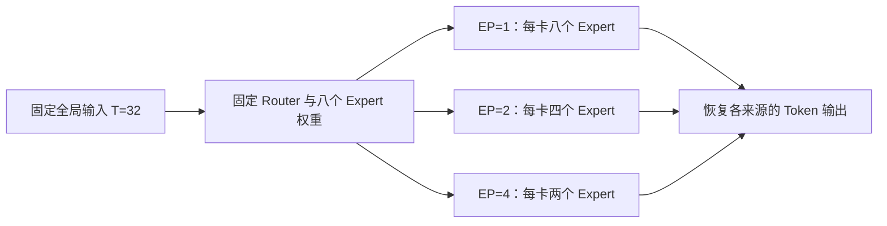
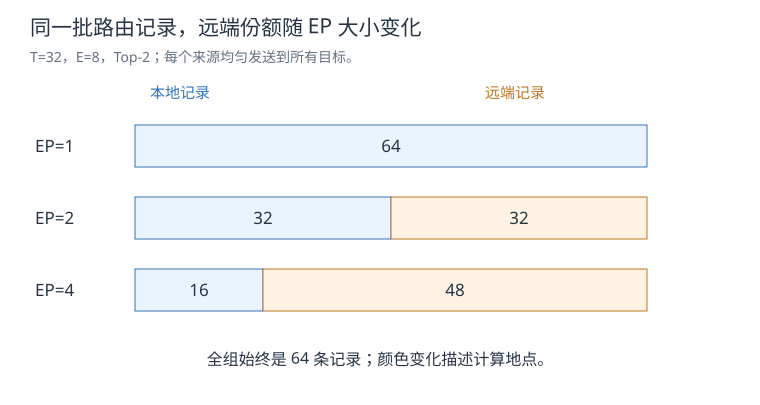

# 第 7 课：EP Scaling——把同一批 Token 分给更多 GPU

本课独立源码位于 `code/course7/`，示例在 `test/`，正确性测试在 `checks/`。下文命令均在本课目录中执行；将整个目录复制到其他位置后也使用同样的启动方式。

第六课把四个 Expert 放到两张 GPU 上，完成了 Token 的一次往返。接下来将 Expert 数扩展到八个，分别交给一张、两张和四张 GPU。模型还是同一个模型，输入还是同一批 Token，改变的是每张卡保存哪些 Expert、输入从哪个 Rank 出发，以及多少条记录需要跨卡。

先取 T=32、E=8、Top-2。全组共有 64 条 Token—Expert 记录。若路由均匀，每个 Expert 接收 8 行：EP=1 的一张卡处理全部 64 行，EP=2 每张卡处理 32 行，EP=4 每张卡处理 16 行。

Expert 的单次矩阵乘法仍有 M=8；扩展 EP 减少的是每张卡负责的 Expert 数。与此同时，更多输入要访问远端 Expert，两次 All-to-All 的参与者也随之增加。

每张卡的计算量与 Token 的跨卡路径共同决定扩展后的耗时。比较 EP=1/2/4 时，统一输入、模型和计时口径，就能把延迟变化联系到具体的数据流；第八课再沿时间线分析负载与等待。

## 7.1 一份模型，三种放置

沿用第六课的符号：T 为全组原始 Token 数，H 为隐藏宽度，F 为 Expert 中间宽度，E 为全组 Expert 数，K 为每个 Token 选择的 Expert 数，P 为 EP group 的 Rank 数。

当前示例等分输入，每个 Rank 持有 N=T/P 个 Token；路由展开后，本 Rank 发送 S=N×K 条记录。这里的 K 表示 Top-K，矩阵乘法的归约维则按具体投影写为 H 或 F。

| EP 大小 P | 每 Rank 原始 Token 数 N | 每 Rank 的 Expert | 均衡时每 Rank 接收记录数 | 每 Expert 的全组记录数 |
| --- | --- | --- | --- | --- |
| 1 | 32 | Rank 0：E0～E7 | 64 | 8 |
| 2 | 16 | Rank 0：E0～E3；Rank 1：E4～E7 | 32 | 8 |
| 4 | 8 | Rank r：E(2r)、E(2r+1) | 16 | 8 |

表中的接收行数是均衡路由下的数值。真实输入中，接收行数由所有来源的路由共同决定：Rank r 的 `recv_splits` 有 P 个元素，第 s 项表示来源 Rank s 发来的记录数。它们的和给出本 Rank 的 Expert 工作量。



图 7-1：固定全局输入时，Expert 在 EP=1/2/4 中的放置。

Router 在每个 Rank 上保存相同的 gate 权重，每个 Rank 只计算自己的输入行。Expert 权重按连续编号切片，`experts_per_rank=E/P`，`destination_rank=expert_id//experts_per_rank`。

均匀放置采用 `E%P=0`，等分输入采用 `T%P=0`，各 Rank 因而分别持有 E/P 个 Expert 和 T/P 行输入。默认 Process Group 就是 EP group，单机 `global_rank=ep_rank`，`world_size=ep_size`，`local_rank` 用于选择进程可见的 CUDA 设备。

配套代码调用 `distribute_single_gpu_moe()` 从同一份 Reference 复制权重，再取 `global_tokens[r*N:(r+1)*N]`。

本地输入为连续行主序 `[N,H]`，stride 为 `(H,1)`，dtype 为指定的 FP32、FP16 或 BF16，device 为当前 Rank 的 CUDA 设备。

最终输出也是 `[N,H]`，按本地原始 Token 顺序排列；全组输出的归属始终跟随输入来源。

## 7.2 强扩展与弱扩展

比较扩展性需要先确定输入怎样变化。保持 T、E、H、F、K、权重和路由不变，增加 P，称为强扩展：观察完成同一批工作需要多久。令单卡和 P 卡的整层延迟分别为 L₁、Lₚ，加速比与并行效率为：

$$
S_P=L_1/L_P,\qquad \eta_P=S_P/P.
$$

如果单卡完成一批需要 4 ms，两卡需要 2.5 ms，则加速比为 1.6，并行效率为 0.8。这是理解计算方法的数值例子。吞吐使用原始 Token 数计数，同一批 Top-2 的 T=32 对应 32 个 Token 和 64 条 Expert 记录：

$$
\mathrm{tokens/s}=1000T/L_P\quad(L_P\text{ 的单位为 ms}).
$$

另一种比较保持每 Rank 输入 N 不变，让 T=N×P 随 GPU 数增长，称为弱扩展。此时均匀路由下，每个 Expert 的平均行数 TK/E 也随 P 增长。矩阵变大后，GEMM 的计算效率可能变化，所以要同时记录全局 T 和本地 N，分别解释每批延迟与全组吞吐。

配套工作负载把固定 seed、模型权重、全局输入和受控路由放在一起。`uniform` 让记录依次访问 Expert；第八课的 `hotspot` 将部分选择集中到 E0。在强扩展中，三个 EP 大小使用相同全局输入，因此全组 `tokens_per_expert` 相同。

每卡原始输入数、Expert 所有权和发送矩阵随 P 变化。这样可以把扩展曲线与明确的数据流联系起来。

## 7.3 每卡计算量与跨卡载荷

Expert 由两次无偏置投影与 GELU 组成。对一个接收 Mₑ 行的 Expert，两次 GEMM 的乘加计算量约为 `4×Mₑ×H×F` FLOPs；GELU 的逐元素计算量单独计入。全组计算量为 `4×T×K×H×F`，强扩展时保持不变；均衡分给 P 张同型 GPU 后，每卡约为其 1/P。

这个估算还需要结合矩阵形状。前面的 T=32、K=2、E=8 给出每 Expert 八行，Up Projection 为 `[8,H] @ [H,F]`，Down Projection 为 `[8,F] @ [F,H]`。

增加 EP 后，每卡调用的 Expert 更少，单个 Expert 的 M 仍为八。矩阵大小、权重访问和 Kernel 提交开销共同决定实际计算时间，第十一课将进一步处理这些小矩阵的调度。

通信载荷可以从发送矩阵直接核算。令 A[s,r] 为来源 s 发给目标 r 的记录数，一行向量占 H×b bytes，b 为每个元素的字节数。两次 All-to-All 都传输隐藏向量，跨 Rank 发送载荷合计为：

$$
V_{\rm remote}=2Hb\sum_{s\ne r}A[s,r].
$$

求和先统计输入发往远端 Expert 的记录，系数 2 再计入相同大小的返回结果。例如 A[0,1]=3 表示 Rank 0 送给 Rank 1 三行输入，计算后再收回三行输出，这一方向的往返载荷就是 6Hb。

A 的对角元素属于本地 Expert；计数元数据单独统计。公式核算的是张量载荷，实际链路还承载协议与通信库内部流量。

若输入来源与 Expert 选择均匀且相互独立，远端比例约为 `1−1/P`。取 T=1024、K=2、H=128、FP32，每行 512 bytes，两次传输所有记录的载荷为 2 MiB。

EP=2 的远端载荷约 1 MiB，EP=4 约 1.5 MiB。更具体的结果由 A 决定：同卡 Expert 的选择次数较多时，远端比例相应降低。

简单通信模型写作 `α+V/B_eff`：α 是启动和准备代价，B_eff 是当前路径上的有效带宽。小载荷更容易显现启动代价，大载荷对链路带宽更敏感。布局构造、计数交换和 Host 侧 splits 准备又发生在向量通信之前，它们一起决定第一批数据何时能够发出。

再用开头的 T=32、E=8、Top-2 追踪实际行数，并令 H=8、dtype=FP32。若每个来源都将记录均匀分给所有目标，EP=2 时全组有 32 条本地记录与 32 条远端记录；EP=4 时分别为 16 条与 48 条。两种配置中，每个 Expert 始终处理八行。



图 7-2：固定 64 条路由记录时，本地与远端记录的变化。

每行占 32 bytes，输入与结果各传一次，所以两卡的远端载荷为 `2×32×32=2048` bytes，四卡为 `2×48×32=3072` bytes。这组手算把计算分摊与跨卡比例联系起来：Expert 的 M 没有变，每张卡负责的 Expert 更少，而需要远端往返的记录更多。

## 7.4 最慢 Rank 的计时口径

一层 MoE 输出要等所选 Expert 的结果返回。某个 Rank 更早完成时，它的局部时间描述自己的进度；整组测量需要把参与者放到同一轮迭代中。配套基准先收集每个 Rank 的第 i 次 CUDA Event 时间，再对相同 i 取最大值，最后对这些最大值取中位数：

$$
L_P=\operatorname{median}_i\left(\max_r L_{r,i}\right).
$$

下面的函数接收本 Rank 的样本列表。浮点时间转换成当前 CUDA 设备上的 FP64 向量，组内逐元素 MAX 后再转到 CPU。样本位置 i 始终对应同一次前向，通信统计放在被测前向之外。

**最慢 Rank 样本 · code/course7/benchmarks/benchmark_ep.py**

```python
from __future__ import annotations
import torch
import torch.distributed as dist

def max_rank_samples(samples, device, group):
    """Reduce matching repetition slots after timing; no metric collective inside a sample."""
    # 时间向量下标 i 表示同一轮迭代，组内按该下标取最大值。
    tensor = torch.tensor(samples, device=device, dtype=torch.float64)
    dist.all_reduce(tensor, op=dist.ReduceOp.MAX, group=group)
    return tensor.cpu().tolist()
```

**逐轮取最慢参与者，再计算整体统计量**

```python
# 对齐各 Rank 的第 i 轮样本，逐轮取 MAX 后再计算分布统计量。
tensor = torch.tensor(samples, device=device, dtype=torch.float64)
dist.all_reduce(tensor, op=dist.ReduceOp.MAX, group=group)
return tensor.cpu().tolist()
```

每个 Rank 的 samples[i] 对应同一次重复。FP64 时间向量在 CUDA 上做逐元素 MAX，使所有参与者获得每轮最慢 Rank 时间；

转回 Host 后才计算中位数。此统计 collective 位于采样之后，独立于前向的通信序列。

这种顺序保留了每轮出现的慢 Rank。假设两轮中 Rank 0 的时间为 `[4,1]` ms，Rank 1 为 `[1,4]` ms，两轮整组时间都是 4 ms。若先分别取平均，再比较两个 Rank，就会得到 2.5 ms，丢失逐轮等待关系。

CUDA Event 的结束位置决定哪些工作被计入延迟。NCCL 在内部通信流执行，配套同步 `all_to_all_single()` 封装建立当前流对通信工作的完成依赖，后续 Expert 能读取接收缓冲区。

同一当前流上的结束 Event 因而排在整次同步前向的结果之后。输入已在 GPU 上，初始化、模型构造和 Reference 比较放在计时区间外。

**前向计时 · code/course7/benchmarks/benchmark_ep.py**

```python
from __future__ import annotations
import torch
import torch.distributed as dist
from benchmarks.benchmark_ep import max_rank_samples

def measure_forward(model, tokens, group, warmup, repeats):
    """Current-stream end-to-end CUDA samples; inputs already reside on device."""
    if warmup < 0 or repeats <= 0:
        raise ValueError(f"need warmup >= 0, repeats > 0; got {warmup}, {repeats}")
    for _ in range(warmup):
        model(tokens, group=group)
    # 预热完成后，在测量边界排空设备工作。
    torch.cuda.synchronize(tokens.device)
    dist.barrier(group=group)
    pairs = []
    for _ in range(repeats):
        started = torch.cuda.Event(enable_timing=True)
        ended = torch.cuda.Event(enable_timing=True)
        # 当前流上的一对 Event 覆盖本轮完整前向。
        started.record()
        model(tokens, group=group)
        ended.record()
        pairs.append((started, ended))
    torch.cuda.synchronize(tokens.device)
    return max_rank_samples([a.elapsed_time(b) for a, b in pairs], tokens.device, group)
```

**对齐整组的测量起点**

```python
# 预热完成后对齐参与者，再进入重复测量区间。
for _ in range(warmup):
    model(tokens, group=group)
# 预热完成后，在测量边界排空设备工作。
torch.cuda.synchronize(tokens.device)
dist.barrier(group=group)
```

各 Rank 先预热相同次数，再排空本设备工作，并在测量边界进入 barrier。随后所有参与者按相同重复次序调用模型。边界同步发生在样本外，模型内部继续保持既有 collective 顺序。

**每轮保存当前流上的端到端区间**

```python
# 同流起止 Event 包住本轮完整前向，记录当前 Rank 的设备时间。
started.record()
model(tokens, group=group)
ended.record()
pairs.append((started, ended))
```

一对 Event 包围完整 model 前向，包括布局准备形成的设备等待、两次通信、本地计算与合并。前向的同步 NCCL 封装将通信依赖接回当前流，因此结束 Event 排在最终结果可用之后。

**先收集各轮时间，再汇总跨 Rank 延迟**

```python
# 先读取各轮 Event 延迟，再按相同轮次汇总最慢 Rank。
return max_rank_samples([a.elapsed_time(b) for a, b in pairs], tokens.device, group)
```

此前的 synchronize 让所有终点可读取。列表保留每轮的顺序，max_rank_samples 再将不同 Rank 的同轮样本对应起来。最终用这些最大值求中位数，衡量整组完成同一批工作的时间。

预热让后端完成首次初始化并进入重复执行；测量开始前排空已提交工作，并用组内 barrier 对齐这一测量边界。每轮前向内部保持原来的 collective 顺序，所有 Rank 完成样本后，再汇总时间向量。此处测量的是设备流上从前向开始到结果可用的间隔；Host 提交不及时造成的空档也会反映在该间隔里。

## 7.5 整层耗时与阶段分解

同步版本的执行依赖依次经过 `ROUTER → DISPATCH → A2A_FORWARD → EXPERT → A2A_RETURN → COMBINE`。阶段记录器在这些边界放置 CUDA Event，便于解释时间花在哪里；无阶段 Event 的原模型前向用于主要的端到端延迟。两组测量使用相同输入与权重。

DISPATCH 的口径包含 Top-K 展开、Expert 打包、Rank 打包、Expert 计数交换和接收布局构造。两次向量 A2A 分别计时，EXPERT 包括收集本地行、MLP 和结果回写，COMBINE 包括从 Rank 顺序恢复为 Expert 顺序与加权求和。

`send_splits.tolist()` 和 `recv_splits.tolist()` 的 Host 准备位于向量通信之前，应结合 Timeline 检查其等待。

阶段统计保留每个 Rank 的时间，便于找到计算或通信较慢的位置。各阶段最大值可能来自不同进程：Rank 0 的 Expert 最慢时，Rank 1 可能在返回 A2A 中等待最久。两项相加会重复包含同一次负载差异带来的等待。因此，整层延迟使用完整前向样本，阶段耗时用来解释这段延迟的来源。

配套入口为 `test/demo.py`。在 `code/course7` 目录、可见 GPU 数不少于所选 EP 大小、CUDA/NCCL 就绪的条件下，以下命令保持全局 T=1024、H=128、F=256、E=8、Top-2 和 FP32。

FP32 比较关闭 TF32，以保持同一数值基准。命令中的 `NCCL_NVLS_ENABLE=0` 使用常规 NCCL 通信路径；NVLS 是 NVLink SHARP 的可选集体通信加速机制。

**EP 扩展 · test/demo.py**

```bash
cd code/course7
for ep in 1 2 4; do
  NCCL_NVLS_ENABLE=0 torchrun --standalone --nproc-per-node="$ep" \
    test/demo.py --tokens 1024 --hidden-size 128 \
    --expert-hidden-size 256 --num-experts 8 --top-k 2 --dtype float32 \
    --warmup 5 --repeats 20 --output "results/ep${ep}.json"
done
```

报告中的逐轮最慢 Rank 时间与中位数描述整层完成速度，Expert 计数、接收行数与通信载荷描述工作分配，阶段时间连接两者。强扩展中固定全组记录数，增加 P 会减少每卡持有的 Expert 数，同时改变远端比例；

实际延迟由这些因素和具体矩阵形状共同决定。下一课沿时间线追踪一份热点路由，解释较早完成计算的 Rank 为什么仍要等待返回。

相关实现：[分布式前向](https://gitee.com/hellofss/miniep1/blob/master/code/course7/mini_ep/model/moe.py)、`mini_ep/profiler/stages.py`。背景阅读可参考 [AI Infra 的专家放置与负载分析](https://github.com/bojieli/ai-infra-book/blob/main/manuscripts/09-分布式推理.md)。

配套源码、运行依赖与各课入口见[课程首页](https://tvle9mq8jh.feishu.cn/wiki/QJp1wvBlgiiYV5kEOqFcpNtNnie)的源码附件；标题中的路径对应解压后的仓库相对路径。

[上一课](第06课.md) · [课程首页](课程首页.md) · [下一课](第08课.md)
