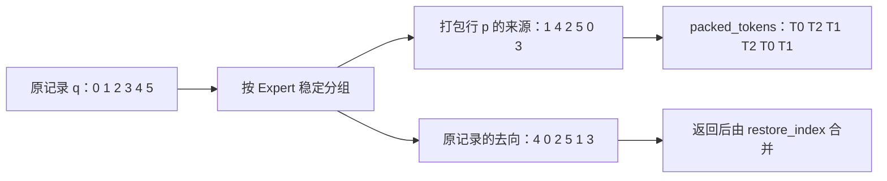
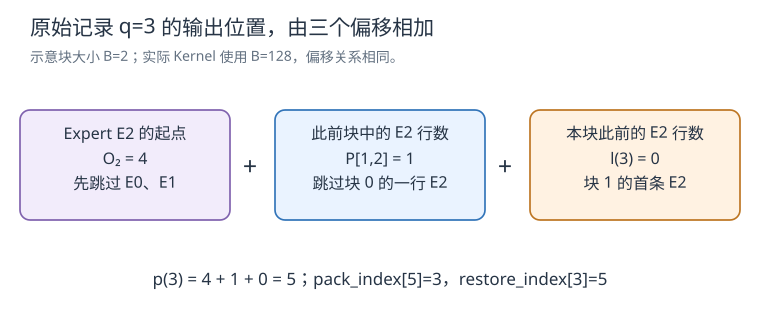

# 第 9 课：Triton Dispatch——从记录编号到连续向量

本课独立源码位于 `code/course9/`，示例在 `test/`，正确性测试在 `checks/`。下文命令均在本课目录中执行；将整个目录复制到其他位置后也使用同样的启动方式。

第二课将三个 Token 的六条路由记录按 Expert 排列，第六课再把这些连续记录交给 All-to-All。现在把打包过程拆开：先计算每个 Expert 有多少行，再给每条记录确定唯一的输出行号，最后搬运隐藏向量。记录编号与向量分开处理，便于看清哪些工作在处理整数 metadata，哪些工作在移动大量浮点数据。

仍取 `tokens=[[1,2],[3,4],[5,6]]`、Top-2 路由 `[[2,0],[1,2],[0,1]]`，四个 Expert 中 E3 为空。原始记录 r0～r5 的 Expert ID 为 `[2,0,1,2,0,1]`。

稳定打包后，记录顺序为 `[r1,r4,r2,r5,r0,r3]`，对应输入行 `[T0,T2,T1,T2,T0,T1]`。Triton 实现沿用这份排列与 metadata，依次完成计数、定位与向量收集。

Triton 是编写 GPU Kernel 的语言与编译器。Host 侧 Python 准备 Tensor 和 launch grid，设备侧程序处理一块逻辑数据；多个 program 实例共同覆盖输入。

一个 program 的逻辑向量、CUDA 线程组织和寄存器布局由编译器联系起来，读代码时先关注索引、数据依赖和地址计算。

## 9.1 输入布局与恢复索引

本 Rank 输入为 `[N,H]`，路由为 `[N,K]`，展开记录数 S=N×K。第七课的全局 T 在本 Rank 变成 N；单卡示例满足 N=T；进入 EP 时，本函数仍只处理当前 Rank 的 N 行输入。

每条原始记录 q 的来源 Token 为 `q//K`，slot 为 `q%K`。它们是这条记录从打包到返回一直携带的逻辑身份。

`dispatch_reference()` 使用稳定排序：Expert ID 较小的组在前，同组记录保持原始 Token/slot 顺序。`dispatch_triton()` 返回相同的 `DispatchOutput`，因此第六课的 Rank 打包、计数交换、两次 A2A 和 Combine 接口可以继续使用。

| 字段 | Shape 与 dtype | 含义和顺序 |
| --- | --- | --- |
| `tokens` | `[N,H]`，FP32/FP16/BF16 | 当前 Rank 的原始 Token 顺序 |
| `expert_ids` | `[N,K]`，int32/int64 | 每个 Token 的全局 Expert ID |
| `routing_weights` | `[N,K]`，浮点 | 与 Token/slot 一一配对的权重 |
| `packed_tokens` | `[S,H]`，与输入同 dtype | 稳定 Expert 顺序，连续行主序 |
| `tokens_per_expert` | `[E]`，int64 | 本 Rank 的记录计数 |
| `expert_offsets` | `[E+1]`，int64 | 各 Expert 段的边界，末项为 S |
| `restore_index` | `[S]`，int64 | 原始记录 q 在打包缓冲区中的行号 |
| `packed_expert_ids` | `[S]`，int64 | 打包行的全局 Expert ID |
| `packed_token_indices` / `packed_route_slots` | `[S]`，int64 | 打包行对应的原始 Token 编号与 Top-K slot |
| `packed_routing_weights` | `[S]`，与输入权重同 dtype | 与 packed_tokens 逐行配对的分支权重 |

这些 Tensor 全部位于输入的 CUDA device。公开 wrapper 校验 shape、dtype、Expert ID 范围和共同 device，并将非连续输入变为连续 Tensor；

相关复制属于公开调用的耗时。GPU Kernel 内部使用连续 stride：`tokens` 为 `(H,1)`，一维 metadata 为 `(1,)`。空输入返回 `[0,H]` 缓冲和零计数，空 Expert 的相邻 offsets 相等。

对六条记录，计数为 `[2,2,2,0]`，offsets 为 `[0,2,4,6,6]`。临时 `pack_index[p]` 表示打包行 p 来自原始记录几，值为 `[1,4,2,5,0,3]`；

`restore_index[q]` 表示原始记录 q 被放到哪一行，值为 `[4,0,2,5,1,3]`。两者满足 `pack_index[restore_index[q]]=q`。



图 9-1：稳定打包排列与恢复索引的两个方向。

## 9.2 直方图与分组前缀

Histogram（直方图）在这里统计每个 Expert ID 出现多少次。将 S 条记录分成 Q 个逻辑块，每块 B 条，得到 `partial_counts[Q,E]`。第 b 行表示块 b 对各 Expert 的贡献；沿块维求和得到全局计数 cₑ。

先把 B 取为 2 便于手算。六条记录分为 `[2,0]`、`[1,2]`、`[0,1]`，各块计数如下：

| 块 b | Expert IDs | E0 | E1 | E2 | E3 |
| --- | --- | --- | --- | --- | --- |
| 0 | `[2,0]` | 1 | 0 | 1 | 0 |
| 1 | `[1,2]` | 0 | 1 | 1 | 0 |
| 2 | `[0,1]` | 1 | 1 | 0 | 0 |
| 合计 | 六条记录 | 2 | 2 | 2 | 0 |

运行实现使用 B=128。`tl.program_id(0)` 选择逻辑块，`tl.arange(0,B)` 生成块内位置。`tl.load` 的 mask 屏蔽末块越过 S 的位置。填充 ID 设为 histogram bin 范围之外的值，使这些位置不计入任何 Expert。

`@triton.jit` 将函数标记为设备程序，第一次按某组配置 launch 时编译。`tl.constexpr` 参数由 Host 给出，编译器据此确定逻辑向量大小与固定循环。

Host 使用 `histogram_kernel[(Q,)](...)` 发起 Q 个 program，Q 为 `ceil(S/B)`；括号中的 grid 决定程序实例数，B 决定每个实例处理的逻辑记录数。

**块内计数 · code/course9/mini_ep/kernels/histogram_triton.py**

```python
from __future__ import annotations
import triton
import triton.language as tl

@triton.jit
def histogram_kernel(
    Ids,
    Partial,
    S: tl.constexpr,
    E: tl.constexpr,
    EPAD: tl.constexpr,
    BLOCK: tl.constexpr,
):
    # 第 b 个 program 负责原始记录区间 [b×BLOCK,(b+1)×BLOCK)。
    block = tl.program_id(0)
    records = block * BLOCK + tl.arange(0, BLOCK)
    ids = tl.load(Ids + records, records < S, other=EPAD).to(tl.int32)
    # 尾块填充 ID 位于直方图 bin 范围之外。
    # Padding IDs lie outside the histogram's bin range.
    counts = tl.histogram(ids, EPAD)
    experts = tl.arange(0, EPAD)
    # 每个 program 只写自己在 partial_counts[Q,E] 中的一行。
    tl.store(Partial + block * E + experts, counts, experts < E)
```

**一个 program 读取一块原始记录**

```python
# 每个 program 负责一块原始记录，尾部越界位置填入无效 ID。
block = tl.program_id(0)
records = block * BLOCK + tl.arange(0, BLOCK)
ids = tl.load(Ids + records, records < S, other=EPAD).to(tl.int32)
```

block 选择第 b 块，records=b×BLOCK+[0,…,BLOCK−1] 生成原记录编号。records<S 的位置读取真实 ID，末块无效位置填 EPAD。

EPAD 位于 histogram 的有效 bin 编号 0…EPAD−1 之外，尾部填充值不贡献任何 Expert 计数。

**将块内直方图写入二维计数表**

```python
# 先统计本块 ID 的直方图，再只写真实 Expert 对应的列。
counts = tl.histogram(ids, EPAD)
experts = tl.arange(0, EPAD)
# 每个 program 只写自己在 partial_counts[Q,E] 中的一行。
tl.store(Partial + block * E + experts, counts, experts < E)
```

tl.histogram 产生 EPAD 个 bin，experts<E 的 mask 只写真实 Expert 列。Partial+block×E+experts 对应 partial_counts[b,e]，输入 S=6、BLOCK=2 时三行分别描述 [2,0]、[1,2]、[0,1]。跨块求和与前缀由后续 wrapper 完成。

`EPAD` 是不小于 E 的二次幂，用于给 `tl.histogram` 提供固定 bin 数。内部 Expert ID 使用 int32，公开接口接收 int32/int64 路由 Tensor。

计数写入 int64 的 `partial_counts`，保留与 Reference 相同的 metadata dtype。`tl.histogram` 的 bin 语义见 [Triton API](https://triton-lang.org/main/python-api/generated/triton.language.histogram.html)。

计数确定每个 Expert 的总区间，前缀和确定各块在这个区间内的子区间。定义：

$$
O_e=\sum_{j<e}c_j,\qquad P_{b,e}=\sum_{a<b}\mathrm{partial\_counts}[a,e].
$$

若记录 q 位于块 b、选择 Expert e，块内在 q 之前出现的同 Expert 记录数为 l(q)，其唯一输出位置为：

$$
p(q)=O_e+P_{b,e}+l(q).
$$

三项分别对应“Expert 从哪里开始”“前面的块占了多少行”“本块里前面的同类记录占了多少行”。原始记录 r3 选择 E2，O₂=4，前面的块对 E2 贡献一行，本块内它前面没有 E2，因此 p(r3)=4+1+0=5。r4 选择 E0，前两块共贡献一行 E0，所以 p(r4)=0+1+0=1。

计数之后，Host wrapper 用 PyTorch CUDA 运算沿块维求和得到 `[E]` 计数，再构造 `[E+1]` 的 Expert offsets 和 `[Q,E]` 的块前缀 P。

这里的运算仍在 GPU 上执行。随后 Triton 读取两组起点，为每条记录写出唯一位置。计数、前缀与定位各自有明确输入输出，可以分别对齐 Reference。

把六条记录全部代入位置公式，可以看到三个偏移怎样共同保持稳定顺序。仍用便于手算的 B=2，三块分别是 `[2,0]`、`[1,2]`、`[0,1]`。

| 原记录 q | Expert e | 块 b | Expert 起点 Oₑ | 之前块贡献 Pᵦ,ₑ | 本块前序同类 l(q) | 输出行 p(q) |
| --- | --- | --- | --- | --- | --- | --- |
| 0 | 2 | 0 | 4 | 0 | 0 | 4 |
| 1 | 0 | 0 | 0 | 0 | 0 | 0 |
| 2 | 1 | 1 | 2 | 0 | 0 | 2 |
| 3 | 2 | 1 | 4 | 1 | 0 | 5 |
| 4 | 0 | 2 | 0 | 1 | 0 | 1 |
| 5 | 1 | 2 | 2 | 1 | 0 | 3 |



图 9-2：Expert 起点、块前缀与块内编号共同确定输出行。

按 q 读取最后一列，得到 `restore_index=[4,0,2,5,1,3]`；按输出行从小到大读取原记录，得到 `pack_index=[1,4,2,5,0,3]`。这份表同时解释了正向收集和反向恢复为何使用不同索引。

## 9.3 稳定的组内行号

对某个 Expert e，块内的匹配向量为 `(ids==e)`。将其转成 0/1，再做包含当前位置的前缀和，匹配位置的结果减一就得到 l(q)。例如本块 IDs 为 `[0,2,0,1]`，E0 的匹配向量是 `[1,0,1,0]`，前缀和为 `[1,1,2,2]`；两条 E0 记录的块内编号分别为 0、1。

**稳定行号 · code/course9/mini_ep/kernels/histogram_triton.py**

```python
from __future__ import annotations
import triton
import triton.language as tl

@triton.jit
def stable_positions_kernel(
    Ids,
    Prefix,
    Offsets,
    Pack,
    Restore,
    S: tl.constexpr,
    E: tl.constexpr,
    BLOCK: tl.constexpr,
):
    # 当前 program 负责一段连续原始记录，逻辑向量长度为 BLOCK。
    block = tl.program_id(0)
    records = block * BLOCK + tl.arange(0, BLOCK)
    # records<S 屏蔽尾块越界位置；-1 不会匹配合法 Expert。
    ids = tl.load(Ids + records, records < S, other=-1)
    # 按 Expert 分别计算块内稳定行号；相同输入得到与 Reference 一致的排列。
    for expert in tl.static_range(E):
        # 仅选中当前 Expert 的有效原始记录。
        selected = (records < S) & (ids == expert)
        # 块内前缀和减 1，得到选中记录从 0 开始的稳定编号。
        within = tl.cumsum(selected.to(tl.int32)) - 1
        # Expert 全局起点加之前块的贡献，得到本块所属子区间起点。
        start = tl.load(Offsets + expert) + tl.load(Prefix + block * E + expert)
        packed_row = start + within
        # 同时写出 p→q 和 q→p 两个方向，保留分支身份。
        # Pack[p]=q，用于从原记录收集输入。
        tl.store(Pack + packed_row, records, selected)
        # Restore[q]=p，用于在返回后读取对应分支。
        tl.store(Restore + records, packed_row, selected)
```

**按逻辑块读取原始记录**

```python
# 每个 program 读取连续 BLOCK 条原记录；records 的 shape 为 [BLOCK]。
block = tl.program_id(0)
records = block * BLOCK + tl.arange(0, BLOCK)
# 尾块越过 S 的位置不读显存，以无效 Expert ID -1 填充。
ids = tl.load(Ids + records, records < S, other=-1)
```

block 决定本 program 处理哪个原始记录区间。records 是长度为 BLOCK 的逻辑向量，保存原始记录编号 q；Ids 是 CUDA 上连续的一维 Expert ID 数组，包含 S=N×K 个元素。这里按原始 Token、slot 顺序读取记录。

沿用六条记录、BLOCK=2 的手算例子：block=2 得到 records=[4,5]，读取 ids=[0,1]。实际实现使用 BLOCK=128；若末块只有部分记录有效，records<S 只允许有效位置读取，其他位置得到 -1，后续不会匹配任何合法 Expert。

**筛出当前 Expert 并计算块内稳定编号**

```python
# 外层 tl.static_range(E) 每次处理一个 Expert，selected 的 shape 为 [BLOCK]。
selected = (records < S) & (ids == expert)
# 包含当前位置的前缀和减 1，得到选中记录从 0 开始的组内编号。
within = tl.cumsum(selected.to(tl.int32)) - 1
```

完整 Kernel 在 for expert in tl.static_range(E) 中执行这段逻辑。selected 同时检查记录有效性和 Expert 归属。

将布尔向量转为 int32 后，tl.cumsum 沿记录顺序累计当前 Expert 的出现次数；减一后，每条选中记录得到本块内的稳定编号。

仍看 block=2 的 ids=[0,1]：处理 E0 时，selected=[True,False]，前缀和为 [1,1]，within=[0,0]。只有第一个位置的编号用于后续写入。一个块里若有多条相同 Expert 记录，扫描会按原记录先后给出 0、1、2 等编号。

**把块内编号平移到 Expert 的全局区间**

```python
# Offsets[e] 是该 Expert 在打包缓冲区中的起点。
# Prefix 按 [逻辑块, Expert] 行主序存储，记录更早块对该 Expert 的贡献。
start = tl.load(Offsets + expert) + tl.load(Prefix + block * E + expert)
# 块起点加块内编号，得到每条选中记录的最终打包行 p。
packed_row = start + within
```

Offsets 是 [E+1] 的 int64 CUDA 数组，Prefix 是 [Q,E] 的连续 int64 CUDA 数组，Q=ceil(S/BLOCK)。

Prefix+block×E+expert 定位 Prefix[block,expert]；这一项统计更早逻辑块中属于当前 Expert 的记录数。它与 Expert 起点相加，得到当前块在该 Expert 分组中占用的子区间起点。

六条记录的 E0 起点为 Offsets[0]=0；block=2 之前已有一条 E0 记录，所以 Prefix[2,0]=1。当前块的 E0 记录 q=4 拥有 within=0，最终得到 packed_row=0+1+0=1。

这个地址由记录顺序与计数决定，各 program 的实际执行先后不改变它。

**分别写出正向排列与恢复索引**

```python
# Pack[p]=q：打包行 p 应从原记录 q 收集输入。
tl.store(Pack + packed_row, records, selected)
# Restore[q]=p：原记录 q 的结果可从打包行 p 取回。
tl.store(Restore + records, packed_row, selected)
```

Pack 与 Restore 都是 shape 为 [S] 的连续 int64 CUDA 数组。第一行以 packed_row 为地址偏移、以 records 为值，保存“打包行来自哪条原记录”；

第二行交换地址和值的角色，保存“原记录去了哪一行”。两次写入共用 selected，只有属于当前 Expert 的有效记录更新数组。

对 q=4、p=1，代码写出 Pack[1]=4 和 Restore[4]=1。后续 Dispatch 读取 Pack[p]，再用 q//K 找到原 Token 并搬运整行隐藏向量；Combine 读取 Restore[q]，从返回结果中取回对应分支。

块内扫描给出互异编号，Prefix 为不同块划分互不重叠的子区间，Offsets 又把不同 Expert 放到互不重叠的组中。因此每条记录具有唯一写入位置，并满足 Pack[Restore[q]]=q。

这种实现对 E 个 Expert 分别执行块内扫描，定位部分的逻辑工作量为 O(S×E)，临时块计数空间为 O(Q×E)。E=4/8 时，可以逐个 Expert 跟踪稳定位置的形成过程。随着 E 增长，扫描次数和临时空间随之增加；扫描、排序与其他分组方案的取舍取决于这些成本及 metadata 的实际耗时。

稳定排列还让正确性比较更直接：输入相同，`packed_expert_ids`、Token 编号、slot、权重、offsets 和逆排列都逐元素对应 Reference。执行线程的先后不影响这些身份关系。

## 9.4 连续向量打包

metadata 确定后，浮点向量的搬运只需要读取 `pack_index[p]`。原始 Token 行号为 `pack_index[p]//K`。同一个 Token 在 Top-2 中会产生两份向量，分别放到两个 Expert 的段内；它们对应不同记录，后续使用不同权重。

下面的 Kernel 采用二维 grid。第一个维度选择打包行，第二个维度选择这一行的 H 维片段，每个片段最多处理 128 个连续元素。

**向量打包 · code/course9/mini_ep/kernels/dispatch_triton.py**

```python
from __future__ import annotations
import triton
import triton.language as tl

@triton.jit
def dispatch_kernel(
    X,
    Pack,
    Y,
    S: tl.constexpr,
    H: tl.constexpr,
    TOP_K: tl.constexpr,
    BLOCK_H: tl.constexpr,
):
    # 二维网格分别选择打包行和该行的隐藏维片段。
    row = tl.program_id(0)
    cols = tl.program_id(1) * BLOCK_H + tl.arange(0, BLOCK_H)
    record = tl.load(Pack + row)
    token = record // TOP_K
    # H 维连续；来源行号从原始 Token 顺序中收集输入。
    # H is contiguous; the row index gathers from original Token order.
    values = tl.load(X + token * H + cols, cols < H, other=0)
    # 以连续打包行布局写出，尾列由同一 mask 屏蔽。
    tl.store(Y + row * H + cols, values, cols < H)
```

**从输出行追溯原 Token**

```python
# 从打包行读取原记录编号，再用整除 Top-K 找到输入 Token。
row = tl.program_id(0)
cols = tl.program_id(1) * BLOCK_H + tl.arange(0, BLOCK_H)
record = tl.load(Pack + row)
token = record // TOP_K
```

grid 第一维选择打包行 p，第二维选择隐藏维的连续列片。Pack[p] 是原记录 q，整数除以 TOP_K 得到原 Token 行 t；

slot 影响所选 Expert 和权重，同一 Token 的输入向量由 t 决定。

**一块连续隐藏向量的收集与写出**

```python
# 沿 H 维收集连续特征，mask 屏蔽最后一个列块的越界位置。
values = tl.load(X + token * H + cols, cols < H, other=0)
# 以连续打包行布局写出，尾列由同一 mask 屏蔽。
tl.store(Y + row * H + cols, values, cols < H)
```

X+t×H+cols 读取原输入行的列片，Y+p×H+cols 写到打包行的同一列片。两端 H 维均连续；cols<H 同时保护输入和输出尾部。

例如 H=130、BLOCK_H=128，第二个列 program 只搬运列 128、129。数值与 dtype 沿用输入，变化的是行的位置与分支副本数量。

本课基准取 N=257、Top-2、H=128，得到 S=514 条记录。BLOCK_H=128 时，向量打包网格为 (514,1)，每个 program 复制一条完整隐藏向量。

若 H 增为 130，网格变为 (514,2)，每行的第二个 program 只复制两个有效元素。记录定位与列片覆盖相互独立，改变 H 会改变向量搬运量，Pack 的长度继续由 N×K 决定。

完整 `dispatch_triton()` 先校验输入，再调用 `stable_dispatch_metadata()` 与向量 Kernel，最后按同一 Pack 收集 packed Expert ID、Token 编号、slot 和路由权重，组装 `DispatchOutput`。

其中 Token 与 slot 的原始序列分别由 `repeat_interleave(K)` 和 `repeat(N)` 生成。packed 权重与 packed 向量从此保持逐行配对，直到第十课的 Combine。

这一次向量搬运的逻辑读写约为 `2×S×H×b` bytes：每条记录读取一行输入、写出一行输出。Top-K 的重复输入在缓存中可能复用，实际 HBM 流量由访问和缓存行为决定；按逻辑字节数除以时间得到的是有效搬运率，适合在相同口径下比较实现。

## 9.5 分布式接入与计时

进入分布式前向时，Dispatch 处理本 Rank 的 `[N,H]` 输入，生成 `[N×K,H]` Expert 顺序缓冲。连续均匀放置让相邻 Expert 属于相邻目标 Rank，后续 `pack_by_destination_rank()` 构造发送缓冲与 splits。

接收方仍按第六课的全组计数重建来源块中的本地 Expert 行索引。

`run_ep_stages()` 提供 `dispatch_impl` 参数，默认使用 PyTorch Reference，传入 `dispatch_triton` 后只改变这一阶段的实现。

所有 Rank 使用同一配置，按相同顺序进入计数交换、正向 A2A 和返回 A2A。来源 Rank 保留自身的 restore metadata；向量完成往返后，Combine 继续恢复原 Token 顺序。

配套正确性用例比较 packed 数值、shape、dtype、device、连续性以及全部 metadata，并覆盖 Top-1/Top-2、空 Token、空 Expert、倾斜选择、int32/int64 ID 和非整齐 H。

索引逆关系还可以用 `pack_index[restore_index]==arange(S)` 独立检查。数值向量只做复制，因此 Dispatch 对照采用精确比较。

单卡入口使用 CUDA 与 Triton，进入 `code/course9` 后运行；可以通过可见设备设置选择具体 GPU。示例的 T=257、H=128、E=8、K=2 同时包含尾块和不同 Expert 行数。

**Dispatch 基准 · test/demo.py**

```bash
cd code/course9
python3 test/demo.py --tokens 257 --hidden-size 128 \
  --num-experts 8 --top-k 2 --dtype float32 --warmup 5 --repeats 20 \
  --output results/lesson09-dispatch.json
```

此基准的对象是 dispatch_triton() 的完整公开调用：输入检查、必要的连续化、metadata 构造、浮点向量搬运与结果组装均属于该接口。准备阶段完成 Reference 对照和首次 JIT，采样阶段使用预热后的相同输入；

Profiler 在独立区间统计 Kernel 数。直方图、扫描与向量搬运分别承担不同成本，比较整段延迟时需要同时保留它们的活动与 E、S、H 配置。

Triton 的 program 划分、边界 mask 和连续地址计算可以参考 [向量加法教程](https://triton-lang.org/main/getting-started/tutorials/01-vector-add.html)。本课已经给每条返回记录确定位置，第十课将沿 `restore_index` 直接读取 Expert 输出，在一个程序中完成路由权重与 Top-K 合并。

配套源码、运行依赖与各课入口见[课程首页](https://tvle9mq8jh.feishu.cn/wiki/QJp1wvBlgiiYV5kEOqFcpNtNnie)的源码附件；标题中的路径对应解压后的仓库相对路径。

[上一课](第08课.md) · [课程首页](课程首页.md) · [下一课](第10课.md)
