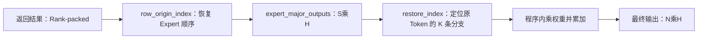
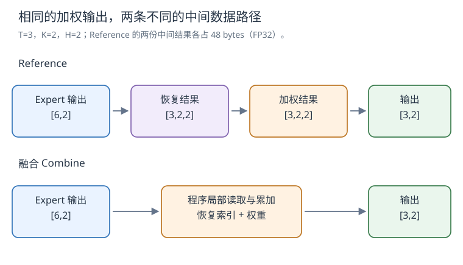

# 第 10 课：Triton Combine——让一条输出在程序内完成

本课独立源码位于 `code/course10/`，示例在 `test/`，正确性测试在 `checks/`。下文命令均在本课目录中执行；将整个目录复制到其他位置后也使用同样的启动方式。

第九课为六条 Expert 记录建立了稳定排列。返回通信结束后，来源 Rank 又拿到六条 Expert 输出；三个原始 Token 各需要合并两条分支。Reference 先恢复记录顺序，再乘权重，最后沿 Top-K 维求和。每一步都容易读懂，也会产生供下一步读取的中间张量。

对一个具体元素，计算只需要两份 Expert 输出和两份权重。若 Token 0 的某列 Expert 输出为 2 和 4，路由权重为 0.25 和 0.75，这一列的最终值就是 3.5。

当前列的结果与其他 Token、其他列相互独立。找到这些依赖后，就可以让一个 Triton program 直接沿逆排列取数，在局部完成加权与求和，再写出最终输出。

沿 Reference 的数据流，将恢复、加权与求和放进同一个程序，可以省去中间张量的写回与重读；不同 dtype 下的舍入顺序也随之进入融合实现。分布式部分沿用第六课的两次 A2A，改变发生在返回结果到达来源 Rank 之后。

## 10.1 两级恢复索引

第二次 All-to-All 返回的 `[S,H]` Tensor，行顺序与第一次发送的 Rank-packed 顺序相同。`rank_pack.row_origin_index[p]` 指出返回行 p 在此前 Expert-major 缓冲中的位置。

第六课用 `index_copy_` 将这些行散射回 Expert 顺序，得到 `expert_major_outputs`。

`dispatch.restore_index[q]` 再指出原始 Token/slot 记录 q 在 Expert-major 缓冲中的位置。因此恢复原记录时读取 `expert_major_outputs[restore_index[q]]`，随后把记录维 reshape 为 `[N,K,H]`。

两种索引连接的是不同排列：来源 Rank 的通信打包与 Expert 分组，以及 Expert 分组与原始 Token/slot。

`combine_triton()` 与 `combine_reference()` 接收相同布局的输入：已经恢复为 Expert-major 的输出 Tensor。Rank 顺序恢复继续位于它之前。

连续均匀放置下，两种打包顺序经常一致；显式保留 `row_origin_index`，让通信布局与 Combine 布局的职责保持清楚。



图 10-1：从返回通信顺序逐级恢复到原始 Token 输出。

两级恢复索引还可以组合为一次寻址。令 pᵣ(pₑ) 为 Expert 行 pₑ 在返回 Rank-packed 缓冲中的位置，则读取地址由 `pᵣ(restore_index[q])` 给出；

相应权重仍与 Expert 行配对。下面的 `combine_triton()` 直接读取 Expert-major 输出，复用第九课的 restore_index，在程序内生成最终 Token 输出。

## 10.2 分支定位与加权

仍使用第二课的权重与 Expert ID。每个 Expert 将输入乘以 `expert_id+1`，六行 Expert-major 输出与权重为：

| Expert 行 p | 原始记录 q | 分支身份 | Expert 输出 | 权重 |
| --- | --- | --- | --- | --- |
| 0 | 1 | T0、slot 1、E0 | `[1,2]` | 0.75 |
| 1 | 4 | T2、slot 0、E0 | `[5,6]` | 0.20 |
| 2 | 2 | T1、slot 0、E1 | `[6,8]` | 0.60 |
| 3 | 5 | T2、slot 1、E1 | `[10,12]` | 0.80 |
| 4 | 0 | T0、slot 0、E2 | `[3,6]` | 0.25 |
| 5 | 3 | T1、slot 1、E2 | `[9,12]` | 0.40 |

T0 的两条原始记录为 q=0、1。`restore_index=[4,0,2,5,1,3]` 让它读取 Expert 行 4、0，得到 `0.25×[3,6]+0.75×[1,2]=[1.5,3]`。T1 读取行 2、5，得到 `[7.2,9.6]`；T2 读取行 1、3，得到 `[9,10.8]`。

令 Y 为 Expert-major 输出，w 为与 Y 同行的 packed 权重，R 为 restore_index，则每个元素满足：

$$
O[t,h]=\sum_{k=0}^{K-1}w[R[tK+k]]Y[R[tK+k],h].
$$

这个公式同时给出索引与融合范围：对固定 t、h，只需要循环读取 K 条分支。同一个程序对一段连续 h 执行这件事，便可以复用每条分支的行号和权重，并把最后一维的读写组织成连续访问。

## 10.3 中间张量与逻辑访存

Reference 先做 `index_select`，得到恢复为原记录顺序的输出 `[N×K,H]`。reshape 为 `[N,K,H]` 是连续 Tensor 上的视图变换。权重沿同一个 restore_index 读取，再转为 Expert 输出 dtype 并广播到最后一维。乘法产生 `[N,K,H]`，求和得到 `[N,H]`。

这些操作分别承担明确作用：索引修复位置，dtype 转换确定乘法精度，广播让同一分支的 H 个元素使用相同权重，Top-K reduction 将一个 Token 的 K 行变成一行。理解融合时，要沿这个顺序检查每份数据的去向。

忽略小规模 metadata 和缓存复用，设一行有 H 个元素，每元素 b bytes。单独的恢复读写约为 `2×N×K×H×b`；乘法读恢复后的输出、写加权结果，约为相同字节数；求和读 `N×K×H`、写 `N×H`。合计的逻辑读写为：

$$
V_{\rm ref}\approx(5K+1)NHb.
$$

融合直接读取 K 份 Expert 输出，再写一份最终输出，逻辑读写为：

$$
V_{\rm fused}\approx(K+1)NHb.
$$

Top-2 的系数分别为 11 和 3。若 N=3、H=2、FP32，以上向量部分分别为 264 bytes 和 72 bytes；减少的 192 bytes 来自两份中间张量各自的一次写回与重读。这个算例计算数据路径，实际 Kernel 时间还取决于 launch、缓存、寻址和设备带宽。

融合后，恢复输出与加权结果保存在程序处理的局部片段中，用完即可释放；显存中只需保留 Expert 输出和最终 `[N,H]` 结果。前面的字节数衡量数据经过的读写路径，临时 Tensor 容量则衡量某一时刻需要保存多少数据。

对本例的 N=3、K=2、H=2，恢复结果和加权结果各含 12 个 FP32 元素，各占 48 bytes。下图把两份中间 Tensor 的去向画出来。融合路径在程序内完成取数与加权，最终写出六个元素的 `[3,2]` 输出。



图 10-2：Reference 中间张量与融合程序局部累加的对照。

以处理 T0 的 program 为例，slot 0 读取行 4 的 `[3,6]` 与权重 0.25，局部累加器变为 `[0.75,1.5]`；slot 1 再读取行 0 的 `[1,2]` 与权重 0.75，累加器变为 `[1.5,3]`。

两列完成后只写出这一行。它与前面的加权公式计算相同结果，同时省去完整恢复 Tensor 与加权 Tensor 的显存中转。

## 10.4 融合 Kernel 与舍入语义

输入 Y 为连续 `[N×K,H]`、CUDA FP32/FP16/BF16，restore 为连续 `[N×K]`、CUDA int64，权重为与 Y 同行的连续浮点 Tensor。

三者位于同一 device。输出为连续 `[N,H]`，dtype 和 device 与 Y 相同。公开 wrapper 会对非连续输入建立连续副本，并支持 N=0；Kernel 支持 Top-1 和 Top-2。

二维 grid 的第一个维度选择 Token，第二个维度选择 H 维片段。每个程序用 `tl.static_range(TOP_K)` 展开固定分支数，读取 row、weight 与向量，累加到一段 FP32 局部向量，最后只写出一次结果。

**融合合并 · code/course10/mini_ep/kernels/combine_triton.py**

```python
from __future__ import annotations
import triton
import triton.language as tl

@triton.jit
def combine_kernel(
    Y,
    Restore,
    Weights,
    Out,
    H: tl.constexpr,
    TOP_K: tl.constexpr,
    BLOCK_H: tl.constexpr,
):
    # 每个 program 负责一个 Token 的一段输出列。
    token = tl.program_id(0)
    cols = tl.program_id(1) * BLOCK_H + tl.arange(0, BLOCK_H)
    acc = tl.zeros((BLOCK_H,), tl.float32)
    for slot in tl.static_range(TOP_K):
        # 原记录编号 q 通过 Restore 找到 Expert-major 行 p。
        packed_row = tl.load(Restore + token * TOP_K + slot)
        value = tl.load(Y + packed_row * H + cols, cols < H, other=0)
        weight = tl.load(Weights + packed_row).to(value.dtype)
        # 每个乘积先舍入到 Expert 输出 dtype，再提升为 FP32 累加。
        # Round each product to Expert-output dtype, like the Reference.
        product = (value.to(tl.float32) * weight.to(tl.float32)).to(value.dtype)
        acc = acc + product.to(tl.float32)
    # 只保存最终加权和；输出指针的 dtype 决定最终存储精度。
    tl.store(Out + token * H + cols, acc, cols < H)
```

**每个 program 持有一段最终输出**

```python
# 每个 program 负责一个原 Token 的连续特征片段，并创建 FP32 累加器。
token = tl.program_id(0)
cols = tl.program_id(1) * BLOCK_H + tl.arange(0, BLOCK_H)
acc = tl.zeros((BLOCK_H,), tl.float32)
```

第一维选择原 Token，第二维选择 H 的列片。acc 为长度 BLOCK_H 的 FP32 局部累加器，初值全零；此时尚未分配 [N,K,H] 的恢复结果或加权中间张量。

**逆排列同时定位分支结果与分支权重**

```python
# 用原 Token、slot 查询打包行，再在同一行读取输出与权重。
packed_row = tl.load(Restore + token * TOP_K + slot)
value = tl.load(Y + packed_row * H + cols, cols < H, other=0)
weight = tl.load(Weights + packed_row).to(value.dtype)
```

token×TOP_K+slot 是原始记录 q，Restore[q] 给出 Expert-major 行 p。Y+p×H+cols 读取该分支向量，Weights+p 读取与该行配对的标量权重。

一次权重加载广播到这个 program 处理的全部列。

**将低精度乘积的舍入保留在融合路径中**

```python
# 乘积先舍入到输入 dtype，再转回 FP32 累加，保留 Reference 精度边界。
product = (value.to(tl.float32) * weight.to(tl.float32)).to(value.dtype)
acc = acc + product.to(tl.float32)
```

weight 先转成 value.dtype，乘法以 FP32 计算后显式转回 value.dtype，复现 Reference 中低精度乘法张量的保存边界；

再提升为 FP32 加到 acc。Top-1/Top-2 的固定循环处理完所有分支后，acc 包含当前 Token 这些列的完整加权和。

**直接写回原始 Token 行**

```python
# 把累加结果写到原始 Token 行，只保留有效隐藏维坐标。
tl.store(Out + token * H + cols, acc, cols < H)
```

Out+token×H+cols 就是最终 [N,H] 布局的地址。mask 仅保留 cols<H，写入时按 Out 的元素类型转换；

输出 dtype 与 Expert 输出相同。每个 Token/列片只由一个 program 写入，最终一次 store 代替恢复、加权与求和之间的显存中转。

将地址式代入第二课的六行输出：T0 的 slot 0 由 Restore[0]=4 定位，slot 1 由 Restore[1]=0 定位。H=2 时，两次向量加载分别从 Y 的元素偏移 8 和 0 开始，读取 [3,6]、[1,2]；

标量权重分别来自 Weights[4]=0.25、Weights[0]=0.75。累加器最终为 [1.5,3]，写入 Out 的前两个元素。权重的下标随打包行变化，输出地址随原 Token 变化。

程序中还显式保留乘法舍入。Reference 先把权重转成 Y 的 dtype，乘法结果也以该 dtype 保存，随后求和。FP16/BF16 中，一个乘积落地到低精度 Tensor 时会舍入。

融合实现将权重转成 `value.dtype`，以 FP32 做乘法，再把乘积转回 `value.dtype`，然后提升为 FP32 累加，最终存回输出 dtype。wrapper 使用 `enable_fp_fusion=False`，让所写的运算边界保持可见。

两条分支可能在求和时相互抵消，因此各乘积先舍入还是先相加，会影响最终值。上述转换顺序保留了 Reference 的低精度乘积，再以 FP32 累加；最终按输出 dtype 保存。正确性对照使用各 dtype 的容差，同时检查值、shape、dtype 和 device。

## 10.5 局部计时与整层收益

Combine 的计时输入已经包含 Expert-major 输出、restore_index 和 packed 权重。Reference 与 Triton 使用同一份 Tensor，计时只覆盖公开 Combine 调用。

连续输入时，融合路径的非空计算由一次 CUDA Kernel launch 完成；必要的连续化属于完整调用，输入布局应在配置中写清楚。

基准在首次 JIT 与预热之后重复采样同一份 Expert 输出、逆排列和权重。CUDA Event 覆盖公开调用的当前流区间，独立 Profiler 统计 Kernel 数。前面的逻辑字节公式解释减少了哪些中间读写；具体延迟与有效读写率由样本给出，实际 HBM 流量可以结合设备计数器解释。

**Combine 基准 · test/demo.py**

```bash
cd code/course10
python3 test/demo.py --tokens 257 --hidden-size 128 \
  --num-experts 8 --top-k 2 --dtype float32 --warmup 5 --repeats 20 \
  --output results/lesson10-combine.json
```

配套测试覆盖原始记录与 Expert 行的排列关系、Top-1/Top-2、尾列、空 Token、非连续输入和三种 dtype。进入分布式前向时，通过 `run_ep_stages(..., combine_impl=combine_triton)` 替换最后一段 Combine；第一次计数交换与两次向量 A2A 保持相同次序。

优化价值还要连接整层占比。若 Combine 占原始整层延迟的 f，局部调用获得 s 倍加速，其他阶段保持相同，则整层加速模型为：

$$
S_{\rm layer}=\frac{1}{(1-f)+f/s}.
$$

取 f=0.1、s=2，整层时间系数为 0.95，加速约 1.053 倍。这一数值推导说明如何把局部变化放回第八课的时间分解。下一课继续处理另一类工作组织：多个 Expert 的 GEMM 有共同的 H、F，却有不同的行数，如何把它们的 tiles 放进同一次调度。

融合的数据路径与舍入边界，可结合 [AI Infra 的算子融合章节](https://github.com/bojieli/ai-infra-book/blob/main/manuscripts/05-算子与运行时.md) 阅读。

配套源码、运行依赖与各课入口见[课程首页](https://tvle9mq8jh.feishu.cn/wiki/QJp1wvBlgiiYV5kEOqFcpNtNnie)的源码附件；标题中的路径对应解压后的仓库相对路径。

[上一课](第09课.md) · [课程首页](课程首页.md) · [下一课](第11课.md)
