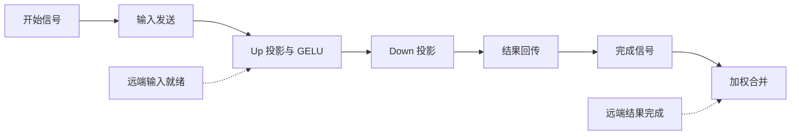
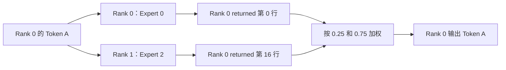
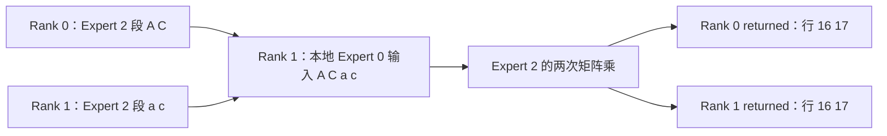
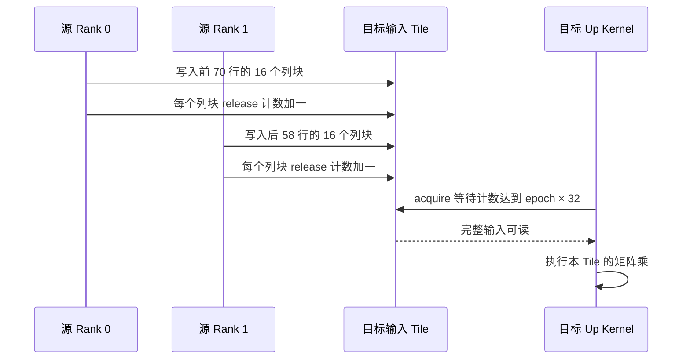
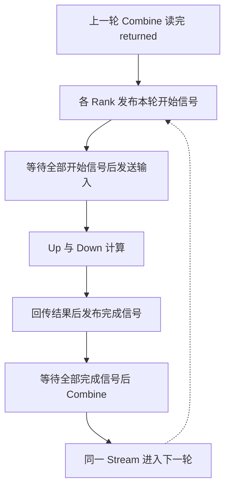

# 第 12 课：Triton 分离执行——从 Token 通信到 Expert 计算

本课独立源码位于 `code/course12/`，示例在 `test/`，正确性测试在 `checks/`。下文命令均在本课目录中执行；将整个目录复制到其他位置后也使用同样的启动方式。

两张 GPU 各自持有一半 Expert。Rank 0 上的 Token A 选择 Expert 0 和 Expert 2：第一条分支留在本地，第二条分支送到 Rank 1。

两边算完后，Rank 1 把结果送回 Rank 0，再按 0.25 和 0.75 的权重合并。即使每个 Expert 都只是两次矩阵乘，这次前向仍要解决三个问题：怎样追踪 A 的两条分支，怎样确认远端写入已经可读，以及怎样在下一轮安全地复用同一块显存。

本课围绕这个例子，实现一条 **Triton 分离执行**路径：输入发送、Expert 计算、结果回传和加权合并由独立的 GPU 内核（Kernel）承担，同一 Rank 按 CUDA 流的顺序提交它们。

通信通过单机 GPU 之间的对等显存访问（Peer Memory）完成；跨 GPU 的数据交接由设备侧信号连接。数学结果、Token 身份和 Expert 归属沿用 Pure Expert Parallel（纯专家并行，EP）的定义。

前十一课已经建立稳定 Dispatch、两次 All-to-All、恢复与 Combine，以及变长 Expert 的分组计算。本课继续沿这条数据流，先用小规模 PyTorch Reference 定义输出与精度，再把通信缓冲区换成可由对端 GPU 写入的映射显存，逐一建立数据地址、就绪时刻和复用边界。

基础 NCCL 前向位于 [model/moe.py](https://gitee.com/hellofss/miniep1/blob/master/code/course12/mini_ep/model/moe.py)；本课路径位于 [kernels/comm_compute/triton_peer.py](https://gitee.com/hellofss/miniep1/blob/master/code/course12/mini_ep/kernels/comm_compute/triton_peer.py)，入口为 `TritonPeerSeparated`。

## 12.1 从两条路由分支到完整输出

沿用前面的 Top-K 路由定义，`expert_ids[t,j]` 是 Token t 的第 j 条分支选择的全局 Expert ID，`weights[t,j]` 是合并权重。

每个 Token 产生 K 条记录；一条记录贯穿输入打包、目标 Expert 计算和返回合并。下面先让所有参数留在同一个设备，明确这份记录最终应贡献什么数值。

把 Token 看成 H 维特征向量，N 个 Token 排成 `x[N,H]`。每个 Expert 是一个无偏置的两层多层感知机（MLP）：先用 Up 投影把 H 维映射到 F 维，再做 GELU 激活，最后用 Down 投影回到 H 维。对分配给 Expert e 的 `n_e` 行输入，有：

$$
Z_e=\operatorname{GELU}(X_eW_{\mathrm{up},e}^{T}),\qquad Y_e=Z_eW_{\mathrm{down},e}^{T}.
$$

$X_e$、$Z_e$、$Y_e$ 的形状依次为 `[n_e,H]`、`[n_e,F]`、`[n_e,H]`；两组权重分别为 `[F,H]` 和 `[H,F]`。这里 GELU 采用 $\operatorname{GELU}(z)=\frac12z(1+\operatorname{erf}(z/\sqrt2))$。

原始 Token t 的输出由它的 K 条分支加权得到：

$$
y_t=\sum_{j=0}^{K-1}w_{t,j}Y_{e_{t,j}}(x_t).
$$

### 12.1.1 用 Reference 固定计算语义

先把全部 Expert 权重放在一个设备上。下面的完整示例沿 Expert 遍历路由，收集输入、计算 MLP，再把结果累加到原始 Token 位置。`expert_ids` 使用 int64，数据和路由权重使用 FP32，所有张量在 CPU 上，数据按行连续存储；

把输入与权重迁移到同一个 CUDA device 后，索引关系保持一致。

**PyTorch Reference · 全部 Expert 位于同一设备**

```python
import torch
import torch.nn.functional as functional

# 四个 Token、四个 Expert；这个 FP32 示例可直接在 CPU 上运行。
torch.manual_seed(12)
n, h, f, e = 4, 8, 16, 4
x = torch.randn(n, h)
expert_ids = torch.tensor([[0, 2], [3, 0], [2, 1], [1, 3]])
weights = torch.tensor([[0.25, 0.75]]).expand(n, 2).contiguous()
up = torch.randn(e, f, h) / h**0.5
down = torch.randn(e, h, f) / f**0.5
output = torch.zeros(n, h, dtype=torch.float32)

# 按 Expert 找到分支并收集输入。
for expert in range(e):
    token, slot = torch.where(expert_ids == expert)
    selected = x.index_select(0, token)       # [n_e,H]
    # 在收集后的行上计算两层 MLP。
    projected = selected @ up[expert].T      # [n_e,F]
    activation = functional.gelu(projected, approximate="none")
    branch_output = activation @ down[expert].T  # [n_e,H]
    # 把分支加权后累加回 Token。
    weighted = branch_output.float() * weights[token, slot, None]
    output.index_add_(0, token, weighted)     # 同一 Token 的分支累加

assert output.shape == (n, h)
assert output.dtype == torch.float32
assert output.device == x.device
```

**按 Expert 找到分支并收集输入**

```python
# 找出当前 Expert 的全部 Token、slot 坐标，并收集对应输入行。
for expert in range(e):
    token, slot = torch.where(expert_ids == expert)
    selected = x.index_select(0, token)       # [n_e,H]
```

torch.where 返回 token 与 slot 两组 int64 索引，它们共同标识原始 [N,K] 路由中的位置。index_select 沿 x 的第 0 维取行，得到 [n_e,H]；

Top-2 中同一个 Token 可以被两个 Expert 分别收集。没有分支的 Expert 得到 [0,H]，其余代码沿用相同形状规则。

**在收集后的行上计算两层 MLP**

```python
# Up、精确 GELU 和 Down 保持同一批分支行的顺序。
projected = selected @ up[expert].T      # [n_e,F]
activation = functional.gelu(projected, approximate="none")
branch_output = activation @ down[expert].T  # [n_e,H]
```

selected @ up[expert].T 将 [n_e,H] 乘 [H,F]，得到 [n_e,F]。GELU 逐元素作用在该矩阵上；

再乘 [F,H] 的 Down 权重，恢复为 [n_e,H]。三步都保留第 0 维的行顺序，所以第 r 行输出仍属于 token[r] 指定的原始 Token。

**把分支加权后累加回 Token**

```python
# 每条分支乘以自己的路由权重，再累加回原 Token 行。
weighted = branch_output.float() * weights[token, slot, None]
output.index_add_(0, token, weighted)     # 同一 Token 的分支累加
```

weights[token,slot,None] 从 [N,K] 中取每条分支的权重，并添加长度为 1 的列维，形成 [n_e,1]，与 [n_e,H] 广播相乘。

index_add_ 沿 output 的行维累加：多个 Expert 指向同一 Token 时，各条分支进入同一行。output 的形状保持 [N,H]，这一步同时完成顺序恢复和 Top-K reduction。

这份 Reference 将分支输出转为 FP32，再乘 FP32 路由权重并累加到 FP32 output。第十课的 combine_triton() 复现低精度乘积和低精度输出；

本课的 Peer Combine 则保留 FP32 加权结果。两条优化路径各自对照相同 dtype 边界的 Reference，完整结果都按原始 Token 行排列。

FP32 Reference 用来检查数学与索引。后续 FP16 路径还有明确的舍入位置：Up 矩阵乘输出为 FP16，GELU 后的激活为 FP16，Down 输出为 FP16，最后转 FP32 加权求和。

做精度对齐时，Reference 也采用这些 dtype 边界；Triton 的矩阵乘在内核中使用 FP32 累加。

### 12.1.2 计算怎样分到两张 GPU

设两张 GPU 对应 Rank 0、1，分别持有 Expert 0、1 和 Expert 2、3。A 的 Expert 0 分支在 Rank 0 计算，Expert 2 分支在 Rank 1 计算，两个结果最后回到 Rank 0。

输入分发（Dispatch）负责把每条分支交给对应 Expert，结果合并（Combine）负责恢复 Token 顺序并加权求和。

CUDA 流（CUDA Stream）是一串按提交顺序执行的 GPU 工作。本课路径通常提交七个 Kernel：开始信号、输入发送、Up 与 GELU、Down、结果回传、完成信号和 Combine。图中实线表示同一 Rank 的流内顺序，虚线表示来自其他 Rank 的依赖。



图 12-1：同一 Stream 上的七个执行阶段，虚线表示跨 Rank 的数据依赖。

通信与矩阵乘各自拥有独立的 Kernel 边界。Up 投影与逐元素 GELU 放在同一个 Kernel 内，直接消费矩阵乘结果；Combine 把索引恢复、权重乘法和 Top-K 求和放在一起。这样，阶段间通过完整张量交接，阶段内仍可以复用已经读入或算出的局部数据。

NCCL 基础实现用两次 All-to-All 完成同样的往返：第一次把分支送到 Expert 所在 Rank，第二次把输出送回源 Rank。本课的 Peer 路径由源 GPU 内核直接写目标 GPU 的映射缓冲区，准备阶段仍使用 NCCL 交换计数。后文依次说明这条路径中数据的地址与可读时刻。

## 12.2 Token 的身份与排列

### 12.2.1 从路由分支到 Expert 顺序

设每个 Rank 有四个 Token，采用 Top-2 路由。用大写字母表示 Rank 0 的 Token，小写字母表示 Rank 1 的 Token：

| 源 Rank | Token | 选择的 Expert | 分支顺序 |
| --- | --- | --- | --- |
| 0 | A、B、C、D | A→0、2；B→3、0；C→2、1；D→1、3 | 每个 Token 的 slot 0 在前，slot 1 在后 |
| 1 | a、b、c、d | a→2、0；b→1、3；c→0、2；d→3、1 | 与 Rank 0 使用相同规则 |

路由张量 `expert_ids[N,K]` 按 Token、槽位顺序展平，第 `t*K+j` 项标识 Token t 的第 j 条分支。Rank 0 的展平 ID 为 `[0,2,3,0,2,1,1,3]`，稳定排序得到分支编号 `[0,3,5,6,1,4,2,7]`。

分支编号除以 K 可找回输入 Token；按此读取 x 后，四个 Expert 依次得到 `[A,B]`、`[C,D]`、`[A,C]`、`[B,D]`。

源 Rank 为每个 Expert 预留 $C=NK$ 行，以容纳倾斜路由。这个例子中 C=8，`packed` 的形状为 `[4,8,H]`，每段前两行有效。展平前两维后，Expert e 内第 r 行的行号是 `e*C+r`。恢复索引 `restore[t,j]` 保存每条原始分支的这个行号：

$$
\mathrm{restore}=\begin{bmatrix}0&16\\24&1\\17&8\\9&25\end{bmatrix}.
$$

下面把上述排序和行号写成可运行的 PyTorch 代码，接续 12.1 节的示例。`packed` 的有效行复制输入，`restore` 记录反向寻址；padding 行保留分配空间，后续只访问计数标明的有效行。

**Expert 分段与 restore · 接续 PyTorch Reference**

```python
# 接续前面的 Reference，建立源 Rank 的固定容量布局。
k = expert_ids.shape[1]
capacity = n * k
# 给展开后的分支排序。
ids = expert_ids.flatten()
order = torch.argsort(ids, stable=True)
counts = torch.bincount(ids, minlength=e)
packed = torch.empty(e, capacity, h, dtype=x.dtype, device=x.device)
restore = torch.empty_like(ids)
position = 0
# 把数据地址和恢复地址一起建立。
for expert, count in enumerate(counts.tolist()):
    selected = order[position:position + count]
    packed[expert, :count] = x[selected // k]
    restore[selected] = expert * capacity + torch.arange(count, device=x.device)
    position += count
# 用恢复索引检验 Top-K 展开。
restore = restore.reshape(n, k)
assert restore.tolist() == [[0, 16], [24, 1], [17, 8], [9, 25]]
restored_input = packed.reshape(e * capacity, h)[restore]
torch.testing.assert_close(restored_input, x[:, None, :].expand(n, k, h))
```

**给展开后的分支排序**

```python
# 将 [N,K] 分支展开后稳定排序，获得 Expert 分组的来源记录。
ids = expert_ids.flatten()
order = torch.argsort(ids, stable=True)
counts = torch.bincount(ids, minlength=e)
```

flatten 得到长度 N*K 的 Expert ID 向量。稳定排序 order 保存的是原始分支编号，排序后相同 Expert 的分支连续排列，同 Expert 内保留原始先后顺序。

counts[e] 给出源 Rank 发给 Expert e 的有效行数，总和为 N*K。

**把数据地址和恢复地址一起建立**

```python
# 逐 Expert 建立数据所在位置与返回位置的对应关系。
for expert, count in enumerate(counts.tolist()):
    selected = order[position:position + count]
    packed[expert, :count] = x[selected // k]
    restore[selected] = expert * capacity + torch.arange(count, device=x.device)
    position += count
```

position 指向排序结果中当前 Expert 段的起点，selected 是该段的原始分支编号。selected//k 把分支编号映射回 Token 编号，因此 packed[expert,:count] 写入正确的输入行。

restore[selected] 在原始分支位置记录 expert*capacity+段内行号：数据按 Expert 写入，恢复地址按原始分支保存。

**用恢复索引检验 Top-K 展开**

```python
# 将逆排列还原为 [N,K]，逐 Token 检查各 slot 的记录身份。
restore = restore.reshape(n, k)
assert restore.tolist() == [[0, 16], [24, 1], [17, 8], [9, 25]]
restored_input = packed.reshape(e * capacity, h)[restore]
torch.testing.assert_close(restored_input, x[:, None, :].expand(n, k, h))
```

reshape 把一维 restore 变回 [N,K]。packed 展平前两维后，使用 restore 高级索引，结果为 [N,K,H]。

它应等于 x 的每行沿 Top-K 维复制 K 次；assert_close 检查的是具体输入值，同时验证了每个恢复地址确实指向对应 Token 的分支。

restore 在源端以原始分支编号为下标保存。目标端计算期间，源端无需修改它；结果回传只需将每条分支写入最初约定的 returned 行。最后再按 restore 读取，便把计算结果接到原路由表上。这里的身份映射与第二课相同，地址增加了每个 Expert 固定容量段的起点。

A 的两个分支位于第 0 行和第 16 行。计算完成后，结果会回到源 GPU 的这两个位置，Combine 按相同索引取回它们。



图 12-2：Token A 的两条分支在不同 GPU 上计算，结果回到源 Rank 后合并。

### 12.2.2 从源 Rank 顺序到本地 Expert 行

令 EP 大小为 P，总 Expert 数为 E。均匀放置要求 $E\bmod P=0$，每个 Rank 持有 $Q=E/P$ 个 Expert。全局 Expert e 的目标 Rank 为 `e//Q`，本地编号为 `e%Q`；

Rank r 持有编号 `[r*Q,(r+1)*Q)` 的 Expert。本实现把 WORLD 用作 EP 进程组，global rank 与 EP rank 相同，world size 与 EP size 都是 P；

local rank 表示本机进程编号，用于绑定 CUDA device。单机运行时一个进程对应一张 GPU。

用 $a_{s,e}$ 表示源 Rank s 发给 Expert e 的分支行数。目标端为每个本地 Expert 按源 Rank 拼接，因此源 s 的这一段从 $d_{s,e}=\sum_{u<s}a_{u,e}$ 行开始，Expert 总行数是 $n_e=\sum_sa_{s,e}$。

这个前缀和既确定远端写入地址，也让不同源的写入范围互不重叠。

目标 Rank 为每个本地 Expert 分配连续行，依次放入来自 Rank 0、1、…、$P-1$ 的 Token。小例子中的 Rank 1、本地 Expert 0 就是全局 Expert 2，它收到的顺序为 `[A,C,a,c]`。

这四行的 `sources` 是 `[0,0,1,1]`，`offsets` 是 `[16,17,16,17]`。回传时，前两行写入 Rank 0 的 `returned`，后两行写入 Rank 1 的 `returned`；相同 offset 属于不同 GPU 的缓冲区。



图 12-3：本地 Expert 输入按源 Rank 拼接；sources 与 offsets 保存回程地址。

### 12.2.3 前向过程中使用的张量

接收容量 M 取所有 Expert 的最大有效行数，至少为 1，再向上取整到 BM 的倍数：$M=B_M\left\lceil\max(1,\max_e n_e)/B_M\right\rceil$。

BM 是一个输入行块的高度，下一节会用它划分就绪信号。`rows[q]` 保存本地 Expert q 的有效行数；M 是分配容量。下表的数据张量与内部 metadata 均在当前 Rank 绑定的 CUDA device 上，采用连续布局，最后一维连续。

| 张量 | Shape 与 dtype | 含义与顺序 |
| --- | --- | --- |
| `x` | `[N,H]`，FP16 | 原始 Token 顺序 |
| `expert_ids` / `weights` | `[N,K]`，int64 / FP32 | 每个 Token 的 Expert ID 与对应路由权重 |
| `up` / `down` | `[Q,F,H]` / `[Q,H,F]`，FP16 | 当前 Rank 持有的本地 Expert 权重 |
| `packed` / `returned` | `[E,C,H]`，FP16 | 源 Rank 的 Expert 分段输入与分支结果，均支持 Peer 访问 |
| `local_inputs` | `[Q,M,H]`，FP16 | 目标 Rank 上的本地 Expert 顺序，每个 Expert 内按源 Rank 拼接 |
| `activation` | `[Q,M,F]`，FP16 | Up 投影和 GELU 的输出 |
| `local_outputs` | `[Q,M,H]`，FP16 | Down 投影输出，随后回传到源 Rank |
| `rows` | `[Q]`，int32 | 本地 Expert 的有效行数，决定读写 mask |
| `sources` / `offsets` | `[Q,M]`，int32 | 每行结果的源 EP rank，以及源 `returned` 展平后的行号 |
| `restore` | `[N,K]`，int64 | 原始分支到 `returned` 行号的映射 |
| `output` | `[N,H]`，FP32 | 按原始 Token 顺序排列的加权结果 |

输入排列发生两次变化：准备阶段从 Token/slot 顺序变为源 Rank 的 Expert 分段顺序；发送阶段把各源的 Expert 段拼到目标 Rank 的本地 Expert 行中。

结果回传利用 `sources`、`offsets` 恢复源端的分支位置，最后由 `restore` 恢复原始 Token 顺序。GEMM 自身只沿行计算，保留输入行与输出行的一一对应关系。

### 12.2.4 准备阶段怎样获得全局行数

对象构造先对本地展平 Expert ID 做 `bincount`，得到 CUDA int64 `counts[E]`。每个目标 Rank 对应连续的 Q 个计数，因此一次等长 `all_to_all_single(received, counts)` 就能交换计数；

发送缓冲区每个目标块含 Q 个 int64 元素。接收结果重排为 `[P,Q]`，第 s 行是源 Rank s 发给本 Rank 各 Expert 的行数。沿源维求和得到 `rows`，再对最大值做 `all_reduce(MAX)`，统一 M。

随后 `all_gather` 收集各源的计数向量，得到 `[P,E]`，沿源维计算前缀和。这里通信的内容是分支计数，Token 数据仍由 Peer 写入传送。缓冲区通过 `torch.distributed._symmetric_memory.empty` 分配，再对 WORLD 做 `rendezvous` 建立各进程可用的 Peer 映射。

准备中的 collective 和映射操作由全部 Rank 按相同顺序参与，对象构造结束后才进入重复前向。

固定容量使地址在多轮调用中保持稳定，也带来显存成本。FP16 的 `packed` 与 `returned` 每 Rank 合计占 $4ECH$ 字节，另外还需要本地输入、激活和输出。只有计数以内的有效行参与搬运与计算。路由变化会改变这些计数、前缀和与恢复索引，因此需要重新准备对象。

## 12.3 输入发送与 Tile 就绪

### 12.3.1 把远端写入拆成互不重叠的片段

直接写 Peer Memory，需要知道一段 Token 从哪里读、发给谁、写到哪里。`segments` 是形状为 `[L,4]` 的 CUDA int32 张量，每行包含 `expert`、`src`、`count`、`dst`：全局 Expert ID、源 Expert 段内起始行、有效行数，以及目标本地 Expert 内的起始行。这三个行相关字段都以 Token 行为单位。

一次输入矩阵乘读取 BM 行，这块输入称为一个行 Tile。准备阶段在目标 Tile 边界处切分每个源段，使一个片段只写一个目标 Tile。若 BM=128，某 Tile 的前 70 行来自 Rank 0、后 58 行来自 Rank 1，就产生两个片段。

每个片段再沿 Hidden 维切成 `COPY_N` 列的块，一个 Triton program 搬运一个列块。program 是网格中的一个执行实例，对应协作处理一块数据的线程块。

发送需要两张 CUDA uint64 `[P]` 指针表：`local_ptrs` 指向各 Rank 的 `local_inputs`，`ready_ptrs` 指向各 Rank 的就绪计数器。

指针值来自对称内存映射句柄，是当前进程可访问的地址；各进程的虚拟地址可以不同。下面的 Kernel 从源 `packed[E,C,H]` 读取 FP16，写到目标 `local_inputs[Q,M,H]`，然后发布这一列块的完成状态。

**输入发送 · code/course12/mini_ep/kernels/comm_compute/triton_peer.py**

```python
@triton.jit
def peer_input_push_kernel(
    Input,
    LocalPtrs,
    ReadyPtrs,
    Segments,
    H: tl.constexpr,
    M: tl.constexpr,
    Q: tl.constexpr,
    C: tl.constexpr,
    BM: tl.constexpr,
    COPY_N: tl.constexpr,
    SIGNAL: tl.constexpr,
):
    # 一个片段只覆盖一个目标行 Tile，沿 H 维分块发送。
    # 从一个 program 编号找到片段和列块。
    nt: tl.constexpr = tl.cdiv(H, COPY_N)
    task = tl.program_id(0)
    seg = task // nt
    expert = tl.load(Segments + seg * 4)
    src = tl.load(Segments + seg * 4 + 1)
    count = tl.load(Segments + seg * 4 + 2)
    dst = tl.load(Segments + seg * 4 + 3)
    # 生成 Tile 坐标并定位目标 GPU。
    rows = tl.arange(0, BM)
    cols = task % nt * COPY_N + tl.arange(0, COPY_N)
    peer = expert // Q
    remote = tl.multiple_of(tl.load(LocalPtrs + peer), 16).to(tl.pointer_type(tl.float16))
    # 按二维地址搬运一块数据。
    v = tl.load(
        Input + (expert * C + src + rows[:, None]) * H + cols[None, :],
        (rows[:, None] < count) & (cols[None, :] < H),
        0,
    )
    tl.store(
        remote + ((expert % Q) * M + dst + rows[:, None]) * H + cols[None, :],
        v,
        (rows[:, None] < count) & (cols[None, :] < H),
    )
    # 数据写入完成后，向目标 GPU 发布本列块的就绪状态。
    # 发布目标输入 Tile 的完成计数。
    if SIGNAL:
        tl.debug_barrier()
        ready = tl.load(ReadyPtrs + peer).to(tl.pointer_type(tl.int32))
        tl.atomic_add(
            ready + (expert % Q) * tl.cdiv(M, BM) + dst // BM, 1, sem="release", scope="sys"
        )
```

**从一个 program 编号找到片段和列块**

```python
# 把一维 program 编号拆成通信片段编号和隐藏维列块编号。
nt: tl.constexpr = tl.cdiv(H, COPY_N)
task = tl.program_id(0)
seg = task // nt
expert = tl.load(Segments + seg * 4)
src = tl.load(Segments + seg * 4 + 1)
count = tl.load(Segments + seg * 4 + 2)
dst = tl.load(Segments + seg * 4 + 3)
```

nt=ceil(H/COPY_N) 是每个源片段的列块数。task//nt 选择 segments 的一行，读取全局 Expert、源段起点 src、有效行数 count 和目标段起点 dst；

task%nt 则选择这个片段的第几个列块。一个片段由 nt 个 program 协作搬完，每个 program 写入互不重叠的列。

**生成 Tile 坐标并定位目标 GPU**

```python
# 生成行列坐标，并从指针表选择目标 GPU 的输入缓冲区。
rows = tl.arange(0, BM)
cols = task % nt * COPY_N + tl.arange(0, COPY_N)
peer = expert // Q
remote = tl.multiple_of(tl.load(LocalPtrs + peer), 16).to(tl.pointer_type(tl.float16))
```

rows 是长度 BM 的片段内行坐标，cols 是长度 COPY_N 的全局 Hidden 列坐标。expert//Q 决定目标 Rank，LocalPtrs[peer] 提供该进程可用的远端映射地址；

转换为 FP16 指针后，后续指针加法的单位是一个 FP16 元素。multiple_of 向编译器声明地址对齐信息，地址来自已建立的映射。

**按二维地址搬运一块数据**

```python
# 按源、目标二维地址搬运数据，行列 mask 只保留有效元素。
v = tl.load(
    Input + (expert * C + src + rows[:, None]) * H + cols[None, :],
    (rows[:, None] < count) & (cols[None, :] < H),
    0,
)
tl.store(
    remote + ((expert % Q) * M + dst + rows[:, None]) * H + cols[None, :],
    v,
    (rows[:, None] < count) & (cols[None, :] < H),
)
```

rows[:,None] 与 cols[None,:] 广播出 [BM,COPY_N] 地址网格。源地址先选择 Expert 段 expert*C，再加 src 和片段内行号；

目标地址先选择本地 Expert expert%Q，再加 dst 和行号。相同的 mask 只读写 count 行、H 列以内的位置，tl.load 的第三个参数 0 让无效位置得到零，tl.store 的 mask 则跳过对应写入。

**发布目标输入 Tile 的完成计数**

```python
# 完成本块输入写入后，向目标行块的就绪计数器发布贡献。
if SIGNAL:
    tl.debug_barrier()
    ready = tl.load(ReadyPtrs + peer).to(tl.pointer_type(tl.int32))
    tl.atomic_add(
        ready + (expert % Q) * tl.cdiv(M, BM) + dst // BM, 1, sem="release", scope="sys"
    )
```

该片段属于目标行 Tile dst//BM，计数器下标由本地 Expert 和这个行 Tile 共同确定。线程块内写入汇合后，对远端计数器执行 system scope 的 release 加一；

一次增加表示一个列块搬运完成。目标 Up program 等到本轮所有片段的列块都发布，才读取这块输入。

片段沿目标输入 Tile 边界切开，因此同一个 program 的所有有效行都发布到同一个就绪计数器。每个片段只覆盖一个来源对某个 Expert 的贡献，源内起点 src 与目标内起点 dst 可以不同。`H`idden 维的多个列 program 共同补齐这个片段，列块的发布次数再参与目标 Tile 的总阈值。

例如小例子里 Rank 0 的 Expert 2 段可以表示为 `(2,0,2,0)`，Rank 1 的对应段为 `(2,0,2,2)`。前者从源第 16 行读取，后者也从各自源缓冲区的第 16 行读取；

两者写入 Rank 1 本地 Expert 0 的第 0、2 行，拼成 `[A,C,a,c]`。这些公式中的偏移以 FP16 元素为单位，换算字节地址时每个元素占 2 字节。

写入数据与发布计数构成一次生产者交接。`tl.debug_barrier()` 先让当前线程块中参与写入的线程汇合；随后 `release` 原子操作在 system scope（`sys`）发布完成。

消费端用同一 system scope 的 `acquire` 等待计数，从而建立跨 GPU 的写入与读取顺序。这个协议要求 Peer 映射支持跨 GPU 原子访问。

### 12.3.2 从完成计数到可读输入

`tile_ready` 是展平存储的 int32 计数器，逻辑形状为 `[Q,ceil(M/BM)]`。`expected` 具有相同逻辑形状和 dtype，记录每轮填充该 Tile 所需的列块发布次数。一个 Tile 每与一个源段相交，就增加 `ceil(H/COPY_N)` 次；因此阈值同时覆盖源段数和 Hidden 维列块数。

以 `H=4096`、`COPY_N=256` 为例，一段输入需要 16 个列块。整个 Tile 来自一个源片段时，`expected=16`；70 行与 58 行分属两个源片段时，两个片段各有 16 个列块，`expected=32`。计数达到目标值，说明该 Tile 的所有有效行、所有列都已经写入。



图 12-4：两个源片段共同填满一个输入 Tile，完成计数连接发送与矩阵乘。

计数器在多次前向之间累加，用递增的 `epoch` 区分轮次。若每轮需要 32 次发布，第 1 轮等待 32，第 2 轮等待 64。固定路由使每轮片段与阈值保持一致；开始信号又约束各 Rank 的轮次进度，缓冲区的完整生命周期将在 12.6 节说明。

本 Rank 的输入发送结束后，流才执行本 Rank 的 Up Kernel。此时其他 Rank 可能还在发送，每个 Up program 便等待自己负责的输入 Tile。

流内顺序连接本 Rank 的阶段，Tile 计数连接跨 Rank 的生产者与消费者。同一 GPU 的输入发送与 Up 按顺序执行；不同 GPU 可以处于不同阶段。

## 12.4 本地 Expert 的分组矩阵乘

### 12.4.1 三维网格对应三个计算坐标

第十一课用 tile_experts、tile_rows 显式列出变长矩阵的工作。本课为每个本地 Expert 分配相同容量 M，以三维网格直接表达 Expert、行块和列块：`program_id(0)` 选择本地 Expert，`program_id(1)` 选择行 Tile，`program_id(2)` 选择列 Tile。

有效行数仍由 rows 提供，每个 program 维护 `[BM,BN]` FP32 累加器，沿输入特征维以 BK 为步长完成点积。

先沿用四 Token 的例子：Rank 1 的 Expert 2 输入为 `[A,C,a,c]`，Up 后仍是这四行，只把每行宽度从 H 改成 F，Down 后恢复为 H。扩大到四张 GPU、16 个 Expert、每 Rank 1024 个 Token、Top-2 严格均匀路由时，每个 Expert 得到 `4*1024*2/16=512` 行。

此时 Q=4、M=512，取 H=4096、F=14336，Up 矩阵乘为 `[512,4096] @ [4096,14336]`，Down 为 `[512,14336] @ [14336,4096]`。

取 BM=128、BN=256、BK=64，Up 网格为 `[4,4,56]`，Down 网格为 `[4,4,16]`。Up 每个 program 沿输入维执行 64 次分块累加，Down 执行 224 次。

Expert 的行数通过 `rows` 单独提供：空 Expert 的 program 跳过计算，尾部不足 BM 行时只写有效行。网格中的 program 可以分批调度，每个 program 只等待自己的输入 Tile。

### 12.4.2 Tensor Descriptor 与精度边界

实现使用 Hopper 的 TMA（Tensor Memory Accelerator，张量内存搬运单元）加载矩阵 Tile。`TensorDescriptor` 描述张量的基地址、形状、步长和块大小，让 Triton 按二维 Tile 读取数据。

输入描述符把 `[Q,M,H]` 看作 `[Q*M,H]`，权重描述符把 `[Q,F,H]` 看作 `[Q*F,H]`，再根据 Expert 编号加上相应的行偏移。

Up 的输入块形状为 `[BM,BK]`，权重块形状为 `[BN,BK]`，转置权重块后完成 `[BM,BK] @ [BK,BN]`。Down 对 `activation` 与 `down` 使用相同的地址组织。

`fence.proxy.async.global` 连接普通全局内存写入与 TMA 的异步读取路径，位于输入就绪之后、描述符加载之前。

描述符看到的是容量矩阵，因此读取尾部 Tile 时可能覆盖有效行以外的 padding。每个输出行只依赖对应输入行，写回 mask 只保留 `row<count` 的行；沿输入维跨过 H 或 F 的边界由描述符加载处理。Kernel 参数中的 `X`、`W` 保留接口中的张量语义，实际读取地址由 `ADesc`、`BDesc` 提供。

**分组投影 · code/course12/mini_ep/kernels/comm_compute/triton_peer.py**

```python
@triton.jit
def grouped_projection_kernel(
    X,
    W,
    Y,
    Rows,
    Ready,
    Expected,
    ADesc,
    BDesc,
    epoch,
    IN: tl.constexpr,
    OUT: tl.constexpr,
    M: tl.constexpr,
    BM: tl.constexpr,
    BN: tl.constexpr,
    BK: tl.constexpr,
    GELU: tl.constexpr,
    WAIT: tl.constexpr,
):
    """Independent local-memory grouped GEMM with the same precision boundaries."""
    # 网格三维分别选择 Expert、输出行 Tile、输出列 Tile。
    # 把网格坐标变成输出矩阵坐标。
    expert = tl.program_id(0)
    row = tl.program_id(1) * BM + tl.arange(0, BM)
    col = tl.program_id(2) * BN + tl.arange(0, BN)
    count = tl.load(Rows + expert)
    # 等待当前行块的输入完整到达。
    if tl.program_id(1) * BM < count:
        # Up 等远端输入；Down 的输入由前一个 Kernel 生产。
        if WAIT:
            tile = expert * tl.cdiv(M, BM) + tl.program_id(1)
            expected = tl.load(Expected + tile)
            _wait(Ready + tile, epoch * expected, True)
        # 连接普通显存写入与 TMA 读取。
        tl.inline_asm_elementwise(
            "fence.proxy.async.global; mov.u32 $0, 0;",
            "=r",
            [],
            dtype=tl.int32,
            is_pure=False,
            pack=1,
        )
        # 沿输入特征维积累一个输出 Tile。
        acc = tl.zeros((BM, BN), tl.float32)
        for step in range(tl.cdiv(IN, BK)):
            ks = step * BK + tl.arange(0, BK)
            a = ADesc.load([expert * M + tl.program_id(1) * BM, step * BK])
            b = BDesc.load([expert * OUT + tl.program_id(2) * BN, step * BK]).T
            acc = tl.dot(a, b, acc)
        # 把已完成的列块拆成两半。
        if GELU:
            left, right = tl.split(tl.reshape(acc, (BM, 2, BN // 2)).permute(0, 2, 1))
            half_col = tl.program_id(2) * BN + tl.arange(0, BN // 2)
            # 先保留舍入位置，再激活并写前半列。
            v = left.to(tl.float16).to(tl.float32)
            value = (0.5 * v * (1.0 + libdevice.erf(v * 0.7071067811865475))).to(tl.float16)
            tl.store(
                Y + (expert * M + row[:, None]) * OUT + half_col[None, :],
                value,
                (row[:, None] < count) & (half_col[None, :] < OUT),
            )
            # 把后半列放回相邻输出位置。
            v = right.to(tl.float16).to(tl.float32)
            value = (0.5 * v * (1.0 + libdevice.erf(v * 0.7071067811865475))).to(tl.float16)
            tl.store(
                Y + (expert * M + row[:, None]) * OUT + half_col[None, :] + BN // 2,
                value,
                (row[:, None] < count) & (half_col[None, :] + BN // 2 < OUT),
            )
        else:
            # Down 怎样把累加结果写回 Y。
            tl.store(
                Y + (expert * M + row[:, None]) * OUT + col[None, :],
                acc.to(tl.float16),
                (row[:, None] < count) & (col[None, :] < OUT),
            )
```

**把网格坐标变成输出矩阵坐标**

```python
# 三维 grid 依次选择 Expert、输出行块和输出列块。
expert = tl.program_id(0)
row = tl.program_id(1) * BM + tl.arange(0, BM)
col = tl.program_id(2) * BN + tl.arange(0, BN)
count = tl.load(Rows + expert)
```

三个 program_id 分别选择 Expert、行块和列块。row 为长度 BM 的行向量，col 为长度 BN 的列向量；两者决定此 program 负责的 [BM,BN] 输出区域。

count 从 Rows 读出该 Expert 的有效行数；只有行块起点小于 count 才进入计算，因此空 Expert 和容量范围中完全无效的行块会被跳过。

**等待当前行块的输入完整到达**

```python
# 有效行块先等待本轮计数阈值，Up 的输入到齐后才开始读取。
if tl.program_id(1) * BM < count:
    # Up 等远端输入；Down 的输入由前一个 Kernel 生产。
    if WAIT:
        tile = expert * tl.cdiv(M, BM) + tl.program_id(1)
        expected = tl.load(Expected + tile)
        _wait(Ready + tile, epoch * expected, True)
```

tile=expert*ceil(M/BM)+program_id(1) 将“Expert、行块”变成计数器下标。Expected[tile] 是这一行块每轮的发布次数，epoch*expected 是当前轮的累计阈值。

同一行块的所有输出列块共用输入，所以它们等待同一个计数器。Up 设置 WAIT=True；Down 的输入来自同流前一个 Up Kernel，设置 WAIT=False。

**连接普通显存写入与 TMA 读取**

```python
# 在就绪等待后建立普通全局访问与 TMA 异步访问之间的代理顺序。
tl.inline_asm_elementwise(
    "fence.proxy.async.global; mov.u32 $0, 0;",
    "=r",
    [],
    dtype=tl.int32,
    is_pure=False,
    pack=1,
)
```

远端输入由普通全局存储写入，描述符加载使用 TMA 的异步访问路径。fence.proxy.async.global 为这两种内存访问路径建立所需的代理顺序，放在输入就绪等待之后、描述符读取之前。

后面的 mov.u32 给这段内联汇编提供一个 int32 返回值；is_pure=False 表示该汇编具有内存顺序副作用。Tile 信号和这条 fence 分别处理跨 GPU 的发布依赖与访问代理的衔接。

**沿输入特征维积累一个输出 Tile**

```python
# 沿 IN 维按 BK 分块加载输入和权重，并用 FP32 累积点积。
acc = tl.zeros((BM, BN), tl.float32)
for step in range(tl.cdiv(IN, BK)):
    ks = step * BK + tl.arange(0, BK)
    a = ADesc.load([expert * M + tl.program_id(1) * BM, step * BK])
    b = BDesc.load([expert * OUT + tl.program_id(2) * BN, step * BK]).T
    acc = tl.dot(a, b, acc)
```

acc 是 [BM,BN] 的 FP32 部分和。每次 step 处理 BK 个输入特征：ADesc 读取 [BM,BK]，BDesc 读取 [BN,BK] 后转置为 [BK,BN]，tl.dot 完成这两个块的矩阵乘并累加到 acc。

描述符把 Expert 维与行维展平，所以输入起始行是 expert*M+行块起点，权重起始行是 expert*OUT+列块起点。

IN 决定循环次数；全部 step 完成后，每个输出值才得到完整点积。ks 在当前实现中生成分块特征坐标，实际加载直接使用 step*BK 的描述符偏移。

**把已完成的列块拆成两半**

```python
# 将列块拆为前后两半；拆分只改变临时组织，写回列位置保持相邻。
if GELU:
    left, right = tl.split(tl.reshape(acc, (BM, 2, BN // 2)).permute(0, 2, 1))
    half_col = tl.program_id(2) * BN + tl.arange(0, BN // 2)
```

Up 的 acc 先从 [BM,BN] reshape 为 [BM,2,BN/2]，再 permute 成 [BM,BN/2,2]，split 沿最后一个二元素维拆出 left 和 right。

left 对应列块的前半列，right 对应后半列；两者都是 [BM,BN/2]。half_col 给出前半列的全局列号，后半列在此基础上加 BN/2。

拆分改变临时张量的组织，最终写回仍是连续的 OUT 列。

**先保留舍入位置，再激活并写前半列**

```python
# 先保留 Up 输出的 FP16 舍入，再计算 GELU 并写出前半列。
v = left.to(tl.float16).to(tl.float32)
value = (0.5 * v * (1.0 + libdevice.erf(v * 0.7071067811865475))).to(tl.float16)
tl.store(
    Y + (expert * M + row[:, None]) * OUT + half_col[None, :],
    value,
    (row[:, None] < count) & (half_col[None, :] < OUT),
)
```

left 先转 FP16，再转回 FP32，明确保留 Up 矩阵乘输出的 FP16 舍入。随后按精确 GELU 的 erf 公式计算，结果再存为 FP16。

Y 的地址由 expert*M、row 与 half_col 组成，mask 只保留有效 Token 行和有效输出列。每个 program 写出自己负责的前半列，与其他 program 的输出区域互不重叠。

**把后半列放回相邻输出位置**

```python
# 后半列使用相同舍入与 GELU，存储列坐标额外增加 BN/2。
v = right.to(tl.float16).to(tl.float32)
value = (0.5 * v * (1.0 + libdevice.erf(v * 0.7071067811865475))).to(tl.float16)
tl.store(
    Y + (expert * M + row[:, None]) * OUT + half_col[None, :] + BN // 2,
    value,
    (row[:, None] < count) & (half_col[None, :] + BN // 2 < OUT),
)
```

right 使用同样的 FP16 舍入与 GELU 计算，写回列号增加 BN/2。对 BN=256 的列块，前一次存储负责 0～127 列，这次负责 128～255 列；

其他列块加上各自列起点。两次写入共同产生同一个 [BM,BN] 激活 Tile，后续 Down 按普通连续布局读取。

**Down 怎样把累加结果写回 Y**

```python
# 按 [Expert,M,OUT] 行主序计算地址，将 FP32 累加结果转为 FP16 写回。
tl.store(
    # [BM,1] 行坐标与 [1,BN] 列坐标广播为 [BM,BN] 元素地址。
    Y + (expert * M + row[:, None]) * OUT + col[None, :],
    # FP32 累加值按输出缓冲区的 FP16 dtype 舍入。
    acc.to(tl.float16),
    # 容量 M 中未使用的行与超过 OUT 的列不写入。
    (row[:, None] < count) & (col[None, :] < OUT),
)
```

这是 GELU=False 分支的输出。Y 的逻辑形状为 [Q,M,OUT]：expert*M+row 先选该 Expert 的行，乘 OUT 移到这一行的起始元素，再加 col 得到列地址。

row[:,None] 与 col[None,:] 广播出 [BM,BN] 地址矩阵，acc.to(tl.float16) 把 FP32 累加结果转换为 FP16。

mask 同时检查 row<count 和 col<OUT，只写有效行列。以 expert=1、M=512、OUT=4096、row=128、col=256 为例，写入元素编号为 (512+128)*4096+256=2621696；

它对应 Y[1,128,256]。这一步不改变 Token 行顺序，写出的 local_outputs 接下来交给结果回传。

`IN`、`OUT` 分别代表当前投影的输入维与输出维：Up 取 `H,F`，Down 取 `F,H`。Up 设置 `WAIT=True`，在读输入前等待 Tile；Down 设置 `WAIT=False`，它的完整输入由前一个 Up Kernel 的完成来保证。两个投影都以 FP32 累加，再在存储时转换为 FP16。

Up 在激活前先把 FP32 累加值转成 FP16，再转回 FP32 计算 GELU，最后写出 FP16。这个舍入点对应 Reference 中 FP16 矩阵乘的输出；

Down 同样把 FP32 累加值存为 FP16。代码把列块拆成左右两半分别计算 GELU，两半写入相邻列，输出布局保持连续。数值格式与舍入位置在算子融合后仍保持一致。

`compute()` 接收已经准备好的工作区，通过两个网格依次提交 Up、Down。第一组描述符对应输入与 Up 权重，第二组对应激活与 Down 权重。下面展示类中的方法摘录，完整定义和导入见本课源码。

`activation[Q,M,F]` 是两个 Kernel 间的完整中间张量，`local_outputs[Q,M,H]` 是回传 Kernel 的输入。

**Expert 计算 · code/course12/mini_ep/kernels/comm_compute/triton_peer.py**

```python
class TritonPeerSeparated(TritonPeerMLP):
    def compute(self, wait: bool = False) -> torch.Tensor:
        """Two local TMA GEMMs; wait=True acquires the distributed input tiles."""
        # Up 的启动参数怎样对应张量布局。
        grouped_projection_kernel[
            (self.q, triton.cdiv(self.m, self.bm), triton.cdiv(self.f, self.bn))
        ](
            self.local_inputs,
            self.up,
            self.activation,
            self.rows,
            self.tile_ready,
            self.expected,
            *self.descriptors[:2],
            self.epoch,
            self.h,
            self.f,
            self.m,
            self.bm,
            self.bn,
            self.bk,
            True,
            wait,
            num_warps=self.warps,
            num_stages=self.stages,
        )
        # Down 复用行布局并恢复 Hidden 宽度。
        grouped_projection_kernel[
            (self.q, triton.cdiv(self.m, self.bm), triton.cdiv(self.h, self.bn))
        ](
            self.activation,
            self.down,
            self.local_outputs,
            self.rows,
            self.tile_ready,
            self.expected,
            *self.descriptors[2:],
            self.epoch,
            self.f,
            self.h,
            self.m,
            self.bm,
            self.bn,
            self.bk,
            False,
            False,
            num_warps=self.warps,
            num_stages=self.stages,
        )
        return self.local_outputs
```

**Up 的启动参数怎样对应张量布局**

```python
# Up 使用 H→F 的描述符和网格，并按 wait 参数等待输入 Tile。
grouped_projection_kernel[
    (self.q, triton.cdiv(self.m, self.bm), triton.cdiv(self.f, self.bn))
](
    self.local_inputs,
    self.up,
    self.activation,
    self.rows,
    self.tile_ready,
    self.expected,
    *self.descriptors[:2],
    self.epoch,
    self.h,
    self.f,
    self.m,
    self.bm,
    self.bn,
    self.bk,
    True,
    wait,
    num_warps=self.warps,
    num_stages=self.stages,
)
```

第一组三维网格分别覆盖 Q 个本地 Expert、ceil(M/BM) 个行块和 ceil(F/BN) 个输出列块。local_inputs、up、activation 分别承担输入、权重和输出，descriptors[:2] 提供两份读取描述符；

IN=H、OUT=F。末尾 True 和 wait 分别开启 GELU、控制输入等待，完整 run() 传入 wait=True。

**Down 复用行布局并恢复 Hidden 宽度**

```python
# Down 使用 F→H 的网格，沿用 Expert 行布局并读取前一个 Kernel 的激活。
grouped_projection_kernel[
    (self.q, triton.cdiv(self.m, self.bm), triton.cdiv(self.h, self.bn))
](
    self.activation,
    self.down,
    self.local_outputs,
    self.rows,
    self.tile_ready,
    self.expected,
    *self.descriptors[2:],
    self.epoch,
    self.f,
    self.h,
    self.m,
    self.bm,
    self.bn,
    self.bk,
    False,
    False,
    num_warps=self.warps,
    num_stages=self.stages,
)
```

第二组网格的列块数换成 ceil(H/BN)，输入换成 activation，权重换成 down，输出换成 local_outputs；

IN=F、OUT=H。两个 False 分别关闭 GELU 和设备侧输入等待。Up 与 Down 提交到同一 CUDA 流，Down 开始时完整 activation 已经生成。

方法返回 local_outputs 的张量句柄，后续 push() 在同一流中读取它。

输入、激活和输出的前两维始终表示“本地 Expert、该 Expert 的接收行”。GEMM 改变每行的特征宽度，保留行身份；`sources` 与 `offsets` 因而可以跨过两次投影，直接用于结果回传。

## 12.5 结果回传与加权合并

### 12.5.1 按来源把每行送回

Down 完成后，`local_outputs[Q,M,H]` 仍按本地 Expert 和源 Rank 拼接的行顺序排列。回传 Kernel 遍历它的有效元素，根据 `sources[q,r]` 找源 GPU，再根据 `offsets[q,r]` 找源 `returned` 的行。

每条分支具有唯一回程位置，因此普通写入即可放回分支结果；Top-K 求和留给源端 Combine。

**结果回传 · code/course12/mini_ep/kernels/comm_compute/triton_peer.py**

```python
@triton.jit
def peer_copy_kernel(
    PeerPtrs,
    Local,
    Sources,
    Offsets,
    Rows,
    H: tl.constexpr,
    M: tl.constexpr,
    Q: tl.constexpr,
    PUSH: tl.constexpr,
    BLOCK: tl.constexpr,
):
    # 把连续元素编号还原成本地 Expert 和行列。
    idx = tl.program_id(0) * BLOCK + tl.arange(0, BLOCK)
    row, col = idx // H, idx % H
    expert = row // M
    count = tl.load(Rows + expert, expert < Q, 0)
    mask = (expert < Q) & (row % M < count)
    # metadata 同时确定结果所属 GPU 和源端分支位置。
    # 根据每行 metadata 找回源地址。
    source = tl.load(Sources + row, mask, 0)
    offset = tl.load(Offsets + row, mask, 0)
    peer = tl.multiple_of(tl.load(PeerPtrs + source), 16).to(tl.pointer_type(tl.float16))
    # 把有效结果元素写回源 GPU。
    if PUSH:
        v = tl.load(Local + idx, mask, 0)
        tl.store(peer + offset * H + col, v, mask)
    else:
        v = tl.load(peer + offset * H + col, mask, 0, cache_modifier=".cg")
        tl.store(Local + idx, v, mask)
```

**把连续元素编号还原成本地 Expert 和行列**

```python
# 将连续元素编号分解为本地 Expert、Expert 内行号和隐藏维列号。
idx = tl.program_id(0) * BLOCK + tl.arange(0, BLOCK)
row, col = idx // H, idx % H
expert = row // M
count = tl.load(Rows + expert, expert < Q, 0)
mask = (expert < Q) & (row % M < count)
```

每个 program 遍历 BLOCK 个连续元素。idx//H 得到展平行号，idx%H 得到列号，再用 row//M 找本地 Expert。

Rows 给出有效行数，mask 检查 Expert 未超出 Q 且 Expert 内行号小于 count。容量中的 padding 行及最后一个 program 的越界元素都被 mask 排除。

**根据每行 metadata 找回源地址**

```python
# 从行 metadata 读取源 Rank 与源端记录位置，确定结果回传地址。
source = tl.load(Sources + row, mask, 0)
offset = tl.load(Offsets + row, mask, 0)
peer = tl.multiple_of(tl.load(PeerPtrs + source), 16).to(tl.pointer_type(tl.float16))
```

Sources 与 Offsets 的逻辑形状都是 [Q,M]，用展平 row 索引得到源 Rank 和源 returned 的展平行号。

PeerPtrs[source] 指向该源 Rank 的映射缓冲区；offset 的单位是 Token 行，乘 H 后才成为元素偏移。

同一行的全部 Hidden 列共享这两个 metadata。

**把有效结果元素写回源 GPU**

```python
# 只将有效结果元素写到该分支所属源 GPU 的返回缓冲区。
if PUSH:
    v = tl.load(Local + idx, mask, 0)
    tl.store(peer + offset * H + col, v, mask)
else:
    v = tl.load(peer + offset * H + col, mask, 0, cache_modifier=".cg")
    tl.store(Local + idx, v, mask)
```

PUSH=True 从本地 Local 读取 FP16 结果，写到 peer+offset*H+col，保留源端预先建立的分支位置。

PUSH=False 反向读取 Peer 数据并放到 Local，供独立搬运诊断使用。两个方向都使用同一 mask。回传本身没有加权或求和，每条分支先独立保存，随后完成信号通知 Combine 可以读取。

在完整前向中，`push()` 以 `PUSH=True` 调用上述 Kernel：`PeerPtrs` 指向各源 Rank 的 `returned`，`Local` 指向本地 Down 输出。

`idx` 是元素编号，除以 H 得到展平行号，再除以 M 得到本地 Expert；`offset*H+col` 把源行号还原为元素地址。BLOCK=8192 表示每个 program 处理的元素数。

`PUSH=False` 用于从固定的源输入读取数据的独立诊断。

`rows` 生成有效行 mask，保留容量中的 padding 行不会被回传。回到小例子，Rank 1 上 Expert 2 的输出依次对应 `[A,C,a,c]`：前两行写 Rank 0 的第 16、17 行，后两行写 Rank 1 的第 16、17 行。

### 12.5.2 在源 Rank 恢复 Token 输出

源 Rank 读结果之前，要等所有参与 Rank 完成回传。每个 Rank 在回传 Kernel 结束后发布本轮完成信号；Combine 对这些信号执行 acquire 等待，再读取 `returned[E,C,H]`。

下面的 Kernel 用 int64 `restore[N,K]` 恢复分支，用 FP32 `weights[N,K]` 加权，写出 FP32 `output[N,H]`。

**加权合并 · code/course12/mini_ep/kernels/comm_compute/triton_peer.py**

```python
@triton.jit
def peer_combine_kernel(
    Returned,
    Restore,
    Weights,
    Output,
    OwnFlags,
    epoch,
    N: tl.constexpr,
    H: tl.constexpr,
    K: tl.constexpr,
    P: tl.constexpr,
    BLOCK: tl.constexpr,
):
    # 所有 Rank 都完成回传后，源端才能读取分支结果。
    # 先等所有 Expert 所在 Rank 完成回传。
    for peer in range(P):
        _wait(OwnFlags + P + peer, epoch, True)
    # 每个 program 负责原始输出的一段元素。
    idx = tl.program_id(0) * BLOCK + tl.arange(0, BLOCK)
    token, col = idx // H, idx % H
    value = tl.full((BLOCK,), 0, tl.float32)
    # 用 restore 逐条取回并加权。
    for slot in range(K):
        row = tl.load(Restore + token * K + slot, token < N, 0)
        w = tl.load(Weights + token * K + slot, token < N, 0)
        v = tl.load(Returned + row * H + col, token < N, 0, cache_modifier=".cg").to(tl.float32)
        value += v * w
    # 把 Top-K 和写入原始 Token 顺序。
    tl.store(Output + idx, value, idx < N * H)
```

**先等所有 Expert 所在 Rank 完成回传**

```python
# 合并前逐 Peer 等待当前轮回传完成，使全部分支结果可读。
for peer in range(P):
    _wait(OwnFlags + P + peer, epoch, True)
```

OwnFlags 前 P 项属于开始轮次，后 P 项属于回传完成轮次，所以此处访问 P+peer。每个 Combine program 在读取 returned 之前，都 acquire 等待全部 Rank 的完成轮次至少为 epoch。各个来源的写回因而先于当前轮的结果读取。

**每个 program 负责原始输出的一段元素**

```python
# 每个 program 负责输出 [N,H] 中一段连续元素。
idx = tl.program_id(0) * BLOCK + tl.arange(0, BLOCK)
token, col = idx // H, idx % H
value = tl.full((BLOCK,), 0, tl.float32)
```

idx 覆盖原始 output[N,H] 的连续元素，token=idx//H、col=idx%H。value 是 BLOCK 个 FP32 零值，每个位置独立累加自己的 Top-K 分支。

因此不同 program 写入的输出范围互不重叠，Combine 在此处无需跨 program 归约。

**用 restore 逐条取回并加权**

```python
# 逐 slot 用 restore 找到返回分支，并以对应权重累加。
for slot in range(K):
    row = tl.load(Restore + token * K + slot, token < N, 0)
    w = tl.load(Weights + token * K + slot, token < N, 0)
    v = tl.load(Returned + row * H + col, token < N, 0, cache_modifier=".cg").to(tl.float32)
    value += v * w
```

第 slot 次循环先从 Restore[token,slot] 取得 returned 的行号，再从 Weights 取同一分支的 FP32 权重。

Returned[row,col] 是 FP16 Expert 输出，转 FP32 后与权重相乘，累加到 value。token<N 的 mask 保护最后一个 program 的无效 Token；

cache_modifier=".cg" 指定通过全局缓存层级读取结果。

**把 Top-K 和写入原始 Token 顺序**

```python
# 将 Top-K 累加结果写回原 Token 顺序，屏蔽末块越界元素。
tl.store(Output + idx, value, idx < N * H)
```

Output+idx 已经是原始 [N,H] 布局中的地址，value 保存该元素的 K 条分支加权和。idx<N*H 保护最后一个 program 的尾部。

Output 是 FP32 张量，最终输出保持 FP32；源端按 Expert 分段保存的结果在这里恢复为按 Token 排列。

`idx//H` 找到原始 Token，`idx%H` 找到 Hidden 列。循环中的 `slot` 遍历 Top-K 分支，`restore[token,slot]` 决定从 `returned` 的哪一行读取；读取 FP16 分支结果后转换为 FP32，再乘路由权重。

回到 Token A，`restore[0]=[0,16]`。若两条分支结果的前两维是 `[2,4]` 与 `[6,8]`，权重为 0.25、0.75，输出就是 `[5,7]`。源 GPU 内部按 Expert 保存的行，在这一刻重新变成原始 Token 顺序。Top-1 使用同一循环，只遍历一个槽位。

## 12.6 信号与缓冲区复用

### 12.6.1 一轮开始与一轮结束

Tile 计数保证输入可读，开始和完成信号则管理整轮前向。每个 Rank 的 `flags` 为 int32 `[2*P]`：前 `P` 项记录各 Rank 的开始轮次，后 `P` 项记录各 Rank 的结果回传完成轮次。槽位由发布者的 Rank 决定，数值是递增的 `epoch`。

为什么下一轮也需要信号？设 Rank 1 已完成自己的 Combine，而 Rank 0 仍在读取上一轮的 `returned`。Rank 1 若立即写回新一轮结果，就会覆盖 Rank 0 尚未读完的数据。

开始信号安排在上一轮 Combine 和本轮输入准备之后；每个 Rank 先发布自己已进入本轮，再等待全部 Rank 的开始轮次。所有源端读完旧结果后，新一轮才进入发送和计算。

**轮次信号 · code/course12/mini_ep/kernels/comm_compute/triton_peer.py**

```python
@triton.jit
def peer_signal_kernel(FlagPtrs, epoch, P: tl.constexpr, RANK: tl.constexpr, START: tl.constexpr):
    # 向每个 Rank 发布自己的轮次。
    for peer in range(P):
        ptr = tl.load(FlagPtrs + peer).to(tl.pointer_type(tl.int32))
        slot = RANK if START else P + RANK
        tl.atomic_xchg(ptr + slot, epoch, sem="release", scope="sys")
    # 开始阶段汇合所有 Rank 的进度。
    if START:
        own = tl.load(FlagPtrs + RANK).to(tl.pointer_type(tl.int32))
        for peer in range(P):
            _wait(own + peer, epoch, True)
```

**向每个 Rank 发布自己的轮次**

```python
# 向每个 Peer 的信号区发布当前 Rank 已到达的轮次。
for peer in range(P):
    ptr = tl.load(FlagPtrs + peer).to(tl.pointer_type(tl.int32))
    slot = RANK if START else P + RANK
    tl.atomic_xchg(ptr + slot, epoch, sem="release", scope="sys")
```

FlagPtrs[peer] 定位目标 Rank 的 flags。发布者始终写自己的槽位：START=True 写 RANK，START=False 写 P+RANK。

atomic_xchg 直接写入当前 epoch，并使用 system scope release 发布本 Rank 先前的数据访问。

每个 Rank 的 flags 最终都包含所有发布者的轮次。

**开始阶段汇合所有 Rank 的进度**

```python
# 开始阶段等待所有 Peer 到达本轮，随后才能复用共享工作区。
if START:
    own = tl.load(FlagPtrs + RANK).to(tl.pointer_type(tl.int32))
    for peer in range(P):
        _wait(own + peer, epoch, True)
```

own 取得本 Rank 的 flags，逐个等待前 P 个开始槽位达到 epoch。只有全部 Rank 都越过上一轮 Combine 并进入本轮，当前 Rank 才继续发送输入。

完成信号阶段只发布后半槽位，实际等待发生在随后的 Combine Kernel。

`START=True` 时使用前半段槽位，发布之后等待本 Rank 上每个来源的开始信号。`START=False` 时使用后半段槽位；它位于结果回传 Kernel 之后，所以发布完成轮次时，本 Rank 的回传写入已完成。Combine 等待这些后半段槽位，随后读取远端写回的分支结果。

等待由 `_wait()` 实现。它通过加零的原子操作读取计数，使用 acquire 语义，并循环到计数达到目标值。system scope 使输入就绪、开始和完成信号的同步关系覆盖 Peer GPU。`nanosleep` 在轮询间插入短暂停顿，program 保持驻留，等待对应生产者继续推进。

**等待信号 · code/course12/mini_ep/kernels/comm_compute/triton_peer.py**

```python
@triton.jit
def _wait(Ptr, epoch, SYSTEM: tl.constexpr):
    # 编译时确定原子作用域；跨 GPU 的 Peer 信号使用 system scope。
    # 轮询如何建立读取依赖。
    scope: tl.constexpr = "sys" if SYSTEM else "gpu"
    while tl.atomic_add(Ptr, 0, sem="acquire", scope=scope) < epoch:
        tl.inline_asm_elementwise(
            "nanosleep.u32 128; mov.u32 $0, 0;",
            "=r",
            [],
            dtype=tl.int32,
            is_pure=False,
            pack=1,
        )
```

**轮询如何建立读取依赖**

```python
# 按 SYSTEM 选择原子作用域，并轮询信号直到依赖满足。
scope: tl.constexpr = "sys" if SYSTEM else "gpu"
while tl.atomic_add(Ptr, 0, sem="acquire", scope=scope) < epoch:
    tl.inline_asm_elementwise(
        "nanosleep.u32 128; mov.u32 $0, 0;",
        "=r",
        [],
        dtype=tl.int32,
        is_pure=False,
        pack=1,
    )
```

SYSTEM 在编译期决定原子作用域。atomic_add(Ptr,0) 读取当前计数并保持数值不变，acquire 语义与生产者的 release 配对；

计数不足就插入 nanosleep 后再次读取。达到阈值时循环结束，调用者继续消费数据。等待期间 program 保持驻留，只有对应生产者完成发布后才能前进。



图 12-5：开始信号保护跨轮次复用，完成信号保护源端结果读取。

同一轮中，`packed` 的生产者是准备或 `update_input()`，消费者是输入发送；`local_inputs` 由各源写入、由 Up 读取；`activation` 与 `local_outputs` 依次交给 Down 和回传；

`returned` 最后交给 Combine。流内顺序保护本地中间张量，开始信号保护跨轮次覆盖，完成信号保护结果读取。对象持有映射句柄和工作区，直至这些 GPU 工作结束。

每次 `run()` 返回同一个输出缓冲区。保留多轮结果时，在调用流中先 `clone()`，再提交下一轮；复制也进入相同流的顺序。固定路由下可用 `update_input(x)` 替换输入数值，排列和 metadata 沿用准备结果。

多轮调用使用同一条流；跨流消费输出时，记录完成事件并让消费流等待，同时将消费结束依赖接回缓冲区复用之前。结束调用后，等待该流完成，再释放对象和销毁进程组。

## 12.7 从准备对象到可消费的输出

`TritonPeerSeparated` 继承基类的准备逻辑，建立路由 metadata、Peer 映射和 Tensor Descriptor，并分配本地输出工作区。它自己的 `run()` 把本课各阶段连接起来。下面是该方法的完整摘录；`compute(wait=True)` 内部启动 Up 和 Down 两个 Kernel。

**分离前向 · code/course12/mini_ep/kernels/comm_compute/triton_peer.py**

```python
class TritonPeerSeparated(TritonPeerMLP):
    def run(self) -> torch.Tensor:
        # 为新一轮分配计数阈值。
        self.epoch += 1
        if self.epoch * max(self.grid, self.max_expected) >= 2**31:
            raise RuntimeError("epoch counter exhausted; recreate the prepared pipeline")
        # 按依赖顺序提交发送、计算和回传。
        peer_signal_kernel[(1,)](self.ptrs[2], self.epoch, self.p, self.rank, True, num_warps=4)
        # 以下调用均进入当前 Stream，Up 额外等待远端输入就绪。
        self.send_input()
        self.compute(wait=True)
        self.push()
        peer_signal_kernel[(1,)](self.ptrs[2], self.epoch, self.p, self.rank, False, num_warps=4)
        # 提交合并并返回可继续排队的输出句柄。
        peer_combine_kernel[(triton.cdiv(self.n * self.h, 1024),)](
            self.returned,
            self.restore,
            self.weights,
            self.output,
            self.flags,
            self.epoch,
            self.n,
            self.h,
            self.k,
            self.p,
            1024,
        )
        return self.output
```

**为新一轮分配计数阈值**

```python
# 推进轮次后，当前轮使用新的累计就绪阈值。
self.epoch += 1
if self.epoch * max(self.grid, self.max_expected) >= 2**31:
    raise RuntimeError("epoch counter exhausted; recreate the prepared pipeline")
```

每次调用先增加 epoch。tile_ready 每轮增加 expected，因此 epoch*max_expected 必须落在 int32 范围内；

此处复用准备对象中的统一上界检查，同时纳入 grid。接近边界时抛出错误，调用者在已有工作结束后重新准备对象，计数器从零开始。

**按依赖顺序提交发送、计算和回传**

```python
# 按同一 CUDA 流的依赖顺序提交输入发送、Up、Down 与结果回传。
peer_signal_kernel[(1,)](self.ptrs[2], self.epoch, self.p, self.rank, True, num_warps=4)
# 以下调用均进入当前 Stream，Up 额外等待远端输入就绪。
self.send_input()
self.compute(wait=True)
self.push()
peer_signal_kernel[(1,)](self.ptrs[2], self.epoch, self.p, self.rank, False, num_warps=4)
```

第一个信号 Kernel 以 START=True 汇合本轮开始进度。send_input() 写入远端输入并发布 Tile 计数；

compute(wait=True) 依次启动 Up 和 Down；push() 写回结果；第二个信号 Kernel 以 START=False 发布回传完成。

它们全部进入当前 CUDA 流，局部的先后关系由流保证，跨 GPU 的依赖由信号等待保证。

**提交合并并返回可继续排队的输出句柄**

```python
# 提交读取返回结果的 Combine，返回可供后续设备工作继续使用的 Tensor。
peer_combine_kernel[(triton.cdiv(self.n * self.h, 1024),)](
    self.returned,
    self.restore,
    self.weights,
    self.output,
    self.flags,
    self.epoch,
    self.n,
    self.h,
    self.k,
    self.p,
    1024,
)
return self.output
```

网格大小 ceil(N*H/1024) 覆盖全部输出元素。returned、restore 和 weights 提供分支结果及恢复信息，flags 和 epoch 决定等待哪轮回传，output 是预分配的 FP32 目标。

返回 self.output 后，同流消费者排在 Combine 后执行；保留多轮输出时，在下一次 run() 前把这块输出复制出来。

`run()` 在调用时的当前 CUDA 流中提交上述工作。Python 返回时，GPU 工作已经入队，同流后续算子在 Combine 后读取输出。CPU 要读取结果时等待流或对应事件；

另一条 CUDA 流要读取时等待生产流记录的完成事件。通常每轮有七次 Kernel 启动；若某 Rank 没有任何待发送片段，`send_input()` 跳过输入发送 Kernel，其余阶段仍按协议参与。

`epoch` 的上界检查保护 int32 计数。Tile 计数每轮累加 `expected` 次，所以它与轮次相乘也需要落在 int32 范围内。到达实现检查的计数上界后，重新准备对象即可重新建立计数与缓冲区生命周期。

构造和重复执行具有不同成本。构造需要排序、打包、统计、计数交换、容量统一和 Peer 映射，包含主机读取 metadata 及初始化同步。重复前向复用固定路由与工作区，从已打包输入开始，完成发送、计算、回传和合并；

更新输入另由 `update_input()` 完成。部署或测量时分别计量这两部分，便能区分冷启动、输入更新和稳定执行的开销。

本实现用于单机、一进程一 GPU 的推理，WORLD 使用 NCCL，各 Rank 的 N、H、F、Q、K 和 Tile 配置一致，并按相同顺序构造对象、调用前向。GPU 拓扑需要 Peer 访问和跨 GPU 原子操作，TMA 路径要求计算能力至少为 9.0。

输入与两组权重为同设备连续 FP16，Expert ID 为同设备 int64，路由权重为同设备连续 FP32；支持 Top-1、Top-2，H 与 F 是 8 的倍数。

PyTorch 需提供 `torch.distributed._symmetric_memory`，Triton 需提供 `triton.tools.tensor_descriptor.TensorDescriptor`；这些接口与所用软件版本配套。

本课各 Triton 代码块是源码函数或类方法摘录；完整运行还需源码中的导入、描述符构造、工作区与进程组初始化。`BM=128`、`BN=256`、`BK=64`、`COPY_N=256`、8 warps、3 stages 是下节测量采用的配置。

Reference 先固定值和索引，分离执行再把这些关系落到显存地址与 GPU 信号上，两条路径可以对照检查。

## 12.8 从矩阵形状理解测量结果

把完整路径与同步 NCCL 路径比较，需要固定 Token、路由、Expert 权重和精度边界。下表使用 NVIDIA H100 80GB HBM3，每 Rank 1024 个 Token，H=4096、F=14336、Top-2、FP16，权重为 0.5、0.5，路由严格均匀。

测量环境为 PyTorch `2.12.0a0+0291f960b6.nv26.04.48445190`、CUDA 13.2、Triton 3.6.0。同步路径采用两次 variable-split NCCL All-to-All 和本地 Expert 计算，分离路径采用 Peer 搬运、TMA Grouped GEMM 和本课 Combine。

计时从已打包输入开始，到原始 Token 顺序的 FP32 加权输出结束，包含两次数据搬运、Expert 计算和 Combine；Router、输入打包、计数交换、映射准备和首次编译单独位于准备区间。

每条路径预热 10 次，按正序和逆序各采样 30 次。CUDA Event 记录各 Rank 延迟，每次取最大 Rank 值，再对 60 个值取中位数：$T=\operatorname{median}_i\left(\max_r T_{r,i}\right)$。

延迟降幅为 $1-T_{\mathrm{separated}}/T_{\mathrm{NCCL}}$，详细配置与样本见[独立验证说明](https://tvle9mq8jh.feishu.cn/wiki/W4AUwwP0DirmJkkl9iiclk0Fn9b)。

| EP / Expert 数 | 同步 NCCL（ms） | Triton 分离（ms） | 延迟降低 |
| --- | --- | --- | --- |
| 2 / 8 | 1.0508 | 0.8900 | 15.3% |
| 4 / 8 | 1.0528 | 0.9244 | 12.2% |
| 4 / 16 | 1.1652 | 0.9659 | 17.1% |
| 4 / 32 | 1.3086 | 1.1283 | 13.8% |

四组配置中，完整分离路径的中位延迟低 12.2%～17.1%。这个比较包含通信实现、GEMM Kernel、工作区管理与 Combine 的组合变化。若要测量某一模块的贡献，可以固定其余模块，单独替换 Peer 搬运或 Expert 计算，再采用同一区间计时。

固定 EP=4，每 Rank 的分支数都是 2048，全局为 8192。Expert 数从 8 增至 32 时，每 Expert 的行数从 1024 减至 256，本地 Expert 数从 2 增至 8。

按两层 MLP 的乘加计数，全局计算量约为 $4PNKHF$，保持不变；但单次矩阵乘的行数、Tile 数和权重复用方式随 Expert 数改变。表中的分离延迟从 0.9244 ms 增至 1.1283 ms，说明配置分析还需要关注每个 Expert 的矩阵形状。

通信量也可以从分支计算。忽略 metadata，每条远端分支往返各搬运 H 个 FP16 元素，因此每个源 Rank 的跨 GPU 载荷为 $B_{\mathrm{peer}}=2R_{\mathrm{remote}}H\times2\ \mathrm{bytes}$。

在 EP=4、E=16 的均匀例子里，2048 条分支中 1536 条去远端，往返载荷为 24 MiB。这个数统计每个源 Rank 的发送输入与返回输出，不含本地 Expert 分支及信号开销。

执行并发需要结合 Timeline 阅读：本 GPU 的输入发送结束后才开始 Up，Up 可以与其他 GPU 尚未结束的发送同时存在；Down 等完整 Up Kernel，回传等完整 Down Kernel。

Nsight Systems 可用 `TRITON_SEPARATED_PROFILE` 范围定位这些 Kernel，再观察各 GPU 的输入发送、Up、Down、回传与 Combine 的先后关系。

讨论通信隐藏程度时，需要在同一测量区间记录 total latency、exposed communication time 和 overlap ratio。上表给出了这四组配置的完整路径延迟。

沿着 A 的两条分支回看，`restore` 保存源端分支身份，`sources/offsets` 保存回程地址，Tile 计数交接远端输入，轮次信号管理结果读取与缓冲区复用。后续引入多流、分块流水或通信计算融合时，这些地址与依赖关系仍是基础：调整的是阶段的执行时机和交接粒度，输出继续遵循同一份 Reference。

[上一课](第11课.md) · [课程首页](课程首页.md)
