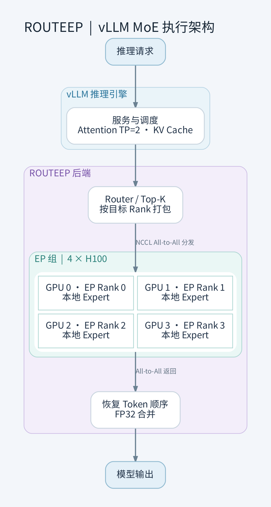
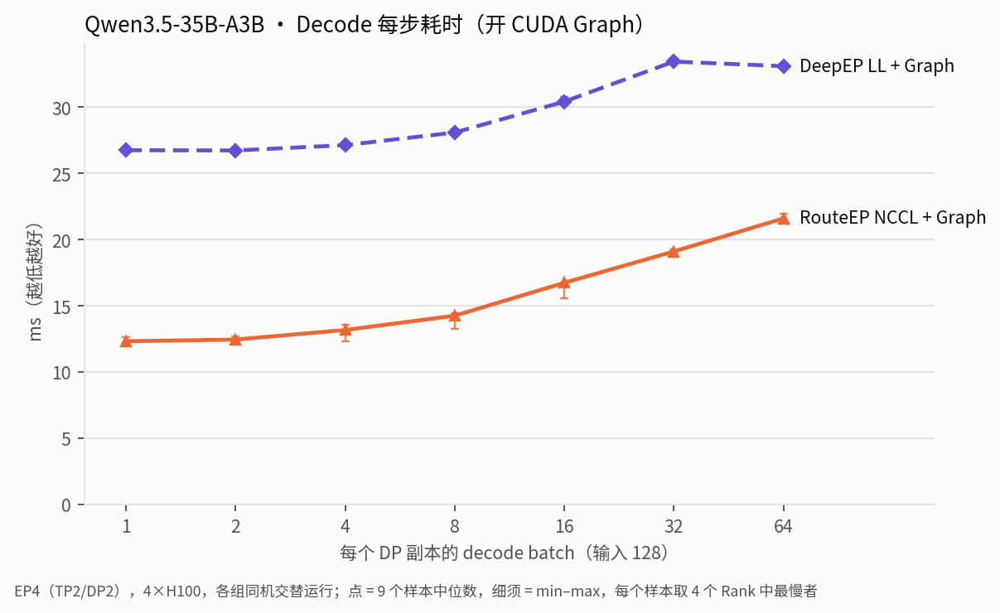
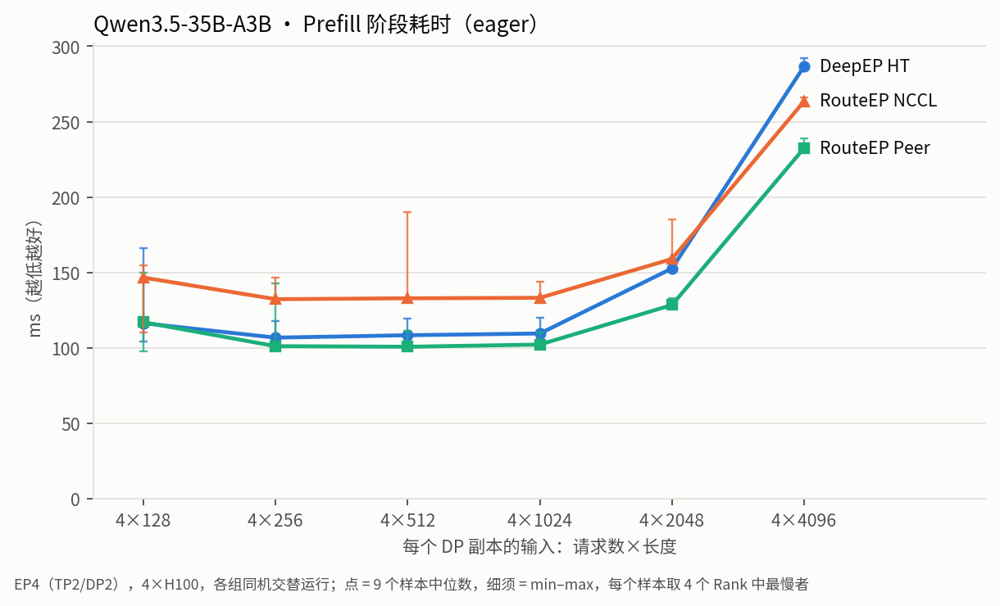
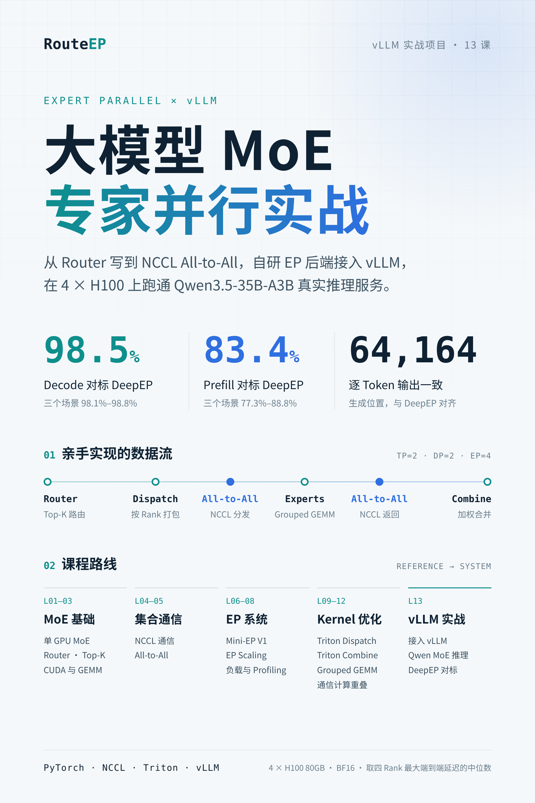

<div align="center">

# RouteEP

**接入 vLLM 的 MoE Expert Parallel 推理后端**

自研 Token 路由与 All-to-All 通信 · 4 × H100 上运行 Qwen3 / Qwen3.5 推理服务 · CUDA Graph decode

</div>

---

## 亮点

| Decode（CUDA Graph） | Prefill | 正确性 |
|:---:|:---:|:---:|
| **1.5–3.1×** | **最高快 23%** | **生成 Token 与 DeepEP HT 一致** |
| 对比 DeepEP LL + Graph 的每步耗时 | 4×4096 输入，对比 DeepEP HT | 服务压测 17,038 个请求，0 失败 |

- 以 vLLM 插件形式运行，支持整模型离线推理和 OpenAI 兼容服务。
- 路由、跨卡分发、Expert 计算、结果返回、加权合并全部自研，每一步都有 PyTorch Reference。
- 与 DeepEP 在同一台机器上交替测量，脚本、原始数据和报告都在仓库里。

## 工作原理

vLLM 负责服务、调度、KV Cache 和 Attention，RouteEP 接管 MoE 层。每个 MoE 层的数据流：

```text
Router (Top-K)  →  Dispatch  →  All-to-All  →  Expert MLP  →  All-to-All  →  Combine
 选出 Expert       按目标 Rank     发送到         本地 Grouped      送回          按路由权重
                  去重打包 Token  Expert 所在卡   GEMM / SwiGLU    原 Rank       加权合并
```

1. **Router**：每个 Token 选出 Top-K 个 Expert 及对应权重。
2. **Dispatch**：按 Token/目标 Rank 去重打包，每个目标只收到一份输入和路由元数据。
3. **All-to-All 分发**：把 Token 送到持有对应 Expert 的 GPU。
4. **Expert 计算**：目标卡展开分支，用 Grouped GEMM / SwiGLU 计算本地 Expert；Qwen3.5 另算 Shared Expert。
5. **All-to-All 返回**：目标卡先合并同一 Token 的本卡输出，每个 Token 只返回一份部分和。
6. **Combine**：恢复原始 Token 顺序，按 owner rank 顺序合并部分和。



四张 H100 的拓扑：Attention TP=2、DP=2，MoE EP=4，每个 EP Rank 持有 1/4 的 Routed Experts。

通信路径由 `MINIEP_TRANSPORT` 选择：

| 取值 | 路径 | 条件 |
|---|---|---|
| `auto`（默认） | 满足条件用 Peer/TMA，否则用 NCCL | SM90+、单机、组内 CUDA P2P 全通 |
| `nccl` | NCCL All-to-All，每个 Rank ≤ 256 Token 时用固定容量缓冲，无 Host 同步 | 任意 GPU |
| `peer` | Peer Memory / TMA | 同 `auto` 的条件 |

开启 CUDA Graph 时，decode 使用 NCCL 固定容量路径。实现细节见 [去重与 Peer 说明](PEER.md)。

## 支持的模型

| 模型 | 权重 | MoE 层数 | Routed Experts | Top-K | Shared Expert |
|---|---|---:|---:|---:|---:|
| Qwen3-30B-A3B | BF16 | 48 | 128 | 8 | — |
| Qwen3.5-35B-A3B | BF16 | 40 | 256 | 8 | 1 |

## 快速开始

硬件：单机 4 × H100 80GB（NVLink）。

### 1. 环境

| 组件 | 版本 |
|---|---|
| Python | 3.12 |
| vLLM | 0.29.0 |
| PyTorch | 2.13.0+cu130 |
| Triton | 3.7.1 |
| Transformers | 5.16.1 |
| CUDA / NCCL | 13.0 / 2.29.7 |
| DeepEP（对照用） | 2.0.0 |

在 vLLM 0.29.0 镜像中启动容器，`MODEL_ROOT` 下放 `Qwen3-30B-A3B` 和 `Qwen3.5-35B-A3B`：

```bash
cd routeep
export IMAGE=<vLLM 0.29.0 镜像>
export MODEL_ROOT=/path/to/Qwen-models

docker run --rm -it --gpus '"device=0,1,2,3"' \
  --net=host --ipc=host --shm-size=16g --ulimit memlock=-1:-1 \
  --cap-add IPC_LOCK --cap-add SYS_ADMIN --cap-add SYS_RAWIO --device /dev/infiniband \
  -e NCCL_NVLS_ENABLE=0 -e OMP_NUM_THREADS=1 \
  -v "$PWD":/workspace -v "$MODEL_ROOT":/models:ro -w /workspace \
  --entrypoint bash "$IMAGE"
```

### 2. 安装

```bash
python3 -m pip install --no-deps --no-build-isolation -e .
python3 -m unittest discover -s checks -p 'test_*.py'
```

安装后 RouteEP 通过 `vllm.general_plugins` 自动注册到 vLLM。

### 3. 离线推理

```bash
export MODEL_PATH=/models/Qwen3-30B-A3B   # 或 /models/Qwen3.5-35B-A3B
torchrun --standalone --nproc-per-node=4 test/demo.py \
  --model "$MODEL_PATH" --backend miniep --output results/demo
```

`--backend native` 切换到 vLLM 原生 DeepEP HT 后端。

### 4. OpenAI 兼容服务

```bash
python3 test/serve.py --model "$MODEL_PATH" --backend miniep --dp-size 2 \
  --max-num-seqs 32 --host 0.0.0.0 --port 8133 \
  --cudagraph-capture-sizes 1 2 4 8 16 32 64     # decode 开 CUDA Graph；去掉这一行为 eager
```

日志出现 `Application startup complete` 后，在另一个终端：

```bash
python3 test/service_check.py --url http://127.0.0.1:8133 --output results/service-check.json
python3 test/service_stress.py --url http://127.0.0.1:8133 --duration 600 --concurrency 16 \
  --output results/service-stress.json
```

`service_check` 覆盖健康检查、普通/流式/Chat 请求和并发请求；`service_stress` 持续 10 分钟混合发送短/长 prompt、采样请求、中途断开的流式请求和重复的贪心请求。两者都以 `PASS` 结尾表示通过。

## 测试

| 检查 | 命令 | GPU | 通过标准 |
|---|---|---:|---|
| 单元检查 | `python3 -m unittest discover -s checks -p 'test_*.py'` | 0 | 全部 OK |
| NCCL 去重 | `torchrun --standalone --nproc-per-node=2 checks/nccl_dedup.py --output results/nccl-dedup` | 2 | 与 Reference 逐元素一致；`--peer-smoke` 同时比较 NCCL 与 Peer |
| Peer 去重 | `torchrun --standalone --nproc-per-node=4 checks/peer_dedup.py --output results/peer-dedup` | 4 | 全部用例通过 |
| CUDA Graph | `torchrun --standalone --nproc-per-node=4 checks/graph_capture_probe.py` | 4 | 每个 Rank 打印 `PASS` |
| 与 DeepEP 对齐 | `python3 test/deepep_alignment.py --model "$MODEL_PATH" --output results/align --transport nccl` | 4 | 生成 Token 与 logits 逐元素相等；`--transport peer` 测 Peer 路径 |

## Benchmark

每个 job 新起一个引擎，每个样本取 4 个 Rank 中最慢者，报告中位数。先为每个模型生成 checkpoint 清单：

```bash
for m in Qwen3-30B-A3B Qwen3.5-35B-A3B; do
  python3 tools/checkpoint_manifest.py /models/$m results/manifests/$m-checkpoint.json
done
```

**固定场景三方对比**：DeepEP HT / RouteEP NCCL / RouteEP Peer，6 个场景，每个模型 35–50 分钟。

```bash
python3 benchmarks/peer_suite.py --models /models/Qwen3-30B-A3B /models/Qwen3.5-35B-A3B \
  --manifest-dir results/manifests --output results/three-way --trials 3 --warmup 2 --repeats 3
```

结果在 `results/three-way/summary.json`，包含三条路径的生成 Token 比对。

**规模扫描与折线图**：prefill 为 4 条请求、单条 128–4096；decode 为 batch 1–64，对比 DeepEP LL + Graph 与 RouteEP NCCL + Graph，并带 eager 参照。prefill 约 25 分钟，decode 约 2 小时。

```bash
MODEL_ROOT=/models MANIFEST_DIR=results/manifests OUT=results/sweep bash benchmarks/scaling_sweep.sh
python3 benchmarks/summarize_scaling.py results/sweep --output results/sweep-summary.json
python3 -m pip install -r requirements-plot.txt
python3 benchmarks/plot_scaling_lines.py --inputs results/sweep-summary.json --out results/sweep-charts
```

`PHASES=decode`、`MODELS=Qwen3-30B-A3B` 可以只跑其中一部分，每个 job 的日志在 `results/sweep/*.log`。

**MoE 层 microbenchmark**：不经过 vLLM，使用合成路由。

```bash
torchrun --standalone --nproc-per-node=4 benchmarks/dedup_layer_bench.py --transport nccl --fixed --output results/layer.json
```

## 性能

4 × H100，EP4（TP2/DP2），各组在同一组卡上交替运行，每个点 9 个样本。完整数据见 [H100 实验报告](reports/h100-opt-20261028/REPORT.md)。

| 阶段 | 对比 | Qwen3-30B-A3B | Qwen3.5-35B-A3B |
|---|---|---|---|
| Decode 每步（CUDA Graph） | DeepEP LL + Graph → RouteEP | 30.4–35.6 → **9.9–15.8 ms** | 26.7–33.4 → **12.3–21.6 ms** |
| Decode 每步（eager） | DeepEP HT → RouteEP Peer | 79.6–81.6 → **74.8–78.0 ms** | 88.0–89.9 → **83.4–85.8 ms** |
| Prefill，4×4096 | DeepEP HT → RouteEP Peer | 330.0 → **252.8 ms** | 286.7 → **232.5 ms** |





- **Decode**：开 CUDA Graph 后，RouteEP 每步耗时是 DeepEP LL + Graph 的 1/3.1–1/1.5，batch 越小优势越大。
- **Prefill**：输入越长，Peer 领先 DeepEP HT 越多，4×2048 起快 16–23%。
- Qwen3 的三张图和 Qwen3.5 decode eager 图在 [`reports/h100-opt-20261028/`](reports/h100-opt-20261028/)。

## 正确性

- 与 DeepEP HT 精确对齐：两个模型各 902 条请求序列、64,164 个生成位置，生成 Token 与 teacher-forced logits 逐元素相等（`reports/qwen3-accuracy.json`、`reports/qwen35-accuracy.json`）。
- 性能测试中，DeepEP HT、RouteEP NCCL、RouteEP Peer 的生成 Token 完全一致。
- 开启 CUDA Graph 后，RouteEP 的生成结果与 eager 逐位一致（`VLLM_BATCH_INVARIANT=1`）。

## 项目结构

```text
routeep/
├── mini_ep/       EP 推理后端：路由、分发、通信、Triton Kernel 与 vLLM 插件
├── reference/     PyTorch Reference，用于逐步核对优化实现
├── validation/    与 DeepEP 的精确对齐验证
├── checks/        单元检查与分布式检查
├── test/          推理、服务与对齐入口
├── benchmarks/    性能基准、结果汇总与绘图
├── reports/       实验报告与原始数据
├── assets/        架构图、性能图与课程海报
└── tools/         checkpoint 清单与海报生成脚本
```

## 配套课程

《vLLM 实战项目：大模型 MoE 专家并行实战》共 13 课，从单 GPU MoE 讲到接入 vLLM：

| 阶段 | 课次 | 内容 |
|---|---|---|
| MoE 基础 | 1–3 | 单 GPU MoE、Router 与 Top-K、CUDA 与 GEMM |
| 集合通信 | 4–5 | NCCL 通信、All-to-All |
| EP 系统 | 6–8 | Mini-EP V1、EP Scaling、负载均衡与 Profiling |
| Kernel 优化 | 9–12 | Triton Dispatch / Combine、Grouped GEMM、通信计算重叠 |
| vLLM 实战 | 13 | 接入 vLLM、Qwen MoE 推理、对标 DeepEP |

<p align="center"></p>
