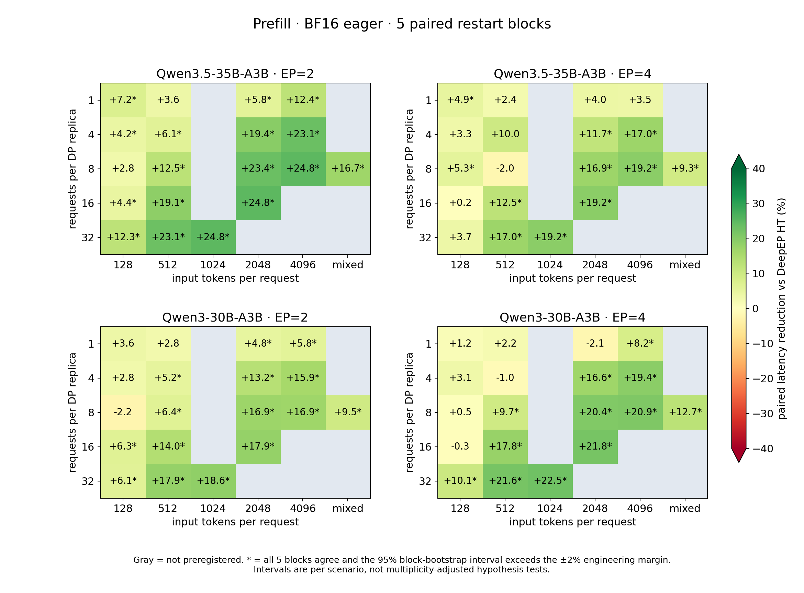
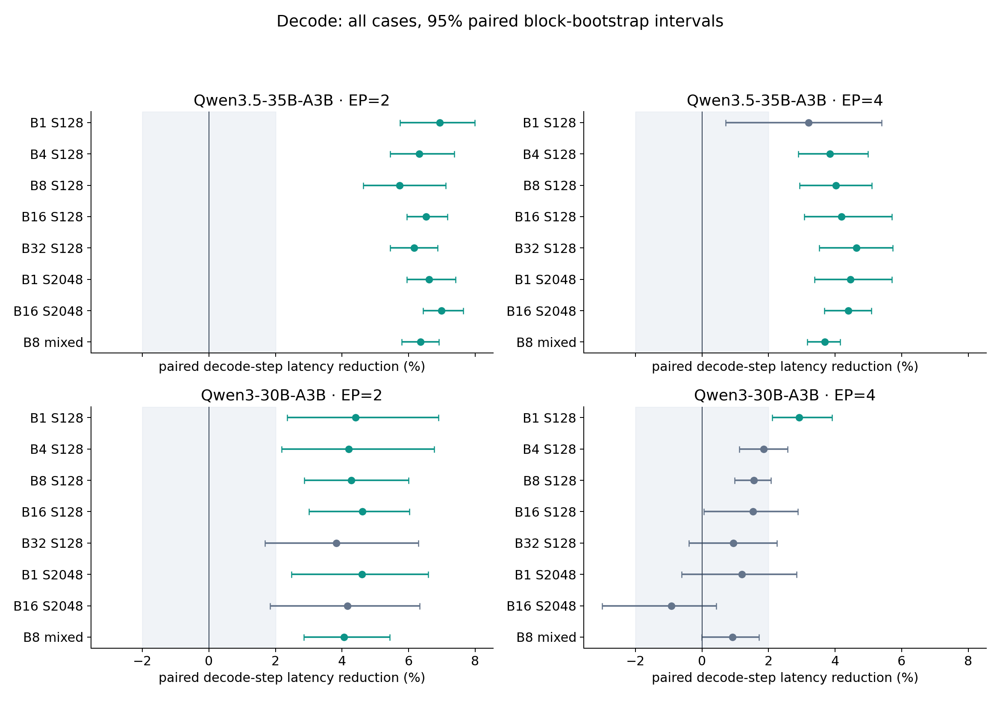
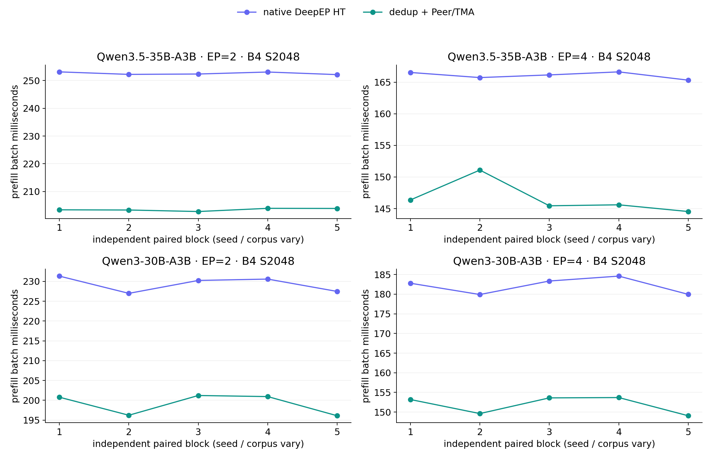
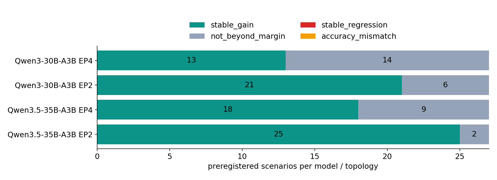
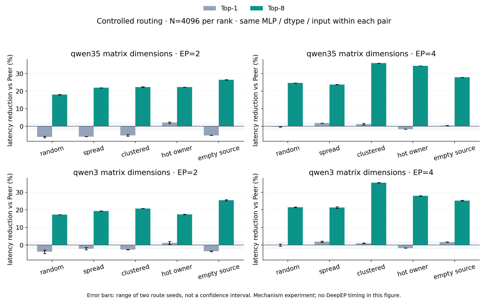
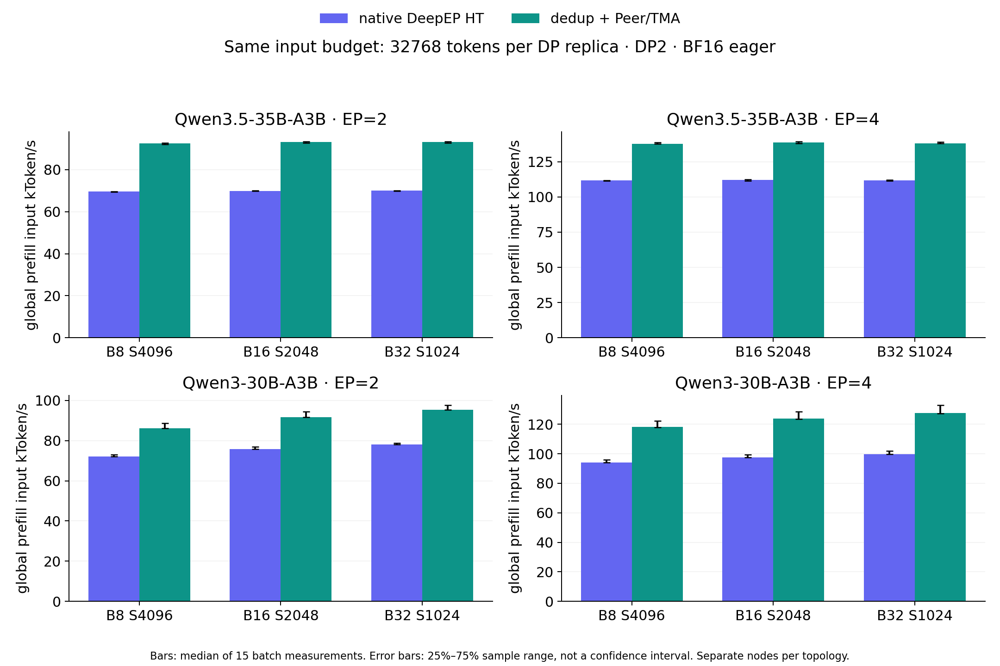

# RouteEP 去重＋Peer/TMA vs DeepEP HT：H100 扩展实验

飞书报告：[工作中的vllm / 太初](https://tvle9mq8jh.feishu.cn/docx/F3xxdCUQOohBQ2x52cHcWFjKnbK)。

108 个预先确定的模型×拓扑×负载场景，五个新进程配对块、每块三次测量，共 3240 个最大 Rank 计时。按预设 ±2% 工程阈值与块方向/区间规则，77 个场景满足稳定增益，31 个未超过判据；稳定回退 0，精度未对齐 0。胜场数不是线上总体胜率。

整模型 684,960 个生成位置全部一致（含重复测量，排除 TP 副本重复计数）。机制实验 600 个配置/种子组合、1800 个 Rank 案例与 Peer 逐元素一致；720 个小输入 Rank 案例与 PyTorch Reference 最大绝对误差 0。

## 复核上轮大 prefill 观察

B、S 为每个 DP 副本的批量和请求输入长度；下面均为 B4×S2048、生成 1 Token。耗时为 15 次测量中位数，配对降幅取五个块内中位延迟比的几何平均。

| 模型 | EP | DeepEP HT ms | 去重版 ms | 配对降幅 | 95% 配对区间 |
|---|---:|---:|---:|---:|---:|
| Qwen3-30B-A3B | 2 | 230.25 | 200.58 | +13.2% | [+12.8%, +13.6%] |
| Qwen3-30B-A3B | 4 | 182.79 | 152.61 | +16.6% | [+16.3%, +17.0%] |
| Qwen3.5-35B-A3B | 2 | 253.04 | 203.43 | +19.4% | [+19.3%, +19.6%] |
| Qwen3.5-35B-A3B | 4 | 166.45 | 146.37 | +11.7% | [+10.3%, +12.6%] |









## 方法与适用边界

同一拓扑内使用相同 GPU UUID、驱动、镜像、软件版本、checkpoint、字面输入、seed、BF16/eager 与 Triton MoE 后端。EP4=TP2/DP2，gpu5 四张 H100；EP2=TP1/DP2，gpu1 两张 H100。CPU 配额均为 8 vCPU。最大模型长度 4608、单 DP 最大输入 32768、最多 32 请求；KV Cache 对 EP4/EP2 为 8/12 GiB。两组节点分别配对，不根据绝对耗时作纯 EP 强缩放解释。

每模型五个种子13/37/123/321/777，技术英语、代码、中英混合三类合成文本；模型与块交替AB/BA。每案例预热2次，GPU时钟预热3秒，再测量3次。动态Router/metadata/pack/Expert/return/combine计入推理。权重lazy加载；首次编译/映射、加载和预热不计入steady-state。关闭prefix caching、chunked prefill、EPLB、DBO；VLLM_MOE_SKIP_PADDING=0；两边经过同一初始化函数设置BF16 reduced-precision reduction=False。

18组prefill、7组decode、2组混合长度/模型/拓扑。Prefill生成1Token；decode生成64Token且ignore_eos=True以固定工作量。完整请求耗时及吞吐保留在JSON和原始样本；表中decode是批次首尾生成跨度除以63，不是逐Token尾延迟。P95是有限批次测量样本的P95，不是生产服务p99。

以配对新进程块为统计单元；先对块内三次取中位数，再重采样完整的五个配对块，枚举3125种bootstrap样本，报告95%区间。区间为逐场景描述性区间，未做多重检验校正；稳定增益是预设工程判据，不是校正后的p值。不能把块内重复或684960个生成位置当作独立性能实验。

源数据是合成负载，结论限定于当前DeepEP HT构建、单机H100和BF16/eager。DeepEP HT自身已有Token×Rank布局掩码；这里消除的是原RouteEP的分支级重复。整模型差异还包含Expert kernel、pack/unpack、就绪交接和框架调用，不能单独推导纯通信层领先，也不扩展到LL、FP8、CUDA Graph或HTTP到达流量。

资源采样期间未发现所选GPU的外部计算活动；两个拓扑各540个rank0案例资源区间均未记录CPU配额节流。服务器非整机独占，EP2起始时有其他进程常驻少量显存；采样覆盖时间范围、原始记录与硬件/二进制指纹均保留。

## 完整108场景

| 模型 | EP | 案例 | 指标 | HT / 去重 ms | 配对降幅 | 95%区间 | 判定 |
|---|---:|---|---|---:|---:|---:|---|
| Qwen3-30B-A3B | 2 | decode_b16_s128 | decode_step_ms | 57.54 / 55.15 | +4.6% | [+3.0%, +6.0%] | stable_gain |
| Qwen3-30B-A3B | 2 | decode_b16_s2048 | decode_step_ms | 57.92 / 55.74 | +4.2% | [+1.8%, +6.3%] | not_beyond_margin |
| Qwen3-30B-A3B | 2 | decode_b1_s128 | decode_step_ms | 57.32 / 55.29 | +4.4% | [+2.3%, +6.9%] | stable_gain |
| Qwen3-30B-A3B | 2 | decode_b1_s2048 | decode_step_ms | 57.10 / 54.84 | +4.6% | [+2.5%, +6.6%] | stable_gain |
| Qwen3-30B-A3B | 2 | decode_b32_s128 | decode_step_ms | 57.55 / 55.83 | +3.8% | [+1.7%, +6.3%] | not_beyond_margin |
| Qwen3-30B-A3B | 2 | decode_b4_s128 | decode_step_ms | 57.31 / 55.34 | +4.2% | [+2.2%, +6.8%] | stable_gain |
| Qwen3-30B-A3B | 2 | decode_b8_s128 | decode_step_ms | 57.04 / 55.07 | +4.3% | [+2.9%, +6.0%] | stable_gain |
| Qwen3-30B-A3B | 2 | prefill_b16_s128 | prefill_batch_ms | 73.84 / 69.77 | +6.3% | [+4.9%, +8.0%] | stable_gain |
| Qwen3-30B-A3B | 2 | prefill_b16_s2048 | prefill_batch_ms | 865.00 / 714.17 | +17.9% | [+17.4%, +18.4%] | stable_gain |
| Qwen3-30B-A3B | 2 | prefill_b16_s512 | prefill_batch_ms | 219.96 / 189.00 | +14.0% | [+13.9%, +14.1%] | stable_gain |
| Qwen3-30B-A3B | 2 | prefill_b1_s128 | prefill_batch_ms | 58.38 / 56.58 | +3.6% | [+1.7%, +6.8%] | not_beyond_margin |
| Qwen3-30B-A3B | 2 | prefill_b1_s2048 | prefill_batch_ms | 77.49 / 73.53 | +4.8% | [+4.2%, +5.6%] | stable_gain |
| Qwen3-30B-A3B | 2 | prefill_b1_s4096 | prefill_batch_ms | 129.15 / 121.61 | +5.8% | [+5.4%, +6.2%] | stable_gain |
| Qwen3-30B-A3B | 2 | prefill_b1_s512 | prefill_batch_ms | 58.74 / 56.96 | +2.8% | [-1.2%, +8.1%] | not_beyond_margin |
| Qwen3-30B-A3B | 2 | prefill_b32_s1024 | prefill_batch_ms | 839.83 / 686.78 | +18.6% | [+18.2%, +19.0%] | stable_gain |
| Qwen3-30B-A3B | 2 | prefill_b32_s128 | prefill_batch_ms | 116.72 / 108.94 | +6.1% | [+4.6%, +6.9%] | stable_gain |
| Qwen3-30B-A3B | 2 | prefill_b32_s512 | prefill_batch_ms | 421.32 / 345.70 | +17.9% | [+17.8%, +18.1%] | stable_gain |
| Qwen3-30B-A3B | 2 | prefill_b4_s128 | prefill_batch_ms | 58.36 / 56.88 | +2.8% | [+0.7%, +5.9%] | not_beyond_margin |
| Qwen3-30B-A3B | 2 | prefill_b4_s2048 | prefill_batch_ms | 230.25 / 200.58 | +13.2% | [+12.8%, +13.6%] | stable_gain |
| Qwen3-30B-A3B | 2 | prefill_b4_s4096 | prefill_batch_ms | 464.19 / 392.59 | +15.9% | [+15.4%, +16.3%] | stable_gain |
| Qwen3-30B-A3B | 2 | prefill_b4_s512 | prefill_batch_ms | 74.39 / 70.16 | +5.2% | [+4.1%, +6.4%] | stable_gain |
| Qwen3-30B-A3B | 2 | prefill_b8_s128 | prefill_batch_ms | 59.78 / 60.36 | -2.2% | [-4.4%, +0.3%] | not_beyond_margin |
| Qwen3-30B-A3B | 2 | prefill_b8_s2048 | prefill_batch_ms | 441.80 / 369.07 | +16.9% | [+16.5%, +17.3%] | stable_gain |
| Qwen3-30B-A3B | 2 | prefill_b8_s4096 | prefill_batch_ms | 908.54 / 760.69 | +16.9% | [+16.3%, +17.4%] | stable_gain |
| Qwen3-30B-A3B | 2 | prefill_b8_s512 | prefill_batch_ms | 118.05 / 110.52 | +6.4% | [+6.0%, +6.8%] | stable_gain |
| Qwen3-30B-A3B | 2 | ragged_b8_o1 | prefill_batch_ms | 237.91 / 216.02 | +9.5% | [+9.2%, +9.7%] | stable_gain |
| Qwen3-30B-A3B | 2 | ragged_b8_o64 | decode_step_ms | 57.62 / 55.65 | +4.1% | [+2.9%, +5.4%] | stable_gain |
| Qwen3-30B-A3B | 4 | decode_b16_s128 | decode_step_ms | 68.70 / 67.70 | +1.5% | [+0.1%, +2.9%] | not_beyond_margin |
| Qwen3-30B-A3B | 4 | decode_b16_s2048 | decode_step_ms | 68.75 / 68.12 | -0.9% | [-3.0%, +0.4%] | not_beyond_margin |
| Qwen3-30B-A3B | 4 | decode_b1_s128 | decode_step_ms | 68.82 / 66.98 | +2.9% | [+2.1%, +3.9%] | stable_gain |
| Qwen3-30B-A3B | 4 | decode_b1_s2048 | decode_step_ms | 68.92 / 67.79 | +1.2% | [-0.6%, +2.8%] | not_beyond_margin |
| Qwen3-30B-A3B | 4 | decode_b32_s128 | decode_step_ms | 68.66 / 67.95 | +0.9% | [-0.4%, +2.3%] | not_beyond_margin |
| Qwen3-30B-A3B | 4 | decode_b4_s128 | decode_step_ms | 68.29 / 66.68 | +1.9% | [+1.1%, +2.6%] | not_beyond_margin |
| Qwen3-30B-A3B | 4 | decode_b8_s128 | decode_step_ms | 68.10 / 67.17 | +1.6% | [+1.0%, +2.1%] | not_beyond_margin |
| Qwen3-30B-A3B | 4 | prefill_b16_s128 | prefill_batch_ms | 71.72 / 73.00 | -0.3% | [-2.2%, +2.2%] | not_beyond_margin |
| Qwen3-30B-A3B | 4 | prefill_b16_s2048 | prefill_batch_ms | 672.35 / 529.53 | +21.8% | [+21.2%, +22.4%] | stable_gain |
| Qwen3-30B-A3B | 4 | prefill_b16_s512 | prefill_batch_ms | 176.22 / 145.31 | +17.8% | [+17.5%, +18.0%] | stable_gain |
| Qwen3-30B-A3B | 4 | prefill_b1_s128 | prefill_batch_ms | 71.23 / 69.26 | +1.2% | [-4.0%, +5.4%] | not_beyond_margin |
| Qwen3-30B-A3B | 4 | prefill_b1_s2048 | prefill_batch_ms | 70.21 / 71.82 | -2.1% | [-3.6%, -0.4%] | not_beyond_margin |
| Qwen3-30B-A3B | 4 | prefill_b1_s4096 | prefill_batch_ms | 102.16 / 94.34 | +8.2% | [+7.6%, +8.8%] | stable_gain |
| Qwen3-30B-A3B | 4 | prefill_b1_s512 | prefill_batch_ms | 70.90 / 69.40 | +2.2% | [+0.3%, +4.2%] | not_beyond_margin |
| Qwen3-30B-A3B | 4 | prefill_b32_s1024 | prefill_batch_ms | 657.12 / 513.28 | +22.5% | [+21.8%, +23.2%] | stable_gain |
| Qwen3-30B-A3B | 4 | prefill_b32_s128 | prefill_batch_ms | 95.27 / 85.76 | +10.1% | [+9.8%, +10.5%] | stable_gain |
| Qwen3-30B-A3B | 4 | prefill_b32_s512 | prefill_batch_ms | 337.09 / 266.06 | +21.6% | [+21.0%, +22.2%] | stable_gain |
| Qwen3-30B-A3B | 4 | prefill_b4_s128 | prefill_batch_ms | 69.79 / 68.75 | +3.1% | [+0.4%, +6.3%] | not_beyond_margin |
| Qwen3-30B-A3B | 4 | prefill_b4_s2048 | prefill_batch_ms | 182.79 / 152.61 | +16.6% | [+16.3%, +17.0%] | stable_gain |
| Qwen3-30B-A3B | 4 | prefill_b4_s4096 | prefill_batch_ms | 362.65 / 293.41 | +19.4% | [+18.9%, +19.8%] | stable_gain |
| Qwen3-30B-A3B | 4 | prefill_b4_s512 | prefill_batch_ms | 70.39 / 71.84 | -1.0% | [-3.5%, +1.4%] | not_beyond_margin |
| Qwen3-30B-A3B | 4 | prefill_b8_s128 | prefill_batch_ms | 69.47 / 69.31 | +0.5% | [-0.2%, +1.0%] | not_beyond_margin |
| Qwen3-30B-A3B | 4 | prefill_b8_s2048 | prefill_batch_ms | 351.08 / 280.71 | +20.4% | [+19.9%, +20.9%] | stable_gain |
| Qwen3-30B-A3B | 4 | prefill_b8_s4096 | prefill_batch_ms | 696.73 / 554.81 | +20.9% | [+20.4%, +21.4%] | stable_gain |
| Qwen3-30B-A3B | 4 | prefill_b8_s512 | prefill_batch_ms | 95.87 / 86.95 | +9.7% | [+9.2%, +10.1%] | stable_gain |
| Qwen3-30B-A3B | 4 | ragged_b8_o1 | prefill_batch_ms | 187.26 / 164.72 | +12.7% | [+12.0%, +13.4%] | stable_gain |
| Qwen3-30B-A3B | 4 | ragged_b8_o64 | decode_step_ms | 68.69 / 68.25 | +0.9% | [-0.0%, +1.7%] | not_beyond_margin |
| Qwen3.5-35B-A3B | 2 | decode_b16_s128 | decode_step_ms | 68.55 / 64.11 | +6.5% | [+5.9%, +7.2%] | stable_gain |
| Qwen3.5-35B-A3B | 2 | decode_b16_s2048 | decode_step_ms | 68.90 / 64.04 | +7.0% | [+6.4%, +7.6%] | stable_gain |
| Qwen3.5-35B-A3B | 2 | decode_b1_s128 | decode_step_ms | 67.26 / 62.48 | +6.9% | [+5.7%, +8.0%] | stable_gain |
| Qwen3.5-35B-A3B | 2 | decode_b1_s2048 | decode_step_ms | 67.27 / 63.00 | +6.6% | [+5.9%, +7.4%] | stable_gain |
| Qwen3.5-35B-A3B | 2 | decode_b32_s128 | decode_step_ms | 69.34 / 64.94 | +6.2% | [+5.4%, +6.9%] | stable_gain |
| Qwen3.5-35B-A3B | 2 | decode_b4_s128 | decode_step_ms | 67.92 / 63.76 | +6.3% | [+5.4%, +7.4%] | stable_gain |
| Qwen3.5-35B-A3B | 2 | decode_b8_s128 | decode_step_ms | 67.86 / 64.19 | +5.7% | [+4.6%, +7.1%] | stable_gain |
| Qwen3.5-35B-A3B | 2 | prefill_b16_s128 | prefill_batch_ms | 89.52 / 85.59 | +4.4% | [+3.7%, +5.2%] | stable_gain |
| Qwen3.5-35B-A3B | 2 | prefill_b16_s2048 | prefill_batch_ms | 937.50 / 704.34 | +24.8% | [+24.7%, +24.9%] | stable_gain |
| Qwen3.5-35B-A3B | 2 | prefill_b16_s512 | prefill_batch_ms | 255.20 / 206.63 | +19.1% | [+18.8%, +19.3%] | stable_gain |
| Qwen3.5-35B-A3B | 2 | prefill_b1_s128 | prefill_batch_ms | 82.13 / 77.47 | +7.2% | [+4.7%, +11.0%] | stable_gain |
| Qwen3.5-35B-A3B | 2 | prefill_b1_s2048 | prefill_batch_ms | 86.74 / 82.90 | +5.8% | [+4.3%, +8.0%] | stable_gain |
| Qwen3.5-35B-A3B | 2 | prefill_b1_s4096 | prefill_batch_ms | 141.45 / 123.94 | +12.4% | [+12.2%, +12.6%] | stable_gain |
| Qwen3.5-35B-A3B | 2 | prefill_b1_s512 | prefill_batch_ms | 81.44 / 77.42 | +3.6% | [+1.3%, +5.4%] | not_beyond_margin |
| Qwen3.5-35B-A3B | 2 | prefill_b32_s1024 | prefill_batch_ms | 937.14 / 704.33 | +24.8% | [+24.7%, +24.9%] | stable_gain |
| Qwen3.5-35B-A3B | 2 | prefill_b32_s128 | prefill_batch_ms | 144.91 / 126.96 | +12.3% | [+12.2%, +12.6%] | stable_gain |
| Qwen3.5-35B-A3B | 2 | prefill_b32_s512 | prefill_batch_ms | 487.28 / 375.10 | +23.1% | [+23.0%, +23.1%] | stable_gain |
| Qwen3.5-35B-A3B | 2 | prefill_b4_s128 | prefill_batch_ms | 85.28 / 81.08 | +4.2% | [+2.3%, +6.9%] | stable_gain |
| Qwen3.5-35B-A3B | 2 | prefill_b4_s2048 | prefill_batch_ms | 253.04 / 203.43 | +19.4% | [+19.3%, +19.6%] | stable_gain |
| Qwen3.5-35B-A3B | 2 | prefill_b4_s4096 | prefill_batch_ms | 485.47 / 372.73 | +23.1% | [+23.0%, +23.2%] | stable_gain |
| Qwen3.5-35B-A3B | 2 | prefill_b4_s512 | prefill_batch_ms | 89.92 / 84.68 | +6.1% | [+4.4%, +7.4%] | stable_gain |
| Qwen3.5-35B-A3B | 2 | prefill_b8_s128 | prefill_batch_ms | 86.71 / 83.75 | +2.8% | [+1.3%, +4.2%] | not_beyond_margin |
| Qwen3.5-35B-A3B | 2 | prefill_b8_s2048 | prefill_batch_ms | 482.77 / 369.82 | +23.4% | [+23.3%, +23.4%] | stable_gain |
| Qwen3.5-35B-A3B | 2 | prefill_b8_s4096 | prefill_batch_ms | 942.52 / 708.72 | +24.8% | [+24.6%, +24.9%] | stable_gain |
| Qwen3.5-35B-A3B | 2 | prefill_b8_s512 | prefill_batch_ms | 138.20 / 120.91 | +12.5% | [+12.2%, +12.7%] | stable_gain |
| Qwen3.5-35B-A3B | 2 | ragged_b8_o1 | prefill_batch_ms | 265.09 / 220.44 | +16.7% | [+16.6%, +16.9%] | stable_gain |
| Qwen3.5-35B-A3B | 2 | ragged_b8_o64 | decode_step_ms | 68.52 / 63.99 | +6.4% | [+5.8%, +6.9%] | stable_gain |
| Qwen3.5-35B-A3B | 4 | decode_b16_s128 | decode_step_ms | 78.66 / 75.07 | +4.2% | [+3.1%, +5.7%] | stable_gain |
| Qwen3.5-35B-A3B | 4 | decode_b16_s2048 | decode_step_ms | 78.78 / 75.22 | +4.4% | [+3.7%, +5.1%] | stable_gain |
| Qwen3.5-35B-A3B | 4 | decode_b1_s128 | decode_step_ms | 77.43 / 74.20 | +3.2% | [+0.7%, +5.4%] | not_beyond_margin |
| Qwen3.5-35B-A3B | 4 | decode_b1_s2048 | decode_step_ms | 76.96 / 73.65 | +4.5% | [+3.4%, +5.7%] | stable_gain |
| Qwen3.5-35B-A3B | 4 | decode_b32_s128 | decode_step_ms | 78.96 / 75.35 | +4.6% | [+3.5%, +5.7%] | stable_gain |
| Qwen3.5-35B-A3B | 4 | decode_b4_s128 | decode_step_ms | 78.07 / 74.99 | +3.8% | [+2.9%, +5.0%] | stable_gain |
| Qwen3.5-35B-A3B | 4 | decode_b8_s128 | decode_step_ms | 78.31 / 74.94 | +4.0% | [+2.9%, +5.1%] | stable_gain |
| Qwen3.5-35B-A3B | 4 | prefill_b16_s128 | prefill_batch_ms | 98.42 / 97.51 | +0.2% | [-1.6%, +1.8%] | not_beyond_margin |
| Qwen3.5-35B-A3B | 4 | prefill_b16_s2048 | prefill_batch_ms | 585.31 / 472.41 | +19.2% | [+19.1%, +19.3%] | stable_gain |
| Qwen3.5-35B-A3B | 4 | prefill_b16_s512 | prefill_batch_ms | 164.08 / 143.16 | +12.5% | [+11.9%, +12.9%] | stable_gain |
| Qwen3.5-35B-A3B | 4 | prefill_b1_s128 | prefill_batch_ms | 96.95 / 90.79 | +4.9% | [+3.3%, +7.4%] | stable_gain |
| Qwen3.5-35B-A3B | 4 | prefill_b1_s2048 | prefill_batch_ms | 97.36 / 92.44 | +4.0% | [-0.2%, +7.6%] | not_beyond_margin |
| Qwen3.5-35B-A3B | 4 | prefill_b1_s4096 | prefill_batch_ms | 98.20 / 94.79 | +3.5% | [+2.0%, +4.9%] | not_beyond_margin |
| Qwen3.5-35B-A3B | 4 | prefill_b1_s512 | prefill_batch_ms | 94.97 / 91.51 | +2.4% | [+0.3%, +5.6%] | not_beyond_margin |
| Qwen3.5-35B-A3B | 4 | prefill_b32_s1024 | prefill_batch_ms | 586.15 / 474.26 | +19.2% | [+19.0%, +19.4%] | stable_gain |
| Qwen3.5-35B-A3B | 4 | prefill_b32_s128 | prefill_batch_ms | 103.86 / 100.19 | +3.7% | [+0.6%, +7.6%] | not_beyond_margin |
| Qwen3.5-35B-A3B | 4 | prefill_b32_s512 | prefill_batch_ms | 307.20 / 255.52 | +17.0% | [+16.8%, +17.2%] | stable_gain |
| Qwen3.5-35B-A3B | 4 | prefill_b4_s128 | prefill_batch_ms | 95.78 / 91.36 | +3.3% | [-2.0%, +6.4%] | not_beyond_margin |
| Qwen3.5-35B-A3B | 4 | prefill_b4_s2048 | prefill_batch_ms | 166.45 / 146.37 | +11.7% | [+10.3%, +12.6%] | stable_gain |
| Qwen3.5-35B-A3B | 4 | prefill_b4_s4096 | prefill_batch_ms | 310.62 / 258.24 | +17.0% | [+16.8%, +17.1%] | stable_gain |
| Qwen3.5-35B-A3B | 4 | prefill_b4_s512 | prefill_batch_ms | 97.61 / 94.55 | +10.0% | [+1.7%, +19.1%] | not_beyond_margin |
| Qwen3.5-35B-A3B | 4 | prefill_b8_s128 | prefill_batch_ms | 99.40 / 93.60 | +5.3% | [+3.4%, +7.3%] | stable_gain |
| Qwen3.5-35B-A3B | 4 | prefill_b8_s2048 | prefill_batch_ms | 304.02 / 252.43 | +16.9% | [+16.7%, +17.3%] | stable_gain |
| Qwen3.5-35B-A3B | 4 | prefill_b8_s4096 | prefill_batch_ms | 587.12 / 475.39 | +19.2% | [+19.0%, +19.3%] | stable_gain |
| Qwen3.5-35B-A3B | 4 | prefill_b8_s512 | prefill_batch_ms | 101.87 / 100.28 | -2.0% | [-7.2%, +1.9%] | not_beyond_margin |
| Qwen3.5-35B-A3B | 4 | ragged_b8_o1 | prefill_batch_ms | 172.12 / 156.68 | +9.3% | [+9.2%, +9.4%] | stable_gain |
| Qwen3.5-35B-A3B | 4 | ragged_b8_o64 | decode_step_ms | 78.21 / 75.21 | +3.7% | [+3.2%, +4.1%] | stable_gain |

## 机制与精度数据



本图比较相同输入、路由和MLP的Peer/去重Peer，不含DeepEP算子性能。每Rank 1/8/128/1024/4096 Token，Top-1/2/8；随机、分散、聚集、热点、空来源五类路由；两种矩阵形状、EP2/4、两个种子。每配置10个AB/BA采样对，CUDAEvent每次取最大Rank；小输入对照独立PyTorch。图中N4096仅便于观察，全部600行与原始样本保留。

逻辑大向量载荷排除本地副本、metadata、信号及链路头，不是NVLink物理计数；新旧路径也改变了就绪信号粒度与归约位置，不把所有收益归因于字节数。

## 文件与复现

- `all-scenarios.csv` / `summary.json`：全部场景、块级结果、区间、吞吐与精度证明。
- `raw-results.tgz`：逐Rank原始记录、实际后端证明、checkpoint/source哈希、环境及资源记录。
- `runtime-ep*.json` / `hardware-ep*.json`：镜像、DeepEP Python/C++文件SHA256与硬件身份。
- `routing-all-cases.csv` / `routing-summary.json`：全部机制场景与原始最大Rank采样。
- `preregistered-plan.json`：测量前固定的方案。

```bash
cd routeep
python3 benchmarks/extended_suite.py --tp-size 2 --models /models/Qwen3.5-35B-A3B /models/Qwen3-30B-A3B --manifest-dir /experiment --output results/paired-ep4
python3 benchmarks/extended_suite.py --tp-size 1 --models /models/Qwen3.5-35B-A3B /models/Qwen3-30B-A3B --manifest-dir /experiment --output results/paired-ep2
```

对应容器分别提供4/2张H100。分析、图表和飞书XML草稿保存在仓库 artifacts/routeep_extended_20261026 与 draft_3f51b55d_folder；没有将容量验证或旧探索性数据混入正式统计。

## 完整请求与吞吐视图



同一批原始正式数据的后处理。误差线为样本四分位范围，不是95%区间；分别在各节点内比较。全部108场景的完整请求延迟与吞吐见 throughput-and-e2e.csv，实际版本与二进制/源码核对见 provenance.json，一致源码快照为 source-code.tgz。

## 完整逐场景图集

[108正式＋12探索性场景的完整12图](complete-charts/README.md)，全部满足/未满足判据及中位值回退均保留。Decode与DeepEP HT的32个场景（含4个混合decode）有22个满足预设稳定增益判据，模型和拓扑差异见图。

## 完整折线图版

[全部120个场景的12张折线图](line-charts/README.md)。按输入长度分面、横轴为每DP请求数，展示绝对延迟和相对DeepEP的配对降幅；所有已测场景均保留。飞书完整图集中的对应柱状图已替换为折线图。
