# 完整性能折线图

全部108个正式场景和12个旧探索场景；仅连接相同模型、EP、输入长度和协议下的已测batch点。各面板横轴为分类等距，标注实际B；mixed与单点配置独立显示。

正式图每组上方为绝对延迟中位数及IQR，下方为配对降幅及95%块bootstrap区间，保留未超过判据和负收益点；面板纵轴范围不同。旧探索性四路径单独显示，不合并统计。

## Qwen3.5-35B-A3B / EP2 / prefill / extended

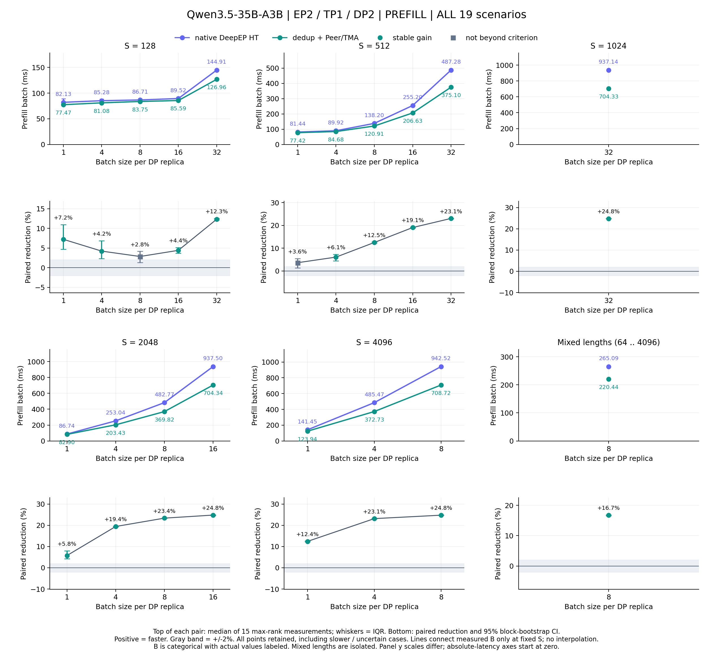

## Qwen3.5-35B-A3B / EP2 / decode / extended

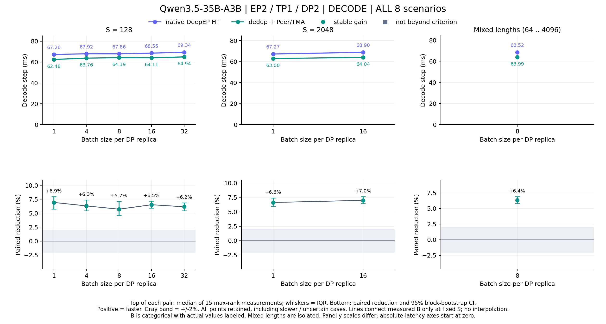

## Qwen3.5-35B-A3B / EP4 / prefill / extended

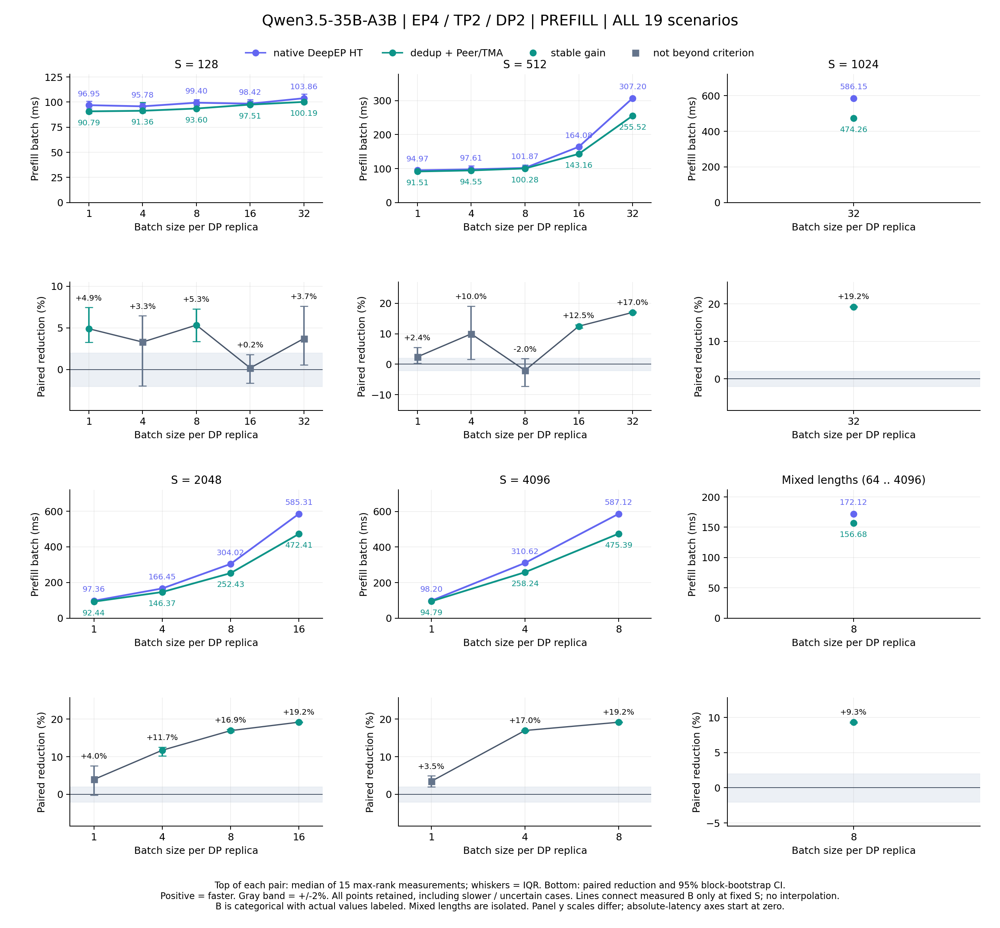

## Qwen3.5-35B-A3B / EP4 / decode / extended

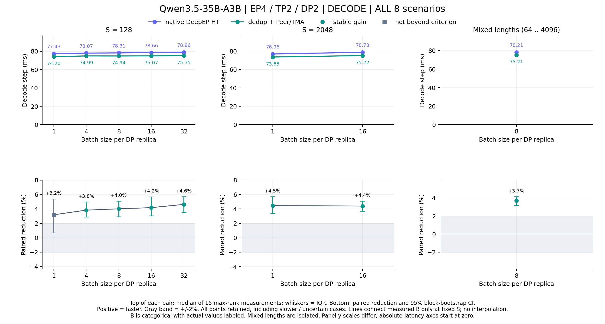

## Qwen3-30B-A3B / EP2 / prefill / extended

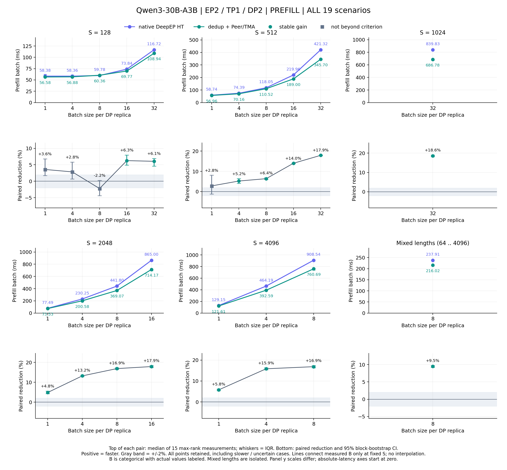

## Qwen3-30B-A3B / EP2 / decode / extended

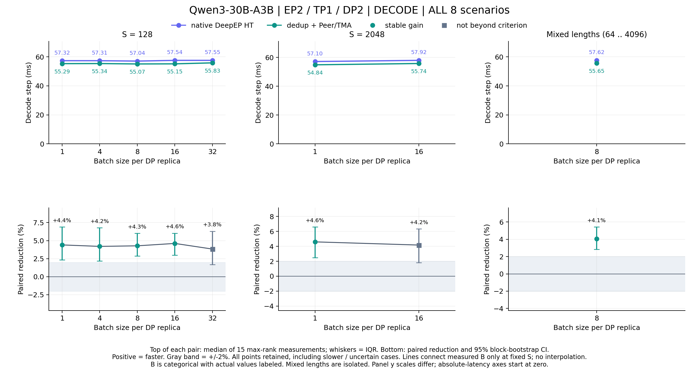

## Qwen3-30B-A3B / EP4 / prefill / extended

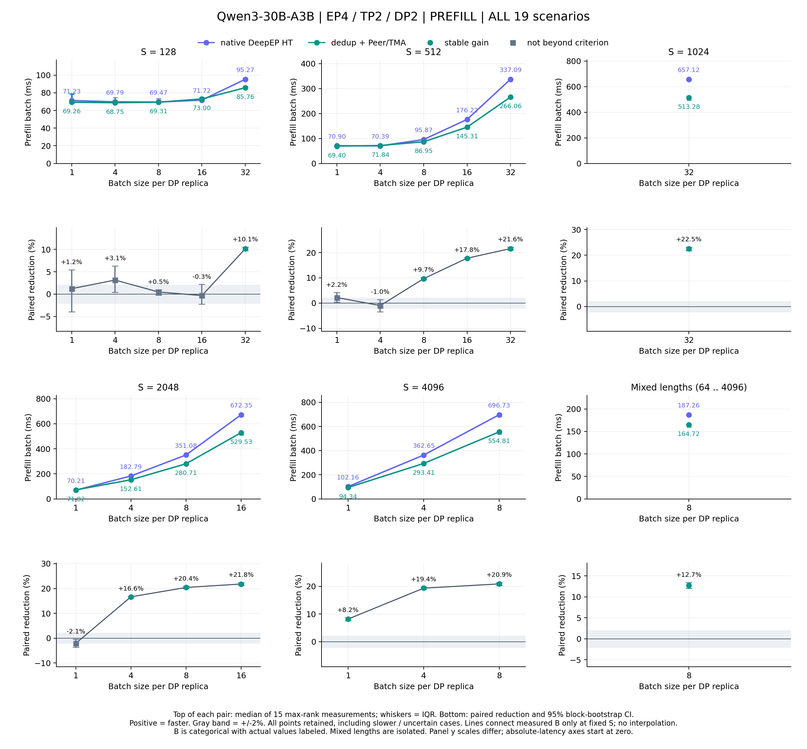

## Qwen3-30B-A3B / EP4 / decode / extended

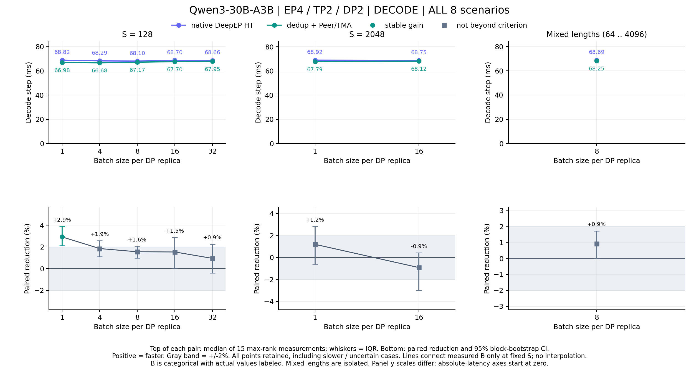

## Qwen3.5-35B-A3B / EP4 / prefill / pilot

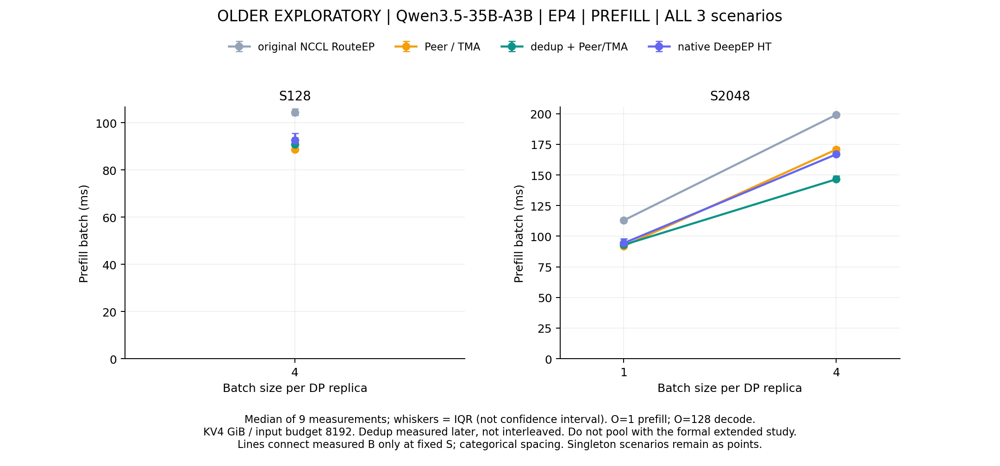

## Qwen3.5-35B-A3B / EP4 / decode / pilot

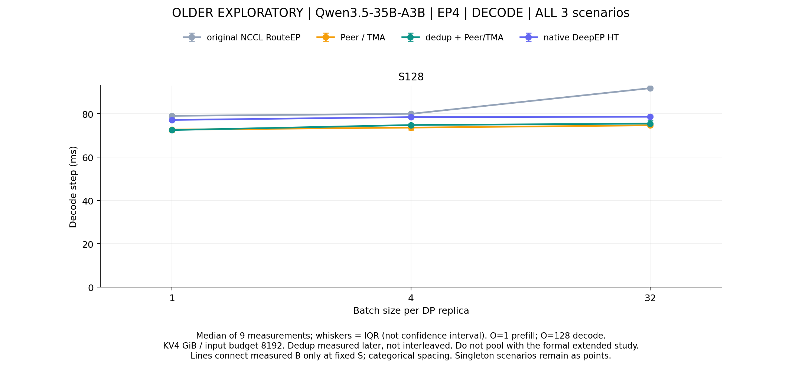

## Qwen3-30B-A3B / EP4 / prefill / pilot

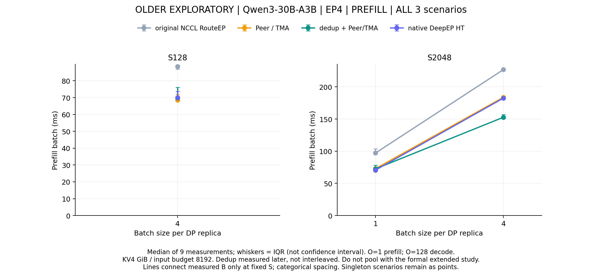

## Qwen3-30B-A3B / EP4 / decode / pilot

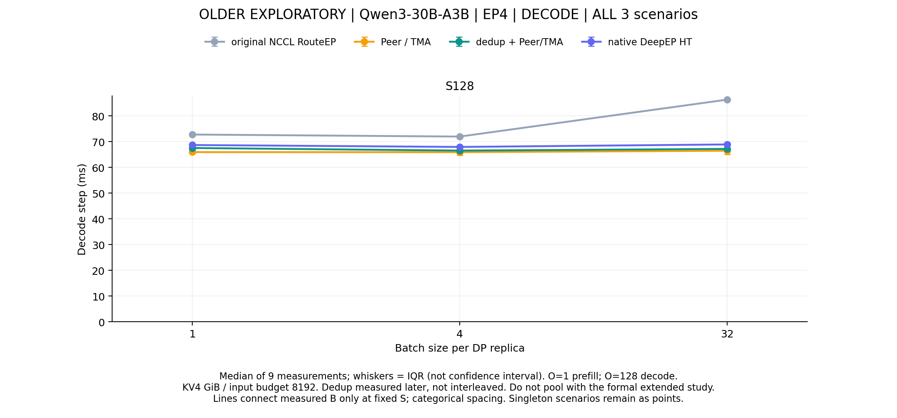

