# RouteEP H100 优化实验报告（2026-10-28）

本报告对比 RouteEP 两条通信路径（NCCL 去重、Peer/TMA 去重）与 vLLM 原生 DeepEP HT 的端到端性能，
并记录这一轮各项优化的层级收益和正确性验证。

## 1. 结论

- **同为 eager、对照 DeepEP HT 时**（4×H100，EP4 = TP2/DP2，最终版本 `11876eb`）：RouteEP **Peer/TMA 路径在全部
  6 个场景、两个模型上都不慢于 DeepEP HT**。`prefill_b4_long` 的 prefill 阶段快 18–25%，decode 每步快 3–6%，
  单条长 prefill 持平（快 1%，在噪声内）。
- **对照 DeepEP 的 decode 部署配置（LL + CUDA Graph）时，Peer 明显落后**：decode 每步慢 1.8–2.4 倍
  （第 4.5 节）。即使 LL 也跑 eager，Peer 每步仍多 15–34%（LL eager 比 Peer 少 13–25%）。所以上一条只说明“eager 下比 HT 快”，
  不能推广到 DeepEP 在 decode 上的最佳配置。prefill 在部署中本来就跑 eager，HT 是合适的对照，prefill 的结论不受影响。
- **NCCL 去重路径**在 `prefill_b4_long` 上追平或超过 HT（Qwen3 106%、Qwen3.5 101%），
  但 decode 只有 92–98%，单条长 prefill 只有 70–79%。
- 在 SM90+、单机、组内 CUDA P2P 全通的硬件上，RouteEP 现在默认自动选择 Peer（`MINIEP_TRANSPORT=auto`），
  不满足条件时退回 NCCL。
- 所有优化都和 DeepEP HT 逐位置精确对齐（Qwen3.5，EP4，NCCL 与 Peer 各 18/18 个 job）；
  两轮三方对比中，三条路径的自由生成 token 也完全一致。
- **RouteEP 的 decode 现在支持 CUDA Graph**（第 4.6 节）：`FULL_DECODE_ONLY` + 编译模式 NONE，decode 批次走
  NCCL 固定容量路径。同为 NCCL，开 graph 后 decode 每步从 85–94 ms 降到 10–20 ms。对照 DeepEP LL + Graph
  （容量 64），每步耗时是对方的 1/3.0–1/1.8；差距的来源还没完全确认。graph 与 eager 的生成 token 在
  batch-invariant 模式下逐位一致，OpenAI 服务 10 分钟混合压测 4 组配置都没有失败。

## 2. 测量方法

| 项目 | 设置 |
|---|---|
| 硬件 | 单机 4×H100 80GB HBM3（gpu5），NVLink 全互联 |
| 软件 | vLLM 0.29.0、PyTorch 2.13.0+cu130、Triton 3.7.1、NCCL 2.29.7 |
| 拓扑 | EP4 = TP2/DP2，每个 EP Rank 持有 1/4 Routed Experts |
| 模型 | Qwen3-30B-A3B（E=128、K=8、F=768）、Qwen3.5-35B-A3B（E=256、K=8、F=512，含 Shared Expert），BF16 |
| 对照 | DeepEP HT（vLLM 原生）、RouteEP NCCL 去重、RouteEP Peer/TMA 去重 |
| 统计 | `benchmarks/peer_suite.py`：每个模型 3 个 trial，三条路径在 trial 间轮换先后顺序；每 trial 预热 2 次、测量 3 次；每个样本取 4 个 Rank 中最慢者；表中为 9 个样本的中位数 |
| 相对速度 | DeepEP HT 中位延迟 ÷ 该路径中位延迟；100% 表示与 DeepEP 一样快，越高越快 |

### 对比场景

| 场景 | 每个 DP 副本的请求 | 输入长度 | 生成长度 | 主要考察 |
|---|---:|---:|---:|---|
| `decode_b1` | 1 | 128 | 128 | 单请求 decode，延迟主导 |
| `decode_b4` | 4 | 128 | 128 | 小 batch decode |
| `decode_b32` | 32 | 128 | 128 | 大 batch decode |
| `prefill_b1_long` | 1 | 2048 | 1 | 单条长 prefill |
| `prefill_b4_short` | 4 | 128 | 1 | 短 prefill |
| `prefill_b4_long` | 4 | 2048 | 1 | 长 prefill，吞吐主导 |

## 3. 优化项

| 编号 | 提交 | 内容 | 适用路径 |
|---|---|---|---|
| 1 | `9f9ff6f` | 融合 EXPERT/COMBINE：唯一行直接 gather 成 Expert-major，单 kernel 完成 slot 顺序 owner 归约与 combine，去掉中间拷贝和逐 slot FP32 循环 | NCCL |
| 2 | `9f9ff6f` | 去重固定容量 A2A（N≤256）：C=max(各 Rank Token 数)，去掉计数交换与 Host 同步 | NCCL |
| 3 | `9f9ff6f` | 分发合成 1 次 A2A：激活、int32 ID、FP32 权重打进同一字节缓冲 | NCCL |
| 6 | `62dbbca` | Grouped GEMM 按行数选 tile（BK 不变）；gate_up 与 SwiGLU 融合成一个 kernel | NCCL（Peer 的 Down 投影也受益） |
| — | `5cb7181` | Peer 移植：`bincount` 换成定长 `scatter_add_`，去掉 Peer 路径唯一的 Host 同步；Down 投影换用新 tile | Peer |
| — | `11876eb` | `MINIEP_TRANSPORT=auto` 默认值：满足条件时自动选 Peer；修复对齐判定的归约标签 | 两者 |
| 5 | `9f9ff6f`（默认关闭） | Qwen3.5 Shared Expert 放到旁路 stream | NCCL，TP=1 |

Peer 路径本来就有单 kernel 的 owner 归约和 combine、不需要 A2A、TMA Up 自带 SwiGLU epilogue，
所以第 1、3 项和 SwiGLU 融合无需移植。

### 层级收益

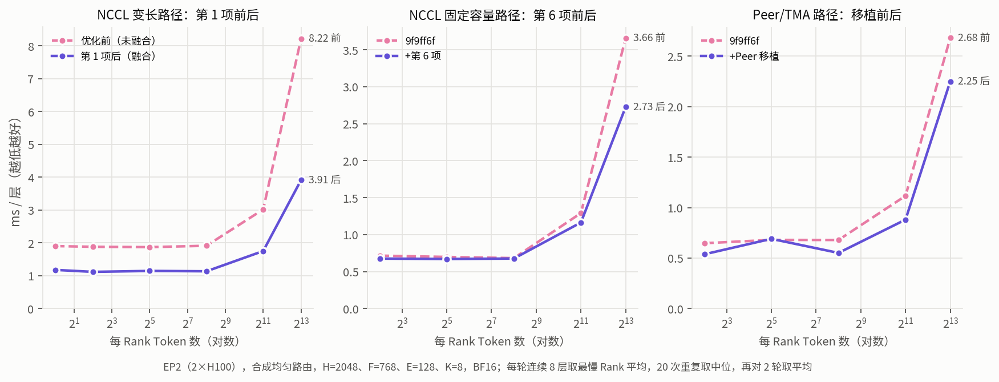

交互版：[`layer-latency.html`](layer-latency.html)（悬停或聚焦后用左右键查看每个 Token 数的数值，附数据表）。

EP2（2×H100），合成均匀路由，H=2048、F=768、E=128、K=8，BF16。每轮连续执行 8 层取最慢 Rank 平均，
20 次重复取中位，再对 2 轮取平均。

- 第 1 项：NCCL 变长路径各规模每层耗时降低 38–52%，T=8192 从 8.2 降到 3.9 ms/层。
- 第 6 项：prefill 规模 T=2048 快约 10%，T=8192 快约 30%；decode 规模在噪声内。
- Peer 移植：T=4/256/2048/8192 分别快约 20/23/27/19%；T=32 两轮结果不一致，不下结论。

## 4. 端到端结果

### 4.1 基线 `9f9ff6f`（Peer 未移植、无第 6 项）

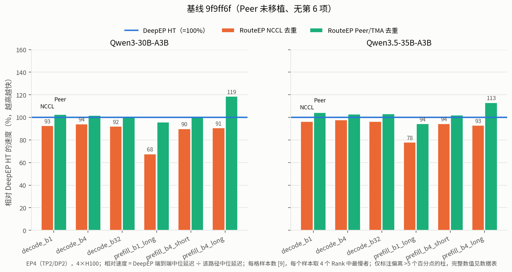

交互版：[`relative-speed-9f9ff6f.html`](relative-speed-9f9ff6f.html)。图上只标出偏离 DeepEP 超过 5 个百分点的柱，
完整数值见下表。

**Qwen3-30B-A3B**

| 场景 | DeepEP HT (ms) | NCCL 去重 (ms) | Peer/TMA (ms) | NCCL 相对 | Peer 相对 | 样本 |
|---|---:|---:|---:|---:|---:|---:|
| `decode_b1` | 8907 | 9609 | 8678 | 92.7% | 102.6% | 9 |
| `decode_b4` | 8836 | 9382 | 8693 | 94.2% | 101.6% | 9 |
| `decode_b32` | 8801 | 9557 | 8757 | 92.1% | 100.5% | 9 |
| `prefill_b1_long` | 72.2 | 106.7 | 75.3 | 67.6% | 95.8% | 9 |
| `prefill_b4_short` | 71.9 | 80.0 | 71.9 | 89.9% | 100.1% | 9 |
| `prefill_b4_long` | 185.9 | 205.2 | 156.8 | 90.6% | 118.6% | 9 |

**Qwen3.5-35B-A3B**

| 场景 | DeepEP HT (ms) | NCCL 去重 (ms) | Peer/TMA (ms) | NCCL 相对 | Peer 相对 | 样本 |
|---|---:|---:|---:|---:|---:|---:|
| `decode_b1` | 9921 | 10307 | 9527 | 96.3% | 104.1% | 9 |
| `decode_b4` | 9941 | 10172 | 9658 | 97.7% | 102.9% | 9 |
| `decode_b32` | 10065 | 10434 | 9754 | 96.5% | 103.2% | 9 |
| `prefill_b1_long` | 95.2 | 122.0 | 100.9 | 78.0% | 94.3% | 9 |
| `prefill_b4_short` | 95.7 | 101.3 | 93.9 | 94.5% | 101.9% | 9 |
| `prefill_b4_long` | 170.5 | 183.6 | 150.8 | 92.9% | 113.1% | 9 |

三条路径的自由生成 token 完全一致。

### 4.2 新提交 `11876eb`（第 6 项 + Peer 移植）

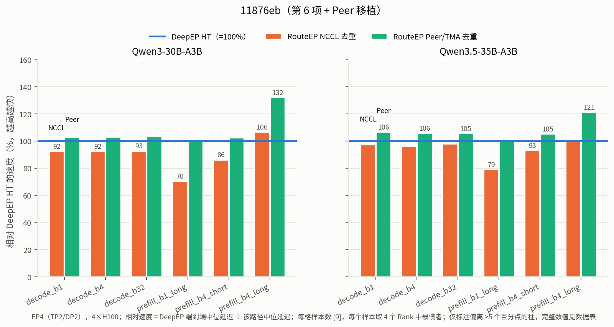

交互版：[`relative-speed-11876eb.html`](relative-speed-11876eb.html)。两张相对速度图使用相同的 y 轴范围，可以直接并排比较。

**Qwen3-30B-A3B**

| 场景 | DeepEP HT (ms) | NCCL 去重 (ms) | Peer/TMA (ms) | NCCL 相对 | Peer 相对 | 样本 |
|---|---:|---:|---:|---:|---:|---:|
| `decode_b1` | 8756 | 9479 | 8541 | 92.4% | 102.5% | 9 |
| `decode_b4` | 8674 | 9393 | 8434 | 92.3% | 102.8% | 9 |
| `decode_b32` | 8744 | 9447 | 8477 | 92.5% | 103.1% | 9 |
| `prefill_b1_long` | 72.3 | 102.9 | 71.7 | 70.2% | 100.8% | 9 |
| `prefill_b4_short` | 71.0 | 82.5 | 69.4 | 86.1% | 102.3% | 9 |
| `prefill_b4_long` | 185.9 | 174.7 | 141.0 | 106.4% | 131.9% | 9 |

**Qwen3.5-35B-A3B**

| 场景 | DeepEP HT (ms) | NCCL 去重 (ms) | Peer/TMA (ms) | NCCL 相对 | Peer 相对 | 样本 |
|---|---:|---:|---:|---:|---:|---:|
| `decode_b1` | 10002 | 10284 | 9392 | 97.3% | 106.5% | 9 |
| `decode_b4` | 10023 | 10422 | 9482 | 96.2% | 105.7% | 9 |
| `decode_b32` | 10221 | 10457 | 9705 | 97.7% | 105.3% | 9 |
| `prefill_b1_long` | 96.2 | 122.0 | 95.2 | 78.9% | 101.0% | 9 |
| `prefill_b4_short` | 95.9 | 103.2 | 91.2 | 92.9% | 105.2% | 9 |
| `prefill_b4_long` | 170.5 | 169.1 | 140.9 | 100.8% | 121.0% | 9 |

三条路径的自由生成 token 完全一致。

### 4.3 基线与新提交对比

两轮测量中 DeepEP HT 自身的绝对延迟相差约 1–2%，所以这里比较的是同一轮内部算出的相对速度；
“延迟变化”是同一路径在两轮之间的中位延迟变化，负数表示更快。

**Qwen3-30B-A3B**

| 场景 | NCCL 基线 → 新 | Peer 基线 → 新 | NCCL 延迟变化 | Peer 延迟变化 |
|---|---:|---:|---:|---:|
| `decode_b1` | 92.7% → 92.4% | 102.6% → 102.5% | -1.4% | -1.6% |
| `decode_b4` | 94.2% → 92.3% | 101.6% → 102.8% | +0.1% | -3.0% |
| `decode_b32` | 92.1% → 92.5% | 100.5% → 103.1% | -1.1% | -3.2% |
| `prefill_b1_long` | 67.6% → 70.2% | 95.8% → 100.8% | -3.5% | -4.7% |
| `prefill_b4_short` | 89.9% → 86.1% | 100.1% → 102.3% | +3.1% | -3.5% |
| `prefill_b4_long` | 90.6% → 106.4% | 118.6% → 131.9% | -14.9% | -10.1% |

**Qwen3.5-35B-A3B**

| 场景 | NCCL 基线 → 新 | Peer 基线 → 新 | NCCL 延迟变化 | Peer 延迟变化 |
|---|---:|---:|---:|---:|
| `decode_b1` | 96.3% → 97.3% | 104.1% → 106.5% | -0.2% | -1.4% |
| `decode_b4` | 97.7% → 96.2% | 102.9% → 105.7% | +2.5% | -1.8% |
| `decode_b32` | 96.5% → 97.7% | 103.2% → 105.3% | +0.2% | -0.5% |
| `prefill_b1_long` | 78.0% → 78.9% | 94.3% → 101.0% | -0.0% | -5.6% |
| `prefill_b4_short` | 94.5% → 92.9% | 101.9% → 105.2% | +1.9% | -2.9% |
| `prefill_b4_long` | 92.9% → 100.8% | 113.1% → 121.0% | -7.9% | -6.6% |

解读：

- **收益集中在长 prefill。** 第 6 项（按行数选 tile、SwiGLU 融合）主要作用于大行数的 Grouped GEMM，
  `prefill_b4_long` 两条路径的延迟降了 7–15%，和层级 bench 里 T=8192 快约 30% 的方向一致
  （端到端还包含 Attention 等不受影响的部分，所以幅度更小）。
- **Peer 的单条长 prefill 追平。** Peer 在 `prefill_b1_long` 上从 94–96% 提到 101%，延迟降了 4.7–5.6%。
  这一轮同时包含两处改动（去掉 Host 同步、Down 换新 tile），没有拆开测，不能确定各自贡献多少。
- **decode 变化很小**（两条路径的延迟变化都在 −3.2% 到 +2.5% 之间）。decode 规模的 Grouped 计划
  从 128×128 换成了 64×64，但层级 bench 在这个规模上本身就看不出差别。Qwen3.5 Peer decode 的
  相对速度涨了 2–3 个点，其中 Peer 自身延迟只降了 0.5–1.8%，其余来自两轮之间 DeepEP 自身约 1–2% 的漂移，
  不应全部算作优化收益。
- **NCCL `prefill_b4_short` 略降**（Qwen3 89.9% → 86.1%，延迟 +3%；Qwen3.5 94.5% → 92.9%）。
  这个场景每 Rank 256 Token，走固定容量路径，Grouped 计划落在 64×128 这一档；但同一档的层级 bench
  （T=256，固定容量，EP2，两轮交替）没有变慢（0.682 → 0.676 ms/层），倾向于判断为噪声，没有单独复测。
  Peer 在同一场景上是 102–105%，不受影响。

### 4.4 按阶段对比（`11876eb`）

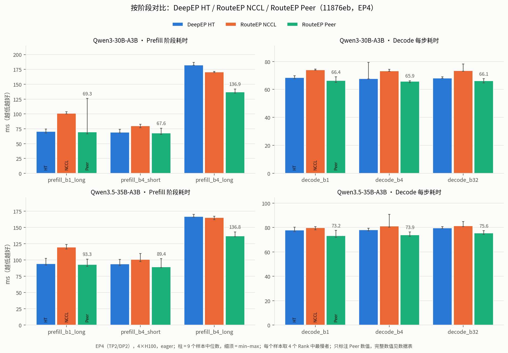

交互版：[`phase-latency-11876eb.html`](phase-latency-11876eb.html)，数据表：[`table-phase-11876eb.md`](table-phase-11876eb.md)。

把端到端拆成两个阶段：prefill 场景只看 prefill 阶段耗时（首次调度到最后一个首 Token），decode 场景只看每步耗时。
数据与 4.2 相同（同一台空闲 4×H100、三条路径交替、每格 9 个样本），柱为中位数，细须为 min–max。
两个阶段量级不同，各用一条 y 轴，分成两列小图。

| Peer 相对 HT 的阶段耗时 | Qwen3 | Qwen3.5 |
|---|---:|---:|
| `prefill_b1_long` | −1.4% | −1.0% |
| `prefill_b4_short` | −2.3% | −4.9% |
| `prefill_b4_long` | −24.9% | −17.9% |
| `decode_b1` / `b4` / `b32` | −2.9% / −2.7% / −2.9% | −6.1% / −5.5% / −5.1% |

负数表示 Peer 更快。`prefill_b4_long` 的 min–max 区间与 HT 不重叠；decode 幅度小，但两个模型、三个场景方向一致。

### 4.5 部署基线：decode 对照 DeepEP LL + CUDA Graph

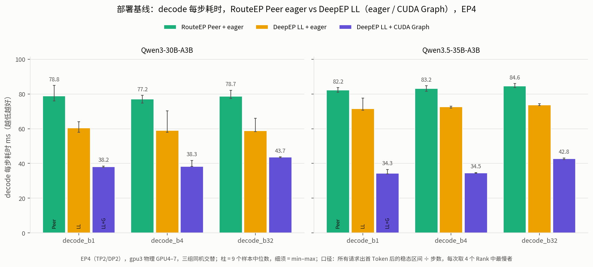

交互版：[`deploy-baseline-ep4.html`](deploy-baseline-ep4.html)，数据表：[`table-deploy-baseline-ep4.md`](table-deploy-baseline-ep4.md)。

DeepEP HT 在 DP>1 时 vLLM 不允许开 CUDA Graph，而 decode 实际部署通常用 LL + Graph。为了回答“离 DeepEP 的
decode 最佳配置还差多少”，另做了一组三方对比：

| 项目 | 设置 |
|---|---|
| 硬件 | gpu3 物理 GPU4–7（4×H100，NVLink 全互联），运行期间卡上无其他进程 |
| 拓扑 | EP4 = TP2/DP2，与 4.2 相同 |
| 三组 | RouteEP Peer + eager（默认调度）；DeepEP LL + eager；DeepEP LL + `FULL_DECODE_ONLY` graph |
| LL 设置 | 512 Token 调度预算 + chunked prefill（`max_tokens_per_rank=512`），BF16 分发，每层实测为 `DeepEPLLAll2AllManager` |
| 场景 | decode_b1 / b4 / b32，两个模型 |
| 统计 | 每模型 3 个 trial、trial 间轮换顺序，每 job 预热 2 次、测量 3 次，每格 9 个样本 |
| 口径 | 所有请求都出首 Token 后的稳态区间 ÷ (步数−1)，每次取 4 个 Rank 中最慢者 |

| decode 每步（ms，中位数） | Peer + eager | LL + eager | LL + Graph | Peer ÷ LL+Graph |
|---|---:|---:|---:|---:|
| Qwen3 `decode_b1` | 78.8 | 60.5 | 38.2 | 2.07× |
| Qwen3 `decode_b4` | 77.2 | 59.1 | 38.3 | 2.01× |
| Qwen3 `decode_b32` | 78.7 | 58.8 | 43.7 | 1.80× |
| Qwen3.5 `decode_b1` | 82.2 | 71.6 | 34.3 | 2.40× |
| Qwen3.5 `decode_b4` | 83.2 | 72.5 | 34.5 | 2.41× |
| Qwen3.5 `decode_b32` | 84.6 | 73.7 | 42.8 | 1.98× |

解读：

- **差距主要来自 CUDA Graph。** LL 从 eager 换到 graph 后每步快了 1.3–2.1 倍；Peer 与 LL 同为 eager 时每步多 15–34%。
  decode 每步要下发几百个小 kernel，eager 下 CPU 下发开销被完全暴露。
- **口径说明。** LL 开了 chunked prefill，decode_b32 的 32×128 个 prompt Token 要分 8 步才能 prefill 完；
  原来的“从最早首 Token 起算”口径会把这部分算进 decode，使 LL 偏慢。这里改用稳态口径，从已保存的
  每请求时间戳重算，未重跑；b1/b4 两种口径数值相同。
- **两张图不能比绝对值。** 本组 Peer 每步 77–85 ms，4.2 中（gpu5）是 66–76 ms。两台机器的 CPU 负载不同
  （gpu3 load 约 20，gpu5 约 5），eager 对 CPU 下发更敏感。只比较同一组内部的相对差距。
- **未覆盖 v2。** DeepEP v2 + graph 在本环境启动即失败（`NCCL exception … DOCA Error 21`），没有数据。
- **未覆盖 prefill。** prefill 不使用 CUDA Graph，部署时仍用 HT/eager，沿用 4.2 与 4.4 的数据。

### 4.6 RouteEP decode 开 CUDA Graph

**做法。** `engine_options(cudagraph_capture_sizes=[...])`（服务入口为 `test/serve.py --cudagraph-capture-sizes ...`）
设置 `compilation_config = {mode: NONE, cudagraph_mode: FULL_DECODE_ONLY}`：只有 decode 批次被整模型 capture，
prefill 仍 eager。编译模式 NONE 时 vLLM 的 `set_splitting_ops_for_v1` 提前返回，不会执行“HT 后端 + DP&gt;1 关闭 graph”的规则。
graph 模式下 Runner 强制 transport=nccl（Peer 路径的 epoch 是 Host 标量，还不能 capture），capture size 必须 ≤ 256，
保证 decode 批次都走无 Host 同步的固定容量 A2A；如果 capture 时走到变长路径，Runner 直接报错。

**数据。** 同一组卡（gpu3 物理 GPU4–7）上五组交替运行，每格 9 个样本，口径同 4.5（稳态每步，取 4 个 Rank 中最慢者）。
LL 的容量取 64（覆盖最大 capture size），见下方说明。

| decode 每步（ms，中位数） | DeepEP HT eager | RouteEP Peer eager | RouteEP NCCL eager | **RouteEP NCCL + Graph** | DeepEP LL + Graph（容量 64） |
|---|---:|---:|---:|---:|---:|
| Qwen3 `decode_b1` | 79.6 | 74.9 | 85.1 | **10.4** | 30.9 |
| Qwen3 `decode_b4` | 79.1 | 74.3 | 84.7 | **10.5** | 30.9 |
| Qwen3 `decode_b32` | 79.3 | 75.2 | 85.2 | **15.3** | 37.9 |
| Qwen3.5 `decode_b1` | 87.7 | 81.5 | 91.4 | **12.4** | 26.7 |
| Qwen3.5 `decode_b4` | 88.8 | 82.5 | 92.2 | **13.4** | 27.0 |
| Qwen3.5 `decode_b32` | 89.4 | 83.8 | 94.0 | **19.4** | 34.8 |

同一轮 prefill（eager，与 4.2 口径一致）：`prefill_b4_long` 上 Peer 比 HT 快 17–23%（127.6 对 165.6 ms、127.4 对 152.8 ms）；
NCCL 的 `prefill_b1_long` 比 HT 慢 23–42%。原始数据：`data/full-suite-ep4.json`（五组）与 `data/llcap-ep4.json`（LL 容量 64）。

解读：

- **graph 是 decode 的主要收益。** 同为 NCCL 路径，开 graph 后每步降到原来的 1/8.2–1/4.8；eager 下 batch 1→32
  每步几乎不变，说明 eager 的瓶颈是 CPU 下发。
- **对照 LL + Graph，差距还没完全解释。** Nsys（Qwen3 `decode_b4`，LL 容量 512）显示 LL 的时间集中在 vLLM 的
  batched Triton Expert kernel（每层 2 次，各约 245 µs），DeepEP dispatch/combine 每层合计约 20 µs；RouteEP 每层 MoE 约 70 µs。
  batched 格式会按容量补齐，所以把 LL 的容量从 512 降到 64：每步快了 14–22%，但仍是 RouteEP 的 1.8–3.0 倍。
  剩余差距是否来自 batched 格式的固定开销（例如每层单独的激活和填零 kernel），需要容量 64 下的 Nsys 复核。
- **4.5 的 LL + Graph 数值用的是容量 512**，这里的 64 更公平；两节的 LL 数值不要混用。

**正确性。**

- 三组 eager（HT、Peer、NCCL）的生成 token 完全一致（144/144 个 (model, rank, case, rep)）。
- RouteEP graph 与 eager：默认设置下 b1/b4 会在第 1–14 个 token 开始分歧，DeepEP LL graph 对 LL eager 也一样；
  开 `VLLM_BATCH_INVARIANT=1`（FlashAttention 不按 graph 设置 split）后 24/24 完全一致，所以分歧来自 attention
  在 graph 下的累加顺序，不是 RouteEP。
- 不用 vLLM 的探针 `checks/graph_capture_probe.py`（EP4，N=1/4/32）：capture 后回放与 eager 逐位一致。

**服务稳定性。** `test/serve.py` 启动 OpenAI 服务（TP2/DP2/EP4，`max_num_seqs=32`），先跑 `test/service_check.py`，
再跑 10 分钟 `test/service_stress.py`（16 路并发；短请求、单副本超过 256 Token 的长 prompt、采样、流式中途断开、
重复的贪心请求，并发数来回波动以制造单侧 DP 空闲）。

| 配置 | 请求数 | 失败 | 结束后 `/health` | 同一贪心请求的不同输出 |
|---|---:|---:|---|---:|
| Qwen3，eager（auto → Peer） | 3430 | 0 | 正常 | 1 |
| Qwen3，graph（NCCL） | 5747 | 0 | 正常 | 1 |
| Qwen3.5，eager（auto → Peer） | 2940 | 0 | 正常 | 1 |
| Qwen3.5，graph（NCCL） | 4921 | 0 | 正常 | 1 |

每组服务日志都有一行 `Failed to initialize FlashInfer All Reduce workspace`（vLLM 随后用其它 all-reduce 后端），
没有 Traceback、CUDA 或 NCCL 错误，服务进程在压测结束时都存活。结果：`data/serve-stress/`。

### 4.7 规模扫描（折线图）

同一组卡（gpu3 物理 GPU4–7）上交替运行，每个点 9 个样本，每个样本取 4 个 Rank 中最慢者。
prefill：每个 DP 副本 4 条请求，单条长度 128–4096，三组 eager。decode：每个 DP 副本 batch 1–64，输入 128、**生成 64**
（与前几节的 128 不同，数值不要混用）；开 graph 的对比（DeepEP LL + Graph 容量 64 / RouteEP NCCL + Graph）单独成图，
eager 三组作为参照。数据表：[`table-scaling-ep4.md`](table-scaling-ep4.md)，原始数据：`data/sweep-ep4.json`。

| Prefill | Decode（开 CUDA Graph） | Decode（eager） |
|---|---|---|
| 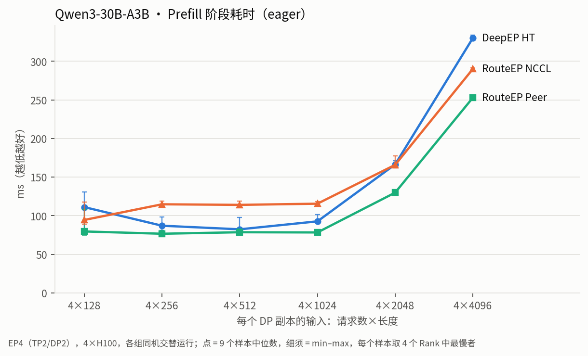 | 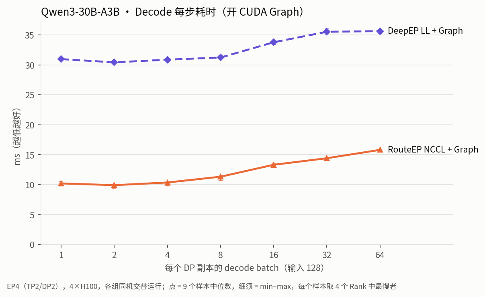 | 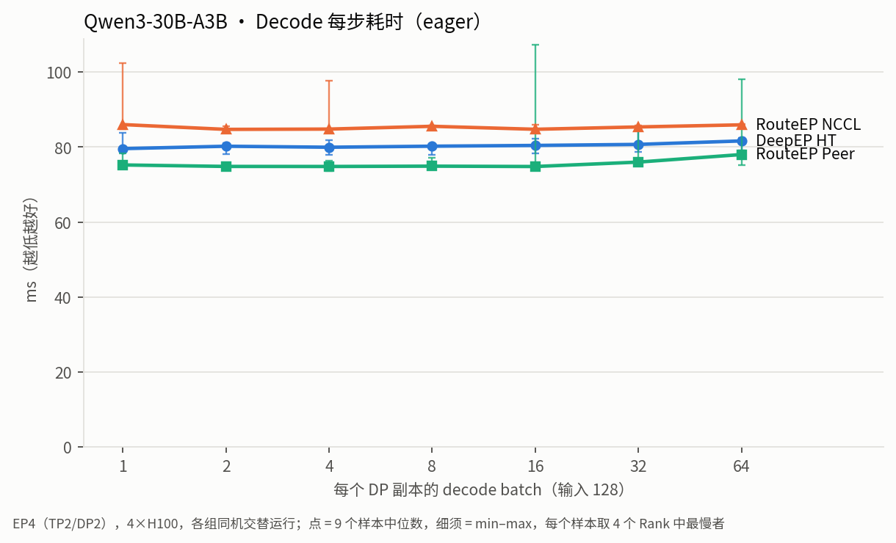 |
| 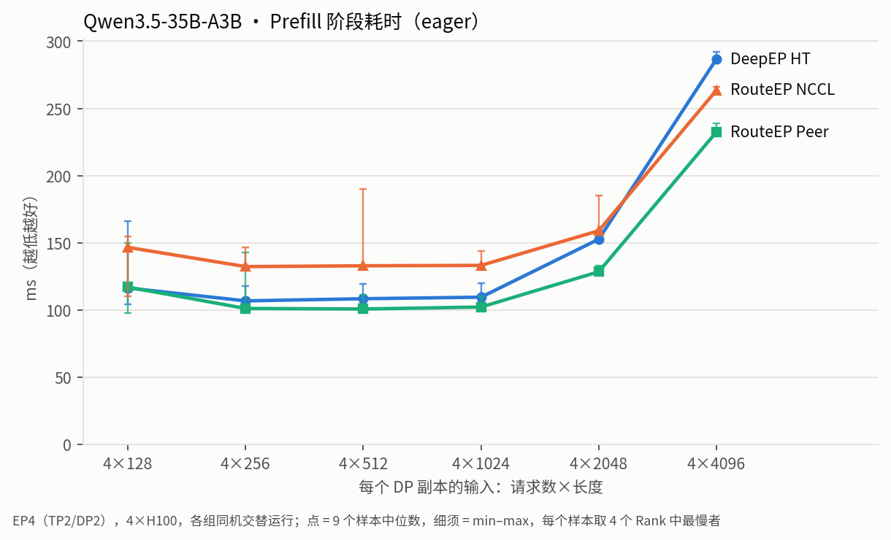 | 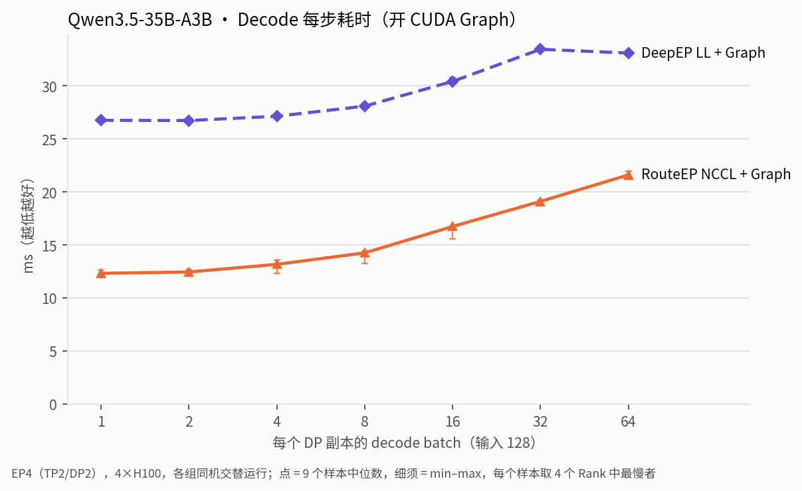 | 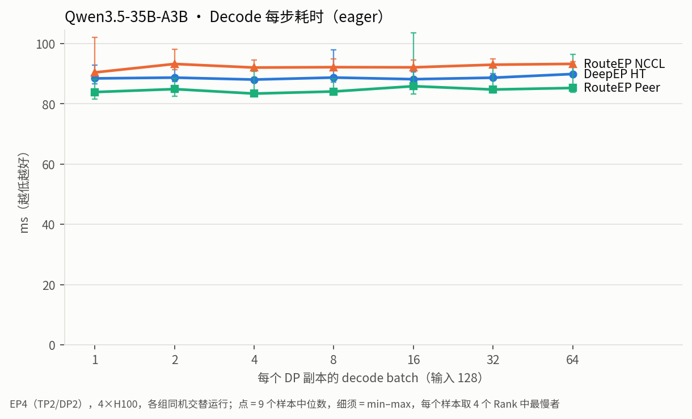 |

- **decode 开 graph**：RouteEP 每步 9.9–15.8 ms（Qwen3）、12.3–21.6 ms（Qwen3.5）；LL + Graph 是 RouteEP 的 2.3–3.1 倍、1.5–2.2 倍，
  batch 越大倍数越小，但两者每步的绝对差（11–21 ms）大部分与 batch 无关。
- **decode eager**：三组每步几乎不随 batch 变化（batch 1→64 变化不超过 2.8 ms）；Peer 比 HT 低 3–7%，NCCL 比 HT 高 2–8%。
- **prefill**：Peer 在 4×4096 时比 HT 快 23%（Qwen3）、19%（Qwen3.5）。NCCL 在 4×256 到 4×1024 基本持平，比 HT 高 22–38%
  （每 Rank 超过 256 Token 后走变长 A2A），到 4×4096 时比 HT 快 8–12%。4×128 的 HT 波动很大，不作结论。
- eager 三组的生成 token 完全一致（312/312）。

## 5. 正确性

| 验证 | 结果 |
|---|---|
| Qwen3.5 EP4 精确对齐，NCCL 路径（含第 1–3、6 项），对照 DeepEP HT | 18/18 通过 |
| Qwen3.5 EP4 精确对齐，Peer 路径（含移植），对照 DeepEP HT | 18/18 通过 |
| 对齐覆盖 | same、rotated×3、boundaries、long（256 token）、performance；种子 13/37/123；生成 token 与 teacher-forced logits 逐元素相等 |
| 单元测试 | 全部通过（含 tile 逐位测试、`auto` 判定表、真实硬件探测） |
| `checks/peer_dedup.py` | 78 例通过 |
| `checks/nccl_dedup.py --peer-smoke` | NCCL 与 Peer 逐元素一致 |

对齐脚本原来写死要求 `local_fp32` 归约标签，所有去重路径都会被误判失败；本轮已改成按 transport
分别检查（`11876eb`），数值比对本身没有放宽。

## 6. 遗留问题

- **decode graph 已支持 NCCL 路径（4.6），以下仍未解决**：
  - Peer 路径不能 capture：epoch 是 Host 标量、工作区按需分配；需要改成设备端计数并预建工作区。
  - 与 DeepEP LL + Graph（容量 64）的差距来源未完全确认，需要容量 64 下的 Nsys 复核。
  - capture 过 c10d NCCL A2A 后，`destroy_process_group` 会一直等待；`benchmarks/deepep_latency_run.py` 在 RouteEP graph
    模式下结果落盘后直接退出绕开（这部分改动和 graph 模式的计时参数还在工作区，未提交），根因未修。服务进程用 SIGTERM 停止时不受影响。
  - 开 Nsys `--cuda-graph-trace=node` 跑 RouteEP graph 时，第 3 次测量后出现 `unspecified launch failure`；
    不开 Nsys 的全部运行正常，原因未查。
- **NCCL 单条长 prefill**：NCCL 路径在 `prefill_b1_long` 上只有 DeepEP 的 70–79%，而 Peer 已到 101%，
  说明差距在 NCCL 的通信路径（该场景每 Rank 约 1024 Token，超过固定容量门槛 256，走变长路径，
  有计数交换和 Host 同步）。默认已选 Peer，NCCL 只在不支持 Peer 的硬件上使用，优先级较低。
- **NCCL `prefill_b4_short` 约 −3%**：见 4.3，倾向于噪声，未复测确认。
- **第 5 项变慢**：Shared Expert 旁路 stream 实测 decode 每步慢约 8 ms，已默认关闭，未抓 Nsys Timeline 定位。
- **第 7 项**：RTX4090 上 A2A 异常耗时需要那台机器，未开始。
- **DeepEP v2**：在本环境启动失败（`DOCA Error 21`），未能作为对照。
- **EP2 与 DeepEP**：EP2（TP1/DP2）下 HT 起不来，所以第 6 项和 Peer 移植的 DeepEP 对比只有 EP4 数据。
  在 gpu1 上做过一组 EP2 的部署基线，但卡上有约 30–98% 的外部负载，数据未采用。

## 7. 复现

```bash
# 三方对比（4×H100）
python3 benchmarks/peer_suite.py --models /models/Qwen3-30B-A3B --manifest-dir <dir> \
  --output <out> --trials 3 --warmup 2 --repeats 3
# 精确对齐（4×H100），--transport nccl|peer
python3 test/deepep_alignment.py --model /models/Qwen3.5-35B-A3B --output <out> \
  --checkpoint-manifest <manifest> --transport peer
# 层级 bench（2×H100），--transport nccl|peer，--fixed 打开固定容量
torchrun --standalone --nproc-per-node=2 benchmarks/dedup_layer_bench.py --output <json>
# 生成本报告的图和表
python3 benchmarks/plot_opt_report.py --report reports/h100-opt-20261028
python3 benchmarks/html_opt_report.py --report reports/h100-opt-20261028
python3 benchmarks/html_layer_report.py --report reports/h100-opt-20261028
python3 benchmarks/plot_phase_report.py --report reports/h100-opt-20261028 --label 11876eb
python3 benchmarks/plot_deploy_report.py --report reports/h100-opt-20261028
# 规模扫描折线图（汇总 JSON 格式见脚本 docstring）
# 输出 <model>-<panel>.png；本报告里的文件名加了 scaling- 前缀
python3 benchmarks/plot_scaling_lines.py --inputs reports/h100-opt-20261028/data/sweep-ep4.json --out <dir>
# 服务稳定性（4×H100；graph 时加 --cudagraph-capture-sizes 1 2 4 8 16 32 64）
python3 test/serve.py --model <model> --backend miniep --dp-size 2 --max-num-seqs 32
python3 test/service_stress.py --url http://127.0.0.1:8133 --duration 600 --concurrency 16 --output <json>
# 部署基线单个 job（4×H100，native LL + graph；Peer 组去掉 --all2all-backend/--execution-mode，改为 --backend miniep --transport peer）
torchrun --standalone --nproc-per-node=4 benchmarks/deepep_latency_run.py --model <model> \
  --checkpoint-manifest <manifest> --backend native --all2all-backend deepep_low_latency \
  --execution-mode full-decode-only --max-num-batched-tokens 512 --enable-chunked-prefill \
  --cases decode_b1 decode_b4 decode_b32 --label <label> --output <out>
```

原始数据：`data/`（三方对比样本、层级 bench JSON、部署基线的稳态 decode 样本 `deploy-baseline-expC-ep4.json`）。
