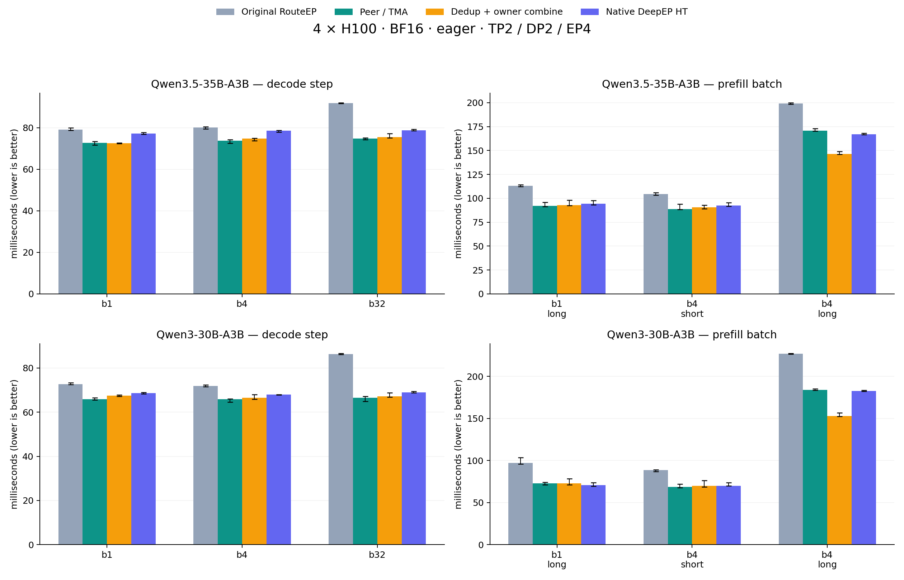

# H100：Peer/TMA 与 Token-owner 去重实测

原实现按 Expert 分支重复发送输入和返回输出的问题已确认。新增去重路径按 Token/目标 GPU 传一份输入，卡内展开给 Expert，并在目标卡按原精度规则先合并，再返回一个 owner 部分和。

长 prefill（每 DP 副本 B=4、S=2048）的主要结果：

- Qwen3.5-35B-A3B：170.7 → 146.5 ms，比仅 Peer/TMA 低 14.2%，比 DeepEP HT 低 12.2%。
- Qwen3-30B-A3B：183.8 → 152.8 ms，比仅 Peer/TMA 低 16.9%，比 DeepEP HT 低 16.3%。

Decode 与小请求没有普遍收益，部分中位值比仅 Peer/TMA 慢约 1%–2.4%；完整数据如下。

本报告的“仅融合”对应本次 Peer/TMA 路径。原 NCCL、仅 Peer/TMA 和 DeepEP HT 的 18 次独立引擎运行已完成；之后只补测去重路径的精度和六次整模型性能运行，没有追加微基准或 Timeline。



每项为九个样本的中位数：三个独立引擎 × 每引擎三次测量；每个样本取最大 Rank 延迟。误差线为样本 25%–75% 分位。正百分比表示去重路径延迟降低，负数表示变慢。

| 模型 | 案例 | 原 NCCL (ms) | 仅 Peer/TMA (ms) | 去重＋Peer/TMA (ms) | DeepEP HT (ms) | 去重比仅 Peer | 去重比 DeepEP |
|---|---|---:|---:|---:|---:|---:|---:|
| Qwen3.5-35B-A3B | decode_b1 | 79.090 | 72.743 | 72.539 | 77.205 | +0.3% | +6.0% |
| Qwen3.5-35B-A3B | decode_b4 | 80.033 | 73.667 | 74.854 | 78.503 | -1.6% | +4.6% |
| Qwen3.5-35B-A3B | decode_b32 | 91.867 | 74.715 | 75.507 | 78.672 | -1.1% | +4.0% |
| Qwen3.5-35B-A3B | prefill_b1_long | 112.986 | 91.950 | 92.998 | 94.374 | -1.1% | +1.5% |
| Qwen3.5-35B-A3B | prefill_b4_short | 104.460 | 88.658 | 90.792 | 92.546 | -2.4% | +1.9% |
| Qwen3.5-35B-A3B | prefill_b4_long | 199.081 | 170.750 | 146.479 | 166.846 | +14.2% | +12.2% |
| Qwen3-30B-A3B | decode_b1 | 72.748 | 65.918 | 67.514 | 68.671 | -2.4% | +1.7% |
| Qwen3-30B-A3B | decode_b4 | 71.952 | 65.896 | 66.515 | 67.930 | -0.9% | +2.1% |
| Qwen3-30B-A3B | decode_b32 | 86.301 | 66.447 | 67.169 | 68.898 | -1.1% | +2.5% |
| Qwen3-30B-A3B | prefill_b1_long | 97.204 | 72.952 | 72.632 | 70.708 | +0.4% | -2.7% |
| Qwen3-30B-A3B | prefill_b4_short | 88.503 | 68.483 | 69.784 | 69.962 | -1.9% | +0.3% |
| Qwen3-30B-A3B | prefill_b4_long | 226.872 | 183.829 | 152.764 | 182.550 | +16.9% | +16.3% |

Decode 行统计每步延迟：每 DP 副本 B=1/4/32，输入 128 Token，生成 128 Token。Prefill 行统计批次 prefill 延迟：B1×2048、B4×128、B4×2048，生成 1 Token。两个 DP 副本使用不同文本；各路径的字面输入、生成长度和 seed 一致。完整请求耗时保存在 combined-summary.json 的 e2e_ms 与原始样本。

## 重复传输确认

使用实际 CPU-capable 打包函数执行 E=256、EP=2、Top-8 示例，得到 send_splits=[4,4]，Rank 1 的 Expert ID 为 [128,129,130,131]，输入是四份 [1,2]。当前 Peer 的发送/返回也按 branch 定位，具有同样冗余。

| 单个 Token 在远端 GPU 的大向量载荷 | 分支路径 | 去重＋目标卡合并 |
|---|---:|---:|
| 分发 | 16 KiB | 4 KiB |
| 返回 | 16 KiB | 4 KiB |
| 往返 | 32 KiB | 8 KiB |

这里是 H=2048、BF16 的有效大向量逻辑载荷，不含路由 metadata、就绪信号和链路协议开销。默认短 decode 的 NCCL 固定容量路径还包含 padding；该示例 C=8 时，其远端大向量往返缓冲为 64 KiB。不同真实路由的去重比例不同。

## 精度

去重核心在 EP=2/4 的 240 个 Rank 级数值案例中与当前 Peer 输出逐元素相等；另有 4 组 owner 归约检查通过。PyTorch Reference 的最大绝对误差为 0，检查容差 atol=0.02、rtol=0.03。包含 Top-1/2/8、H=128/256/2048、空来源/Expert、倾斜路由和连续输入变化。

owner 内保留原 slot 顺序，以 FP32 累加已舍入的 BF16 分支，再舍入一次为 BF16。来源卡按 owner rank 升序以 FP32 加和后转 BF16。专门检查 [1,2,3,4] → 10、[256,1,-256,1] → 2，避免错误地逐次以 BF16 归约。

整模型精度口径为相同请求的生成 Token：去重路径与当前 Peer 的 170,820 个生成位置全部一致（含重复测量样本，排除 TP 副本重复计数）。此前三方原始结果也全部一致。详见 accuracy-summary.json、supplement-audit.json 和逐 Rank 原始记录。

## 实验条件与复现

同一台 gpu5、同一组四张 H100 80GB HBM3、同一镜像、BF16/eager、TP=2/DP=2/EP=4，CPU 配额 8 vCPU，KV Cache 固定 4 GiB。每案例预热两次，另有三秒 GPU 时钟预热，再测量三次。权重 lazy 加载；模型加载、首次 JIT、预热和测量边界同步不计入 steady-state。

原三方按三轮轮换运行顺序。去重版为随后补测，未与旧版重新交替；软件、配置、checkpoint、GPU UUID/驱动、输入和生成 Token 均逐项核对。短请求的微小差异应结合误差线和原始样本阅读。

输入就绪由 per-Tile metadata release/acquire 交接；卡内展开后复用相同 TMA Up/SwiGLU 和 weighted Down。归约位置和就绪信号粒度随去重实现一起变化，表格是整个新路径的组合效果，不将全部收益归因于浮点载荷字节数。

实现、信号/缓冲区生命周期与启动命令见 [Peer 实验说明](../../PEER.md)。新路径使用 MINIEP_TRANSPORT=peer_dedup，当前路径为 peer，原 NCCL 路径仍是默认。

```bash
cd routeep
# 定向精度：2 / 4 张 H100。
 torchrun --standalone --nproc-per-node=2 checks/peer_dedup.py --output results/dedup-ep2
 torchrun --standalone --nproc-per-node=4 checks/peer_dedup.py --output results/dedup-ep4

# 只补测去重版，复用已完成的三方对照目录。
python3 benchmarks/peer_dedup_suite.py \
  --models /models/Qwen3.5-35B-A3B /models/Qwen3-30B-A3B \
  --manifest-dir /experiment --baseline /experiment/three-way-final \
  --output results/dedup-performance
```

数据索引：comparison.json 为表格数据，combined-summary.json 包含完整请求耗时与原始统计；raw-results.tgz 保存逐 Rank 样本、实际后端证明、软件版本、配置、checkpoint 和源码哈希；accuracy-results.tgz 保存定向精度与重复传输复现结果。未将失败或弃用的试运行纳入上述统计。

软件：vllm 0.29.0, torch 2.13.0+cu130, triton 3.7.1, transformers 5.16.1, deep_ep 2.0.0+local；PyTorch CUDA 13.0 / NCCL 2.29.7。vLLM PyNccl 的版本另见启动日志。

实测源码快照：[仅 Peer/TMA](../../../artifacts/routeep_tile_pipeline_20261025/measured-source.tgz)、[去重版](../../../artifacts/routeep_tile_pipeline_20261025/dedup-measured-source.tgz)。旧基线第一组运行期间仅新增了其未执行的 Peer TMA 可见性屏障；原 NCCL 执行代码保持一致。源码差异及核对结果见 baseline-audit.json、local-source-audit.json、dedup-source-audit.json。
